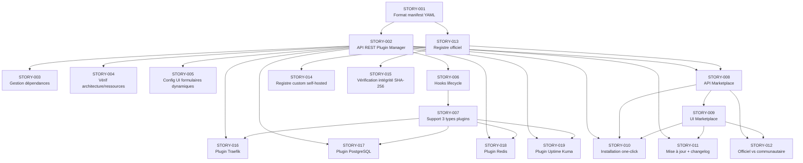

# EPIC-001 : Système de Plugins & Marketplace

**Statut :** TODO
**Priorité :** Haute
**Phase Roadmap :** 2 — Q2 2026 (Avril–Juin)
**Version cible :** 1.1

## Vision

Le système de plugins est la **brique fondatrice** de l'extensibilité de WindFlow. Sans lui, WindFlow reste un gestionnaire Docker classique. Avec lui, WindFlow devient une plateforme extensible où chaque utilisateur compose son infrastructure en installant uniquement les briques dont il a besoin — depuis une marketplace claire et accessible.

L'objectif est de livrer :
1. Un **Plugin Manager** capable d'installer, configurer, mettre à jour et désinstaller des plugins depuis l'UI et la CLI.
2. Une **Marketplace** browsable avec catalogue, catégories, fiches détaillées et installation one-click.
3. Un **Registre de plugins** (officiel + support self-hosted) avec vérification d'intégrité.
4. Les **4 premiers plugins** validant le système de bout en bout.

### Valeur Business
- Déverrouille toute la roadmap future (phases 3, 4, 5 en dépendent)
- Différenciation produit vs Portainer/CasaOS : extensibilité modulaire
- Réduit le bloat : un RPi n'installe que le strict nécessaire
- Fondation pour l'écosystème communautaire (SDK plugins en Phase 5)

### Utilisateurs cibles
- **Self-hoster débutant** : installe un reverse proxy en un clic sans toucher à la config
- **Homelab avancé** : compose sa stack sur-mesure (Traefik + PostgreSQL + monitoring)
- **Petit team** : standardise l'infra via des plugins officiels maintenus

## Ordre de traitement

> Analyse des dépendances entre stories pour déterminer l'ordre optimal d'implémentation.
> Les stories sont organisées en **6 vagues** correspondant aux couches de dépendances du graphe.

### Ordre linéaire (19 stories)

| Priorité | Story | Vague | Dépendances |
|----------|-------|-------|-------------|
| 1 | STORY-001 — Format manifest YAML (spécification + validation Pydantic) | Vague 1 — Fondation | Aucune |
| 2 | STORY-002 — API REST Plugin Manager — CRUD plugins | Vague 2 — Cœur du système | STORY-001 |
| 3 | STORY-013 — Registre officiel (index JSON ou API simple) | Vague 2 — Cœur du système | STORY-001 |
| 4 | STORY-006 — Hooks lifecycle plugins | Vague 3 — Fonctionnalités core | STORY-001, STORY-002 |
| 5 | STORY-003 — Gestion des dépendances entre plugins | Vague 3 — Fonctionnalités core | STORY-001, STORY-002 |
| 6 | STORY-004 — Vérification compatibilité architecture/ressources | Vague 3 — Fonctionnalités core | STORY-001, STORY-002 |
| 7 | STORY-005 — Configuration plugin UI (formulaires dynamiques) | Vague 3 — Fonctionnalités core | STORY-001, STORY-002 |
| 8 | STORY-015 — Vérification d'intégrité (checksums SHA-256) | Vague 3 — Fonctionnalités core | STORY-001, STORY-013 |
| 9 | STORY-007 — Support 3 types de plugins (service, extension, hybrid) | Vague 4 — Types + Marketplace | STORY-001, STORY-002, STORY-006 |
| 10 | STORY-008 — API Marketplace — catalogue, recherche, filtres | Vague 4 — Types + Marketplace | STORY-001, STORY-013 |
| 11 | STORY-014 — Support registre custom (self-hosted) | Vague 4 — Types + Marketplace | STORY-013 |
| 12 | STORY-009 — UI Marketplace — catalogue browsable avec fiches plugin | Vague 5 — UI + Plugins | STORY-008 |
| 13 | STORY-016 — Plugin Traefik — reverse proxy + TLS Let's Encrypt | Vague 5 — UI + Plugins | STORY-001, STORY-002, STORY-006, STORY-007 |
| 14 | STORY-017 — Plugin PostgreSQL — détection containers, backup | Vague 5 — UI + Plugins | STORY-001, STORY-002, STORY-006, STORY-007 |
| 15 | STORY-018 — Plugin Redis — détection containers, monitoring | Vague 5 — UI + Plugins | STORY-001, STORY-002, STORY-006, STORY-007 |
| 16 | STORY-019 — Plugin Uptime Kuma — déploiement + widget dashboard | Vague 5 — UI + Plugins | STORY-001, STORY-002, STORY-006, STORY-007 |
| 17 | STORY-010 — Installation one-click depuis la Marketplace | Vague 6 — Marketplace avancée | STORY-002, STORY-008, STORY-009 |
| 18 | STORY-011 — Mise à jour plugins avec affichage changelog | Vague 6 — Marketplace avancée | STORY-002, STORY-009 |
| 19 | STORY-012 — Distinction plugins officiels vs communautaires | Vague 6 — Marketplace avancée | STORY-008, STORY-009 |

### Graphe des dépendances



### Résumé par vagues

```
Vague 1 (Fondation)            → STORY-001
Vague 2 (Cœur du système)      → STORY-002 + STORY-013
Vague 3 (Fonctionnalités core) → STORY-006 + STORY-003 + STORY-004 + STORY-005 + STORY-015
Vague 4 (Types + Marketplace)  → STORY-007 + STORY-008 + STORY-014
Vague 5 (UI + Plugins)         → STORY-009 + STORY-016 + STORY-017 + STORY-018 + STORY-019
Vague 6 (Marketplace avancée)  → STORY-010 + STORY-011 + STORY-012
```

**Chemin critique** : `STORY-001 → STORY-002 → STORY-006 → STORY-007 → STORY-016/017/018/019`

## Liste des Stories liées

### Plugin Manager (core)
- [x] STORY-001 : Format manifest YAML (spécification + validation Pydantic)
- [x] STORY-002 : API REST Plugin Manager — CRUD plugins (install/update/uninstall)
- [ ] STORY-003 : Gestion des dépendances entre plugins
- [ ] STORY-004 : Vérification compatibilité architecture (arm64/amd64) et ressources
- [ ] STORY-005 : Configuration plugin depuis l'UI (formulaires dynamiques générés depuis manifest)
- [ ] STORY-006 : Hooks lifecycle plugins (on_install, on_configure, on_start, on_stop, on_uninstall)
- [ ] STORY-007 : Support 3 types de plugins (service, extension, hybrid)

### Marketplace (UI + API)
- [ ] STORY-008 : API Marketplace — catalogue, recherche, filtres par catégorie
- [ ] STORY-009 : UI Marketplace — catalogue browsable avec fiches plugin
- [ ] STORY-010 : Installation one-click depuis la Marketplace
- [ ] STORY-011 : Mise à jour plugins avec affichage changelog
- [ ] STORY-012 : Distinction plugins officiels vs communautaires (badges, tri)

### Registre de Plugins
- [ ] STORY-013 : Registre officiel (index JSON ou API simple)
- [ ] STORY-014 : Support registre custom (self-hosted)
- [ ] STORY-015 : Vérification d'intégrité (checksums SHA-256)

### Premiers Plugins (validation du système)
- [ ] STORY-016 : Plugin Traefik — reverse proxy + TLS automatique Let's Encrypt
- [ ] STORY-017 : Plugin PostgreSQL — détection containers, create DB/users/grants, backup
- [ ] STORY-018 : Plugin Redis — détection containers, monitoring clés/stats
- [ ] STORY-019 : Plugin Uptime Kuma — déploiement + widget status dashboard

## Notes de conception

- **Manifest YAML** : chaque plugin déclare nom, version, type, dépendances, architectures, ressources min, ports, config (voir draft dans 18-roadmap.md)
- **API-first** : toutes les opérations plugin sont disponibles via API REST avant UI/CLI
- **Sécurité** : checksums obligatoires, validation manifest côté serveur, sandboxing des extensions
- **Formulaires dynamiques** : réutiliser le composant `DynamicFormField.vue` existant pour la config plugin
- **Tests** : chaque story doit avoir >80% couverture ; tests d'intégration pour le lifecycle complet install → configure → start → stop → uninstall
- **Compatibilité ARM** : les 4 premiers plugins doivent fonctionner sur arm64

## Critères de succès (Definition of Done)
- [ ] Le plugin system est fonctionnel : on peut installer, configurer et désinstaller des plugins depuis l'UI et la CLI
- [ ] La marketplace affiche un catalogue avec au moins 4 plugins
- [ ] Un utilisateur peut installer le plugin Traefik et exposer un service avec domaine + TLS automatique
- [ ] Les 4 plugins (Traefik, PostgreSQL, Redis, Uptime Kuma) sont fonctionnels
- [ ] Registre officiel opérationnel avec checksums
- [ ] Build multi-arch fonctionnel pour tous les plugins
- [ ] Documentation API OpenAPI à jour
- [ ] Couverture tests ≥ 80%

## Risques
| Risque | Impact | Mitigation |
|--------|--------|------------|
| Plugin system trop complexe | Élevé | MVP simple (manifest YAML + stack Docker), itérer |
| Images Docker sans support ARM | Moyen | Lister images multi-arch, builder si nécessaire |
| Conflits de ports entre plugins | Moyen | Validation au moment de l'install |
| Sécurité des plugins tiers | Moyen | Checksums, review pour plugins officiels |

## Dépendances
- Phase 1 Core Platform (✅ livré)
- Composant `DynamicFormField.vue` (✅ existant)
