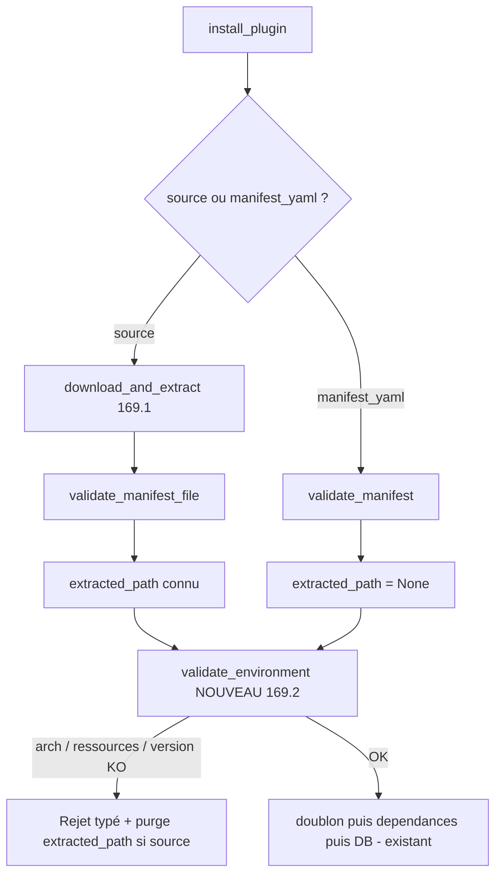

# STORY-169.2 : Plugins — VALIDATE complet : manifest, architecture, ressources, dépendances, conflits et version WindFlow (P2-3, partie validation — STORY-169 découpée)

**Statut :** DONE
**Epic Parent :** EPIC-013 — P2 : Conformité fonctionnelle (remédiation backend)
**Story Parent (split) :** STORY-169 ([ABANDONED — découpe proactive post-analyse le 2026-10-30](STORY-169-plugins-installation-reelle.md))
**Item plan :** P2-3 partie installation (axe B5) — volet **VALIDATE** du pipeline spec 11 — ampleur **M**

> **Périmètre (découpe)** : cette sous-story reprend le **volet validation** de STORY-169 — validation complète du package extrait : manifest (service existant à consommer tel quel), **architecture locale**, **ressources** (arbitrage psutil absent), dépendances + conflits (déjà en place — nothing to redo), **`windflow_version` minimale** (évaluation à écrire) ; rejet **sans résidu filesystem**. Couvre l'**AC 1 de la mère (partie VALIDATE)**. Le download/extraction est porté par [STORY-169.1](STORY-169.1-plugins-package-download-checksum-extraction.md), l'orchestration compose/hooks/rollback par [STORY-169.3](STORY-169.3-plugins-install-compose-hooks-rollback.md), le chiffrement config et le durcissement par [STORY-169.4](STORY-169.4-plugins-configure-chiffrement-durcissement.md).

## Description

En tant qu'administrateur WindFlow, je veux que toute installation valide le package extrait — manifest (structure, `compose_file` si service/hybrid), architecture locale, ressources disponibles, dépendances, conflits de plugins et version WindFlow minimale — **avant toute inscription en base ou déploiement**, avec rejet propre et **sans résidu filesystem**, afin qu'aucun plugin incompatible ou trop gourmand ne soit installé.

**Problème constaté** ([`backend_status.md`](../../docs/backend_status.md) §5, §14.1) : la validation de structure du manifest existe déjà (socle sain), mais l'étape VALIDATE du pipeline spec 11 est incomplète — il manque l'architecture, les ressources et l'évaluation de la contrainte `windflow_version` (le format est validé, pas la compatibilité effective) ; l'installation ne rejette donc pas un plugin incompatible avant enregistrement (B5).

## Contexte technique

> Extrait de l'analyse STORY-169 (2026-10-30, `analyse-story`) — volet validation, fondé sur le code réel du dépôt. Tâches détaillées à rédiger par `analyse-story` sur cette sous-story.

### Patterns existants à réutiliser (extrait de la mère)

- **Validation manifest** : [`plugin_manifest_service.py`](../../backend/app/services/plugin_manifest_service.py) (`yaml.safe_load`, erreurs typées `validation`/`yaml_syntax`/`value`) + [`plugin_manifest.py`](../../backend/app/schemas/plugin_manifest.py) : kebab-case anti path-traversal, semver, `compose_file` obligatoire si type service/hybrid, `windflow_version` au format contrainte — **la validation de structure existe déjà intégralement** (socle sain §2.G, à conserver tel quel).
- **Dépendances** : [`plugin_dependency_service.py`](../../backend/app/services/plugin_dependency_service.py) — `check_install_dependencies` + `resolve_transitive_dependencies` déjà appelés dans `install_plugin` (conflits + version mismatches couverts) → **rien à refaire** ; il manque arch/ressources/version WindFlow.
- **Évaluation de contrainte de version (découverte analyse 2026-10-30)** : la staticmethod [`validate_version_constraint(installed_version, constraint)`](../../backend/app/services/plugin_dependency_service.py) (`packaging.Version`, 7 opérateurs dont `~=`) est **réutilisable telle quelle** pour évaluer `windflow_version` contre la version courante du backend ([`app.__version__ = "0.1.0"`](../../backend/app/__init__.py), synchronisée [`pyproject.toml`](../../pyproject.toml)) — seule l'invocation est à écrire, pas le parsing.

### Éléments à écrire (nouveaux — étape VALIDATE spec 11)

- **Architecture locale** : `platform` module vs architecture déclarée au manifest (si déclarée) — rejet sur incompatibilité ;
- **Ressources** : disque (espace disponible sous `plugins_base_dir` + volumes prévisibles) et mémoire — voir arbitrage n°6 ci-dessous ;
- **`windflow_version` minimale** : le parsing du format contrainte est **déjà validé côté schéma** — **l'évaluation de la contrainte contre la version courante du backend est à écrire** ;
- **Nettoyage filesystem** : tout échec de validation → suppression du répertoire extrait (emplacement posé par 169.1) — coordination avec 169.1/169.3 pour garantir « sans résidu ».

### Divergence héritée de la mère — arbitrage délégué à cette sous-story

- **n°6 — Vérification ressources : `psutil` absent des dépendances** → utiliser `shutil.disk_usage` + `/proc/meminfo` (ou `docker info`), ou **skip avec warning** si indisponible — l'arbitrage (choix + fallback) doit être documenté dans la story avant implémentation.

**Arbitrage tranché par l'analyse (2026-10-30 — satisfait AC 3)** :

- **Stdlib uniquement, aucune nouvelle dépendance** (rules 05) : disque → `shutil.disk_usage(plugins_base_dir).free` ; RAM → lecture de `MemAvailable` dans `/proc/meminfo` (kB → Mo) ; CPU → `os.cpu_count()` (cœurs logiques comparés à `cpu_min_cores`, float) ;
- **`psutil` non ajouté** — pattern projet actuel : optionnel en try/import dans [`stats.py`](../../backend/app/api/v1/stats.py) avec dégradation silencieuse ; `docker info` écarté (couplage Docker inutile pour les plugins `extension` sans conteneur) ;
- **Métrique non évaluable → skip avec warning** (log structuré `resource_check_skipped` avec métrique + raison) — jamais de rejet sur simple incapacité d'évaluer (`/proc/meminfo` absent sur non-Linux, `cpu_count()` à `None`, `plugins_base_dir` non résolvable) ;
- **Métrique évaluable et insuffisante → rejet typé** `insufficient_resources` listant **toutes les insuffisances cumulées** (`resource`, `required`, `available`) avec cause + suggestion — reflété dans le message de rejet (AC 3).

### Hors périmètre explicite

- Download/checksum/extraction (→ 169.1) ;
- Orchestration du pipeline, inscription DB, compose, rollback (→ 169.3) ;
- Chiffrement `config_values`, RL/RBAC, tests transverses globaux (→ 169.4).

## Critères d'acceptation (AC)

- [x] AC 1 *(extrait de l'AC 1 de la mère — partie VALIDATE)* : la validation complète s'exécute sur le package extrait **avant toute inscription en base ou déploiement** — tests : manifest invalide → rejet ; dépendance manquante ou conflit → rejet ; **version WindFlow insuffisante → rejet** avec message explicite ; architecture incompatible → rejet (ou comportement documenté selon l'arbitrage).
- [x] AC 2 *(extrait de l'AC 1 de la mère — partie VALIDATE)* : **rejet sans résidu filesystem** — tout échec de validation entraîne la suppression du répertoire extrait (vérifié par test d'absence de résidu).
- [x] AC 3 : **arbitrage ressources documenté** (divergence n°6) — choix `shutil.disk_usage`/`/proc/meminfo`/`docker info`/skip-warning consigné dans la story et reflété dans les messages de rejet ; couverture ≥ 80 % des modules touchés.

## Références spécification

- [`11-plugins.md`](../../docs/general_specs/11-plugins.md) — § Étapes d'installation (étape 2 VALIDATE), § Manifest (compatibilité `windflow_version`, ressources, dépendances, ports) ;
- [`15-securite.md`](../../docs/general_specs/15-securite.md) — § Vérifications à l'installation ;
- [`backend_remediation_plan.md`](../../docs/backend_remediation_plan.md) — §4 P2-3, §2.B B5 ;
- [`backend_status.md`](../../docs/backend_status.md) — §5 (services plugin_*), §14.1 (coquille vide).

## Dépendances

- **Dépend de** [STORY-169.1](STORY-169.1-plugins-package-download-checksum-extraction.md) — le package extrait (et l'emplacement `plugins_base_dir/{name}/`) est l'entrée de la validation ;
- **Conditionne** [STORY-169.3](STORY-169.3-plugins-install-compose-hooks-rollback.md) (l'orchestrateur appelle l'étape VALIDATE) ;
- Socle existant : validation manifest + dépendances déjà en place (nothing to redo) ; aucune migration DB.

## État d'avancement technique

- 2026-10-30 (`analyse-story`) : exploration terminée — `## Tâches d'implémentation détaillées` (T1→T7) et `## Tests à écrire` rédigées à partir du code réel ; **arbitrage n°6 tranché** (stdlib uniquement + skip-warning, cf. Contexte technique) ; découverte clé : [`validate_version_constraint()`](../../backend/app/services/plugin_dependency_service.py) du dependency service est **réutilisable tel quel** pour évaluer `windflow_version` contre [`app.__version__`](../../backend/app/__init__.py). Complexité confirmée **M monotâche** (7 tâches, 1 module nouveau + 1 branchement) → pas de re-découpe. Statut inchangé (`TODO`), kanban/epic inchangés, aucun fichier de code modifié.
- 2026-10-30 (`treat-story`) : T1→T5 implémentés (service `PluginValidationService` complet : arch/ressources/version + orchestration court-circuit ; branchement manager avec purge sans résidu avant écriture DB), T6 implémenté (23 tests validation + 6 tests manager dont purge ×3 error_types paramétrés) ; exécution interrompue puis **reprise à T7** (état workspace évalué, rien de recréé) ; T7 validé : 23+26 tests ciblés passed, couverture module **96 %**, `make backend-test-unit` **2804 passed 0 failed**, flake8/isort/bandit/black 0 erreur (black appliqué sur 3 fichiers), mypy 0 erreur périmètre (15 erreurs globales prouvées préexistantes sur HEAD via stash). Statut → `DONE` ; kanban/epic mis à jour.

*(coché pendant `treat-story`)*

## Tâches d'implémentation détaillées

> Rédigées par `analyse-story` (2026-10-30) — exploration code réel, sans implémentation. **Ordre séquentiel strict**. Exigences sécurité ([`40-security.md`](../../.roo/rules/40-security.md)) intégrées : le manifest est un **input externe non fiable** — validation Pydantic stricte en amont (existante), jamais de contenu de manifest dans les logs (seulement `name`/`version`), erreurs typées `WindFlowException(details={"error_type": ...})` conformes au pattern de [`plugin_manager_service.py`](../../backend/app/services/plugin_manager_service.py). Aucune route API modifiée (contrat `/plugins/install` inchangé).

### Architecture cible (volet VALIDATE)

Nouveau service `PluginValidationService` (**un service = une classe**, DI `Settings` — pattern [`plugin_package_service.py`](../../backend/app/services/plugin_package_service.py)) consommé par `PluginManagerService.install_plugin`, appelé **après** la validation du manifest et **avant** toute inscription en base :



**Arbitrages pris par l'analyse** :

1. **Nouveau service dédié** `PluginValidationService` plutôt qu'extension du manifest service (SoC : la validation d'**environnement** dépend de la machine hôte, pas du contenu YAML — le manifest service reste tel quel, socle sain §2.G) ;
2. **Réutilisation directe** de [`PluginDependencyService.validate_version_constraint()`](../../backend/app/services/plugin_dependency_service.py) (staticmethod, `packaging.Version`, 7 opérateurs) pour évaluer `windflow_version` — zéro réécriture ;
3. **Version courante = [`app.__version__`](../../backend/app/__init__.py)** (`"0.1.0"`, synchronisée avec [`pyproject.toml`](../../pyproject.toml)) — pas de nouveau setting (YAGNI) ;
4. **Ordre séquentiel court-circuit** : architecture → ressources → `windflow_version` ; les insuffisances de ressources sont **cumulées** dans une seule erreur (message unique listant tout) ;
5. **Purge au niveau `install_plugin`** via le tuple `(manifest, extracted_path)` désormais retourné par [`_install_from_source()`](../../backend/app/services/plugin_manager_service.py) — la purge « manifest invalide » posée par 169.1 **reste inchangée** dans `_install_from_source` (non-régression de [`test_plugin_manager_service.py`](../../backend/tests/unit/test_services/test_plugin_manager_service.py)) ;
6. **Dépendances auto-installées** (manifests locaux de `resolve_transitive_dependencies`) : **non** soumises à la validation d'environnement (périmètre = plugin demandé) — comportement documenté, à couvrir éventuellement en 169.3 ;
7. **`architectures`** : rejet `architecture_incompatible` si plateforme Linux identifiable absente de la liste déclarée ; **skip avec warning** si OS non-Linux ou machine non mappable (postes dev macOS/Windows — cohérent avec l'approche skip-warning de l'arbitrage n°6).

---

- [x] **T1 — `PluginValidationService` : squelette + architecture locale** ([`backend/app/services/plugin_validation_service.py`](../../backend/app/services/plugin_validation_service.py), **nouveau**)

  Classe unique `PluginValidationService` avec `__init__(self, settings: Settings)` (DI). Constante de classe documentée `_ARCH_ALIASES: dict[str, str] = {"x86_64": "linux/amd64", "amd64": "linux/amd64", "aarch64": "linux/arm64", "arm64": "linux/arm64"}`. Méthode publique `validate_environment(self, manifest: PluginManifest) -> None` (lève `WindFlowException` typée, retourne `None` — orchestration complétée en T4).

  **Check architecture** — `_check_architecture(manifest)` :
  - `platform.system() != "Linux"` → log warning structuré `architecture_check_skipped` (reason `non_linux_os`) → passe (arbitrage n°7) ;
  - `platform.machine()` absent des aliases → warning `architecture_check_skipped` (reason `unmapped_machine`) → passe ;
  - sinon plateforme locale `f"linux/{alias}"` **absente** de `manifest.architectures` (non-vide garanti par le schéma) → `WindFlowException` message cause + suggestion, `details={"error_type": "architecture_incompatible", "plugin_name", "local_architecture", "supported_architectures": [...]}` ;
  - logs : `plugin_name`/`version` uniquement — **jamais le contenu YAML** (rules 40).

- [x] **T2 — Ressources (arbitrage n°6 : stdlib + skip-warning)** (même fichier)

  `_check_resources(manifest)` — passe immédiatement si `manifest.resources is None` (champ optionnel du schéma) :
  - **disque** : `shutil.disk_usage(Path(self._settings.plugins_base_dir))` → `.free` converti en Mo ; l'espace est mesuré **sous `plugins_base_dir`** (emplacement réel du package extrait et des volumes prévisibles — pas `/` arbitraire) ; `OSError` → skip warning `resource_check_skipped` (resource `disk`) ;
  - **RAM** : helper `_read_mem_available_mb() -> Optional[int]` lisant `MemAvailable` dans `/proc/meminfo` (kB → Mo) — constant module `_MEMINFO_PATH` (patchable en tests) ; fichier absent/illisible/valeur non parsable → `None` → skip warning (arbitrage n°6) ;
  - **CPU** : `os.cpu_count()` comparé à `cpu_min_cores` (float, ex. `0.5`) ; `None` → skip warning ;
  - cumul des insuffisances (disponible < requis, requis > 0) dans une liste de dicts `{"resource": "disk|ram|cpu", "required": ..., "available": ...}` → **une seule** `WindFlowException` `details={"error_type": "insufficient_resources", "plugin_name", "shortcomings": [...]}` avec message listant chaque manque + suggestion (« libérez de l'espace / augmentez les ressources de l'hôte ») — reflété dans le message de rejet (AC 3).

- [x] **T3 — `windflow_version` minimale** (même fichier)

  `_check_windflow_version(manifest)` — passe si `manifest.windflow_version is None` (optionnel) :
  - importer la version courante au niveau module : `from .. import __version__ as CURRENT_WINDFLOW_VERSION` ([`app/__init__.py`](../../backend/app/__init__.py) ne contient que `__version__` — pas de circular import ; si l'import posait problème en pratique, fallback `importlib.metadata.version("windflow")`) ;
  - évaluation par **réutilisation directe** : `PluginDependencyService.validate_version_constraint(CURRENT_WINDFLOW_VERSION, manifest.windflow_version)` (le format de contrainte est déjà validé par le champ [`windflow_version`](../../backend/app/schemas/plugin_manifest.py) — pas de re-parse à écrire) ;
  - contrainte non satisfaite → `WindFlowException` message **cause + suggestion** (version courante vs contrainte exigée + « mettez à jour WindFlow »), `details={"error_type": "windflow_version_incompatible", "plugin_name", "current_version", "required_constraint"}` (AC 1) ;
  - satisfait → log debug `windflow_version_check_passed` (constraint + current, valeurs non sensibles).

- [x] **T4 — Orchestration `validate_environment`** (même fichier)

  Appel séquentiel `_check_architecture` → `_check_resources` → `_check_windflow_version` — **première erreur remonte** (court-circuit, arbitrage n°4) ; succès → log info `plugin_environment_validated` (`plugin_name`, `version`, `checks: ["architecture", "resources", "windflow_version"]`). Docstring complète du service : périmètre spec 11 étape VALIDATE (volet environnement), référence à l'arbitrage n°6, exclut dépendances/conflits (déjà en place dans [`plugin_dependency_service.py`](../../backend/app/services/plugin_dependency_service.py)).

- [x] **T5 — Branchement dans `PluginManagerService` + purge sans résidu** ([`backend/app/services/plugin_manager_service.py`](../../backend/app/services/plugin_manager_service.py))

  - `__init__` : instancier `self._validation_service = PluginValidationService(self._settings)` (mockable en tests — pattern `_package_service` 169.1) ;
  - [`_install_from_source()`](../../backend/app/services/plugin_manager_service.py) : retourne désormais `Tuple[PluginManifest, Path]` — `(manifest, Path(result.extracted_path))` ; la purge « manifest invalide » existante reste **inchangée** dans cette méthode ;
  - `install_plugin` : déballer le tuple (branche `source`) / `extracted_path = None` (branche `manifest_yaml`), puis **avant la vérification doublon et toute écriture DB** :
    ```python
    try:
        self._validation_service.validate_environment(manifest)
    except WindFlowException:
        if extracted_path is not None:
            shutil.rmtree(extracted_path, ignore_errors=True)
            logger.warning("plugin_validation_failed_purged", extra={...})
        raise  # message typé préservé tel quel
    ```
    → rejet **sans résidu filesystem** sur la branche source (AC 2), aucun rmtree sur la branche locale (rien extrait) ; statuts inchangés (arbitrage 169.1 n°4 : les statuts intermédiaires appartiennent à 169.3).

- [x] **T6 — Tests** : implémenter la section `## Tests à écrire` ci-dessous — nouveau [`test_plugin_validation_service.py`](../../backend/tests/unit/test_services/test_plugin_validation_service.py) + extension [`test_plugin_manager_service.py`](../../backend/tests/unit/test_services/test_plugin_manager_service.py) (adapter la fixture `sourced_service` : mocker `_validation_service` en plus de `_package_service`/`_registry_service`, pour ne pas dépendre de la machine hôte dans les tests manager existants).

- [x] **T7 — Validation finale** : `make backend-lint` sur le périmètre (isort + black + flake8 + bandit sur les fichiers touchés ; mypy sur les 3 fichiers modifiés/créés), tests ciblés `poetry run pytest backend/tests/unit/test_services/test_plugin_validation_service.py backend/tests/unit/test_services/test_plugin_manager_service.py -v --cov=app/services/plugin_validation_service --cov-fail-under=80`, puis non-régression `make backend-test-unit`. Couverture ≥ 80 % du nouveau module (rules 35).

## Tests à écrire

> Conformes à [`35-testing-quality-gates.md`](../../.roo/rules/35-testing-quality-gates.md) — patterns AAA, docstrings cas nominal/erreur. Localisation : `backend/tests/unit/test_services/`. Couverture cible ≥ 80 % de `plugin_validation_service.py`. Les dépendances manquantes/conflits sont **déjà couverts** par les tests existants du manager (rien à refaire — périmètre de la découpe).

### Fichier 1 : [`backend/tests/unit/test_services/test_plugin_validation_service.py`](../../backend/tests/unit/test_services/test_plugin_validation_service.py) (nouveau)

Fixtures : `Settings(plugins_base_dir=str(tmp_path))` ; helper `_build_manifest(**overrides)` retournant un `PluginManifest` valide (base sans `resources` ni `windflow_version`, architectures des deux plateformes pour les cas non-arch) ; mocks `monkeypatch` de `platform.machine`/`platform.system`, `os.cpu_count`, `shutil.disk_usage` et de `_MEMINFO_PATH` pointé vers un faux `/proc/meminfo` écrit dans `tmp_path` (ex. `MemAvailable: 2097152 kB` = 2048 Mo).

**Cas nominaux (AC 1)**

- `test_architecture_amd64_compatible` — `machine="x86_64"`, manifest `[linux/amd64]` → passe ;
- `test_architecture_arm64_compatible` — `machine="aarch64"`, manifest `[linux/arm64]` → passe ;
- `test_resources_absent_passes` — manifest sans `resources` → passe ;
- `test_resources_sufficient_passes` — disk/ram/cpu mockés au-dessus des minima → passe ;
- `test_windflow_version_absent_passes` — `windflow_version=None` → passe ;
- `test_windflow_version_satisfied_passes` — contrainte `">=0.1.0"` (et `"==0.1.0"`) vs version courante `0.1.0` → passe.

**Cas d'erreur (AC 1/AC 3 — rejets typés avec message explicite)**

- `test_architecture_incompatible_rejected` — `machine="x86_64"`, manifest `[linux/arm64]` → `architecture_incompatible`, message contient l'architecture locale et les architectures supportées ;
- `test_disk_insufficient_rejected` — `disk_usage.free` < `disk_min_mb` → `insufficient_resources` (shortcoming `disk`) ;
- `test_ram_insufficient_rejected` — `MemAvailable` < `ram_min_mb` → `insufficient_resources` (shortcoming `ram`) ;
- `test_cpu_insufficient_rejected` — `cpu_count` < `cpu_min_cores` → `insufficient_resources` (shortcoming `cpu`) ;
- `test_all_resource_shortcomings_accumulated` — les 3 insuffisantes → **une seule** exception listant les 3 shortcomings (message cumulatif) ;
- `test_windflow_version_incompatible_rejected` — `">=1.1.0"` vs `0.1.0` → `windflow_version_incompatible`, message avec version courante + contrainte + suggestion de mise à jour ;
- `test_windflow_version_equality_rejected` — `"==9.9.9"` → rejet.

**Dégradations documentées (AC 3 — arbitrage n°6 : skip avec warning, jamais de rejet sur incapacité d'évaluer)**

- `test_non_linux_os_skips_architecture_check` — `system="Darwin"` → passe + warning `architecture_check_skipped` (caplog) ;
- `test_unmapped_machine_skips_architecture_check` — `machine="riscv64"` → passe + warning ;
- `test_meminfo_unavailable_skips_ram_check` — `_MEMINFO_PATH` vers fichier inexistant → RAM skippée (warning), disque/CPU toujours vérifiés ;
- `test_disk_usage_error_skips_disk_check` — `shutil.disk_usage` lève `OSError` → disque skippé (warning), pas de rejet ;
- `test_cpu_count_none_skips_cpu_check` — `cpu_count → None` → CPU skippé (warning).

**Comportement transverse**

- `test_first_failure_short_circuits` — arch incompatible ET ressources insuffisantes → `architecture_incompatible` remonte (ordre arbitrage n°4) ;
- `test_zero_requirements_pass` — `ram_min_mb=0`, `cpu_min_cores=0`, `disk_min_mb=0` → passe (edge) ;
- `test_logs_contain_no_manifest_content` — caplog : aucun contenu YAML du manifest dans les entrées loggées (rules 40).

### Fichier 2 : [`backend/tests/unit/test_services/test_plugin_manager_service.py`](../../backend/tests/unit/test_services/test_plugin_manager_service.py) (extension)

Mocks : fixture `sourced_service` étendue (`_validation_service = AsyncMock()` — ou mock simple, la méthode étant sync) ; helper `_fake_extraction` réutilisé (il écrit un `windflow-plugin.yml` valide → la validation mockée passe).

- `test_install_from_source_calls_validate_environment` — install source succès → `validate_environment` appelé **une fois** avec le manifest extrait, **avant** la création DB (assert d'ordre via les mocks) ;
- `test_install_source_arch_incompatible_purges_extraction` *(AC 1 + AC 2)* — `validate_environment` lève `architecture_incompatible` → exception remontée avec `error_type` préservé, `plugins_base_dir/{name}` **purgé** (le répertoire n'existe plus), **aucune ligne `Plugin`** en base ;
- `test_install_source_insufficient_resources_purges_extraction` *(AC 2/AC 3)* — idem avec `insufficient_resources` ;
- `test_install_source_windflow_version_incompatible_purges_extraction` *(AC 1 + AC 2)* — idem avec `windflow_version_incompatible` ;
- `test_install_manifest_yaml_validates_environment` — branche locale : `validate_environment` appelé, échec → rejet, aucune tentative de purge (aucun chemin extrait — vérifier qu'aucun `rmtree` ne s'exécute) ;
- `test_install_manifest_yaml_environment_failure_no_db_row` — échec validation sur branche locale → aucune ligne `Plugin` en base.

**Non-régression attendue** : les tests existants `TestInstallFromSource` (169.1) doivent rester verts après mock de `_validation_service` dans la fixture ; `make backend-test-unit` complet sans échec.

## Notes d'implémentation

**Date de clôture :** 2026-10-30 (`treat-story`)

### Fichiers créés/modifiés

| Fichier | Nature |
|---------|--------|
| [`backend/app/services/plugin_validation_service.py`](../../backend/app/services/plugin_validation_service.py) | **Créé** — `PluginValidationService` (T1→T4) : check architecture (`_ARCH_ALIASES`, skip-warning non-Linux/machine non mappable), check ressources (stdlib uniquement, insuffisances cumulées en une erreur `insufficient_resources`), check `windflow_version` (réutilisation `PluginDependencyService.validate_version_constraint` contre `app.__version__` avec fallback `importlib.metadata`), orchestration `validate_environment` avec court-circuit |
| [`backend/app/services/plugin_manager_service.py`](../../backend/app/services/plugin_manager_service.py) | **Modifié** (T5) — DI `self._validation_service` ; `_install_from_source()` retourne `Tuple[PluginManifest, Path]` ; `install_plugin` appelle `validate_environment` **avant** doublon/dépendances/écriture DB avec purge `shutil.rmtree(extracted_path, ignore_errors=True)` sur échec (branche source uniquement) + log `plugin_validation_failed_purged` |
| [`backend/tests/unit/test_services/test_plugin_validation_service.py`](../../backend/tests/unit/test_services/test_plugin_validation_service.py) | **Créé** (T6) — 23 tests : 6 nominaux, 7 rejets typés, 5 dégradations skip-warning (caplog), 4 transverses (court-circuit, zéro, hygiène logs rules 40, log succès) |
| [`backend/tests/unit/test_services/test_plugin_manager_service.py`](../../backend/tests/unit/test_services/test_plugin_manager_service.py) | **Étendu** (T6) — fixture `sourced_service` mocke `_validation_service` (`MagicMock`, méthode sync) ; classe `TestValidateEnvironment` : 6 tests (appel+ordre, purge ×3 `error_type` paramétrés, branche locale sans rmtree, aucune ligne DB) |

### Décisions techniques

- **Arbitrage n°6 appliqué tel quel** (stdlib + skip-warning) : `shutil.disk_usage(plugins_base_dir)` pour le disque, `MemAvailable` de `/proc/meminfo` via constante module patchable `_MEMINFO_PATH` pour la RAM, `os.cpu_count()` pour le CPU ; métrique non évaluable → warning `resource_check_skipped` (jamais rejet), métrique insuffisante → cumul dans `shortcomings` puis **une seule** `WindFlowException` `insufficient_resources`.
- **Version courante** : `from .. import __version__ as CURRENT_WINDFLOW_VERSION` avec fallback défensif `importlib.metadata.version("windflow")` (chaîné `PackageNotFoundError` → `"0.0.0"`) — marqué `pragma: no cover`.
- **Purge au niveau `install_plugin`** (pas dans `_install_from_source`) conformément à l'arbitrage n°5 : la purge « manifest invalide » de 169.1 reste inchangée dans `_install_from_source` ; `raise` nu pour préserver le message typé du service de validation tel quel.
- **Tests manager indépendants de la machine hôte** : `_validation_service` mocké dans `sourced_service` (pattern `_package_service` 169.1) ; la purge est vérifiée par pré-condition d'existence du répertoire extrait + assertion d'absence après rejet.
- **Divergence mineure de nommage des tests** (sans impact sur les exigences couvertes) : les 3 tests de purge prévus (`arch_incompatible`/`insufficient_resources`/`windflow_version_incompatible`) sont fusionnés en **un seul test paramétré** `test_install_source_validation_failure_purges_extraction[...]` (mêmes assertions, moins de duplication) ; deux tests bonus ajoutés (`test_success_emits_validated_log`, paramétrage `==0.1.0`/`>=0.1.0`).

### Divergences par rapport à l'analyse

- Aucune divergence fonctionnelle. Seule la forme des tests diffère (paramétrage, cf. ci-dessus).
- Note d'exécution : la commande de couverture ciblée déclenche le `--cov-fail-under=80` **global** (addopts pyproject) car la couverture est mesurée sur toute l'app lors d'une run partielle → le seuil pertinent est la couverture du module `plugin_validation_service.py` seul : **96 %** (4 lignes manquantes : branches défensives du parse meminfo), vérifié via `--cov-report=term-missing`.

### Difficultés rencontrées

- Exécution initiale interrompue : T1→T6 étaient déjà posés dans le workspace ; la reprise a consisté à auditer l'existant (aucun doublon recréé), appliquer le formatage black manquant sur 3 fichiers, puis exécuter T7 (validation) intégralement.
- `black` souhaitait reformater les 3 fichiers créés/étendus (répartition des arguments dans les appels de fixtures/resources) → reformat appliqué, tests re-passés verts après reformat (49/49).

### Validation (T7)

| Commande | Résultat |
|----------|----------|
| `pytest tests/unit/test_services/test_plugin_validation_service.py --cov=app/services/plugin_validation_service` | **23 passed** — couverture module **96 %** (≥ 80 % requis) |
| `pytest tests/unit/test_services/test_plugin_manager_service.py` | **26 passed** (dont 11 `TestInstallFromSource` 169.1 non-régressés + 6 `TestValidateEnvironment` nouveaux) |
| `make backend-test-unit` | **2804 passed, 0 failed** (128 s) |
| `flake8` / `isort --check` / `black --check` / `bandit -ll` (4 fichiers périmètre) | **0 erreur** chacun (après application de black) |
| `mypy` sur les 2 fichiers service du périmètre | **0 erreur dans le périmètre** — 15 erreurs globales restantes prouvées **préexistantes sur HEAD** (vérifiées via `git stash` : `Found 15 errors in 6 files` identique sans les changements ; fichiers hors périmètre : `plugin_lifecycle_service.py`, `background_tasks.py`, etc.) |
