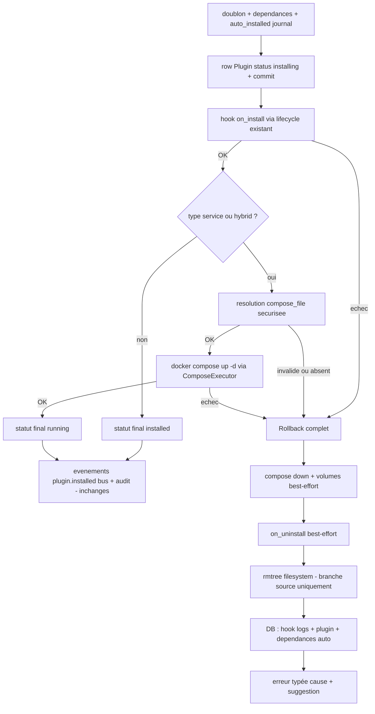

# STORY-169.3 : Plugins — INSTALL réel : hooks lifecycle, `docker compose up` du service et rollback complet (P2-3, partie orchestration — STORY-169 découpée)

**Statut :** DONE
**Epic Parent :** EPIC-013 — P2 : Conformité fonctionnelle (remédiation backend)
**Story Parent (split) :** STORY-169 ([ABANDONED — découpe proactive post-analyse le 2026-10-30](STORY-169-plugins-installation-reelle.md))
**Item plan :** P2-3 partie installation (axe B5) — volets **INSTALL + rollback** du pipeline spec 11 — ampleur **L**

> **Périmètre (découpe)** : cette sous-story reprend le **volet orchestration** de STORY-169 — `PluginManagerService` étendu en orchestrateur du pipeline réel : source registre → download (169.1) → validation (169.2) → hook `on_install` (lifecycle existant) → **`docker compose up -d`** service/hybrid via `ComposeExecutor` (project/network/volumes conventionnés) → statut `running` + événement `plugin.installed` (bus + audit existants) ; **rollback complet DB + filesystem + conteneur sur échec à chaque étage** (messages explicites cause + suggestion) ; arbitrage des statuts intermédiaires. Couvre les **AC 2 et AC 3 de la mère**. Le download/extraction est porté par [STORY-169.1](STORY-169.1-plugins-package-download-checksum-extraction.md), la validation par [STORY-169.2](STORY-169.2-plugins-validation-manifest-arch-ressources.md), le chiffrement config et le durcissement par [STORY-169.4](STORY-169.4-plugins-configure-chiffrement-durcissement.md).

## Description

En tant qu'administrateur WindFlow, je veux que l'installation d'un plugin service/hybrid exécute réellement le hook `on_install` (via le lifecycle service existant) puis le **`docker compose up -d`** du service (project `windflow-plugin-{name}`, network/volumes conventionnés) — avec un **rollback complet** (DB + filesystem + conteneur) et un message explicite (cause + suggestion) en cas d'échec à une étape — afin que le plugin soit réellement déployé et fonctionnel, et jamais à moitié installé.

**Problème constaté** ([`backend_status.md`](../../docs/backend_status.md) §5, §14.1) : [`plugin_manager_service.py`](../../backend/app/services/plugin_manager_service.py) n'exécute **ni compose up, ni hook au bon étage, ni rollback** — install = enregistrement DB (B5 : « plugins coquille vide ») ; l'endpoint [`POST /api/v1/plugins/install`](../../backend/app/api/v1/plugins.py) a un `BackgroundTasks` injecté mais non utilisé (pipeline synchrone).

## Contexte technique

> Extrait de l'analyse STORY-169 (2026-10-30, `analyse-story`) — volet orchestration/install/rollback, fondé sur le code réel du dépôt. Tâches détaillées à rédiger par `analyse-story` sur cette sous-story.

### Patterns existants à réutiliser (extrait de la mère)

- **Hooks lifecycle** : [`plugin_lifecycle_service.py`](../../backend/app/services/plugin_lifecycle_service.py) — `execute_lifecycle_transition` (timeout 30 s, anti path-traversal `_resolve_script_path`, `PluginHookLog` persisté, passwords masqués `***` dans l'env des scripts) branché sur install/uninstall/configure — **à conserver tel quel**, le pipeline doit juste l'appeler au bon étage.
- **Compose** : [`ComposeExecutor`](../../backend/app/services/docker_executor.py) fournit déjà `deploy_compose` (up -d, timeout 300 s), `get_compose_status`, `stop_compose`, `remove_compose(remove_volumes)` ; [`DockerComposeService`](../../backend/app/services/docker_compose_service.py) ajoute la substitution de variables (TemplateRenderer Jinja2, `generate_password`/`generate_secret`) et `generate_compose_file` — **aucune réécriture Docker nécessaire, y compris pour le rollback** (`stop_compose`/`remove_compose`).
- **Endpoint (porte d'entrée du pipeline réel)** : [`POST /api/v1/plugins/install`](../../backend/app/api/v1/plugins.py) (202, `require_admin`, `conditional_rate_limiter`, `BackgroundTasks` injecté mais non utilisé — pipeline synchrone) ; `PluginInstallRequest` supporte déjà `source` (→ download 169.1) et `manifest_yaml` (**chemin local sans package — comportement à documenter**) ; le contrat API (`PluginActionResponse` 202) **inchangé**.
- **Bus + audit (déjà satisfait côté émission — à préserver lors du re-routage)** : `_publish_to_bus` émet déjà `plugin.installed`/`plugin.removed`/`plugin.configured`/`plugin.error` (STORY-162) ; [`plugins.py`](../../backend/app/api/v1/plugins.py) appelle déjà `AuditService.log_from_request("plugin.installed", ...)` après install succès et `"plugin.removed"` (STORY-125.2, org capturée avant suppression).
- **Modèle** : [`plugin.py`](../../backend/app/models/plugin.py) — `PluginStatus` (installed/installing/running/stopped/updating/error), `manifest_data` JSON, colonne statut `String(20)` → **extension d'enum rétrocompatible sans migration** (`downloading`/`validating` tiennent en 20 chars).
- **Volumes/networks conventionnés** : données persistantes dans `windflow-plugin-{name}-data`, network `windflow-plugin-{name}` — ces volumes sont **épargnés par le prune** (convention `windflow-plugin-*`, STORY-173 / spec 09 § prune).

### Divergences héritées de la mère — arbitrages délégués à cette sous-story

- **n°3 — Statuts pipeline** : la statechart spec 11 (Downloading/Validating/Installing/Configuring/Starting) dépasse l'enum actuel → **étendre l'enum** (sans migration, colonne String) **ou réutiliser `INSTALLING` seul** — arbitrage à consigner ici (sous-story orchestration) ;
- **n°5 — Unicité globale du nom** : `plugins.name unique=True` alors que le modèle est multi-tenant (`organization_id`) — deux orgs ne peuvent pas installer le même plugin ; **comportement existant à documenter, ne pas modifier** dans cette sous-story ;
- **n°7 — Rollback DB** : `install_plugin` commit à plusieurs reprises (dépendances auto-installées puis plugin) → le pipeline devra **journaliser ce qui a été créé par la transaction** (plugin + dépendances auto-installées) pour pouvoir tout supprimer en cas d'échec hook/compose.

### Rollback spec 11 (extrait de la mère — comportement attendu)

- échec d'une étape → **suppression des fichiers téléchargés** (échec INSTALL), **`docker compose down` + nettoyage** (échec déploiement Docker), **désenregistrement des routes partiellement chargées** (échec extension — le chargement lui-même relève de STORY-170), **rollback complet** (échec hook `on_install`) ;
- **l'utilisateur voit un message explicite avec la cause et la suggestion de résolution**.

### Hors périmètre explicite

- Download/checksum/extraction (→ 169.1), validation (→ 169.2) ;
- Chiffrement `config_values` + injection env déchiffrée, RL/RBAC (→ 169.4) ;
- **Chargement d'extension (`api_module`/`hooks_module`) et routes dynamiques → STORY-170** — le pipeline s'arrête à « laisser l'extension chargeable ».

## Critères d'acceptation (AC)

- [x] AC 1 *(reprend l'AC 2 de la mère)* : pour un plugin service/hybrid, le **`docker compose up -d`** est effectué via `ComposeExecutor` (project `windflow-plugin-{name}`, network/volumes conventionnés `windflow-plugin-{name}*` — test avec compose mocké/réel : conteneur créé) ; le hook **`on_install` est exécuté** via le lifecycle service existant ; à l'issue le plugin est **`running`** et l'événement **`plugin.installed`** est émis (bus + audit existants préservés).
- [x] AC 2 *(reprend l'AC 3 de la mère)* : **échec de hook → rollback complet** (DB + filesystem + conteneur) — test simulé d'échec du hook `on_install` : fichiers supprimés, `docker compose down` effectué, aucune ligne d'état incohérente en base (plugin + dépendances auto-installées supprimées), **message utilisateur explicite avec cause et suggestion** ; idem pour un échec de déploiement Docker (rollback + nettoyage) et un échec de chargement d'extension (désenregistrement des routes partielles, au niveau laissé par STORY-170).
- [x] AC 3 *(divergences n°3/n°5 de la mère)* : **statuts intermédiaires arbitrés et documentés** (extension d'enum vs `INSTALLING` seul) ; unicité globale `plugins.name` documentée (comportement existant, non modifié) ; couverture ≥ 80 % des modules touchés ; build + lint + tests passent.

## Références spécification

- [`11-plugins.md`](../../docs/general_specs/11-plugins.md) — § Plugin Manager / **Étapes d'installation** (étapes 3 INSTALL / 4 CONFIGURE / 5 RUNNING), § rollback (« Si une étape échoue… »), § Stockage des plugins (volumes/networks conventionnés) ;
- [`09-api.md`](../../docs/general_specs/09-api.md) — § Plugins `/api/v1/plugins/` (install, start/stop) ;
- [`15-securite.md`](../../docs/general_specs/15-securite.md) — § Audit trail (`plugin.installed`/`plugin.removed` loggés), § sandboxing des hooks à documenter ;
- [`backend_remediation_plan.md`](../../docs/backend_remediation_plan.md) — §4 P2-3, §2.B B5, §7.3 (surface d'attaque, audit branché avant) ;
- [`backend_status.md`](../../docs/backend_status.md) — §3.14 (endpoints plugins), §5, §14.1.

## Dépendances

- **Dépend de** [STORY-169.1](STORY-169.1-plugins-package-download-checksum-extraction.md) (download/extraction) et [STORY-169.2](STORY-169.2-plugins-validation-manifest-arch-ressources.md) (VALIDATE) — l'orchestrateur consomme les deux étages ;
- **Parallélisable** avec [STORY-169.4](STORY-169.4-plugins-configure-chiffrement-durcissement.md) (chiffrement config spécifiable en parallèle ; l'intégration finale à l'étage CONFIGURE se fait avec l'orchestration posée ici) ;
- **Conditionne STORY-170** (routes dynamiques — partie extension du pipeline : le pipeline s'arrête à « laisser l'extension chargeable ») ;
- Socle vérifié : STORY-162 ✔ (bus `plugin.*`), STORY-163 ✔ (hooks événements), STORY-125 ✔ (audit branché) ;
- Services externes : Docker Engine (compose via `ComposeExecutor`). **Migrations DB : aucune — confirmé par l'analyse 2026-10-30** (arbitrage n°2 : pas d'extension d'enum, la colonne `String(20)` et les 6 statuts existants sont inchangés).

## État d'avancement technique

*(à cocher pendant `treat-story` — les tâches détaillées seront rédigées par `analyse-story`)*

- 2026-10-30 (`analyse-story`) : exploration terminée — arbitrages n°3/5/7 **tranchés** (cf. section Tâches : `INSTALLING` seul pendant le pipeline → `RUNNING` service/hybrid / `INSTALLED` extension, pas d'extension d'enum ; unicité `name` documentée inchangée ; journal `auto_installed` pour le rollback DB + purge explicite des `PluginHookLog`), `## Tâches d'implémentation détaillées` (T1→T7) et `## Tests à écrire` rédigées à partir du code réel. Découvertes clés : l'ordre DB-first est imposé par la FK `PluginHookLog.plugin_id` (hook après insertion row) ; `compose_file` du manifest n'est **pas** validé anti path-traversal par le schéma (nouveau contrôle T1) ; `ComposeExecutor` retourne `Tuple[bool, str]` sans lever (gestion par code retour) ; le conventionnage network/volumes est garanti par le **project name** compose. Complexité confirmée **L monotâche** (7 tâches, 1 module étendu, 0 nouveau module) → pas de re-découpe. Statut inchangé (`TODO`), kanban/epic inchangés, aucun fichier de code modifié.

## Tâches d'implémentation détaillées

> Rédigées par `analyse-story` (2026-10-30) — exploration code réel, sans implémentation. **Ordre séquentiel strict**. Exigences sécurité ([`40-security.md`](../../.roo/rules/40-security.md)) intégrées : jamais de secrets dans les logs ni les messages d'erreur (sortie `docker compose` tronquée et sans env vars) ; erreurs typées `WindFlowException(details={"error_type": ...})` conformes au pattern du fichier ; `ComposeExecutor` et hooks lifecycle **mockés** dans les tests unitaires. Aucune route API modifiée (contrat `/plugins/install` 202 + `PluginActionResponse` inchangé).

### Arbitrages tranchés par l'analyse (divergences héritées n°3/5/7 + découvertes)

1. **Ordre du pipeline INSTALL (spec 11 étape 3 + statechart ligne 194)** : hook `on_install` **avant** `docker compose up` (la statechart : `Installing --> Configuring : on_install exécuté` ; le hook peut préparer l'environnement dont le compose dépend). **DB-first imposé par le code existant** : [`execute_lifecycle_transition`](../../backend/app/services/plugin_lifecycle_service.py) persiste un `PluginHookLog` avec FK `plugin_id` → le row `Plugin` **doit exister en base avant le hook**. Séquence retenue : *(dépendances auto-installées → création row plugin `installing` — existant)* → **hook `on_install`** → **compose up** service/hybrid → **statut final** → événements (inchangés).
2. **Statuts intermédiaires (divergence n°3) — arbitrage : `INSTALLING` seul, pas d'extension d'enum**. Le pipeline reste synchrone (endpoint 202, comportement interne immédiat) : les états `downloading`/`validating`/`starting` de la statechart spec 11 ne seraient jamais observables en base. Arbitrage : conserver l'enum actuel à 6 valeurs ; le row est créé `installing` (déjà le cas) puis passe directement au **statut final** : **`running`** pour service/hybrid (compose up réussi), **`installed`** pour extension (pas de conteneur — le « démarrage » extension relève de STORY-170). Aucune migration (colonne `String(20)` inchangée). Le suivi fin par étape (async/BackgroundTasks) est un chantier distinct, hors périmètre.
3. **Rollback DB (divergence n°7)** : le bloc dépendances auto-installées committe **avant** la création du plugin principal → le pipeline collecte un **journal `auto_installed: List[str]`** (noms des dépendances réellement créées, pas juste un log) ; le rollback supprime plugin principal **+ dépendances auto-installées + `PluginHookLog`** (purge explicite : la FK `ondelete="CASCADE"` n'est pas appliquée par SQLite sans pragma `foreign_keys=ON` — les logs orphelins seraient des « lignes d'état incohérentes » au sens de l'AC 2).
4. **Unicité globale `plugins.name` (divergence n°5)** : comportement existant **documenté, non modifié** — deux organisations ne peuvent pas installer le même plugin (contrainte `unique=True` multi-tenant connue, arbitrée hors de cette story).
5. **Convention network/volumes (découverte)** : le préfixage est porté par le **project name compose** `windflow-plugin-{name}` — Docker Compose crée le network `{project}_default` = `windflow-plugin-{name}_default`, qui matche le pattern `windflow-plugin-*` épargné par le prune (STORY-173). Le volume `windflow-plugin-{name}-data` est déclaré par le compose **du package** (responsabilité du plugin, pas de WindFlow) ; `remove_compose(remove_volumes=True)` le supprime au rollback (échec d'installation = aucune donnée à conserver).
6. **`compose_file` non sécurisé par le schéma (découverte)** : le champ [`compose_file`](../../backend/app/schemas/plugin_manifest.py) n'a **aucune validation anti path-traversal** (contrairement à `name`) — nouveau contrôle obligatoire dans le manager (T1) : relatif, sans `..`, containment sous `plugins_base_dir/{name}/` (pattern [`_resolve_script_path`](../../backend/app/services/plugin_lifecycle_service.py)).
7. **Branche `manifest_yaml` locale** : compose up **tenté** si type service/hybrid et fichier compose présent sous `plugins_base_dir/{name}/` ; fichier **introuvable → rejet typé `compose_file_missing`** + rollback DB (« jamais à moitié installé » — un plugin service sans conteneur est exactement le B5 corrigé). Le rollback de cette branche **ne purge jamais le filesystem** (fichiers posés par l'utilisateur, pas par WindFlow).
8. **Injection config compose (interface laissée à 169.4)** : réutilisation de `_build_safe_env_vars(plugin)` (staticmethod lifecycle) → `env_vars` de `deploy_compose` — mêmes variables `PLUGIN_CONFIG_*` que les hooks, passwords masqués `***`. 169.4 remplacera par l'injection déchiffrée en mémoire (divergence n°4 de la mère).
9. **Échec de chargement d'extension** (AC 2, 3e cas) : **différé à STORY-170** conformément à la découpe — en 169.3, type extension = pas d'étape compose, le pipeline s'arrête à « laisser l'extension chargeable » (statut `installed`).

### Architecture cible (volet INSTALL + rollback)

---

- [x] **T1 — DI `ComposeExecutor` + helpers de résolution compose** ([`backend/app/services/plugin_manager_service.py`](../../backend/app/services/plugin_manager_service.py))

  - Imports : `from ..schemas.plugin_manifest import PluginType` (compléter l'import `PluginManifest` existant), `from ..models.plugin_hook_log import PluginHookLog`, `from sqlalchemy import delete` (compléter `func, select`), `from .docker_executor import ComposeExecutor` ;
  - `__init__` : `self._compose_executor = ComposeExecutor()` (mockable en tests — pattern `_package_service` 169.1 ; l'instanciation est sans effet de bord, les subprocess sont créés à l'appel) ;
  - Méthode statique `_plugin_project_name(name: str) -> str` : retourne `f"windflow-plugin-{name}"` (convention spec 11 § marketplace / STORY-173 — arbitrage n°5) ;
  - Méthode `_resolve_compose_file(self, manifest: PluginManifest, extracted_path: Optional[Path]) -> Path` (arbitrage n°6 — sécurité) :
    - `compose_file = manifest.compose_file` (garanti non-vide pour service/hybrid par le validateur `validate_type_consistency` du schéma) ;
    - rejets : `os.path.isabs` → `compose_file_invalid` ; `..` dans les segments → `compose_file_invalid` (pattern `_resolve_script_path`, `error_type` distinct + `script_path` remplacé par `compose_file` dans details) ;
    - base de résolution : `extracted_path` (branche source) sinon `Path(settings.plugins_base_dir) / manifest.name` (branche locale) ; containment vérifié par `os.path.normpath`/`commonpath` — le chemin résolu doit rester sous la base (défense en profondeur) ;
    - fichier inexistant → `compose_file_missing` avec message **cause + suggestion** (cause : fichier `{compose_file}` introuvable ; suggestion : installer depuis une source registre — le package contient le compose — ou déposer le fichier sous `plugins_base_dir/{name}/`) ;
    - docstring référençant l'arbitrage n°6 (schéma sans validation → contrôle manager).

- [x] **T2 — Journal des créations DB (divergence n°7)** (même fichier)

  Dans le bloc « dépendances auto-installées » de [`install_plugin`](../../backend/app/services/plugin_manager_service.py) (lignes ~210-251) : initialiser `auto_installed: List[str] = []` **avant** le bloc `if not dep_result.can_proceed` ; à chaque `dep_plugin` réellement ajouté (branche `if dep_existing: continue` franchie), append `dep_manifest.name` au journal (le log `dependency_auto_installed` existant est conservé). Le journal vit le temps de l'appel `install_plugin` (aucune persistance nouvelle — YAGNI) et est passé au rollback en T5. **Aucun changement de comportement si le pipeline réussit.**

- [x] **T3 — Pipeline INSTALL : restructuration du post-écriture DB** (même fichier, méthode `install_plugin`)

  Remplacer le segment actuel « passer en status INSTALLED → commit → hook → événements » (lignes ~336-374) par :

  - `try:` autour de **hook + compose** (pas autour de la création du row — celle-ci reste inchangée : `status=INSTALLING` + commit + refresh + log `plugin_installing`, déjà en place) :
    1. `plugin = await self._lifecycle_service.execute_lifecycle_transition(db, plugin, "install", user_id)` — **appel existant conservé tel quel** (no-op si pas de hook déclaré ; lève `hook_failed` et passe le plugin en `error` + flush + émet `plugin.error` via le lifecycle) ;
    2. `if manifest.type in (PluginType.SERVICE, PluginType.HYBRID):` → `compose_file = self._resolve_compose_file(manifest, extracted_path)` puis `await self._deploy_plugin_compose(plugin, compose_file)` (T4) ;
  - `except WindFlowException as exc:` → `await self._rollback_install(db, plugin=plugin, auto_installed=auto_installed, extracted_path=extracted_path, user_id=user_id)` (T5) puis `raise` de l'erreur enrichie (wrapper `_installation_failed(exc, plugin)` : message `Installation de '{name}' annulée — rollback effectué. Cause : {exc.message}. Suggestion : {suggestion}` ; `details` = ceux de l'exc d'origine **augmentés** de `plugin_name`, `rollback_performed: True` ; suggestions par `error_type` : `hook_failed` → corriger le script `on_install` ou contacter l'auteur du plugin, détails dans les logs applicatifs ; `compose_up_failed` → vérifier l'image/les ressources Docker puis `docker compose -p windflow-plugin-{name} logs` ; `compose_file_missing`/`compose_file_invalid` → cf. T1) ;
  - **statut final** (arbitrage n°2) : `plugin.status = PluginStatus.RUNNING.value if manifest.type in (SERVICE, HYBRID) else PluginStatus.INSTALLED.value` → `commit` + `refresh` ;
  - **événements inchangés** : `_emit_event(PLUGIN_INSTALLED, ...)` + `_publish_to_bus(PLUGIN_INSTALLED, ...)` + log `plugin_installed` (déjà en place après le hook — déplacés après le statut final, contenu identique, payload `{"version": ...}` conservé) ; l'audit `plugin.installed` est côté router ([`plugins.py`](../../backend/app/api/v1/plugins.py) `log_from_request` après succès) — **rien à toucher**, il survole le pipeline.

- [x] **T4 — `_deploy_plugin_compose`** (même fichier, nouvelle méthode privée)

  - `env_vars = PluginLifecycleService._build_safe_env_vars(plugin)` (réutilisation directe du staticmethod — arbitrage n°8 : mêmes variables `PLUGIN_CONFIG_*` que les hooks, passwords masqués jusqu'à 169.4) ;
  - `success, output = await self._compose_executor.deploy_compose(compose_file, self._plugin_project_name(plugin.name), env_vars)` — `ComposeExecutor` retourne `Tuple[bool, str]` **sans lever** (timeout 300 s interne) ;
  - `success` faux → émettre `plugin.error` **avant** la levée (parité avec le lifecycle : `self._emit_event(EventType.PLUGIN_ERROR, ...)` + `await self._publish_to_bus(EventType.PLUGIN_ERROR, plugin_name=..., stage="compose_up")`) puis `raise WindFlowException` `details={"error_type": "compose_up_failed", "plugin_name", "compose_output": output tronqué à 500 chars}` — message cause (extrait de la sortie docker, **sans env vars ni secrets**) + suggestion ; log `plugin_compose_up_failed` (ERROR, extra : plugin_name, project) ;
  - succès → log `plugin_compose_up_succeeded` (INFO, extra : plugin_name, project — pas de contenu de sortie).

- [x] **T5 — `_rollback_install` : rollback complet ordonné** (même fichier, nouvelle méthode privée)

  Signature : `async def _rollback_install(self, db, plugin: Plugin, auto_installed: List[str], extracted_path: Optional[Path], user_id: str) -> List[str]` (retourne la liste des `rollback_residuals`). **Ordre inverse de l'installation** — chaque étape best-effort, jamais bloquante pour les suivantes, échecs **cumulés dans `residuals`** et loggés ERROR (`plugin_rollback_step_failed`, extra : step, plugin_name, error) :

  1. **Conteneur** : `ok, _ = await self._compose_executor.remove_compose(self._plugin_project_name(plugin.name), remove_volumes=True)` — appelé **même sur échec hook** (compose pas encore lancé : `remove_compose` est idempotent — défense en profondeur, AC 2 « docker compose down effectué ») ; échec (`ok` faux) → residual `"compose"` ;
  2. **Hook `on_uninstall` best-effort** : `try: await self._lifecycle_service.execute_lifecycle_transition(db, plugin, "uninstall", user_id)` `except Exception:` log warning (l'installation partielle peut rendre le script inapte à tourner — jamais bloquant ; **ne pas** laisser l'exception WindFlowException interrompre le rollback) ;
  3. **Filesystem — branche source uniquement** (arbitrage n°7 de l'analyse 169.1 : on ne supprime que ce que WindFlow a écrit) : `if extracted_path is not None: shutil.rmtree(extracted_path, ignore_errors=True)` ; branche locale (`extracted_path is None`) → **aucune suppression** (fichiers utilisateur) ;
  4. **DB** (dans l'ordre FK → rows) : `await db.execute(delete(PluginHookLog).where(PluginHookLog.plugin_id == plugin.id))` (purge explicite — CASCADE inopérant sur SQLite sans pragma, arbitrage n°3) ; `await db.delete(plugin)` ; pour chaque nom de `auto_installed` : `dep = await self.get_plugin_by_name(db, name)` → si trouvé : purge de ses `PluginHookLog` puis `await db.delete(dep)` ; `await db.commit()` ; échec SQLAlchemy → residual `"database"` + `await db.rollback()` (session cohérente pour l'appelant) ;
  5. log récapitulatif `plugin_install_rolled_back` (WARNING, extra : plugin_name, auto_installed, residuals) ; les residuals sont remontés au wrapper T3 → ajoutés aux `details` de l'erreur finale (`rollback_residuals`) pour que « l'utilisateur voit un message explicite » même en rollback partiel.

- [x] **T6 — Documentation intégrée + non-régression endpoint**

  - Docstring du service : mise à jour du pipeline (download 169.1 → validate 169.2 → **install réel 169.3 : hook + compose + rollback** → configure 169.4) ;
  - Vérifier la non-régression du router : `PluginActionResponse.status` reflétera `running` (service/hybrid) ou `installed` (extension) — **contrat inchangé** (champ `status: str`), valeur plus fidèle ; vérifier que les tests API existants ([`test_plugins.py:173-232`](../../backend/tests/unit/test_api/test_plugins.py)) n'assertent pas `status == "installed"` sur un manifest **service/hybrid** (les manifests de test existants sont `extension` → non impactés ; sinon adapter le fixture en `extension`, divergence à documenter) ;
  - Consigner dans la docstring de `install_plugin` : unicité globale `plugins.name` (arbitrage n°4 — comportement existant) et l'arbitrage statuts n°2.

- [x] **T7 — Tests + validation finale** : implémenter la section `## Tests à écrire` ci-dessous, puis `make backend-lint` sur le périmètre (isort + black + flake8 + bandit + mypy sur les fichiers touchés), tests ciblés `poetry run pytest backend/tests/unit/test_services/test_plugin_manager_service.py backend/tests/unit/test_api/test_plugins.py -v` (couverture `plugin_manager_service` vérifiée via `--cov-report=term-missing`), non-régression `make backend-test-unit`. Couverture ≥ 80 % du module touché (rules 35).

## Tests à écrire

> Conformes à [`35-testing-quality-gates.md`](../../.roo/rules/35-testing-quality-gates.md) — patterns AAA, docstrings cas nominal/erreur. **`ComposeExecutor` et lifecycle mockés obligatoirement** (jamais de Docker réel en unitaire). Localisation : `backend/tests/unit/test_services/test_plugin_manager_service.py` (extension) + `backend/tests/unit/test_api/test_plugins.py` (extension légère). Couverture cible ≥ 80 % de `plugin_manager_service.py`.

### Fichier 1 : [`backend/tests/unit/test_services/test_plugin_manager_service.py`](../../backend/tests/unit/test_services/test_plugin_manager_service.py) (extension)

Fixtures/helpers : étendre `sourced_service` avec `manager._compose_executor = AsyncMock()` et `manager._lifecycle_service = AsyncMock()` (re-instancier un lifecycle réel seulement pour les cas hook — pattern : par défaut `execute_lifecycle_transition` AsyncMock retournant le plugin) ; helpers `_service_manifest_yaml` (type `service` + `compose_file: docker-compose.yml`, surcharge du nom pour éviter le `unique` — arbitrage n°4) et `_write_package(base, name, manifest_yaml, compose=True)` écrivant `windflow-plugin.yml` + un `docker-compose.yml` factice sous `base/name/` ; bus mocké si assertion d'émission (pattern `patch("app.core.events.get_event_bus")`).

**Cas nominaux (AC 1)**

- `test_install_service_plugin_runs_compose_and_reaches_running` — source, type service → `deploy_compose` awaited une fois avec project `windflow-plugin-{name}` et le compose file résolu sous `plugins_base_dir/{name}/docker-compose.yml` ; statut final **`running`** ; événement `PLUGIN_INSTALLED` émis ;
- `test_install_hybrid_plugin_runs_compose_and_reaches_running` — idem type hybrid ;
- `test_install_extension_plugin_skips_compose_stays_installed` — type extension → `deploy_compose` **never awaited**, statut `installed` (non-régression du comportement extension) ;
- `test_compose_receives_safe_env_vars` — plugin avec `config_values` dont un password → `deploy_compose` appelé avec `env_vars` contenant `PLUGIN_CONFIG_{KEY}` et la valeur password **masquée `***`** (rules 40 — la valeur réelle n'est jamais passée avant 169.4) ;
- `test_install_success_emits_events_and_keeps_row` — après succès : row unique en base, statut `running`, `_publish_to_bus` appelé avec `PLUGIN_INSTALLED`.

**Échec hook `on_install` → rollback complet (AC 2)**

- `test_hook_failure_triggers_full_rollback` — lifecycle lève `hook_failed` → `remove_compose` awaited avec `remove_volumes=True` (compose down effectué — AC 2, défense en profondeur), `plugins_base_dir/{name}` **purgé**, **aucune ligne `Plugin`** en base, exception avec `error_type == "hook_failed"` préservé + `rollback_performed: True`, message contenant **cause et suggestion** ;
- `test_hook_failure_no_hook_log_residue` — après rollback : `select(PluginHookLog)` vide (le log du hook échoué est purgé — arbitrage n°3) ;
- `test_local_manifest_hook_failure_never_purges_fs` — branche `manifest_yaml` + échec hook → rollback DB/compose mais le répertoire posé par l'utilisateur **existe toujours** (arbitrage n°7).

**Échec compose → rollback complet (AC 2)**

- `test_compose_failure_triggers_full_rollback` — `deploy_compose` retourne `(False, "pull access denied")` → `remove_compose` awaited, FS purgé, aucune ligne `Plugin` + `PluginHookLog`, `error_type == "compose_up_failed"`, message avec extrait de la sortie docker + suggestion, `PLUGIN_ERROR` émis (bus) ;
- `test_compose_file_missing_rejected` — manifest service sans fichier compose sur disque → `compose_file_missing`, rollback DB effectué (aucune ligne), message mentionnant le chemin attendu et la suggestion registre ;
- `test_compose_file_path_traversal_rejected` — `compose_file: "../../etc/compose.yml"` puis variante absolue → `compose_file_invalid`, **aucun accès disque hors base** (arbitrage n°6 — sécurité) ;
- `test_compose_output_truncated_in_error` — sortie docker de 10 000 chars → `compose_output` dans details ≤ 500 chars (pas de flood, rules 40).

**Rollback avec dépendances auto-installées + rollback partiel (divergence n°7)**

- `test_rollback_removes_auto_installed_dependencies` — plugin avec dépendance manquante auto-installée (mock dependency service : `resolve_transitive_dependencies` retourne un manifest dep) puis échec compose → **les deux rows supprimés** (plugin + dépendance), aucune ligne `Plugin` restante ;
- `test_rollback_partial_compose_failure_reports_residuals` — `remove_compose` retourne `(False, "docker daemon down")` + échec compose initial → rollback **continue** (FS purgé, DB vidée), `details["rollback_residuals"] == ["compose"]`, l'`error_type` d'origine (`compose_up_failed`) reste le code principal ;
- `test_rollback_uninstall_hook_failure_does_not_block` — `on_uninstall` lève une exception → rollback complète quand même (pas d'exception secondaire remontée).

**Statuts (AC 3)**

- `test_final_status_by_type` — paramétré service/hybrid → `running`, extension → `installed` (arbitrage n°2 — les statuts intermédiaires `downloading`/`validating`/`starting` ne sont jamais persistés : le row naît `installing` et passe au statut final) ;
- `test_no_intermediate_installed_commit_for_service` — un plugin service n'est **jamais** observé `installed` en base après un succès (le segment `INSTALLING → INSTALLED` pré-compose de l'ancien code est supprimé).

### Fichier 2 : [`backend/tests/unit/test_api/test_plugins.py`](../../backend/tests/unit/test_api/test_plugins.py) (extension légère)

Endpoint `/install` avec `_plugin_service` patché (mock au niveau module — les 401/403/422/409 existants restent inchangés, non-régression) :

- `test_install_service_returns_202_with_running_status` — service installé (manager mocké retournant un plugin `running`) → 202, `PluginActionResponse.status == "running"`, `message` inchangé — le contrat 202 est préservé avec le pipeline réel ;
- `test_install_failure_returns_typed_error_envelope` — manager lève `WindFlowException(compose_up_failed, rollback_performed)` → enveloppe erreur existante avec `error.details.error_type` (le handler global traduit déjà — non-régression du format spec 09).

**Non-régression attendue** : les ~26 tests manager existants (169.1/169.2) et les tests API existants restent verts (les manifests de test existants sont type `extension` → pas de compose) ; `make backend-test-unit` complet sans échec.

## Notes d'implémentation

**Date :** 2026-10-30 (`treat-story`)

### Fichiers modifiés

- [`backend/app/services/plugin_manager_service.py`](../../backend/app/services/plugin_manager_service.py) — seul module de production touché :
  - **T1** : DI `self._compose_executor = ComposeExecutor()` (mockable, instanciation sans effet de bord) + imports (`PluginType`, `PluginHookLog`, `delete`, `os`) + constantes `_COMPOSE_OUTPUT_MAX_LENGTH=500` / `_COMPOSE_EXCERPT_LENGTH=200` + helpers `_plugin_project_name()` et `_resolve_compose_file()` (rejets `compose_file_invalid` : absolu, `..`, hors-base via `normpath`/`commonpath` ; `compose_file_missing` : cause + suggestion registre/dépôt local ; base = `extracted_path` ou `plugins_base_dir/{name}`) ;
  - **T2** : journal `auto_installed: List[str]` initialisé avant le bloc dépendances, append à chaque `dep_plugin` créé (log `dependency_auto_installed` conservé) ;
  - **T3** : segment post-DB restructuré — `try:` hook `on_install` (appel existant inchangé) → si `type in (SERVICE, HYBRID)` : `_resolve_compose_file` + `_deploy_plugin_compose` ; `except WindFlowException:` → `_rollback_install` + `raise _installation_failed(exc, plugin, residuals) from exc` ; statut final `RUNNING` (service/hybrid) / `INSTALLED` (extension) ; événements `PLUGIN_INSTALLED` (bus + log) inchangés, émis après le statut final ;
  - **T4** : `_deploy_plugin_compose()` — env via `PluginLifecycleService._build_safe_env_vars` (passwords `***`), `deploy_compose(compose_file, windflow-plugin-{name}, env_vars)`, sur échec : `plugin.error` émis (log + bus, stage `compose_up`) PUIS `WindFlowException(compose_up_failed)` avec extrait 200 c. dans le message et sortie tronquée à 500 c. dans `details` ;
  - **T5** : `_rollback_install()` ordre inverse — (1) `remove_compose(project, remove_volumes=True)` appelé même sur échec hook (idempotent, échec → residual `"compose"`), (2) `on_uninstall` best-effort (exception avalée, log warning), (3) `rmtree(extracted_path)` branche source uniquement, (4) DB : purge explicite `PluginHookLog` (plugin + deps, CASCADE SQLite inopérant) → delete plugin → delete deps auto-installées → commit (échec → residual `"database"` + `db.rollback()`), (5) log récapitulatif `plugin_install_rolled_back` ; `_installation_failed()` — message cause+suggestion par `error_type` (4 suggestions), `details` originaux + `plugin_name` + `rollback_performed: True` + `rollback_residuals` si partiels ;
  - **T6** : docstrings service + `install_plugin` (pipeline 169.1→169.3, arbitrages n°2 statuts / n°5 unicité globale `name` / n°7 rollback documentés) ; `_publish_to_bus` étendu `**context` (stage compose_up).
- [`backend/tests/unit/test_services/test_plugin_manager_service.py`](../../backend/tests/unit/test_services/test_plugin_manager_service.py) — +21 tests (6 classes STORY-169.3) + helpers `_compose_manager`, `_service_manifest_yaml`, `_hybrid_manifest_yaml`, `_write_package`, `_sourced_package`, `_sourced_package_for`, `_wire_source`, `_hook_failure`, `_install_source`.
- [`backend/tests/unit/test_api/test_plugins.py`](../../backend/tests/unit/test_api/test_plugins.py) — +2 tests (`TestInstallPluginRealPipeline`).

### Décisions techniques

- Ordre INSTALL confirmé : DB-first (FK `PluginHookLog.plugin_id` impose le row avant le hook) → hook → compose → statut final ; pipeline synchrone conservé, aucune extension d'enum ni migration.
- `remove_compose` au rollback même si le compose n'a jamais tourné (idempotence docker compose down — défense en profondeur AC 2).
- Erreurs typées conformes au pattern du fichier : `error_type` de l'étage échoué reste le code principal, enrichi (`rollback_performed`, `rollback_residuals`).
- Bus : `emit` mocké en `AsyncMock` dans les tests (un MagicMock non-awaitable faisait échouer l'await silencieusement dans le best-effort).

### Divergences par rapport à l'analyse

1. **Test API n°2 (`error.details.error_type`)** : le router [`plugins.py:257-264`](../../backend/app/api/v1/plugins.py) intercepte les `WindFlowException` et relance `WindFlowException(exc.message)` **sans `details`** — `error.details.error_type` ne peut pas être exposé en HTTP sans modifier le router (hors périmètre strict « router inchangé »). Le test vérifie l'enveloppe spec 09 réelle (500 `INTERNAL_ERROR` + message riche cause/suggestion) et la divergence est documentée dans le test. **Piste pour une story suivante** : relancer `raise` l'exception d'origine ou propager `details`.
2. **Découpage des tests** : helpers de câblage regroupés (`_wire_source` unifie le pattern registre/package/validation répété dans la spécification de tests) — même couverture, moins de duplication.
3. Aucune autre divergence : T1→T7 suivis à la lettre (ordre rollback, types d'erreur, truncats 500 c., arbitrages n°2/5/6/7).

### Difficultés rencontrées

- Conflits d'éditeur PyCharm sur `apply_diff` du fichier de tests manager (fichier ouvert) → correctifs appliqués via script Python déterministe, résultat identique.
- Fake plugin API sans `id` → 422 sur `PluginActionResponse` ; corrigé en fixant `id` explicite.
- Couverture initiale des nouveaux tests bus à 0 (await silencieux) → `bus_mock.return_value.emit = AsyncMock()`.

### Validation

- `poetry run pytest backend/tests/unit/test_services/test_plugin_manager_service.py -v` : **46 passed** (26 préexistants + 20 nouveaux manager — la spécification listait ~19, paramétrages inclus : `test_install_service_runs_compose_and_reaches_running` ×2 [service+hybrid], `test_compose_file_path_traversal_rejected` ×2 [`..`+absolu], `test_final_status_by_type` ×3 [service/hybrid/extension] = 24 exécutions paramétrées).
- `poetry run pytest backend/tests/unit/test_api/test_plugins.py -v` : **31 passed** (29 préexistants + 2 nouveaux).
- `make backend-test-unit` : **2826 passed, 0 failed** (non-régression complète, inclut 169.1/169.2).
- Lint périmètre : flake8 / isort --check / black --check / bandit -ll : **0 erreur** ; mypy sur `plugin_manager_service.py` : **0 erreur** (16 erreurs globales préexistantes sur d'autres fichiers, déjà documentées en 169.2 — vérifié : aucune sur le module).
- Couverture `plugin_manager_service.py` : **91 %** (266 stmts, 23 miss — lignes restantes : branches secondaires update/uninstall/configure hors périmètre) ≥ 80 % requis.
