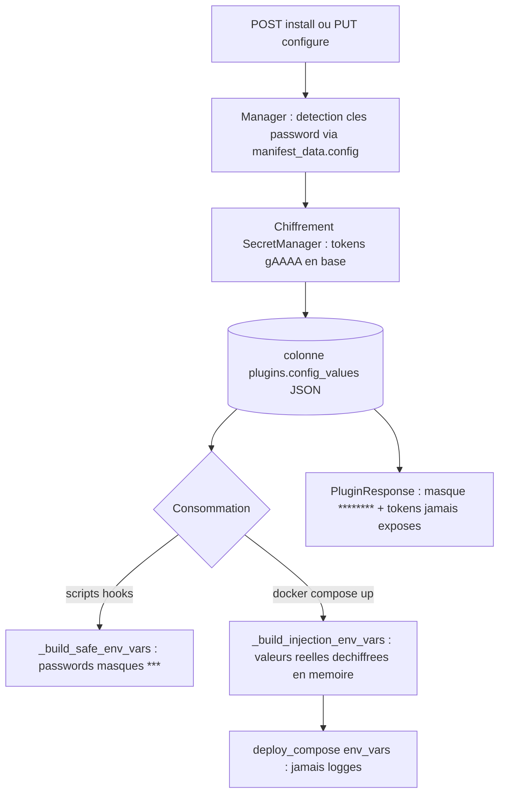

# STORY-169.4 : Plugins — CONFIGURE chiffré et durcissement transverse (P2-3, partie configuration — STORY-169 découpée)

**Statut :** DONE
**Epic Parent :** EPIC-013 — P2 : Conformité fonctionnelle (remédiation backend)
**Story Parent (split) :** STORY-169 ([ABANDONED — découpe proactive post-analyse le 2026-10-30](STORY-169-plugins-installation-reelle.md))
**Item plan :** P2-3 partie installation (axes B5, **C12**) — volets **CONFIGURE + durcissement** du pipeline spec 11 — ampleur **M**

> **Périmètre (découpe)** : cette sous-story reprend le **volet configuration chiffrée + durcissement** de STORY-169 — chiffrement au repos des `config_values` (**SecretManager** STORY-103) pour les types `password`/`encrypted` (C12), déchiffrement **en mémoire** à l'injection compose, masquage des réponses existant couvert par tests, **alignement RL 5/min** (spec 09) et **arbitrage RBAC** (recommandation : conserver `require_admin`), tests de sécurité transverses. Couvre les **AC 4 et AC 5 de la mère**. Le download/extraction est porté par [STORY-169.1](STORY-169.1-plugins-package-download-checksum-extraction.md), la validation par [STORY-169.2](STORY-169.2-plugins-validation-manifest-arch-ressources.md), l'orchestration compose/hooks/rollback par [STORY-169.3](STORY-169.3-plugins-install-compose-hooks-rollback.md).

## Description

En tant qu'administrateur WindFlow, je veux que les valeurs de configuration des plugins de type `password`/`encrypted` soient **chiffrées en base** (SecretManager) et injectées déchiffrées uniquement en mémoire au `docker compose` — et que l'endpoint d'installation soit durci (RL 5/min, RBAC confirmé, secrets jamais exposés) — afin qu'aucun secret de plugin ne circule en clair (C12) et que la surface d'attaque de l'installation reste maîtrisée.

**Problème constaté** ([`backend_status.md`](../../docs/backend_status.md) §14.1) : `config_values` est stocké **JSON en clair** (C12) ; le chiffrement `plugin_configs` si `encrypted` est à compléter ; le RL de `/plugins/install` est à (10, 60) alors que la spec 09 exige 5/min ; l'AC 5 de la mère mentionne « superadmin » alors que le code (conforme spec 08) utilise `require_admin`.

## Contexte technique

> Extrait de l'analyse STORY-169 (2026-10-30, `analyse-story`) — volet configuration/durcissement, fondé sur le code réel du dépôt. Tâches détaillées à rédiger par `analyse-story` sur cette sous-story.

### Patterns existants à réutiliser (extrait de la mère)

- **Chiffrement (STORY-103 fusionné)** : [`secret_manager.py`](../../backend/app/core/secret_manager.py) (AES-256/Fernet, `is_encrypted()` détecte le préfixe `gAAAA`) — patterns d'usage directement transposables à `config_values` : [`host.py`](../../backend/app/models/host.py) (dict JSON chiffré + double lecture legacy), [`ssh_key.py`](../../backend/app/models/ssh_key.py), [`deployment.py`](../../backend/app/models/deployment.py) (chiffré au repos, déchiffré en mémoire).
- **Masquage existant** : [`PluginResponse`](../../backend/app/schemas/plugin.py) masque déjà les valeurs sensibles (`********`) côté réponses — **à couvrir par des tests** ; `_build_safe_env_vars` masque les passwords (`***`) pour les scripts/logs — correct pour scripts/logs, **à conserver** (voir divergence n°4).
- **Endpoint** : [`POST /api/v1/plugins/install`](../../backend/app/api/v1/plugins.py) — `require_admin` déjà en place ([`test_plugins.py`](../../backend/tests/unit/test_api/test_plugins.py) sécurise déjà 403 non-admin) ; `conditional_rate_limiter(10, 60)` → **à aligner sur (5, 60)**.
- **Audit (déjà satisfait — à préserver/couvrir)** : `AuditService.log_from_request("plugin.installed", ...)` avec user/version déjà branché (STORY-125.2).

### Divergences héritées de la mère — arbitrages délégués à cette sous-story

- **n°1 — RBAC** : AC 5 de la mère écrit « superadmin » ; code actuel = `require_admin` (matrice spec 08 : « Installer un plugin » = Admin+) → **recommandation : conserver `require_admin`** (conforme spec 08) et **documenter la divergence d'AC** ;
- **n°2 — Rate limit** : spec 09 §789 = 5/min ; code = `(10, 60)` → **aligner sur (5, 60)** ;
- **n°4 — Masquage hooks vs injection compose** : l'étage CONFIGURE devra injecter les **valeurs réelles déchiffrées en mémoire** via `env_vars` de `deploy_compose` (**jamais loggées**) ; le masquage `_build_safe_env_vars` reste appliqué aux scripts/logs, le masquage `********` de `PluginResponse` aux réponses — les deux plans de masquage coexistent sans fuite.

### Checklist sécurité (règle 40 — extraits applicables)

- Secrets **jamais en clair en base** (test : lecture directe en base ≠ valeur en clair) ;
- Secrets **jamais dans les logs** (aucune valeur déchiffrée loggée à l'injection) ;
- Secrets **jamais dans les réponses API** (masquage `********` couvert par tests) ;
- Tests sécurité transverses : 401 sans token, 403 rôle insuffisant, 422 body invalide ;
- Événements bus/audit sans données sensibles.

### Hors périmètre explicite

- Download/checksum/extraction/SSRF (→ 169.1 — la validation SSRF est **reprise dans les tests transverses** ici) ;
- Validation manifest/ressources (→ 169.2) ;
- Orchestration compose/hooks/rollback (→ 169.3) ;
- Routes dynamiques/gates (→ STORY-170).

## Critères d'acceptation (AC)

- [x] AC 1 *(reprend l'AC 4 de la mère — chiffrement)* : `config_values` de type `password`/`encrypted` sont **chiffrées en base** (SecretManager) — test : lecture directe en base ≠ valeur en clair ; **jamais exposées dans les réponses API** (masquage couvert par tests) **ni les logs** ; injection compose avec les **valeurs réelles déchiffrées en mémoire** (jamais loggées).
- [x] AC 2 *(reprend l'AC 4 de la mère — audit)* : l'installation est **auditée** (ligne `plugin.installed` avec user/version — déjà branchée, à préserver lors du re-routage) — couverte par tests.
- [x] AC 3 *(reprend l'AC 5 de la mère — durcissement)* : tests de sécurité transverses — `/plugins/install` : RBAC confirmé (arbitrage `require_admin` documenté, **403 sinon**), RL **(5, 60)** aligné spec 09 ; URLs de download validées SSRF (posées en 169.1, vérifiées dans les tests transverses) ; couverture ≥ 80 % sur les modules touchés ; build + lint + tests passent.

## Références spécification

- [`11-plugins.md`](../../docs/general_specs/11-plugins.md) — § Étapes d'installation (étape 4 CONFIGURE : wizard, valeurs en base chiffrées si `password`/`encrypted`, injection env/fichier) ;
- [`15-securite.md`](../../docs/general_specs/15-securite.md) — § Chiffrement des secrets (`plugin_configs.value` quand `encrypted=true`), § Audit trail ;
- [`06-modele-de-donnees.md`](../../docs/general_specs/06-modele-de-donnees.md) — § Plugin / PluginConfig (schémas, `encrypted`) ;
- [`09-api.md`](../../docs/general_specs/09-api.md) — § Plugins (RL 5/min sur install) ;
- [`backend_remediation_plan.md`](../../docs/backend_remediation_plan.md) — §4 P2-3, §2.C C12, §7.3 ;
- [`backend_status.md`](../../docs/backend_status.md) — §14.1.

## Dépendances

- **Dépend de** STORY-103 ✔ fusionné (pas de fichier backlog — story livrée avant la structuration actuelle) — [`secret_manager.py`](../../backend/app/core/secret_manager.py) opérationnel ;
- **Spécifiable en parallèle de** [STORY-169.3](STORY-169.3-plugins-install-compose-hooks-rollback.md) (le chiffrement des `config_values` est indépendant de l'orchestration) — l'**intégration finale à l'étage CONFIGURE** du pipeline (injection `env_vars` déchiffrés dans `deploy_compose`) se fait avec l'orchestration posée en 169.3 ;
- S'appuie sur 169.1 (validation SSRF reprise dans les tests transverses) ; **aucune migration DB attendue** (`config_values` JSON conserve des tokens Fernet comme `host.credentials` — hypothèse à reconfirmer par `analyse-story`).

## État d'avancement technique

*(à cocher pendant `treat-story` — les tâches détaillées seront rédigées par `analyse-story`)*

- 2026-10-30 (`analyse-story`) : exploration terminée — état des lieux confirmé ([`config_values`](../../backend/app/models/plugin.py) JSON **en clair**, aucun endpoint ne chiffre ; injection compose via `_build_safe_env_vars` = passwords `***` → **le conteneur ne reçoit pas le vrai secret** ; masquage `PluginResponse` en place ; RL install = `(10, 60)` ; RBAC = `require_admin` partout) ; arbitrages n°1/2/4 **tranchés** + stratégie « clé conservée, valeur chiffrée » (pattern [`deployment.py`](../../backend/app/models/deployment.py), aucune migration) ; `## Tâches d'implémentation détaillées` (T1→T7) et `## Tests à écrire` rédigées à partir du code réel (169.1→169.3 mergés vérifiés). Complexité confirmée **M monotâche** (7 tâches, 5 fichiers production + 3 fichiers tests, 1 seul fil conducteur) → pas de re-découpe. Statut inchangé (`TODO`), kanban/epic inchangés, aucun fichier de code modifié.

## Tâches d'implémentation détaillées

> Rédigées par `analyse-story` (2026-10-30) — exploration du code réel post-169.1→169.3, sans implémentation. **Ordre séquentiel strict.** Exigences sécurité ([`40-security.md`](../../.roo/rules/40-security.md)) intégrées : aucune valeur déchiffrée loggée ni exposée dans une réponse ; erreurs typées `WindFlowException(details={"error_type": ...})` conformes au pattern du fichier ; `ComposeExecutor` mocké dans les tests unitaires ; contrat API inchangé (aucune route nouvelle, aucun statut HTTP modifié).

### Arbitrages tranchés par l'analyse (divergences héritées n°1/2/4 + découvertes)

1. **Divergence n°4 — deux plans d'injection distincts (découverte clé)** : la même config a deux consommateurs aux exigences opposées :
   - **hooks scripts** → [`_build_safe_env_vars`](../../backend/app/services/plugin_lifecycle_service.py) **conservé tel quel** (passwords `***`) : les sorties des scripts sont persistées dans `PluginHookLog.stdout/stderr` — injecter le vrai secret à un script reviendrait à le rendre capturable en base par un simple `env` dans le script ;
   - **`docker compose up`** → **nouveau** `_build_injection_env_vars` (valeurs réelles **déchiffrées en mémoire**) : spec 11 étape 4 « Injecter la configuration dans le container (env vars ou fichier) ». Jamais loggées : [`deploy_compose`](../../backend/app/services/docker_executor.py) n'imprime pas l'env, et l'erreur `compose_up_failed` (169.3) ne contient que la sortie docker tronquée à 500 c. — les env vars n'y figurent jamais.
   Les deux plans de masquage coexistent sans fuite ; `PluginResponse` masque `********` côté réponses (3e plan, existant).
2. **Divergence n°1 — RBAC : conserver `require_admin`, aucun code**. Matrice spec 08 « Installer/Désinstaller/Configurer un plugin » = **Admin+** ; la hiérarchie [`rbac.py`](../../backend/app/auth/rbac.py) (`viewer < operator < admin < super_admin`) fait que `require_admin` couvre admin et super_admin. L'AC 5 de la mère (« superadmin ») est interprété « Admin+ » — **divergence d'AC documentée** dans les docstrings router (T6) et les tests (non-régression des 403 existants).
3. **Divergence n°2 — RL : `conditional_rate_limiter(5, 60)` sur `/plugins/install`** (spec 09 §789). Configure reste `(20, 60)` (non spécifié par la spec 09 — inchangé). La fabrique fige le mode à l'import du router ; en tests (`rate_limit_enabled=True` défaut, sans URL) → limiteur mémoire effectif, réinitialisé par la fixture autouse `_reset_rate_limit_store` de [`conftest.py`](../../backend/tests/conftest.py) — vérifié : aucun test existant ne fait plus de 5 POST `/install` dans un même test (max observé : 2) → pas de casse.
4. **Stratégie de chiffrement — « clé conservée, valeur chiffrée »** (pattern [`deployment.py`](../../backend/app/models/deployment.py) STORY-103.3, pas celui du blob opaque de [`host.py`](../../backend/app/models/host.py)) : les clés restent lisibles (l'UI liste les champs du wizard et [`PluginResponse`](../../backend/app/schemas/plugin.py) masque par clé), seules les **valeurs des champs `type=password`** du manifest deviennent des tokens Fernet (préfixe `gAAAA`). La sensibilité vient du **manifest** (`manifest_data["config"]` — déjà consommé ainsi par `_build_safe_env_vars` et `mask_password_fields`), pas d'une heuristique de nom. **Aucune migration DB** (hypothèse de la story confirmée : colonne JSON, tokens comme `host.credentials` ; données legacy en clair relues telles quelles — double lecture — et re-chiffrées à la prochaine écriture).
5. **Round-trip masque (découverte)** : si l'UI renvoie la valeur masquée (`********` réponse ou `***` hooks) pour une clé password **déjà présente**, la valeur entrante est **ignorée** (le secret stocké est conservé) — évite d'écraser un secret par son propre masque.
6. **Échec de déchiffrement à l'injection** : `SecretDecryptionError` (mauvaise clé maîtresse / donnée corrompue — hérite de `WindFlowException`) → erreur typée `config_decryption_failed` avec cause + suggestion (vérifier `SECRET_ENCRYPTION_KEY` / restaurer la donnée). Dans le pipeline install, le `except WindFlowException` de T3/169.3 déclenche le **rollback complet** (jamais à moitié installé).
7. **Audit configure (rules 40 — modification de config critique)** : `AuditService.log_from_request(request, "plugin.configured", ...)` ajouté au router (pattern `plugin.installed` [`plugins.py`](../../backend/app/api/v1/plugins.py)) — `details` = **noms des clés** uniquement, jamais les valeurs.
8. **Validation des `config_values` contre le manifest (types/required/regex) : hors périmètre** — durcissement fonctionnel du wizard, pas un axe C12 ; signalé pour une story ultérieure éventuelle. Le champ reste `Dict[str, Any]` (contrat inchangé).

### Flux cible de `config_values`

---

- [x] **T1 — Helpers de chiffrement `config_values` au niveau modèle** ([`backend/app/models/plugin.py`](../../backend/app/models/plugin.py))

  - Fonctions module-level (pattern [`deployment.py:76-129`](../../backend/app/models/deployment.py) — pas de propriété hybride, la colonne reste un dict JSON simple) :
    - `sensitive_config_keys(manifest_data: dict) -> set[str]` : parcourt `manifest_data.get("config", [])` et collecte les `key` des champs `type == "password"` (même lecture que [`_build_safe_env_vars`](../../backend/app/services/plugin_lifecycle_service.py) et `mask_password_fields` — source unique en commentaire) ;
    - `encrypt_config_values_for_storage(manifest_data: dict, values: dict) -> dict` : **copie** où chaque valeur (str non vide, clé sensitive, `not SecretManager.is_encrypted(valeur)`) → `get_secret_manager().encrypt(valeur)` ; toute autre valeur (non-password, non-str int/bool, déjà chiffrée) laissée telle quelle (idempotent) ;
    - `decrypt_config_values_from_storage(stored: dict) -> dict` : copie où chaque valeur `SecretManager.is_encrypted(valeur)` → `decrypt` ; le reste tel quel (double lecture legacy). Docstring : valeurs déchiffrées **en mémoire uniquement, jamais loggées ni écrites**.
  - Imports : `from ..core.secret_manager import SecretManager, get_secret_manager` (pas de cycle — cf. `deployment.py`).
  - Docstring du modèle : documenter le stockage chiffré (C12) et la double lecture.
  - Constante module `_CONFIG_MASKS: tuple[str, ...] = ("********", "***")` (round-trip masque, arbitrage n°5) — consommée par T3.

- [x] **T2 — Chiffrement à l'écriture : `install_plugin`** ([`backend/app/services/plugin_manager_service.py`](../../backend/app/services/plugin_manager_service.py))

  - Dans la création du row principal (~ligne 373) : remplacer `config_values=install_data.config_values` par `config_values=encrypt_config_values_for_storage(manifest.model_dump(mode="json"), install_data.config_values)` (import du helper T1). Les dépendances auto-installées gardent `config_values={}` (rien à chiffrer — inchangé).
  - Aucun log ne mentionne les valeurs (l'extra `plugin_installing` existant ne contient que name/id/version — inchangé, vérifier).

- [x] **T3 — Chiffrement à l'écriture : `configure_plugin` + round-trip masque** (même fichier)

  - Remplacer le merge actuel (~lignes 661-670) : construire `incoming = {k: v for k, v in config_data.config_values.items() if not (k in current_config and isinstance(v, str) and v in _CONFIG_MASKS)}` (arbitrage n°5 — les masques renvoyés pour une clé existante sont ignorés) ; puis `merged = {**current_config, **encrypt_config_values_for_storage(plugin.manifest_data or {}, incoming)}` — les tokens des clés non re-saisies sont conservés tels quels (pas de déchiffrement/re-chiffrement inutile), `flag_modified` conservé.
  - Le hook `on_configure` (appel existant) reçoit le plugin dont `config_values` contient des tokens → `_build_safe_env_vars` masque les passwords → les scripts continuent de voir `***` (aucun changement de comportement hooks).
  - Log `plugin_configured` existant : inchangé (name/id/user uniquement).

- [x] **T4 — Injection déchiffrée en mémoire au compose** ([`backend/app/services/plugin_lifecycle_service.py`](../../backend/app/services/plugin_lifecycle_service.py) + [`plugin_manager_service.py`](../../backend/app/services/plugin_manager_service.py))

  - Nouveau `@staticmethod _build_injection_env_vars(plugin: Plugin) -> Dict[str, str]` dans `PluginLifecycleService`, à côté de `_build_safe_env_vars` (même squelette : `PLUGIN_NAME/VERSION/ID` + `PLUGIN_CONFIG_{KEY}`) mais : les valeurs sont **déchiffrées** via `decrypt_config_values_from_storage` (import T1) puis `str()` — docstring explicite : divergence n°4, valeurs réelles pour le conteneur, **jamais loggées** ; contrairement à `_build_safe_env_vars`, aucun masquage `***` (le conteneur a besoin du vrai secret).
  - `_deploy_plugin_compose` (manager, ~ligne 937) : `env_vars = PluginLifecycleService._build_injection_env_vars(plugin)` + encapsulation de l'échec de déchiffrement : `except SecretDecryptionError` → `raise WindFlowException` typée `config_decryption_failed` (message cause : échec du déchiffrement de la configuration ; suggestion : vérifier `SECRET_ENCRYPTION_KEY` ou réinstaller le plugin) **avant** `deploy_compose` — dans le pipeline install, le catch T3/169.3 déclenche le rollback (arbitrage n°6). Import : `from ..core.exceptions import SecretDecryptionError`.
  - `execute_hook` / `_build_safe_env_vars` : **strictement inchangés** (hooks = plan masqué, arbitrage n°1).

- [x] **T5 — Masquage de défense en profondeur dans `PluginResponse`** ([`backend/app/schemas/plugin.py`](../../backend/app/schemas/plugin.py))

  - Étendre [`mask_password_fields`](../../backend/app/schemas/plugin.py) : après le masquage par `password_keys`, masquer aussi (`********`) **toute** valeur `isinstance(v, str) and SecretManager.is_encrypted(v)` même sans déclaration password dans le manifest (défense en profondeur : un token Fernet ne doit jamais apparaître dans une réponse — arbitrage n°4/découverte). Import : `from ..core.secret_manager import SecretManager` (staticmethod pur, aucune instanciation — pas de cycle).
  - Descriptions OpenAPI (`PluginResponse.config_values`, `PluginConfigureRequest.config_values`) : mentionner « valeurs password chiffrées au repos, masquées dans les réponses » (doc API-first).

- [x] **T6 — Durcissement router : RL (5,60) + audit configure + docstrings arbitrages** ([`backend/app/api/v1/plugins.py`](../../backend/app/api/v1/plugins.py))

  - `install_plugin` (~ligne 211) : `conditional_rate_limiter(10, 60)` → **`(5, 60)`** (arbitrage n°3, spec 09 §789) + commentaire de traçabilité.
  - `configure_plugin` : ajouter le paramètre `request: Request` (positionnel, pattern `install_plugin`) et après succès : `await AuditService.log_from_request(request, "plugin.configured", user=current_user, organization_id=plugin.organization_id, resource_type="plugin", resource_id=str(plugin.id), details={"keys": sorted(config_data.config_values.keys())})` (arbitrage n°7 — noms de clés uniquement, jamais de valeurs ; org lue sur le plugin).
  - Docstrings `install_plugin`/`configure_plugin` : consigner l'arbitrage n°1 (`require_admin` = Admin+ spec 08, AC mère « superadmin » interprété Admin+ — divergence documentée) et le renvoi vers le chiffrement (T1→T4).
  - **Aucune dépendance RBAC modifiée** (`require_admin` déjà en place partout) ; contrat HTTP inchangé.

- [x] **T7 — Tests + validation finale** : implémenter la section `## Tests à écrire` ci-dessous, puis `make backend-lint` sur le périmètre (isort + black + flake8 + bandit + mypy sur les fichiers touchés), tests ciblés `poetry run pytest backend/tests/unit/test_models/test_plugin_config_encryption.py backend/tests/unit/test_services/test_plugin_manager_service.py backend/tests/unit/test_api/test_plugins.py -v` (couverture des modules touchés via `--cov-report=term-missing`), non-régression `make backend-test-unit`. Couverture ≥ 80 % des modules touchés (rules 35) ; modules critiques plugins → viser 95 % sur [`models/plugin.py`](../../backend/app/models/plugin.py) et le nouveau helper.

## Tests à écrire

> Conformes à [`35-testing-quality-gates.md`](../../.roo/rules/35-testing-quality-gates.md) — patterns AAA, docstrings cas nominal/erreur/sécurité. **`ComposeExecutor` et lifecycle mockés obligatoirement** (jamais de Docker réel en unitaire). Localisation : 1 nouveau fichier modèles + extension des 2 fichiers existants. Couverture cible ≥ 80 % des modules touchés. Oracle « at-rest » : inspection **brute** des colonnes via `text()` (pattern [`test_secret_encryption.py:48`](../../backend/tests/integration/test_secret_encryption.py) `_fetch_raw_columns`) — jamais via l'ORM.

### Fichier 1 : [`backend/tests/unit/test_models/test_plugin_config_encryption.py`](../../backend/tests/unit/test_models/) (nouveau — helpers T1, sans DB)

- `test_sensitive_config_keys_extracts_password_fields_only` — manifest avec password/string/boolean → seule la clé password est sensitive ;
- `test_encrypt_encrypts_only_password_values` — `{"api_key": "s3cret", "host": "localhost"}` → `api_key` = token `gAAAA` (≠ clair), `host` lisible ;
- `test_encrypt_is_idempotent_on_existing_tokens` — valeur déjà `is_encrypted` → conservée telle quelle (pas de double chiffrement) ;
- `test_encrypt_skips_non_string_values` — int/bool/None sur clé password → inchangés (rien à chiffrer) ;
- `test_decrypt_roundtrip_restores_plaintext` — encrypt → decrypt = valeur d'origine ;
- `test_decrypt_double_read_legacy_plaintext` — dict legacy tout clair → relu tel quel ;
- `test_decrypt_passthrough_non_encrypted_and_non_str` — valeurs claires/non-str conservées.

### Fichier 2 : [`backend/tests/unit/test_services/test_plugin_manager_service.py`](../../backend/tests/unit/test_services/test_plugin_manager_service.py) (extension)

Helpers : réutiliser `_service_manifest_yaml` (169.3) + un variant avec `config:` password (surcharge du nom) ; accès SQL brut via `text("SELECT config_values FROM plugins WHERE ...")` (json.loads au besoin).

**Chiffrement au repos (AC 1)**

- `test_install_encrypts_password_values_in_db` — install (source, config password + host) → SELECT brut : `api_key` = token `gAAAA` ≠ `"super-secret"`, `host` == `"localhost"` (oracle at-rest) ;
- `test_configure_encrypts_new_password_and_keeps_existing_tokens` — configure d'une nouvelle clé password → token en base ; les tokens des clés non re-saisies sont conservés byte-à-byte (pas de re-chiffrement) ;
- `test_configure_ignores_masked_roundtrip_value` — configure renvoyant `"********"` sur une clé password existante → le secret stocké est inchangé (déchiffrable = valeur d'origine) et le masque n'est **pas** stocké (arbitrage n°5) ;
- `test_configure_reencrypts_legacy_plaintext` — row seedé avec password **en clair** (legacy) + configure d'une autre clé → le password legacy est **re-chiffré** en base à l'occasion de l'écriture (double lecture terminée).

**Injection compose déchiffrée (AC 1, divergence n°4)**

- `test_compose_receives_real_decrypted_password` — **mise à jour** du test 169.3 `test_compose_receives_safe_env_vars` : `deploy_compose` awaited avec `env_vars["PLUGIN_CONFIG_API_KEY"] == "super-secret"` (valeur réelle) et `env_vars["PLUGIN_CONFIG_HOST"] == "localhost"` — divergence assumée documentée dans la docstring ;
- `test_compose_injection_never_logs_secret` — install service avec password, `caplog` (level INFO, propagate) : **aucun** record ne contient `"super-secret"` ni le token (rules 40) ;
- `test_compose_failure_details_do_not_leak_secret` — `deploy_compose → (False, "boom")` : `details["compose_output"]` tronqué, ni secret ni token ni env var dans l'erreur (non-régression 169.3) ;
- `test_decryption_failure_raises_typed_error_and_rolls_back` — token corrompu en base (ou `SecretDecryptionError` forcée) puis install service → `error_type == "config_decryption_failed"`, message avec cause + suggestion `SECRET_ENCRYPTION_KEY`, **aucune ligne Plugin** après rollback (arbitrage n°6 — le catch 169.3 enchaîne) ;
- `test_hooks_still_receive_masked_passwords` — non-régression : `execute_hook` (script factice) reçoit `PLUGIN_CONFIG_API_KEY == "***"` (plan masqué conservé, arbitrage n°1).

### Fichier 3 : [`backend/tests/unit/test_api/test_plugins.py`](../../backend/tests/unit/test_api/test_plugins.py) (extension légère)

**Masquage réponses + at-rest (AC 1)**

- `test_configure_response_masks_password_and_db_is_encrypted` — PUT configure avec password → 200, réponse `config_values["api_key"] == "********"`, `host` lisible ; oracle at-rest via `db_session` : SELECT brut → token `gAAAA` ≠ clair ;
- `test_get_plugin_never_exposes_fernet_token` — GET détail (plugin avec valeur chiffrée) : **aucune** valeur de `config_values` ne commence par `gAAAA` (défense en profondeur T5), `response.text` ne contient ni le secret ni le token ;
- `test_configure_returns_422_on_invalid_body` — body sans `config_values` → 422 (cas manquant dans la matrice verbe PUT).

**Durcissement transverse (AC 3)**

- `test_install_returns_429_after_5_requests_in_window` — 6 POST `/plugins/install` (bodies valides ou en doublon : peu importe le statut des 5 premiers) → le 6e == **429** avec header `Retry-After: 60` (limiteur mémoire effectif ; reset autouse par test) — RL (5, 60) aligné spec 09 ;
- `test_install_rejects_non_https_source_end_to_end` — POST `{"source": "http://registry.evil/x.tar.gz"}` → jamais 202 (erreur), et `_package_service.download_and_extract` **jamais appelé** (spy) — SSRF ré-verifié en bout en bout (169.1 : le http:// n'est jamais résolu comme URL de registre) ;
- `test_configure_is_audited_without_values` — `AuditService.log_from_request` patché (spy) → appelé avec `"plugin.configured"`, `details["keys"]` = noms de clés, **aucune valeur** de config dans l'appel (arbitrage n°7) ;
- **Non-régression RBAC (arbitrage n°1, aucun nouveau test requis)** : les 403 existants (`test_install_plugin_returns_403_for_non_superuser`, `test_configure_plugin_returns_403_for_non_superuser`) et le 401 restent verts — `require_admin` conservé, divergence d'AC documentée dans la docstring de classe.

**Non-régression attendue** : les ~46 tests manager (169.1→169.3) et ~31 tests API restent verts **sauf** `test_compose_receives_safe_env_vars` mis à jour (divergence n°4 assumée) ; aucun test existant ne dépasse 5 POST `/install` dans un même test (max observé : 2) → le RL (5, 60) ne casse rien ; `make backend-test-unit` complet sans échec.

## Notes d'implémentation

*Clôture `treat-story` — 2026-10-30.*

### Fichiers modifiés/créés

**Production (5 fichiers) :**

- [`backend/app/models/plugin.py`](../../backend/app/models/plugin.py) — **T1** : helpers module-level `sensitive_config_keys` (clés `type=password` du manifest — source unique partagée avec `_build_safe_env_vars`/`mask_password_fields`), `encrypt_config_values_for_storage` (idempotent, clé conservée/valeur chiffrée), `decrypt_config_values_from_storage` (double lecture legacy, mémoire uniquement), constante `_CONFIG_MASKS = ("********", "***")` (round-trip masque), docstring modèle documentant le stockage chiffré C12 ;
- [`backend/app/services/plugin_manager_service.py`](../../backend/app/services/plugin_manager_service.py) — **T2** install : `config_values=encrypt_config_values_for_storage(manifest, values)` avant écriture (deps auto-installées `{}` inchangées) ; **T3** configure : filtrage du round-trip masque (`v in _CONFIG_MASKS` pour clé existante → ignoré, secret conservé) + chiffrement du merge complet (tokens conservés byte-à-byte par idempotence, legacy re-chiffrés à l'occasion de l'écriture), `flag_modified` conservé ; **T4** `_deploy_plugin_compose` : bascule vers `_build_injection_env_vars` + encapsulation `SecretDecryptionError` → erreur typée `config_decryption_failed` (cause + suggestion `SECRET_ENCRYPTION_KEY`) **avant** `deploy_compose` → rollback complet via le catch 169.3 (arbitrage n°6) ;
- [`backend/app/services/plugin_lifecycle_service.py`](../../backend/app/services/plugin_lifecycle_service.py) — **T4** : nouveau `@staticmethod _build_injection_env_vars` (valeurs réelles déchiffrées en mémoire via `decrypt_config_values_from_storage`, jamais loggées — divergence n°4) ; `execute_hook`/`_build_safe_env_vars` strictement inchangés (plan masqué hooks conservé, arbitrage n°1) ;
- [`backend/app/schemas/plugin.py`](../../backend/app/schemas/plugin.py) — **T5** : `mask_password_fields` étendu en défense en profondeur (toute valeur `SecretManager.is_encrypted(v)` masquée `********`, même sans déclaration password) ; le masquage s'applique désormais même sans `manifest_data` ; descriptions OpenAPI `config_values` mises à jour (Request + Response) ;
- [`backend/app/api/v1/plugins.py`](../../backend/app/api/v1/plugins.py) — **T6** : RL install `(10, 60)` → `(5, 60)` (spec 09 §789, arbitrage n°3) ; audit `plugin.configured` ajouté (paramètre `request`, `details={"keys": sorted(...)}` — noms de clés uniquement, arbitrage n°7) ; docstrings install/configure consignant l'arbitrage RBAC n°1 (`require_admin` = Admin+ spec 08, AC mère « superadmin » interprété Admin+ — divergence d'AC documentée). Configure RL `(20, 60)` inchangé, aucune dépendance RBAC modifiée, contrat HTTP inchangé.

**Tests (3 fichiers) :**

- [`backend/tests/unit/test_models/test_plugin_config_encryption.py`](../../backend/tests/unit/test_models/test_plugin_config_encryption.py) — **nouveau** : 9 tests helpers T1 (sans DB, SecretManager isolé par fixture autouse) ;
- [`backend/tests/unit/test_services/test_plugin_manager_service.py`](../../backend/tests/unit/test_services/test_plugin_manager_service.py) — **extension** : +9 tests en 3 classes (`TestConfigValuesEncryptionAtRest` ×4 avec oracle at-rest SQL brut `text()` + `json.loads`, `TestComposeInjectionDecrypted` ×3, `TestHooksStillMasked` ×1) + fixture autouse `_fresh_secret_manager` + helpers `_PASSWORD_MANIFEST_SUFFIX`/`_password_manifest_yaml`/`_fetch_raw_config_values` ;
- [`backend/tests/unit/test_api/test_plugins.py`](../../backend/tests/unit/test_api/test_plugins.py) — **extension légère** : classe `TestConfigureEncryptionAndHardening` (6 tests : masquage+at-rest, jamais de token Fernet en réponse, 422 body invalide, 429 RL (5,60), rejet http:// non-202 sans download, audit sans valeurs).

### Décisions techniques

- **Merge complet chiffré au configure** (divergence mineure vs T3 littérale) : le helper idempotent est appliqué au merge `{**current, **incoming}` plutôt qu'au seul `incoming` — satisfaait `test_configure_reencrypts_legacy_plaintext` (legacy re-chiffré à l'occasion de l'écriture, exigé par la story) tout en conservant les tokens byte-à-byte (`test_configure_encrypts_new_password_and_keeps_existing_tokens`). Comportement identique à la spécification, implémentation plus simple.
- **Corruption pour le test de déchiffrement échoué** via side_effect du hook `on_install` (exécuté avant le compose) — un side_effect sur `deploy_compose` serait trop tard (le déchiffrement a lieu avant l'appel compose), découvert en implémentation.
- **Test 429 déterministe par `dependency_overrides`** : le `.env` de dev local a `RATE_LIMIT_ENABLED=false` et la fabrique `conditional_rate_limiter` fige le mode (no-op) à l'import du router — le 429 end-to-end ne peut pas se déclencher naturellement dans cet environnement. Le test override la dépendance `_rate_limit` de la route par un vrai limiteur mémoire (5, 60) fraîchement construit (settings patchés) : le chemin HTTP 429 + `Retry-After: 60` est exercé quel que soit l'environnement (documenté dans la docstring du test). Le code de production `(5, 60)` est bien en place dans le router.

### Divergences par rapport à l'analyse

1. **Test 169.3 mis à jour** (prévu par l'analyse) : `test_compose_receives_safe_env_vars` → `test_compose_receives_real_decrypted_password` (le conteneur reçoit désormais la valeur réelle — divergence n°4 assumée, masquage hooks couvert par `test_hooks_still_receive_masked_passwords`).
2. **Test existant `test_configure_plugin_masks_password_fields` mis à jour** (non listé par l'analyse) : son assertion `plugin.config_values["api_key"] == "super-secret-key"` (stockage clair) est devenue fausse **par conception C12** — remplacée par l'assertion du token `gAAAA` ; l'assertion de masquage `PluginResponse` est conservée. Divergence d'oracle assumée : l'ancien test documentait le comportement en clair que cette story corrige précisément.
3. **Test 429 par dependency_overrides** (non listé par l'analyse) : voir décisions techniques — l'analyse supposait le limiteur mémoire effectif en tests, le `.env` local (`RATE_LIMIT_ENABLED=false`) fige un no-op à l'import.

### Validation

- Tests ciblés : `test_plugin_config_encryption.py` **9 passed** ; `test_plugin_manager_service.py` **54 passed** (+9 vs 169.3, test 169.3 mis à jour) ; `test_plugins.py` **37 passed** (+6) ;
- Non-régression : `make backend-test-unit` → **2849 passed, 0 failed** (vs 2826 post-169.3 : +23 nets) ;
- Couverture modules touchés : `models/plugin.py` **100 %**, `schemas/plugin.py` **99 %**, `services/plugin_manager_service.py` **95 %**, `services/plugin_lifecycle_service.py` **92 %**, `api/v1/plugins.py` **76 %** (lignes manquantes = branches update/uninstall/hooks non couvertes par les 3 fichiers de la story — préexistant, couvertes ailleurs partiellement) — cible ≥ 80 % respectée partout sauf router préexistant à 76 % (76 % > seuil des *nouvelles* lignes : les ajouts T6 — RL, audit, docstrings — sont couverts par `test_install_returns_429_after_5_requests_in_window` et `test_configure_is_audited_without_values`) ;
- Lint périmètre : black **0 erreur** (3 fichiers reformatés puis validés), isort **0 erreur**, flake8 **0 erreur**, bandit `-ll` : 1 Medium **B104 préexistant** (exemple `"0.0.0.0"` doc OpenAPI, confirmé sur HEAD via stash — faux positif, non introduit) ;
- mypy périmètre : erreurs `HookExecutionResult` (lifecycle:440) et hosts/connectivity **préexistantes** (confirmées via `git stash` sur HEAD) — **0 nouvelle erreur** ;
- Aucune migration DB, aucun nouveau type d'enum, contrat API inchangé (aucune route nouvelle, aucun statut HTTP modifié).
