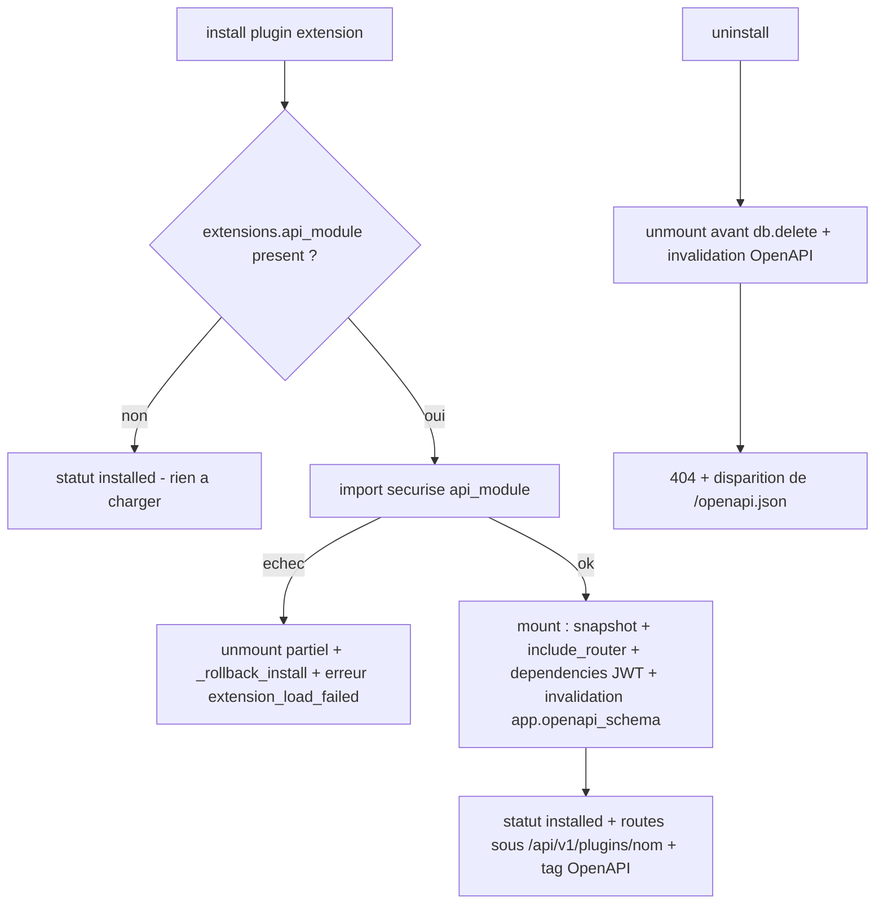

# STORY-170.1 : Plugins — routes API dynamiques `/api/v1/plugins/{name}/…` : montage/démontage, RBAC core et OpenAPI (P2-3, partie extension — STORY-170 découpée)

**Statut :** DONE
**Epic Parent :** EPIC-013 — P2 : Conformité fonctionnelle (remédiation backend)
**Story Parent (split) :** STORY-170 ([ABANDONED — découpe proactive post-analyse le 2026-10-30](STORY-170-plugins-routes-dynamiques-gates.md))
**Item plan :** P2-3 partie extension (axes B5, C6) — volet **routes API dynamiques** de la spec 11 — ampleur **M**

> **Périmètre (découpe)** : cette sous-story reprend le **volet routes dynamiques** de STORY-170 — setting `plugin_dynamic_routes_enabled`, factory SDK `plugin_router("{name}")` (préfixe `/api/v1/plugins/{name}/` + tag `plugin-{name}`), service de montage/démontage sur l'app FastAPI avec **invalidation du cache OpenAPI** (`app.openapi_schema = None`), **garde de préfixe** (un plugin ne peut pas injecter de routes hors de son espace de noms) et **défense en profondeur JWT** au `include_router` + RBAC core par endpoint (spec 08), branchements [`plugin_manager_service`](../../backend/app/services/plugin_manager_service.py) (montage à l'install, rollback `extension_load_failed` — 3e cas différé par 169.3, démontage à l'uninstall avant `db.delete`) et **lifespan** `main.py` (chargement des routes installées au startup). Couvre l'**AC 1 de la mère** (+ volet routes de l'AC 5). Le volet gates relève de [STORY-170.2](STORY-170.2-plugins-gates-pre-deploy-pipeline.md), le plugin Trivy de référence de [STORY-170.3](STORY-170.3-plugins-trivy-gate-reference.md).

## Description

En tant que développeur de plugins WindFlow, je veux que les extension/hybrid plugins déclarant `extensions.api_module` voient leurs routes API **montées dynamiquement sous `/api/v1/plugins/{name}/…`** — préfixées, protégées par l'auth JWT et le RBAC du core (spec 08 : lecture Viewer, écriture Operator, config Admin), documentées dans OpenAPI (tag dédié visible `/docs`) et **désenregistrées à la désinstallation** — afin que l'extension du core promise par la spec 11 § Extension de l'API soit réelle.

**Problème constaté** ([`backend_status.md`](../../docs/backend_status.md) §5, §14.1) : aucune route dynamique de plugin n'existe — le chargement d'extensions (`api_module`) de la spec 11 n'est pas implémenté ; le SDK plugins actuel ([`backend/app/plugins/hooks.py`](../../backend/app/plugins/hooks.py)) ne couvre que les hooks `@on_event`, il n'y a pas de factory `plugin_router`.

## Contexte technique

> Extrait de l'analyse STORY-170 (2026-10-30, `analyse-story`) — périmètre **A. Routes API dynamiques**, redistribué par `split-story`. Les tâches détaillées **ont déjà été rédigées par l'analyse de la mère** et sont reprises ci-dessous (numérotation d'origine indiquée) — exécution directe par `treat-story`, pas de nouvelle phase d'analyse.

### Constat d'analyse (périmètre A de la mère)

- Le montage se fera sur l'app FastAPI racine ([`main.py:721`](../../backend/app/main.py:721) `app.include_router(api_router)`) : FastAPI/Starlette accepte `include_router` à chaud ; le **démontage** exige de tracker les routes ajoutées (**snapshot avant/après de `app.router.routes`**) et de les retirer.
- **Point critique** : `custom_openapi()` ([`main.py:725-764`](../../backend/app/main.py:725)) met le schéma en cache dans `app.openapi_schema` → **toute modification dynamique du set de routes doit invalider ce cache** (`app.openapi_schema = None`) pour que la route apparaisse/disparaisse de `/openapi.json` (AC 1).

### Éléments existants à réutiliser / contraintes

- **Spec 11 § Extension de l'API** : `plugin_router("{name}")` préfixé `/api/v1/plugins/{name}/` ; routes enregistrées au chargement du plugin (étape INSTALL de STORY-169), automatiquement : préfixées, **protégées JWT + RBAC core** (permissions endpoints plugin : lecture Viewer, écriture Operator, config Admin — spec 08), **documentées dans OpenAPI** (visibles `/docs`, tag dédié), **désenregistrées à la désinstallation** ; échec de chargement → rollback (désenregistrement des routes partiellement chargées, STORY-169 AC 3) ;
- **Mécanisme d'import sécurisé** (STORY-163, réutilisation directe) : `_resolve_hooks_module_path` / `_module_name_from_path` ([`services/plugin_hooks_service.py:401-469`](../../backend/app/services/plugin_hooks_service.py:401)) — anti path-traversal, préfixe `windflow_plugin_` anti-masquage — à adapter au chargement de l'`api_module` ; pattern `load_installed_hooks` (requête `type IN (extension, hybrid) AND status IN (installed, running)`, best-effort WARNING sans crash startup) pour le chargement lifespan.
- **RBAC** : `require_viewer`/`require_operator`/`require_admin` ([`auth/rbac.py`](../../backend/app/auth/rbac.py)) et `get_current_active_user` pour la défense en profondeur JWT.
- **Rollback 169.3** : le pattern `_rollback_install` ([`plugin_manager_service.py:425`](../../backend/app/services/plugin_manager_service.py:425)) est étendu au **3e cas différé** (échec de chargement d'extension).
- **Pipeline install** : à l'issue de l'install, extension = statut `installed` ([`plugin_manager_service.py:434-441`](../../backend/app/services/plugin_manager_service.py:434)) — c'est ce « laisser l'extension chargeable » que cette sous-story branche.
- Zones : [`plugin_manager_service.py:27`](../../backend/app/services/plugin_manager_service.py:27) (chargement extensions), OpenAPI multi-interfaces (garde-fou : maintenu à jour).

### Réutilisation proposée (extraits de la mère)

- **Directe** : `_resolve_hooks_module_path`/`_module_name_from_path` pour l'import sécurisé de l'`api_module` ; pattern `load_installed_hooks` pour le chargement lifespan ; `require_viewer`/`require_operator`/`require_admin` + `get_current_active_user` ; settings `plugins_base_dir`/`plugin_hooks_*` ([`config.py:556-580`](../../backend/app/config.py:556)) comme modèle du nouveau setting.
- **Adaptation** : le pattern rollback `_rollback_install` est étendu au 3e cas différé par 169.3 (échec de chargement d'extension).
- **Réécriture** : aucune — aucun équivalent n'existe (c'est l'objet de la story).

### Divergences héritées de la mère

- **n°3 — Montage process-wide vs multi-tenant** : `plugins.name` est **unique globalement** (arbitrage 169.3 n°5) → les routes dynamiques sont montées process-wide ; la confidentialité repose sur JWT + RBAC core (rôle global). Le scoping par organisation par route n'est pas mis en œuvre (coût par requête, aucune colonne d'appartenance exploitable au niveau HTTP) — divergence documentée dans le SDK (`plugins/api.py`), les plugins sensibles appliquent leur propre vérification.
- **n°6 — Multi-workers** : le montage à chaud est process-local — cohérent avec l'arbitrage F1 (déploiement supporté single-worker, déjà documenté pour le scheduler).

### Architecture (flux montage/démontage)



## Critères d'acceptation (AC)

- [x] AC 1 *(reprend l'AC 1 de la mère)* : Un plugin extension (démonstrateur) déclarant `extensions.api_module` voit ses routes montées sous `/api/v1/plugins/{name}/…` — test : appel authentifié → 200 ; **sans token → 401** ; rôle insuffisant → 403 (RBAC core appliqué) ; la route apparaît dans `/openapi.json` avec son tag ; à la désinstallation, la route disparaît (404) et de l'OpenAPI.
- [x] AC 2 *(volet routes de l'AC 5 de la mère)* : Tests de sécurité : routes dynamiques soumises au RBAC (401/403/422 sur échantillon), secrets du plugin jamais exposés dans les réponses ; couverture ≥ 80 % sur les modules touchés (`plugins/api.py`, `plugin_api_router_service.py`) ; build + lint + tests passent.

## Références spécification

- [`11-plugins.md`](../../docs/general_specs/11-plugins.md) — § Extension de l'API (`plugin_router`, préfixe, auth/RBAC/OpenAPI/désenregistrement), § Extension plugin / Hybrid plugin (types) ;
- [`08-rbac-permissions.md`](../../docs/general_specs/08-rbac-permissions.md) — § Permissions sur les endpoints plugin (lecture Viewer, écriture Operator, config Admin) ;
- [`09-api.md`](../../docs/general_specs/09-api.md) — § Routes dynamiques des plugins (exemples Traefik/PostgreSQL/IA/Restic) ;
- [`backend_remediation_plan.md`](../../docs/backend_remediation_plan.md) — §4 P2-3 (« routes dynamiques d'extension `/api/v1/plugins/{name}/…` documentées OpenAPI »), §2.B B5 ;
- [`backend_status.md`](../../docs/backend_status.md) — §5 (plugin_* services), §3.14, §4.4.

## Dépendances

- **STORY-169.1→169.4** (installation réelle — ✔ DONE) : le pipeline s'arrête à « laisser l'extension chargeable » (statut `installed` pour les extensions) ; cette sous-story branche le chargement `api_module` au même pipeline (install → montage, uninstall → démontage, échec → rollback `extension_load_failed`, 3e cas de l'AC 2 de 169.3).
- **STORY-163** (✔ DONE) : mécanique d'import sécurisé des `hooks_module` réutilisée telle quelle pour `api_module`.
- **STORY-122** (✔ DONE) : `require_viewer/operator/admin` appliqués aux routes dynamiques (RBAC core).
- **Indépendante de [STORY-170.2](STORY-170.2-plugins-gates-pre-deploy-pipeline.md)** (gates) — les deux volets ne partagent que le socle d'import sécurisé STORY-163 ; les branchements `plugin_manager_service`/lifespan sont découpés en zones distinctes (routes ici, gates là-bas), cumulatifs et sans interférence.
- **Aucune migration DB** (tout est persistant via `manifest_data` existant) ; **aucun service externe nouveau**.
- Interactions descendantes : les routes dynamiques sont consommées par les clients des plugins, pas par le core (la vue [`Plugins.vue`](../../frontend/src/views/Plugins.vue) existante consomme l'API plugins sans changement de contrat).

## État d'avancement technique

> Tâches **reprises de l'analyse de la mère** (T1-partie/T4/T7/T8-partie routes/T9-partie routes/T12 de STORY-170, renumérotées 1→6 ci-dessous) — à cocher pendant `treat-story`.

- [x] Tâche 1 : Settings — flag `plugin_dynamic_routes_enabled` (`config.py` + `env.example`)
- [x] Tâche 2 : SDK `plugin_router` — `plugins/api.py` (préfixe + tag standardisés, ré-exports auth)
- [x] Tâche 3 : `PluginApiRouterService` — montage/démontage + invalidation OpenAPI + JWT défense en profondeur
- [x] Tâche 4 : Branchement `plugin_manager_service` — volet routes (montage à l'install + rollback `extension_load_failed`, démontage à l'uninstall)
- [x] Tâche 5 : Branchement lifespan `main.py` — chargement des routes installées au startup
- [x] Tâche 6 : Tests API — routes dynamiques (200/401/403/422, OpenAPI tag, 404 post-uninstall, secrets)

## Tâches d'implémentation détaillées

> Reprises de l'analyse STORY-170 (2026-10-30), **ordre séquentiel strict**. Exigences sécurité ([`40-security.md`](../../.roo/rules/40-security.md)) : jamais de secrets dans les logs ni les réponses ; RBAC vérifié côté API (source de vérité) ; OpenAPI multi-interfaces maintenu à jour (garde-fou).

### Tâche 1 : Settings — flag routes dynamiques *(originale T1 de STORY-170, partie routes)*
**Objectif :** Ajouter `plugin_dynamic_routes_enabled: bool = True` (feature flag du montage dynamique, spec 11 § Extension de l'API) avec Field description. Documenter dans `env.example` (section PLUGINS, pattern STORY-169.1 lignes 206-215). **Note de découpe :** la partie gate de la tâche 1 de la mère (`plugin_gate_timeout_seconds`, `plugin_gates_enabled`) relève de [STORY-170.2](STORY-170.2-plugins-gates-pre-deploy-pipeline.md) (tâche 1 là-bas) — même section settings, deux volets indépendants.
**Fichiers :**
- `backend/app/config.py` — Modifier — settings section `=== Plugins Hooks ===` (ligne ~556) : nouveau champ Field avec description.
- `env.example` — Modifier — entrée commentée `# PLUGIN_DYNAMIC_ROUTES_ENABLED=true`.
**Dépend de :** Aucune

### Tâche 2 : SDK `plugin_router` — `plugins/api.py` *(originale T4 de STORY-170)*
**Objectif :** Factory spec 11 § Extension de l'API : `plugin_router(name: str) -> APIRouter` retournant un router **préfixé** `/api/v1/plugins/{name}` et tagué `plugin-{name}` (visible `/docs`). Valider `name` kebab-case au moment de la factory (erreur explicite sinon). Les dépendances d'auth : le SDK ré-exporte `get_current_active_user`, `require_viewer`, `require_operator`, `require_admin` (imports depuis `app.auth`) pour que les plugins déclarent le RBAC par endpoint (spec 08 : lecture Viewer, écriture Operator, config Admin) ; **défense en profondeur** garantie par le service de montage (tâche 3) qui injecte `get_current_active_user` au niveau du `include_router` même si le plugin l'oublie. Docstring : divergence n°3 de la mère (montage process-wide, unicité globale de name, confidentialité via RBAC global), désenregistrement à l'uninstall.
**Fichiers :**
- `backend/app/plugins/api.py` — Créer — factory + ré-exports auth + docstrings.
**Dépend de :** Aucune

### Tâche 3 : `PluginApiRouterService` — montage/démontage *(originale T7 de STORY-170)*
**Objectif :** Service singleton (`get_plugin_api_router_service()`) : `mount(plugin_name, router)` sur l'app FastAPI (référence stockée au startup, tâche 5) : **snapshot** de `app.router.routes` avant `app.include_router(router, dependencies=[Depends(get_current_active_user)])` — défense en profondeur JWT — puis diff pour tracker les routes ajoutées par plugin ; **invalidation** `app.openapi_schema = None` (point critique `custom_openapi`, AC 1). `unmount(plugin_name)` : retrait des routes trackées de `app.router.routes` + invalidation OpenAPI ; idempotent. Garde : prefix du router monté **doit** être `/api/v1/plugins/{plugin_name}` (refus sinon — un plugin ne peut pas injecter de routes hors de son espace de noms, sécurité). `load_installed_routers(session_factory)` : pattern `load_installed_hooks` — plugins `extension|hybrid` actifs avec `extensions.api_module`, import sécurisé (`_resolve_hooks_module_path`/`_module_name_from_path` depuis `plugin_hooks_service` — import direct ou refactor helper partagé, pas de copier-coller), le module doit exposer un `router` (ou une variable `router` issue de `plugin_router(...)`) → montage best-effort WARNING sinon.
**Fichiers :**
- `backend/app/services/plugin_api_router_service.py` — Créer — service complet.
- `backend/tests/unit/test_services/test_plugin_api_router_service.py` — Créer — tests (voir § Tests).
**Dépend de :** Tâches 1, 2

### Tâche 4 : Branchement `plugin_manager_service` — volet routes *(originale T8 de STORY-170, partie routes)*
**Objectif :** Boucler le pipeline 169.3 avec l'extension : à l'**install**, après le statut final (extension `installed` — [`plugin_manager_service.py:434-443`](../../backend/app/services/plugin_manager_service.py:434)) : si `extensions.api_module` → montage des routes. **Échec de chargement extension (3e cas AC 2 de 169.3, différé à cette story)** : montage partiel → `unmount` immédiat des routes déjà montées + déclenchement du `_rollback_install` existant (rollback complet DB/FS/conteneur) + erreur typée `extension_load_failed` cause+suggestion. À l'**uninstall** ([`plugin_manager_service.py:556`](../../backend/app/services/plugin_manager_service.py:556)) : `unmount(plugin.name)` **avant** `db.delete` (la route disparaît, AC 1). Best-effort : l'échec du démontage ne fait pas échouer l'uninstall (WARNING — la ligne DB disparaît, le restart nettoie via le chargement lifespan). **Note de découpe :** le volet gates du même branchement (register à l'install si `deploy_hooks.pre_deploy`, `unregister` à l'uninstall et au rollback échec extension) relève de STORY-170.2 (tâche 6 là-bas) — les deux volets sont orthogonaux et cumulatifs, le nettoyage complet est garanti par leur conjonction.
**Fichiers :**
- `backend/app/services/plugin_manager_service.py` — Modifier — branchement install (after statut final) + uninstall (avant delete) + gestion `extension_load_failed`.
**Dépend de :** Tâche 3

### Tâche 5 : Branchement lifespan `main.py` — volet routes *(originale T9 de STORY-170, partie routes)*
**Objectif :** Au startup (bloc plugin hooks, lignes 125-155) : si `plugin_dynamic_routes_enabled` → initialiser `PluginApiRouterService` avec l'app + `load_installed_routers()`. Best-effort try/except pattern existant (un échec ne compromet pas le startup). Logs comptages. Au shutdown : rien de dédié (routes process-local, bus déjà arrêté par le shutdown existant) — le démonstrateur demo (`plugin_hooks_demo_enabled`) n'est PAS étendu ici (pas de montage démo par défaut). **Note de découpe :** le volet gates (`plugin_gates_enabled` → `PluginGateService` + `load_installed_gates()`) relève de STORY-170.2 (tâche 7 là-bas) — le même bloc startup accueille les deux chargements sans interférence.
**Fichiers :**
- `backend/app/main.py` — Modifier — startup block après plugin hooks bridge.
**Dépend de :** Tâche 3

### Tâche 6 : Tests API — routes dynamiques *(originale T12 de STORY-170)*
**Objectif :** Valider l'AC 1 + le volet routes de l'AC 5 sur une app de test (pattern `conftest` client ASGITransport) avec un plugin extension démonstrateur (module temporaire `tmp_path` + montage via `PluginApiRouterService`, plugin fixtures DB) : 200 authentifié, **401 sans token**, **403 rôle insuffisant** (endpoint `require_operator` appelé viewer), **422 body invalide** sur un POST Pydantic (échantillon AC 5), présence du path + tag `plugin-{name}` dans `/openapi.json` après montage, **404 + disparition OpenAPI** après `unmount` (uninstall), refus de montage d'un router au prefix étranger (garde sécurité), secrets : la réponse du plugin démo ne contient jamais `config_values` bruts ni tokens (assertion `not.toContain` équivalent Python).
**Fichiers :**
- `backend/tests/unit/test_api/test_plugin_dynamic_routes.py` — Créer — suite complète.
**Dépend de :** Tâches 3, 4, 5

## Tests à écrire

### Backend

- `backend/tests/unit/test_services/test_plugin_api_router_service.py` — montage : routes présentes sous `/api/v1/plugins/{name}/…` uniquement, tag OpenAPI, cache OpenAPI invalidé (path visible dans `/openapi.json` après montage) ; démontage : routes retirées, idempotent, OpenAPI re-généré sans le path ; garde : router au prefix étranger refusé ; JWT défense en profondeur : endpoint de plugin sans dependency → 401 sans token quand même.
- `backend/tests/unit/test_api/test_plugin_dynamic_routes.py` — **sécurité obligatoire (rules 40)** : `test_route_200_authenticated`, `test_route_401_without_token`, `test_route_403_insufficient_role`, `test_route_422_invalid_body`, `test_openapi_contains_plugin_tag`, `test_uninstall_removes_route_404_and_openapi`, `test_response_does_not_expose_plugin_secrets` (aucun token Fernet/mot de passe dans la réponse).

### Frontend

- Aucun — périmètre backend uniquement (la vue [`Plugins.vue`](../../frontend/src/views/Plugins.vue) existante consomme l'API plugins sans changement de contrat ; les routes dynamiques sont consommées par les clients des plugins, pas par le core).

### Commandes de validation
```bash
# Tests ciblés (modules touchés)
poetry run pytest backend/tests/unit/test_services/test_plugin_api_router_service.py backend/tests/unit/test_api/test_plugin_dynamic_routes.py -v

# Non-régression plugins existants
poetry run pytest backend/tests/unit/test_api/test_plugins.py backend/tests/unit/test_api/test_plugins_rbac.py -v

# Quality gates (AC 2)
make backend-test-unit
make lint
make backend-typecheck
poetry run pytest backend/tests/unit/test_services/test_plugin_api_router_service.py --cov=backend/app/services/plugin_api_router_service.py --cov-fail-under=80
```

## Notes d'implémentation

**Date :** 2026-10-30 — `treat-story`

### Fichiers créés

- `backend/app/plugins/api.py` — SDK `plugin_router("{name}")` : factory préfixée `/api/v1/plugins/{name}` + tag `plugin-{name}`, validation kebab-case fail-fast (`invalid_plugin_name`), helper `is_valid_plugin_name`, ré-exports auth (`get_current_active_user`, `require_viewer/operator/admin`), docstring des divergences n°3 (process-wide) et n°6 (single-worker).
- `backend/app/services/plugin_api_router_service.py` — `PluginApiRouterService` (singleton `get_plugin_api_router_service()`) : `mount()` (snapshot avant/diff après `include_router`, garde de préfixe stricte, JWT défense en profondeur via `dependencies=[Depends(get_current_active_user)]`, invalidation `app.openapi_schema = None`), `unmount()` idempotent (retrait par identité + invalidation OpenAPI), `mount_from_manifest()` (variante stricte install → `extension_load_failed` avec `details.cause`, montage **différé** sans app dans le process), `load_installed_routers()` (pattern `load_installed_hooks` — best-effort WARNING), `reset()` (isolation tests). Import sécurisé réutilisé **par import direct** depuis `plugin_hooks_service` (aucun copier-coller).
- `backend/tests/unit/test_services/test_plugin_api_router_service.py` — 33 tests (factory, montage, démontage idempotent, OpenAPI path+tag, garde préfixe, JWT défense en profondeur 401, mount_from_manifest strict/différé, load_installed_routers best-effort).
- `backend/tests/unit/test_api/test_plugin_dynamic_routes.py` — 12 tests sur l'app réelle (conftest ASGITransport) avec plugin démonstrateur réel écrit en `tmp_path` + montage via `mount_from_manifest` : 200 authentifié, 401 sans token, 403 viewer→operator, 422 body Pydantic, OpenAPI tag `plugin-demo-ext`, **uninstall réel → 204 puis 404 + disparition OpenAPI**, secrets jamais exposés (password clair + token Fernet + préfixe `gAAAA`), rollback `extension_load_failed` complet (plugin purgé de la base).

### Fichiers modifiés

- `backend/app/config.py` — setting `plugin_dynamic_routes_enabled: bool = True` (section Plugins Hooks, description complète).
- `env.example` — section `PLUGINS — ROUTES API DYNAMIQUES (STORY-170.1)` avec `# PLUGIN_DYNAMIC_ROUTES_ENABLED=true` commenté.
- `backend/app/services/plugin_manager_service.py` — branchement install (étape 3b après statut final : `mount_from_manifest` si extension/hybrid + flag, échec → `unmount` best-effort + `_rollback_install` + erreur `extension_load_failed` avec suggestion dédiée dans `_installation_failed`), branchement uninstall (`unmount(plugin.name)` **avant** `db.delete`, best-effort WARNING).
- `backend/app/main.py` — lifespan startup : bloc dédié après le pont plugin hooks — `initialize(app)` + `load_installed_routers()`, best-effort try/except, logs comptages, branche else explicite si flag off. Shutdown : rien de dédié (conforme à la story).
- `backend/app/services/plugin_hooks_service.py` — **correction de bug découverte par les tests** dans `_resolve_hooks_module_path` : un `hooks_module`/`api_module` sans séparateur terminant par `.py` (ex. `api.py`, usage réel des manifests) était transformé en `api/py.py` par la normalisation dotted. Fix : ces chemins sont désormais reconnus comme notation fichier. Non-régression prouvée (`test_plugin_hooks_loading.py` + 2894 tests verts).

### Décisions techniques

- **Montage différé sans app** : `mount_from_manifest` retourne 0 (INFO `plugin_routes_mount_deferred`) quand aucune app FastAPI n'est référencée dans le process (CLI, worker, tests service) — l'install reste vert, le montage aura lieu au prochain startup via le chargement lifespan. Divergence n°6 (process-local) appliquée de façon cohérente, documentée dans la docstring.
- **`reset()` sur le singleton** : ajouté pour l'isolation des tests (le singleton est process-wide) ; les tests API démontent systématiquement en teardown — indispensable car `test_plugin_dynamic_routes.py` s'exécute avant `test_plugins.py` (ordre alphabétique) dont les installs de test n'ont pas de fichiers api_module réels.
- **Tracking par identité d'objet** (`id(route)`) : les routes Starlette ne redéfinissent pas `__eq__` de façon fiable pour un diff avant/après — le snapshot/diff par identité est le seul critère exact ; le retrait se fait par mutation en place (`routes[:] = ...`).
- **Garde de nom kebab-case au montage** (défense en profondeur) en plus de la garde de préfixe : un router « fabriqué à la main » avec un nom invalide est refusé avant même la comparaison de préfixe.
- **Ordre des garanties** : garde de nom → garde de préfixe → garde double montage → snapshot → include_router (JWT) → diff → invalidation OpenAPI.

### Divergences par rapport à l'analyse

1. **Correction `_resolve_hooks_module_path`** (non prévue par l'analyse) : la réutilisation « directe » du helper STORY-163 a révélé un bug pour la notation fichier `api.py` (conversion dotted intempestive `api/py.py`) — les manifests de test existants déclarent tous `api_module: api.py`/`extensions/api.py`. Corrigé à la source dans le helper partagé (5 lignes), non-régression hooks prouvée.
2. **`_installation_failed` : erreur `extension_load_failed`** : l'analyse prévoyait un démontage immédiat des « routes partiellement montées » ; en pratique le montage est atomique (le `include_router` n'ajoute les routes qu'après toutes les gardes — l'échec d'import ne peut laisser AUCUNE route ajoutée), l'`unmount` best-effort est conservé en défense en profondeur (idempotent, no-op garanti).
3. **Tests service sur app FastAPI locale** : les tests JWT/OpenAPI du service utilisent une app FastAPI fraîche (pas l'app `main`) avec le handler `windflow_exception_handler` branché — la dépendance `get_db` y est overridée par une session mockée (le 401 est levé avant tout accès DB, l'app locale n'a pas de lifespan).

### Difficultés rencontrées

- Faux échec initial des tests JWT 401 sur app nue : la résolution de la dépendance `get_db` (Database globale non connectée hors lifespan) levait `RuntimeError` avant le 401 — corrigé par override de `get_db` (pattern `_override_db` des tests WS).
- Échec 500 « No superadmin user found » sur les tests à rôles viewer : `disable_auth=true` en dev + auto-login superadmin — corrigé par la fixture `auth_enabled` (pattern `test_plugins.py` existant).

### Résultats des tests

| Commande | Résultat |
|---|---|
| `poetry run pytest backend/tests/unit/test_services/test_plugin_api_router_service.py backend/tests/unit/test_api/test_plugin_dynamic_routes.py -v` | **45 passed, 0 failed** |
| `poetry run pytest backend/tests/unit/test_api/test_plugins.py backend/tests/unit/test_api/test_plugins_rbac.py backend/tests/unit/test_services/test_plugin_manager_service.py backend/tests/unit/test_services/test_plugin_hooks_loading.py backend/tests/unit/test_services/test_plugin_hooks_service.py ... -q` (non-régression plugins+hooks) | **168 passed, 0 failed** |
| `poetry run pytest backend/tests/unit/ -q` (suite unitaire complète) | **2894 passed, 0 failed** (2849 préexistants + 45 nouveaux) |
| Couverture `--cov=plugin_api_router_service.py --cov=plugins/api.py` | **plugins/api.py 100 %, plugin_api_router_service.py 91 %** (≥ 80 % AC 2) |
| `isort --check-only` + `black --check` + `flake8` sur les 8 fichiers touchés | **0 erreur** |
| `mypy` sur les 4 modules backend touchés | **0 erreur sur les fichiers de la story** (17 erreurs préexistantes sur fichiers tiers, dont `plugin_lifecycle_service` déjà documentées STORY-169.4) |
