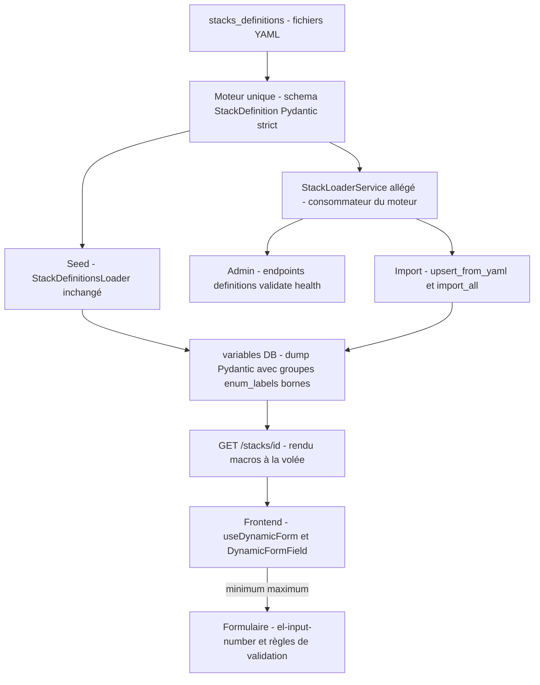

# STORY-171 : Unification de la validation des stacks — fusionner `stack_loader_service` (allégé) et la validation admin en un moteur unique + correction des bornes numériques `min/max` (P2-6 — axes B8, B9)

**Statut :** DONE
**Epic Parent :** EPIC-013 — P2 : Conformité fonctionnelle (remédiation backend)
**Item plan :** P2-6 (axes B8, B9, rapports §9) — ampleur **M**

## Description

En tant que développeur WindFlow, je veux que la validation des stack definitions passe par un **moteur unique de règles** — le même au seed de démarrage et à l'import/validate admin — avec [`stack_loader_service.py`](../../backend/app/services/stack_loader_service.py) allégé en consommateur de ce moteur, et que les bornes numériques des formulaires soient corrigées (`minimum`/`maximum` servis au formulaire, `min`/`max` ne plus être silencieusement ignorés), afin que `stacks_definitions/postgresql.yaml` cesse de ressortir « invalide » via l'API admin alors qu'il passe le seed.

**Problème constaté** ([STACK-DEFINITIONS.md § Deux chargeurs, deux validations](../../docs/technical_specs/STACK-DEFINITIONS.md), [`backend_status.md`](../../docs/backend_status.md) §5) : deux chemins de validation divergent — le seed utilise [`stack_definitions_loader.py:22`](../../backend/app/services/stack_definitions_loader.py:22) avec le schéma Pydantic `StackDefinition` **strict** ; l'admin ([`admin/stacks_management.py:16`](../../backend/app/api/v1/admin/stacks_management.py:16)) utilise [`stack_loader_service.py:18`](../../backend/app/services/stack_loader_service.py:18) avec une vérification manuelle **allégée** (métadonnées réduites, types de variables sans `integer` ni `group`) — conséquence : `postgresql.yaml` (qui utilise `integer` et `group`) se charge au démarrage mais ressort **invalide** via `GET /admin/stacks-management/definitions`. En parallèle (B9) : les bornes numériques `minimum`/`maximum` du schéma sont servies mais le formulaire lit `min`/`max` — transversal ([`stack_definitions_loader.py:22`](../../backend/app/services/stack_definitions_loader.py:22) + schemas).

## Contexte technique

> Analyse `analyse-story` du 2026-10-30 — exploration du code réel backend + frontend ; aucune ligne de code modifiée à ce stade.

### Constat d'analyse — les deux chemins aujourd'hui

- **Chemin seed (strict)** : [`database_seed.py:260`](../../backend/app/database_seed.py) `seed_stack_definitions` → [`StackDefinitionsLoader`](../../backend/app/services/stack_definitions_loader.py) (`_parse_yaml_file` [:76](../../backend/app/services/stack_definitions_loader.py:76)) → `StackDefinition(**raw_data)` : validation Pydantic stricte ([`schemas/stack_definition.py:157`](../../backend/app/schemas/stack_definition.py:157)) — types fermés `string|number|integer|boolean|password|textarea|group` (`VariableType` [:13](../../backend/app/schemas/stack_definition.py:13)), variables récursives `type: group` ([:67](../../backend/app/schemas/stack_definition.py:67)), `enum_labels ⊆ enum` (validateur [:71](../../backend/app/schemas/stack_definition.py:71)), `target_type` fermé à 6 valeurs ([:138](../../backend/app/schemas/stack_definition.py:138)), métadonnées complètes requises (`category`/`author`/`license`/`target_type`, [:97](../../backend/app/schemas/stack_definition.py:97)). Un YAML invalide est journalisé et **sauté** sans interrompre les autres ([`scan_definitions`](../../backend/app/services/stack_definitions_loader.py:40)). Écriture DB via `_convert_variables_to_db_format` ([`stack_definitions_loader.py:259`](../../backend/app/services/stack_definitions_loader.py:259)) : `model_dump(mode="json", exclude_none=True)` — **conserve** la hiérarchie des groupes (récursif), `visible`, `enum_labels`, `has_macro`/`macro_template`, `minimum`/`maximum`.
- **Chemin admin (allégé)** : endpoints [`admin/stacks_management.py`](../../backend/app/api/v1/admin/stacks_management.py) — `GET /definitions` [:114](../../backend/app/api/v1/admin/stacks_management.py:114), `POST /validate` [:201](../../backend/app/api/v1/admin/stacks_management.py:201), `GET /health` [:995](../../backend/app/api/v1/admin/stacks_management.py:995), et l'import (`POST /import` [:245](../../backend/app/api/v1/admin/stacks_management.py:245) → [`StackService.upsert_from_yaml`](../../backend/app/services/stack_service.py:247) / `import_all_from_directory` [:297](../../backend/app/services/stack_service.py:297)) → [`StackLoaderService`](../../backend/app/services/stack_loader_service.py) : `load_from_yaml` (dict brut, exige sections `metadata`/`template`/`variables` [:152](../../backend/app/services/stack_loader_service.py:152)) + `validate_stack_definition` **manuelle** ([:188](../../backend/app/services/stack_loader_service.py:188)) : métadonnées `name`/`version`/`description` seulement, types **sans `integer` ni `group`** mais avec un pseudo-type `enum` inexistant du schéma strict, et exigence `template.services` non portée par le schéma.
- **Conséquence vérifiée** : [`stacks_definitions/postgresql.yaml`](../../stacks_definitions/postgresql.yaml) (variables `host_port`/`max_connections` `type: integer` [:204](../../stacks_definitions/postgresql.yaml:204), groupe `performance` `type: group` [:225](../../stacks_definitions/postgresql.yaml:225), template container simple **sans clé `services`** [:64](../../stacks_definitions/postgresql.yaml:64)) ressort invalide via l'API admin alors qu'il passe le seed. **Les deux YAML du dépôt sont concernés** : `baserow.yaml` utilise aussi `type: integer` (×4 : `public_port`, `ssl_port`, `max_workers`, `email_port`).
- **B9 — écart bornes** : le backend sert déjà `minimum`/`maximum` sur les DEUX chemins (dump Pydantic côté seed [:43](../../backend/app/schemas/stack_definition.py:43) ; copie explicite côté loader [:128](../../backend/app/services/stack_loader_service.py:128)), et `GET /stacks/{id}` ([`_render_stack_variables`](../../backend/app/api/v1/stacks.py:49)) les laisse passer (rendu des macros uniquement, bornes intactes). Le désalignement est **frontend** : [`useDynamicForm.ts`](../../frontend/src/composables/useDynamicForm.ts) déclare et lit `min`/`max` (interface `VariableDefinition` [:18](../../frontend/src/composables/useDynamicForm.ts:18), règles de validation [:105](../../frontend/src/composables/useDynamicForm.ts:105), propagation `generateGroupFields` [:272](../../frontend/src/composables/useDynamicForm.ts:272)), [`DynamicFormField.vue`](../../frontend/src/components/DynamicFormField.vue) bind `:min="field.min" :max="field.max"` ([:91](../../frontend/src/components/DynamicFormField.vue:91), heuristique entier [:186](../../frontend/src/components/DynamicFormField.vue:186)) et [`schemaConverter.ts`](../../frontend/src/utils/schemaConverter.ts) mappe `variable.min/max` → `property.minimum/maximum` ([:109](../../frontend/src/utils/schemaConverter.ts:109), slider [:180](../../frontend/src/utils/schemaConverter.ts:180)). DYNAMIC-FORMS.md § « Écart connu » documente ce constat.

### Divergences détectées (au-delà de l'énoncé de la story)

- **n°1 — `baserow.yaml` aussi invalide côté admin** : la story ne cite que `postgresql.yaml` ; les 4 variables `integer` de baserow échouent la validation manuelle. L'unification corrige les deux fichiers du dépôt (AC 1 testé sur **tous** les YAML).
- **n°2 — Deux formats de variables en DB divergents** : le seed conserve groupes/`visible`/`enum_labels`/`has_macro` (dump Pydantic) ; l'import admin passe par `normalize_variables` ([`stack_loader_service.py:92`](../../backend/app/services/stack_loader_service.py:92)) qui **aplatit les groupes** (sous-variables perdues) et perd `visible`/`enum_labels`. Même verdict ≠ mêmes données : un stack importé via admin produirait un formulaire différent du même YAML seedé. L'unification impose de faire écrire aux deux chemins le **même format** (dump Pydantic `_convert_variables_to_db_format`).
- **n°3 — `template.services` exigé à tort côté admin** : le schéma strict n'exige qu'un template non vide (validateur [:172](../../backend/app/schemas/stack_definition.py:172)) ; `postgresql.yaml` (container simple sans `services`) est rejeté pour cette 2e raison, indépendante des types.
- **n°4 — Macros des défauts : rendu à l'import vs brutes au seed** : `normalize_variables` appelle `process_variable_default` ([:52](../../backend/app/services/stack_loader_service.py:52)) qui **rend** `generate_password`/`generate_secret` à l'import (valeur figée en DB) ; le seed conserve les macros **brutes** et le rendu se fait à la volée à chaque `GET /stacks/{id}` (via `_render_stack_variables` + `TemplateRenderer`). **Arbitrage** : aligner l'import sur le seed (macros brutes conservées — cohérent avec `regenerate-variable` [:1261](../../backend/app/api/v1/stacks.py:1261) et le rendu par requête). `process_variable_default`/`generate_password`/`generate_secret` de `StackLoaderService` deviendraient non référencés → vérifier par grep avant retrait ; les équivalents vivent dans [`jinja_functions.py`](../../backend/app/helper/jinja_functions.py).
- **n°5 — Pseudo-type `enum` côté admin** : `type: enum` passait la validation admin mais échoue le seed (type fermé) — l'unifié supprime cette incohérence (une variable à choix = `type: string` + champ `enum`).
- **n°6 — `StackCreate` ne porte pas `target_type`/`target_parameters`** : l'import admin defaulte donc toujours `target_type='docker'` en DB (défaut du modèle [:63](../../backend/app/models/stack.py:63)) quand le seed écrit la valeur du YAML (ex. `docker_compose`). Recommandation : champs optionnels sur `StackCreate` ([`schemas/stack.py:101`](../../backend/app/schemas/stack.py:101)) pour parité réelle — aucune migration (colonnes existantes).
- **n°7 — `schemaConverter.ts` sans consommateur actif** : grep frontend → aucun import de `convertToJsonSchema` hors son propre module (probable reliquat JSONForms) ; la bascule `min/max`→`minimum/maximum` y est faite pour cohérence (AC 3 « plus lus nulle part »), statut de module à noter (pas de suppression ici — hors périmètre).
- **n°8 — `is_public` par défaut divergent** : schéma strict `True` vs loader admin `False` (aligné modèle SQL) — comportement inchangé par cette story (l'import passe par `StackCreate` → `False`), consigné pour traçabilité.
- **Zone à zéro test** : aucun test n'existe sur `StackLoaderService` ni `StackDefinitionsLoader` (grep backend/tests → 0 hit) ; les tests admin existants ([`test_admin_rbac.py`](../../backend/tests/unit/test_api/test_admin_rbac.py)) mockent ou lisent le répertoire réel sans couvrir le verdict. [`test_database_seed.py`](../../backend/tests/unit/test_database_seed.py) mocke `seed_stack_definitions` (comportement à préserver).

### Architecture cible — un moteur, deux consommateurs



### Éléments existants à réutiliser / contraintes
- **Source de vérité** : le schéma Pydantic [`schemas/stack_definition.py`](../../backend/app/schemas/stack_definition.py) (« le schéma Pydantic fait foi pour la rédaction des YAML » — STACK-DEFINITIONS) ; le moteur unique = ce schéma + ses validateurs (`validate_target_type`, `enum_labels`, variables récursives `type: group`…) ;
- **Refacto** : [`stack_loader_service.py:18`](../../backend/app/services/stack_loader_service.py:18) est allégé pour consommer le moteur (parsing YAML → validation stricte partagée) ; les endpoints admin `definitions`/`validate`/`import` ([`admin/stacks_management.py:16`](../../backend/app/api/v1/admin/stacks_management.py:16)) rendent le même verdict que le seed ; [`database_seed.py`](../../backend/app/database_seed.py) inchangé fonctionnellement (il consomme déjà le loader strict) ;
- **Bornes numériques (B9)** : harmoniser le contrat servi au formulaire — `minimum`/`maximum` partout (schéma → sérialisation → DYNAMIC-FORMS/frontend) ; un `min:`/`max:` mal orthographié en YAML reste ignoré (comportement Pydantic) mais le formulaire reçoit bien les bornes quand elles existent ;
- **Ne pas régresser** (garde-fou §2.G stack definitions + Jinja2) : 16 fonctions Jinja2, macros dans les défauts, groupes récursifs, `enum_labels`, stratégies `update_if_newer`… — ne toucher qu'à la validation et aux bornes ; les fichiers YAML du dépôt doivent continuer de passer ;
- **Hors périmètre noté** : la validation Compose 20 règles avec confrontation à l'état réel du Host suit l'entité Apps/Host consolidée (Phase 2 — plan §6) — « les règles communes sont dès P2-6 » concerne le moteur de règles, pas les 20 règles Compose runtime ;
- Contrôle : l'inventaire admin `definitions` (validité par fichier) et `validate` (superadmin) doivent être cohérents avec le chargement réel.

### Checklist sécurité ([`.roo/rules/40-security.md`](../../.roo/rules/40-security.md)) — évaluation de l'analyse

- **AuthN/AuthZ** : aucune nouvelle route ; `definitions`/`validate`/`health`/`import` conservent `require_super_admin` (STORY-122.6) et `GET /stacks/{id}` reste viewer+ avec isolation organisation — **ne pas régresser** les 403/404 existants (suites [`test_admin_rbac.py`](../../backend/tests/unit/test_api/test_admin_rbac.py) / [`test_stacks_rbac.py`](../../backend/tests/unit/test_api/test_stacks_rbac.py) repassées en tâche 8).
- **Validation & injection** : `yaml.safe_load` conservé (pas d'eval) ; l'unification **renforce** la validation admin (types fermés, métadonnées complètes, `enum_labels ⊆ enum`, `target_type` fermé à 6 valeurs) ; le champ `pattern` (regex) est transmis au frontend qui fait `new RegExp` — risque ReDoS **préexistant**, hors périmètre (à inscrire au backlog sécurité, aucun changement introduit ici).
- **Exposition de données sensibles** : les définitions de variables transitent (pas les valeurs déployées) ; erreurs Pydantic détaillées = chemins de champs + messages de validation (pas de stack trace interne), exposées au **superadmin uniquement** — acceptable ; `GET /stacks/{id}` sert des défauts macro rendus à la volée (comportement existant requis par le déploiement) — rien de nouveau exposé ; filtrer la clé `input` de `ValidationError.errors()` dans les messages d'erreur servis (peut contenir la valeur testée).
- **Audit & traçabilité** : `validate`/`definitions`/`health` = lectures filesystem sans effet de bord ; l'`import` modifie la DB sans audit dédié — **état préexistant, hors périmètre** (renvoi backlog sécurité le cas échéant) ; logs seed existants conservés (logger par fichier), messages sans valeurs de variables.

## Critères d'acceptation (AC)

> Avancement final au 2026-10-31 : les 5 AC sont validés. Backend (T1→T4 + T8) :
> tests de parité verts sur les 2 YAML du dépôt via les deux chemins, 3055 unit
> passed, couverture modules touchés 84-97 %. Frontend (T5→T7 + T9) : bascule
> `minimum`/`maximum` complète (grep 0 lecture `min`/`max` restante), 27
> nouveaux tests verts, suite frontend entière 1052 passed, typecheck + lint
> 0 erreur.

- [x] AC 1 : **Un seul moteur de validation** : `postgresql.yaml` passe la validation API admin (`POST /admin/stacks-management/validate` → valide, inventaire `definitions` → valide) **ET** le seed de démarrage avec **les mêmes règles** — test de parité : chaque YAML du dépôt (`stacks_definitions/*.yaml`) donne le même verdict par les deux chemins.
- [x] AC 2 : `stack_loader_service` est allégé : il ne porte plus de règles de validation propres, il délègue au schéma/moteur partagé — vérifié par revue (plus de double maintenance) et par tests de non-régression sur `import` admin (fichier invalide → rejet avec erreurs Pydantic détaillées, fichier valide → import).
- [x] AC 3 : **Bornes numériques corrigées (B9)** : le formulaire reçoit `minimum`/`maximum` pour les variables `number`/`integer` — test : `GET /stacks/{id}` (variables sérialisées) expose les bornes attendues ; le frontend de formulaire les applique (contrôle bloquant ou avertissement selon DYNAMIC-FORMS) ; `min`/`max` ne sont plus lus nulle part.
- [x] AC 4 : Non-régression du chargement : stratégies (`skip_existing`/`update_if_newer`/`force_update`), comparaison semver, macros Jinja2 des défauts, `regenerate-variable`, groupes récursifs et `enum_labels` fonctionnent comme avant (tests existants + nouveaux sur la parité) ; un YAML invalide reste **journalisé et sauté** sans interrompre les autres au seed.
- [x] AC 5 : Couverture ≥ 80 % sur les modules touchés ; build + lint + tests passent.

## Références spécification

- [STACK-DEFINITIONS.md](../../docs/technical_specs/STACK-DEFINITIONS.md) — § **Deux chargeurs, deux validations ⚠️** (tableau comparatif, conséquence postgresql.yaml, « le schéma Pydantic fait foi »), § Variables (`minimum`/`maximum` — « écrire min/max est silencieusement ignoré »), § Validation Pydantic (comportement réel), § Workflow de développement, § Bonnes pratiques ;
- [DYNAMIC-FORMS.md](../../docs/technical_specs/DYNAMIC-FORMS.md) — mécanique des formulaires générés (consommateur des bornes — à consulter) ;
- [`09-api.md`](../../docs/general_specs/09-api.md) — § Validation Compose `POST /compute/stacks/{id}/validate` (renvoi : moteur auto-déclaré — les 20 règles restent Phase 2, seul le socle est concerné) ;
- [`03-modele-compute.md`](../../docs/general_specs/03-modele-compute.md) — § Stack WindFlow managed (catalogue interne vs marketplace) ;
- [`backend_remediation_plan.md`](../../docs/backend_remediation_plan.md) — §4 P2-6, §2.B B8/B9, §6 (« les règles communes sont dès P2-6 ») ;
- [`backend_status.md`](../../docs/backend_status.md) — §5 (`stack_loader_service` parsing, `stack_definitions_loader` chargement auto), §3.13 (admin stacks_management, 15 endpoints).

## Dépendances

- **Aucune dépendance marquée par le plan** (P2-6 « dépend de : — ») — indépendance maximale, peut avancer tôt dans la vague.
- Coordonnée avec STORY-166 (le champ `target_type` YAML et sa correspondance profils canoniques restent inchangés à ce stade) ; toucher aux schemas touche le contrat des formulaires (frontend à synchroniser si besoin).
- **Confirmation d'analyse** : aucune story pré-requise bloquante (STORY-120/166 ✔ DONE) ; **aucune migration DB** (aucune nouvelle table/colonne — `target_type`/`target_parameters` existent déjà sur [`models/stack.py`](../../backend/app/models/stack.py), seul le schéma `StackCreate`/`StackUpdate` s'étend) ; **aucun service externe nouveau** ; configuration inchangée (`stack_definitions_path`/`auto_load_stack_definitions`/`stack_update_strategy` — aucun nouveau setting).
- Le volet frontend (AC 3) reste dans la story : 3 fichiers d'un même domaine « formulaire dynamique », sans découpe nécessaire (9 tâches au total, périmètre homogène).
- Renvois post-story : corrections documentaires STACK-DEFINITIONS.md § écart / DYNAMIC-FORMS.md § écart connu → **STORY-253** (P3-5) ; validation Compose 20 règles vs état réel du Host → Phase 2 (socle compute STORY-173/174) ; audit de l'import admin + ReDoS `pattern` → backlog sécurité.

## Sous-stories

*(non prévue — story M)*

## État d'avancement technique

- [x] Tâche 1 : Extension `StackCreate`/`StackUpdate` — champs optionnels `target_type`/`target_parameters` (parité seed/import, divergence n°6)
- [x] Tâche 2 : Refonte `StackLoaderService` — consommateur du moteur unique + conversion partagée `convert_variables_to_db_format`
- [x] Tâche 3 : Endpoints admin `definitions`/`validate`/`health` — verdict moteur + erreurs Pydantic détaillées
- [x] Tâche 4 : Chemins d'import `StackService` — mapping complet via le moteur + propagation force_update
- [x] Tâche 5 : Frontend `useDynamicForm.ts` — bascule `minimum`/`maximum` (interface, règles, champs, groupes)
- [x] Tâche 6 : Frontend `DynamicFormField.vue` — binds `el-input-number` canoniques
- [x] Tâche 7 : Frontend `schemaConverter.ts` — interface et mapping canoniques
- [x] Tâche 8 : Tests backend — parité moteur, verdict admin, contrat `GET /stacks/{id}` (+ non-régressions)
- [x] Tâche 9 : Tests frontend + validation globale (lint, typecheck, couverture ≥ 80 %)

## Tâches d'implémentation détaillées

> Ordre séquentiel strict. Exigences sécurité (rules 40) : dépendances d'auth **inchangées** (`require_super_admin` sur les 4 endpoints admin, scoping org sur `/stacks`) ; messages d'erreur sans valeur d'input (filtrer `input` de `ValidationError.errors()`) ; logs sans données sensibles.

### Tâche 1 : Schémas — champs `target_type`/`target_parameters` sur `StackCreate`/`StackUpdate`
**Objectif :** Parité réelle seed/import (divergence n°6) : ajouter `target_type: Optional[str]` (défaut `None` → défaut modèle `'docker'` inchangé en DB si absent) et `target_parameters: Optional[Dict[str, Any]]` sur [`StackCreate`](../../backend/app/schemas/stack.py) et `StackUpdate`, avec descriptions + exemples OpenAPI à jour (rule 20). Aucune migration (colonnes existantes [`models/stack.py:60-73`](../../backend/app/models/stack.py:60)).
**Fichiers :**
- `backend/app/schemas/stack.py` — Modifier.
**Dépend de :** Aucune

### Tâche 2 : Refonte `StackLoaderService` — consommateur du moteur unique
**Objectif :** Alléger le service (AC 2) :
- extraire la conversion partagée en fonction module-level `convert_variables_to_db_format(variables: Dict[str, StackDefinitionVariable]) -> Dict[str, Any]` dans [`schemas/stack_definition.py`](../../backend/app/schemas/stack_definition.py) (même logique que `_convert_variables_to_db_format` — dump `model_dump(mode="json", exclude_none=True)` + récursion groupes) ; `StackDefinitionsLoader._convert_variables_to_db_format` délègue (comportement identique, non-régression AC 4, divergence n°2 : même format des deux côtés) ;
- `StackLoaderService.load_definition(yaml_path) -> StackDefinition` : `yaml.safe_load` + `StackDefinition(**raw_data)` — le **moteur** fait toute la validation (types fermés dont `integer`/`group`, `enum_labels ⊆ enum`, `target_type` fermé, métadonnées complètes, template non vide **sans exiger `services`** — divergences n°3/n°5 corrigées) ;
- `validate_stack_definition(data)` : réduit à un wrapper du moteur (compatibilité des appels) — **plus aucune règle propre** ;
- `to_stack_create(definition, organization_id)` : mapping complet depuis `StackDefinition` — `target_type`, `target_parameters`, `deployment_name`, macros **brutes** conservées (arbitrage divergence n°4), `variables = convert_variables_to_db_format(...)` ;
- `load_all_from_directory` : via `load_definition`, fichiers `_` ignorés, erreur → `logger.warning` + continue (remplacer les `print` par `logging` — rule 45) ;
- retrait de `normalize_variables`/`process_variable_default`/`generate_password`/`generate_secret` **après grep zéro référence** (doublons de [`jinja_functions.py`](../../backend/app/helper/jinja_functions.py)) ; `load_from_yaml` (lecture brute inventaire) et `get_stack_filename` conservés.
**Fichiers :**
- `backend/app/schemas/stack_definition.py` — Modifier — fonction partagée de conversion.
- `backend/app/services/stack_loader_service.py` — Modifier — refonte.
**Dépend de :** Aucune

### Tâche 3 : Endpoints admin — verdict par le moteur + erreurs détaillées
**Objectif :** `GET /definitions` ([`stacks_management.py:114`](../../backend/app/api/v1/admin/stacks_management.py:114)), `POST /validate` ([`:201`](../../backend/app/api/v1/admin/stacks_management.py:201)) et `GET /health` ([`:995`](../../backend/app/api/v1/admin/stacks_management.py:995)) évaluent via `StackLoaderService.load_definition` : `is_valid`/`validation_errors` remplis depuis `ValidationError.errors()` (une entrée formatée par erreur : `"{'.'.join(loc)}: {msg}"` — localise le champ fautif, **exclut la clé `input`** — rules 40), YAML mal formé → invalide sans 500 ; `variables_count` = variables racine. **Conserver `require_super_admin` et le skip des fichiers `_` à l'identique** (STORY-122.6 — non-régression RBAC).
**Fichiers :**
- `backend/app/api/v1/admin/stacks_management.py` — Modifier.
**Dépend de :** Tâche 2

### Tâche 4 : Chemins d'import `StackService` — mapping complet via le moteur
**Objectif :** [`import_from_yaml`](../../backend/app/services/stack_service.py:221)/[`upsert_from_yaml`](../../backend/app/services/stack_service.py:247)/[`import_all_from_directory`](../../backend/app/services/stack_service.py:297) consomment `load_definition` + `to_stack_create` refondus : `force_update` propage `target_type`/`target_parameters` via `StackUpdate` étendu (Tâche 1) ; un YAML invalide → rejet avec **erreurs Pydantic détaillées** dans `ImportStats.results[].message` (AC 2, format tâche 3) ; `print` → `logger` (rule 45) ; comportements `created`/`updated`/`skipped` inchangés (AC 4).
**Fichiers :**
- `backend/app/services/stack_service.py` — Modifier.
**Dépend de :** Tâches 1, 2

### Tâche 5 : Frontend `useDynamicForm.ts` — bornes canoniques `minimum`/`maximum`
**Objectif :** AC 3 côté composable : interface [`VariableDefinition`](../../frontend/src/composables/useDynamicForm.ts:9) et `FormField` remplacent `min`/`max` par `minimum`/`maximum` ; [`getValidationRules`](../../frontend/src/composables/useDynamicForm.ts:71) génère les règles de bornes depuis `variable.minimum`/`variable.maximum` ; `generateGroupFields` propage les bornes (sous-variables des groupes incluses — `performance.max_connections`). **Strict : plus aucune lecture `min`/`max`** (grep de contrôle).
**Fichiers :**
- `frontend/src/composables/useDynamicForm.ts` — Modifier.
**Dépend de :** Aucune (contrat backend déjà servi)

### Tâche 6 : Frontend `DynamicFormField.vue` — binds canoniques
**Objectif :** [`el-input-number`](../../frontend/src/components/DynamicFormField.vue:89) bind `:min="field.minimum"` `:max="field.maximum"` (contrôle bloquant Element Plus) ; heuristique [`isIntegerField`](../../frontend/src/components/DynamicFormField.vue:177) lit `minimum`/`maximum`.
**Fichiers :**
- `frontend/src/components/DynamicFormField.vue` — Modifier.
**Dépend de :** Tâche 5

### Tâche 7 : Frontend `schemaConverter.ts` — interface canonique
**Objectif :** [`SimpleVariable`](../../frontend/src/utils/schemaConverter.ts:8) remplace `min`/`max` par `minimum`/`maximum` ; mapping `property.minimum`/`property.maximum` ([:109-137](../../frontend/src/utils/schemaConverter.ts:109)) et option slider ([:180](../../frontend/src/utils/schemaConverter.ts:180)) alignés ; module sans consommateur actif (divergence n°7) — cohérence maintenue, pas de suppression.
**Fichiers :**
- `frontend/src/utils/schemaConverter.ts` — Modifier.
**Dépend de :** Aucune

### Tâche 8 : Tests backend — parité, verdict admin, contrat variables
**Objectif :** Couvrir AC 1/2/3(backend)/4 : créer `test_stack_loader_service.py`, `test_stack_definitions_loader.py`, `test_admin_stacks_validation.py`, `test_stacks_variables_contract.py` (détail § Tests à écrire) ; repasser en non-régression `test_admin_rbac.py`, `test_stacks_rbac.py`, `test_database_seed.py`, `test_database.py` (seed intact).
**Fichiers :**
- `backend/tests/unit/test_services/test_stack_loader_service.py` — Créer.
- `backend/tests/unit/test_services/test_stack_definitions_loader.py` — Créer.
- `backend/tests/unit/test_api/test_admin_stacks_validation.py` — Créer.
- `backend/tests/unit/test_api/test_stacks_variables_contract.py` — Créer.
**Dépend de :** Tâches 1-4

### Tâche 9 : Tests frontend + validation globale
**Objectif :** Créer `useDynamicForm.spec.ts`, `DynamicFormField.spec.ts`, `schemaConverter.spec.ts` (détail § Tests à écrire) ; validation AC 5 : `make backend-test-unit`, `make lint`, `make backend-typecheck`, `cd frontend && pnpm test && pnpm typecheck && pnpm lint`, couverture ≥ 80 % sur `stack_loader_service` + `stack_definitions_loader` ; vérification finale : chaque YAML du dépôt passe les deux chemins (tests de parité verts).
**Fichiers :**
- `frontend/tests/unit/composables/useDynamicForm.spec.ts` — Créer.
- `frontend/tests/unit/components/DynamicFormField.spec.ts` — Créer.
- `frontend/tests/unit/utils/schemaConverter.spec.ts` — Créer.
**Dépend de :** Tâches 5-7 (8 pour la validation d'ensemble)

## Tests à écrire

> Patterns rules 35 — fixtures JWT réelles (`create_access_token` → `_auth_headers`, pattern [`test_admin_rbac.py`](../../backend/tests/unit/test_api/test_admin_rbac.py)), `AsyncClient` + `ASGITransport` via fixture `client`, YAML réels du dépôt pour la parité, `tmp_path` pour les cas invalides.

### Backend

- `backend/tests/unit/test_services/test_stack_loader_service.py` — **créer** :
  - **Parité AC 1** (paramétré sur `stacks_definitions/*.yaml` réels, excluant `_*`) : `load_definition` valide sans exception ; `to_stack_create` → `StackCreate` avec `target_type` du YAML, `variables` au format dump — groupe `performance` imbriqué avec sous-variables, `host_port` porte `minimum: 1`/`maximum: 65535`, `enum_labels`/`visible` conservés ;
  - `test_integer_and_group_types_accepted` (régression du bug corrigé), macros brutes conservées (`default == "{{ generate_password(24) }}"` — arbitrage n°4) ;
  - invalides → `ValidationError` : `type: enum` (divergence n°5), metadata sans `author`/`license`/`target_type`, `enum_labels` clé orpheline, `target_type: lxd`, template vide, template **sans `services` accepté** (divergence n°3) ;
  - `load_all_from_directory` : fichier invalide sauté sans interrompre (AC 4), fichiers `_` ignorés.
- `backend/tests/unit/test_services/test_stack_definitions_loader.py` — **créer** (non-régression seed AC 4) : stratégies `skip_existing` / `update_if_newer` (semver `1.2.0 > 1.1.9`, égal → skip) / `force_update` ; `scan_definitions` journalise et saute les invalides ; **parité de dump** : `convert_variables_to_db_format`_unique partagée avec le loader admin (même structure de sortie).
- `backend/tests/unit/test_api/test_admin_stacks_validation.py` — **créer** :
  - **Sécurité obligatoire** : `test_definitions_returns_401_without_token`, `test_definitions_returns_403_for_org_admin` (+ viewer/operator échantillon), `test_validate_returns_403_for_non_superadmin`, `test_validate_returns_401_without_token` ;
  - AC 1 : `test_validate_all_valid_on_repo_yamls` (superadmin → `all_valid: true`, `invalid: 0`), `test_definitions_all_repo_yamls_valid` (chaque fichier `is_valid: true` — **postgresql ET baserow**) ;
  - cas invalides (répertoire `tmp_path` monkeypatché) : `is_valid: false` + `validation_errors` contient le champ fautif (ex. `variables.host_port.type`), `POST /validate` agrège `{file, error}` sans 500, YAML syntaxiquement invalide → invalide (pas d'exception), erreurs **sans valeur d'input** (rules 40) ;
  - 404 répertoire absent (comportement existant conservé).
- `backend/tests/unit/test_api/test_stacks_variables_contract.py` — **créer** (AC 3 backend + AC 4 rendu) : stack créé via `to_stack_create` + `StackService.create` (variable `integer` bornée + groupe + macro password) → `GET /stacks/{id}` : 200, `variables` expose `minimum`/`maximum` (**AC 3**), groupe sérialisé imbriqué, macro rendue (`default` != template, `has_macro: true`, `macro_template` préservé) ; **Sécurité** : `test_get_stack_returns_401_without_token`, isolation org (stack d'une autre organisation → 404).

### Frontend

- `frontend/tests/unit/composables/useDynamicForm.spec.ts` — **créer** : variable `integer` avec `minimum`/`maximum` → `FormField` porte les bornes + règles générées (valeur sous la borne → erreur, dans l'intervalle → OK) ; groupes récursifs → clés pointées `performance.max_connections` avec bornes conservées ; `min`/`max` legacy **ignorés** (plus lus — AC 3).
- `frontend/tests/unit/components/DynamicFormField.spec.ts` — **créer** : type `integer` + bornes → `el-input-number` rendu avec attributs `min`/`max` alimentés depuis `minimum`/`maximum` ; `precision` 0 pour `integer`.
- `frontend/tests/unit/utils/schemaConverter.spec.ts` — **créer** : `minimum`/`maximum` → `property.minimum`/`property.maximum` ; option slider active quand les deux bornes présentes ; `min_length`/`max_length`/`pattern` inchangés.

### Commandes de validation
```bash
# Tests ciblés backend (parité + verdict + contrat)
poetry run pytest backend/tests/unit/test_services/test_stack_loader_service.py backend/tests/unit/test_services/test_stack_definitions_loader.py backend/tests/unit/test_api/test_admin_stacks_validation.py backend/tests/unit/test_api/test_stacks_variables_contract.py -v

# Non-régression (RBAC + seed)
poetry run pytest backend/tests/unit/test_api/test_admin_rbac.py backend/tests/unit/test_api/test_stacks_rbac.py backend/tests/unit/test_database_seed.py backend/tests/unit/test_database.py -v

# Frontend ciblé + qualité
cd frontend && pnpm test -- tests/unit/composables/useDynamicForm.spec.ts tests/unit/components/DynamicFormField.spec.ts tests/unit/utils/schemaConverter.spec.ts
cd frontend && pnpm typecheck && pnpm lint

# Quality gates (AC 5)
make backend-test-unit && make lint && make backend-typecheck
poetry run pytest backend/tests/unit/test_services/test_stack_loader_service.py --cov=backend/app/services/stack_loader_service --cov-fail-under=80
```

## Notes d'implémentation — sous-tâche backend (T1→T4 + T8, 2026-10-30)

### Fichiers modifiés
- `backend/app/schemas/stack.py` — `StackCreate`/`StackUpdate` : champs optionnels `target_type`/`target_parameters` (descriptions + exemples OpenAPI) — aucune migration (colonnes existantes).
- `backend/app/schemas/stack_definition.py` — fonction module-level partagée `convert_variables_to_db_format()` + `format_validation_errors()` (exclut la clé `input` — rules 40) ; message du validateur `target_type` reformulé **sans la valeur d'input** (renforcement sécurité au-delà de l'analyse).
- `backend/app/services/stack_loader_service.py` — refonte complète en consommateur du moteur : `load_definition()` (yaml.safe_load + `StackDefinition(**data)`), `to_stack_create(definition, org)` (mapping complet, macros **brutes**), `validate_stack_definition` réduit à un wrapper, `load_all_from_directory` (logging au lieu de print, fichiers `_` ignorés, invalides sautés) ; **retrait** de `normalize_variables`/`process_variable_default`/`generate_password`/`generate_secret` (grep zéro référence ; équivalents dans `helper/jinja_functions.py`) ; `load_from_yaml` (lecture brute) et `get_stack_filename` conservés.
- `backend/app/services/stack_definitions_loader.py` — `_convert_variables_to_db_format` délègue à la fonction partagée (comportement seed inchangé).
- `backend/app/services/stack_service.py` — `import_from_yaml`/`upsert_from_yaml`/`import_all_from_directory` via `load_definition` + `to_stack_create` ; propagation `target_type`/`target_parameters` dans le `StackUpdate` de force_update ; erreurs Pydantic formatées (sans input) dans `stats["errors"]` ; print → logger.
- `backend/app/api/v1/admin/stacks_management.py` — helper `_inspect_yaml_definition()` : verdict moteur unique pour `GET /definitions`, `POST /validate`, `GET /health` (métadonnées brutes au mieux-effort si invalide, YAML mal formé → invalide sans 500) ; `/sync/status` bascule aussi sur `load_definition` (cohérence du verdict) ; `require_super_admin` et skip `_` inchangés.

### Tests créés (T8 — 68 tests)
- `backend/tests/unit/test_services/test_stack_loader_service.py` — parité sur les YAML réels (paramétré), format dump (groupes/bornes/enum_labels/macros brutes), régression integer/group, invalides → ValidationError (pseudo-type enum, métadonnées, enum_labels orphelin, target_type lxd, template vide, template **sans services accepté**), erreurs sans valeur d'input, `load_all_from_directory` (invalides sautés, `_` ignorés).
- `backend/tests/unit/test_services/test_stack_definitions_loader.py` — non-régression seed : stratégies skip_existing/update_if_newer/force_update, scan (invalide journalisé-sauté), semver packaging (pré-releases), parité de dump via la fonction partagée.
- `backend/tests/unit/test_api/test_admin_stacks_validation.py` — sécurité 401/403 (viewer/operator/admin d'org) sur definitions/validate/health, AC 1 (`all_valid: true` + chaque fichier `is_valid: true` — postgresql ET baserow), cas invalides (champ fautif localisé, agrégation sans 500, YAML mal formé, pas de fuite d'input), skip `_`, 404 répertoire absent.
- `backend/tests/unit/test_api/test_stacks_variables_contract.py` — contrat `GET /stacks/{id}` : `minimum`/`maximum` servis (AC 3 backend), groupe imbriqué avec bornes, macro rendue (`has_macro`/`macro_template` préservés), `target_type` persisté ; sécurité 401 + isolation org + 404.

### Validation
- `poetry run pytest` ciblés 4 fichiers : **68 passed** ; non-régression `test_admin_rbac`/`test_stacks_rbac`/`test_database_seed`/`test_database` : **40 passed** ; suite unitaire backend complète : **3055 passed, 0 failed**.
- isort + black + flake8 + bandit sur les fichiers modifiés : **0 erreur** ; mypy périmètre : **0 erreur** (24 erreurs listées préexistantes dans plugin/hosts/stats — hors périmètre).
- Couverture modules touchés : `stack_loader_service` **84 %**, `stack_definitions_loader` **94 %**, `stack_definition` **97 %** (≥ 80 % AC 5).

### Divergences vs analyse
1. **Isolation org `GET /stacks/{id}` = 403, pas 404** : le endpoint existant lève `PermissionDeniedError` après `is_member()` (stack trouvée mais org étrangère) — comportement conservé (non-régression RBAC), test adapté (`test_get_stack_other_organization_forbidden` : 403 + aucune variable divulguée). L'analyse évoquait 404 ; le 404 ne s'applique qu'à l'ID inexistant.
2. **`update_if_newer` recherche par (name, version) exacte** : comportement seed existant — un YAML de version différente **crée** une nouvelle entrée plutôt que d'updater l'existante. Non modifié (AC 4 : non-régression stricte du chemin seed) ; tests écrits sur le comportement réel + comparaison semver couverte par `TestSemverComparison`.
3. **Message validateur `target_type` sans valeur d'input** : l'ancien message reprenait `{v}` — reformulé (renforcement rules 40 convergent avec la demande « sans valeur d'input »).
4. **Testabilité du répertoire admin** : le routeur résout `Path(__file__)…/stacks_definitions` (layout Docker) inexistant en dev — les tests « repo réel » redirigent via monkeypatch **sélectif** de `Path.__truediv__` (uniquement pour l'opérande `"stacks_definitions"`, pattern du test RBAC existant affiné).

### Contrat API exposé (source de vérité pour la sous-tâche frontend T5→T7)
- `GET /stacks/{id}` → `variables: { [clé]: VariableDef }` où `VariableDef` =
  `{ type: "string"|"number"|"integer"|"boolean"|"password"|"textarea"|"group", label, description?, default, required, visible, group?, help?, pattern?, enum?: Any[], enum_labels?: {str: str}, minimum?: int, maximum?: int, min_length?: int, max_length?: int, has_macro: bool, macro_template?: str, depends_on?, variables?: { [sous-clé]: VariableDef } (récursif, type=group) }`.
- **Bornes : `minimum`/`maximum` uniquement** (un `min:`/`max:` YAML reste ignoré par Pydantic — comportement inchangé).
- Macros : `default` rendu à la volée à chaque GET + `has_macro: true` + `macro_template` = template brut.
- Sous-variables des groupes : clé `variables` imbriquée (clés pointées côté frontend type `performance.max_connections`).
- `POST /admin/stacks-management/validate` : `{total_files, valid, invalid, all_valid, errors: [{file, error}]}` — erreurs format `"chemin.champ: message"` sans valeur d'input.
- `GET /admin/stacks-management/definitions` : chaque item `{filename, name, version, category, description, is_public, tags, variables_count, is_valid, validation_errors?}`.

## Notes d'implémentation — sous-tâche frontend (T5→T7 + T9, 2026-10-31)

### Fichiers modifiés (frontend)
- `frontend/src/composables/useDynamicForm.ts` — interfaces `VariableDefinition`/`FormField` : `min`/`max` → `minimum`/`maximum` ; règles de validation de bornes générées depuis `variable.minimum`/`variable.maximum` ; `generateGroupFields` propage les bornes canoniques (sous-variables `performance.max_connections` incluses) ; retrait des propriétés mortes `min`/`max` de `ValidationRule` (jamais peuplées — les bornes passent uniquement par les validators custom).
- `frontend/src/components/DynamicFormField.vue` — `el-input-number` bind `:min="field.minimum"` `:max="field.maximum"` (contrôle bloquant Element Plus) ; heuristique `isIntegerField` lit `minimum`/`maximum`.
- `frontend/src/utils/schemaConverter.ts` — interface `SimpleVariable` canonique ; mapping `variable.minimum`/`maximum` → `property.minimum`/`maximum` (integer + number) ; option slider conditionnée aux deux bornes canoniques (module sans consommateur actif — divergence n°7, cohérence maintenue sans suppression).

### Tests créés (T9 — 27 tests)
- `frontend/tests/unit/composables/useDynamicForm.spec.ts` — bornes canoniques portées par `FormField` + règles fonctionnelles (sous borne/au-dessus/dans l'intervalle), coercion défaut integer, groupes récursifs (clé pointée + bornes conservées + header), **bornes legacy `min`/`max` ignorées** (AC 3), `visible: false` exclu.
- `frontend/tests/unit/components/DynamicFormField.spec.ts` — `el-input-number` rendu avec props `min`/`max` alimentées depuis `minimum`/`maximum`, `precision` 0 pour `integer` / 2 pour `number` décimal, bornes absentes (défaut Element Plus), header de groupe sans saisie, `enum_labels` localisés (dropdown téléporté → interrogation `document.body`).
- `frontend/tests/unit/utils/schemaConverter.spec.ts` — mapping `minimum`/`maximum` integer+number, option slider (active/inactive/integer exclu), `min_length`/`max_length`/`pattern` inchangés, legacy `min`/`max` ignoré, `extractDefaults` + `validateAgainstSchema` sur bornes.

### Validation
- Tests ciblés : `pnpm test -- tests/unit/composables/useDynamicForm.spec.ts tests/unit/components/DynamicFormField.spec.ts tests/unit/utils/schemaConverter.spec.ts` → **27 passed**.
- Suite frontend complète : `pnpm test:unit` → **1052 passed (66 fichiers), 0 failed** — aucun test existant cassé par le changement de contrat (les 3 modules n'étaient pas couverts avant).
- `pnpm type-check` (vue-tsc --noEmit) : **0 erreur** ; ESLint périmètre : **0 erreur** (35 warnings `no-explicit-any` préexistants dans ces fichiers historiques) ; Prettier appliqué puis style ESLint (`vue/max-attributes-per-line`) restauré via `eslint --fix` (conflit Prettier/ESLint-vue connu du projet).
- **Grep de contrôle AC 3** : `(field|variable).(min|max)` dans `frontend/src` → **0 occurrence**.
- Backend non retouché (aucun défaut du contrat révélé par les tests frontend).

### Divergences vs analyse
1. **Aucune test existant à corriger** : l'analyse prévoyait un alignement d'éventuels tests cassés ; grep préalable → aucun spec frontend ne couvrait les 3 modules (aucune lecture `min`/`max` hors des fichiers cibles).
2. **Retrait des propriétés mortes `min`/`max` de `ValidationRule`** : l'analyse ne ciblait que `VariableDefinition`/`FormField` ; ces propriétés n'ont jamais été peuplées (les règles Element Plus portaient les bornes uniquement via validators) — retrait pour satisfaire strictement « plus lues nulle part ».
3. **Calibrage des expectatifs de test sur le comportement réel d'Element Plus 2.11.4** : défaut de prop `min`/`max` non transmis = `±Number.MAX_SAFE_INTEGER` (et non `±Infinity`) ; options `el-select` téléportées vers `document.body` (non requêtables via `findAllComponents`).

### Difficultés rencontrées
- Conflit de formatage Prettier ↔ règle ESLint `vue/max-attributes-per-line` sur `DynamicFormField.vue` (Prettier ré-empile les attributs) : résolu en appliquant Prettier puis `eslint --fix` (style 1-attribut/ligne du projet).

## Notes d'implémentation — clôture story (2026-10-31)

Story close en une session frontend à la suite de la session backend (T1→T4 + T8). Récapitulatif complet des fichiers de la story :

- **Backend (session 1)** : `schemas/stack.py`, `schemas/stack_definition.py`, `services/stack_loader_service.py`, `services/stack_definitions_loader.py`, `services/stack_service.py`, `api/v1/admin/stacks_management.py` modifiés ; 4 fichiers de tests créés (68 tests) ; 3055 unit passed, couverture 84-97 %.
- **Frontend (session 2)** : `useDynamicForm.ts`, `DynamicFormField.vue`, `schemaConverter.ts` modifiés ; 3 specs créées (27 tests) ; 1052 frontend tests passed, typecheck/lint 0 erreur.

Tous les AC validés → statut `DONE` ; kanban et EPIC-013 synchronisés (epic reste `IN_PROGRESS` : STORY-168 en REVIEW, STORY-172/173/174 en TODO).
