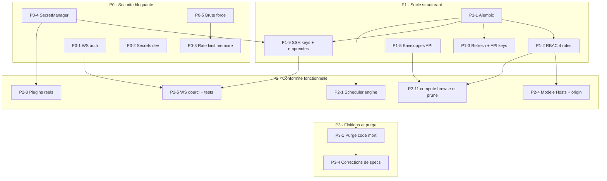

# Plan de remédiation backend WindFlow — « remise d'équerre » de l'existant

> **Date :** 30 août 2026
>
> **Statut :** **✅ Plan exécuté** (vagues P0→P3, EPIC-011→014, stories STORY-100 → STORY-254) — bilan et tableau de conformité final : [`backend_conformity_report.md`](backend_conformity_report.md) (audit de clôture du 2026-11-07). Historiquement : document de planification — aucun code n'avait été modifié à ce stade.
>
> **Avertissement :** ce plan transforme le diagnostic du rapport d'analyse d'écart (spécifications ↔ code) en plan d'action sur **l'existant** : corriger ce qui est faux, compléter ce qui est incomplet, élargir ce qui est trop restreint, purger ce qui est mort. Les grandes phases produit futures (pilotage VMs/Proxmox/K8s, marketplace complète, GitOps, IA…) sont explicitement **hors périmètre** (cf. §7). Plusieurs arbitrages sont **recommandés** dans ce document (notamment : abandon de Celery au profit d'asyncio, adoption d'Argon2 avec correction de la spec, incorporation des surfaces HORS SPEC) et nécessitent une validation utilisateur avant exécution (cf. §8.4).
>
> **Sources :**
> - Inventaire du code réel : [`docs/backend_status.md`](backend_status.md) (30/08/2026)
> - Rapport d'analyse d'écart spécifications ↔ code (fourni, intégralement repris ci-dessous par référence)
> - Spécifications : [`docs/general_specs/`](general_specs/README.md) (19 fichiers) et [`docs/technical_specs/`](technical_specs/README.md)
> - Contexte phases : [`docs/Roadmap.md`](Roadmap.md) (Phase 1 déclarée livrée, Phases 2-3 planifiées)

---

## Sommaire

1. [Principes directeurs](#1-principes-directeurs)
2. [Axes de travail A-G](#2-axes-de-travail-a-g)
3. [Arbitrages tranchés](#3-arbitrages-tranchés)
4. [Séquencement en vagues P0-P3](#4-séquencement-en-vagues-p0-p3)
5. [Dépendances inter-vagues](#5-dépendances-inter-vagues)
6. [Hors périmètre de ce plan](#6-hors-périmètre-de-ce-plan)
7. [Risques et points d'attention](#7-risques-et-points-dattention)
8. [Annexes](#8-annexes)

---

## 1. Principes directeurs

1. **Remettre d'équerre l'existant avant d'étendre.** Aucune nouvelle famille de workload, aucun marketplace, aucun pilotage K8s avant que le socle actuel (auth, RBAC, secrets, migrations, API contract) soit conforme.
2. **Conformité spec prioritaire sur le confort.** Quand le code et la spec divergent, on corrige le code — sauf lorsque la spec est objectivement en retrait (ex. JWT 30 min vs 15 min réel : le code est plus sûr, on corrige la spec) ou when l'arbitrage est explicitement tranché (§3).
3. **Chaque arbitrage est explicite et tranché.** Aucun zone grise laissée en suspens : Celery vs asyncio, Argon2 vs bcrypt, incorporation des surfaces HORS SPEC, phasage du modèle directeur.
4. **Préserver les points forts inventoriés** (§2.G) : scan de cibles, module Docker, WebSocket modulaire, stack definitions + Jinja2, middlewares sécurité, OpenAPI, recovery orchestrateur. Aucune réécriture massive par principe — on refactor au contact des corrections.
5. **Compatibilité des installations existantes.** Pas de cassage : baseline Alembic sur schéma existant, migration progressive des credentials chiffrés (double lecture), rôles RBAC par défaut non cassants.
6. **Traçabilité.** Chaque item du plan est traçable au rapport d'écart (numéros de section du rapport cités) ou à [`backend_status.md`](backend_status.md).

---

## 2. Axes de travail A-G

### A. Socle oublié à réaliser (MANQUANT sur l'existant)

| # | Item | Réf. rapport | Zone de code concernée |
|---|------|--------------|------------------------|
| A1 | **Alembic** : init `backend/alembic/`, baseline du schéma existant, `upgrade head` à l'install/démarrage | §4, §14 | [`database.py`](../backend/app/database.py:89) (`create_all` à remplacer), spec [`16-deploiement.md`](general_specs/16-deploiement.md) |
| A2 | **RBAC 4 rôles** Viewer/Operator/Admin/Super_Admin + `user_organizations.role` + `require_role(...)` + hiérarchie + cache TTL 300 s | §3 | [`dependencies.py`](../backend/app/auth/dependencies.py:23) (n'existe que `require_superuser`) |
| A3 | **Audit trail** : table `audit_logs`, écriture sur actions critiques, rétention, base du futur `GET /admin/audit` | §7 | nouveau module + spéc [`15-securite.md`](general_specs/15-securite.md) |
| A4 | **Refresh tokens révocables** : table `refresh_tokens` (opaque hashé), rotation, invalidation au logout | §2 | [`auth.py`](../backend/app/api/v1/auth.py:391) (logout stateless actuel) |
| A5 | **Clés API** `wf_ak_` : table `api_keys` (hash bcrypt), révocation, header `X-API-Key` | §2 | [`auth/dependencies.py`](../backend/app/auth/dependencies.py:23) |
| A6 | **SecretManager** AES/Fernet : chiffrement au repos de `connection_config`, `env_vars`, `plugin_configs` | §7 (critique n°1) | nouveau `core/secret_manager.py` + [`target_service.py`](../backend/app/services/target_service.py:30) |
| A7 | **SSH réutilisables + empreintes** : tables `ssh_keys`, `host_ssh_fingerprints`, anti-MITM (TOFU + confirmation) | §4, §7 | credentials actuellement en JSON en clair sur [`Target`](../backend/app/models) |
| A8 | **Scheduler engine** : registre d'actions, triggers cron **et** événement, verrous anti-chevauchement, relecture défensive, récupération d'orphelins, fuseaux IANA | §12 (majeur) | [`scheduler_service.py`](../backend/app/services/scheduler_service.py:20) (CRUD sans moteur), `scheduled_task_executions` manquante |
| A9 | **Notifications core** : in-app + webhook, contrat, routage, anti-spam | §12 | nouveau |
| A10 | **Enveloppes API standard** `{data,...}` / `{data,pagination}` / `{error:{code,message}}` | §1 | tous routers [`api/v1/`](../backend/app/api/v1/__init__.py:28) |
| A11 | **Hiérarchie d'exceptions** `APIError(code,…)` héritant de [`WindFlowException`](../backend/app/core/exceptions.py:10), 409 conflits | §1 | [`exceptions.py`](../backend/app/core/exceptions.py:10) (2 exceptions seulement) |
| A12 | **`GET /system/ready`** (sans auth) + health sans auth formalisé | §1 | [`main.py`](../backend/app/main.py:315) (existe `/health` seul) |
| A13 | **`PUT /auth/password`** | §2 | [`auth.py`](../backend/app/api/v1/auth.py:27) |
| A14 | **`environments`** : table + rattachement stacks (socle du modèle spec 06) | §4 | spec [`06-modele-de-donnees.md`](general_specs/06-modele-de-donnees.md) |
| A15 | **`deployment_events`** : événements structurés persistés (vs colonne texte) | §4 | [`deployment.py`](../backend/app/models/deployment.py:34), [`deployment_service.py`](../backend/app/services/deployment_service.py:23) |
| A16 | **Incorporation HORS SPEC** dans la spec 09 : `/compute/*`, `/discovery/*`, `/stats/*`, import/export stacks, `admin/stacks-management`, `plugin_registry` | §1, cartographie | spec [`09-api.md`](general_specs/09-api.md) — voir arbitrage F3 |

### B. Existant faux à corriger (FAUX/CASSÉ)

| # | Item | Réf. rapport | Zone de code |
|---|------|--------------|--------------|
| B1 | **WS auth obligatoire** : [`get_current_user_ws()`](../backend/app/auth/dependencies.py:23) retourne `None` sans token → connexions anonymes acceptées | §7 (critique), §8 | [`dependencies.py`](../backend/app/auth/dependencies.py:23), [`websockets.py`](../backend/app/api/v1/websockets.py:27) |
| B2 | **Rate limiting effectif** : no-op sans Redis ([`rate_limit.py`](../backend/app/core/rate_limit.py:43)) → fallback mémoire + warning | §7 | [`rate_limit.py`](../backend/app/core/rate_limit.py:18) |
| B3 | **Credentials cibles en clair** → chiffrés via A6 (doublon volontaire : la cause est un MANQUANT, le symptôme est un FAUX) | §4, §7 | modèles `Target` |
| B4 | **Prometheus mensonger** : `prometheus_enabled=True` sans instrumentation ; [`websocket/metrics.py`](../backend/app/websocket/metrics.py) jamais importé | §15 | [`config.py`](../backend/app/config.py:41), instrumentation à créer |
| B5 | **Plugins coquille vide** : install = enregistrement DB (pas de download, pas de checksum SHA-256, pas de compose up, pas de rollback) | §10 | [`plugin_manager_service.py`](../backend/app/services/plugin_manager_service.py:27) |
| B6 | **Logout/révocation impossibles** : refresh = JWT 7 j, pas de table, pas de blacklist | §2 | [`auth.py`](../backend/app/api/v1/auth.py:391) — lié à A4 |
| B7 | **Nomenclature événements divergente** : `deployment.completed` vs `succeeded`, `target.*` vs `host.*` ; pont ne mappe que 5 types ; `DEPLOYMENT_PROGRESS` défini jamais émis ; `deployment_notifications` non enregistré | §6, §8 | [`events.py`](../backend/app/core/events.py:115), [`event_bridge.py`](../backend/app/websocket/event_bridge.py:20) |
| B8 | **Double validation stacks** : [`stack_loader_service.py`](../backend/app/services/stack_loader_service.py:18) allégé vs seed → postgresql.yaml « invalide » via API admin | §9 | [`stack_loader_service.py`](../backend/app/services/stack_loader_service.py:18), [`admin/stacks_management.py`](../backend/app/api/v1/admin/stacks_management.py:16) |
| B9 | **Bornes numériques formulaires** : `minimum/maximum` servis vs `min/max` lus — transversal | §9 | [`stack_definitions_loader.py`](../backend/app/services/stack_definitions_loader.py:22) + schemas |
| B10 | **JWT 15 min réel vs 30 min spec** | §2 | arbitrage F5 → corriger la **spec** |
| B11 | **Hash bcrypt vs Argon2 imposé par les rules** | §2 | arbitrage F2 → migrer le **code** |
| B12 | **Secrets dev par défaut** (`jwt_secret`, admin `changeme123`) : dangereux en prod | §7 | [`config.py`](../backend/app/config.py:15) + [`database_seed.py`](../backend/app/database_seed.py) |
| B13 | **Celery fantôme** : [`celery_app.py`](../backend/app/celery_app.py:19) jamais importé | §6, §9.1 | arbitrage F1 → assumer asyncio, purger |
| B14 | **CircuitBreaker/HealthCheck décoratifs** : [`resilience.py`](../backend/app/core/resilience.py) non câblé | §6 | arbitrage E2 (§2.E) |
| B15 | **Modèle binaire user/superadmin** : 40 endpoints Docker destructeurs ouverts à tout user authentifié | §3 | docker.py — résolu par A2 |

### C. Existant incomplet à compléter (INCOMPLET)

| # | Item | Réf. rapport | Zone de code |
|---|------|--------------|--------------|
| C1 | **Pagination généralisée** `?page&per_page` : stacks, organizations, schedules, plugins non paginés | §1 | [`stacks.py`](../backend/app/api/v1/stacks.py:116), [`organizations.py`](../backend/app/api/v1/organizations.py:43), [`schedules.py`](../backend/app/api/v1/schedules.py:24), [`plugins.py`](../backend/app/api/v1/plugins.py:45) |
| C2 | **Brute-force login** : compteur 5 essais/10 min par username, blocage 5 min, Redis ou mémoire | §2 | [`auth.py`](../backend/app/api/v1/auth.py:27) |
| C3 | **Canaux WS manquants** (sur l'existant) : `batch` (une fois le modèle Apps posé), `ssh`, `journal` ; console VNC → hors périmètre (machines) | §8 | [`websocket/`](../backend/app/websocket) |
| C4 | **Heartbeats** : expiration des connexions muettes, ack, reconnexion homogène | §8 | [`connection_managers.py`](../backend/app/websocket/connection_managers.py:27) |
| C5 | **EventBus → interface bus canonique** : extraire l'interface, adapter in-memory (défaut) + Redis Pub/Sub (si configuré) | §6 | [`events.py`](../backend/app/core/events.py:115) (stubs Redis lignes 144, 227, 255, 298, 321, 376) |
| C6 | **Consommateurs plugins** : aucun plugin ne consomme les ~18 événements canoniques | §6, §10 | [`plugin_lifecycle_service.py`](../backend/app/services/plugin_lifecycle_service.py:40) |
| C7 | **Cache Redis + fallback mémoire réel** : dégradation silencieuse en no-op → warning + TTL mémoire | §6 | à créer (peut consommer [`abstractions.py`](../backend/app/core/abstractions.py:13)) |
| C8 | **Auto-détection du host local** au premier démarrage | §14 | [`target_service.py`](../backend/app/services/target_service.py:30) |
| C9 | **Tests des zones zéro** : websocket, organizations, users API, schedules, discovery, import_export, stats | §16 | [`tests/`](../backend/tests) |
| C10 | **Recreate sécurisé** : rebase, rollback, secrets masqués `***` | §5 | docker recreate existant |
| C11 | **Discovery : réconciliation persistée** (compose.yaml sur disque, réconciliation) — l'existant (classifier + [`adoption_service.py`](../backend/app/services/adoption_service.py:230)) sert d'assise | §5 | [`container_classifier.py`](../backend/app/services/container_classifier.py:61) |
| C12 | **`plugin_configs` chiffré si `encrypted`** | §4 | lié à A6 |
| C13 | **Axes `origin` managed/adopted/external** sur les entités pilotées (sert l'adoption existante) | §4, §5 | modèles — lié à D2 |
| C14 | **Audit des tests auth** : register/refresh/RBAC peu couverts | §16 | [`tests/`](../backend/tests) |

### D. Existant trop restreint à élargir (TROP RESTREINT — avec prudence YAGNI)

| # | Item | Réf. rapport | Justification / garde-fou |
|---|------|--------------|---------------------------|
| D1 | **Surface `/compute/*`** : ajouter `browse` et `prune` Docker (le check-updates et le graph complet restent hors périmètre) | §1, §5 | `browse`/`prune` sont des sur-fonctions de l'inventaire existant ([`compute_service.py`](../backend/app/services/compute_service.py:58)) ; pas de nouveau runtime |
| D2 | **`Stack.git_url` + env chiffré** : source Git optionnelle + chiffrement des variables d'env | §4 | `git_url` simple champ (le GitOps complet est hors périmètre) ; env chiffré s'appuie sur A6 |
| D3 | **`WorkloadAdapter` (interface) + `DockerWorkloadAdapter`** : poser le contrat architectural en enveloppant les exécuteurs existants — **sans** créer d'adapter K8s/Helm | §5, spec 02 | Interface + 1 implémentation concrète = fondation spec-compliant sans réécriture ; les autres adapters suivront en Phase 2 Roadmap |
| D4 | **Organisation modules cibles** (workloads/adapters) — limitée à ce que D3 introduit | §6 | Pas de big-bang de réorganisation des ~36 services (YAGNI) |
| D5 | **`GET /compute/global`** : conserver la richesse Docker, la rendre extensible par famille | §5 | Spéc 3 sections par Host — atteignable pour la famille Docker seulement |

### E. Code mort & résidus à purger — décision par item (purger OU ressusciter)

| # | Item | Décision recommandée | Justification |
|---|------|----------------------|---------------|
| E1 | [`helper/permissions.py`](../backend/app/helper/permissions.py:64) (policies/groups/cron legacy) | **Purger** | Le RBAC cible (A2) est endpoint-based via `require_role(...)`, spec 08 — ne pas ressusciter un modèle legacy divergent |
| E2 | [`core/resilience.py`](../backend/app/core/resilience.py) (CircuitBreaker/RetryPolicy/HealthCheck) | **Ressusciter partiellement** : câbler `CircuitBreaker` sur les appels Docker distants ; le retry existe déjà dans l'orchestrateur ([`deployment_orchestrator.py`](../backend/app/services/deployment_orchestrator.py:21), backoff lignes 36-38) ; `HealthCheck` redondant avec [`target_service.check_all_health()`](../backend/app/services/target_service.py:30) → purger cette classe | Conforme spec 04 « résilience » sans dupliquer |
| E3 | [`helper/croniter.py`](../backend/app/helper/croniter.py) (vendored) | **Ressusciter via A8** : le scheduler engine l'utilisera comme parseur cron | Seul consommateur crédible = scheduler (sinon purger) |
| E4 | [`core/abstractions.py`](../backend/app/core/abstractions.py:13) (`DatabaseManager`, `CacheManager`) | **Ressusciter `CacheManager`** via C7 (cache fallback) ; `DatabaseManager` → purger si non consommé à l'issue de P1 | Éviter un contrat mort ; en supprimer la partie inutile |
| E5 | [`websocket/metrics.py`](../backend/app/websocket/metrics.py) (jamais importé) | **Ressusciter via B4** (instrumentation Prometheus) sinon purger | Fusionné avec l'item observabilité |
| E6 | [`workflows.py`](../backend/app/api/v1/workflows.py:17) (stub retournant `[]`) | **Purger** | Arbitrage D2 des specs : workflows = plugins n8n, pas du core. Le stub trompe le contrat API |
| E7 | [`litellm_service.py`](../backend/app/services/litellm_service.py:24) (simulation, orphelin) | **Purger du core** (recréer en plugin IA en Phase 5) | Spec 18 positionne l'IA en plugin ; garder un simulateur orphelin entretient la confusion |
| E8 | Print de debug [`main.py`](../backend/app/main.py:12) | **Purger** | Trivial |
| E9 | Duplication `/users/me` vs `/auth/me` | **Déprécier `/auth/me`** (garde `302`/alias une version), contractuel : conserver `/users/me` | Convention REST utilisateur ; éviter deux contrats pour une ressource |
| E10 | [`celery_app.py`](../backend/app/celery_app.py:19) + `Dockerfile.worker` | **Purger** (après validation arbitrage F1) | Le runtime réel est asyncio et fonctionne ; maintenir un double runtime fantôme est un risque opérationnel |

### F. Arbitrages specs ↔ code à trancher

Voir §3 (chaque arbitrage y est tranché avec justification) : F1 Celery vs asyncio, F2 Argon2 vs bcrypt, F3 incorporation HORS SPEC, F4 phasage modèle directeur, F5 durée JWT, F6 bus d'événements, F7 WorkloadAdapter.

### G. Conformes à préserver (garde-fous)

| Point fort | Réf. | Garde-fou pendant la remédiation |
|------------|------|----------------------------------|
| Scan de cibles (~20 parseurs, SocketProbe 7 familles, profils d'accès) | [`target_scan_parsers.py`](../backend/app/services/target_scan_parsers.py:29), [`socket_clients.py`](../backend/app/services/socket_clients.py:38) | Ne pas réécrire ; brancher sur Host lors de D2/F4 sans casser les payloads |
| Module Docker (40 endpoints, promote, adoption) | [`docker.py`](../backend/app/api/v1/docker.py:69) | Aucune suppression d'endpoint ; uniquement RBAC + enveloppes par-dessus |
| WebSocket modulaire et documenté | [`websocket/README.md`](../backend/app/websocket/README.md) | Étendre (heartbeats, canaux) sans casser l'architecture plugins |
| Stack definitions + 16 fonctions Jinja2 | [`template_renderer.py`](../backend/app/helper/template_renderer.py), [`jinja_functions.py`](../backend/app/helper/jinja_functions.py) | Conforme spec ; ne toucher qu'aux bornes numériques (B9) |
| Middlewares sécurité (CSP/HSTS/correlation/timing) | [`main.py`](../backend/app/main.py:254) | Conforme spec 15 — ne pas régresser |
| OpenAPI multi-interfaces (Scalar/Swagger/ReDoc) | [`main.py`](../backend/app/main.py:224) | Maintenir à jour lors des changements de contrat (A10) |
| Recovery orchestrateur (reprise orphelins) | [`deployment_orchestrator.py`](../backend/app/services/deployment_orchestrator.py:21) | Conserver `recover_pending_deployments()` au startup |
| Registre plugins (lecture, cache TTL) | [`plugin_registry_service.py`](../backend/app/services/plugin_registry_service.py:23) | Base saine pour B5 |
| Login username/email + register | [`auth.py`](../backend/app/api/v1/auth.py:27) | Conforme — ne pas régresser |

---

## 3. Arbitrages tranchés

> Chaque arbitrage ci-dessous est une **recommandation** à valider par l'utilisateur avant exécution (cf. §7.4).

### F1 — Celery vs asyncio → **asyncio (tranché : abandonner Celery)**

- **Constat** : [`celery_app.py`](../backend/app/celery_app.py:19) est complet mais jamais importé ; le runtime réel (orchestrateur + boucle de santé lifespan + [`background_tasks.py`](../backend/app/tasks/background_tasks.py:24)) fonctionne en asyncio avec retry/recovery conformes.
- **Décision recommandée** : assumer asyncio comme unique runtime. Purger `celery_app.py`, `Dockerfile.worker`, et corriger la spec [`04-architecture.md`](general_specs/04-architecture.md) + [`05-stack-technologique.md`](general_specs/05-stack-technologique.md) + les rules `.roo` (mention « Celery prévu mais non intégré »).
- **Justification** : philosophie produit « cœur minimal sur Raspberry Pi 2 Go » ([`Roadmap.md`](Roadmap.md)) ; un broker AMQP + worker séparé est un coût opérationnel injustifié pour un monolithe single-node ; la dépendance Celery n'est même pas installable via Poetry actuellement (rules 05) ; maintenir deux runtimes fantômes double la surface de test et de déploiement.
- **Contrepartie assumée** : les tâches longues tournent dans le processus API → à isoler via le scheduler engine (A8) et, si besoin ultérieur de scale-out, ré-introduire un worker **sur la même base de contrat de tâches** (définition stockée en base, exécution déléguée).

### F2 — Argon2 vs bcrypt → **Argon2 (tranché : corriger le CODE, la spec 07 suit)**

- **Constat** : spec 07 demande bcrypt cost 12 ; les rules projet (`.roo/rules/40-security.md`) imposent argon2-cffi ; le code utilise passlib (bcrypt). Le rapport juge Argon2 supérieur.
- **Décision recommandée** : migrer vers Argon2id via passlib/argon2-cffi en s'appuyant sur l'upgrade automatique au login qui **existe déjà** ([`user_service.py`](../backend/app/services/user_service.py:20), `verify_and_update_user`) → migration transparente, sans reset de mots de passe. Corriger la spec [`07-authentification.md`](general_specs/07-authentification.md).

### F3 — Surfaces HORS SPEC → **incorporer dans la spec 09 (tranché)**

- **Constat** : `/compute/*`, `/discovery/*`, `/stats/*`, import/export YAML stacks, `admin/stacks-management` (15 endpoints), `plugin_registry` existent dans le code, sont consommés par l'UI et ne violent aucune intension produit — ils **précèdent** la spec au lieu de la suivre.
- **Décision recommandée** : incorporer ces contrats dans [`09-api.md`](general_specs/09-api.md) (avec pagination/enveloppes cf. A10/C1), puis les faire converger vers la nomenclature cible lors du phasage modèle (F4) : `/targets/*` deviendra `/hosts/*` avec période d'alias de compatibilité. Le « promote conteneur→stack » est également incorporé ( pont adoption→managé cohérent avec l'axe `origin`).

### F4 — Modèle directeur (targets→Hosts/Apps/Machines/Clusters) → **phasage en 3 étapes (tranché)**

- **Étape 1 (dans ce plan, P1)** : tables support de l'existant — `user_organizations`, `refresh_tokens`, `api_keys`, `audit_logs`, `ssh_keys`, `host_ssh_fingerprints`, `environments`, `scheduled_task_executions`.
- **Étape 2 (dans ce plan, P2)** : migration `Target` → `Host` (profils 3 valeurs spec 06) + axe `origin` + `Stack.git_url`/env chiffré — le tout avec migration de données Alembic et double nommage API temporaire.
- **Étape 3 (hors périmètre, Roadmap Phase 2)** : entités `Apps`, `Machines`, `Clusters`, triple XOR, verbes universels — **justification** : créer ces tables sans adapter de pilotage (Aucun K8s/Helm/Proxmox exécutable) produirait des coquilles vides non testables ; l'interface `WorkloadAdapter` (D3) pose le contrat dès ce plan, les entités arrivent avec leurs adapters.
- **Contrepartie** : la spec 06 est annotée « déploiement phasé » pour rester honnête vis-à-vis du code.

### F5 — Durée JWT 15 vs 30 min → **15 min (tranché : corriger la SPEC)**

Le code (15 min) est plus sûr que la spec (30 min) ; aucun bénéfice à allonger. Correction de [`07-authentification.md`](general_specs/07-authentification.md).

### F6 — Bus d'événements : Redis Streams vs in-memory → **interface canonique + 2 implémentations (tranché)**

- La spec 04 et ARCHITECTURE-MODULAIRE admettent « Redis Pub/Sub **ou** asyncio.Queue ». L'EventBus in-memory ([`events.py`](../backend/app/core/events.py:115)) fonctionne (consommateur réel : le pont WebSocket).
- **Décision** : extraire une interface `Bus` canonique avec la nomenclature des ~18 événements spec (B7), garder l'implémentation in-memory par défaut (mode léger RPi), ajouter l'implémentation Redis Pub/Sub activée quand `cache_url` est configuré. Les stubs Redis Streams commentés (lignes 144-376) sont remplacés par cette implémentation Pub/Sub — Streams complets (replay/event sourcing) restent hors périmètre.

### F7 — WorkloadAdapter → **créer l'interface + adapter Docker maintenant (tranché)**

Spec 02 + VIRTUALIZATION-SYSTEMS §6.3 exigent le socle. L'adapter Docker enveloppe les exécuteurs existants ([`docker_executor.py`](../backend/app/services/docker_executor.py:26)) sans réécriture. Les adapters K8s/Helm/Swarm suivent la Roadmap.

### F8 — Backup/restore core (spec 16) → **reporté (tranché)**

Cf. §6 : périmètre trop gros pour la remédiation, mérite une initiative dédiée liée au scheduler engine (action `admin.backup` du registre A8).

---

## 4. Séquencement en vagues P0-P3

> Ampleur : **S** (< ~2 fichiers/jour-homme d'effort ciblé), **M** (quelques jours), **L** (plusieurs jours, multi-fichiers), **XL** (initiative majeure, à découper en stories).
> Règle de dépendance respectée : **Alembic avant toute migration de modèle ; RBAC avant ouverture de nouveaux endpoints ; SecretManager avant ssh_keys.**

### Vague P0 — Sécurité bloquante

| ID | Objectif | Zones concernées | Dépend de | Critère de done vérifiable | Ampleur |
|----|----------|------------------|-----------|----------------------------|---------|
| P0-1 | Auth WS obligatoire : refuser les connexions sans token valide (B1) | [`dependencies.py`](../backend/app/auth/dependencies.py:23) (`get_current_user_ws`), [`websockets.py`](../backend/app/api/v1/websockets.py:27), 5 canaux | — | Test : connexion WS sans token → refusée (401/fermeture) sur les 5 canaux ; `disable_auth` continue de fonctionner en dev | S |
| P0-2 | Refus des secrets dev en prod : démarrage bloqué si `jwt_secret` par défaut ou admin `changeme123` lorsque `environment=production` (B12) | [`config.py`](../backend/app/config.py:15), [`database_seed.py`](../backend/app/database_seed.py) | — | Test : settings prod + secret par défaut → exception au startup avec message explicite ; doc `env.example` à jour | S |
| P0-3 | Rate limiting effectif sans Redis : backend mémoire process-local + log warning une fois (B2) | [`rate_limit.py`](../backend/app/core/rate_limit.py:18) | — | Test : sans `RATE_LIMIT_STORAGE_URL`, 6 requêtes/min sur `/auth/login` → 429 ; warning unique dans les logs | M |
| P0-4 | SecretManager Fernet/AES + chiffrement des credentials cibles et env vars de stacks, migration double-lecture (A6, B3, C12 partiel) | nouveau `core/secret_manager.py`, [`config.py`](../backend/app/config.py:15) (clé maîtresse), modèles `Target`/`Stack`, [`database.py`](../backend/app/database.py:27) | — (conçu sans migration de schéma : chiffrement du contenu JSON) | Test unitaire round-trip chiffrement ; test de migration : ancienne ligne en clair → lue puis ré-encryptée au premier accès ; 0 credential lisible en base après exécution | L |
| P0-5 | Brute-force login : compteur 5 essais/10 min par username, blocage 5 min, stockage Redis **ou** mémoire (C2) | [`auth.py`](../backend/app/api/v1/auth.py:27) | P0-3 (même mécanique de stockage) | Tests : 6e essai → 429 avec `Retry-After` ; reset après fenêtre ; compteur par username (pas par IP seule) | M |

### Vague P1 — Socle structurant

| ID | Objectif | Zones concernées | Dépend de | Critère de done vérifiable | Ampleur |
|----|----------|------------------|-----------|----------------------------|---------|
| P1-1 | Alembic : init, baseline du schéma existant (10 modèles), `upgrade head` au démarrage/install à la place de `create_all` nu (A1) | `backend/alembic/` (nouveau), [`database.py`](../backend/app/database.py:89), spec 16 | — | Sur une base existante : `alembic stamp baseline` puis démarrage → aucun diff ; sur base vierge : création complète par migrations uniquement ; CI exécute les migrations | M |
| P1-2 | RBAC 4 rôles : enum + `user_organizations.role` + `require_role(...)` + hiérarchie + cache TTL 300 s + protections d'escalade (dernier superadmin, non-promotion) — appliqué aux ~110 endpoints existants (A2, B15) | [`dependencies.py`](../backend/app/auth/dependencies.py:23), nouveau `auth/rbac.py`, tous routers, migration données : superuser→Super_Admin, autres→Operator | P1-1 | Tests : matrice rôle×endpoint représentative (viewer 403 sur DELETE `/docker/containers/{id}`, operator 200, etc.) ; test dernier superadmin non-démotable ; cache vérifié (TTL) | XL |
| P1-3 | Refresh tokens révocables + clés API : tables, hashage, rotation, logout invalide, `X-API-Key` (A4, A5, B6) | [`auth.py`](../backend/app/api/v1/auth.py:391), [`jwt.py`](../backend/app/auth/jwt.py:16), nouveau `api_keys.py` | P1-1 | Tests : refresh révoqué → 401 ; logout → refresh suivant refusé ; clé API `wf_ak_...` authentifie ; révocation immédiate ; hash bcrypt en base (jamais la clé) | L |
| P1-4 | Audit trail : table `audit_logs` + écriture sur actions critiques (suppressions, déploiements, modifications config/RBAC) + rétention (A3) | nouveau `services/audit_service.py`, middlewares/endpoints concernés | P1-1, (P1-2 pour l'acteur rôle) | Test : DELETE stack → ligne d'audit avec user, org, action, cible, correlation_id ; rétention configurable appliquée | M |
| P1-5 | Enveloppes API standard `{data}` / `{data,pagination}` / `{error:{code,message}}` + hiérarchie `APIError` avec 409 (A10, A11) | [`exceptions.py`](../backend/app/core/exceptions.py:10), [`main.py`](../backend/app/main.py:380) handlers, tous routers, client frontend/CLI à synchroniser | — (mais à merger tôt pour éviter les conflits) | Tous les endpoints répondent au format enveloppe (test de contrat sur un échantillon par router) ; 409 sur conflit (ex. slug org dupliqué) ; OpenAPI exemples mis à jour | L |
| P1-6 | Pagination généralisée `?page&per_page` (C1) | [`stacks.py`](../backend/app/api/v1/stacks.py:116), [`organizations.py`](../backend/app/api/v1/organizations.py:43), [`schedules.py`](../backend/app/api/v1/schedules.py:24), [`plugins.py`](../backend/app/api/v1/plugins.py:45), [`targets/crud.py`](../backend/app/api/v1/targets) | P1-5 (format pagination) | Chaque liste expose `pagination{page,per_page,total}` ; bornes per_page (max 100) ; defaults documentés OpenAPI | M |
| P1-7 | `GET /system/ready` sans auth + formalisation `/system/health` (A12) | [`main.py`](../backend/app/main.py:315) | — | `/ready` vérifie migrations appliquées + DB + dépendances optionnelles (Redis si configuré) ; sans auth ; 503 en cas de non-prêt | S |
| P1-8 | `PUT /auth/password` ( changement authentifié, vérification ancien mot de passe, révocation des refresh) (A13) | [`auth.py`](../backend/app/api/v1/auth.py:27) | P1-3 | Tests : 200 avec ancien mdp correct, 400 si faux, refresh tokens révoqués après changement | S |
| P1-9 | SSH réutilisables + empreintes hôtes + anti-MITM (TOFU + écran de confirmation) ; credentials cibles passent par ssh_keys référencées (chiffrées via P0-4) (A7) | modèles `ssh_keys`/`host_ssh_fingerprints` (migration), [`target_service.py`](../backend/app/services/target_service.py:30), [`commands.py`](../backend/app/services/commands.py:167) | P1-1, P0-4 | Tests : fingerprint inconnu → déploiement bloqué + événement de confirmation ; clé réutilisée sur N cibles ; flux `commands.py` inchangé côté appelants | L |
| P1-10 | Migration hash Argon2id (F2) | [`user_service.py`](../backend/app/services/user_service.py:20), dépendance `argon2-cffi` | — | Test : login d'un utilisateur bcrypt → hash re-haché Argon2id en base après login ; aucun reset de mot de passe requis ; spec 07 corrigée | S |
| P1-11 | Purge Celery + `Dockerfile.worker` (F1, E10) — après validation utilisateur | [`celery_app.py`](../backend/app/celery_app.py:19), `infrastructure/docker/Dockerfile.worker`, compose files, specs 04/05 | Arbitrage F1 validé | Plus aucune référence Celery dans le code/CI/docs ; `make docker-build-worker` retiré du Makefile ; specs et rules mises à jour | S |

### Vague P2 — Conformité fonctionnelle

| ID | Objectif | Zones concernées | Dépend de | Critère de done vérifiable | Ampleur |
|----|----------|------------------|-----------|----------------------------|---------|
| P2-1 | Scheduler engine : boucle d'exécution asyncio, registre d'actions (`stack.backup`, `compute.docker.prune`, `host.scan`, `admin.backup`, `notification.send`), triggers cron **et** événement, verrous anti-chevauchement, relecture défensive, récupération d'orphelins, fuseaux IANA, persistance `scheduled_task_executions` (A8) | [`scheduler_service.py`](../backend/app/services/scheduler_service.py:20) + nouveau `scheduler/engine.py`, [`croniter.py`](../backend/app/helper/croniter.py) (E3), lifespan [`main.py`](../backend/app/main.py:59) | P1-1 | Tests : cron déclenché à l'heure (time travel/monkeypatch), verrou (2 déclenchements simultanés → 1 exécution), exécutions persistées et listables, redémarrage mi-exécution → récupération | XL |
| P2-2 | Bus d'événements canonique : interface `Bus`, nomenclature des ~18 événements spec, migration des émetteurs (`deployment.succeeded`→`completed`, `target.*`→`host.*`), implémentation Redis Pub/Sub optionnelle, `DEPLOYMENT_PROGRESS` émis ou retiré, `deployment_notifications` enregistré (B7, C5, F6) | [`events.py`](../backend/app/core/events.py:115) (+ stubs 144-376 remplacés), [`event_bridge.py`](../backend/app/websocket/event_bridge.py:20), [`deployment_events.py`](../backend/app/services/deployment_events.py:22) | — | Table de correspondance ancien→nouveau documentée ; tests : chaque événement spec émis par son émetteur réel ; avec Redis configuré, événement visible sur le canal Pub/Sub ; sans Redis, comportement in-memory intact | L |
| P2-3 | Plugins réels : download + checksum SHA-256 obligatoire → validation manifest → hooks lifecycle → compose up → rollback sur échec ; chiffrement `plugin_configs` si `encrypted` (B5, C12) | [`plugin_manager_service.py`](../backend/app/services/plugin_manager_service.py:27), [`plugin_manifest_service.py`](../backend/app/services/plugin_manifest_service.py:21), P0-4 | P0-4 | Tests : install avec checksum invalide → rejet, échec de hook → rollback complet (DB + filesystem + conteneur), config chiffrée en base ; routes dynamiques d'extension `/api/v1/plugins/{name}/…` documentées OpenAPI | XL |
| P2-4 | Modèle — étape 2 : `Target`→`Host` (profils spec 06), axe `origin` managed/adopted/external, `environments` activés, `Stack.git_url` (F4, A14, C13, D2) | migrations Alembic, [`enums/target.py`](../backend/app/enums/target.py:10), routers `/targets/*` → alias `/hosts/*`, [`adoption_service.py`](../backend/app/services/adoption_service.py:230) (pose `origin=adopted`) | P1-1, P1-2 (RBAC avant nouveaux chemins) | Migration de données sans perte (test sur fixture réaliste) ; double nommage actif avec header de dépréciation ; adoption marque `origin=adopted` ; stacks rattachables à un environnement | XL |
| P2-5 | WebSocket durci : heartbeats avec expiration, ack, reconnexion homogène, canal `journal` (logs système host) et `ssh` (via P1-9) ; tests WS — currently 0 (C3, C4, C9) | [`connection_managers.py`](../backend/app/websocket/connection_managers.py:27), handlers, [`tests/unit/test_websocket/`](../backend/tests) | P0-1, P1-9 | Suite de tests WS (connexion, auth, heartbeat timeout, re-souscription) ; client type documenté ; VNC explicitement absent (machines = Roadmap) | L |
| P2-6 | Stacks : unification de la double validation (une seule source de vérité de règles) + correction des bornes numériques formulaires `min/max` (B8, B9) | [`stack_loader_service.py`](../backend/app/services/stack_loader_service.py:18), [`stack_definitions_loader.py`](../backend/app/services/stack_definitions_loader.py:22), [`admin/stacks_management.py`](../backend/app/api/v1/admin/stacks_management.py:16) | — | Test : `postgresql.yaml` passe la validation API admin ET le seed avec les mêmes règles ; `minimum/maximum` servis au formulaire | M |
| P2-7 | `deployment_events` structurés : persistance des événements de déploiement (colonnes typées) + rétention, la colonne logs texte reste pour le payload brut (A15) | [`deployment.py`](../backend/app/models/deployment.py:34), [`deployment_service.py`](../backend/app/services/deployment_service.py:23) | P2-2 (nomenclature) | Un déploiement de test produit une séquence d'events requêtables paginée ; rétention appliquée | M |
| P2-8 | Cache Redis avec fallback mémoire effectif : interface [`CacheManager`](../backend/app/core/abstractions.py:13) consommée, TTL mémoire, warning de dégradation (C7, E4) | nouveau `core/cache.py`, consommateurs (registry plugins TTL, RBAC TTL) | P1-2 (cache RBAC) | Test : sans Redis, cache mémoire fonctionne et un warning est émis ; avec Redis, clés visibles ; TTL respecté | M |
| P2-9 | Observabilité réelle : instrumentation Prometheus (`/metrics` sans auth, compteurs HTTP + métriques business déploiements ok/ko), import de [`metrics.py`](../backend/app/websocket/metrics.py), dashboards Grafana existants vérifiés (B4, E5) | [`main.py`](../backend/app/main.py:59), [`config.py`](../backend/app/config.py:41), [`infrastructure/docker/prometheus.yml`](../infrastructure/docker/prometheus.yml) | — | `/metrics` expose au minimum : latence endpoints, taux d'erreur, déploiements ok/ko ; dashboards provisionnés affichent des données sur un run de démo | M |
| P2-10 | Auto-détection du host local au premier démarrage (cible locale + profil d'accès) (C8) | [`target_service.py`](../backend/app/services/target_service.py:30), seed lifespan | P2-4 (entité Host) | Premier démarrage : host local présent avec capacités scannées ; désactivable par setting | S |
| P2-11 | `/compute` élargi : `browse` (inventaire détaillé paginé) et `prune` Docker (D1) — check-updates et graph complet restent hors périmètre | [`compute.py`](../backend/app/api/v1/compute.py:25), [`compute_service.py`](../backend/app/services/compute_service.py:58) | P1-2, P1-5/6 | `browse` paginé filtrable ; `prune` (images/volumes/conteneurs stoppés) protégé RBAC + audit + dry-run | M |
| P2-12 | `WorkloadAdapter` : interface + `DockerWorkloadAdapter` enveloppant [`DockerExecutor`](../backend/app/services/docker_executor.py:26)/[`ComposeExecutor`](../backend/app/services/docker_executor.py:786) + verbes universels pour la famille Docker (D3) | nouveau `services/workloads/` | — | Le chemin de déploiement existant passe par l'adapter (test de non-régression complet des déploiements) ; l'interface est documentée spec 02 | L |
| P2-13 | Recreate sécurisé : rebase des modifications, rollback sur échec, masquage secrets `***` dans les aperçus (C10) | recreate Docker existant | P0-4 | Test : recreate avec secret env → aperçu masqué ; échec de recreate → retour à l'état antérieur | M |
| P2-14 | Tests des zones zéro : websocket (avec P2-5), organizations, users API, schedules (avec P2-1), discovery/adoption complément, import_export, stats (C9) | [`tests/`](../backend/tests) | Selon zones | Couverture par domaine cible ≥ 80 % sur les modules touchés ; CI verte | L |
| P2-15 | Notifications core : in-app + webhook, contrat, routage par événement, anti-spam (A9) — base pour `notification.send` de P2-1 | nouveau module | P2-2 | Test : événement → notification in-app persistée + webhook livré (mock) ; anti-spam effectif | M |

### Vague P3 — Finitions & purge

| ID | Objectif | Zones concernées | Dépend de | Critère de done vérifiable | Ampleur |
|----|----------|------------------|-----------|----------------------------|---------|
| P3-1 | Purge du code mort : [`permissions.py`](../backend/app/helper/permissions.py:64) (E1), `DatabaseManager` dans [`abstractions.py`](../backend/app/core/abstractions.py:13) si non consommé (E4), stub [`workflows.py`](../backend/app/api/v1/workflows.py:17) (E6), [`litellm_service.py`](../backend/app/services/litellm_service.py:24) (E7), print debug [`main.py:12`](../backend/app/main.py:12) (E8), `HealthCheck` de [`resilience.py`](../backend/app/core/resilience.py) (E2) | fichiers listés | P2-1 (croniter consommé), P2-8 (abstractions), arbitrage F1 | `grep`/import-check : aucun symbole orphelin ; OpenAPI ne référence plus `/workflows` ; CI et tests verts | S |
| P3-2 | CircuitBreaker câblé sur appels Docker distants (E2) | [`resilience.py`](../backend/app/core/resilience.py), [`docker_executor.py`](../backend/app/services/docker_executor.py:76) | P2-12 | Test : cible Docker défaillante → circuit ouvert après N échecs, demi-ouvert après délai ; métrique exposée (P2-9) | M |
| P3-3 | Dépréciation `/auth/me` au profit de `/users/me` (E9) | [`auth.py`](../backend/app/api/v1/auth.py:27) | — | `/auth/me` répond avec header `Deprecation` + note OpenAPI ; removal planifié documenté | S |
| P3-4 | Corrections de specs consolidées : JWT 15 min (F5), suppression Celery (F1), Argon2 (F2), incorporation HORS SPEC (F3), annotation phasage modèle (F4), nomenclature événements (P2-2) | [`general_specs/04`](general_specs/04-architecture.md), [`05`](general_specs/05-stack-technologique.md), [`06`](general_specs/06-modele-de-donnees.md), [`07`](general_specs/07-authentification.md), [`09`](general_specs/09-api.md) | Vagues précédentes | Les specs reflètent le code livré ; revue croisée specs↔[`backend_status.md`](backend_status.md) actualisé | M |
| P3-5 | Rangement documentaire : mise à jour de [`backend_status.md`](backend_status.md) + rules `.roo` (Celery retiré, RBAC réel, secrets) pour refléter l'état post-remédiation | docs + `.roo/rules` | Fin des vagues | Relecture : plus d'écart « annoncé vs réel » sur les points traités | S |

---

## 5. Dépendances inter-vagues

Chaînes critiques :
1. **Alembic (P1-1) → RBAC (P1-2) → modèle Hosts (P2-4) et `/compute` élargi (P2-11)** — aucune nouvelle table ni nouvel endpoint ouvert avant migrations + RBAC.
2. **SecretManager (P0-4) → SSH keys (P1-9) → plugins réels (P2-3) et canal WS ssh (P2-5)**.
3. **Scheduler engine (P2-1) → purge croniter (P3-1)** — le vendored ne peut être statué qu'une fois consommé.
4. **Enveloppes API (P1-5) → pagination (P1-6) → toutes les surfaces élargies** — le contrat de réponse doit être stable avant d'ajouter des endpoints.

---

## 6. Hors périmètre de ce plan

Reportés aux phases Roadmap (cf. [`Roadmap.md`](Roadmap.md)) ou à des initiatives dédiées, **pour éviter l'effet tunnel** :

| Item | Réf. rapport | Destination |
|------|--------------|-------------|
| Pilotage VMs / Proxmox API / clusters / power / snapshot / VNC / cloud-init / bibliothèque images | §5, §13 | Roadmap Phase 2 (adapters `Machines`) |
| Piloting Helm / K8s / Swarm | §5 | Roadmap Phase 2 (adapters `Clusters`) |
| Entités `Apps`, `Machines`, `Clusters`, triple XOR, batch update multi-Apps + `WS /ws/batch` | §1, §4 | Roadmap Phase 2 (avec les adapters — cf. arbitrage F4) |
| Marketplace multi-backends + catalogue 28 plugins officiels | §1, §10 | Roadmap Phase 2 |
| Plugin Git GitOps (clone blobless, SHA-256, webhooks HMAC) | §10 | Roadmap (Phase 2/3) |
| Check-updates (digest sans pull, semver, pending-updates) et auto-update complet | §5 | Roadmap Phase 5 |
| IA / LiteLLM réel | §11 | Roadmap Phase 5 (plugin IA) — le service simulé est purgé du core (E7) |
| Keycloak SSO (plugin OIDC) | §2, §7 | Initiative plugin dédiée (flags conservés en config) |
| Vault plugin `vault://` | §7 | Initiative plugin dédiée (idem) |
| Backup/restore core + recovery | §14 | Initiative dédiée (F8) — le registre d'actions du scheduler (P2-1) prépare `admin.backup` |
| Validation Compose 20 règles avec confrontation état réel Host | §1 | Suit l'entité `Apps`/`Host` consolidée (Phase 2) — les règles communes sont dès P2-6 |
| Redis Streams complet (replay/event sourcing) | §6 | Remplacé à court terme par Pub/Sub (F6) ; Streams = arbitrage ultérieur scale-out |
| Isolation réseau par environnement | §7 | Avec `environments` complet (Phase 2) |
| Console VNC / canaux WS liés aux machines | §8 | Avec le pilotage VMs (Phase 2) |
| Environnements `/environments` API complète (CRUD multi-env) | §1 | Seule la table + rattachement stacks sont dans ce plan (P2-4) |
| Admin `/admin/users|audit|backup|registries` complet | §1 | `audit` arrive avec A3/P1-4 (endpoint lecture) ; `users` existe partiellement ; `backup`/`registries` reportés |
| Workflows n8n | §12 | Conforme arbitrage D2 — rien à faire côté core (purge du stub uniquement) |

---

## 7. Risques et points d'attention

### 7.1 Compatibilité des données existantes

| Risque | Mitigation prévue dans le plan |
|--------|-------------------------------|
| Passage `create_all` → Alembic sur des bases existantes | Baseline + `stamp` sur schéma existant (P1-1) ; `create_all` retiré seulement après validation |
| Chiffrement des credentials existants (P0-4) | Double lecture (clair → ré-encryptage au premier accès) ; backup de base préalable documenté ; procédure de rotation de clé maîtresse |
| Migration `Target`→`Host` (P2-4) | Migration de données Alembic testée sur fixtures réalistes ; double nommage API avec dépréciation progressive |
| RBAC : utilisateurs existants | Mapping non cassant : superuser→Super_Admin, actif→Operator (droits proches de l'existant), ajustable ensuite |
| Enveloppes API (P1-5) | Breaking change consommateur : synchroniser frontend/CLI dans le même lot ; versionner dans le changelog |

### 7.2 Charge de test

- Les zones actuellement à zéro test (websocket, organizations, users API, schedules, discovery, import_export, stats — cf. [`backend_status.md` §13.4](backend_status.md)) devront être couvertes **au fil des vagues** (P2-14) et non en fin de projet, faute de quoi les XL (RBAC, scheduler, plugins) avanceraient sans filet.
- La cible projet (≥ 80 %, 95 % chemins critiques auth/déploiement/RBAC — cf. rules 35) devient réaliste seulement après P1-2 ; à mesurer par domaine.

### 7.3 Risques d'exécution

- **P1-2 (RBAC)** est l'item le plus invasif (~110 endpoints) : découpage impératif par router, avec la matrice de rôles spec 08 comme critère d'acceptation.
- **P2-2 (nomenclature)** touche les consommateurs d'événements (bridge WS, plugins) : table de correspondance + période d'émission double pour le frontend.
- **P2-3 (plugins réels)** introduit de la surface d'attaque (download/exécution de hooks) : checksum obligatoire, sandboxing des hooks à documenter, audit trail branché (P1-4 avant P2-3 idéalement).

### 7.4 Arbitrages nécessitant une validation utilisateur avant exécution

1. **F1 — Abandon de Celery** (impact : Dockerfile.worker, compose, specs 04/05, rules).
2. **F2 — Migration Argon2** (correction de spec 07 + nouvelle dépendance).
3. **F4 — Phasage du modèle directeur** (valider que `Apps`/`Machines`/`Clusters` attendent la Phase 2).
4. **F3 — Incorporation des surfaces HORS SPEC** dans la spec 09 (et double nommage `/targets`→`/hosts`).
5. **F8 — Report du backup core** en initiative dédiée.
6. **P1-5 — Enveloppes API** : breaking change contrat (coordinate frontend/CLI requis).

### 7.5 Risque de dérive de périmètre

Le présent plan exclut explicitement les fonctionnalités nouvelles (§6). Toute story issue de ce plan doit vérifier qu'elle ne déborde pas sur les familles non pilotées — en cas de doute, l'item est requalifié Roadmap.

---

## 8. Annexes

### 8.1 Correspondance vagues ↔ axes

| Vague | Axes couverts |
|-------|---------------|
| P0 | B1, B2, B3 (via A6), B12, C2 |
| P1 | A1-A5, A7, A10-A13, B6, B10 (spec), B11, B15, C1, E10/F1 |
| P2 | A8, A9, A14, A15, A16/F3, B4, B5, B7, B8, B9, C3-C11, C13, D1-D5, F4 (étape 2), F6, F7 |
| P3 | E1-E9, F1/F2/F5 (docs), P3-5 rangement |

### 8.2 Correspondance rapport d'écart ↔ plan

| Section du rapport | Items de plan |
|--------------------|---------------|
| §1 API | P1-5, P1-6, P1-7, P2-11, F3, hors périmètre (apps/batch/marketplace) |
| §2 Authentification | P0-5, P1-3, P1-8, P1-10, F5 |
| §3 RBAC | P1-2, P3-1 (E1) |
| §4 Modèle de données | P1-1, P1-9, P2-4, P0-4, F4 |
| §5 Workloads/compute | P2-12, P2-11, P2-13, hors périmètre (adapters non-Docker) |
| §6 Architecture/event-driven | P2-2, P2-8, F1, E2, E4 |
| §7 Sécurité | P0-1 à P0-5, P1-4, P1-9, P2-3, hors périmètre (Vault, isolation) |
| §8 WebSocket | P0-1, P2-5 |
| §9 Stacks definitions | P2-6, F4 (contrat `/apps`) |
| §10 Plugins & marketplace | P2-3, P2-2 (C6), hors périmètre (catalogue, GitOps) |
| §11 IA | E7 (purge), hors périmètre |
| §12 Automatisation | P2-1, P2-15, E3, E6 |
| §13 Virtualisation | Conforme (préserver), hors périmètre |
| §14 Déploiement & exploitation | P1-1, P2-10, F8 |
| §15 Observabilité | P2-9 |
| §16 Tests & qualité | P2-14, P2-5 |

### 8.3 Rappel des conformités à préserver (§2.G)

Scan de cibles, module Docker (40 endpoints), WebSocket modulaire, stack definitions + Jinja2 (16 fonctions), middlewares sécurité, OpenAPI multi-interfaces, recovery orchestrateur, registre plugins lecture, login username/email + register.

---

*Document généré le 30 août 2026 dans le cadre de la remise d'équerre du backend. Toute exécution doit passer par le workflow backlog du projet (epics/stories) — cf. `.roo/rules/01-Project-management.md.*
