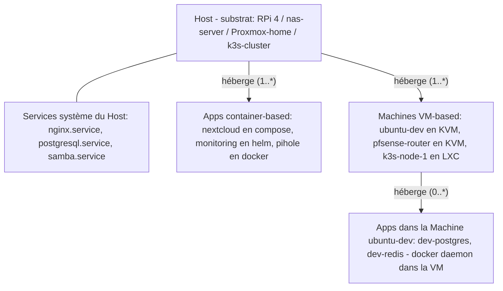

# Chapitre 02 — Familles de Workloads et WorkloadAdapter

> **Statut** : Spec cible · **Public** : Tous (concept fondateur) · **Lié à** : [01-vision.md](01-vision.md), [06-modele-de-donnees.md](06-modele-de-donnees.md), [09-api.md](09-api.md)

## Vue d'ensemble

Ce chapitre décrit le **modèle directeur** de WindFlow : trois familles de workloads (Apps, Machines, Hosts), une grammaire UI partagée, et le pattern `WorkloadAdapter` qui traduit des verbes universels en opérations natives par profil technique. Tous les autres chapitres de cette spec sont écrits dans ce paradigme. Ce chapitre ne couvre pas la vue Compute par technologie (chapitre 03), le schéma de données (chapitre 06), la surface API (chapitre 09) ni la marketplace (chapitre 12) — il y renvoie.

## Le principe à trois familles

### Pourquoi trois familles

WindFlow gère trois types d'objets fondamentalement différents dans le modèle mental des utilisateurs :

| Famille | Identité | Pattern | Durée de vie | Modèle mental |
|---------|----------|---------|--------------|---------------|
| **Apps** | un service | cattle | courte/moyenne | « je déploie un service » |
| **Machines** | un OS complet | pet | longue (années) | « je gère une machine » |
| **Hosts** | un substrat | infrastructure | très longue | « j'administre un serveur » |

Une convergence totale (à la manière naïve d'Umbrel « tout est une App ») fait violence aux modèles mentaux : un utilisateur qui crée une VM Ubuntu **pense en termes de machine**, pas en termes de service. Lui présenter sa VM comme une « App » l'oblige à apprendre une abstraction inverse à la sienne.

À l'inverse, une UI complètement séparée par technologie (à la Proxmox) impose de naviguer entre des outils qui semblent indépendants alors qu'ils partagent énormément.

**Le compromis WindFlow** : trois familles distinctes au niveau du modèle, mais une grammaire UI unifiée. Le squelette de page, le pattern Adapter, les menus contextuels, le Mode App / Mode Infra et la marketplace s'appliquent identiquement aux trois familles.

### Définition des familles

#### Famille Apps — workloads container-based

Tout ce qui tourne dans un container ou un orchestrateur de containers. L'utilisateur pense : « j'installe un service ».

Profils inclus :
- `docker_container` — container Docker/Podman standalone
- `docker_compose` — stack Compose multi-services
- `helm_release` — release Helm sur un cluster Kubernetes
- `k8s_manifest` — manifests YAML appliqués directement

**Pourquoi Helm et Compose dans la même famille ?** Du point de vue utilisateur, « Nextcloud installé via Compose » et « Nextcloud installé via Helm » produisent le même résultat : un service qui tourne, accessible par URL, sauvegardable, configurable. La différence opérationnelle (values vs env, revisions Helm, scale d'un workload) est traitée dans le menu contextuel `[⋯ Plus]`, section « Avancé (Helm) » — exactement le rôle des ContextualActions.

#### Famille Machines — workloads VM-based

Tout ce qui est une machine virtuelle avec son OS complet. L'utilisateur pense : « je crée et je gère une machine ».

Profils inclus :
- `vm_kvm` — VM KVM/QEMU via libvirt
- `vm_lxd` — VM ou system container LXD (en mode VM)
- `vm_incus` — VM ou system container Incus
- `vm_virtualbox` — VM VirtualBox
- `vm_lxc` — system container LXC

**Distinction system container vs container Docker** : un LXC ou un LXD en mode container système se comporte comme une VM légère (un OS complet, un init system, SSH dedans). Il appartient à la famille Machines, pas Apps. Un container Docker, lui, n'a qu'un process et appartient à Apps.

#### Famille Hosts — substrat d'exécution

Toute machine physique ou virtuelle sur laquelle WindFlow agit pour déployer Apps et Machines. L'utilisateur pense : « j'ai un serveur que j'administre ». Le terme *target*, utilisé historiquement en interne, est remplacé partout par **Host**.

Profils inclus :
- `host_baremetal` — machine physique sur laquelle WindFlow tourne ou qu'il pilote via SSH
- `host_proxmox` — serveur ou cluster Proxmox VE accessible via son API
- `host_kubernetes` — cluster Kubernetes (k8s, k3s, microk8s) accessible via kubeconfig
- `host_remote_docker` — daemon Docker distant accessible via SSH

Un Host est différent d'une App ou d'une Machine parce qu'il **n'est pas déployé** par WindFlow — il est **adopté** au moment où il est ajouté. Une fois adopté, on peut y déployer des Apps et y créer des Machines. Proxmox n'est pas un backend de VM parmi d'autres : c'est un **profil de Host** ; les VMs qu'il héberge sont des Machines standard pilotées via le Host `host_proxmox`.

### La hiérarchie

### Diagramme — Hiérarchie d'hébergement Host → Apps + Machines



La règle d'hébergement canonique est : une **Machine** est hébergée par un et un seul **Host** ; une **App** est hébergée par un et un seul hôte, qui est soit un **Host**, soit une **Machine** — exactement un des deux. Un Host peut héberger une ou plusieurs Machines et/ou Apps ; une Machine peut héberger une ou plusieurs Apps. Deux cas d'usage canoniques : le conteneur posé directement sur une machine physique (App → Host) et le conteneur dans un Docker daemon tournant **dans** une VM (App → Machine, chaîne `Host → Machine → App`). La règle complète est détaillée en section [Hiérarchie d'hébergement](#hiérarchie-dhébergement). Les services système (systemd sur le Host) sont gérés **dans le détail du Host**, pas dans une famille à part. Ils peuvent être adoptés comme Apps avec le profil `app_native_service` pour apparaître dans la liste Apps (voir [Services système](#services-système--mode-adoption)).

## La grammaire UI partagée

Bien que les trois familles soient conceptuellement distinctes, elles partagent **rigoureusement la même grammaire UI**. C'est cette grammaire qui crée la cohérence sans imposer une fausse unification.

### Squelette de page (invariant)

Toutes les pages détail (App, Machine, Host) partagent exactement la même structure visuelle :

```
┌─ <Nom> ─────────────────────────────────────────────────┐
│ [Icône] <Nom> <version>     <Pastille de statut>  [P]   │  ← HEADER
│ <contexte (URL, IP, Host)>                              │
│ <métriques inline : CPU, RAM>                           │
│                                                          │
│ [Action 1] [2] [3] [4] [5]                  [⋯ Plus ▾]  │  ← ACTION BAR (5 + Plus)
│                                                          │
│ ┌ Aperçu ┬ Onglet ┬ Onglet ┬ Onglet ┬ Config ┐          │  ← ONGLETS canoniques
│ │                                          │            │
│ │   ...contenu...                          │            │
│ └──────────────────────────────────────────┘            │
└──────────────────────────────────────────────────────────┘
```

Le **squelette est invariant** ; les verbes, les onglets et le contenu varient par famille.

### Action bar canonique par famille

Chaque famille a son propre jeu de 5 verbes canoniques :

| Famille | Verbes canoniques |
|---------|-------------------|
| **Apps** | `[🔗 Ouvrir]` `[⏵ Lifecycle ▾]` `[📋 Logs]` `[🖥 Console]` `[⚙ Config]` `[⋯ Plus]` |
| **Machines** | `[🔗 Ouvrir]` `[⏵ Power ▾]` `[📸 Snapshot]` `[🖥 Console VNC]` `[⚙ Hardware]` `[⋯ Plus]` |
| **Hosts** | `[🖥 SSH]` `[📊 Métriques]` `[📋 journalctl]` `[📦 Packages]` `[⚙ Config]` `[⋯ Plus]` |

Le bouton `[⏵]` est un split-button dans les deux premières familles :
- Apps : `Start / Stop / Restart / Pause`
- Machines : `Power on / Power off / Reboot / Reset / Pause / Suspend / Hibernate`

Pour les Hosts, pas de lifecycle universel (un Host n'a pas d'état « off » géré depuis WindFlow). L'opération de bas niveau équivalente est `Reboot`, accessible dans le menu `[⋯ Plus]`.

### Onglets canoniques par famille

Chaque famille a son ensemble d'onglets canoniques, dans un ordre cohérent (Aperçu en premier, Config en dernier, observabilité au milieu) :

**Onglets Apps** — `Aperçu | Logs | Console | Métriques | Sauvegardes | Config` — plus en Mode Infra : `Composants techniques | Manifest`.

**Onglets Machines** — `Aperçu | Console VNC | Métriques | Disques | Réseau | Snapshots | Hardware` — plus l'onglet conditionnel `Apps hébergées` (uniquement si un moteur container est détecté dans la Machine) ; plus en Mode Infra : `Définition libvirt (XML)`.

**Onglets Hosts** — `Aperçu | Apps déployées | Machines hébergées | Services système | Métriques | Stockage | Réseau | Config` — plus en Mode Infra : `Moteurs installés | Scan & Diagnostics`.

### Menus contextuels (identiques pour les trois familles)

Le menu `[⋯ Plus ▾]` est peuplé par l'adapter du profil, avec les **mêmes cinq sections ordonnées** quelle que soit la famille :

```
[⋯ Plus ▾]
  ┌─────────────────────────────────────┐
  │  ── Cycle de vie ──                 │
  │  ── Configuration ──                │
  │  ── Données ──                      │
  │  ── Avancé (<profil>) ──            │  ← section libellée par le profil
  │  ── Dangereux ──                    │
  └─────────────────────────────────────┘
```

Le contenu varie par profil. C'est dans la section « Avancé » — et là seulement en Mode App — que le profil technique du workload est révélé.

### Pattern inner hierarchy (familles composites)

Pour les workloads composites (compose, helm pour Apps ; Machines multi-disques ; Hosts qui hébergent plusieurs Apps/Machines), l'onglet `Aperçu` adopte un **layout 2 colonnes** identique :

```
┌─ Aperçu ─────────────────────────────────────────────┐
│  ┌─ Inventaire ──────┐ ┌─ Détail item sélectionné ─┐│
│  │ Item 1   🟢       │ │ Métadonnées              ││
│  │ Item 2   🟢       │ │                          ││
│  │ Item 3   🟡       │ │ Sous-actions             ││
│  └────────────────────┘ └──────────────────────────┘│
└──────────────────────────────────────────────────────┘
```

Le contenu de la colonne gauche change (services compose, pods helm, snapshots VM, services systemd d'un Host), le squelette reste identique.

## Famille Apps

### Verbes universels (Apps)

Sept verbes définissent l'expérience App. Sémantique universelle, implémentation déléguée à l'adapter du profil.

| Verbe | Sémantique App |
|-------|----------------|
| **Ouvrir** | Accède à l'UI web/interface native de l'App via le navigateur |
| **Démarrer / Arrêter / Redémarrer** | Cycle de vie de l'App entière (tous les services) |
| **Mettre à jour** | Passe l'App à une version plus récente, avec rollback automatique |
| **Sauvegarder** | Snapshot restaurable des données utilisateur (volumes, values, config) |
| **Configurer** | Modifie les paramètres de l'App via formulaire |
| **Logs** | Stream textuel des événements de l'App (agrégé pour les composites) |
| **Console** | Session shell interactive dans le composant principal |

### Mapping par profil App

| Verbe | docker_container | docker_compose | helm_release | k8s_manifest |
|-------|------------------|-----------------|---------------|----------------|
| Ouvrir | URL port mappé | URL via ingress/proxy | URL via ingress | URL via service |
| Start | `docker start` | `compose up -d` | `helm upgrade --reset` | `kubectl scale` ou re-apply |
| Stop | `docker stop` | `compose stop` | scale to 0 | `kubectl scale --replicas=0` |
| Restart | `docker restart` | `compose restart` | `kubectl rollout restart` | `kubectl rollout restart` |
| Update | pull + recreate | pull + redeploy | `helm upgrade` | re-apply |
| Backup | volume snapshot | volumes + DB | values + PV | PV + manifests |
| Configure | env (form) | env + ports (form) | values (form) | manifest values |
| Logs | `docker logs` | `compose logs` | `kubectl logs --all` | `kubectl logs --all` |
| Console | `exec sh` | `exec sh` (service principal) | `exec` pod | `exec` pod |

### Hiérarchie des adapters App

Exemple illustratif — spécialisations de `AppAdapter` pour la famille Apps :

```python
class AppAdapter(WorkloadAdapter):
    """Base pour la famille Apps — sémantique service."""

    @abstractmethod
    async def get_open_url(self) -> str | None: ...

    @abstractmethod
    async def list_services_or_pods(self) -> list[AppComponent]:
        """Composants internes : services Compose, pods Helm, container unique."""
        ...

# Implémentations concrètes par profil
class DockerContainerAdapter(AppAdapter): ...   # docker_container
class ComposeStackAdapter(AppAdapter): ...      # docker_compose
class HelmReleaseAdapter(AppAdapter): ...       # helm_release
class K8sManifestAdapter(AppAdapter): ...       # k8s_manifest
```

### Catalogue des ContextualActions par profil App

| Section | docker_container | docker_compose | helm_release | k8s_manifest |
|---------|------------------|-----------------|---------------|----------------|
| Cycle de vie | force restart, pause | recreate, scale service, restart service | rollout restart, scale workload | rollout restart |
| Configuration | edit env, edit limits | edit env, edit ports, edit compose YAML | edit values (form), edit values.yaml | edit manifests |
| Données | volume snapshot | volumes backup | values + PV backup | PV backup |
| Avancé | commit image, export, inspect | pull images, logs per service | history, rollback, sync chart, helm test | dry-run, diff |
| Dangereux | force remove | down -v --rmi | uninstall --no-hooks | delete --cascade |

## Famille Machines

### Verbes universels (Machines)

Six verbes définissent l'expérience Machine. Vocabulaire de **machine**, pas de service.

| Verbe | Sémantique Machine |
|-------|--------------------|
| **Ouvrir** | Accède à la Machine (URL exposée ou Console VNC) |
| **Power on / off / Reboot / Reset** | Cycle de vie matériel de la VM |
| **Snapshot** | Capture l'état complet de la Machine (mémoire + disques) |
| **Console** | Accès graphique VNC/SPICE ou texte série |
| **Hardware** | Modifier les ressources allouées (CPU, RAM, disques, réseau) |
| **Sauvegarder** | Export du disque qcow2 vers un emplacement de backup |

**Différences sémantiques notables avec Apps :**
- `Power off` ≠ `Stop` — une Machine s'arrête comme un PC physique (shutdown ACPI), pas comme un service. Le bouton est nommé « Power » et non « Lifecycle ».
- `Snapshot` est un verbe canonique (toujours présent) pour les Machines, contextuel (dans `[⋯ Plus]`) pour les Apps.
- Pas de verbe `Mettre à jour` universel — une Machine se met à jour de l'intérieur (apt upgrade depuis la console) ou par recréation depuis un template plus récent (action dans le menu Avancé).

### Mapping par profil Machine

| Verbe | vm_kvm (libvirt) | vm_lxd | vm_incus | vm_lxc | vm_virtualbox |
|-------|------------------|---------|----------|--------|----------------|
| Power on | `virsh start` | `lxc start` | `incus start` | `lxc-start` | `VBoxManage startvm` |
| Power off | `virsh shutdown` | `lxc stop` | `incus stop` | `lxc-stop` | `VBoxManage controlvm acpipowerbutton` |
| Reboot | `virsh reboot` | `lxc restart` | `incus restart` | `lxc-stop && lxc-start` | `VBoxManage controlvm reset` |
| Snapshot | `virsh snapshot-create-as` | `lxc snapshot` | `incus snapshot create` | (limité) | `VBoxManage snapshot take` |
| Console | VNC/SPICE via libvirt | `lxc console` | `incus console` | `lxc-console` | RDP/VRDE |
| Hardware | `virsh edit` (XML) | `lxc config edit` | `incus config edit` | container config | `VBoxManage modifyvm` |
| Backup | qcow2 copy | `lxc export` | `incus export` | tarball rootfs | OVA export |

### Hiérarchie des adapters Machine

Exemple illustratif — spécialisations de `MachineAdapter` pour la famille Machines :

```python
class MachineAdapter(WorkloadAdapter):
    """Base pour la famille Machines — sémantique matériel."""

    @abstractmethod
    async def power_state(self) -> PowerState:
        """running | stopped | paused | suspended | crashed."""
        ...

    @abstractmethod
    async def list_snapshots(self) -> list[Snapshot]: ...

    @abstractmethod
    async def list_disks(self) -> list[Disk]: ...

    @abstractmethod
    async def list_network_interfaces(self) -> list[NetworkInterface]: ...

    @abstractmethod
    async def open_vnc_console(self) -> VNCHandle:
        """WebSocket pour noVNC."""
        ...

# Implémentations concrètes par profil
class KVMAdapter(MachineAdapter): ...           # vm_kvm
class LXDAdapter(MachineAdapter): ...           # vm_lxd
class IncusAdapter(MachineAdapter): ...         # vm_incus
class LXCAdapter(MachineAdapter): ...           # vm_lxc
class VirtualBoxAdapter(MachineAdapter): ...    # vm_virtualbox
```

### Catalogue des ContextualActions par profil Machine

| Section | Contenu (commun à toutes les Machines) |
|---------|----------------------------------------|
| Cycle de vie | Force reset (kill), Pause/Resume, Suspend/Resume (hibernate) |
| Configuration | Edit hardware (CPU/RAM/disks), Mount ISO, Add disk, Add NIC, Firmware (BIOS/EFI), Edit native config (XML/yaml) |
| Données | Snapshot now, Restore snapshot…, Browse disks, Backup (export disk) |
| Avancé (profil) | Clone, Convert to template, Resize disk, Migrer vers un autre Host, Live migration (KVM) |
| Dangereux | Delete VM (avec ou sans les disques) |

## Famille Hosts

### Verbes universels (Hosts)

Cinq verbes définissent l'expérience Host. Vocabulaire d'**administration**, pas de déploiement.

| Verbe | Sémantique Host |
|-------|------------------|
| **SSH** | Ouvre une session shell sur le Host (équivalent du « Console » pour les autres familles) |
| **Métriques** | Affiche les métriques live (CPU, RAM, disque, réseau, température) |
| **journalctl** | Stream du journal système (logs du Host, pas d'une App spécifique) |
| **Packages** | Inventaire et gestion des paquets système (apt, yum, apk) |
| **Configuration** | Réseau, utilisateurs, hostname, fuseau horaire |

**Différences sémantiques notables avec Apps/Machines :**
- Pas de cycle de vie universel — un Host n'a pas d'état « running » géré par WindFlow. L'action `Reboot` est dans `[⋯ Plus]`.
- Pas de « Snapshot » universel — un Host n'a pas de mécanisme natif de snapshot complet (les Hosts Proxmox/k8s peuvent en avoir, mais c'est spécifique à l'adapter).
- Pas de « Mettre à jour » comme bouton de barre — l'update OS du Host est dans `[⋯ Plus]`, marqué `danger=True` (peut nécessiter un reboot).

### Mapping par profil Host

| Verbe | host_baremetal (SSH) | host_proxmox | host_kubernetes | host_remote_docker |
|-------|------------------------|---------------|------------------|---------------------|
| SSH | session SSH directe | session SSH au node | kubectl exec sur node ou `kubectl debug` | session SSH au daemon |
| Métriques | parse `/proc`, `node_exporter` | API Proxmox `/nodes/.../status` | `kubectl top nodes` + metrics-server | docker stats agrégé |
| journalctl | `journalctl` via SSH | API Proxmox tasks/syslog | `kubectl logs -n kube-system` | `journalctl` via SSH |
| Packages | apt/yum/apk via SSH | apt sur le node Proxmox | (limité à `kubectl get nodes -o wide`) | apt via SSH |
| Configuration | edit `/etc/network/...`, hostname | API Proxmox node config | kubeconfig, taints, labels | docker daemon.json |

### Hiérarchie des adapters Host

Exemple illustratif — spécialisations de `HostAdapter` pour la famille Hosts :

```python
class HostAdapter(WorkloadAdapter):
    """Base pour la famille Hosts — sémantique administration."""

    @abstractmethod
    async def get_hardware_info(self) -> HardwareInfo: ...  # CPU, arch, RAM, disques, NICs

    @abstractmethod
    async def list_engines(self) -> list[InstalledEngine]: ...  # Docker, libvirt, k8s…

    @abstractmethod
    async def list_apps_hosted(self) -> list[App]: ...          # Apps déployées directement sur ce Host

    @abstractmethod
    async def list_machines_hosted(self) -> list[Machine]: ...

    @abstractmethod
    async def list_system_services(self) -> list[SystemService]:
        """Services systemd / openrc / runit du Host."""
        ...

# Implémentations concrètes par profil
class BaremetalHostAdapter(HostAdapter): ...      # host_baremetal
class ProxmoxHostAdapter(HostAdapter): ...        # host_proxmox
class KubernetesHostAdapter(HostAdapter): ...     # host_kubernetes
class RemoteDockerHostAdapter(HostAdapter): ...   # host_remote_docker
```

La taxonomie complète des moteurs de virtualisation détectés par `list_engines` est décrite dans [../technical_specs/VIRTUALIZATION-SYSTEMS.md](../technical_specs/VIRTUALIZATION-SYSTEMS.md).

### Catalogue des ContextualActions par profil Host

| Section | Contenu |
|---------|---------|
| Cycle de vie | Reboot (danger), Shutdown (danger), Schedule reboot |
| Configuration | Edit network, Edit users, Edit hostname, Edit SSH config, Set timezone |
| Données | Backup configuration, Export inventory |
| Avancé (profil) | Install package, Run command (sudo), Refresh scan, Update OS (danger), View kernel info, Diagnostics |
| Dangereux | Retirer du suivi WindFlow (ne supprime pas le Host, juste la connexion) |

### Services système — mode adoption

Sur un Host de profil `host_baremetal`, les services systemd détectés peuvent être :

- **listés** dans l'onglet « Services système » du détail Host (toujours visible) ;
- **adoptés** comme Apps avec le profil spécial `app_native_service`, ce qui les fait apparaître dans la liste Apps avec le même traitement que les autres Apps.

```python
class NativeServiceAdapter(AppAdapter):
    """Profil app_native_service — service systemd adopté comme App.

    Permet de gérer un service installé directement sur le Host (sans container)
    comme s'il était une App, avec les mêmes verbes universels."""
```

L'adoption demande à l'utilisateur quelques métadonnées (icône, nom affiché, URL d'ouverture si applicable). C'est l'équivalent de l'adoption Discovered → Managed décrite au chapitre 03 *Modèle Compute* ([03-modele-compute.md](03-modele-compute.md)).

## Interface WorkloadAdapter

L'interface abstraite est commune aux trois familles, avec des spécialisations par famille (voir ci-dessus). Exemple illustratif — base commune :

```python
class WorkloadFamily(str, Enum):
    APP = "app"
    MACHINE = "machine"
    HOST = "host"

class WorkloadAdapter(ABC):
    """Base commune aux trois familles — toutes les méthodes sont abstraites."""

    # ─── Identité ─────────────────────────────────────────────
    def family(self) -> WorkloadFamily: ...       # APP | MACHINE | HOST
    def profile(self) -> str: ...                 # ex. docker_compose, vm_kvm, host_proxmox
    def profile_label(self) -> str: ...           # libellé affiché en Mode Infra

    # ─── Métriques et santé (universel) ──────────────────────
    async def get_metrics(self) -> WorkloadMetrics: ...   # CPU, RAM, Net, I/O — format unifié
    async def health(self) -> HealthStatus: ...

    # ─── ContextualActions ───────────────────────────────────
    def contextual_actions(self, context: str = "detail") -> list[ContextualAction]: ...
    def child_actions(self, child_kind: str, child_id: str) -> list[ContextualAction]: ...

    # ─── Mode Infra ──────────────────────────────────────────
    async def get_native_config(self) -> NativeConfig: ...  # compose YAML, libvirt XML…
    async def get_technical_components(self) -> list[TechnicalComponent]: ...
```

Les spécialisations ajoutent les verbes propres à chaque famille : `start/stop/restart/update/backup/configure/stream_logs/open_console` pour `AppAdapter` ; `power_on/power_off/reboot/pause/suspend/take_snapshot/restore_snapshot/get_hardware/set_hardware/open_vnc/open_serial/backup_disk/list_apps_hosted` pour `MachineAdapter` ; `open_ssh/get_hardware_info/list_engines/list_apps_hosted/list_machines_hosted/list_system_services/install_package/reboot/update_os/stream_journal` pour `HostAdapter`.

Le contrat complet (types de retour, sémantique des erreurs) est spécifié au chapitre [06-modele-de-donnees.md](06-modele-de-donnees.md) pour les entités et [09-api.md](09-api.md) pour l'exposition REST des verbes.

## Les deux modes UI appliqués aux trois familles

WindFlow propose deux niveaux de lecture de la même infrastructure : le **Mode App** (par défaut, vocabulaire par famille) et le **Mode Infra** (augmenté, objets techniques révélés).

### Sidebar Mode App

```
┌──────────────────────────┐
│  🌀 WindFlow              │
│                          │
│  🏠  Dashboard           │
│                          │
│  ── Workloads ──         │
│  📱  Apps                │  ← Famille Apps
│  🖥️  Machines           │  ← Famille Machines
│  🖧  Hosts               │  ← Famille Hosts
│                          │
│  🏪  Marketplace         │
│  🔌  Plugins             │
│                          │
│  ⚙️  Settings            │
│                          │
│  ─────────────────────── │
│  [🔧 Mode Infra]         │  ← Toggle
│  🟢 nas-server (x86_64)  │
│  👤 admin                │
└──────────────────────────┘
```

### Sidebar Mode Infra

```
┌──────────────────────────┐
│  🌀 WindFlow              │
│                          │
│  🏠  Dashboard           │
│                          │
│  ── Workloads ──         │
│  📱  Apps                │  ← profil révélé dans le header
│  🖥️  Machines           │
│  🖧  Hosts               │
│                          │
│  🏪  Marketplace         │
│  🔌  Plugins             │
│                          │
│  ── Compute (technique) ─│
│  ⚡  Compute             │  ← vue par technologie
│  📚  Stacks              │
│  💾  Volumes             │
│  🌐  Networks            │
│  🖼️  Images              │
│  📸  Snapshots           │
│                          │
│  ⚙️  Settings            │
│  📋  Audit               │
│                          │
│  ─────────────────────── │
│  [📱 Mode App]           │  ← Toggle retour
└──────────────────────────┘
```

Ces deux sidebars constituent la **référence unique** de navigation WindFlow (les maquettes complètes sont au chapitre 14 *Maquettes*, [14-ui-maquettes.md](14-ui-maquettes.md)).

La vue **Compute** (chapitre 03 *Modèle Compute*, [03-modele-compute.md](03-modele-compute.md)) n'est accessible qu'en Mode Infra ; elle montre les objets bas niveau (containers individuels, instances de Machines, snapshots) **par technologie** plutôt que par famille. C'est un complément aux trois familles, pas un remplaçant.

### Mode Infra ciblé (par workload)

Le toggle `[🔧 Voir les composants techniques]` dans le menu `[⋯ Plus]` d'un workload bascule **uniquement cette page** en Mode Infra. Disponible pour les trois familles :

- **App** → ajoute les onglets « Composants techniques » (workloads K8s, services Compose) et « Manifest »
- **Machine** → ajoute l'onglet « Définition libvirt (XML) » et révèle l'hyperviseur exact
- **Host** → ajoute les onglets « Moteurs installés » et « Scan & Diagnostics »

## Hiérarchie d'hébergement

### Relation d'hébergement

Règle canonique (une seule, sans exception) :

- Une **Machine** est hébergée par **un et un seul Host** (`machines.host_id` obligatoire, chapitre [06-modele-de-donnees.md](06-modele-de-donnees.md)).
- Une **App** est hébergée par **un et un seul hôte**, qui est soit un **Host**, soit une **Machine** : exactement un des deux, jamais aucun, jamais les deux (`apps.host_id` XOR `apps.machine_id`).
- Un **Host** peut héberger une ou plusieurs Machines et/ou Apps (cardinalité `1..*` côté hôte).
- Une **Machine** peut héberger une ou plusieurs Apps (cardinalité `1..*` côté hôte).

Cas d'usage canoniques :

- **Conteneur sur machine physique** — l'App est posée directement sur le Host (ex. `pihole` sur `nas-server`) → `apps.host_id`.
- **Conteneur dans une VM** — le Docker daemon tourne **dans** une Machine (ex. `dev-postgres` dans la VM `ubuntu-dev`) → `apps.machine_id`. La chaîne d'hébergement complète est alors `Host → Machine → App`.

La profondeur d'imbrication s'arrête à un niveau : une Machine n'héberge jamais une autre Machine. La virtualisation imbriquée (VM dans VM) se représente par l'identité duale « Machine-as-Host » (chapitre [14-ui-maquettes.md](14-ui-maquettes.md), Écran 12) : la VM y est enregistrée comme Host **uniquement** pour héberger des Machines filles et pour l'administration — ses Apps restent rattachées à la Machine.

Cette relation est exposée :

- dans la card de l'App/Machine : `Sur : nas-server` (Host) ou `Sur : ubuntu-dev (Machine)` ;
- dans le détail de l'App/Machine : header avec l'hôte cliquable ;
- dans le détail du Host : onglets « Apps déployées » et « Machines hébergées » ;
- dans le détail d'une Machine : onglet « Apps hébergées » (conditionnel — uniquement si un moteur container est détecté dans la Machine).

### Filtres et vues croisées

La liste Apps a un filtre `Sur quel Host ?` qui cible l'hôte direct de l'App (Host ou Machine) ; le détail d'un Host expose en outre, dans son onglet « Apps déployées », les Apps hébergées par ses Machines. Idem pour la liste Machines. Inversement, depuis le détail d'un Host ou d'une Machine hôte, on accède directement aux Apps hébergées.

### Migration entre hôtes

Cas particuliers :
- **Une App docker_container/docker_compose** peut être migrée vers un autre hôte Docker — Host ou Machine (export volumes + redéploiement).
- **Une App helm_release** ne se « migre » pas (elle est liée au cluster k8s qui est un Host).
- **Une Machine KVM** peut être migrée vers un autre Host KVM (live migration ou cold migration selon la configuration) ; ses Apps hébergées suivent la Machine.

Ces opérations apparaissent dans `[⋯ Plus]`, section « Avancé ». Les dépendances logicielles (Docker, libvirt) requises côté hôte sont vérifiées avant migration via `list_engines`.

## Voir aussi

- [06-modele-de-donnees.md](06-modele-de-donnees.md) — entités `App`, `Machine`, `Host`, profils et statuts en base
- [09-api.md](09-api.md) — exposition REST des familles (`/apps`, `/machines`, `/hosts`) et de la vue Compute
- [../technical_specs/VIRTUALIZATION-SYSTEMS.md](../technical_specs/VIRTUALIZATION-SYSTEMS.md) — taxonomie complète des moteurs de virtualisation
- [03-modele-compute.md](03-modele-compute.md) — taxonomie stack/discovered/standalone et vue Compute par technologie
- [11-plugins.md](11-plugins.md) — système de plugins, transversal aux trois familles
- [12-marketplace.md](12-marketplace.md) — marketplace 3 onglets (Apps multi-backend, Machine Templates, Plugins)
