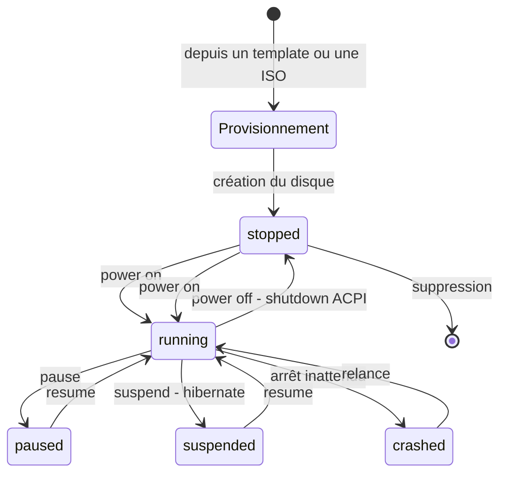

# Chapitre 03 — Modèle Compute

> **Statut** : Spec cible · **Public** : Tous · **Lié à** : [02-familles-workloads.md](02-familles-workloads.md), [06-modele-de-donnees.md](06-modele-de-donnees.md), [09-api.md](09-api.md), [12-marketplace.md](12-marketplace.md)

## Vue d'ensemble

Ce chapitre spécifie la taxonomie des objets Compute (niveau de contrôle × technologie), la **matrice canonique « profil × origine »** qui l'affine, la vue Compute du Mode Infra, la gestion des snapshots, la bibliothèque d'images OS, ainsi que le mécanisme de discovery/réconciliation et le wizard d'adoption. La vue Compute est exposée à l'utilisateur **en Mode Infra uniquement** : en Mode App, l'utilisateur manipule les trois familles (chapitre 02) et la technologie sous-jacente d'un workload est une métadonnée invisible. Les deux modes voient la même réalité technique sous-jacente, présentée à des niveaux d'abstraction différents.

## Taxonomie des objets Compute

WindFlow organise tous les objets Compute selon deux axes orthogonaux : le **niveau de contrôle** (WindFlow en est-il l'auteur ?) et le **type de technologie** (container ou VM).

### Axe 1 — Niveau de contrôle

#### Stack WindFlow (managed)

WindFlow est le source of truth. Il a créé l'objet, en connaît la configuration complète, et peut le modifier, le redémarrer, le supprimer, le sauvegarder.

Une stack WindFlow est un **environnement nommé** qui regroupe un ensemble d'objets Compute liés fonctionnellement. Elle peut contenir :

- un ou plusieurs containers Docker définis via un Compose intégré ;
- une ou plusieurs releases Helm sur un cluster Kubernetes connecté ;
- une ou plusieurs Machines (KVM ou LXD), provisionnées depuis un template cloud-init ;
- ou un **mélange des trois** (stack mixte).

La stack définit les dépendances entre ses composants (ordre de démarrage, réseau partagé, volumes communs), les variables d'environnement globales, et éventuellement sa source Git pour le GitOps (plugin Git).

#### Discovered (observé, lecture seule)

WindFlow a détecté l'objet lors du scan d'un Host, mais ne l'a pas créé. Il peut en lire les métriques et l'état, mais ne le modifie pas sans action explicite de l'utilisateur. Objets pouvant être *discovered* :

- **Containers Docker orphelins** — présents sur le daemon Docker mais non connus de WindFlow ;
- **Compositions Compose** — fichiers `docker-compose.yml` ou `compose.yaml` détectés sur le système de fichiers du Host, avec leurs containers associés ;
- **Releases Helm** — releases déployées sur un cluster Kubernetes connecté (`helm list`) ;
- **VMs libvirt** — VMs présentes dans libvirt (`virsh list --all`) non créées par WindFlow ;
- **VMs et containers LXC** — instances détectées via LXD ou Incus mais non créées par WindFlow.

L'action **« Adopter »** importe un objet discovered dans une stack WindFlow (voir [Wizard d'adoption](#wizard-dadoption)).

#### Standalone (individuel, managed)

Objet créé directement depuis WindFlow, sans appartenir à une stack. WindFlow en est l'auteur et le gestionnaire, mais sans notion d'environnement groupé. Utile pour des services one-shot, des tests rapides ou des containers/VMs à longue durée de vie simples. Un standalone peut être promu en stack à tout moment (l'objet rejoint une nouvelle stack ou une stack existante).

### Axe 2 — Type de technologie

| Type | Sous-type | Runtime / hyperviseur | Granularité |
|---|---|---|---|
| Container | Docker standalone | Docker Engine | Container individuel |
| Container | Podman standalone | Podman | Container individuel |
| Container | Compose | Docker Engine | Service dans une composition |
| Container | Helm / k8s / k3s | Kubernetes | Pod dans un namespace |
| VM | KVM | libvirt / QEMU | Instance VM |
| VM | LXD / Incus | LXD / Incus | Instance VM ou system container |
| VM | LXC | via Host `host_proxmox` | Container système |

Proxmox n'est **pas** un backend de VM dans cette taxonomie : les VMs et LXC hébergés par un serveur Proxmox sont des Machines standard, pilotées via le Host `host_proxmox` (chapitre 02).

## Matrice canonique « profil × origine »

La taxonomie ci-dessus est affinée par un croisement canonique : l'axe **profil technique conteneur** (les 4 profils Apps `docker_container`, `docker_compose`, `helm_release`, `k8s_manifest`) × l'axe **origine** (qui a créé l'objet, quel contrôle WindFlow exerce-t-il). Cette matrice est la **référence unique** pour la sémantique des cellules, les niveaux de contrôle et les actions autorisées ; les autres chapitres y renvoient (colonne `origin` au chapitre [06-modele-de-donnees.md](06-modele-de-donnees.md), badge d'origine au chapitre [14-ui-maquettes.md](14-ui-maquettes.md), définitions au chapitre [19-glossaire.md](19-glossaire.md)).

### Axe origine — `managed` / `adopted` / `external`

| Origine | Sémantique | Niveau de contrôle | Actions autorisées |
|---|---|---|---|
| **`managed`** | Déployé par WindFlow (stack ou standalone) | **Complet** — WindFlow est le source of truth | Cycle de vie complet : start/stop/restart, update, backup, config, suppression, actions de stack |
| **`adopted`** | Découvert puis **adopté** par WindFlow (wizard d'adoption) | **Complet après adoption** — WindFlow devient source of truth | Cycle de vie complet, identique à `managed`, dès la fin du wizard (sans interruption de service) |
| **`external`** | Pré-existant / à côté, **jamais managé** par WindFlow | **Lecture seule** — observation | Observation (logs, métriques, état) et **adoption uniquement** — jamais stop/remove/update direct |

Articulation avec l'axe 1 (niveau de contrôle) : les objets `managed` correspondent aux stacks WindFlow et aux standalones ; les objets `external` sont les objets *discovered* **non adoptés** (section « Discovered » de la vue globale) ; le wizard d'adoption fait passer un objet de `external` à `adopted`. L'origine s'applique aussi aux Machines (`machines.origin`, chapitre 06) ; la matrice ci-dessous porte sur les 4 profils conteneurs.

### La matrice

| Profil \ Origine | `managed` | `adopted` | `external` |
|---|---|---|---|
| **`docker_container`** | Container créé par WindFlow — cycle de vie complet | Container pré-existant importé — cycle complet après adoption | Container à côté — observation + adoption uniquement |
| **`docker_compose`** | Stack Compose déployée par WindFlow — cycle complet + actions de stack | Composition détectée importée — cycle complet + actions de stack | Composition détectée — observation + adoption uniquement |
| **`helm_release`** | Release déployée par WindFlow — cycle complet (upgrade, rollback) | Release pré-existante importée — cycle complet | Release existante — observation + adoption uniquement |
| **`k8s_manifest`** | Manifests appliqués par WindFlow — cycle complet (re-apply, scale) | Manifests pré-existants importés — cycle complet | Workload existant — observation + adoption uniquement |

Chaque cellule se lit : `(profil, origine)` → sémantique, niveau de contrôle et actions autorisées. Le **niveau de contrôle ne dépend que de l'origine** (complet / complet après adoption / lecture seule) ; le **profil** détermine la traduction des actions en opérations natives (mapping des verbes, chapitre [02-familles-workloads.md](02-familles-workloads.md)).

### Détection de l'origine par runtime

L'origine est déterminée par le scan de discovery (voir [Discovery et réconciliation](#discovery-et-réconciliation)) à partir de marqueurs par runtime :

| Runtime | Marqueurs → `managed` | Marqueurs → `external` |
|---|---|---|
| **Docker** (containers) | Label `windflow.managed=true` posé par WindFlow à la création | Tout container sans labels WindFlow ; label `com.docker.compose.project` sans projet connu → composition candidate |
| **Compose** | Projet compose connu de WindFlow **et** labels WindFlow sur ses containers | Projet compose (`com.docker.compose.project`) non enregistré ; fichier `compose.yaml` détecté sur le Host sans trace WindFlow |
| **Kubernetes / Helm** | Namespace dédié WindFlow (convention : `windflow`) ; release avec annotation Helm `windflow.io/managed=true` | Tout workload / release dans un namespace existant sans annotation `windflow.io/managed` |

Une fois l'objet adopté, l'origine `adopted` est portée en base (`origin`) — la détection runtime ne sert plus qu'à la réconciliation (dérive entre l'état attendu et l'état observé).

### Implications UI

- **Filtres croisés** : les filtres « Niveau de contrôle » et « Technologie » de la vue Compute ([Filtres disponibles](#filtres-disponibles)) se combinent avec l'origine — chaque cellule de la matrice est adressable (ex. « Compose × `external` » = les compositions adoptables).
- **Badge d'origine** : chaque carte App porte un badge d'origine — `Managé` (discret, défaut), `Adopté` (visible), `Externe` (visible, avec mention lecture seule). Le badge est la traduction UI de la colonne `origin` (chapitre 06) ; il ne remplace pas la pastille de statut.
- **Actions conditionnées** : les actions d'une carte dérivent de la cellule `(profil × origine)` — une App `external` n'expose pas les boutons Lifecycle/Supprimer, uniquement l'observation et « Adopter ».

### Lecture depuis le modèle de données

La matrice se lit directement depuis le schéma (chapitre [06-modele-de-donnees.md](06-modele-de-donnees.md)) : l'axe profil est la colonne `profile` (`apps.profile`), l'axe origine est la colonne `origin` (`apps.origin`, `machines.origin` — enum `WorkloadOrigin` : `managed | adopted | external`). La cellule d'un objet vaut `(profile, origin)`. L'ancien booléen `adopted_from_discovered` est remplacé par `origin` (correspondance documentée au chapitre 06).

## Vue Compute (Mode Infra)

### Structure de l'interface

La section **Compute** unifie ce qui serait autrement des sections séparées « Containers », « VMs », « Stacks ». Accessible depuis la sidebar en Mode Infra (chapitre 02), elle expose plusieurs onglets internes :

| Onglet | Contenu |
|---|---|
| **Vue globale** | Tous les objets (containers + VMs), tous Hosts confondus, groupés par stack/composition puis standalones |
| **VMs** | Uniquement les VMs, avec métriques étendues et accès rapide aux consoles et snapshots |
| **Containers** | Uniquement les containers (Docker + k8s), avec la profondeur de gestion Portainer |
| **Images & ISOs** | Bibliothèque des images Docker et des images OS (qcow2 cloud-init + ISOs) |
| **Snapshots** | Vue centralisée de tous les snapshots de Machines, tous Hosts confondus |

### Vue globale — principe de regroupement

La vue globale affiche les objets Compute en trois sections ordonnées :

```
1. Stacks WindFlow
   ├── nextcloud (compose · nas-server) — 3/3 running
   │   ├── [container] nextcloud
   │   ├── [container] postgres
   │   └── [container] redis
   ├── dev-env (mixte VM + containers · nas-server) — all up
   │   ├── [VM KVM]   ubuntu-dev
   │   ├── [container] postgres
   │   └── [container] redis
   └── web (helm · k3s-cluster) — 5/5 running

2. Discovered — non managés
   ├── monitoring (compose · nas-server) — observé, adoptable
   │   ├── [container] prometheus
   │   └── [container] grafana
   └── windows-legacy (VM KVM · local) — observé, adoptable

3. Standalone
   ├── [VM KVM]    pfsense-router · local · running
   ├── [VM LXC]    k3s-node-1 · prox-home · running
   ├── [container] traefik · local · running
   └── [container] pihole · pi4-home · running
```

### Filtres disponibles

La vue globale expose des filtres combinables :

- **Niveau de contrôle** : Stacks WindFlow / Discovered / Standalone — combinable avec l'origine (`managed` / `adopted` / `external`, voir [Matrice canonique « profil × origine »](#matrice-canonique-profil--origine)) ;
- **Technologie** : Docker / Compose / Helm / VM KVM / LXD / LXC / Incus ;
- **Host** : filtrer par Host (local, nas-server, pi4-home, k3s-cluster…) ;
- **Statut** : running / stopped / paused / exited / suspended ;
- **Recherche libre** : nom, image, OS.

### Vue « par Host »

Un toggle bascule entre la vue logique (groupée par stack) et la vue physique (groupée par Host). En vue par Host, chaque Host est une carte qui affiche :

- le résumé de ses containers et VMs (stack ou standalone) ;
- les métriques agrégées : CPU total, RAM totale utilisée / disponible ;
- l'hyperviseur et la version du daemon Docker.

Les endpoints REST correspondants (`/compute/containers`, `/compute/vms`, `/compute/stacks`, `/compute/snapshots`, `/compute/volumes`, `/compute/networks`, `/compute/images`) sont spécifiés au chapitre [09-api.md](09-api.md).

## Gestion des Machines (VMs)

### Cycle de vie

### Diagramme — Cycle de vie d'une Machine



| État | Description | Actions disponibles |
|---|---|---|
| `running` | Machine démarrée, en cours d'exécution | Pause, Suspend, Stop, Console VNC, Snapshot |
| `paused` | Exécution gelée, mémoire préservée (QEMU pause) | Resume, Stop |
| `suspended` | État sauvegardé sur disque (hibernation) | Resume, Stop |
| `stopped` | Machine éteinte proprement | Start, Snapshot (disque seul), Modifier config, Supprimer |
| `crashed` | Arrêt inattendu | Start (relance), Consulter logs |

La sémantique « Power » (vs « Lifecycle » des Apps) et le vocabulaire matériel de la famille Machines sont définis au chapitre [02-familles-workloads.md](02-familles-workloads.md).

### Console VNC / SPICE

La console s'ouvre dans le navigateur via noVNC (WebSocket `/ws/console/{machine_id}`, chapitre 09). Elle est disponible pour toute Machine en état `running` ou `paused` :

- connexion directe sans client lourd ;
- plein écran disponible ;
- clipboard bidirectionnel (texte) ;
- la console reste accessible même si la Machine n'a pas d'agent invité (contrairement au terminal SSH qui nécessite l'OS démarré et accessible).

### Provisionnement depuis un template

1. Choisir un template OS dans la bibliothèque (Ubuntu 24.04 cloud-init, Debian 12 cloud-init, Alpine 3.19…).
2. Configurer les ressources : vCPU, RAM, taille du disque.
3. Renseigner la configuration cloud-init : hostname, utilisateur, clé SSH publique, packages additionnels.
4. Choisir le réseau (bridge existant ou réseau isolé).
5. WindFlow génère le `user-data`, `meta-data` et `network-config`, crée le volume qcow2 depuis le template, et démarre la Machine.

Le provisionnement depuis un template cloud-init prend typiquement moins de 2 minutes (métrique de succès du chapitre [01-vision.md](01-vision.md)).

### Modification de configuration

Une Machine arrêtée peut être reconfigurée : ajout/suppression de vCPU, redimensionnement RAM, ajout de disques, modification des interfaces réseau, changement de firmware (BIOS / UEFI). Les modifications s'appliquent au redémarrage. L'écran d'édition par sections est décrit au chapitre [14-ui-maquettes.md](14-ui-maquettes.md).

## Bibliothèque d'images OS

### Types d'images

| Type | Format | Usage | Architectures |
|---|---|---|---|
| Template cloud-init | qcow2 | Provisionnement automatisé, déploiement rapide | amd64 + arm64 |
| ISO brute | ISO 9660 | Installation manuelle depuis un média d'installation | amd64 (principalement) |
| Template personnalisé | qcow2 | Image maison construite et sauvegardée par l'utilisateur | selon build |

### Images officielles maintenues

WindFlow maintient et met à jour les images officielles suivantes :

- **Ubuntu Server 22.04 LTS** (Jammy) — cloud-init — amd64 + arm64 ;
- **Ubuntu Server 24.04 LTS** (Noble) — cloud-init — amd64 + arm64 ;
- **Debian 12 Bookworm** — cloud-init — amd64 + arm64 ;
- **Alpine Linux 3.19** — cloud-init — amd64 + arm64 (54 Mo — idéal RPi) ;
- **Rocky Linux 9** — cloud-init — amd64 ;
- **Home Assistant OS 12** — ISO — amd64 ;
- **pfSense 2.7** — ISO — amd64.

L'utilisateur peut importer ses propres ISOs ou images qcow2, et créer des templates personnalisés en capturant l'état d'une Machine existante après configuration (reset cloud-init). Ces images sont exposées dans l'onglet **Machine Templates** de la marketplace (chapitre [12-marketplace.md](12-marketplace.md)).

### Relation avec les images Docker

Les images Docker (registres OCI) et les images OS (qcow2 / ISO) sont deux registres distincts dans l'onglet **Images & ISOs**, mais dans la même section pour éviter la multiplication des entrées de navigation :

- **Images Docker** : pull depuis un registre (Docker Hub, ghcr.io, registre privé), listing local, détection des images dangling, nettoyage ;
- **Images OS** : stockage local sur le Host, téléchargement depuis les sources officielles, vérification de signature SHA-256.

### Détection de mises à jour d'images

Au-delà de l'inventaire, WindFlow assure un **suivi des mises à jour d'images** reposant sur un **double mécanisme** :

| Aspect | Digest | Semver |
|---|---|---|
| Cible | Images à tag flottant (`nginx:latest`) ou toute image de registre | Images épinglées par version (`app:1.24.0`) |
| Méthode | Digest du manifeste distant comparé aux `RepoDigests` locaux, **sans pull** | Liste des tags du registre, comparaison sémantique |
| Signification | **Mise à jour réelle appliquable** (même référence, nouveau contenu) | **Suggestion** purement indicative d'une nouvelle version publiée |
| Application | Manuelle (unitaire ou groupée) via le recreate du chapitre 02 | **Jamais auto-appliquée** — action humaine uniquement ; statut `skipped` si ignorée |

**Comparaison de digest sans pull.** La vérification interroge le registre (requête HEAD sur le manifeste du tag) et le compare aux empreintes locales. Deux règles éliminent les faux positifs :

- **épinglage par digest** (`repo@sha256:…`) : jamais signalé — l'épinglage est un verrou volontaire ;
- **faux positif multi-arch** : le digest de tête du registre est celui de l'**index** ; une image locale identifiée par le digest **enfant par architecture** ne correspond jamais à l'index alors qu'elle est à jour — WindFlow vérifie l'appartenance du digest local aux enfants de l'index avant de déclarer une mise à jour.

Les tags flottants (`latest`) court-circuitent la vérification semver (aucun appel registre).

### Mises à jour en attente

L'entité **« mise à jour en attente »** (une ligne par container, unicité Host + container) cumule les deux signaux :

| Champ | Signification |
|---|---|
| `container` | Container concerné (id, nom) et référence d'image courante (`current`) |
| `current` / `available` | Référence courante et référence disponible (digest pour `type=digest`, tag pour `type=semver`) |
| `type` | `digest` \| `semver` — nature du signal |
| `status` | `pending` \| `skipped` — `skipped` marque une suggestion semver ignorée par l'utilisateur |
| `checked_at` | Fraîcheur du contrôle |

Cycle de vie : la vérification (manuelle ou planifiée, scheduler core + Celery) **réinitialise** puis **reconstruit** les lignes en fusionnant les deux signaux ; une ligne est **effacée** à la recréation réussie du container (recreate, chapitre [02-familles-workloads.md](02-familles-workloads.md)) ou à sa suppression. C'est cette entité qui alimente les colonnes `current_version` / `available_version` du modèle de données (chapitre [06-modele-de-donnees.md](06-modele-de-donnees.md)) et le badge ⬆ « mise à jour disponible » des cartes Apps (chapitre [14-ui-maquettes.md](14-ui-maquettes.md), Écran 2).

### Réconciliation après redéploiement de stack

Un redéploiement de stack **avec pull** recrée les containers avec de **nouveaux identifiants**, orphelins pour les lignes en attente (clé = ancien identifiant). La règle de réconciliation efface une ligne **uniquement si le container prouve** qu'il tourne la plus récente image locale de son tag :

- container vivant introuvable par nom → ligne orpheline, effacée ;
- container vivant mais hors de la stack concernée → **conservé** (pas à nous) ;
- identifiant d'image du container = plus récent identifiant local du tag → à jour, effacée ;
- sinon (pull échoué, image `build:`, tag non résolvable) → **conservé** — toute ambiguïté préserve le signal plutôt que de masquer une mise à jour réelle.

Un garde-fou de délai évite que la réconciliation ne retarde ou ne fasse échouer le redéploiement lui-même.

### Label d'exclusion

Un container portant le label **`windflow.update=false`** est **exclu de la détection et de l'application des mises à jour** (prioritaire sur tout état interne). Les conteneurs utilitaires internes de WindFlow (helpers, sidecars) sont exclus de fait, ainsi que les images à digest épinglé. Le label garantit qu'aucune mise à jour non voulue ne sera proposée ou appliquée à un workload que l'utilisateur a choisi de geler.

Les endpoints correspondants (`check-updates`, `pending-updates`) sont spécifiés au chapitre [09-api.md](09-api.md).

## Gestion des snapshots

### Concept

Un snapshot capture l'état complet d'une Machine à un instant T. Selon le moment de la capture :

- **Snapshot chaud** (Machine `running`) : capture mémoire + disques + état CPU. La Machine continue de tourner pendant la capture (légère dégradation des performances pendant quelques secondes). Permet une restauration à l'état exact, y compris les processus en cours.
- **Snapshot froid** (Machine `stopped`) : capture des disques seuls. Plus rapide, moins de données. Ne restaure pas l'état mémoire.

### Vue Snapshots

La vue **Snapshots** (onglet de Compute) affiche l'ensemble des snapshots de toutes les Machines gérées, sur tous les Hosts connectés. Pour chaque snapshot : nom et description, Machine source et Host, date et heure de création, type (chaud / froid), taille sur disque, et les actions Restaurer, Supprimer, Créer un template depuis ce snapshot.

### Arbre de snapshots

Pour les Machines avec plusieurs snapshots, WindFlow affiche l'arbre de parenté (un snapshot peut être pris depuis un état lui-même snapshoté, créant une chaîne). La vue arbre est accessible depuis le détail d'une Machine (chapitre 14).

### Limites et recommandations

- Les snapshots qcow2 sont des fichiers delta (COW — Copy on Write) : ils grossissent au fur et à mesure des écritures sur la Machine après la capture.
- WindFlow avertit si un snapshot dépasse 30 jours ou si la chaîne de snapshots dépasse 5 niveaux (impact sur les performances I/O).
- Pour une sauvegarde longue durée, utiliser le plugin Restic ou Borg (chapitre [12-marketplace.md](12-marketplace.md)), qui exporte une image complète indépendante de la chaîne COW.

## Discovery et réconciliation

### Fonctionnement du scan

À chaque connexion à un Host (et périodiquement selon le polling configuré), WindFlow effectue un scan de découverte :

**Sur un Host Docker :**

```bash
docker ps -a                          # containers
docker network ls                     # réseaux
docker volume ls                      # volumes
find / -name "docker-compose.yml"     # compositions (chemins configurables)
find / -name "compose.yaml"
```

**Sur un Host avec libvirt :**

```bash
virsh list --all                      # VMs
virsh pool-list --all                 # pools de stockage
```

**Sur un Host `host_proxmox` (API) :**

```bash
GET /api2/json/nodes/{node}/qemu      # VMs
GET /api2/json/nodes/{node}/lxc       # LXC
```

**Sur un Host `host_kubernetes` :**

```bash
kubectl get pods --all-namespaces
helm list --all-namespaces
```

### Réconciliation

WindFlow compare les objets détectés avec son état interne (base de données) :

- **Objet connu et présent** → mise à jour des métriques ;
- **Objet connu mais absent** → marqué `missing` (supprimé hors WindFlow) ;
- **Objet inconnu** → marqué `discovered`, affiché dans la section Discovered.

La réconciliation est **non-destructive** : WindFlow ne modifie jamais un objet discovered sans action explicite de l'utilisateur.

### Wizard d'adoption

L'adoption d'un objet discovered suit un wizard en 3 étapes :

**Étape 1 — Inventaire.** WindFlow liste les composants détectés et leur configuration actuelle (variables d'environnement, volumes, réseaux, ports exposés).

**Étape 2 — Mapping.** L'utilisateur choisit :

- le nom de la stack WindFlow à créer (ou une stack existante à laquelle rattacher l'objet) ;
- si les volumes existants sont préservés tels quels ou re-déclarés dans WindFlow ;
- si les réseaux existants sont préservés ou recréés.

**Étape 3 — Validation.** WindFlow génère la définition de stack (fichier Compose ou configuration Machine) correspondant à l'état actuel, l'affiche pour relecture, et l'utilisateur confirme. L'objet passe d'`external` (discovered non adopté) à `adopted` — cycle de vie complet dès la fin du wizard — **sans interruption de service** (matrice [profil × origine](#matrice-canonique-profil--origine)).

L'adoption des services système d'un Host (profil `app_native_service`) suit le même principe et est décrite au chapitre [02-familles-workloads.md](02-familles-workloads.md). Le parcours utilisateur complet est détaillé dans [../user-guide/adoption.md](../user-guide/adoption.md), et l'écran d'adoption au chapitre [14-ui-maquettes.md](14-ui-maquettes.md).

## Actions par type d'objet

### Matrice des actions disponibles

Cette matrice est la **référence unique** des actions par type d'objet Compute ; les verbes par famille (chapitre 02) s'y réfèrent.

| Action | Container standalone | Container dans stack | Machine standalone | Machine dans stack | Discovered |
|---|---|---|---|---|---|
| Démarrer / Arrêter | ✓ | ✓ (via stack ou individuel) | ✓ | ✓ (via stack ou individuel) | ✗ |
| Redémarrer | ✓ | ✓ | ✓ | ✓ | ✗ |
| Pause / Suspend | ✓ (Docker pause) | ✓ | ✓ (QEMU pause + hibernation) | ✓ | ✗ |
| Logs inline | ✓ | ✓ | ✗ (console VNC à la place) | ✗ | lecture seule |
| Terminal exec | ✓ | ✓ | Via console VNC ou SSH | Via console VNC ou SSH | ✗ |
| Console VNC | ✗ | ✗ | ✓ | ✓ | lecture seule |
| Snapshot | ✗ | ✗ | ✓ | ✓ | ✗ |
| Modifier config | ✓ | ✓ (éditer stack) | ✓ (Machine arrêtée) | ✓ (éditer stack) | ✗ |
| Supprimer | ✓ | Via stack | ✓ | Via stack | ✗ |
| Adopter en stack | ✓ (promote) | — | ✓ (promote) | — | ✓ |
| Métriques live | ✓ | ✓ | ✓ | ✓ | ✓ (lecture seule) |
| Volume Browser | ✓ | ✓ | ✗ | ✗ | ✗ |

### Actions de stack

Une stack WindFlow expose des actions globales en plus des actions par composant :

- **Démarrer la stack** : démarre tous les composants dans l'ordre de dépendance ;
- **Arrêter la stack** : arrête tous les composants dans l'ordre inverse ;
- **Redéployer la stack** : pull les nouvelles images, recrée les containers modifiés (rolling ou stop-and-start selon configuration) ; après un redéploiement **avec pull**, les mises à jour en attente des containers de la stack sont réconciliées (voir [Réconciliation après redéploiement de stack](#réconciliation-après-redéploiement-de-stack)) ;
- **Mettre à jour depuis Git** : pull la branche configurée et redéploie si des changements sont détectés (plugin Git) ;
- **Éditer la stack** : ouvre l'éditeur de configuration (Compose YAML ou formulaire assisté) ;
- **Dupliquer la stack** : crée une copie avec un nouveau nom (utile pour créer un environnement staging depuis prod) ;
- **Archiver** : arrête la stack et la conserve en base sans la supprimer.

## Voir aussi

- [02-familles-workloads.md](02-familles-workloads.md) — familles Apps/Machines/Hosts et WorkloadAdapter, qui s'appuient sur ce modèle Compute
- [06-modele-de-donnees.md](06-modele-de-donnees.md) — tables `stacks`, `deployments`, `deployment_events`
- [09-api.md](09-api.md) — endpoints `/compute/*` exposant ces objets par technologie
- [14-ui-maquettes.md](14-ui-maquettes.md) — Vue Compute (Écran 22), Snapshots Machines (Écran 8) et Adoption d'objets découverts (Écran 14)
- [12-marketplace.md](12-marketplace.md) — onglet Machine Templates de la marketplace
- [../user-guide/adoption.md](../user-guide/adoption.md) — parcours utilisateur d'adoption pas à pas
