# Chapitre 04 — Architecture

> **Statut** : Spec cible · **Public** : Développeurs backend/frontend, architectes · **Lié à** : [01-vision.md](01-vision.md), [02-familles-workloads.md](02-familles-workloads.md), [09-api.md](09-api.md), [11-plugins.md](11-plugins.md)

## Vue d'ensemble

Ce chapitre décrit l'architecture applicative de WindFlow : monolithe modulaire, principes de conception, vue d'ensemble des composants, profils de déploiement et services core. Les verbes et familles de workloads sont définis au chapitre 02 ; le système de plugins au chapitre 11 ; le modèle de données au chapitre 06 ; l'API et le temps réel au chapitre 09 — ce chapitre n'en donne que des synthèses avec renvois.

## Principes de conception

### Philosophie architecturale

WindFlow est une **application monolithique modulaire** conçue pour être légère, simple à déployer, et extensible par plugins. Ce n'est pas un système distribué de microservices — c'est un outil self-hosted qui doit tourner sur un Raspberry Pi comme sur un serveur dédié.

**Principes fondamentaux :**

- **Cœur minimal** : le core gère les workloads des trois familles (Apps, Machines, Hosts), les stacks, les plugins et la marketplace. Toute autre fonctionnalité est un plugin.
- **Plugin-first** : l'architecture du système de plugins est aussi importante que le core lui-même. Chaque plugin peut déployer des services, étendre l'API et ajouter des pages à l'UI.
- **Léger par défaut** : le core tourne avec 512 Mo de RAM en mode léger. Chaque composant optionnel (Redis, PostgreSQL au lieu de SQLite) est un choix conscient de l'utilisateur.
- **Multi-arch natif** : ARM64 et x86_64 sont des cibles de première classe. Pas de dépendance à une architecture spécifique.
- **API-First** : toute action disponible dans l'UI est disponible via l'API REST. Le CLI/TUI utilise la même API.

### Ce que WindFlow n'est pas

Pour garder la conception cohérente, il est utile de définir les frontières :

- **Pas un système distribué** : WindFlow est une seule instance (API + worker + DB). Le multi-machine signifie « piloter plusieurs Hosts », pas « distribuer WindFlow sur plusieurs serveurs ».
- **Pas cloud-native** : WindFlow tourne sur du matériel physique ou des VMs. Il n'a pas besoin de Kubernetes pour fonctionner.
- **Pas enterprise-first** : les fonctionnalités enterprise (SSO, Vault, audit avancé) existent en tant que plugins, pas comme prérequis.

## Architecture globale

### Diagramme — Vue d'ensemble des composants

```mermaid
flowchart TB
    subgraph Interfaces
        WebUI["Web UI Vue.js 3"]
        CLI["CLI Typer"]
        TUI["TUI Textual"]
    end

    subgraph ApplicationWindFlow
        API["API REST FastAPI"]
        Auth["Auth JWT + RBAC"]
        Worker["Celery Worker tâches async"]

        subgraph CoreServices
            AppSvc["App Service"]
            MachineAdapter["MachineAdapter KVM LXD Incus VirtualBox"]
            HostAdapter["HostAdapter baremetal proxmox kubernetes remote_docker"]
            StackSvc["Stack Service compose templates"]
            PluginSvc["Plugin Service lifecycle registre"]
            MarketSvc["Marketplace Service"]
        end

        subgraph PluginRuntime
            PluginAPI["Plugin API Extensions"]
            PluginUI["Plugin UI Components"]
            PluginHooks["Plugin Lifecycle Hooks"]
        end
    end

    subgraph Données
        DB["PostgreSQL ou SQLite"]
        Cache["Redis optionnel"]
    end

    subgraph InfrastructureGérée
        DockerLocal["Docker local"]
        DockerRemote["Docker distant via SSH"]
        KVM["KVM QEMU libvirt"]
        LXD["LXD / Incus"]
        VBox["VirtualBox optionnel"]
        ProxmoxHost["Proxmox VE via profil Host"]
    end

    subgraph PluginsInstallés
        Traefik["Plugin Traefik"]
        PGPlugin["Plugin PostgreSQL"]
        Restic["Plugin Restic"]
        UptimeKuma["Plugin Uptime Kuma"]
    end

    WebUI --> API
    CLI --> API
    TUI --> API

    API --> Auth
    API --> AppSvc
    API --> MachineAdapter
    API --> HostAdapter
    API --> StackSvc
    API --> PluginSvc
    API --> MarketSvc
    API --> Worker

    PluginSvc --> PluginAPI
    PluginSvc --> PluginUI
    PluginSvc --> PluginHooks

    AppSvc --> DockerLocal
    AppSvc --> DockerRemote
    MachineAdapter --> KVM
    MachineAdapter --> LXD
    MachineAdapter --> VBox
    HostAdapter --> DockerRemote
    HostAdapter --> ProxmoxHost

    API --> DB
    API --> Cache
    Worker --> DB

    PluginHooks --> Traefik
    PluginHooks --> PGPlugin
    PluginHooks --> Restic
    PluginHooks --> UptimeKuma
```



Points clés du diagramme :

- Les workloads des familles Apps et Machines sont pilotés par des **adapters** (chapitre 02) : `MachineAdapter` couvre KVM/libvirt, LXD, Incus, LXC et VirtualBox.
- Proxmox n'est **pas** un backend de VM : c'est un profil de Host (`host_proxmox`) piloté par `HostAdapter` via l'API Proxmox VE. Les VMs Proxmox sont des Machines standards exposées par ce Host.
- Les containers Docker tournent localement ou sur des Hosts `host_remote_docker` via SSH — l'API Docker n'est jamais exposée sur le réseau.

### Répartition Core vs Plugins

Règle de décision : quand une fonctionnalité est envisagée, la question est « Est-ce que WindFlow est inutilisable sans ? ». Si la réponse est non, c'est un plugin. Ce tableau est la **référence unique** de la frontière core/plugins.

| Appartient au Core | Est un Plugin |
|----------------------------------------|---------------|
| Gestion containers Docker, Podman, K8s | Reverse proxy (Traefik, Caddy) |
| Gestion Machines (KVM, LXD, Incus, VirtualBox) | DNS (Pi-hole, CoreDNS) |
| Gestion Hosts (baremetal, proxmox, kubernetes, remote_docker) | Monitoring (Uptime Kuma, Prometheus) |
| Auth JWT + RBAC | Backup (Restic, Borg) |
| Plugin Manager + Marketplace | Bases de données (PostgreSQL manager, Redis manager) |
| Stacks, volumes et networks Docker | Mail (Mailu, Stalwart) |
| CLI / TUI / Web UI | IA (Ollama, LiteLLM) |
| | SSO (Keycloak) |
| | Git auto-deploy |
| | Workflows (n8n, Node-RED) |

Le détail du système de plugins (types, manifest, lifecycle, hooks) est spécifié au chapitre [11-plugins.md](11-plugins.md).

## Profils de déploiement

WindFlow s'adapte au matériel disponible. Le même code tourne dans les trois profils — seule la configuration change. Ce tableau est la **référence unique** des profils de ressources.

### Profils de ressources

| Profil | Contenu | RAM | CPU | Stockage | Machine type |
|---|---|---|---|---|---|
| **Léger** | core, SQLite, sans Redis, sans VMs | 512 Mo | 1 core ARM | 2 Go | Raspberry Pi 4 (2 Go) |
| **Standard** | core, PostgreSQL, Redis, KVM | 1.5 Go | 2 cores | 5 Go | RPi 4 (4 Go), mini PC |
| **Complet** | core + 5-10 plugins, VMs actives | 4 Go | 4 cores | 20 Go | NUC, serveur dédié |

### Mode léger

```
WindFlow API (FastAPI) ─── SQLite (fichier local)
       │
   Celery Worker (1 process)
       │
   Docker Engine (local)
```

- SQLite au lieu de PostgreSQL (pas de service DB séparé)
- Pas de Redis (cache en mémoire, sessions en DB)
- Un seul worker Celery
- Empreinte : ~512 Mo RAM, 1 core

### Mode standard

```
WindFlow API (FastAPI) ─── PostgreSQL ─── Redis
       │
   Celery Worker(s)
       │
   Docker Engine + libvirt (local ou distant)
```

- PostgreSQL pour la persistance
- Redis pour le cache et le broker Celery
- Un ou plusieurs workers
- Empreinte : ~1.5 Go RAM, 2 cores

### Mode standard + plugins

Identique au mode standard, mais les plugins ajoutent des containers et des fonctionnalités :

```
WindFlow (API + Worker + PostgreSQL + Redis)
    │
    ├── Plugin Traefik (container Traefik, intégration reverse proxy)
    ├── Plugin PostgreSQL (extension : gestion DB depuis l'UI)
    ├── Plugin Uptime Kuma (container Uptime Kuma, widget dashboard)
    └── Plugin Restic (extension : backup planifié)
```

Chaque plugin consomme des ressources supplémentaires. Le Plugin Manager vérifie les ressources disponibles avant installation (voir [11-plugins.md](11-plugins.md)).

## Architecture du core

### Organisation cible des modules

L'arborescence ci-dessous décrit l'**organisation cible des modules** de l'application — ce n'est pas l'arborescence du dépôt de code, qui diffère (voir le dépôt et [../technical_specs/ARCHITECTURE-MODULAIRE.md](../technical_specs/ARCHITECTURE-MODULAIRE.md)) :

```
windflow/
├── main.py                  # Point d'entrée FastAPI
├── config.py                # Configuration (profil léger/standard)
├── auth/                    # JWT, RBAC, sessions
│   ├── jwt_handler.py
│   ├── rbac.py
│   └── models.py
├── workloads/               # Les trois familles (chapitre 02)
│   ├── adapters/
│   │   ├── workload_adapter.py    # Interface abstraite commune
│   │   ├── apps/                  # DockerContainer, ComposeStack, HelmRelease, K8sManifest
│   │   ├── machines/              # KVM, LXD, Incus, LXC, VirtualBox
│   │   └── hosts/                 # Baremetal, Proxmox, Kubernetes, RemoteDocker
│   ├── apps_service.py
│   ├── machines_service.py
│   └── hosts_service.py
├── stacks/                  # Stacks et templates
│   ├── stack_service.py
│   ├── template_engine.py   # Templates Jinja2
│   └── models.py
├── plugins/                 # Système de plugins (chapitre 11)
│   ├── plugin_manager.py    # Installation, lifecycle
│   ├── plugin_registry.py   # Registre local + distant
│   ├── plugin_api.py        # API dynamique par plugin
│   ├── plugin_hooks.py      # Hooks lifecycle
│   └── marketplace.py       # Catalogue, recherche
├── tasks/                   # Tâches Celery
│   ├── deployment_tasks.py
│   ├── plugin_tasks.py
│   └── maintenance_tasks.py
├── websocket/               # Temps réel (renvoi 09-api.md)
│   ├── terminal.py          # Terminal interactif
│   ├── logs.py              # Streaming logs
│   └── events.py            # Événements push
└── api/                     # Routes API REST (chapitre 09)
    ├── v1/
    │   ├── apps.py
    │   ├── machines.py
    │   ├── hosts.py
    │   ├── compute.py       # Vue Compute Mode Infra
    │   ├── stacks.py
    │   ├── plugins.py
    │   ├── marketplace.py
    │   ├── auth.py
    │   └── system.py
    └── deps.py              # Dépendances FastAPI
```

### Services core

**App Service** — pilote les workloads de la famille Apps via les adapters de profils (`DockerContainerAdapter`, `ComposeStackAdapter`, `HelmReleaseAdapter`, `K8sManifestAdapter`). Gère containers, stacks Compose, releases Helm et manifests K8s, y compris sur des daemons Docker distants via SSH.

**Machine Service** — pilote les workloads de la famille Machines via les adapters (`KVMAdapter`, `LXDAdapter`, `IncusAdapter`, `LXCAdapter`, `VirtualBoxAdapter`). Chaque adapter implémente l'interface commune `MachineAdapter` (chapitre 02) : power, snapshots, console VNC/SPICE, hardware, export de disques.

**Host Service** — gère les Hosts (le terme historique *target* est remplacé par Host partout). Fournit l'inventaire des substrats et leurs moteurs détectés (Docker, libvirt, Kubernetes…) via les adapters `BaremetalHostAdapter`, `ProxmoxHostAdapter`, `KubernetesHostAdapter`, `RemoteDockerHostAdapter`. C'est lui qui exécute la découverte et l'adoption d'objets existants (chapitre 03).

**Stack Service** — gère les stacks (groupes de services) avec versioning, templates Jinja2 et configuration. Les stacks peuvent venir de la marketplace, d'un dépôt Git (plugin), ou être créées manuellement (chapitre 03).

**Plugin Service** — le cœur de l'extensibilité : cycle de vie des plugins (installation, configuration, mise à jour, désinstallation). Détaillé au chapitre [11-plugins.md](11-plugins.md).

**Marketplace Service** — catalogue d'entrées Apps multi-backends, de templates Machines et de plugins. Interroge les registres pour les fiches, vérifie la compatibilité (architecture, ressources, profils de Host) et déclenche l'installation. Détaillé au chapitre [12-marketplace.md](12-marketplace.md).

## Communication et temps réel

### API REST

L'API suit les conventions REST classiques avec FastAPI ; toutes les routes sont documentées automatiquement via OpenAPI. La surface API est organisée **par famille** (`/api/v1/apps`, `/api/v1/machines`, `/api/v1/hosts`) en surface principale, complétée par la vue Compute (`/api/v1/compute/*`) réservée au Mode Infra. La référence complète — conventions, endpoints, modèles — est au chapitre [09-api.md](09-api.md).

### WebSocket

Le WebSocket est utilisé pour les interactions temps réel qui ne peuvent pas passer par du REST polling :

- **Consoles** : terminal container, console VNC/SPICE de Machine, session SSH de Host ;
- **Streaming de logs** : logs d'App, journal de Host, événements de déploiement ;
- **Événements système** : notifications push (déploiement terminé, Host injoignable, plugin installé).

Les chemins canoniques et le format des messages sont spécifiés au chapitre [09-api.md](09-api.md) ; le protocole détaillé (reconnexion, heartbeats, multiplexage) dans [../technical_specs/WEBSOCKET-REAL-TIME.md](../technical_specs/WEBSOCKET-REAL-TIME.md).

### Bus d'événements internes

Les services core et les plugins communiquent via un bus d'événements simple. En mode standard, Redis Pub/Sub est utilisé. En mode léger (sans Redis), un bus en mémoire (files asyncio) prend le relais. Les plugins s'abonnent aux événements qui les concernent — par exemple, le plugin Traefik écoute `stack.deployed` et `container.started` pour auto-configurer les routes.

La **liste canonique des événements** (nommage `domaine.action_passé`, ex. `deployment.succeeded`, `host.offline`) est définie au chapitre [11-plugins.md](11-plugins.md) et référencée par les chapitres 09 et 17.

### Collecte et historique court des métriques Hosts

Les métriques Hosts (CPU, RAM, disque, température) alimentent le widget Système du dashboard (Écran 1), l'onglet Métriques du détail Host et l'endpoint `GET /hosts/{id}/metrics` (chapitre [09-api.md](09-api.md)). Leur stratégie de stockage est délibérément minimale :

- **Tampon circulaire en mémoire**, borné à ~360 points par Host (environ 30 minutes à un point toutes les 5 s) — les points anciens sont écrasés, rien n'est jamais écrit en base ;
- **CPU normalisé** par le nombre de cœurs du Host (0-100 % quel que soit le matériel) ;
- **Mémoire hors cache** : la RAM exposée exclut le cache/buffers reclaimable (sinon un Linux sain affiche ~95 % « utilisé ») ;
- **Non-persistance assumée**, cohérente avec la cible RPi : pas de base de séries temporelles dans le core. L'historique long et l'alerting passent par le plugin Prometheus (export des métriques, chapitre [12-marketplace.md](12-marketplace.md)).

Le tampon vit dans le process API et se repeuple après un redémarrage : une fenêtre vide est acceptable — les métriques sont un signal d'observation, pas une donnée d'audit.

## Résilience et fiabilité

### Stratégies adaptées au contexte

WindFlow n'est pas un système distribué qui a besoin de patterns comme Saga ou CQRS. Ses stratégies de résilience sont pragmatiques et adaptées au self-hosting :

**Déploiements avec rollback** : chaque déploiement de stack sauvegarde l'état précédent. En cas d'échec, un rollback automatique restaure la configuration précédente.

**Retry avec backoff** : les opérations qui interagissent avec des services externes (Docker Engine, libvirt, API Proxmox, machines SSH) utilisent un retry avec exponential backoff, configurable par Host.

**Health checks** : le core expose `/health` et `/ready`. Les services déployés sont surveillés par des health checks Docker natifs. Les plugins de monitoring (Uptime Kuma, Netdata) ajoutent une couche de surveillance supplémentaire.

**Gestion des erreurs** : les erreurs sont loggées en base avec contexte complet (stack trace, configuration, état du système). Le frontend affiche des messages d'erreur exploitables.

### Backup et recovery

Le core fournit un mécanisme de backup basique : export de la base de données et des fichiers de configuration. Pour des backups avancés (volumes, scheduling, offsite), le plugin Restic ou Borg est recommandé.

Exemple illustratif — backup et restore core via la CLI (grammaire normalisée, voir [10-cli-tui.md](10-cli-tui.md)) :

```bash
# Backup core (intégré)
windflow admin backup create --output /backup/windflow-20260315.tar.gz

# Restore core
windflow admin backup restore --input /backup/windflow-20260315.tar.gz
```

Les procédures complètes d'exploitation sont au chapitre [16-deploiement.md](16-deploiement.md).

## Performance

### Optimisations core

**Base de données** : index sur les colonnes fréquemment requêtées (status, organization_id, created_at). Requêtes async avec SQLAlchemy 2.0.

**Cache** : en mode standard, Redis cache les sessions, les métadonnées des stacks et le catalogue marketplace. En mode léger, un cache dict en mémoire remplace Redis avec les mêmes TTL.

**Tâches async** : les opérations longues (déploiement, pull d'images, snapshot de Machine) sont exécutées par Celery worker(s) pour ne pas bloquer l'API.

**WebSocket** : le terminal et le streaming de logs utilisent des connexions WebSocket persistantes pour éviter le polling.

### Benchmarks cibles

| Métrique | Profil léger (RPi 4) | Profil standard |
|----------|---------------------|---------------|
| Temps de réponse API (p95) | < 500 ms | < 200 ms |
| Démarrage de l'application | < 15 s | < 10 s |
| Mémoire au repos (core seul) | < 400 Mo | < 800 Mo |
| Déploiement d'une stack simple | < 30 s | < 15 s |
| Connexions WebSocket simultanées | 10 | 50+ |

## Voir aussi

- [02-familles-workloads.md](02-familles-workloads.md) — modèle directeur Apps/Machines/Hosts et pattern WorkloadAdapter
- [09-api.md](09-api.md) — surface API complète et protocole temps réel
- [11-plugins.md](11-plugins.md) — système de plugins et liste canonique des événements
- [06-modele-de-donnees.md](06-modele-de-donnees.md) — schéma de données unifié
- [05-stack-technologique.md](05-stack-technologique.md) — choix techniques et dépendances
- [../technical_specs/ARCHITECTURE-MODULAIRE.md](../technical_specs/ARCHITECTURE-MODULAIRE.md) — détail technique de l'architecture modulaire
