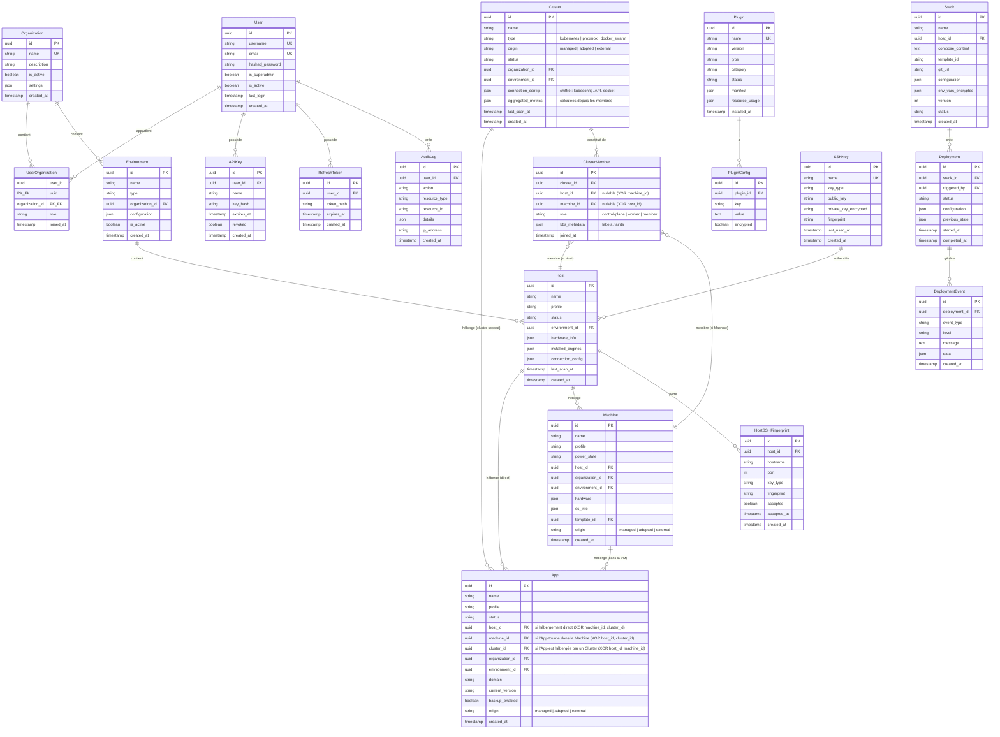

# Chapitre 06 — Modèle de données

> **Statut** : Spec cible · **Public** : Développeurs backend, DBA · **Lié à** : [02-familles-workloads.md](02-familles-workloads.md), [04-architecture.md](04-architecture.md), [07-authentification.md](07-authentification.md), [09-api.md](09-api.md)

## Vue d'ensemble

Ce chapitre spécifie le schéma de données de WindFlow : entités comptes/organisations, entités workloads (Apps, Machines, Hosts — issues du modèle directeur du chapitre 02), entité **Cluster** et ses membres (`clusters`, `cluster_members`), entités plugins et entités transverses (déploiements, audit, auth). Il couvre aussi la stratégie de migration `targets` → `hosts` (et la transformation des anciens Hosts `host_kubernetes` en Clusters) ainsi que les règles de compatibilité PostgreSQL/SQLite. Les comportements métier (verbes, adoption, cycles de vie) sont définis aux chapitres 02 et 03 ; seul leur support persistant est décrit ici.

> **Déploiement phasé (F4)** — le modèle directeur ci-dessous est la **cible produit**, déployée par étapes :
>
> - **Étapes 1-2 livrées** : tables support (organisations, environments), entité `Host` avec `origin`/`environment_id` et `Stack.git_url` — migrations Alembic `1661`/`1662` ;
> - **Étape 3 reportée** (Roadmap Phase 2) : tables `apps`, `machines`, `clusters`/`cluster_members`, triple XOR d'hébergement et verbes universels — le contrat d'adaptation est déjà posé par l'interface `WorkloadAdapter` (chapitre 02, STORY-174.1).

## Principes de conception

- **Simplicité** : peu de tables, relations claires. Pas d'over-engineering relationnel.
- **Compatibilité SQLite** : pas de types PostgreSQL spécifiques (CIDR, INET, arrays). Les types complexes utilisent JSON.
- **Extensibilité via JSON** : les colonnes `configuration` et `metadata` en JSON permettent de stocker des données structurées sans migration pour chaque nouveau champ.
- **Alignement familles** : les workloads sont persistés selon les trois familles du chapitre 02 — tables `apps`, `machines`, `hosts` distinctes, avec profils et statuts par famille — et l'entité Cluster de premier rang dans `clusters` / `cluster_members`.
- **Plugins séparés** : les plugins stockent leurs propres données dans des tables préfixées (`plugin_traefik_*`) ou dans la colonne JSON `metadata` de l'entité concernée. Le modèle core ne contient pas de tables pour le DNS, les domaines, les certificats, le monitoring, etc.

## Diagramme entité-relations

### Diagramme — Schéma complet



## Entités workloads (familles)

Les trois familles du chapitre 02 sont persistées dans trois tables distinctes. Chaque table porte le `profile` (sous-type technique) et un champ de statut propre à la famille. L'entité Cluster (premier rang, hors familles) est persistée dans `clusters` / `cluster_members` (section suivante).

> **Phasage (F4)** : `hosts` est **livrée** (migration `1661`) ; les tables `apps` et `machines` sont **cibles non livrées** (étape 3 reportée Roadmap Phase 2).

### App — workload container-based

```sql
CREATE TABLE apps (
    id TEXT PRIMARY KEY,                          -- UUID stocké en TEXT (compatible SQLite)
    name VARCHAR(100) NOT NULL,
    icon VARCHAR(255),
    description TEXT,
    profile VARCHAR(30) NOT NULL,                 -- docker_container, docker_compose, helm_release, k8s_manifest, app_native_service
    host_id TEXT REFERENCES hosts(id),            -- le Host qui l'héberge (hébergement direct)
    machine_id TEXT REFERENCES machines(id),      -- la Machine qui l'héberge (App dans le daemon Docker de la VM)
    cluster_id TEXT REFERENCES clusters(id),      -- le Cluster qui l'héberge (App cluster-scoped : helm_release, k8s_manifest, stacks Swarm)
    organization_id TEXT NOT NULL REFERENCES organizations(id),
    environment_id TEXT REFERENCES environments(id),
    domain VARCHAR(255),                          -- domaine public si exposé
    status VARCHAR(20) DEFAULT 'unknown',         -- statuts AppStatus
    current_version VARCHAR(50),
    available_version VARCHAR(50),
    backup_enabled BOOLEAN DEFAULT FALSE,
    last_backup_at TIMESTAMP,
    marketplace_entry_id TEXT,                    -- entrée marketplace d'origine
    origin VARCHAR(10) NOT NULL DEFAULT 'managed', -- origine : managed | adopted | external (matrice profil × origine, chapitre 03)
    created_at TIMESTAMP DEFAULT CURRENT_TIMESTAMP,
    updated_at TIMESTAMP DEFAULT CURRENT_TIMESTAMP,
    -- Règle d'hébergement (chapitre 02) : exactement un des trois —
    -- host_id XOR machine_id XOR cluster_id (triple XOR)
    CHECK (
        (CASE WHEN host_id    IS NOT NULL THEN 1 ELSE 0 END
        + CASE WHEN machine_id IS NOT NULL THEN 1 ELSE 0 END
        + CASE WHEN cluster_id IS NOT NULL THEN 1 ELSE 0 END) = 1
    ),
    UNIQUE(host_id, name),
    UNIQUE(machine_id, name),
    UNIQUE(cluster_id, name)
);

CREATE INDEX idx_apps_host ON apps(host_id);
CREATE INDEX idx_apps_machine ON apps(machine_id);
CREATE INDEX idx_apps_cluster ON apps(cluster_id);
CREATE INDEX idx_apps_origin ON apps(origin);
CREATE INDEX idx_apps_status ON apps(status);
```

### Machine — workload VM-based

```sql
CREATE TABLE machines (
    id TEXT PRIMARY KEY,
    name VARCHAR(100) NOT NULL,
    icon VARCHAR(255),
    description TEXT,
    profile VARCHAR(30) NOT NULL,                 -- vm_kvm, vm_lxd, vm_incus, vm_lxc, vm_virtualbox
    host_id TEXT NOT NULL REFERENCES hosts(id),   -- le Host qui l'héberge (obligatoire — règle d'hébergement, chapitre 02)
    organization_id TEXT NOT NULL REFERENCES organizations(id),
    environment_id TEXT REFERENCES environments(id),
    power_state VARCHAR(20) DEFAULT 'stopped',    -- statuts PowerState
    hardware TEXT DEFAULT '{}',                   -- JSON : CPU, RAM, disques, NICs
    os_info TEXT DEFAULT '{}',                    -- JSON : nom, version, architecture
    template_id TEXT,                             -- template d'origine (nullable)
    origin VARCHAR(10) NOT NULL DEFAULT 'managed', -- origine : managed | adopted | external (matrice profil × origine, chapitre 03)
    created_at TIMESTAMP DEFAULT CURRENT_TIMESTAMP,
    updated_at TIMESTAMP DEFAULT CURRENT_TIMESTAMP,
    UNIQUE(host_id, name)
);

CREATE INDEX idx_machines_host ON machines(host_id);
CREATE INDEX idx_machines_state ON machines(power_state);
```

### Host — substrat d'exécution

La table `hosts` remplace l'ancienne table `targets` (voir [Migration de `targets` vers `hosts`](#migration-de-targets-vers-hosts)). Le profil `host_kubernetes` est **supprimé** — un cluster Kubernetes est une entité Cluster (table `clusters`) ; les anciens Hosts `host_kubernetes` sont transformés en Clusters (voir [Migration `host_kubernetes` → `clusters`](#migration-host_kubernetes--clusters)).

```sql
CREATE TABLE hosts (
    id TEXT PRIMARY KEY,
    name VARCHAR(100) NOT NULL,
    description TEXT,
    profile VARCHAR(30) NOT NULL,                 -- host_baremetal, host_proxmox, host_remote_docker
    organization_id TEXT NOT NULL REFERENCES organizations(id),
    environment_id TEXT NOT NULL REFERENCES environments(id),
    connection_config TEXT DEFAULT '{}',          -- JSON chiffré : SSH config, API endpoint, kubeconfig
    ssh_key_id TEXT REFERENCES ssh_keys(id),      -- clé SSH réutilisable (profils à accès SSH ; voir SSHKey)
    hardware_info TEXT DEFAULT '{}',              -- JSON : CPU, RAM, disques, interfaces
    installed_engines TEXT DEFAULT '[]',          -- JSON : moteurs détectés (Docker, libvirt, k8s…)
    status VARCHAR(20) DEFAULT 'unknown',         -- online, offline, unreachable, scanning
    last_scan_at TIMESTAMP,
    created_at TIMESTAMP DEFAULT CURRENT_TIMESTAMP,
    updated_at TIMESTAMP DEFAULT CURRENT_TIMESTAMP,
    UNIQUE(environment_id, name)
);

CREATE INDEX idx_hosts_env ON hosts(environment_id);
CREATE INDEX idx_hosts_status ON hosts(status);
```

**Format `installed_engines` (JSON) :**

```json
{
    "system": {
        "arch": "x86_64",
        "os": "Ubuntu 22.04",
        "cpu_cores": 8,
        "memory_mb": 16384,
        "disk_gb": 4096
    },
    "docker": { "version": "24.0.7", "compose_version": "2.23.0" },
    "libvirt": { "hypervisor": "QEMU/KVM", "version": "9.0.0" },
    "kubernetes": null
}
```

## Entité Cluster (clusters et membres)

L'entité **Cluster** (premier rang, chapitre 02) est persistée dans deux tables : `clusters` (la grappe) et `cluster_members` (l'appartenance des Hosts/Machines à un Cluster). Un Cluster héberge des Apps (`apps.cluster_id`, triple XOR ci-dessus) et est constitué de membres.

> **Phasage (F4)** : cible non livrée — tables `clusters`/`cluster_members` reportées à l'étape 3 (Roadmap Phase 2).

### Cluster — grappe multi-nœuds

```sql
CREATE TABLE clusters (
    id TEXT PRIMARY KEY,
    name VARCHAR(100) NOT NULL,
    description TEXT,
    type VARCHAR(20) NOT NULL,                    -- kubernetes | proxmox | docker_swarm (enum ClusterType)
    origin VARCHAR(10) NOT NULL DEFAULT 'adopted', -- managed | adopted | external (l'origine s'applique aux Clusters, chapitre 03)
    organization_id TEXT NOT NULL REFERENCES organizations(id),
    environment_id TEXT NOT NULL REFERENCES environments(id),
    connection_config TEXT DEFAULT '{}',          -- JSON chiffré : kubeconfig (kubernetes), API endpoint + tokens (proxmox), socket/API + TLS (docker_swarm)
    status VARCHAR(20) DEFAULT 'unknown',         -- healthy, degraded, unreachable, scanning (enum ClusterStatus)
    aggregated_metrics TEXT DEFAULT '{}',         -- JSON calculé (jamais saisi) : CPU/RAM agrégés des membres, nombre de pods/namespaces
    last_scan_at TIMESTAMP,
    created_at TIMESTAMP DEFAULT CURRENT_TIMESTAMP,
    updated_at TIMESTAMP DEFAULT CURRENT_TIMESTAMP,
    UNIQUE(environment_id, name)
);

CREATE INDEX idx_clusters_env ON clusters(environment_id);
CREATE INDEX idx_clusters_type ON clusters(type);
CREATE INDEX idx_clusters_status ON clusters(status);
```

Les métriques agrégées sont **calculées** à chaque scan depuis les membres (jamais saisies manuellement) — un Cluster n'a pas de hardware propre.

### ClusterMember — appartenance Host/Machine à un Cluster

```sql
CREATE TABLE cluster_members (
    id TEXT PRIMARY KEY,
    cluster_id TEXT NOT NULL REFERENCES clusters(id) ON DELETE CASCADE,
    host_id TEXT REFERENCES hosts(id),            -- le membre est un Host…
    machine_id TEXT REFERENCES machines(id),      -- …ou une Machine : exactement un des deux (XOR)
    role VARCHAR(20) NOT NULL DEFAULT 'member',   -- control-plane | worker | member (enum ClusterRole)
    k8s_metadata TEXT DEFAULT '{}',               -- JSON : labels, taints k8s du nœud (vide pour proxmox/swarm)
    joined_at TIMESTAMP DEFAULT CURRENT_TIMESTAMP,
    -- Règle d'appartenance (chapitre 02) : le membre est un Host OU une Machine, jamais les deux
    CHECK (
        (host_id IS NOT NULL AND machine_id IS NULL)
        OR (host_id IS NULL AND machine_id IS NOT NULL)
    ),
    -- Un Host/une Machine est membre d'au plus un Cluster (règle d'appartenance, chapitre 02)
    UNIQUE(host_id),
    UNIQUE(machine_id),
    UNIQUE(cluster_id, role, host_id, machine_id)
);

CREATE INDEX idx_cluster_members_cluster ON cluster_members(cluster_id);
CREATE INDEX idx_cluster_members_host ON cluster_members(host_id);
CREATE INDEX idx_cluster_members_machine ON cluster_members(machine_id);
```

**Formulation de la relation membre.** Le style « deux FK nullables avec XOR » (`host_id` / `machine_id`) est retenu : cohérent avec la règle d'hébergement des Apps (`apps.host_id` XOR `apps.machine_id`), il conserve les clés étrangères réelles et les `UNIQUE` par colonne (garantissant « au plus un cluster » par membre). Une variante d'implémentation polymorphe (`member_type` / `member_id`) est documentée comme option si l'appartenance devait s'étendre à d'autres entités — au prix de l'intégrité référentielle nativement garantie par les FK.

L'appartenance est **orthogonale** à l'hébergement : une VM nœud conserve `machines.host_id` (hébergement physique par son Host Proxmox) et porte en plus sa ligne `cluster_members` (appartenance au Cluster kubernetes).

## Profils canoniques

Les valeurs de `profile` sont des enums canoniques. `HostProfile` unifie les anciennes valeurs divergentes de `Target.type` (`local | ssh | proxmox`) : `local` et `ssh` deviennent `host_baremetal`, et le pilotage Docker distant devient `host_remote_docker`.

```python
class AppProfile(str, Enum):
    DOCKER_CONTAINER   = "docker_container"
    DOCKER_COMPOSE     = "docker_compose"
    HELM_RELEASE       = "helm_release"
    K8S_MANIFEST       = "k8s_manifest"
    APP_NATIVE_SERVICE = "app_native_service"   # service systemd adopté

class MachineProfile(str, Enum):
    VM_KVM        = "vm_kvm"
    VM_LXD        = "vm_lxd"
    VM_INCUS      = "vm_incus"
    VM_LXC        = "vm_lxc"
    VM_VIRTUALBOX = "vm_virtualbox"

class HostProfile(str, Enum):
    HOST_BAREMETAL     = "host_baremetal"
    HOST_PROXMOX       = "host_proxmox"       # serveur Proxmox VE isolé (un cluster Proxmox = entité Cluster)
    HOST_REMOTE_DOCKER = "host_remote_docker"

class ClusterType(str, Enum):
    KUBERNETES  = "kubernetes"   # k8s, k3s, microk8s — connexion kubeconfig
    PROXMOX     = "proxmox"      # cluster Proxmox VE (quorum) — API du cluster
    DOCKER_SWARM = "docker_swarm" # Swarm — socket/API Docker

class ClusterRole(str, Enum):
    CONTROL_PLANE = "control-plane"  # kubernetes ; « manager » pour Swarm (variante)
    WORKER        = "worker"         # kubernetes, docker_swarm
    MEMBER        = "member"         # proxmox (rôle par défaut des autres types)

class WorkloadOrigin(str, Enum):
    MANAGED  = "managed"    # déployé par WindFlow
    ADOPTED  = "adopted"    # découvert puis adopté par WindFlow
    EXTERNAL = "external"   # pré-existant, observé uniquement, jamais managé
```

L'enum `WorkloadOrigin` porte l'**origine** d'un workload — deuxième axe de la matrice canonique « profil × origine » définie au chapitre [03-modele-compute.md](03-modele-compute.md). Il s'applique aux Apps, aux Machines **et aux Clusters** (`clusters.origin`). Il remplace l'ancien booléen `adopted_from_discovered` (voir [Rétro-compatibilité `adopted_from_discovered`](#rétro-compatibilité-adopted_from_discovered)).

Le profil `host_kubernetes` est retiré de `HostProfile` : les grappes multi-nœuds sont typées par `ClusterType` sur l'entité Cluster, et les Hosts redeviennent strictement des substrats individuels (trois profils).

### Rétro-compatibilité `adopted_from_discovered`

L'ancien booléen `adopted_from_discovered` (`apps`, `machines`) est remplacé par la colonne `origin`. Correspondance documentaire :

| Ancienne valeur | `origin` correspondant |
|---|---|
| `adopted_from_discovered = FALSE` | `origin = 'managed'` (ou `'external'` si l'objet est resté non adopté — le booléen ne permettait pas de distinguer) |
| `adopted_from_discovered = TRUE` | `origin = 'adopted'` |

La valeur `'external'` est **nouvelle** : elle caractérise les objets pré-existants observés par WindFlow sans jamais être adoptés (lecture seule). Une migration Alembic simple réalise la bascule : `origin = CASE WHEN adopted_from_discovered THEN 'adopted' ELSE 'managed' END`, puis suppression de la colonne héritée.

## Statuts unifiés par famille

Chaque famille a son enum de statut, avec des conventions de couleur cohérentes :

```python
class AppStatus(str, Enum):
    RUNNING   = "running"     # 🟢
    STOPPED   = "stopped"     # ⚪
    STARTING  = "starting"    # 🟡
    STOPPING  = "stopping"    # 🟡
    UPDATING  = "updating"    # 🔵
    DEGRADED  = "degraded"    # 🟠
    ERROR     = "error"       # 🔴
    UNKNOWN   = "unknown"     # ⚫

class PowerState(str, Enum):       # Machines
    RUNNING   = "running"     # 🟢
    STOPPED   = "stopped"     # ⚪
    PAUSED    = "paused"      # 🟡
    SUSPENDED = "suspended"   # 🟡
    CRASHED   = "crashed"     # 🔴

class HostStatus(str, Enum):
    ONLINE      = "online"       # 🟢
    OFFLINE     = "offline"      # ⚪
    UNREACHABLE = "unreachable"  # 🔴
    SCANNING    = "scanning"     # 🔵

class ClusterStatus(str, Enum):   # Clusters — santé de la grappe (quorum, membres notReady)
    HEALTHY    = "healthy"       # 🟢
    DEGRADED   = "degraded"      # 🟠 (un membre down, quorum maintenu)
    UNREACHABLE = "unreachable"  # 🔴
    SCANNING   = "scanning"      # 🔵
```

## Migration de `targets` vers `hosts`

L'entité `Target` (colonne `type = local | ssh | proxmox`) est remplacée par l'entité **Host**. *Target* reste cité ici uniquement comme alias historique. Stratégie de migration — **livrée** (migrations Alembic `1661`/`1662` : renommage `targets` → `hosts`, axe `origin`, table `environments`, `stacks.environment_id`/`Stack.git_url`) :

1. **Création de `hosts`** avec le schéma ci-dessus (profils canoniques à 3 valeurs).
2. **Copie des lignes** de `targets` vers `hosts` avec correspondance de profils : `local` → `host_baremetal`, `ssh` → `host_baremetal` (accès SSH) ou `host_remote_docker` (si le Docker distant est le seul usage), `proxmox` → `host_proxmox`.
3. **Reprise des colonnes** : `capabilities` → `hardware_info` + `installed_engines` (éclaté), `connection_config` conservé, `last_seen` → `last_scan_at`.
4. **Mise à jour des clés étrangères** : `stacks.target_id` → `stacks.host_id` ; les FK `machines.host_id` (obligatoire) et `apps.host_id`/`apps.machine_id`/`apps.cluster_id` (triple XOR, règle d'hébergement du chapitre 02) sont peuplées depuis les objets Compute existants — une App tournant dans le daemon Docker d'une VM est rattachée à sa Machine via `apps.machine_id` ; une App helm_release est rattachée à son Cluster via `apps.cluster_id`.
5. **Suppression de `targets`** après validation (les lectures API passent par `/hosts`, cf. chapitre 09).

Les migrations Alembic restent compatibles PostgreSQL + SQLite (voir [Compatibilité PostgreSQL et SQLite](#compatibilité-postgresql-et-sqlite)).

## Migration `host_kubernetes` → `clusters`

Le profil `host_kubernetes` disparaît des Hosts (chapitre 02) : un cluster Kubernetes devient une entité Cluster. Stratégie documentaire de transformation des Hosts `host_kubernetes` existants — **cible non livrée** (dépend de l'étape 3 `clusters`, phasage F4) :

1. **Création de `clusters`** et `cluster_members` avec les schémas ci-dessus.
2. **Transformation des lignes** : chaque Host `host_kubernetes` devient un Cluster `type = 'kubernetes'` — `name`, `connection_config` (kubeconfig) et `last_scan_at` sont repris ; `origin` vaut `adopted` (un Host était une entité adoptée).
3. **Reprise des Apps** : les Apps `helm_release`/`k8s_manifest` hébergées par l'ancien Host passent de `apps.host_id` à `apps.cluster_id` (le triple XOR est respecté : `host_id` remis à NULL).
4. **Résolution des membres** : lorsque les nœuds du cluster correspondent à des Machines/Hosts déjà connus de WindFlow (rapprochement par nom de nœud k8s ou IP), des lignes `cluster_members` sont créées (`role` déduit de `kubectl get nodes`, labels/taints dans `k8s_metadata`). Les nœuds non reconnus ne créent pas d'entités — le rattachement se fait à la demande depuis l'UI (Écran 27) ou la CLI (`windflow clusters members`).
5. **Suppression des Hosts `host_kubernetes`** après validation (les lectures API passent par `/clusters`, cf. chapitre 09).

Le même chemin s'applique aux clusters Proxmox : un ancien Host `host_proxmox` correspondant en réalité à un cluster multi-nœuds peut être promu en Cluster `type = 'proxmox'` (ses nœuds deviennent des membres) ; un serveur isolé reste un Host `host_proxmox`.

Exemple illustratif — migration Alembic de la table `hosts` :

```python
def upgrade():
    op.create_table(
        "hosts",
        sa.Column("id", sa.String(36), primary_key=True),
        sa.Column("name", sa.String(100), nullable=False),
        sa.Column("profile", sa.String(30), nullable=False),
        sa.Column("organization_id", sa.String(36), sa.ForeignKey("organizations.id"), nullable=False),
        sa.Column("environment_id", sa.String(36), sa.ForeignKey("environments.id"), nullable=False),
        sa.Column("connection_config", sa.JSON, default={}),
        sa.Column("hardware_info", sa.JSON, default={}),
        sa.Column("installed_engines", sa.JSON, default=[]),
        sa.Column("status", sa.String(20), default="unknown"),
        sa.Column("last_scan_at", sa.DateTime, nullable=True),
        sa.Column("created_at", sa.DateTime, default=sa.func.now()),
    )
```

## Entités comptes et organisations

### User — utilisateur

```sql
CREATE TABLE users (
    id TEXT PRIMARY KEY,
    username VARCHAR(50) UNIQUE NOT NULL,
    email VARCHAR(255) UNIQUE NOT NULL,
    hashed_password VARCHAR(255) NOT NULL,
    is_superadmin BOOLEAN DEFAULT FALSE,
    is_active BOOLEAN DEFAULT TRUE,
    last_login TIMESTAMP,
    created_at TIMESTAMP DEFAULT CURRENT_TIMESTAMP,
    updated_at TIMESTAMP DEFAULT CURRENT_TIMESTAMP
);

CREATE INDEX idx_users_username ON users(username);
CREATE INDEX idx_users_email ON users(email);
```

### Organization — organisation

```sql
CREATE TABLE organizations (
    id TEXT PRIMARY KEY,
    name VARCHAR(100) UNIQUE NOT NULL,
    description TEXT,
    is_active BOOLEAN DEFAULT TRUE,
    settings TEXT DEFAULT '{}',               -- JSON : préférences, limites
    created_at TIMESTAMP DEFAULT CURRENT_TIMESTAMP,
    updated_at TIMESTAMP DEFAULT CURRENT_TIMESTAMP
);
```

### UserOrganization — appartenance avec rôle

```sql
CREATE TABLE user_organizations (
    user_id TEXT NOT NULL REFERENCES users(id) ON DELETE CASCADE,
    organization_id TEXT NOT NULL REFERENCES organizations(id) ON DELETE CASCADE,
    role VARCHAR(20) NOT NULL DEFAULT 'viewer',  -- viewer, operator, admin
    joined_at TIMESTAMP DEFAULT CURRENT_TIMESTAMP,
    PRIMARY KEY (user_id, organization_id)
);

CREATE INDEX idx_user_org_org ON user_organizations(organization_id);
```

### Environment — environnement

```sql
CREATE TABLE environments (
    id TEXT PRIMARY KEY,
    name VARCHAR(100) NOT NULL,
    type VARCHAR(20) NOT NULL DEFAULT 'development',  -- development, staging, production, ou libre
    organization_id TEXT NOT NULL REFERENCES organizations(id) ON DELETE CASCADE,
    configuration TEXT DEFAULT '{}',           -- JSON : paramètres réseau, variables partagées
    is_active BOOLEAN DEFAULT TRUE,
    created_at TIMESTAMP DEFAULT CURRENT_TIMESTAMP,
    updated_at TIMESTAMP DEFAULT CURRENT_TIMESTAMP,
    UNIQUE(organization_id, name)
);

CREATE INDEX idx_environments_org ON environments(organization_id);
```

## Entités d'accès distant (SSH)

### SSHKey — clé SSH réutilisable

Clé SSH partagée par plusieurs Hosts (les Hosts distants référencent l'entité via `hosts.ssh_key_id` au lieu d'embarquer une clé chacun dans `connection_config`). Les règles de sécurité (chiffrement, affichage unique, empreintes known_hosts) sont spécifiées au chapitre [15-securite.md](15-securite.md) § Hosts distants (SSH).

```sql
CREATE TABLE ssh_keys (
    id TEXT PRIMARY KEY,
    name VARCHAR(100) UNIQUE NOT NULL,           -- nom d'affichage unique
    key_type VARCHAR(20) NOT NULL DEFAULT 'ssh-ed25519',  -- ssh-ed25519 recommandé, ssh-rsa accepté
    public_key TEXT NOT NULL,                    -- consultable (déploiement authorized_keys)
    private_key_encrypted TEXT NOT NULL,         -- chiffrée via le SecretManager (chapitre 15)
    fingerprint VARCHAR(100) NOT NULL,           -- empreinte stable (identification dans les listes)
    last_used_at TIMESTAMP,                      -- mise à jour à chaque session réussie
    created_at TIMESTAMP DEFAULT CURRENT_TIMESTAMP
);

CREATE INDEX idx_ssh_keys_fingerprint ON ssh_keys(fingerprint);
```

**Relations :** `ssh_keys` ← `hosts.ssh_key_id` — suppression refusée si des Hosts l'utilisent encore (ou déréférencement explicite à `NULL`), jamais de suppression silencieuse.

### HostSSHFingerprint — empreinte d'hôte (known_hosts)

Empreinte SSH attendue d'un serveur distant (équivalent known_hosts), vérifiée à chaque connexion — acceptation explicite à la première connexion, blocage en cas de divergence (anti-MITM, chapitre [15-securite.md](15-securite.md)).

```sql
CREATE TABLE host_ssh_fingerprints (
    id TEXT PRIMARY KEY,
    host_id TEXT NOT NULL REFERENCES hosts(id) ON DELETE CASCADE,
    hostname VARCHAR(255) NOT NULL,              -- adresse de connexion
    port INTEGER NOT NULL DEFAULT 22,
    key_type VARCHAR(20) NOT NULL,               -- algorithme de clé d'hôte (ssh-ed25519…)
    fingerprint VARCHAR(100) NOT NULL,           -- empreinte attendue
    accepted BOOLEAN DEFAULT FALSE,              -- TRUE après acceptation explicite
    accepted_at TIMESTAMP,
    created_at TIMESTAMP DEFAULT CURRENT_TIMESTAMP,
    UNIQUE(host_id, hostname, port, key_type)
);

CREATE INDEX idx_host_ssh_fp_host ON host_ssh_fingerprints(host_id);
```

**Contrainte UNIQUE** `(host_id, hostname, port, key_type)` : une empreinte par serveur et par algorithme de clé d'hôte — un même Host peut présenter plusieurs empreintes (multi-algorithmes) sans collision.

## Entités Compute (stacks et déploiements)

Les stacks sont les environnements nommés d'objets Compute managés, définies au chapitre 03.

### Stack — groupe de services

```sql
CREATE TABLE stacks (
    id TEXT PRIMARY KEY,
    name VARCHAR(100) NOT NULL,
    host_id TEXT NOT NULL REFERENCES hosts(id) ON DELETE CASCADE,
    compose_content TEXT,                     -- contenu docker-compose.yml
    template_id VARCHAR(100),                 -- référence au template marketplace (nullable)
    git_url VARCHAR(500),                     -- URL du dépôt Git (nullable, plugin Git)
    git_branch VARCHAR(100) DEFAULT 'main',
    configuration TEXT DEFAULT '{}',          -- JSON : variables du template
    env_vars_encrypted TEXT DEFAULT '{}',     -- JSON : variables d'env sensibles (chiffrées)
    version INTEGER DEFAULT 1,                -- incrémenté à chaque modification
    status VARCHAR(20) DEFAULT 'created',     -- created, deploying, deployed, stopped, error
    created_at TIMESTAMP DEFAULT CURRENT_TIMESTAMP,
    updated_at TIMESTAMP DEFAULT CURRENT_TIMESTAMP,
    UNIQUE(host_id, name)
);

CREATE INDEX idx_stacks_host ON stacks(host_id);
CREATE INDEX idx_stacks_status ON stacks(status);
```

### Deployment — déploiement

```sql
CREATE TABLE deployments (
    id TEXT PRIMARY KEY,
    stack_id TEXT NOT NULL REFERENCES stacks(id) ON DELETE CASCADE,
    triggered_by TEXT NOT NULL REFERENCES users(id),
    status VARCHAR(20) DEFAULT 'pending',     -- pending, running, success, failed, rolled_back
    configuration TEXT DEFAULT '{}',          -- JSON : config utilisée pour ce déploiement
    previous_state TEXT,                      -- JSON : état précédent pour rollback
    started_at TIMESTAMP DEFAULT CURRENT_TIMESTAMP,
    completed_at TIMESTAMP,
    UNIQUE(stack_id, started_at)
);

CREATE INDEX idx_deployments_stack ON deployments(stack_id);
CREATE INDEX idx_deployments_status ON deployments(status);
CREATE INDEX idx_deployments_started ON deployments(started_at);
```

### DeploymentEvent — événements de déploiement

```sql
CREATE TABLE deployment_events (
    id TEXT PRIMARY KEY,
    deployment_id TEXT NOT NULL REFERENCES deployments(id) ON DELETE CASCADE,
    event_type VARCHAR(50) NOT NULL,          -- pulling, deploying, health_check, success, error, rollback
    level VARCHAR(10) DEFAULT 'info',         -- debug, info, warning, error
    message TEXT,
    data TEXT DEFAULT '{}',                   -- JSON : données supplémentaires
    created_at TIMESTAMP DEFAULT CURRENT_TIMESTAMP
);

CREATE INDEX idx_deploy_events_deployment ON deployment_events(deployment_id);
CREATE INDEX idx_deploy_events_created ON deployment_events(created_at);
```

## Entités d'automatisation (tâches planifiées)

### ScheduledTaskExecution — exécution d'une tâche planifiée

La table `scheduled_tasks` (définition des tâches du scheduler core : action, déclencheur, paramètres) est spécifiée au chapitre [17-automatisation-workflows.md](17-automatisation-workflows.md). Chaque exécution d'une tâche — par cron, par événement ou manuelle — est **matérialisée** dans `scheduled_task_executions`, avec son statut, son déclencheur, ses horodatages et son journal.

```sql
CREATE TABLE scheduled_task_executions (
    id TEXT PRIMARY KEY,
    task_id TEXT NOT NULL REFERENCES scheduled_tasks(id) ON DELETE CASCADE,  -- tâche exécutée
    status VARCHAR(10) NOT NULL DEFAULT 'queued',  -- queued, running, success, failed, skipped
    triggered_by VARCHAR(10) NOT NULL,             -- cron, event, manual
    started_at TIMESTAMP,                          -- début d'exécution effective (running)
    finished_at TIMESTAMP,                         -- clôture (success, failed ou skipped)
    duration_seconds INTEGER,                      -- durée d'exécution (calculée à la clôture)
    error TEXT,                                    -- message d'erreur si failed
    logs TEXT,                                     -- journal horodaté ligne à ligne (horodatages ISO 8601, stockage UTC)
    created_at TIMESTAMP DEFAULT CURRENT_TIMESTAMP -- création de la ligne (mise en file)
);

CREATE INDEX idx_scheduled_exec_task ON scheduled_task_executions(task_id);
CREATE INDEX idx_scheduled_exec_status ON scheduled_task_executions(status);
CREATE INDEX idx_scheduled_exec_started ON scheduled_task_executions(started_at);
```

**Sémantique des statuts** — `queued` (en file), `running` (en cours), `success`, `failed`, et `skipped` : une exécution **sautée** par le verrou d'anti-chevauchement (l'exécution précédente tourne encore) reste tracée. Au démarrage du scheduler, les lignes orphelines `queued`/`running` sont marquées `failed` (récupération après crash — chapitre [17-automatisation-workflows.md](17-automatisation-workflows.md)).

**Relations et exploitation** — `scheduled_task_executions.task_id` → `scheduled_tasks.id` (la suppression d'une tâche emporte son historique en cascade). Cet historique alimente l'écran Activité (chapitre [14-ui-maquettes.md](14-ui-maquettes.md)) et l'alerte « 3 échecs répétés » du scheduler ; il est purgé par le job système de rétention (chapitre [17-automatisation-workflows.md](17-automatisation-workflows.md)). L'index sur `started_at` sert aux requêtes de rétention et d'historique.

## Entités plugins

### Plugin — plugin installé

```sql
CREATE TABLE plugins (
    id TEXT PRIMARY KEY,
    name VARCHAR(100) UNIQUE NOT NULL,        -- identifiant unique (ex. traefik)
    version VARCHAR(20) NOT NULL,
    type VARCHAR(20) NOT NULL,                -- service, extension, hybrid
    category VARCHAR(30),                     -- access, dns, database, monitoring, etc.
    status VARCHAR(20) DEFAULT 'installed',   -- installed, running, stopped, error, updating
    manifest TEXT DEFAULT '{}',               -- JSON : manifest complet du plugin
    resource_usage TEXT DEFAULT '{}',         -- JSON : RAM, CPU mesurés
    installed_at TIMESTAMP DEFAULT CURRENT_TIMESTAMP,
    updated_at TIMESTAMP DEFAULT CURRENT_TIMESTAMP
);

CREATE INDEX idx_plugins_status ON plugins(status);
CREATE INDEX idx_plugins_category ON plugins(category);
```

### PluginConfig — configuration d'un plugin

```sql
CREATE TABLE plugin_configs (
    id TEXT PRIMARY KEY,
    plugin_id TEXT NOT NULL REFERENCES plugins(id) ON DELETE CASCADE,
    key VARCHAR(100) NOT NULL,
    value TEXT,                                -- valeur (chiffrée si encrypted=true)
    encrypted BOOLEAN DEFAULT FALSE,
    UNIQUE(plugin_id, key)
);

CREATE INDEX idx_plugin_configs_plugin ON plugin_configs(plugin_id);
```

## Entités auth et audit

### APIKey — clé API

```sql
CREATE TABLE api_keys (
    id TEXT PRIMARY KEY,
    user_id TEXT NOT NULL REFERENCES users(id) ON DELETE CASCADE,
    name VARCHAR(100) NOT NULL,
    key_hash VARCHAR(255) NOT NULL,           -- hash Argon2id de la clé (la clé brute n'est jamais stockée)
    expires_at TIMESTAMP,                     -- null = n'expire jamais
    last_used_at TIMESTAMP,
    revoked BOOLEAN DEFAULT FALSE,
    created_at TIMESTAMP DEFAULT CURRENT_TIMESTAMP
);

CREATE INDEX idx_api_keys_user ON api_keys(user_id);
```

### RefreshToken — token de rafraîchissement

```sql
CREATE TABLE refresh_tokens (
    id TEXT PRIMARY KEY,
    user_id TEXT NOT NULL REFERENCES users(id) ON DELETE CASCADE,
    token_hash VARCHAR(255) NOT NULL,
    expires_at TIMESTAMP NOT NULL,
    created_at TIMESTAMP DEFAULT CURRENT_TIMESTAMP
);

CREATE INDEX idx_refresh_tokens_user ON refresh_tokens(user_id);
CREATE INDEX idx_refresh_tokens_expires ON refresh_tokens(expires_at);
```

### AuditLog — journal d'audit

```sql
CREATE TABLE audit_logs (
    id TEXT PRIMARY KEY,
    user_id TEXT REFERENCES users(id) ON DELETE SET NULL,
    action VARCHAR(50) NOT NULL,              -- user.login, stack.deploy, plugin.install, etc.
    resource_type VARCHAR(30),                -- app, machine, host, stack, plugin, user, etc.
    resource_id TEXT,
    details TEXT DEFAULT '{}',                -- JSON : détails de l'action
    ip_address VARCHAR(45),
    created_at TIMESTAMP DEFAULT CURRENT_TIMESTAMP
);

CREATE INDEX idx_audit_user ON audit_logs(user_id);
CREATE INDEX idx_audit_action ON audit_logs(action);
CREATE INDEX idx_audit_resource ON audit_logs(resource_type, resource_id);
CREATE INDEX idx_audit_created ON audit_logs(created_at);
```

## Modèle SQLAlchemy

Exemple illustratif — entités workloads en SQLAlchemy 2.0 :

```python
class Host(Base):
    __tablename__ = "hosts"

    id: Mapped[str] = mapped_column(String(36), primary_key=True, default=lambda: str(uuid4()))
    name: Mapped[str] = mapped_column(String(100))
    profile: Mapped[HostProfile] = mapped_column(String(30))   # baremetal | proxmox | remote_docker
    environment_id: Mapped[str] = mapped_column(ForeignKey("environments.id"))
    connection_config: Mapped[dict] = mapped_column(JSON, default=dict)  # chiffré en application
    installed_engines: Mapped[list] = mapped_column(JSON, default=list)
    status: Mapped[str] = mapped_column(String(20), default="unknown")

    apps: Mapped[list["App"]] = relationship(back_populates="host")
    machines: Mapped[list["Machine"]] = relationship(back_populates="host")

class Cluster(Base):
    __tablename__ = "clusters"

    id: Mapped[str] = mapped_column(String(36), primary_key=True, default=lambda: str(uuid4()))
    name: Mapped[str] = mapped_column(String(100))
    type: Mapped[ClusterType] = mapped_column(String(20))      # kubernetes | proxmox | docker_swarm
    origin: Mapped[WorkloadOrigin] = mapped_column(String(10), default="adopted")
    environment_id: Mapped[str] = mapped_column(ForeignKey("environments.id"))
    connection_config: Mapped[dict] = mapped_column(JSON, default=dict)  # kubeconfig / API / socket — chiffré
    aggregated_metrics: Mapped[dict] = mapped_column(JSON, default=dict) # calculées depuis les membres
    status: Mapped[str] = mapped_column(String(20), default="unknown")

    members: Mapped[list["ClusterMember"]] = relationship(back_populates="cluster")
    apps: Mapped[list["App"]] = relationship(back_populates="cluster")

class ClusterMember(Base):
    __tablename__ = "cluster_members"
    __table_args__ = (
        CheckConstraint(  # le membre est un Host OU une Machine (jamais les deux)
            "(host_id IS NOT NULL AND machine_id IS NULL) OR "
            "(host_id IS NULL AND machine_id IS NOT NULL)"
        ),
        UniqueConstraint("host_id"),     # au plus un cluster par Host
        UniqueConstraint("machine_id"),  # au plus un cluster par Machine
    )

    id: Mapped[str] = mapped_column(String(36), primary_key=True, default=lambda: str(uuid4()))
    cluster_id: Mapped[str] = mapped_column(ForeignKey("clusters.id"))
    host_id: Mapped[str | None] = mapped_column(ForeignKey("hosts.id"))
    machine_id: Mapped[str | None] = mapped_column(ForeignKey("machines.id"))
    role: Mapped[ClusterRole] = mapped_column(String(20), default="member")  # control-plane | worker | member
    k8s_metadata: Mapped[dict] = mapped_column(JSON, default=dict)

    cluster: Mapped["Cluster"] = relationship(back_populates="members")

class App(Base):
    __tablename__ = "apps"
    __table_args__ = (
        CheckConstraint(  # triple XOR : exactement un des trois (règle d'hébergement, chapitre 02)
            "(CASE WHEN host_id IS NOT NULL THEN 1 ELSE 0 END"
            " + CASE WHEN machine_id IS NOT NULL THEN 1 ELSE 0 END"
            " + CASE WHEN cluster_id IS NOT NULL THEN 1 ELSE 0 END) = 1"
        ),
    )

    id: Mapped[str] = mapped_column(String(36), primary_key=True, default=lambda: str(uuid4()))
    name: Mapped[str] = mapped_column(String(100))
    profile: Mapped[AppProfile] = mapped_column(String(30))    # docker_compose, helm_release…
    host_id: Mapped[str | None] = mapped_column(ForeignKey("hosts.id"))        # hébergement direct…
    machine_id: Mapped[str | None] = mapped_column(ForeignKey("machines.id"))  # …ou App dans la VM…
    cluster_id: Mapped[str | None] = mapped_column(ForeignKey("clusters.id"))  # …ou App cluster-scoped
    status: Mapped[str] = mapped_column(String(20), default="unknown")
    origin: Mapped[WorkloadOrigin] = mapped_column(String(10), default="managed")

    host: Mapped["Host"] = relationship(back_populates="apps")
    machine: Mapped["Machine"] = relationship(back_populates="apps")
    cluster: Mapped["Cluster"] = relationship(back_populates="apps")
```

## Compatibilité PostgreSQL et SQLite

Le schéma est conçu pour fonctionner sur PostgreSQL et SQLite sans modification. Points clés :

- **UUID en TEXT** : SQLite n'a pas de type UUID natif. On stocke les UUID en `TEXT(36)`. Sur PostgreSQL, cela fonctionne aussi (légère perte de performance vs un vrai UUID, acceptable pour la cible).
- **JSON en TEXT** : SQLite supporte `json()` mais le type natif est TEXT. SQLAlchemy gère la sérialisation/désérialisation automatiquement avec `JSON`.
- **Pas de types PostgreSQL spécifiques** : pas de CIDR, INET, ARRAY ni vues matérialisées. Les adresses IP sont stockées en VARCHAR.
- **Pas de procédures stockées** : toute la logique est dans le code Python (SQLAlchemy), pas dans la base de données.
- **Timestamps sans timezone** : SQLite ne supporte pas `TIMESTAMP WITH TIME ZONE`. Les timestamps sont stockés en UTC.

## Données des plugins

Les plugins ne modifient pas le schéma core. Ils ont deux options pour stocker leurs données :

### Option 1 : tables préfixées

Les plugins complexes (comme Traefik) peuvent créer leurs propres tables avec un préfixe :

```sql
-- Créées par le plugin Traefik
CREATE TABLE plugin_traefik_routes (
    id TEXT PRIMARY KEY,
    domain VARCHAR(255) NOT NULL,
    service_name VARCHAR(100) NOT NULL,
    app_id TEXT REFERENCES apps(id),
    tls_enabled BOOLEAN DEFAULT TRUE,
    certificate_expiry TIMESTAMP,
    created_at TIMESTAMP DEFAULT CURRENT_TIMESTAMP
);
```

Le Plugin Manager gère la création et la suppression de ces tables lors de l'installation/désinstallation du plugin.

### Option 2 : table PluginConfig

Les plugins simples stockent leur configuration dans la table `plugin_configs` (clé/valeur).

## Résumé des tables

| Table | Entité | Description |
|-------|--------|-------------|
| `users` | User | Utilisateurs du système |
| `organizations` | Organization | Organisations (groupes de travail) |
| `user_organizations` | UserOrganization | Appartenance utilisateur ↔ organisation avec rôle |
| `environments` | Environment | Environnements (dev, staging, prod) |
| `hosts` | Host | Substrats d'exécution individuels (baremetal, proxmox isolé, remote_docker) |
| `clusters` | Cluster | Grappes multi-nœuds (kubernetes, proxmox, docker_swarm) — hébergent des Apps cluster-scoped |
| `cluster_members` | ClusterMember | Appartenance Host/Machine à un Cluster (rôle, k8s_metadata) — orthogonale à l'hébergement |
| `apps` | App | Workloads container-based (famille Apps) |
| `machines` | Machine | Workloads VM-based (famille Machines) |
| `stacks` | Stack | Groupes de services Docker Compose |
| `deployments` | Deployment | Historique des déploiements |
| `deployment_events` | DeploymentEvent | Événements détaillés par déploiement |
| `scheduled_task_executions` | ScheduledTaskExecution | Historique des exécutions des tâches planifiées (statut, déclencheur, durées, journaux) |
| `plugins` | Plugin | Plugins installés |
| `plugin_configs` | PluginConfig | Configuration clé/valeur des plugins |
| `api_keys` | APIKey | Clés API pour l'authentification non-interactive |
| `refresh_tokens` | RefreshToken | Tokens de rafraîchissement JWT |
| `audit_logs` | AuditLog | Journal d'audit |
| `ssh_keys` | SSHKey | Clés SSH réutilisables (authentification des Hosts distants) |
| `host_ssh_fingerprints` | HostSSHFingerprint | Empreintes known_hosts des serveurs distants |
| | **Total** | **20 tables core** |

Les plugins ajoutent leurs propres tables si nécessaire (préfixées `plugin_{name}_*`).

## Voir aussi

- [02-familles-workloads.md](02-familles-workloads.md) — définition des familles, profils et verbes portés par ces entités
- [03-modele-compute.md](03-modele-compute.md) — taxonomie stack/discovered/standalone et adoption
- [07-authentification.md](07-authentification.md) — cycle de vie des tokens et clés API
- [08-rbac-permissions.md](08-rbac-permissions.md) — rôles et table `user_organizations`
- [09-api.md](09-api.md) — exposition REST des entités et conventions de pagination
- [11-plugins.md](11-plugins.md) — manifest, tables préfixées et cycle de vie des plugins
- [15-securite.md](15-securite.md) — règles de sécurité des clés SSH réutilisables et des empreintes known_hosts
- [17-automatisation-workflows.md](17-automatisation-workflows.md) — scheduler core, sémantique des exécutions (`scheduled_task_executions`) et jobs de maintenance planifiée
