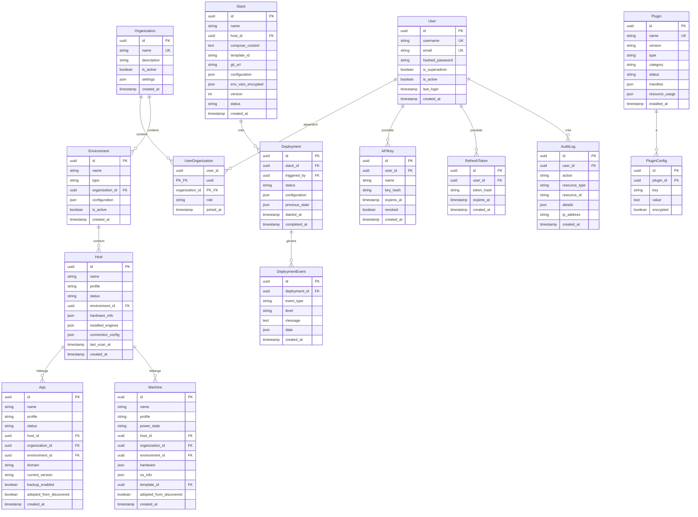

# Chapitre 06 — Modèle de données

> **Statut** : Spec cible · **Public** : Développeurs backend, DBA · **Lié à** : [02-familles-workloads.md](02-familles-workloads.md), [04-architecture.md](04-architecture.md), [07-authentification.md](07-authentification.md), [09-api.md](09-api.md)

## Vue d'ensemble

Ce chapitre spécifie le schéma de données de WindFlow : entités comptes/organisations, entités workloads (Apps, Machines, Hosts — issues du modèle directeur du chapitre 02), entités plugins et entités transverses (déploiements, audit, auth). Il couvre aussi la stratégie de migration `targets` → `hosts` et les règles de compatibilité PostgreSQL/SQLite. Les comportements métier (verbes, adoption, cycles de vie) sont définis aux chapitres 02 et 03 ; seul leur support persistant est décrit ici.

## Principes de conception

- **Simplicité** : peu de tables, relations claires. Pas d'over-engineering relationnel.
- **Compatibilité SQLite** : pas de types PostgreSQL spécifiques (CIDR, INET, arrays). Les types complexes utilisent JSON.
- **Extensibilité via JSON** : les colonnes `configuration` et `metadata` en JSON permettent de stocker des données structurées sans migration pour chaque nouveau champ.
- **Alignement familles** : les workloads sont persistés selon les trois familles du chapitre 02 — tables `apps`, `machines`, `hosts` distinctes, avec profils et statuts par famille.
- **Plugins séparés** : les plugins stockent leurs propres données dans des tables préfixées (`plugin_traefik_*`) ou dans la colonne JSON `metadata` de l'entité concernée. Le modèle core ne contient pas de tables pour le DNS, les domaines, les certificats, le monitoring, etc.

## Diagramme entité-relations

### Diagramme — Schéma complet



## Entités workloads (familles)

Les trois familles du chapitre 02 sont persistées dans trois tables distinctes. Chaque table porte le `profile` (sous-type technique) et un champ de statut propre à la famille.

### App — workload container-based

```sql
CREATE TABLE apps (
    id TEXT PRIMARY KEY,                          -- UUID stocké en TEXT (compatible SQLite)
    name VARCHAR(100) NOT NULL,
    icon VARCHAR(255),
    description TEXT,
    profile VARCHAR(30) NOT NULL,                 -- docker_container, docker_compose, helm_release, k8s_manifest, app_native_service
    host_id TEXT NOT NULL REFERENCES hosts(id),   -- le Host qui l'héberge
    organization_id TEXT NOT NULL REFERENCES organizations(id),
    environment_id TEXT REFERENCES environments(id),
    domain VARCHAR(255),                          -- domaine public si exposé
    status VARCHAR(20) DEFAULT 'unknown',         -- statuts AppStatus
    current_version VARCHAR(50),
    available_version VARCHAR(50),
    backup_enabled BOOLEAN DEFAULT FALSE,
    last_backup_at TIMESTAMP,
    marketplace_entry_id TEXT,                    -- entrée marketplace d'origine
    adopted_from_discovered BOOLEAN DEFAULT FALSE,
    created_at TIMESTAMP DEFAULT CURRENT_TIMESTAMP,
    updated_at TIMESTAMP DEFAULT CURRENT_TIMESTAMP,
    UNIQUE(host_id, name)
);

CREATE INDEX idx_apps_host ON apps(host_id);
CREATE INDEX idx_apps_status ON apps(status);
```

### Machine — workload VM-based

```sql
CREATE TABLE machines (
    id TEXT PRIMARY KEY,
    name VARCHAR(100) NOT NULL,
    icon VARCHAR(255),
    description TEXT,
    profile VARCHAR(30) NOT NULL,                 -- vm_kvm, vm_lxd, vm_incus, vm_lxc, vm_virtualbox
    host_id TEXT NOT NULL REFERENCES hosts(id),   -- le Host qui l'héberge
    organization_id TEXT NOT NULL REFERENCES organizations(id),
    environment_id TEXT REFERENCES environments(id),
    power_state VARCHAR(20) DEFAULT 'stopped',    -- statuts PowerState
    hardware TEXT DEFAULT '{}',                   -- JSON : CPU, RAM, disques, NICs
    os_info TEXT DEFAULT '{}',                    -- JSON : nom, version, architecture
    template_id TEXT,                             -- template d'origine (nullable)
    adopted_from_discovered BOOLEAN DEFAULT FALSE,
    created_at TIMESTAMP DEFAULT CURRENT_TIMESTAMP,
    updated_at TIMESTAMP DEFAULT CURRENT_TIMESTAMP,
    UNIQUE(host_id, name)
);

CREATE INDEX idx_machines_host ON machines(host_id);
CREATE INDEX idx_machines_state ON machines(power_state);
```

### Host — substrat d'exécution

La table `hosts` remplace l'ancienne table `targets` (voir [Migration de `targets` vers `hosts`](#migration-de-targets-vers-hosts)).

```sql
CREATE TABLE hosts (
    id TEXT PRIMARY KEY,
    name VARCHAR(100) NOT NULL,
    description TEXT,
    profile VARCHAR(30) NOT NULL,                 -- host_baremetal, host_proxmox, host_kubernetes, host_remote_docker
    organization_id TEXT NOT NULL REFERENCES organizations(id),
    environment_id TEXT NOT NULL REFERENCES environments(id),
    connection_config TEXT DEFAULT '{}',          -- JSON chiffré : SSH config, API endpoint, kubeconfig
    hardware_info TEXT DEFAULT '{}',              -- JSON : CPU, RAM, disques, interfaces
    installed_engines TEXT DEFAULT '[]',          -- JSON : moteurs détectés (Docker, libvirt, k8s…)
    status VARCHAR(20) DEFAULT 'unknown',         -- online, offline, unreachable, scanning
    last_scan_at TIMESTAMP,
    created_at TIMESTAMP DEFAULT CURRENT_TIMESTAMP,
    updated_at TIMESTAMP DEFAULT CURRENT_TIMESTAMP,
    UNIQUE(environment_id, name)
);

CREATE INDEX idx_hosts_env ON hosts(environment_id);
CREATE INDEX idx_hosts_status ON hosts(status);
```

**Format `installed_engines` (JSON) :**

```json
{
    "system": {
        "arch": "x86_64",
        "os": "Ubuntu 22.04",
        "cpu_cores": 8,
        "memory_mb": 16384,
        "disk_gb": 4096
    },
    "docker": { "version": "24.0.7", "compose_version": "2.23.0" },
    "libvirt": { "hypervisor": "QEMU/KVM", "version": "9.0.0" },
    "kubernetes": null
}
```

## Profils canoniques

Les valeurs de `profile` sont des enums canoniques. `HostProfile` unifie les anciennes valeurs divergentes de `Target.type` (`local | ssh | proxmox`) : `local` et `ssh` deviennent `host_baremetal`, et le pilotage Docker distant devient `host_remote_docker`.

```python
class AppProfile(str, Enum):
    DOCKER_CONTAINER   = "docker_container"
    DOCKER_COMPOSE     = "docker_compose"
    HELM_RELEASE       = "helm_release"
    K8S_MANIFEST       = "k8s_manifest"
    APP_NATIVE_SERVICE = "app_native_service"   # service systemd adopté

class MachineProfile(str, Enum):
    VM_KVM        = "vm_kvm"
    VM_LXD        = "vm_lxd"
    VM_INCUS      = "vm_incus"
    VM_LXC        = "vm_lxc"
    VM_VIRTUALBOX = "vm_virtualbox"

class HostProfile(str, Enum):
    HOST_BAREMETAL     = "host_baremetal"
    HOST_PROXMOX       = "host_proxmox"
    HOST_KUBERNETES    = "host_kubernetes"
    HOST_REMOTE_DOCKER = "host_remote_docker"
```

## Statuts unifiés par famille

Chaque famille a son enum de statut, avec des conventions de couleur cohérentes :

```python
class AppStatus(str, Enum):
    RUNNING   = "running"     # 🟢
    STOPPED   = "stopped"     # ⚪
    STARTING  = "starting"    # 🟡
    STOPPING  = "stopping"    # 🟡
    UPDATING  = "updating"    # 🔵
    DEGRADED  = "degraded"    # 🟠
    ERROR     = "error"       # 🔴
    UNKNOWN   = "unknown"     # ⚫

class PowerState(str, Enum):       # Machines
    RUNNING   = "running"     # 🟢
    STOPPED   = "stopped"     # ⚪
    PAUSED    = "paused"      # 🟡
    SUSPENDED = "suspended"   # 🟡
    CRASHED   = "crashed"     # 🔴

class HostStatus(str, Enum):
    ONLINE      = "online"       # 🟢
    OFFLINE     = "offline"      # ⚪
    UNREACHABLE = "unreachable"  # 🔴
    SCANNING    = "scanning"     # 🔵
```

## Migration de `targets` vers `hosts`

L'entité `Target` (colonne `type = local | ssh | proxmox`) est remplacée par l'entité **Host**. *Target* reste cité ici uniquement comme alias historique. Stratégie de migration :

1. **Création de `hosts`** avec le schéma ci-dessus (profils canoniques à 4 valeurs).
2. **Copie des lignes** de `targets` vers `hosts` avec correspondance de profils : `local` → `host_baremetal`, `ssh` → `host_baremetal` (accès SSH) ou `host_remote_docker` (si le Docker distant est le seul usage), `proxmox` → `host_proxmox`.
3. **Reprise des colonnes** : `capabilities` → `hardware_info` + `installed_engines` (éclaté), `connection_config` conservé, `last_seen` → `last_scan_at`.
4. **Mise à jour des clés étrangères** : `stacks.target_id` → `stacks.host_id` ; les nouvelles FK `apps.host_id` et `machines.host_id` sont peuplées depuis les objets Compute existants.
5. **Suppression de `targets`** après validation (les lectures API passent par `/hosts`, cf. chapitre 09).

Les migrations Alembic restent compatibles PostgreSQL + SQLite (voir [Compatibilité PostgreSQL et SQLite](#compatibilité-postgresql-et-sqlite)).

Exemple illustratif — migration Alembic de la table `hosts` :

```python
def upgrade():
    op.create_table(
        "hosts",
        sa.Column("id", sa.String(36), primary_key=True),
        sa.Column("name", sa.String(100), nullable=False),
        sa.Column("profile", sa.String(30), nullable=False),
        sa.Column("organization_id", sa.String(36), sa.ForeignKey("organizations.id"), nullable=False),
        sa.Column("environment_id", sa.String(36), sa.ForeignKey("environments.id"), nullable=False),
        sa.Column("connection_config", sa.JSON, default={}),
        sa.Column("hardware_info", sa.JSON, default={}),
        sa.Column("installed_engines", sa.JSON, default=[]),
        sa.Column("status", sa.String(20), default="unknown"),
        sa.Column("last_scan_at", sa.DateTime, nullable=True),
        sa.Column("created_at", sa.DateTime, default=sa.func.now()),
    )
```

## Entités comptes et organisations

### User — utilisateur

```sql
CREATE TABLE users (
    id TEXT PRIMARY KEY,
    username VARCHAR(50) UNIQUE NOT NULL,
    email VARCHAR(255) UNIQUE NOT NULL,
    hashed_password VARCHAR(255) NOT NULL,
    is_superadmin BOOLEAN DEFAULT FALSE,
    is_active BOOLEAN DEFAULT TRUE,
    last_login TIMESTAMP,
    created_at TIMESTAMP DEFAULT CURRENT_TIMESTAMP,
    updated_at TIMESTAMP DEFAULT CURRENT_TIMESTAMP
);

CREATE INDEX idx_users_username ON users(username);
CREATE INDEX idx_users_email ON users(email);
```

### Organization — organisation

```sql
CREATE TABLE organizations (
    id TEXT PRIMARY KEY,
    name VARCHAR(100) UNIQUE NOT NULL,
    description TEXT,
    is_active BOOLEAN DEFAULT TRUE,
    settings TEXT DEFAULT '{}',               -- JSON : préférences, limites
    created_at TIMESTAMP DEFAULT CURRENT_TIMESTAMP,
    updated_at TIMESTAMP DEFAULT CURRENT_TIMESTAMP
);
```

### UserOrganization — appartenance avec rôle

```sql
CREATE TABLE user_organizations (
    user_id TEXT NOT NULL REFERENCES users(id) ON DELETE CASCADE,
    organization_id TEXT NOT NULL REFERENCES organizations(id) ON DELETE CASCADE,
    role VARCHAR(20) NOT NULL DEFAULT 'viewer',  -- viewer, operator, admin
    joined_at TIMESTAMP DEFAULT CURRENT_TIMESTAMP,
    PRIMARY KEY (user_id, organization_id)
);

CREATE INDEX idx_user_org_org ON user_organizations(organization_id);
```

### Environment — environnement

```sql
CREATE TABLE environments (
    id TEXT PRIMARY KEY,
    name VARCHAR(100) NOT NULL,
    type VARCHAR(20) NOT NULL DEFAULT 'development',  -- development, staging, production, ou libre
    organization_id TEXT NOT NULL REFERENCES organizations(id) ON DELETE CASCADE,
    configuration TEXT DEFAULT '{}',           -- JSON : paramètres réseau, variables partagées
    is_active BOOLEAN DEFAULT TRUE,
    created_at TIMESTAMP DEFAULT CURRENT_TIMESTAMP,
    updated_at TIMESTAMP DEFAULT CURRENT_TIMESTAMP,
    UNIQUE(organization_id, name)
);

CREATE INDEX idx_environments_org ON environments(organization_id);
```

## Entités Compute (stacks et déploiements)

Les stacks sont les environnements nommés d'objets Compute managés, définies au chapitre 03.

### Stack — groupe de services

```sql
CREATE TABLE stacks (
    id TEXT PRIMARY KEY,
    name VARCHAR(100) NOT NULL,
    host_id TEXT NOT NULL REFERENCES hosts(id) ON DELETE CASCADE,
    compose_content TEXT,                     -- contenu docker-compose.yml
    template_id VARCHAR(100),                 -- référence au template marketplace (nullable)
    git_url VARCHAR(500),                     -- URL du dépôt Git (nullable, plugin Git)
    git_branch VARCHAR(100) DEFAULT 'main',
    configuration TEXT DEFAULT '{}',          -- JSON : variables du template
    env_vars_encrypted TEXT DEFAULT '{}',     -- JSON : variables d'env sensibles (chiffrées)
    version INTEGER DEFAULT 1,                -- incrémenté à chaque modification
    status VARCHAR(20) DEFAULT 'created',     -- created, deploying, deployed, stopped, error
    created_at TIMESTAMP DEFAULT CURRENT_TIMESTAMP,
    updated_at TIMESTAMP DEFAULT CURRENT_TIMESTAMP,
    UNIQUE(host_id, name)
);

CREATE INDEX idx_stacks_host ON stacks(host_id);
CREATE INDEX idx_stacks_status ON stacks(status);
```

### Deployment — déploiement

```sql
CREATE TABLE deployments (
    id TEXT PRIMARY KEY,
    stack_id TEXT NOT NULL REFERENCES stacks(id) ON DELETE CASCADE,
    triggered_by TEXT NOT NULL REFERENCES users(id),
    status VARCHAR(20) DEFAULT 'pending',     -- pending, running, success, failed, rolled_back
    configuration TEXT DEFAULT '{}',          -- JSON : config utilisée pour ce déploiement
    previous_state TEXT,                      -- JSON : état précédent pour rollback
    started_at TIMESTAMP DEFAULT CURRENT_TIMESTAMP,
    completed_at TIMESTAMP,
    UNIQUE(stack_id, started_at)
);

CREATE INDEX idx_deployments_stack ON deployments(stack_id);
CREATE INDEX idx_deployments_status ON deployments(status);
CREATE INDEX idx_deployments_started ON deployments(started_at);
```

### DeploymentEvent — événements de déploiement

```sql
CREATE TABLE deployment_events (
    id TEXT PRIMARY KEY,
    deployment_id TEXT NOT NULL REFERENCES deployments(id) ON DELETE CASCADE,
    event_type VARCHAR(50) NOT NULL,          -- pulling, deploying, health_check, success, error, rollback
    level VARCHAR(10) DEFAULT 'info',         -- debug, info, warning, error
    message TEXT,
    data TEXT DEFAULT '{}',                   -- JSON : données supplémentaires
    created_at TIMESTAMP DEFAULT CURRENT_TIMESTAMP
);

CREATE INDEX idx_deploy_events_deployment ON deployment_events(deployment_id);
CREATE INDEX idx_deploy_events_created ON deployment_events(created_at);
```

## Entités plugins

### Plugin — plugin installé

```sql
CREATE TABLE plugins (
    id TEXT PRIMARY KEY,
    name VARCHAR(100) UNIQUE NOT NULL,        -- identifiant unique (ex. traefik)
    version VARCHAR(20) NOT NULL,
    type VARCHAR(20) NOT NULL,                -- service, extension, hybrid
    category VARCHAR(30),                     -- access, dns, database, monitoring, etc.
    status VARCHAR(20) DEFAULT 'installed',   -- installed, running, stopped, error, updating
    manifest TEXT DEFAULT '{}',               -- JSON : manifest complet du plugin
    resource_usage TEXT DEFAULT '{}',         -- JSON : RAM, CPU mesurés
    installed_at TIMESTAMP DEFAULT CURRENT_TIMESTAMP,
    updated_at TIMESTAMP DEFAULT CURRENT_TIMESTAMP
);

CREATE INDEX idx_plugins_status ON plugins(status);
CREATE INDEX idx_plugins_category ON plugins(category);
```

### PluginConfig — configuration d'un plugin

```sql
CREATE TABLE plugin_configs (
    id TEXT PRIMARY KEY,
    plugin_id TEXT NOT NULL REFERENCES plugins(id) ON DELETE CASCADE,
    key VARCHAR(100) NOT NULL,
    value TEXT,                                -- valeur (chiffrée si encrypted=true)
    encrypted BOOLEAN DEFAULT FALSE,
    UNIQUE(plugin_id, key)
);

CREATE INDEX idx_plugin_configs_plugin ON plugin_configs(plugin_id);
```

## Entités auth et audit

### APIKey — clé API

```sql
CREATE TABLE api_keys (
    id TEXT PRIMARY KEY,
    user_id TEXT NOT NULL REFERENCES users(id) ON DELETE CASCADE,
    name VARCHAR(100) NOT NULL,
    key_hash VARCHAR(255) NOT NULL,           -- hash bcrypt de la clé (la clé brute n'est jamais stockée)
    expires_at TIMESTAMP,                     -- null = n'expire jamais
    last_used_at TIMESTAMP,
    revoked BOOLEAN DEFAULT FALSE,
    created_at TIMESTAMP DEFAULT CURRENT_TIMESTAMP
);

CREATE INDEX idx_api_keys_user ON api_keys(user_id);
```

### RefreshToken — token de rafraîchissement

```sql
CREATE TABLE refresh_tokens (
    id TEXT PRIMARY KEY,
    user_id TEXT NOT NULL REFERENCES users(id) ON DELETE CASCADE,
    token_hash VARCHAR(255) NOT NULL,
    expires_at TIMESTAMP NOT NULL,
    created_at TIMESTAMP DEFAULT CURRENT_TIMESTAMP
);

CREATE INDEX idx_refresh_tokens_user ON refresh_tokens(user_id);
CREATE INDEX idx_refresh_tokens_expires ON refresh_tokens(expires_at);
```

### AuditLog — journal d'audit

```sql
CREATE TABLE audit_logs (
    id TEXT PRIMARY KEY,
    user_id TEXT REFERENCES users(id) ON DELETE SET NULL,
    action VARCHAR(50) NOT NULL,              -- user.login, stack.deploy, plugin.install, etc.
    resource_type VARCHAR(30),                -- app, machine, host, stack, plugin, user, etc.
    resource_id TEXT,
    details TEXT DEFAULT '{}',                -- JSON : détails de l'action
    ip_address VARCHAR(45),
    created_at TIMESTAMP DEFAULT CURRENT_TIMESTAMP
);

CREATE INDEX idx_audit_user ON audit_logs(user_id);
CREATE INDEX idx_audit_action ON audit_logs(action);
CREATE INDEX idx_audit_resource ON audit_logs(resource_type, resource_id);
CREATE INDEX idx_audit_created ON audit_logs(created_at);
```

## Modèle SQLAlchemy

Exemple illustratif — entités workloads en SQLAlchemy 2.0 :

```python
class Host(Base):
    __tablename__ = "hosts"

    id: Mapped[str] = mapped_column(String(36), primary_key=True, default=lambda: str(uuid4()))
    name: Mapped[str] = mapped_column(String(100))
    profile: Mapped[HostProfile] = mapped_column(String(30))   # baremetal | proxmox | kubernetes | remote_docker
    environment_id: Mapped[str] = mapped_column(ForeignKey("environments.id"))
    connection_config: Mapped[dict] = mapped_column(JSON, default=dict)  # chiffré en application
    installed_engines: Mapped[list] = mapped_column(JSON, default=list)
    status: Mapped[str] = mapped_column(String(20), default="unknown")

    apps: Mapped[list["App"]] = relationship(back_populates="host")
    machines: Mapped[list["Machine"]] = relationship(back_populates="host")

class App(Base):
    __tablename__ = "apps"

    id: Mapped[str] = mapped_column(String(36), primary_key=True, default=lambda: str(uuid4()))
    name: Mapped[str] = mapped_column(String(100))
    profile: Mapped[AppProfile] = mapped_column(String(30))    # docker_compose, helm_release…
    host_id: Mapped[str] = mapped_column(ForeignKey("hosts.id"))
    status: Mapped[str] = mapped_column(String(20), default="unknown")
    adopted_from_discovered: Mapped[bool] = mapped_column(Boolean, default=False)

    host: Mapped["Host"] = relationship(back_populates="apps")
```

## Compatibilité PostgreSQL et SQLite

Le schéma est conçu pour fonctionner sur PostgreSQL et SQLite sans modification. Points clés :

- **UUID en TEXT** : SQLite n'a pas de type UUID natif. On stocke les UUID en `TEXT(36)`. Sur PostgreSQL, cela fonctionne aussi (légère perte de performance vs un vrai UUID, acceptable pour la cible).
- **JSON en TEXT** : SQLite supporte `json()` mais le type natif est TEXT. SQLAlchemy gère la sérialisation/désérialisation automatiquement avec `JSON`.
- **Pas de types PostgreSQL spécifiques** : pas de CIDR, INET, ARRAY ni vues matérialisées. Les adresses IP sont stockées en VARCHAR.
- **Pas de procédures stockées** : toute la logique est dans le code Python (SQLAlchemy), pas dans la base de données.
- **Timestamps sans timezone** : SQLite ne supporte pas `TIMESTAMP WITH TIME ZONE`. Les timestamps sont stockés en UTC.

## Données des plugins

Les plugins ne modifient pas le schéma core. Ils ont deux options pour stocker leurs données :

### Option 1 : tables préfixées

Les plugins complexes (comme Traefik) peuvent créer leurs propres tables avec un préfixe :

```sql
-- Créées par le plugin Traefik
CREATE TABLE plugin_traefik_routes (
    id TEXT PRIMARY KEY,
    domain VARCHAR(255) NOT NULL,
    service_name VARCHAR(100) NOT NULL,
    app_id TEXT REFERENCES apps(id),
    tls_enabled BOOLEAN DEFAULT TRUE,
    certificate_expiry TIMESTAMP,
    created_at TIMESTAMP DEFAULT CURRENT_TIMESTAMP
);
```

Le Plugin Manager gère la création et la suppression de ces tables lors de l'installation/désinstallation du plugin.

### Option 2 : table PluginConfig

Les plugins simples stockent leur configuration dans la table `plugin_configs` (clé/valeur).

## Résumé des tables

| Table | Entité | Description |
|-------|--------|-------------|
| `users` | User | Utilisateurs du système |
| `organizations` | Organization | Organisations (groupes de travail) |
| `user_organizations` | UserOrganization | Appartenance utilisateur ↔ organisation avec rôle |
| `environments` | Environment | Environnements (dev, staging, prod) |
| `hosts` | Host | Substrats d'exécution (baremetal, proxmox, kubernetes, remote_docker) |
| `apps` | App | Workloads container-based (famille Apps) |
| `machines` | Machine | Workloads VM-based (famille Machines) |
| `stacks` | Stack | Groupes de services Docker Compose |
| `deployments` | Deployment | Historique des déploiements |
| `deployment_events` | DeploymentEvent | Événements détaillés par déploiement |
| `plugins` | Plugin | Plugins installés |
| `plugin_configs` | PluginConfig | Configuration clé/valeur des plugins |
| `api_keys` | APIKey | Clés API pour l'authentification non-interactive |
| `refresh_tokens` | RefreshToken | Tokens de rafraîchissement JWT |
| `audit_logs` | AuditLog | Journal d'audit |
| | **Total** | **15 tables core** |

Les plugins ajoutent leurs propres tables si nécessaire (préfixées `plugin_{name}_*`).

## Voir aussi

- [02-familles-workloads.md](02-familles-workloads.md) — définition des familles, profils et verbes portés par ces entités
- [03-modele-compute.md](03-modele-compute.md) — taxonomie stack/discovered/standalone et adoption
- [07-authentification.md](07-authentification.md) — cycle de vie des tokens et clés API
- [08-rbac-permissions.md](08-rbac-permissions.md) — rôles et table `user_organizations`
- [09-api.md](09-api.md) — exposition REST des entités et conventions de pagination
- [11-plugins.md](11-plugins.md) — manifest, tables préfixées et cycle de vie des plugins
