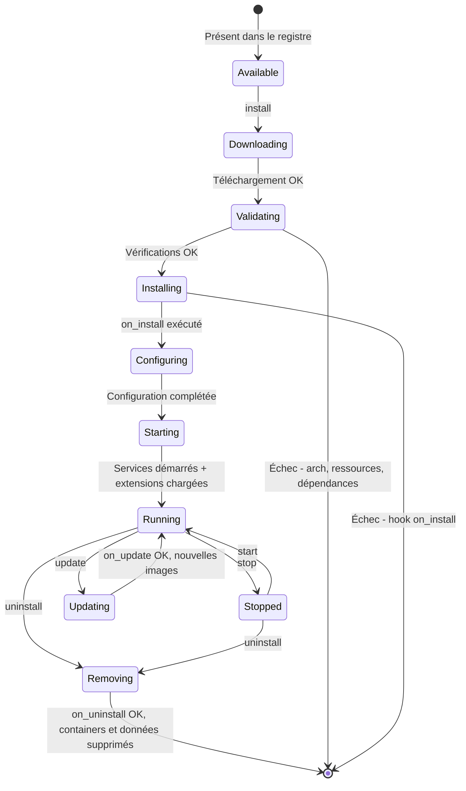

# Chapitre 11 — Système de plugins

> **Statut** : Spec cible · **Public** : Développeurs de plugins, développeurs backend · **Lié à** : [04-architecture.md](04-architecture.md), [12-marketplace.md](12-marketplace.md), [09-api.md](09-api.md), [15-securite.md](15-securite.md)

## Vue d'ensemble

Ce chapitre est la **référence unique** du système de plugins : types de plugins, manifest, Plugin Manager et cycle de vie, système d'événements (liste canonique), extension de l'API et de l'UI, guide de développement et conventions. La frontière core/plugins est spécifiée au chapitre [04-architecture.md](04-architecture.md) ; les registres, la marketplace et le catalogue officiel des plugins au chapitre [12-marketplace.md](12-marketplace.md) ; la sécurité des plugins est détaillée au chapitre [15-securite.md](15-securite.md).

## Philosophie

WindFlow repose sur un principe simple : **le core fait le minimum, les plugins font le reste**. Le core gère les workloads des trois familles (chapitre 02), les stacks, l'authentification et le système de plugins lui-même. Tout ce qui n'est pas strictement nécessaire (reverse proxy, DNS, bases de données, monitoring, backup, IA, mail, workflows, SSO…) est un plugin installable et désinstallable à la demande.

Trois avantages concrets :

- **Empreinte minimale** : un Raspberry Pi avec 2 Go de RAM ne charge que le core (~500 Mo). Les plugins consomment des ressources uniquement quand ils sont installés.
- **Pas de complexité imposée** : un homelab n'a pas besoin de Keycloak ; un petit serveur n'a pas besoin d'Elasticsearch. L'utilisateur installe uniquement ce dont il a besoin.
- **Extensibilité ouverte** : n'importe qui peut créer un plugin et le distribuer. Le format est ouvert et documenté (ce chapitre).

## Types de plugins

WindFlow reconnaît trois types de plugins. Le type est déclaré dans le manifest.

### Service plugin

Déploie une **stack Docker préconfigurée**. Il ne modifie pas le core — il ajoute un ou plusieurs containers gérés par WindFlow.

Exemple — plugin Uptime Kuma : déploie un container Uptime Kuma, ajoute un widget sur le dashboard, et l'utilisateur configure Uptime Kuma dans son interface native.

```
uptime-kuma/
├── windflow-plugin.yml          # Manifest
├── docker-compose.yml           # Stack à déployer
├── config-schema.yml            # Schéma de configuration (génère le wizard)
├── icon.svg                     # Icône pour la marketplace
└── scripts/
    ├── install.sh               # Hook post-installation
    └── uninstall.sh             # Hook pré-désinstallation
```

### Extension plugin

**Ajoute des fonctionnalités au core** sans déployer de nouveau container. Il détecte des services existants et enrichit l'interface avec des actions contextuelles.

Exemple — plugin PostgreSQL Manager : détecte les containers basés sur l'image `postgres`, ajoute des boutons « Créer une DB », « Créer un utilisateur », « Backup » dans l'UI, et expose des endpoints `/api/v1/plugins/postgresql/*` — sans déployer rien.

```
postgresql-manager/
├── windflow-plugin.yml          # Manifest
├── config-schema.yml
├── icon.svg
├── extensions/
│   ├── api.py                   # Endpoints FastAPI
│   ├── hooks.py                 # Réactions aux événements core
│   └── ui/
│       ├── routes.json          # Pages à ajouter au menu
│       └── components/          # Composants Vue.js
└── scripts/
    └── install.sh
```

### Hybrid plugin

Fait les deux : **déploie un service ET étend le core**. C'est le type le plus puissant.

Exemple — plugin Traefik : déploie un container Traefik (service), ajoute une page « Domaines & Routage » dans l'UI et des endpoints API (extension), et s'abonne à l'événement `stack.deployed` pour auto-configurer le routage.

```
traefik/
├── windflow-plugin.yml          # Manifest
├── docker-compose.yml           # Stack Traefik
├── config-schema.yml
├── icon.svg
├── extensions/
│   ├── api.py                   # Endpoints API (gestion domaines, routes)
│   ├── hooks.py                 # Hook on stack.deployed → auto-route
│   └── ui/                      # routes.json + composants (DomainsPage…)
├── templates/
│   └── traefik-dynamic.yml.j2   # Template de config Traefik dynamique
└── scripts/
    └── install.sh, configure.sh, uninstall.sh
```

## Manifest plugin

Chaque plugin contient un fichier `windflow-plugin.yml` à sa racine. C'est le contrat entre le plugin et le Plugin Manager.

Exemple illustratif — sections identité et type (plugin Traefik) :

```yaml
# ===== Identité =====
name: traefik                          # Identifiant unique (a-z, 0-9, tirets)
version: 1.2.0                         # Semver
display_name: "Traefik"
description: "Reverse proxy avec TLS automatique via Let's Encrypt"
long_description: |                    # Markdown supporté
  Traefik est un reverse proxy moderne qui s'intègre nativement
  avec Docker. Ce plugin déploie Traefik et permet d'associer
  des noms de domaine à vos services depuis l'interface WindFlow.
category: access                       # Catégorie marketplace (chapitre 12)
tags: ["reverse-proxy", "tls", "https", "letsencrypt"]
icon: icon.svg
author: "WindFlow Team"
license: MIT

# ===== Type =====
type: hybrid                           # service | extension | hybrid
```

La section **compatibilité** déclare les architectures cibles, la version minimale de WindFlow, les ressources nécessaires et les dépendances :

```yaml
# ===== Compatibilité =====
architectures: [linux/amd64, linux/arm64]
windflow_version: ">=1.1.0"
resources:                             # Ressources nécessaires
  ram_min_mb: 128
  cpu_min_cores: 0.5
  disk_min_mb: 100

# ===== Dépendances =====
dependencies:
  requires: [docker]                   # Plugins ou capabilities requis
  optional: [cloudflare-dns]           # Enrichissent si présents
  conflicts: [nginx-proxy-manager]     # Conflit de ports 80/443

# ===== Capabilities et ports =====
provides: [reverse_proxy, tls_certificates]   # Consommables par d'autres plugins
ports:
  - { port: 80,   protocol: tcp, description: "HTTP" }
  - { port: 443,  protocol: tcp, description: "HTTPS" }
  - { port: 8080, protocol: tcp, description: "Dashboard Traefik", optional: true }
```

Les sections **configuration utilisateur**, **fichiers** et **hooks** complètent le contrat :

```yaml
# ===== Configuration utilisateur (extrait) =====
config:
  - key: acme_email
    label: "Email pour Let's Encrypt"
    type: string
    required: true
    validation: "^[^@]+@[^@]+\\.[^@]+$"
  - key: dashboard_enabled
    label: "Activer le dashboard Traefik"
    type: boolean
    default: true

# ===== Fichiers =====
compose_file: docker-compose.yml       # Stack (service et hybrid)
extensions:                            # Code d'extension (extension et hybrid)
  api_module: extensions/api.py
  hooks_module: extensions/hooks.py
  ui_routes: extensions/ui/routes.json
  ui_components: extensions/ui/components/

# ===== Hooks lifecycle =====
hooks:
  on_install: scripts/install.sh       # Après téléchargement, avant premier start
  on_configure: scripts/configure.sh   # Après changement de configuration
  on_update: scripts/update.sh         # Avant mise à jour
  on_uninstall: scripts/uninstall.sh   # Avant suppression

# ===== Détection automatique (extension plugins) =====
auto_detect:
  docker_images: ["traefik", "traefik:*"]   # Images qui activent le plugin
```

### Types de configuration supportés

| Type | Rendu UI | Exemple |
|------|----------|---------|
| `string` | Champ texte | Email, URL, chemin |
| `password` | Champ masqué (valeur chiffrée en base) | Mots de passe, tokens |
| `boolean` | Toggle | Activer/désactiver une option |
| `integer` | Champ numérique | Port, nombre de workers |
| `select` | Menu déroulant | Niveau de logs, mode |
| `multiline` | Textarea | Configuration custom, certificats |

Options par champ : `required`, `default`, `validation` (regex), `generate: true` (propose un bouton « Générer », pour les mots de passe), `visible_if` (conditionne l'affichage à une capability ou un autre plugin installé).

## Plugin Manager

Le Plugin Manager est le module core qui orchestre le cycle de vie des plugins.

### Diagramme — Cycle de vie d'un plugin



### Étapes d'installation

```
1. DOWNLOAD
   ├── Télécharger le package depuis le registre
   ├── Vérifier le checksum SHA-256
   └── Extraire dans /data/plugins/{name}/

2. VALIDATE
   ├── Parser le manifest windflow-plugin.yml
   ├── Vérifier l'architecture (arm64 / amd64)
   ├── Vérifier les ressources disponibles (RAM, CPU, disque)
   ├── Vérifier les dépendances (plugins requis installés ?)
   ├── Vérifier les conflits (plugins incompatibles ?)
   └── Vérifier la version WindFlow minimale

3. INSTALL
   ├── Exécuter le hook on_install (si défini)
   ├── [Service/Hybrid] Déployer docker-compose.yml
   │   ├── Pull des images Docker
   │   ├── Créer le network plugin si nécessaire
   │   └── docker compose up -d
   └── [Extension/Hybrid] Charger le code Python
       ├── Importer api_module → enregistrer les routes FastAPI
       ├── Importer hooks_module → s'abonner aux événements
       └── Enregistrer ui_routes et ui_components

4. CONFIGURE
   ├── Afficher le wizard (généré depuis config_schema)
   ├── Stocker les valeurs en base (chiffrées si type=password)
   ├── Injecter la configuration dans le container (env vars ou fichier)
   └── Exécuter le hook on_configure (si défini)

5. RUNNING
   ├── Le plugin est actif
   ├── Les endpoints API sont disponibles
   ├── Les pages UI sont visibles dans le menu
   └── Les hooks événements sont actifs
```

Si une étape échoue, le Plugin Manager effectue un **rollback** : suppression des fichiers téléchargés (échec INSTALL), `docker compose down` + nettoyage (échec du déploiement Docker), désenregistrement des routes partiellement chargées (échec d'extension), rollback complet (échec du hook `on_install`). L'utilisateur voit un message explicite dans l'UI avec la cause et la suggestion de résolution.

### Stockage des plugins

```
/data/plugins/
├── traefik/
│   ├── windflow-plugin.yml
│   ├── docker-compose.yml
│   ├── extensions/
│   └── scripts/
├── postgresql-manager/
│   └── ...
└── uptime-kuma/
    └── ...
```

Les données persistantes des plugins sont stockées dans des volumes Docker nommés `windflow-plugin-{name}-data`. Le stockage en base (tables préfixées `plugin_{name}_*` ou `plugin_configs`) est spécifié au chapitre [06-modele-de-donnees.md](06-modele-de-donnees.md).

## Système d'événements

Le core émet des événements lors d'actions importantes. Les extension/hybrid plugins s'y abonnent pour réagir automatiquement.

### Liste canonique des événements

Cette liste est la **référence unique** du nommage des événements (convention `domaine.action_passé`), référencée par les chapitres 04, 09 et 17. Les événements `host.*` remplacent les anciens `target.*` (alias historique) ; `deployment.succeeded` est la forme canonique (jamais `deployment.success`).

| Événement | Émis quand | Données |
|-----------|------------|---------|
| `container.created` | Un container est créé | container_id, name, image, host_id |
| `container.started` | Un container démarre | container_id, name, host_id |
| `container.stopped` | Un container s'arrête | container_id, name, host_id |
| `container.removed` | Un container est supprimé | container_id, name, host_id |
| `stack.deployed` | Une stack est déployée | stack_id, name, services[], host_id |
| `stack.updated` | Une stack est mise à jour | stack_id, name, previous_version, new_version |
| `stack.removed` | Une stack est supprimée | stack_id, name, host_id |
| `machine.created` | Une Machine est créée | machine_id, name, profile, host_id |
| `machine.started` | Une Machine démarre | machine_id, name, host_id |
| `machine.stopped` | Une Machine s'arrête | machine_id, name, host_id |
| `deployment.started` | Un déploiement commence | deployment_id, stack_id |
| `deployment.succeeded` | Un déploiement réussit | deployment_id, stack_id, duration |
| `deployment.failed` | Un déploiement échoue | deployment_id, stack_id, error |
| `host.added` | Un Host est ajouté | host_id, name, profile, engines |
| `host.removed` | Un Host est retiré | host_id, name |
| `host.offline` | Un Host devient injoignable | host_id, name, last_seen |
| `plugin.installed` | Un plugin est installé | plugin_name, version |
| `plugin.removed` | Un plugin est désinstallé | plugin_name |

Ces événements alimentent aussi le canal WebSocket `/ws/events` (chapitre [09-api.md](09-api.md)) et les triggers du scheduler (chapitre [17-automatisation-workflows.md](17-automatisation-workflows.md)).

### Implémentation des hooks

Exemple illustratif — hooks du plugin Traefik :

```python
# extensions/hooks.py
from windflow.plugins.hooks import PluginHooks, on_event

class TraefikHooks(PluginHooks):
    """Hooks du plugin Traefik."""

    @on_event("stack.deployed")
    async def auto_configure_route(self, event):
        """Configure une route Traefik pour chaque service labellisé."""
        for service in event.data.get("services", []):
            domain = service.get("labels", {}).get("windflow.domain")
            if domain:
                await self.traefik.add_route(
                    domain=domain,
                    backend=f"http://{service['name']}:{service['port']}",
                    tls=True,
                )

    @on_event("stack.removed")
    async def remove_routes(self, event):
        """Supprime les routes de la stack supprimée."""
        await self.traefik.remove_routes_for_stack(event.data["stack_id"])
```

### Bus d'événements

En mode standard (avec Redis), les événements passent par Redis Pub/Sub. En mode léger (sans Redis), un bus en mémoire basé sur `asyncio.Queue` prend le relais. L'interface est identique pour les plugins — qui n'ont pas à connaître le mode de déploiement.

## Extension de l'API

Les extension/hybrid plugins ajoutent des endpoints sous `/api/v1/plugins/{name}/` (liste d'exemples au chapitre [09-api.md](09-api.md)). Les routes sont enregistrées dynamiquement au chargement du plugin et automatiquement :

- préfixées par `/api/v1/plugins/{plugin_name}/` ;
- protégées par l'authentification JWT et le RBAC du core (chapitre [08-rbac-permissions.md](08-rbac-permissions.md)) ;
- documentées dans OpenAPI (visibles dans `/api/docs`) ;
- désenregistrées quand le plugin est désinstallé.

Exemple illustratif — déclaration de routes :

```python
# extensions/api.py
from windflow.plugins.api import plugin_router

router = plugin_router("traefik")  # Préfixe : /api/v1/plugins/traefik

@router.get("/domains")
async def list_domains(user=Depends(get_current_user)):
    """Liste les domaines configurés dans Traefik."""
    return await traefik_service.list_domains()

@router.post("/domains")
async def add_domain(request: AddDomainRequest, user=Depends(get_current_user)):
    """Ajoute un domaine et configure le routage."""
    return await traefik_service.add_domain(request.domain, request.service, request.tls)
```

## Extension de l'UI

Les plugins ajoutent des pages et des widgets à l'interface web sans modifier le code core.

### Déclaration des routes UI

```json
{
  "pages": [
    {
      "path": "domains",
      "label": "Domaines & Routage",
      "icon": "globe",
      "component": "DomainsPage.vue",
      "menu_section": "plugins",
      "menu_order": 10
    }
  ],
  "widgets": [
    {
      "id": "traefik-status",
      "component": "TraefikWidget.vue",
      "position": "dashboard",
      "size": "small",
      "refresh_interval": 30
    }
  ]
}
```

### Chargement dynamique

1. L'API retourne la liste des plugins installés avec leurs `ui_routes`.
2. Le router Vue.js ajoute dynamiquement les routes des plugins.
3. Les composants sont chargés en lazy-loading depuis le serveur.
4. Les widgets dashboard sont rendus dans les emplacements prévus (chapitre [13-ui-principes.md](13-ui-principes.md)).

Quand un plugin est désinstallé, ses routes et widgets disparaissent au prochain rafraîchissement. Les composants sont des Single File Components Vue.js standard avec accès à l'API WindFlow via le client injecté du SDK plugin.

## Guide : créer un plugin

### 1. Scaffolding

```bash
windflow plugins create my-plugin --type extension
# Crée la structure complète : manifest, config-schema, icon,
# extensions/ (api.py, hooks.py, ui/), scripts/, README
```

### 2. Implémenter

- **API (`extensions/api.py`)** — ajouter des endpoints via `plugin_router("my-plugin")` ;
- **Hooks (`extensions/hooks.py`)** — réagir aux événements canoniques via `@on_event` ;
- **UI (`extensions/ui/`)** — ajouter pages et widgets Vue.js.

### 3. Tester localement

```bash
# Installation en mode développement (lien symbolique)
windflow plugins dev-install ./my-plugin
# Le code Python est rechargé dynamiquement ; l'UI nécessite un refresh navigateur

windflow plugins logs my-plugin
```

### 4. Packager et distribuer

```bash
windflow plugins pack ./my-plugin
# → my-plugin-1.0.0.tar.gz + checksum SHA-256 affiché
```

L'entrée est ajoutée dans l'`index.json` d'un registre et le `.tar.gz` hébergé sur un serveur HTTP accessible — le détail du format de registre et de la publication est au chapitre [12-marketplace.md](12-marketplace.md).

## Sécurité des plugins

Résumé — le détail est au chapitre [15-securite.md](15-securite.md) § Sécurité des plugins :

- **Isolation** : les service plugins tournent dans des containers isolés ; les extension/hybrid plugins s'exécutent dans le process core et exigent une confiance élevée.
- **Intégrité** : chaque package est vérifié par checksum SHA-256 au téléchargement ; les plugins officiels seront signés.
- **Secrets** : les valeurs de configuration `password` sont chiffrées en base, jamais exposées dans les logs ni les réponses API.
- **Permissions** : les routes injectées héritent de l'authentification JWT et du RBAC du core.

## Résumé des conventions

| Convention | Règle |
|------------|-------|
| Nom de plugin | Minuscules, `a-z`, `0-9`, tirets. Ex : `postgresql-manager` |
| Manifest | `windflow-plugin.yml` à la racine |
| Compose | `docker-compose.yml` à la racine (service et hybrid) |
| Extensions Python | Dans `extensions/` |
| Extensions UI | Dans `extensions/ui/` |
| Scripts lifecycle | Dans `scripts/` |
| Icône | `icon.svg` (SVG ou PNG 128×128) |
| Versioning | Semver (`1.2.3`) |
| Package | `{name}-{version}.tar.gz` |
| Volumes de données | `windflow-plugin-{name}-data` |
| Network | `windflow-plugin-{name}` (si isolé) |
| Préfixe API | `/api/v1/plugins/{name}/` |
| Préfixe routes UI | `/plugins/{name}/` |

## Voir aussi

- [12-marketplace.md](12-marketplace.md) — registres, marketplace et catalogue officiel des plugins
- [04-architecture.md](04-architecture.md) — frontière core/plugins et tableau de décision
- [15-securite.md](15-securite.md) — niveaux de confiance, vérifications à l'installation
- [09-api.md](09-api.md) — routes dynamiques des plugins dans la surface API
- [08-rbac-permissions.md](08-rbac-permissions.md) — permissions des endpoints plugin
- [../technical_specs/ARCHITECTURE-MODULAIRE.md](../technical_specs/ARCHITECTURE-MODULAIRE.md) — détail technique de l'architecture modulaire
