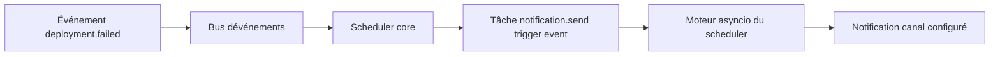

# Chapitre 17 — Automatisation et workflows

> **Statut** : Arbitré (décision D2 du plan de refonte) · **Public** : Utilisateurs avancés, administrateurs · **Lié à** : [11-plugins.md](11-plugins.md), [12-marketplace.md](12-marketplace.md), [09-api.md](09-api.md)

## Vue d'ensemble

Ce chapitre spécifie l'automatisation dans WindFlow selon l'arbitrage D2 : le core fournit un **scheduler minimal** (tâches planifiées et déclenchées par les événements canoniques du chapitre 11), et les **workflows avancés sont des plugins** (n8n, Node-RED) — WindFlow n'embarque **pas** de moteur de workflows visuels dans le core. Cette répartition respecte le principe « core minimal » (chapitre [04-architecture.md](04-architecture.md)) : un self-hoster qui n'automatise rien n'a aucune dépendance supplémentaire, et celui qui veut de l'orchestration visuelle installe l'outil de référence du domaine plutôt qu'un moteur ad hoc.

## Positionnement (arbitrage D2)

| Besoin | Réponse WindFlow | Où |
|---|---|---|
| Exécuter une action à intervalle régulier (backup, prune, scan) | Tâche planifiée (cron) du scheduler core | Core |
| Réagir à un événement (`deployment.failed`, `host.offline`…) | Trigger d'événement du scheduler core | Core |
| Enchaîner des opérations avec conditions, branches, retries | Plugin n8n ou Node-RED | Plugin |
| Workflows visuels drag-and-drop, bibliothèque partagée | UI native du plugin installé | Plugin |

**Conséquence directe** : il n'y a ni `WorkflowEngine`, ni éditeur Vue Flow embarqué, ni table de state de workflows dans le core. L'ancienne proposition de moteur intégré est conservée en [annexe](#annexe--proposition-historique-de-moteur-de-workflows-intégré-non-arbitrée) pour mémoire, marquée non arbitrée.

## Scheduler core

### Modèle

Le scheduler core gère des **tâches planifiées** persistées dans la table `scheduled_tasks` (entités du chapitre [06-modele-de-donnees.md](06-modele-de-donnees.md)) et exécutées par son moteur asyncio (boucle au lifespan du process API). Une tâche est définie par :

- une **action** parmi un registre fixe d'actions core (voir ci-dessous) ;
- un **déclencheur** : planification cron **ou** événement de la liste canonique (chapitre [11-plugins.md](11-plugins.md)) ;
- des **paramètres** propres à l'action (JSON) ;
- une politique d'erreur : ignorer, réessayer avec backoff (défaut : 3 tentatives), ou désactiver la tâche.

```python
class ScheduledTask(Base):
    """Tâche planifiée ou déclenchée par événement."""
    __tablename__ = "scheduled_tasks"

    id: Mapped[UUID] = mapped_column(primary_key=True, default=uuid4)
    name: Mapped[str] = mapped_column(String(100))
    action: Mapped[str] = mapped_column(String(50))     # ex. "app.backup"
    trigger_type: Mapped[str] = mapped_column(String(20))  # "cron" | "event"
    cron_expression: Mapped[Optional[str]]              # "0 2 * * 0" si cron
    event_name: Mapped[Optional[str]]                   # "deployment.failed" si event
    parameters: Mapped[dict] = mapped_column(JSON, default=dict)
    enabled: Mapped[bool] = mapped_column(Boolean, default=True)
    last_run_at: Mapped[Optional[datetime]]
    last_status: Mapped[Optional[str]]                  # success | failed | skipped
```

### Actions core enregistrées

| Action | Paramètres | Effet |
|---|---|---|
| `app.backup` | `app_id` | Sauvegarde d'une App (volumes, values, config) |
| `app.update` | `app_id` | Met à jour une App (avec rollback automatique) |
| `stack.deploy` | `stack_id` | Redéploie une stack |
| `machine.snapshot` | `machine_id`, `type: chaud\|froid` | Snapshot d'une Machine |
| `compute.images.prune` | `host_id` | Nettoyage des images non utilisées |
| `compute.volumes.prune` | `host_id` | Nettoyage des volumes orphelins |
| `host.scan` | `host_id` | Rescan des moteurs et objets discovered |
| `admin.backup.create` | `output` | Backup core (chapitre 16) |
| `notification.send` | `channel`, `title`, `message`, `severity`, `event_type`, `routing` (optionnel) | Notification selon le contrat de canal (voir [Notifications](#notifications)) |

Les plugins peuvent enregistrer leurs propres actions via leur module d'extension (chapitre [11-plugins.md](11-plugins.md)) — elles deviennent disponibles avec le préfixe du plugin (ex. `restic.backup_all`).

### Triggers

**Planification cron** — expression cron standard, évaluée par le moteur asyncio du scheduler ; la tâche s'exécute avec les paramètres enregistrés.

**Déclenchement par événement** — la tâche s'abonne à un événement de la liste canonique du chapitre [11-plugins.md](11-plugins.md). Le bus d'événements (Redis Pub/Sub en mode standard, `asyncio.Queue` en mode léger) notifie le scheduler, qui exécute l'action avec, en paramètres additionnels, les données de l'événement. Exemples :

- sur `deployment.failed` → `notification.send` avec le contexte de l'échec ;
- sur `host.offline` → `notification.send` d'alerte ;
- sur `plugin.installed` → `host.scan` pour actualiser les capacités.

Diagramme — chaîne d'un trigger d'événement :



### Exécutions : traçabilité, verrous et fuseaux

Chaque exécution d'une tâche — par cron, par événement ou par déclenchement manuel (`windflow admin tasks run`) — est **matérialisée** dans la table `scheduled_task_executions` (chapitre [06-modele-de-donnees.md](06-modele-de-donnees.md)) : statut, déclencheur, horodatages, durée, erreur et journaux. C'est cet historique qui rend exploitables l'écran Activité (chapitre [14-ui-maquettes.md](14-ui-maquettes.md)) et l'alerte « 3 échecs répétés » (voir [Bonnes pratiques](#bonnes-pratiques)).

**Cycle de vie et déclencheur** — une exécution traverse les statuts `queued → running → success | failed | skipped` et porte son **déclencheur** (`triggered_by`) :

| Valeur | Origine |
|---|---|
| `cron` | Planification cron arrivée à échéance |
| `event` | Événement canonique du bus (chapitre [11-plugins.md](11-plugins.md)) — couvre notamment les webhooks entrants relayés par des plugins |
| `manual` | Déclenchement explicite (CLI ou UI) |

**Verrou d'anti-chevauchement** — si l'exécution précédente d'une tâche tourne encore au moment où le tick se présente, la nouvelle exécution est **sautée** (statut `skipped`), jamais empilée : une sauvegarde, une synchro ou un prune lent ne se chevauche pas lui-même — pas de double exécution concurrente sur la même cible. Le saut est tracé comme toute exécution et reste visible dans l'historique.

**Relecture défensive** — à chaque tick, le scheduler **relit la définition de la tâche en base** (existence + `enabled`) avant tout déclenchement : une tâche supprimée ou désactivée entre deux ticks n'est jamais exécutée.

**Récupération des états orphelins** — un crash ou un redémarrage en cours d'exécution laisserait des états mensongers (« en cours » perpétuel). Au démarrage du scheduler, toute exécution restée `queued` ou `running` est marquée **`failed`** avec pour raison « interrompue — le scheduler a été redémarré pendant l'exécution ».

**Fuseaux horaires (IANA)** — les expressions cron sont évaluées dans des fuseaux nommés **IANA** (`Europe/Paris`…), jamais dans un décalage UTC implicite :

- **fuseau global** : réglage de l'instance (défaut UTC) — s'applique aux tâches sans rattachement à un Host (jobs système, tâches globales) ;
- **surcharge par Host** : chaque Host peut déclarer son fuseau ; il prime sur le réglage global pour toutes les tâches qui le ciblent (le Host d'exécution est résolu depuis les paramètres de la tâche : `host_id`, `machine_id`, `app_id`…) ;
- **réinscription à chaud** : la modification d'un fuseau (global ou d'un Host) réinscrit les tâches concernées **sans redémarrage**.

**Journaux d'exécution** — chaque exécution embarque un journal **horodaté ligne à ligne** (horodatages ISO 8601, stockage UTC conformément au chapitre [06-modele-de-donnees.md](06-modele-de-donnees.md)) : étapes de l'action, décisions, erreurs. Un échec d'écriture d'une ligne de journal n'affecte jamais le statut de l'exécution (seule la ligne est perdue, avec une trace d'erreur). La **rétention** des exécutions et de leurs journaux est assurée par les jobs de maintenance (voir [Maintenance système planifiée](#maintenance-système-planifiée)).

### Maintenance système planifiée

Le scheduler core exécute des **jobs système de maintenance** : des rétentions automatiques qui bornent la croissance des historiques et nettoient les caches. Ce sont des tâches internes du scheduler (non inscrites au registre des actions utilisateur), **exécutées par son moteur asyncio** et **configurables** (périodicité cron, rétention, activation) dans les réglages d'administration :

| Job | Nettoyage | Réglages |
|---|---|---|
| **Rétention des exécutions de tâches** | Anciennes lignes de `scheduled_task_executions` (journaux et détails compris) | Périodicité + rétention en jours ; désactivable |
| **Rétention des événements/déploiements** | Anciens événements de déploiement (`deployment_events`) et entrées du journal d'activité | Périodicité + rétention en jours ; désactivable |
| **Nettoyage des caches temporaires** | Caches et artefacts temporaires du core et des plugins (caches de scan, fichiers transitoires) — Host local et Hosts distants | Périodicité ; désactivable ; un Host injoignable est passé avec un message, sans échec global du job |

Cadrages :

- **Exécutions tracées** : chaque job système s'exécute comme une tâche ordinaire (ligne `scheduled_task_executions`, statut, durée, journaux) ; le job « rétention des exécutions » purge ses propres traces comme celles des tâches utilisateur.
- **Audit exclu** : la rétention du journal d'audit est gouvernée séparément (chapitre [15-securite.md](15-securite.md)) — les jobs de maintenance ne purgent jamais l'audit.
- **Prunes planifiés** : automatiser les nettoyages Docker se fait côté utilisateur en planifiant les actions `compute.images.prune` / `compute.volumes.prune` (voir [Actions core enregistrées](#actions-core-enregistrées)) ; leur sémantique de prune protégé est spécifiée au chapitre [09-api.md](09-api.md) et n'est pas reprise ici.
- **Usage disque tolérant** : la collecte d'usage disque qui alimente les alertes accepte un **délai de garde de 15 s** — au-delà, la valeur est considérée indisponible (affichage dégradé) plutôt qu'en erreur ; un contournement permet de la désactiver sur les hôtes où elle est trop coûteuse (certains NAS).

### Notifications

Le canal de notification core est minimal : notifications in-app (cloche 🔔 de l'UI, écran Activité du chapitre [14-ui-maquettes.md](14-ui-maquettes.md)) et webhook HTTP optionnel (URL + secret). Les canaux riches (Slack, email, Discord, Alertmanager…) sont apportés par les plugins — n8n/Node-RED pour le routage complexe, ou les plugins de monitoring (chapitre [12-marketplace.md](12-marketplace.md)).

Cette position « core minimal » n'exclut pas un **contrat commun** : tout canal — in-app du core, webhook HTTP, ou canal apporté par un plugin — consomme la même charge et obéit aux mêmes règles de routage et d'anti-spam. WindFlow spécifie le **contrat**, pas l'implémentation.

**Contrat de canal (charge commune)** — toute notification véhicule :

| Champ | Rôle |
|---|---|
| `title` | Titre court |
| `message` | Corps du message (peut porter des variables de contexte : `{stack_id}`, `{error}`…) |
| `severity` | `info` \| `warning` \| `error` \| `success` |
| `event_type` | Type d'événement à l'origine de l'envoi (ex. `deployment.failed`, `host.offline`) |
| `host` / `environment` | Host et environnement émetteurs (identifiant + nom) quand l'événement y est rattaché |
| `timestamp` | Horodatage d'émission (ISO 8601 UTC) |

Chaque canal met en forme cette charge selon ses usages (toast in-app, payload JSON du webhook, carte Slack d'un plugin…) — la sémantique (titre, message, sévérité, origine) reste identique partout.

**Routage Host × type d'événement** — le routage est une **matrice configurable côté utilisateur** : pour chaque Host — et au niveau global —, quels canaux reçoivent quels types d'événements. Exemple : les échecs de déploiement du Host `prod-1` partent sur le webhook et le canal d'un plugin Slack, tandis que le Host `lab` ne notifie qu'en in-app. Les canaux apportés par des plugins s'inscrivent dans la même matrice.

**Règles anti-spam** :

| Règle | Effet |
|---|---|
| Label `windflow.notify=false` | Coupe **toutes** les notifications émises pour le conteneur porteur du label |
| Transitions de santé uniquement | Seules les **bascules** healthy↔unhealthy notifient — jamais les sondes répétées d'un conteneur restant dans le même état |
| Prune silencieux à vide | Un prune planifié qui ne supprime rien n'émet **aucune** notification de succès |
| Hiérarchie des vulnérabilités | Un scan ne notifie qu'**une seule fois**, au niveau de sévérité le plus élevé détecté (critique > haute > moyenne/basse) |

**Sémantique best-effort** — l'émission d'une notification n'influence **jamais** l'issue de l'action déclenchante : un échec d'envoi (webhook injoignable, canal plugin arrêté) est **journalisé** (journal d'exécution de la tâche, journaux du core) et rien de plus — une sauvegarde réussie reste réussie même si sa notification échoue.

L'action `notification.send` (voir [Actions core enregistrées](#actions-core-enregistrées)) est enrichie de ce contrat : `title`, `severity` et `event_type` s'ajoutent aux paramètres `channel`/`message`, et `routing` permet de viser des canaux explicites (court-circuit de la matrice de routage).

### Exemples de définitions de tâches

Tâche planifiée — sauvegarde hebdomadaire de toutes les Machines (dimanche 2 h) :

```json
{
    "name": "snapshot-hebdo-machines",
    "action": "machine.snapshot",
    "trigger_type": "cron",
    "cron_expression": "0 2 * * 0",
    "parameters": { "machine_id": "ubuntu-dev", "type": "froid" },
    "enabled": true
}
```

Tâche déclenchée par événement — notification d'échec de déploiement :

```json
{
    "name": "notifier-echec-deploiement",
    "action": "notification.send",
    "trigger_type": "event",
    "event_name": "deployment.failed",
    "parameters": {
        "channel": "webhook",
        "title": "Déploiement échoué : {stack_id}",
        "message": "Déploiement {stack_id} échoué : {error}",
        "severity": "error",
        "event_type": "deployment.failed"
    },
    "enabled": true
}
```

Tâche d'hygiène — nettoyage des images inutilisées chaque nuit sur le Host `nas-server` :

```json
{
    "name": "prune-images-nuit",
    "action": "compute.images.prune",
    "trigger_type": "cron",
    "cron_expression": "30 3 * * *",
    "parameters": { "host_id": "nas-server" },
    "enabled": true
}
```

### Gestion des tâches

```bash
# Via la CLI (grammaire normalisée, chapitre 10)
windflow admin tasks list
windflow admin tasks create backup-nextcloud \
  --action app.backup --param app_id=nextcloud \
  --cron "0 2 * * *"
windflow admin tasks create notify-deploy-failure \
  --action notification.send --on-event deployment.failed \
  --param channel=webhook
windflow admin tasks disable backup-nextcloud
windflow admin tasks run backup-nextcloud        # exécution immédiate
```

Via l'UI : Settings → Tâches planifiées (liste, historique des exécutions, statut de la dernière exécution — Écran 23 du chapitre [14-ui-maquettes.md](14-ui-maquettes.md)). Les exécutions sont matérialisées dans `scheduled_task_executions` (chapitre [06-modele-de-donnees.md](06-modele-de-donnees.md)) — déclencheur, durée, statut, journaux horodatés — et visibles dans l'écran Activité.

## Workflows avancés = plugins

### Plugin n8n

Le plugin `n8n` (hybrid, catalogue du chapitre [12-marketplace.md](12-marketplace.md)) déploie un container n8n et l'intègre au core :

- **Page « Workflows »** dans le menu WindFlow (entrée plugin) ;
- **Triggers WindFlow natifs** : n8n reçoit les événements canoniques (webhook ou trigger dédié) — `stack.deployed`, `deployment.succeeded`, `deployment.failed`, `host.offline`, `container.started`… — et peut les utiliser comme déclencheurs de workflows ;
- **Nœuds d'action WindFlow** : appel des endpoints `/apps`, `/machines`, `/hosts`, `/compute/*` (chapitre [09-api.md](09-api.md)) avec l'authentification de l'instance (clé API dédiée recommandée, chapitre [07-authentification.md](07-authentification.md)) ;
- l'édition et l'exécution des workflows se font dans l'UI n8n native, accessible depuis WindFlow.

Exemple illustratif — workflow n8n type « déploiement avec tests et rollback » :

```
[Trigger: deployment.started sur stack "web"]
   → [HTTP: GET /compute/stacks/{id}/deployments] (statut)
   → [IF: status == "failed"]
        → [HTTP: POST /compute/stacks/{id}/rollback]
        → [Notification: Slack #ops]
```

### Plugin Node-RED

Le plugin `node-red` (hybrid) propose la même intégration pour les cas d'usage orientés IoT et protocoles variés : container Node-RED, page d'accès dans le menu WindFlow, triggers sur les événements canoniques, et appels à l'API WindFlow depuis les nœuds HTTP.

### Choix entre scheduler core et plugin de workflows

- **Restez sur le scheduler core** si l'automatisation tient en une action déclenchée par le temps ou un événement — zéro empreinte supplémentaire.
- **Installez n8n/Node-RED** dès qu'il y a des branchements conditionnels, des boucles, des retries complexes, des intégrations tierces (Slack, email, Git) ou un besoin d'édition visuelle.

Le Plugin Manager vérifie les ressources avant installation (n8n : ~256 Mo RAM recommandés — chapitre [11-plugins.md](11-plugins.md)).

## Bonnes pratiques

- **Idempotence** : les actions du scheduler sont conçues pour être rejouables (un `compute.volumes.prune` deux fois de suite ne casse rien) ; les workflows plugins doivent suivre la même discipline.
- **Sablier et timeout** : chaque exécution de tâche a un timeout configurable (défaut 10 min) ; au-delà, la tâche est marquée `failed` sans tuer le worker.
- **Secrets** : les paramètres sensibles d'une tâche (jetons webhook) sont chiffrés via le `SecretManager` (chapitre [15-securite.md](15-securite.md)) ; ils ne figurent jamais dans les logs d'exécution.
- **Observabilité** : l'historique d'exécution (`scheduled_task_executions` : statut, durée, journaux) alimente l'écran Activité ; les échecs répétés (3×) d'une tâche cron génèrent une notification in-app.

## Annexe — Proposition historique de moteur de workflows intégré (non arbitrée)

> ⚠ **Statut : proposition, non arbitrée — ne fait pas partie de la spec du core.** Une version antérieure de ce chapitre spécifiait un `WorkflowEngine` complet intégré au core : registre de nœuds (trigger/action/logique/intégration), éditeur visuel Vue Flow embarqué, gestion d'état persistante dans Redis, nœuds `DeployStack`/`ScaleService`/`BackupData`. L'arbitrage D2 a tranché en faveur du scheduler core minimal + plugins n8n/Node-RED, conformément au principe de core minimal. Cette proposition est conservée ici uniquement comme piste d'évolution (par exemple comme base d'un futur plugin « workflows-légers ») ; rien de cette annexe n'engage l'implémentation.

## Exemple de bout en bout

Scénario : sauvegarder automatiquement une App chaque nuit, puis notifier en cas d'échec.

1. **Tâche cron** `backup-nextcloud-nuit` — action `app.backup` (paramètre `app_id: nextcloud`), planifiée `0 2 * * *`.
2. Le scheduler déclenche l'action à 2 h ; le worker exécute la sauvegarde via l'adapter de l'App (chapitre [02-familles-workloads.md](02-familles-workloads.md)).
3. En cas d'échec, l'événement `deployment.failed` n'est pas pertinent (pas de déploiement) ; en revanche la tâche marque `last_status: failed` et, au bout de 3 échecs consécutifs, le scheduler émet une notification in-app.
4. Pour un routage riche (Slack + email + escalade), l'utilisateur installe n8n et construit le workflow : trigger sur l'API WindFlow (statut de la tâche) → branchement conditionnel → notifications.

Ce scénario illustre la frontière de l'arbitrage D2 : la **planification et la détection** vivent dans le core ; l'**orchestration multi-étapes** vit dans le plugin.

## Voir aussi

- [11-plugins.md](11-plugins.md) — liste canonique des événements consommés par les triggers
- [12-marketplace.md](12-marketplace.md) — fiches des plugins n8n et node-red
- [09-api.md](09-api.md) — endpoints pilotés par les workflows et tâches
- [06-modele-de-donnees.md](06-modele-de-donnees.md) — tables `scheduled_tasks` et `scheduled_task_executions`
- [18-plugins-ia.md](18-plugins-ia.md) — plugins IA utilisables dans les automatisations
