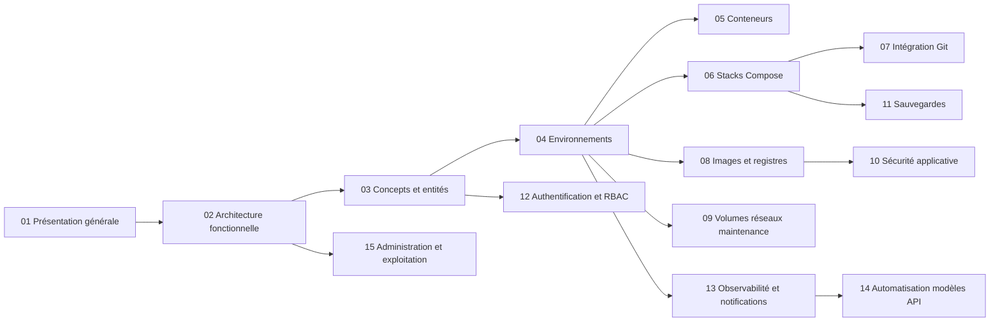

# Spécification fonctionnelle Dockhand — Document 0 : Chapitrage

## Objet du document

Ce document constitue le **sommaire de référence** de la future spécification fonctionnelle du logiciel Dockhand. Il définit la liste des chapitres, leur périmètre et leur ordre de lecture. Il ne contient volontairement pas le contenu détaillé : chaque chapitre sera rédigé dans un document dédié lors de la phase 2 de rédaction.

## Contexte

- **Logiciel analysé** : Dockhand, version **1.0.43** (numéro de version issu de `package.json`).
- **Date de l'analyse** : 21/08/2026.
- **Nature du logiciel** : Dockhand est une interface web de gestion Docker, auto-hébergeable, destinée à administrer des conteneurs, des stacks Compose et des hôtes Docker multiples depuis une console unique. Elle se compose d'un frontend SvelteKit 2 / Svelte 5, d'un backend Node/Bun exposant une API REST et des WebSockets, d'un collecteur Go (`collector/`) pour les métriques et événements, d'une base de données SQLite ou PostgreSQL via Drizzle ORM, et d'un sidecar de mise à jour (`updater/`).
- **Modèle de licence** : BSL 1.1 (gratuit pour usage personnel/interne/éducatif ; interdit en SaaS commercial ; conversion Apache 2.0 prévue). Fonctionnalités avancées (RBAC, audit, préférences par utilisateur) conditionnées à une licence Enterprise ou SMB activée par clé signée RSA.
- **Sources analysées** : `README.md`, `package.json`, `server.js`, `src/routes/` (pages et API), `src/lib/server/` (services), `src/lib/server/db/schema/` (schémas Drizzle SQLite et PostgreSQL), `drizzle/` et `drizzle-pg/` (migrations), `collector/main.go`, `updater/update.sh`, `scripts/emergency/`, `tests/`, `docs/`.

## Principes de structuration de la spécification

- La progression suit un ordre **du général au particulier** : présentation du produit, concepts et entités transverses, puis fonctions métier détaillées, enfin sujets transverses (sécurité, administration, API, exploitation).
- Chaque chapitre correspond à un document markdown indépendant de la série `01-`, `02-`, etc.
- Les numéros de chapitre sont définitifs : un chapitre ajouté ultérieurement sera suffixé (ex. `09-bis`) afin de préserver les références croisées.

## Chapitres proposés

### 01 — Présentation générale du produit

Présente Dockhand, son positionnement et ses objectifs fonctionnels de haut niveau : gestion visuelle et temps réel d'infrastructures Docker, orchestration de stacks Compose, multi-environnements. Décrit les utilisateurs cibles (administrateur d'hommelab, équipe ops interne), les cas d'usage principaux et le modèle de distribution (image Docker auto-hébergée, licence BSL/éditions Free et Enterprise/SMB).

- Positionnement, objectifs et propositions de valeur
- Utilisateurs et contextes d'usage cibles
- Cas d'usage majeurs (vue d'ensemble)
- Modèle de distribution, d'édition et de licence
- Glossaire de premier niveau et références (site, documentation, support)

### 02 — Architecture fonctionnelle et vue d'ensemble du système

Décrit la composition du système : frontend SvelteKit, backend SvelteKit API routes + `server.js` (HTTP/HTTPS, WebSockets), collecteur Go, bases SQLite/PostgreSQL, sidecar de mise à jour. Explique les flux majeurs entre ces composants et le Docker Engine (API Docker directe, agent Hawser). Introduit la carte des modules fonctionnels servant de fil conducteur aux chapitres suivants.

- Composants (frontend, backend, collector Go, updater, bases de données)
- Topologie de déploiement et flux entre composants
- Connexion à Docker : socket Unix, TCP direct, agent Hawser (standard/edge)
- Dualité SQLite / PostgreSQL et migrations Drizzle
- Carte des modules fonctionnels et correspondance avec les chapitres

### 03 — Concepts et entités métier

Définit le vocabulaire fonctionnel et le modèle de données conceptuel : environnement, conteneur, image, volume, réseau, stack, source de stack, variable d'environnement de stack, mise à jour en attente, planification, sauvegarde, destination de sauvegarde, jetons, utilisateurs/rôles. Précise les relations et les cycles de vie des entités principales.

- Environnement Docker (entité pivot)
- Conteneur, image, réseau, volume (objets Docker maniés par Dockhand)
- Stack Compose, source de stack (interne/Git), variables d'environnement, fichiers synchronisés
- Registres d'images et credentials de registre
- Mises à jour en attente (digest et semver)
- Planifications et exécutions de tâches planifiées
- Destinations et configurations de sauvegarde, snapshots
- Utilisateurs, sessions, rôles, jetons (API/Hawser)
- Événements, métriques, journaux d'audit

### 04 — Environnements et connexions aux hôtes Docker

Détaillie la gestion des environnements : ajout, modification, suppression, types de connexion (socket local, TCP direct avec TLS optionnel, agent Hawser standard ou edge), états en ligne/hors ligne, libellés et icônes, options de collecte (activité, métriques, mise en évidence des changements). Couvre la supervision de santé des connexions et l'agent Hawser (protocole WebSocket, capacités, battements de cœur).

- Création et paramétrage d'un environnement (type de connexion, TLS, options)
- Connexions socket, TCP direct, Hawser standard et Hawser edge
- Cycle de vie et états d'un environnement ; détection hors-ligne
- Agent Hawser : jalon de protocole, capacités, jetons d'agent, sécurité
- Libellés, icônes et préférences d'affichage
- Sécurité des jetons Hawser et périmètre d'accès

### 05 — Gestion des conteneurs

Décrit la fonction centrale : inventaire temps réel des conteneurs, démarrage/arrêt/redémarrage/suppression, accès aux détails (inspection), statistiques, gestion de l'état de santé. Couvre les fonctions interactives : streaming des journaux avec filtres, terminal interactif (exec via WebSocket/xterm), navigateur de fichiers du conteneur (parcours, édition, téléversement, téléchargement), recreate avec fusion d'environnement/labels.

- Inventaire et supervision temps réel (statut, santé, ports, ressources)
- Cycle de vie : start, stop, restart, pause, remove, recreate
- Journaux : streaming, filtres, recherche, favoris
- Terminal interactif dans le conteneur (exec)
- Navigateur de fichiers conteneur (parcours, édition, upload/download)
- Batch : opérations groupées sur plusieurs conteneurs
- Suivi des mises à jour d'image en attente (indicateur, actions)

### 06 — Stacks Compose

Détaillie la gestion des stacks Docker Compose : création depuis l'éditeur YAML, déploiement, redéploiement, arrêt et suppression sécurisée (gardes-fous), variables d'environnement par stack, éditeur graphique de topologie (services, réseaux, volumes, secrets). Couvre la validation des fichiers Compose, le graphe de réseau et les options de déploiement.

- Création et édition d'une stack (éditeur YAML, assistant, éditeur graphique)
- Déploiement, redéploiement et options (build, pull, force)
- Variables d'environnement de stack (valeurs secrètes masquées)
- Validation Compose (règles, vocabulaire, contexte effectif)
- Suppression protégée (garde-fous anti-suppression)
- Visualisation : graphe de réseau, pile par pile
- Fichiers de stack et chemins associés sur l'hôte

### 07 — Intégration Git

Décrit le déploiement de stacks depuis des dépôts Git : credentials (none, HTTPS, SSH), dépôts et stacks Git (branche, chemin Compose, fichier .env, répertoire de contexte), synchronisation manuelle et automatique (planification), webhooks signés, suivi de l'état de synchronisation (commit, statut, erreurs) et manifeste des fichiers synchronisés.

- Credentials Git (HTTPS, SSH avec passphrase)
- Dépôts Git et paramètres de synchronisation
- Stacks Git : chemins, contexte, options de déploiement (build, no-cache, repull, force)
- Synchronisation : manuelle, planifiée (cron), auto-update
- Webhooks de déploiement et vérification de signature
- État de synchronisation, historique, erreurs et fichiers synchronisés
- Sécurité (validation d'URL, isolation des chemins)

### 08 — Images, registres et gestion des mises à jour

Couvre la gestion des images : inventaire (tags, tailles, couches, usage), pull, suppression, nettoyage des images inutilisées (prune), gestion multi-instances. Décrit les registres (authentification, registre par défaut, catalogue distant) et le suivi des mises à jour d'images : détection par digest, suggestions semver pour images épinglées, mise à jour automatique planifiée avec critères (y compris critères de vulnérabilités).

- Inventaire et inspection d'images (couches, taille, conteneurs associés)
- Pull, suppression, prune d'images
- Registres : ajout, credentials, registre par défaut, catalogue
- Détection de mises à jour (digest, tags semver)
- Auto-update de conteneurs : planification, critères de vulnérabilités
- Mises à jour en attente : consultation, application, report

### 09 — Volumes, réseaux et maintenance système

Détaillie la gestion des volumes et réseaux : inventaire, création, suppression, prune (avec protections), navigateur de fichiers de volume. Couvre la maintenance système de l'hôte Docker : informations système, usage disque, nettoyages planifiés (conteneurs/volumes/réseaux images orphelins), helpers de volume et leur recyclage.

- Volumes : inventaire, création, suppression, prune protégé
- Navigateur de fichiers de volume
- Réseaux : inventaire, création, suppression, prune
- Informations système de l'hôte (version Docker, OS, ressources)
- Nettoyage système et planifications de maintenance
- Helpers de volume : cycle de vie, protections, purge

### 10 — Sécurité applicative : scans de vulnérabilités et secrets

Décrit les fonctions de sécurité applicative : scans d'images via Grype et Trivy (conteneurs de scan réutilisables, files d'attente, cache), tableau de bord des vulnérabilités (filtrage, export), notifications associées. Couvre les fournisseurs de secrets externes (1Password Connect, Infisical, HashiCorp Vault, Doppler, Bitwarden, Proton, Service Account) : configuration, test de connexion, injection lors du déploiement, masquage des valeurs.

- Scans d'images : Grype, Trivy, double scanner, planification
- File de scan, cache des résultats, fraîcheur des données
- Tableau de bord vulnérabilités : vues, filtres, export
- Critères de vulnérabilités appliqués à l'auto-update
- Fournisseurs de secrets : types supportés et configuration
- Test de connexion, sondes, cache
- Injection de secrets au déploiement et masquage (clés injectées)

### 11 — Sauvegardes et restauration (bêta)

Décrit le sous-système de sauvegarde reposant sur restic : destinations (dépôt restic, mot de passe chiffré, variables d'environnement, politiques), configurations de sauvegarde (conteneur ou stack, volumes ciblés, arrêt avant sauvegarde, planification, rétention, options), exécution et suivi des jobs, snapshots (parcours, diff, restauration partielle ou complète), maintenance des dépôts (prune, check, verify), sécurité et cloisonnement par instance/environnement.

- Destinations restic : paramètres, chiffrement, test de connexion
- Configurations de sauvegarde : cibles, volumes, planification, rétention
- Exécutions : suivi, annulation, statuts, code d'erreurs
- Snapshots : liste, parcours de fichiers, diff, métadonnées
- Restauration : prévisualisation, restauration sélective, redéploiement de stack
- Maintenance de dépôt : prune, check, verify, auto-unlock
- Sécurité : balisage par instance, portée environnement (Enterprise)
- Statut bêta : activation par variable d'environnement

### 12 — Authentification, utilisateurs et contrôle d'accès (RBAC)

Décrit l'authentification : comptes locaux (Argon2id), SSO via OIDC multiple, LDAP/AD, MFA TOTP avec codes de secours, sessions (cookies HttpOnly, expiration), mode authentification désactivée. Puis le contrôle d'accès : rôles et permissions par domaine fonctionnel, portée par environnement, mappings de rôles depuis OIDC/LDAP, différences Free vs Enterprise, jetons d'API personnels, scripts d'administration des accès en urgence.

- Comptes locaux : création, mot de passe (Argon2id), profil, avatar
- SSO OIDC : fournisseurs multiples, découverte, claims, mappings de rôles
- LDAP/AD : configuration, filtres, groupes, TLS
- MFA : TOTP, codes de secours, activation par utilisateur
- Sessions : cookies, expiration, révocation, script de purge
- Rôles et permissions : structure, rôles système, portée environnement
- Free vs Enterprise : périmètre effectif des droits
- Jetons d'API : création, usage, expiration, préfixe
- Procédures d'urgence : create-admin, reset-password, disable-auth, list-users

### 13 — Observabilité : tableaux de bord, activité, audit, événements et notifications

Couvre l'observabilité fonctionnelle : tableau de bord personnalisable (tuiles d'environnement, vues), flux d'activité des conteneurs, journal d'audit (Enterprise), journalisation des événements de stack, collecte des métriques (CPU/mémoire/disque via collecteur Go, historique), export Prometheus, et le système de notifications multi-canaux (SMTP, Discord, Slack, Telegram, Gotify, ntfy, Bark, Signal, Apprise, Pushover, webhook générique, workflows GitHub, Zabbix, Mattermost) avec routage par type d'événement et par environnement.

- Tableau de bord : tuiles, disposition, préférences, filtres par libellé
- Activité des conteneurs : flux temps réel, filtres, surlignage des changements
- Journal d'audit : contenu, consultation, portée (Enterprise)
- Événements de stack et historique
- Métriques : collecte Go, stockage, historique, fraîcheur
- Export Prometheus / endpoint de métriques
- Notifications : canaux supportés, configuration, test
- Routage des notifications par type d'événement et par environnement
- Masquage par label de conteneur

### 14 — Automatisation : planificateur, modèles et API

Décrit l'automatisation : planificateur unifié (cron via croner) couvrant auto-update de conteneurs, synchronisation Git, prune d'images, sauvegardes, maintenance de dépôts, nettoyages système (exécutions, événements, helpers, cache scanner), fuseau horaire. Couvre la bibliothèque de modèles de stacks (sources de templates compatibles Portainer, sources personnalisées) et l'API REST documentée par OpenAPI (activation, jetons, surface de l'API, viewer Scalar).

- Planificateur unifié : types de tâches, cycles de vie des jobs
- Exécutions planifiées : statuts, journaux, historique, rétention
- Fuseaux horaires et planifications par environnement
- Bibliothèque de modèles : sources intégrées, ajout de sources, déploiement depuis un modèle
- API REST : activation des docs, authentification par jeton, périmètre
- Spécification OpenAPI et viewer intégré
- Webhooks entrants (Git, sauvegardes) et signatures

### 15 — Administration, exploitation et cycle de vie de l'application

Regroupe les fonctions d'administration transverses : réglages généraux et préférences (thème, police, colonnes de grilles, sidebar), réglages par environnement (onglets activité/mises à jour/sauvegardes, types d'événements), gestion de licence (activation, expiration, notifications), auto-mise à jour de Dockhand (sidecar updater), endpoints de santé et diagnostic, pages légales générées, journal des modifications, opérations d'urgence sur base de données (sauvegarde/restauration/réinitialisation), configuration au démarrage (variables d'environnement, HTTPS natif, HSTS).

- Réglages généraux et préférences utilisateur (thème, disposition, grilles)
- Réglages par environnement et types d'événements collectés
- Gestion de licence : activation, désactivation, alertes d'expiration
- Auto-mise à jour de l'application (sidecar, remplacement de conteneur)
- Santé et diagnostic : endpoints de santé, debug, dépendances
- Changelog et pages légales générées
- Outils d'urgence base de données (backup, restore, reset, sessions)
- Configuration au démarrage : variables d'environnement, HTTPS/HSTS, feature flags

## Ordre de lecture recommandé

1. **Fondations (01 → 03)** : compréhension du produit, de son architecture et de son vocabulaire.
2. **Fonctions métier (04 → 11)** : les grandes fonctions au gré d'une lecture recommandée — environnements d'abord, puis conteneurs et stacks (cœurs du produit), intégrations (Git, registres), ressources (volumes/réseaux), sécurité applicative et sauvegardes.
3. **Transverse (12 → 15)** : sécurité des accès, observabilité, automatisation, administration et exploitation.

## Règles de rédaction pour la phase 2

- Chaque chapitre est un document distinct nommé `NN-titre.md` dans `docs/spec/`.
- Chaque chapitre commence par un rappel du contexte, du périmètre et des prérequis de lecture.
- Les descriptions fonctionnelles s'appuient sur les chemins de code sources (routes, services, schémas) pour garantir la traçabilité.
- Les comportements spécifiques à une édition (Free / SMB / Enterprise) sont explicitement signalés.
- Les fonctionnalités gated par feature flag (sauvegardes bêta, docs API) sont signalées comme telles.
