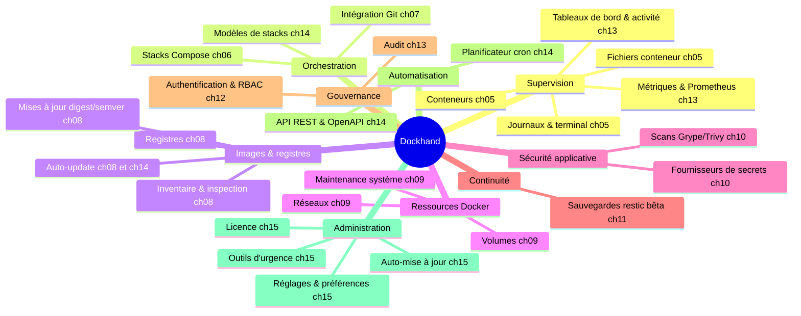

# Spécification fonctionnelle Dockhand — Chapitre 01 : Présentation générale du produit

| Rubrique | Valeur |
|---|---|
| **Chapitre** | 01 — Présentation générale du produit |
| **Document de référence** | [`00-chapitrage.md`](00-chapitrage.md) |

## Table des matières

1. [Objet et rappel du contexte](#1-objet-et-rappel-du-contexte)
2. [Positionnement et objectifs fonctionnels](#2-positionnement-et-objectifs-fonctionnels)
3. [Propositions de valeur](#3-propositions-de-valeur)
4. [Utilisateurs et contextes d'usage cibles](#4-utilisateurs-et-contextes-dusage-cibles)
5. [Cas d'usage majeurs](#5-cas-d-usage-majeurs)
6. [Périmètre fonctionnel couvert](#6-périmètre-fonctionnel-couvert)
7. [Modèle de distribution, d'édition et de licence](#7-modèle-de-distribution-dédition-et-de-licence)
8. [Ce que Dockhand n'est pas](#8-ce-que-dockhand-nest-pas)
9. [Glossaire de premier niveau](#9-glossaire-de-premier-niveau)
10. [Références et ressources](#10-références-et-ressources)
11. [Renvois vers les autres chapitres](#11-renvois-vers-les-autres-chapitres)

---

## 1. Objet et rappel du contexte

Ce chapitre introduit le produit Dockhand : ce qu'il est, à qui il s'adresse, ce qu'il couvre fonctionnellement et selon quel modèle il est distribué et licencié. Il pose le vocabulaire de premier niveau utilisé dans toute la spécification. Il ne décrit ni l'architecture interne (chapitre 02) ni le détail des concepts et entités (chapitre 03).

**Rappel du contexte** (conforme au chapitrage) :

- Dockhand est une **interface web de gestion Docker, auto-hébergeable**, destinée à administrer des conteneurs, des stacks Compose et des hôtes Docker multiples depuis une console unique.
- Le produit se compose d'une **SPA Vue 3.5** construite avec Vite (Vue Router, Pinia, PrimeVue 4, TailwindCSS), d'un **backend Python 3.13 / FastAPI** servi par Uvicorn (API REST, WebSockets Starlette, SSE sse-starlette, planificateur APScheduler), d'une **couche de collecte Docker intégrée au backend** (tâches asyncio + aiodocker), d'une base de données **SQLite ou PostgreSQL** via **SQLAlchemy 2.0** (migrations Alembic unifiées), et d'un sidecar de mise à jour (**« image updater »**).
- Les hôtes Docker distants sont administrés via un **remote shell SSH** (AsyncSSH, clés ed25519 recommandé) exécutant le CLI docker sur l'hôte distant.
- Le modèle de licence est **BSL 1.1**, avec des fonctionnalités avancées (RBAC, audit, préférences par utilisateur) conditionnées à une licence **Enterprise** ou **SMB** activée par clé signée RSA.

## 2. Positionnement et objectifs fonctionnels

Dockhand se positionne comme une **console unique de supervision et de pilotage d'infrastructures Docker**, auto-hébergée par l'administrateur lui-même, par opposition à une offre en SaaS : gestion visuelle et temps réel de conteneurs, orchestration de stacks Compose et prise en charge multi-environnements, dans un paquet léger, sûr et respectueux de la vie privée.

Les objectifs fonctionnels de haut niveau sont :

1. **Gestion visuelle et temps réel des conteneurs** — inventaire vivant, statuts, santé, ressources, journaux, terminal, fichiers ; actions de cycle de vie immédiates.
2. **Orchestration de stacks Docker Compose** — création via éditeur YAML (CodeMirror 6) ou éditeur graphique, déploiement/redéploiement, variables d'environnement, visualisation du graphe de réseau éditable (Vue Flow).
3. **Multi-environnements** — administration de plusieurs hôtes Docker (local et distants) depuis une seule interface : socket Unix, socket-proxy, TCP/TLS direct, ou **remote shell SSH** vers l'hôte distant.
4. **Automatisation de la maintenance** — mises à jour d'images (digest + semver), synchronisation Git planifiée, prunes, sauvegardes restic (bêta), planificateur cron unifié (APScheduler).
5. **Sécurité applicative** — scans de vulnérabilités d'images (Grype/Trivy), gestion de secrets externes (fournisseurs tiers), critères de vulnérabilités appliqués à l'auto-update.
6. **Observabilité intégrée** — tableaux de bord, flux d'activité, métriques d'hôtes, journal d'audit (Enterprise), notifications multi-canaux (apprise).

## 3. Propositions de valeur

| Proposition de valeur | Traduction fonctionnelle |
|---|---|
| **Temps réel** | Streaming des journaux (SSE), terminal interactif (WebSocket + xterm.js), flux d'activité des conteneurs et métriques rafraîchies sans rechargement. |
| **Légèreté** | Un unique conteneur Dockhand (image `python:3.13-slim` multi-stage, dépendances explicites), base SQLite embarquée par défaut, collecte Docker assurée par des tâches asyncio intégrées au backend — pas de processus de collecte séparé. |
| **Sécurité et respect de la vie privée** | Auto-hébergement intégral (aucun appel sortant obligatoire), authentification locale/SSO/LDAP, MFA, secrets chiffrés au repos, webhooks signés, masquage des valeurs secrètes. |
| **Console unique multi-hôtes** | Un point d'entrée pour tous les hôtes Docker, y compris distants : connexions SSH sortantes du serveur vers les hôtes (remote shell), sans agent dédié ni ouverture de l'API Docker sur le réseau. |
| **Automatisation clé en main** | Planificateur cron unifié (APScheduler) couvrant auto-update, sync Git, prunes, sauvegardes et maintenances de dépôts ; webhooks de déploiement signés (formats GitHub/Gitea/Forgejo/GitLab). |
| **Graduation commerciale claire** | Fonctions collaboratives (RBAC, audit, préférences par utilisateur) réservées aux éditions SMB/Enterprise ; cœur complet en Free. |

## 4. Utilisateurs et contextes d'usage cibles

### 4.1 Personas cibles

| Persona | Description | Usage dominant |
|---|---|---|
| **Administrateur d'homelab** | Particulier gérant un ou plusieurs serveurs personnels (NAS, mini-PC, Raspberry Pi) hébergeant des services auto-hébergés. | Supervision temps réel, déploiement de stacks depuis des templates, mises à jour d'images, sauvegardes. |
| **Équipe ops / IT interne** | Petite équipe gérant l'infrastructure Docker interne d'une organisation (staging/production internes). | Multi-environnements, GitOps léger (sync Git + webhooks), scans de vulnérabilités, notifications, RBAC (éditions payantes). |
| **MSP (fournisseur de services gérés)** | Prestataire gérant l'infrastructure Docker de ses clients, sans revendre Dockhand lui-même comme service. | Multi-hôtes via remote shell SSH, cloisonnement par environnement, audit (usage permis par la BSL, cf. §7.1). |
| **Évaluateur / éducateur** | Découvreur du produit, environnement pédagogique ou de test. | Prise en main rapide, mode sans authentification possible, documentation intégrée (changelog, pages légales). |

### 4.2 Contextes d'usage

- **Mono-poste local** : Dockhand accède au Docker Engine de sa propre machine hôte via le socket Unix monté dans le conteneur (ou via un socket-proxy durci).
- **Fleet multi-hôtes** : plusieurs environnements déclarés ; certains locaux (socket/socket-proxy), d'autres distants (TCP/TLS direct) ou administrés par remote shell SSH.
- **Exploitation automatisée / tiers** : pilotage par API REST (jetons d'API personnels) et webhooks entrants ; documentation OpenAPI opt-in (générée nativement par FastAPI).
- **Mode dégradé/urgence** : commandes d'administration hors interface (create-admin, reset-password, disable-auth, sauvegarde/restauration de base) utilisables en ligne de commande.

## 5. Cas d'usage majeurs

Les cas d'usage détaillés par fonction sont renvoyés aux chapitres 04 à 15. En vision d'ensemble :

1. **Superviser et piloter ses conteneurs** — « Je vois l'état de tous mes conteneurs en temps réel et je peux les démarrer, arrêter, redémarrer, recréer ou supprimer, consulter leurs journaux, ouvrir un shell, parcourir leurs fichiers. » *(ch. 05)*
2. **Déployer une application multi-conteneurs** — « Je décris ma stack Compose en YAML (ou via l'éditeur graphique), je la déploie, je la redéploie avec de nouvelles variables, je la supprime avec garde-fous. » *(ch. 06)*
3. **Synchroniser mes stacks depuis Git** — « Mes stacks vivent dans un dépôt Git ; Dockhand les synchronise selon un planning cron ou sur webhook signé, et me montre l'état de synchro et les fichiers synchronisés. » *(ch. 07)*
4. **Garder mes images à jour et propres** — « Dockhand détecte les mises à jour d'images (digest ou nouveau tag semver), me propose de les appliquer, peut automatiser la mise à jour selon des critères de vulnérabilités, et prunit les images inutilisées. » *(ch. 08)*
5. **Exploiter volumes et réseaux** — inventaire, création, suppression, prune protégé, navigateur de fichiers de volume, informations système de l'hôte. *(ch. 09)*
6. **Sécuriser mes déploiements** — scans Grype/Trivy planifiés, tableau de bord des vulnérabilités, injection de secrets depuis des fournisseurs externes (1Password, Vault, etc.). *(ch. 10)*
7. **Sauvegarder et restaurer** — sauvegardes restic de conteneurs/stacks vers des destinations chiffrées, snapshots parcourables, restauration sélective. *(ch. 11, bêta)*
8. **Gérer les accès** — comptes locaux, SSO OIDC, LDAP/AD, MFA TOTP, RBAC à portée environnement (éditions payantes), jetons d'API. *(ch. 12)*
9. **Observer et être alerté** — tableau de bord personnalisable, flux d'activité, audit (Enterprise), métriques Prometheus, notifications routées par événement et par environnement. *(ch. 13)*
10. **Automatiser** — planificateur unifié (auto-update, sync Git, prune, sauvegardes, nettoyages), bibliothèque de modèles de stacks, API REST documentée. *(ch. 14)*
11. **Administrer l'outil lui-même** — réglages et préférences, licence, auto-mise à jour par sidecar « image updater », santé/diagnostic, outils d'urgence base de données, configuration au démarrage. *(ch. 15)*

## 6. Périmètre fonctionnel couvert

La carte ci-dessous donne la vue d'ensemble des modules fonctionnels et leur correspondance avec les chapitres détaillés (le détail architectural fait l'objet du chapitre 02).

### 6.1 Synthèse des modules

| Domaine | Fonctions couvertes | Chapitre |
|---|---|---|
| Environnements | Ajout/modification/suppression d'hôtes Docker ; socket, socket-proxy, TCP/TLS direct, remote shell SSH ; états en ligne/hors-ligne ; libellés, icônes ; options de collecte | 04 |
| Conteneurs | Inventaire temps réel, cycle de vie (start/stop/restart/pause/remove/recreate), détails/inspection, journaux, terminal exec, navigateur de fichiers, opérations groupées | 05 |
| Stacks Compose | Éditeur YAML (CodeMirror 6) + éditeur graphique, déploiement et options, variables d'environnement (valeurs secrètes masquées), validation, suppression protégée, graphe de réseau éditable (Vue Flow) | 06 |
| Intégration Git | Credentials HTTPS/SSH, dépôts, stacks Git (chemins, contexte, options), sync manuelle/planifiée/webhook, état et historique de synchronisation, fichiers synchronisés | 07 |
| Images & registres | Inventaire/inspection, pull/suppression/prune, registres (credentials, registre par défaut, catalogue), détection de mises à jour, auto-update | 08 |
| Volumes/réseaux/système | Inventaires, création/suppression/prune protégé, navigateur de fichiers de volume, infos système, nettoyages planifiés, helpers de volume | 09 |
| Vulnérabilités & secrets | Scans Grype/Trivy (file d'attente, cache), tableau de bord, critères pour auto-update ; fournisseurs de secrets (test de connexion, injection, masquage) | 10 |
| Sauvegardes (bêta) | Destinations restic chiffrées, configurations de sauvegarde, exécutions suivies, snapshots, restauration, maintenance de dépôts | 11 |
| Authentification & RBAC | Comptes locaux Argon2id, OIDC multiple, LDAP/AD, MFA TOTP, sessions, rôles/permissions par environnement, jetons d'API, procédures d'urgence | 12 |
| Observabilité | Tableau de bord personnalisable, activité, audit (Enterprise), événements de stack, métriques, export Prometheus, notifications multi-canaux routées (apprise) | 13 |
| Automatisation | Planificateur unifié (APScheduler), exécutions et historique, fuseaux horaires IANA, bibliothèque de modèles, API REST/OpenAPI, webhooks entrants signés | 14 |
| Administration | Réglages généraux et par environnement, préférences, licence, auto-mise à jour (sidecar), santé/diagnostic, changelog, pages légales, outillage d'urgence, configuration démarrage (HTTPS/HSTS, feature flags) | 15 |

## 7. Modèle de distribution, d'édition et de licence

### 7.1 Licence BSL 1.1

Dockhand est distribué sous **Business Source License 1.1**. Paramètres notables :

- **Licencier** : l'éditeur du produit Dockhand.
- **Usage additionnel accordé (Additional Use Grant)** : usage libre y compris en production, à l'exclusion de l'offre de Dockhand (ou d'une œuvre dérivée) à des tiers **comme service hébergé commercial / SaaS / service géré** dont la proposition de valeur principale est la gestion de conteneurs Docker.
- **Usages explicitement permis sans restriction** : usage personnel (homelabs et projets de loisir), usage interne en organisation (quel que soit le nombre d'environnements), associations à but non lucratif, usages éducatifs/académiques/recherche, évaluation/test/développement/démonstration, intégration dans des outils internes non commercialisés, et usage par des **MSP** gérant l'infrastructure Docker de leurs clients tant que le MSP n'offre pas Dockhand lui-même comme le service.
- **Change Date** : à cette date, le logiciel devient **Apache License 2.0**.

### 7.2 Éditions et activation

Le modèle d'édition est trilogique ; il repose sur une **clé de licence signée RSA-SHA256** (vérification cryptographique via la bibliothèque `cryptography`) vérifiée par une clé publique intégrée au produit :

| Édition | Activation | Débloque |
|---|---|---|
| **Free** | Aucune clé requise | L'intégralité du cœur fonctionnel (environnements, conteneurs, stacks, Git, images/registres, volumes/réseaux, scans, notifications, planificateur, API, sauvegardes bêta via flag). Le contrôle d'accès effectif est alors de type « administrateur unique / confiance accordée » : sans licence Enterprise, les fonctions RBAC, audit et préférences par utilisateur ne sont pas actives. |
| **SMB** | Clé signée de type `smb` | Fonctions intermédiaires ; ne débloque **pas** les fonctions Enterprise. |
| **Enterprise** | Clé signée de type `enterprise` | RBAC complet (rôles, permissions, portée par environnement), journal d'audit, préférences par utilisateur. |

Caractéristiques fonctionnelles de la licence :

- **Format** : `payloadBase64.signature` (payload JSON encodé base64url + signature RSA-SHA256).
- **Contenu signé** : nom du licencié, hôte autorisé (avec jokers `*.domaine`), dates d'émission/expiration, type (`enterprise`|`smb`), version de format (`v: 2` = signé RSA).
- **Contrôles à l'activation et à chaque vérification** : signature valide, expiration non atteinte, concordance du nom, adéquation du hostname (détection Docker-aware via la variable dédiée, sinon nom d'hôte du système).
- **Cycle de vie** : activation/désactivation via les réglages ; vérification d'expiration quotidienne avec notification d'alerte à **J-30** et anti-spam de 24 h.
- **Fonctions signalées « Enterprise » dans cette spécification** : RBAC, audit, préférences utilisateur individualisées, portée environnement des sauvegardes (voir chapitres concernés).

### 7.3 Feature flags (activation par variable d'environnement)

Deux fonctionnalités sont livrées « éteintes » et activables par instance :

| Flag | Fonction | Motif |
|---|---|---|
| `FEAT_BACKUPS_ENABLED=true` | Sauvegardes conteneurs/stacks (restic) — **statut bêta** | Fonction jeune, mise en production progressive |
| `FEAT_API_DOCS=true` | Documentation API OpenAPI + viewer Scalar (`/api/docs`) | Routes non authentifiées : exposition opt-in de la surface d'API |

Dans toute la spécification, ces fonctions sont signalées comme **gated par feature flag**.

### 7.4 Distribution

- **Vecteur principal** : image Docker auto-hébergée à base **`python:3.13-slim`** avec build **multi-stage** (construction du frontend Vue avec Node/pnpm, puis image d'exécution Python légère ; dépendances explicitement déclarées).
- **Point d'entrée applicatif** : le backend FastAPI servi par **Uvicorn** (ASGI), HTTPS optionnel ; le conteneur inclut le script d'entrée `docker-entrypoint.sh` (configuration **PUID/PGID**) et les outils d'exploitation.
- **Mise à jour** : sidecar d'auto-mise à jour (**« image updater »**) remplaçant le conteneur Dockhand (pré-création du remplaçant, stop/rm/rename/reconnect networks/start/vérification). Voir chapitre 15.
- **Fichiers complémentaires** : un service compose **PostgreSQL** (`postgres:16-alpine`) pour un déploiement PostgreSQL optionnel ; bascule SQLite/PostgreSQL par `DATABASE_URL`.
- **Outillage de développement** : **pnpm** pour le frontend, **pytest** pour les tests backend.

## 8. Ce que Dockhand n'est pas

Pour borner l'interprétation du périmètre :

- **Pas un SaaS** : pas d'offre hébergée par l'éditeur ; chaque instance est exploitée par son administrateur (la revente en SaaS est interdite par la BSL).
- **Pas un orchestrateur distribué** : Dockhand pilote des hôtes Docker individuels et des stacks Compose ; il ne remplace pas Kubernetes/Swarm (pas de scheduling multi-nœuds d'un même service).
- **Pas un CI/CD complet** : l'intégration Git se limite au déploiement de stacks Compose (sync, webhooks) ; pas de pipeline de build applicatif générique (le build Docker est toutefois possible lors d'un déploiement de stack).
- **Pas un SIEM** : l'audit et les scans de vulnérabilités sont des fonctions opérationnelles intégrées, pas une gestion de sécurité centralisée.

## 9. Glossaire de premier niveau

Le vocabulaire complet des entités fait l'objet du chapitre 03. Ce glossaire se limite aux termes indispensables à la lecture des chapitres 01 et 02.

| Terme | Définition |
|---|---|
| **Environnement** | Un hôte Docker administré par Dockhand (local ou distant), identifié par son nom, son mode de connexion (socket, socket-proxy, direct, remote shell SSH) et ses options de collecte. Entité pivot du produit. |
| **Conteneur** | Instance d'image en cours d'exécution (ou arrêtée) sur un environnement, maniée via l'API Docker. |
| **Stack** | Application multi-conteneurs décrite par un fichier Docker Compose, déployée et gérée comme un tout nommé, au sein d'un environnement. |
| **Remote shell** | Mécanisme d'administration d'un hôte Docker distant : Dockhand ouvre une connexion **SSH sortante** (AsyncSSH) vers l'hôte et y exécute le CLI docker. Authentification par clés SSH (ed25519 recommandé) ; aucun agent dédié ni jeton maison. |
| **Digest** | Empreinte cryptographique identifiant de manière immuable une image de registre ; utilisée pour détecter les mises à jour d'images « flottantes » (ex. `latest`). |
| **Semver** | Versionnement sémantique (Majeur.Mineur.Patch) ; utilisé pour suggérer les nouveaux tags d'images épinglées (suggestion indicative, jamais appliquée automatiquement). |
| **Mise à jour en attente** | État signalant qu'un conteneur a une image plus récente disponible (digest différent ou tag semver supérieur), en attente d'action de l'administrateur ou de l'auto-update. |
| **Prune** | Nettoyage des ressources Docker orphelines/inutilisées (images, conteneurs, volumes, réseaux) avec protections contre les suppressions dangereuses. |
| **restic** | Outil de sauvegarde chiffrée, dédupliqué, utilisé par le sous-système de sauvegarde de Dockhand (bêta). |
| **RBAC** | *Role-Based Access Control* : contrôle d'accès par rôles dotés de permissions par domaine fonctionnel et d'une portée par environnement (éditions SMB/Enterprise). |
| **OIDC** | *OpenID Connect* : protocole de SSO supporté avec fournisseurs multiples et mapping de rôles. |
| **Audit** | Journal horodaté des actions des utilisateurs (qui, quoi, où, quand, depuis quelle IP), consultable en Enterprise. |
| **Feature flag** | Variable d'environnement activant une fonction livrée « éteinte » par défaut (ex. `FEAT_BACKUPS_ENABLED`). |
| **BSL 1.1** | *Business Source License 1.1* : licence du produit, convertie en Apache 2.0 à la Change Date. |
| **Image updater** | Conteneur sidecar chargé du remplacement du conteneur Dockhand lors d'une auto-mise à jour. |
| **Webhook signé** | Point d'entrée HTTP déclenchant une action (déploiement Git, sauvegarde) dont la charge utile est authentifiée par signature. |
| **SSE** | *Server-Sent Events* : canal HTTP unidirectionnel serveur→navigateur (via sse-starlette) utilisé pour les flux temps réel (activité, audit, journaux, statistiques de tableau de bord). |
| **WebSocket** | Canal bidirectionnel (natif Starlette) utilisé pour le terminal interactif (exec) et les flux interactifs navigateur↔serveur. |

## 10. Références et ressources

- **Documentation utilisateur** : manuel intégré au site du produit.
- **Texte de licence** : fichier de licence distribué avec le produit (BSL 1.1).
- **Journal des modifications** : intégré au produit (données de changelog rendues dans l'interface, chapitre 15).
- **Documentation API** : spécification **OpenAPI 3.0 générée nativement par FastAPI**, viewer Scalar opt-in (chapitre 14).
- **Pages légales** : générées à partir des métadonnées du produit (chapitre 15).

## 11. Renvois vers les autres chapitres

| Chapitre | Lien | Pourquoi y aller |
|---|---|---|
| 00 — Chapitrage | [`00-chapitrage.md`](00-chapitrage.md) | Sommaire de référence, périmètre et règles de rédaction. |
| 02 — Architecture fonctionnelle | [`02-architecture-fonctionnelle.md`](02-architecture-fonctionnelle.md) | Composition du système, flux, canaux de communication, stockage. |
| 03 — Concepts et entités | [`03-concepts-entites.md`](03-concepts-entites.md) | Dictionnaire complet du vocabulaire métier et modèle de données conceptuel. |
| 07 — Intégration Git | [`07-git.md`](07-git.md) | Détail des webhooks signés et de la synchronisation. |
| 11 — Sauvegardes (bêta) | [`11-sauvegardes.md`](11-sauvegardes.md) | Statut bêta et activation par `FEAT_BACKUPS_ENABLED`. |
| 12 — Authentification et RBAC | [`12-authentification-rbac.md`](12-authentification-rbac.md) | Périmètre exact du gating SMB/Enterprise. |
| 15 — Administration et exploitation | [`15-administration-exploitation.md`](15-administration-exploitation.md) | Gestion de licence, auto-mise à jour, configuration au démarrage. |
