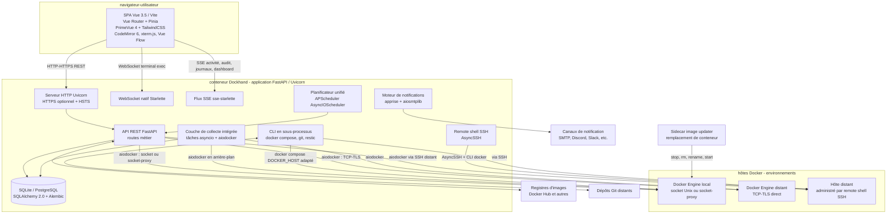
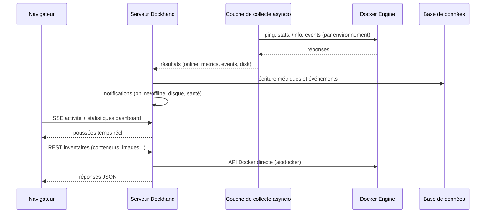
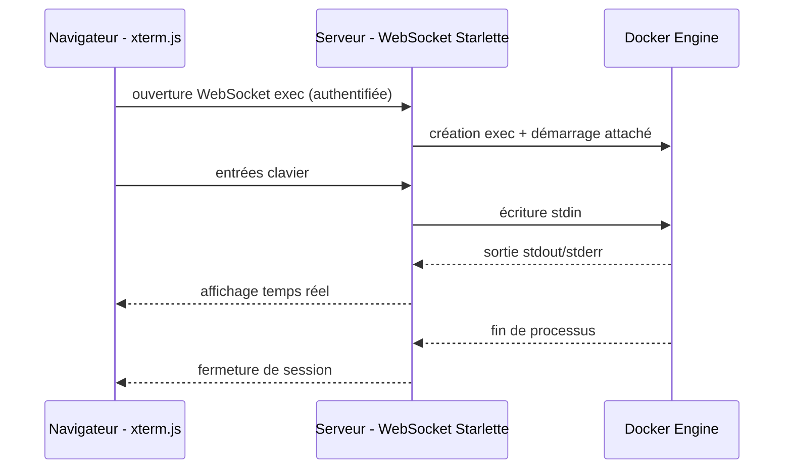
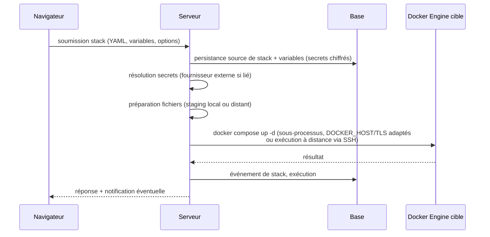
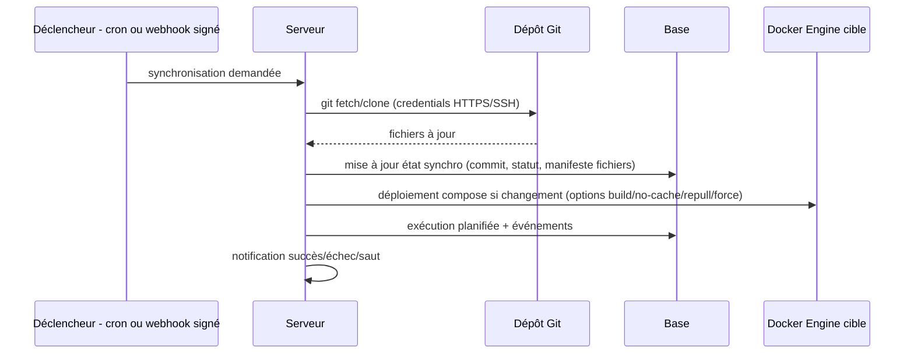
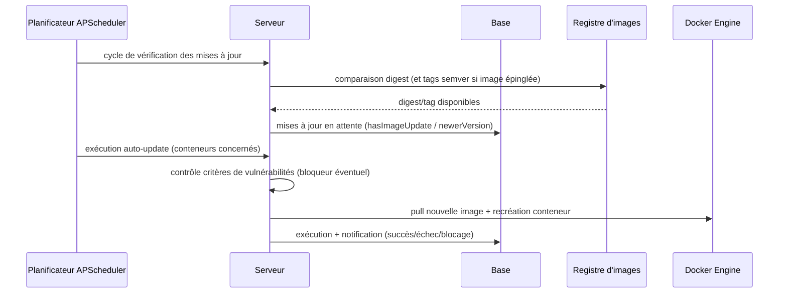
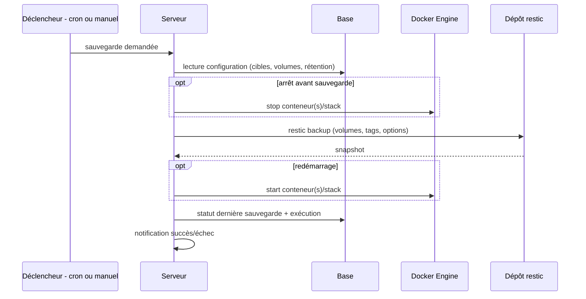
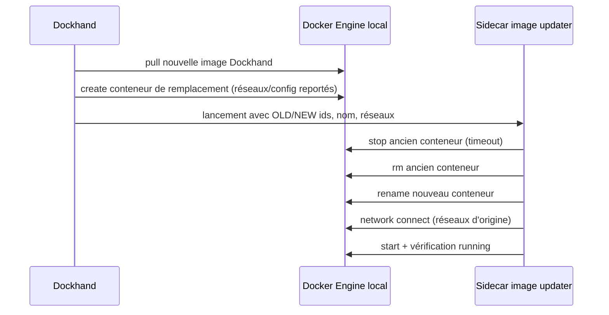

# Spécification fonctionnelle Dockhand — Chapitre 02 : Architecture fonctionnelle et vue d'ensemble du système

| Rubrique | Valeur |
|---|---|
| **Chapitre** | 02 — Architecture fonctionnelle et vue d'ensemble du système |
| **Document de référence** | [`00-chapitrage.md`](00-chapitrage.md) |

## Table des matières

1. [Objet, périmètre et prérequis de lecture](#1-objet-périmètre-et-prérequis-de-lecture)
2. [Vue d'ensemble du système](#2-vue-densemble-du-système)
3. [Composants](#3-composants)
4. [Topologie de déploiement et flux entre composants](#4-topologie-de-déploiement-et-flux-entre-composants)
5. [Connexion à Docker](#5-connexion-à-docker)
6. [Canaux de communication navigateur ↔ serveur](#6-canaux-de-communication-navigateur--serveur)
7. [Stockage : SQLite / PostgreSQL et migrations Alembic](#7-stockage-sqlite--postgresql-et-migrations-alembic)
8. [Flux principaux de bout en bout](#8-flux-principaux-de-bout-en-bout)
9. [Principes généraux](#9-principes-généraux)
10. [Carte des modules fonctionnels et correspondance avec les chapitres](#10-carte-des-modules-fonctionnels-et-correspondance-avec-les-chapitres)
11. [Renvois vers les autres chapitres](#11-renvois-vers-les-autres-chapitres)

---

## 1. Objet, périmètre et prérequis de lecture

Ce chapitre décrit la **composition fonctionnelle du système** Dockhand : ses composants (SPA Vue, backend FastAPI, couche de collecte intégrée, remote shell SSH, sidecar « image updater », bases de données), la topologie de déploiement, les flux majeurs entre ces composants et les Docker Engine, les canaux de communication (HTTP/HTTPS, WebSockets, SSE) et le stockage. Il introduit la carte des modules fonctionnels qui sert de fil conducteur aux chapitres 04 à 15.

**Prérequis de lecture** : chapitre 01 (positionnement, éditions/licence, glossaire de premier niveau). Le niveau de description reste **fonctionnel** : les briques sont désignées par leur rôle architectural (le service de planification, la couche de collecte Docker…), sans détail d'implémentation fichier par fichier.

**Conventions** :

- Les fonctions conditionnées à une licence **Enterprise** (ou SMB) sont signalées par la mention *(Enterprise)* / *(SMB)*.
- Les fonctions activables par feature flag sont signalées par la mention *(flag)*.

## 2. Vue d'ensemble du système

Dockhand est une application web monoposte déployée sous forme de conteneur. Toute la valeur fonctionnelle est rendue par **une instance serveur unique** qui :

1. sert l'interface web (**SPA Vue 3.5** construite avec Vite et servie en statique — pas de rendu serveur) ;
2. expose une **API REST** (FastAPI) et des **points d'entrée WebSocket** natifs Starlette (terminal exec) ainsi que des **flux SSE** (sse-starlette) ;
3. dialogue avec **un ou plusieurs Docker Engine** (environnements) selon quatre modes de connexion ;
4. assure elle-même les **appels Docker d'arrière-plan** (métriques, événements, usage disque) par des tâches asyncio intégrées et une connexion aiodocker — il n'existe **pas de processus de collecte séparé** ;
5. administre les hôtes distants par **remote shell SSH** : connexion SSH sortante (AsyncSSH) et exécution du CLI docker sur l'hôte distant ;
6. s'appuie sur une base **SQLite** (défaut) ou **PostgreSQL** via SQLAlchemy 2.0 (async) et un jeu de migrations Alembic unique ;
7. se met à jour elle-même via un **sidecar « image updater »** qui remplace le conteneur Dockhand.

## 3. Composants

### 3.1 Frontend (interface utilisateur)

- **Nature** : application **Vue 3.5** en **SPA classique** construite par **Vite** (SSR désactivé : l'interface est entièrement rendue côté client et servie en statique par le backend). Outillage de construction et de dépendances : **pnpm**.
- **Bibliothèques d'interface** : **PrimeVue 4** pour les composants UI, **TailwindCSS** pour les styles ; **Vue Router** pour la navigation ; **Pinia** pour la gestion d'état (stores applicatifs : environnement sélectionné, licence, inventaires…) ; **CodeMirror 6** pour les éditeurs YAML/environnement ; **xterm.js** pour le terminal navigateur ; **Vue Flow** (@vue-flow/core) pour le graphe des réseaux — un graphe **éditable** (drag & drop des nœuds, création/suppression de nœuds et de liens, positions persistées), au-delà de la simple visualisation.
- **Rôle fonctionnel** : présentation et interaction — tableaux de bord, inventaires (conteneurs, images, volumes, réseaux), éditeurs de stacks, vues journaux/terminal/fichiers, réglages. Le frontend consomme l'API REST et les flux temps réel (SSE/WebSocket) exposés par le backend.
- **Pages principales** : dashboard, conteneurs, stacks, images, volumes, réseaux, activité, audit, sauvegardes, terminal, journaux, métriques, environnements, registres, planifications, modèles, réglages, alertes, profil, connexion.
- **Garde d'authentification** : la router-garde applique la politique d'accès — mode sans authentification, session valide, ou mode d'installation initiale (aucun administrateur existant) ; chemins publics limités à la connexion et, si activés, aux docs API.

### 3.2 Backend (serveur applicatif)

L'application serveur est un **processus unique Python 3.13 / FastAPI servi par Uvicorn (ASGI)** :

- **Serveur HTTP/HTTPS** : Uvicorn écoute sur port/hôte configurables (`PORT`/`HOST`) ; le **HTTPS natif** est optionnel (certificat/clé/CA, **HSTS** avec âge maximal configurable, 1 an par défaut) ; à défaut, la terminaison TLS est assurée par un reverse-proxy amont (Traefik, Pangolin…). Journalisation avec horodatage ISO et niveaux.
- **API REST** : routes FastAPI couvrant les domaines — environnements, conteneurs, stacks, images, registres, volumes, réseaux, Git, vulnérabilités, sauvegardes, notifications, rôles, utilisateurs, préférences, planifications, licence, santé, self-update, etc.
- **Services métier** (couches applicatives) : accès Docker (aiodocker), gestion des stacks (CLI `docker compose` en sous-processus via `asyncio.create_subprocess_exec`), intégration Git (CLI git), scanner de vulnérabilités (conteneurs Grype/Trivy), notifications (apprise, aiosmtplib), sauvegardes (CLI restic), service de planification (APScheduler), fournisseurs de secrets.
- **Cycle de vie au démarrage** : initialisation de la base (migrations Alembic, chiffrement/rotation des credentials), détection du répertoire de données hôte, nettoyage des conteneurs de scan orphelins, démarrage des tâches asyncio de collecte et du planificateur.
- **Documentation API** : spécification **OpenAPI 3.0 générée nativement par FastAPI**, consultable via le viewer Scalar (opt-in, *flag*).

### 3.3 Couche de collecte Docker (intégrée)

- **Nature** : ensemble de **tâches asyncio** exécutées dans le processus du backend (boucle d'événements ASGI), s'appuyant sur **aiodocker** pour dialoguer avec l'API Docker Engine. **Aucun processus collecteur séparé** : la collecte est intégrée au serveur.
- **Rôle fonctionnel** : assurer les **appels Docker d'arrière-plan** — *ping* (état en ligne), listing, statistiques (CPU/mémoire), `/info` (usage disque), flux d'événements Docker. Le backend garde la responsabilité des écritures en base, des notifications et de la diffusion SSE.
- **Portée** : la couche de collecte reçoit la configuration de chaque environnement (type socket/http/https, chemin de socket, hôte/port, matériel TLS, option *skip verify*) et interroge chaque hôte selon ses options (activité, métriques, intervalles, mode *stream* ou *poll*).

### 3.4 Remote shell SSH (hôtes distants)

- **Rôle fonctionnel** : administrer un hôte Docker distant **sans ouvrir l'API Docker sur le réseau** ni déployer d'agent dédié : Dockhand ouvre une **connexion SSH sortante** vers l'hôte (bibliothèque **AsyncSSH**) et y **exécute le CLI docker** (`docker`, `docker compose`) comme le ferait un administrateur.
- **Authentification** : **clés SSH** (ed25519 recommandé) ; pas de jeton maison, pas de protocole dédié. La clé utilisée est référencée par l'environnement ; l'empreinte de l'hôte est contrôlée via **known_hosts**.
- **Couverture** : le remote shell couvre à lui seul les cas d'usage historiques « agent standard » et « agent edge » : tout passe par une **connexion SSH sortante du serveur** Dockhand vers l'hôte distant — y compris les hôtes derrière NAT/pare-feu dès lors qu'ils sont joignables en SSH.
- **Détail** : établissement de la connexion, commandes exécutées, fiabilité et sécurité sont traités au chapitre 04.

### 3.5 Sidecar « image updater »

- **Rôle fonctionnel** : exécuter la **mise à jour de Dockhand par lui-même** (fonction *self-update*). Dockhand **pré-crée le conteneur de remplacement** (nouvelle image), puis le sidecar enchaîne : arrêt de l'ancien conteneur (avec délai configurable) → suppression → renommage du remplaçant → reconnexion aux réseaux Docker (avec options par réseau) → démarrage → vérification de l'état `running`.
- **Contrat fonctionnel** : le sidecar reçoit les identifiants d'ancien/nouveau conteneur, le nom à restaurer, la liste des réseaux ; il échoue explicitement si un pas est impossible. (Développé au chapitre 15.)

### 3.6 Bases de données

- **SQLite** (par défaut, via aiosqlite) ou **PostgreSQL** (optionnel, via psycopg 3), bascule par la variable d'environnement **`DATABASE_URL`** ; accès unifié par **SQLAlchemy 2.0** en mode asynchrone ; **un seul jeu de migrations Alembic** pour les deux dialectes.
- **Contenu fonctionnel** : environnements, registres, réglages, utilisateurs/sessions/rôles, configurations SSO/LDAP, intégration Git, sources de stacks et variables, fournisseurs de secrets, scans de vulnérabilités, audit, événements (conteneurs, stacks), métriques d'hôtes, planifications et exécutions, mises à jour en attente, sauvegardes, jetons d'API, préférences, sources de modèles. Le dictionnaire complet fait l'objet du chapitre 03.

## 4. Topologie de déploiement et flux entre composants

### 4.1 Topologies types

| Topologie | Description | Flux notables |
|---|---|---|
| **Mono-hôte** | Dockhand dans un conteneur, socket Docker monté (`/var/run/docker.sock`) ou exposé derrière un **socket-proxy** durci. | Dockhand → Docker Engine via socket/proxy ; le sidecar image updater manœuvre le conteneur Dockhand lui-même via ce même accès. |
| **Multi-hôtes direct** | Environnements distants joignables en TCP (2375/2376, TLS optionnel). | Dockhand → Docker Engine distant via TCP/TLS (aiodocker) ; couche de collecte idem pour l'arrière-plan. |
| **Multi-hôtes remote shell** | Hôtes distants administrés par SSH. | Dockhand → hôte distant en **SSH sortant** (AsyncSSH) ; exécution du CLI docker sur l'hôte ; transfert des fichiers de stack le cas échéant. |
| **PostgreSQL externalisé** | Base PostgreSQL dédiée (service compose `postgres:16-alpine`). | Dockhand → PostgreSQL sur le réseau ; schéma migré par Alembic. |

### 4.2 Flux internes au conteneur Dockhand

- **Navigateur ↔ serveur** : REST (JSON), SSE (activité, audit, journaux, statistiques dashboard — via sse-starlette), WebSocket (terminal exec — natif Starlette).
- **Serveur ↔ couche de collecte** : les tâches asyncio de collecte partagent la boucle d'événements du backend ; elles publient leurs résultats aux services (historisation, notifications, diffusion SSE) sans mécanisme inter-processus.
- **Serveur ↔ planificateur** : le **service de planification** (APScheduler, AsyncIOScheduler, triggers cron) planifie : auto-update de conteneurs, sync de stacks Git, vérification des mises à jour par environnement, prune d'images, sauvegardes *(flag)*, maintenance de dépôts restic *(flag)*, nettoyages système (exécutions, événements, helpers de volume, cache scanner). Chaque tâche journalise une **exécution** (statut, durées, journaux) en base.
- **Serveur → sous-processus externes** : commandes `docker` CLI (déploiement de stacks Compose, avec `DOCKER_HOST` positionné pour l'environnement cible — ou exécution à distance via le remote shell SSH), `git` (clonage/pull des dépôts), `restic` (sauvegardes), conteneurs de scan Grype/Trivy réutilisables (`anchore/grype:v0.115.0`, `aquasec/trivy:0.71.2`).

## 5. Connexion à Docker

### 5.1 Modes de connexion d'un environnement

Le mode de connexion d'un environnement distingue quatre possibilités, unifiées côté backend par la couche d'accès Docker (aiodocker + exécution CLI) :

| Mode | Valeur | Principe fonctionnel |
|---|---|---|
| **Socket Unix** | `socket` | API Docker atteinte via le socket monté dans le conteneur Dockhand (chemin paramétrable, défaut `/var/run/docker.sock`). Détection automatique de sockets alternatifs (Docker Desktop, OrbStack, Podman rootless) et respect de `DOCKER_HOST`/`DOCKER_SOCKET`. |
| **Socket-proxy** | `socket-proxy` | API Docker atteinte via un **socket-proxy** durci (conteneur intermédiaire n'exposant qu'un sous-ensemble filtré de l'API Docker). Même mécanique que le socket local, chemin et port paramétrables. |
| **TCP direct** | `direct` | API Docker atteinte en HTTP (`http`) ou HTTPS (`https`) sur hôte/port (défaut 2375), avec triplet CA/certificat/clé TLS et option *skip verify*. |
| **Remote shell SSH** | `remote-shell` | Dockhand ouvre une connexion **SSH sortante** (AsyncSSH) vers l'hôte distant, authentifiée par **clé SSH** (ed25519 recommandé), hôte/port/utilisateur configurés, empreinte vérifiée via known_hosts ; le **CLI docker est exécuté sur l'hôte distant** (`docker`, `docker compose`), et l'API Docker est joignée à travers cette connexion. Couvre à la fois les usages « standard » et « derrière NAT/pare-feu ». |

### 5.2 Comportements transverses

- **Santé de connexion** : ping périodique par la couche de collecte (statut en ligne/hors-ligne stocké et notifié — événements `environment_online`/`environment_offline`).
- **Collecte** : par environnement, options **activité** (collecte des événements conteneurs) et **métriques** (CPU/mémoire), mode *stream* ou *poll* avec intervalles configurables ; option **mise en évidence des changements**.
- **Exécution distante de commandes** : les déploiements de stacks passent par la CLI `docker compose` **invoquée en sous-processus** côté serveur avec `DOCKER_HOST`/TLS adaptés à l'environnement cible ; pour les environnements remote shell, les fichiers de stack sont **préparés/stagés** puis la commande `docker compose` est **exécutée sur l'hôte distant via SSH**.
- **Scanners de vulnérabilités** : conteneurs de scan (Grype/Trivy) exécutés sur l'environnement cible ; le scanner **réplique la propre connexion Docker de Dockhand** (socket local/proxy, TCP, ou à travers le remote shell) pour joindre l'API.

## 6. Canaux de communication navigateur ↔ serveur

| Canal | Usage fonctionnel | Mise en œuvre |
|---|---|---|
| **REST/JSON** | CRUD et actions : environnements, conteneurs, stacks, images, volumes, réseaux, registres, Git, scans, sauvegardes, réglages, utilisateurs/rôles, licence, santé… | Routes FastAPI |
| **SSE** | Flux temps réel unidirectionnels : activité des conteneurs, journal d'audit *(Enterprise)*, journaux de conteneurs, statistiques du tableau de bord (rafraîchissement continu) | Endpoints de flux servis par **sse-starlette** |
| **WebSocket** | Bidirectionnel interactif : **terminal exec** dans un conteneur (xterm.js ↔ Docker exec) | **WebSocket natif Starlette** |

Règles transverses :

- **Authentification** : sessions (cookies HttpOnly) pour le navigateur ; **jetons d'API** personnels (Bearer) pour les clients machine — avec limitation de débit sur échecs (fenêtre glissante puis refroidissement) ; l'upgrade WebSocket du terminal exec est authentifiée par le même mécanisme de session.
- **Compression** : réponses compressibles gzippées au-delà d'un seuil ; les flux SSE et binaire en sont exclus.
- **HTTPS natif** : optionnel au démarrage (Uvicorn), avec HSTS ; sinon terminaison TLS par un reverse-proxy amont.

## 7. Stockage : SQLite / PostgreSQL et migrations Alembic

### 7.1 Choix fonctionnel

- **SQLite** : mode par défaut, zéro dépendance externe, adapté à l'instance unique (fichier dans le répertoire de données, via aiosqlite).
- **PostgreSQL** : mode opéré, adapté aux déploiements externalisant la donnée (service compose `postgres:16-alpine`, via psycopg 3).
- Le **choix est fait au démarrage** par la variable **`DATABASE_URL`** et le reste du système est agnostique : une couche d'accès aux données unique (SQLAlchemy 2.0 async) sert les deux dialectes.

### 7.2 Migrations

- **Un seul jeu de migrations Alembic**, commun à SQLite et PostgreSQL — la dualité historique de jeux de migrations est supprimée : toute évolution de schéma est écrite une fois et s'applique aux deux dialectes.
- **Périmètre fonctionnel du schéma** : environnements, registres, réglages, événements, configurations d'authentification, RBAC, Git, sécurité, audit, activité, préférences, variables d'environnement de stacks, mises à jour en attente, chemins de stacks, options de déploiement Git, jetons d'API, répertoire de contexte Git, manifeste des fichiers synchronisés, sources de modèles, tables de sauvegarde, fournisseurs de secrets, semver des mises à jour en attente.
- Les **credentials sensibles** sont chiffrés au repos (**AES-256-GCM** via la bibliothèque `cryptography`, rotation de clé) et migrés/rotatés au démarrage si la clé de chiffrement change ; le démarrage du planificateur et des tâches de fond attend la fin de cette migration pour éviter tout déchiffrement en cours de rotation.

### 7.3 Réplication d'état Docker

Les objets Docker (conteneurs, images, volumes, réseaux) **ne sont pas répliqués en base** : ils sont lus en temps réel auprès du Docker Engine concerné. La base persiste la **configuration déclarative** (environnements, stacks, planifications…), les **observations historisées** (événements, métriques, scans, exécutions, audit) et les **états calculés** (mises à jour en attente).

## 8. Flux principaux de bout en bout

### 8.1 Supervision temps réel

### 8.2 Action interactive (exemple : terminal exec)

Variante **remote shell SSH** : les étapes Docker sont transportées à travers la connexion SSH de l'environnement (exécution distante, flux relayés).

### 8.3 Déploiement d'une stack Compose

### 8.4 Synchronisation Git (planifiée ou webhook)

### 8.5 Mise à jour automatique de conteneur

### 8.6 Sauvegarde *(flag `FEAT_BACKUPS_ENABLED`)*

### 8.7 Auto-mise à jour de Dockhand (sidecar)

## 9. Principes généraux

### 9.1 Temps réel

- Les inventaires et statistiques sont servis **à la demande** (REST) et complétés par des **flux poussés** (SSE/WebSocket) pour l'activité, l'audit *(Enterprise)*, les journaux et le tableau de bord.
- La collecte d'arrière-plan est assurée par des **tâches asyncio intégrées** (aiodocker) qui partagent la boucle d'événements du serveur — le serveur historise et rediffuse sans processus externe.

### 9.2 Multi-environnements

- Toute ressource manipulée est **qualifiée par environnement** : la plupart des entités métier portent un identifiant d'environnement (voir chapitre 03) ; les API acceptent le contexte d'environnement et les RBAC *(Enterprise)* restreignent la portée par environnement.
- Les environnements distants bénéficient des **mêmes fonctions** (déploiement, journaux, exec, scans…) via la couche de routage (TLS direct ou remote shell SSH).

### 9.3 Feature flags

- Deux fonctions sont **désactivées par défaut** et activées par variable d'environnement au démarrage (lecture unique) : sauvegardes *(bêta)* et documentation API publique.
- Conséquences fonctionnelles : entrées de navigation masquées, routes API renvoyant 404, tâches du planificateur non enregistrées lorsque le flag est éteint.

### 9.4 Gating Enterprise / SMB

- Les fonctions **RBAC** (rôles, permissions, portée environnement), **journal d'audit** et **préférences par utilisateur** exigent une licence active ; la clé est vérifiée par signature RSA-SHA256 (type `enterprise` requis pour les fonctions Enterprise ; SMB ne les débloque pas).
- Le frontend interroge l'état de licence (store Pinia) et adapte l'interface en conséquence.

### 9.5 Sécurité par défaut

- Secrets **chiffrés au repos** (AES-256-GCM) : mots de passe de registres, credentials Git, matériel TLS, secrets de stacks, configurations de sauvegarde — avec rotation de clé au démarrage.
- **Webhooks signés** (déploiement Git, formats GitHub/Gitea/Forgejo/GitLab), anti-rejeu et vérifications d'URL (protection SSRF des hôtes de notification et de fournisseurs de secrets : blocage loopback/métadonnées cloud, LAN autorisé).
- **Sessions** en cookies HttpOnly avec expiration ; limitation de débit sur échecs d'authentification par jeton.
- **Remote shell SSH** : authentification par clés (ed25519 recommandé), vérification d'empreinte known_hosts, aucune ouverture entrante sur l'hôte distant.

### 9.6 Exploitabilité

- **Endpoints de santé/diagnostic** (santé, debug, dépendances) et journalisation horodatée structurée.
- **Commandes d'urgence** hors interface : création d'admin, réinitialisation de mot de passe, désactivation d'authentification, purge de sessions, sauvegarde/restauration/réinitialisation de base (déclinaisons SQLite/PostgreSQL).
- **Arrêt propre** : à la réception de SIGTERM/SIGINT, arrêt du planificateur, des tâches asyncio et des sous-processus avant sortie.
- **Tests** : le backend est couvert par des tests **pytest** ; le frontend est construit avec **pnpm**.

## 10. Carte des modules fonctionnels et correspondance avec les chapitres

| Module fonctionnel | Composants impliqués | Données principales | Chapitre |
|---|---|---|---|
| Environnements & connexions | API environnements, remote shell SSH (AsyncSSH), couche de collecte | `environments`, clés SSH | 04 |
| Conteneurs (inventaire, cycle de vie, logs, terminal, fichiers) | API containers, WebSocket Starlette exec, navigateur de fichiers | objets Docker + `container_events` | 05 |
| Stacks Compose | API stacks, éditeur YAML CodeMirror/éditeur graphique, CLI docker compose en sous-processus | `stack_sources`, `stack_environment_variables`, `stack_events` | 06 |
| Intégration Git | API git, service git, webhooks signés | `git_credentials`, `git_repositories`, `git_stacks` | 07 |
| Images & registres | API images/registries, catalogue distant | objets Docker + `registries`, `pending_container_updates` | 08 |
| Volumes/réseaux/maintenance | API volumes/networks/prune, helpers de volume (busybox:1.37.0) | objets Docker + réglages | 09 |
| Vulnérabilités & secrets | Scanner Grype/Trivy, fournisseurs de secrets | `vulnerability_scans`, `secret_providers` | 10 |
| Sauvegardes *(flag)* | Tâches restic, destinations chiffrées | `backup_destinations`, `backup_configs` | 11 |
| Authentification & RBAC | Auth locale/OIDC/LDAP/MFA, rôles *(Enterprise)* | `users`, `sessions`, `roles`, `user_roles`, `oidc_config`, `ldap_config`, `api_tokens` | 12 |
| Observabilité & notifications | Tableau de bord, activité, audit *(Enterprise)*, notifications apprise | `container_events`, `host_metrics`, `audit_logs`, `notification_settings` | 13 |
| Automatisation & API | Planificateur APScheduler, modèles, OpenAPI *(flag)* | `schedule_executions`, `auto_update_settings`, `template_sources` | 14 |
| Administration & exploitation | Réglages, préférences, licence, self-update, santé | `settings`, `user_preferences`, réglages licence | 15 |

## 11. Renvois vers les autres chapitres

| Chapitre | Lien | Pourquoi y aller |
|---|---|---|
| 00 — Chapitrage | [`00-chapitrage.md`](00-chapitrage.md) | Sommaire de référence. |
| 01 — Présentation générale | [`01-presentation-generale.md`](01-presentation-generale.md) | Positionnement, éditions, glossaire de premier niveau. |
| 03 — Concepts et entités | [`03-concepts-entites.md`](03-concepts-entites.md) | Dictionnaire des entités et relations (détail des données évoquées ici). |
| 04 — Environnements | [`04-environnements.md`](04-environnements.md) | Détail des modes de connexion, du remote shell SSH et des clés SSH. |
| 05 — Gestion des conteneurs | [`05-conteneurs.md`](05-conteneurs.md) | Déclinaison des canaux (SSE journaux, WebSocket exec) sur les fonctions conteneur. |
| 06 — Stacks Compose | [`06-stacks.md`](06-stacks.md) | `DOCKER_HOST` adapté, exécution Compose via SSH, staging distant. |
| 07 — Intégration Git | [`07-git.md`](07-git.md) | Credentials, webhooks, manifeste des fichiers synchronisés. |
| 08 — Images et registres | [`08-images.md`](08-images.md) | Détection digest/semver, auto-update, mises à jour en attente. |
| 09 — Volumes et réseaux | [`09-volumes-reseaux.md`](09-volumes-reseaux.md) | Helpers de volume, prunes protégés, maintenance système. |
| 10 — Sécurité applicative | [`10-securite-applicative.md`](10-securite-applicative.md) | Scanners répliquant la connexion de l'environnement, fournisseurs de secrets. |
| 11 — Sauvegardes (bêta) | [`11-sauvegardes.md`](11-sauvegardes.md) | Destinations, configurations, snapshots, maintenance de dépôts. |
| 12 — Authentification et RBAC | [`12-authentification-rbac.md`](12-authentification-rbac.md) | Détail des canaux d'authentification et du gating d'édition. |
| 13 — Observabilité | [`13-observabilite.md`](13-observabilite.md) | Détail des flux SSE, métriques et notifications. |
| 14 — Automatisation | [`14-automatisation-api.md`](14-automatisation-api.md) | Types de tâches planifiées, API REST/OpenAPI. |
| 15 — Administration | [`15-administration-exploitation.md`](15-administration-exploitation.md) | Self-update, santé, configuration démarrage, outils d'urgence. |
