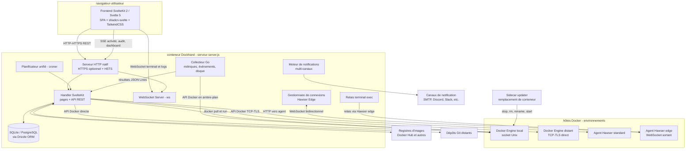
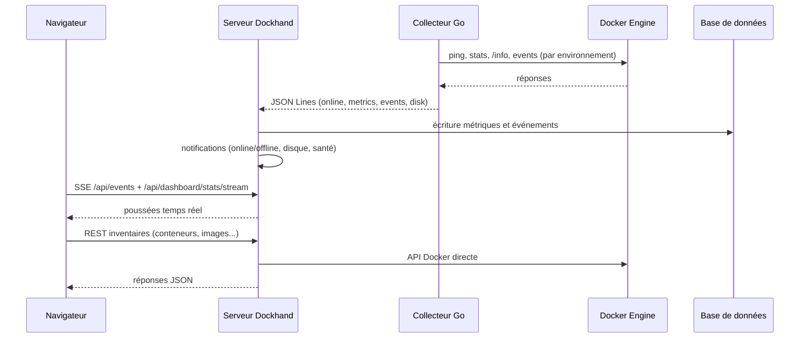
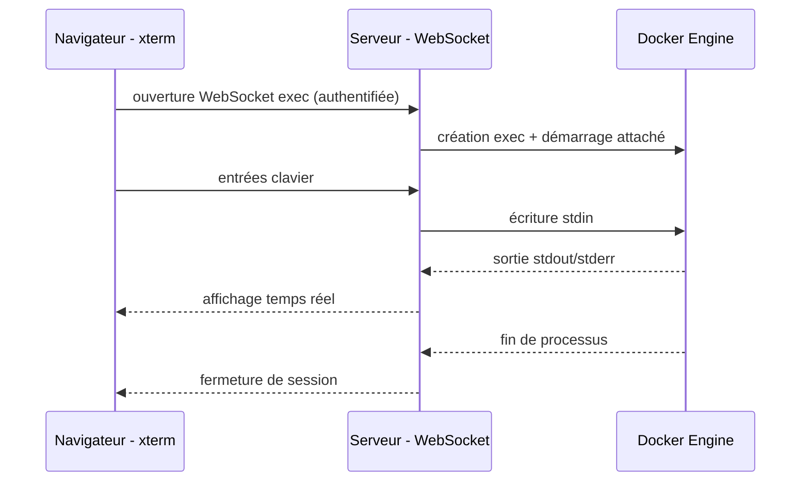
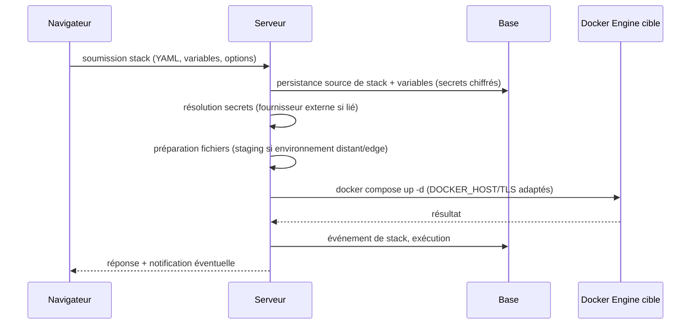
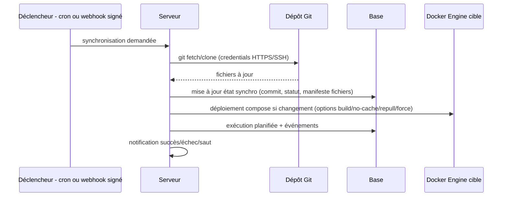
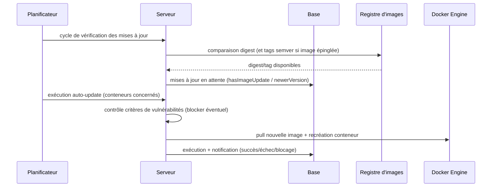
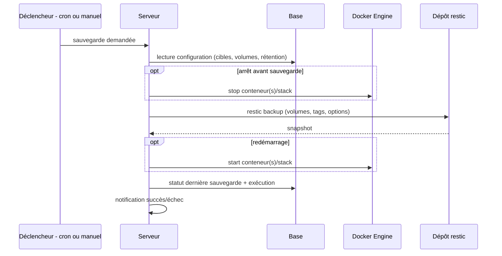
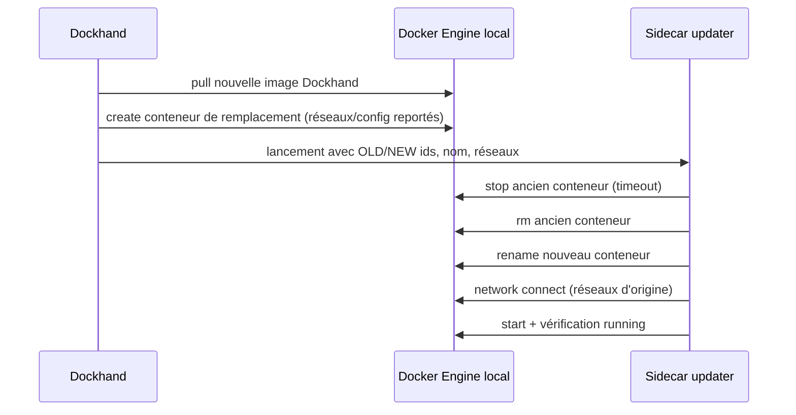

# Spécification fonctionnelle Dockhand — Chapitre 02 : Architecture fonctionnelle et vue d'ensemble du système

| Rubrique | Valeur |
|---|---|
| **Chapitre** | 02 — Architecture fonctionnelle et vue d'ensemble du système |
| **Statut** | Rédigé (phase 2, lot 1/5) |
| **Date de rédaction** | 21/08/2026 |
| **Version du logiciel analysée** | Dockhand **1.0.43** (numéro issu de [`package.json`](../../package.json:4)) |
| **Document de référence** | [`docs/spec/00-chapitrage.md`](00-chapitrage.md) |
| **Sources principales** | [`server.js`](../../server.js:1), [`src/hooks.server.ts`](../../src/hooks.server.ts:1), [`src/lib/server/subprocess-manager.ts`](../../src/lib/server/subprocess-manager.ts:1), [`collector/main.go`](../../collector/main.go:1), [`src/lib/server/hawser.ts`](../../src/lib/server/hawser.ts:1), [`src/lib/server/docker.ts`](../../src/lib/server/docker.ts:1), [`src/lib/server/scheduler/index.ts`](../../src/lib/server/scheduler/index.ts:1), [`updater/update.sh`](../../updater/update.sh:1), [`src/lib/server/db/schema/`](../../src/lib/server/db/schema/index.ts:1) |

## Table des matières

1. [Objet, périmètre et prérequis de lecture](#1-objet-périmètre-et-prérequis-de-lecture)
2. [Vue d'ensemble du système](#2-vue-densemble-du-système)
3. [Composants](#3-composants)
4. [Topologie de déploiement et flux entre composants](#4-topologie-de-déploiement-et-flux-entre-composants)
5. [Connexion à Docker](#5-connexion-à-docker)
6. [Canaux de communication navigateur ↔ serveur](#6-canaux-de-communication-navigateur--serveur)
7. [Stockage : SQLite / PostgreSQL et migrations Drizzle](#7-stockage-sqlite--postgresql-et-migrations-drizzle)
8. [Flux principaux de bout en bout](#8-flux-principaux-de-bout-en-bout)
9. [Principes généraux](#9-principes-généraux)
10. [Carte des modules fonctionnels et correspondance avec les chapitres](#10-carte-des-modules-fonctionnels-et-correspondance-avec-les-chapitres)
11. [Renvois vers les autres chapitres](#11-renvois-vers-les-autres-chapitres)

---

## 1. Objet, périmètre et prérequis de lecture

Ce chapitre décrit la **composition fonctionnelle du système** Dockhand : ses composants (frontend, backend, collecteur Go, agents Hawser, sidecar de mise à jour, bases de données), la topologie de déploiement, les flux majeurs entre ces composants et le Docker Engine, les canaux de communication (HTTP/HTTPS, WebSockets, SSE) et le stockage. Il introduit la carte des modules fonctionnels qui sert de fil conducteur aux chapitres 04 à 15.

**Prérequis de lecture** : chapitre 01 (positionnement, éditions/licence, glossaire de premier niveau). Le niveau de description reste **fonctionnel** : les chemins de code sont cités à titre de traçabilité, sans détail d'implémentation ligne à ligne.

**Conventions** :

- Les fonctions conditionnées à une licence **Enterprise** (ou SMB) sont signalées par la mention *(Enterprise)* / *(SMB)*.
- Les fonctions activables par feature flag sont signalées par la mention *(flag)*.

## 2. Vue d'ensemble du système

Dockhand est une application web monoposte déployée sous forme de conteneur. Toute la valeur fonctionnelle est rendue par **une instance serveur unique** qui :

1. sert l'interface web (SPA SvelteKit, rendue côté client — SSR désactivé, cf. [`src/routes/+layout.ts`](../../src/routes/+layout.ts:1)) ;
2. expose une **API REST** (routes SvelteKit sous [`src/routes/api/`](../../src/routes/api)) et des **points d'entrée WebSockets** (terminal exec, agents Hawser edge) ;
3. dialogue avec **un ou plusieurs Docker Engine** (environnements) selon quatre modes de connexion ;
4. délègue les appels Docker d'arrière-plan (métriques, événements, usage disque) à un **processus collecteur Go** qu'il supervise ;
5. reçoit les connexions sortantes des **agents Hawser edge** (hôtes distants derrière réseau restreint) ;
6. s'appuie sur une base **SQLite** (défaut) ou **PostgreSQL** via Drizzle ORM ;
7. se met à jour elle-même via un **sidecar updater** qui remplace le conteneur Dockhand.

## 3. Composants

### 3.1 Frontend (interface utilisateur)

- **Nature** : application SvelteKit 2 / Svelte 5 en **rendu exclusivement client** (SSR désactivé car le tableau de bord dépend entièrement du chargement de données côté client — cf. [`src/routes/+layout.ts`](../../src/routes/+layout.ts:1)). Composants d'interface shadcn-svelte et TailwindCSS ; éditeurs CodeMirror (YAML, env, etc.) ; terminal xterm.
- **Rôle fonctionnel** : présentation et interaction — tableaux de bord, inventaires (conteneurs, images, volumes, réseaux), éditeurs de stacks, vues logs/terminal/fichiers, réglages. Le frontend consomme l'API REST et les flux temps réel (SSE/WebSocket) exposés par le backend.
- **Organisation des pages** ([`src/routes/`](../../src/routes)) : `dashboard/`, `containers/`, `stacks/`, `images/`, `volumes/`, `networks/`, `activity/`, `audit/`, `backups/`, `terminal/`, `logs/`, `metrics/`, `environments/`, `registry/`, `schedules/`, `templates/`, `settings/`, `alerts/`, `profile/`, `login/`.
- **Garde d'authentification** : le layout serveur ([`src/routes/+layout.server.ts`](../../src/routes/+layout.server.ts:11)) applique la politique d'accès — mode sans authentification, session valide, ou mode d'installation initiale (aucun admin existant) ; chemins publics limités à `/login` et, si activés, aux docs API.

### 3.2 Backend (serveur applicatif)

Deux briques coopèrent :

1. **`server.js`** ( enveloppe de production autour de la sortie `@sveltejs/adapter-node` — cf. [`server.js`](../../server.js:1)) :
   - crée le serveur **HTTP natif** (port/hôte configurables via `PORT`/`HOST`) ou **HTTPS natif** (`HTTPS_MODE=on` + `HTTPS_CERT_PATH`/`HTTPS_KEY_PATH`/`HTTPS_CA_PATH`), avec **HSTS** optionnel (`HSTS_MAX_AGE`, 1 an par défaut) ;
   - attache un **serveur WebSocket** (`ws`) au serveur HTTP pour : le **terminal exec** (xterm ↔ Docker exec) et les **connexions des agents Hawser Edge** ;
   - journalise avec horodatage ISO et niveau (INFO/WARN/ERROR).
2. **Application SvelteKit** (handler) :
   - **routes API REST** sous [`src/routes/api/`](../../src/routes/api) : environnements, conteneurs, stacks, images, registres, volumes, réseaux, Git, vulnérabilités, sauvegardes, notifications, rôles, utilisateurs, préférences, planifications, licence, santé, self-update, etc. ;
   - **services métier** dans [`src/lib/server/`](../../src/lib/server) : accès Docker ([`docker.ts`](../../src/lib/server/docker.ts:1)), stacks ([`stacks.ts`](../../src/lib/server/stacks.ts:1)), Git ([`git.ts`](../../src/lib/server/git.ts:1)), scanner de vulnérabilités ([`scanner.ts`](../../src/lib/server/scanner.ts:1)), notifications, sauvegardes ([`backups/`](../../src/lib/server/backups)), scheduler ([`scheduler/`](../../src/lib/server/scheduler/index.ts:1)), secrets ([`secretproviders/`](../../src/lib/server/secretproviders)) ;
   - **hooks serveur** ([`src/hooks.server.ts`](../../src/hooks.server.ts:1)) : initialisation au démarrage (base de données, migration/chiffrement des credentials, détection du répertoire de données hôte, nettoyage des conteneurs de scan orphelins, démarrage des sous-processus et du planificateur), authentification des requêtes (sessions et jetons d'API avec limitation de débit sur échecs), compression gzip des réponses compressibles.

### 3.3 Collecteur Go (`collector/`)

- **Nature** : binaire Go léger ([`collector/main.go`](../../collector/main.go:1)) lancé et supervisé par le processus Node/Bun ([`src/lib/server/subprocess-manager.ts`](../../src/lib/server/subprocess-manager.ts:1)).
- **Rôle fonctionnel** : décharge des **appels Docker d'arrière-plan** — *ping* (état en ligne), listing, statistiques (CPU/mémoire), `/info` (usage disque), flux d'événements Docker. Le processus parent garde la responsabilité des écritures en base, des notifications et de la diffusion SSE.
- **Communication** : **JSON Lines sur stdin/stdout** — commandes entrantes (ajout d'un environnement avec sa config de connexion socket/http/https, intervalle de métriques, mode de collecte d'événements *stream* ou *poll*), résultats sortants (statut en ligne, événements, métriques CPU/mémoire, données disque, informations système).
- **Couverture de connexion** : le collecteur reçoit la configuration de chaque environnement (type socket/http/https, chemin de socket, hôte/port, matériel TLS, option *skip verify*) et sait router vers l'agent Hawser lorsque l'environnement l'exige (jeton transmis).

### 3.4 Agents Hawser (hôtes distants)

- **Rôle fonctionnel** : agent compagnon déployé sur un hôte Docker distant pour exposer son Docker Engine à Dockhand sans ouvrir l'API Docker sur le réseau.
- **Deux modes** (cf. [`src/lib/server/hawser.ts`](../../src/lib/server/hawser.ts:1) et le schéma de [`environments`](../../src/lib/server/db/schema/index.ts:39) `connectionType`) :
  - **Hawser standard** (`hawser-standard`) : Dockhand se connecte à l'agent (HTTP), authentifié par **jeton d'agent** (stocké en clair côté environnement, `hawserToken`) ;
  - **Hawser edge** (`hawser-edge`) : l'agent initie une **connexion WebSocket sortante** vers `/api/hawser/connect` (adapté aux hôtes derrière NAT/pare-feu), authentifiée par **jeton haché** (table `hawser_tokens`).
- **Protocole edge** (version `1.0`) : messages `hello`/`welcome` (identification agent, version, version Docker, nom d'hôte, capacités), `request`/`response` (corrélation par identifiant avec promesses et délais), `stream`/`stream_end` (journaux, exec), `metrics`, `ping`/`pong` (battements de cœur). **Expiration** : connexion considérée perdue après 3 battements manqués (90 s), requêtes en attente rejetées.
- **Capacités déclarées** : par ex. `compose`, `exec`, `metrics` — elles conditionnent les fonctions proposées pour l'environnement.
- **Sécurité** : jetons d'agent liés à un environnement, activables/désactivables, datés de dernière utilisation, expiration possible. Le détail est traité au chapitre 04.

### 3.5 Sidecar updater (`updater/`)

- **Rôle fonctionnel** : exécuter la **mise à jour de Dockhand par lui-même** (fonction *self-update*). Dockhand **pré-crée le conteneur de remplacement** (nouvelle image), puis le sidecar ([`updater/update.sh`](../../updater/update.sh:1)) enchaîne : arrêt de l'ancien conteneur (avec délai configurable) → suppression → renommage du remplaçant → reconnexion aux réseaux Docker (avec options par réseau) → démarrage → vérification de l'état `running`.
- **Contrat fonctionnel** : le sidecar reçoit les identifiants d'ancien/nouveau conteneur, le nom à restaurer, la liste des réseaux ; il échoue explicitement si un pas est impossible. (Développé au chapitre 15.)

### 3.6 Bases de données

- **SQLite** (par défaut, via `better-sqlite3`) ou **PostgreSQL** (via `postgres`), accès unifié par **Drizzle ORM** — un schéma déclaratif unique décliné en deux variantes ([`src/lib/server/db/schema/index.ts`](../../src/lib/server/db/schema/index.ts:1) et [`pg-schema.ts`](../../src/lib/server/db/schema/pg-schema.ts:1)).
- **Contenu fonctionnel** : environnements, registres, réglages, utilisateurs/sessions/rôles, configurations SSO/LDAP, intégration Git, sources de stacks et variables, fournisseurs de secrets, scans de vulnérabilités, audit, événements (conteneurs, stacks), métriques d'hôtes, planifications et exécutions, mises à jour en attente, sauvegardes, jetons (API, Hawser), préférences, sources de templates. Le dictionnaire complet fait l'objet du chapitre 03.

## 4. Topologie de déploiement et flux entre composants

### 4.1 Topologies types

| Topologie | Description | Flux notables |
|---|---|---|
| **Mono-hôte** | Dockhand dans un conteneur, socket Docker monté (`/var/run/docker.sock`). | Dockhand → Docker Engine via socket Unix ; le sidecar updater manœuvre le conteneur Dockhand lui-même via ce même socket. |
| **Multi-hôtes direct** | Environnements distants joignables en TCP (2375/2376, TLS optionnel). | Dockhand → Docker Engine distant via TCP/TLS ; collecteur Go idem pour l'arrière-plan. |
| **Multi-hôtes Hawser standard** | Agents Hawser déployés sur les hôtes distants. | Dockhand → agent (HTTP, jeton) → Docker Engine local à l'agent. |
| **Multi-hôtes Hawser edge** | Hôtes derrière NAT/pare-feu. | Agent → Dockhand (WebSocket sortant `/api/hawser/connect`, jeton haché) ; Dockhand relaye requêtes/réponses et flux (journaux, exec) sur cette connexion. |
| **PostgreSQL externalisé** | Base PostgreSQL dédiée (cf. [`docker-compose-postgresql.yaml`](../../docker-compose-postgresql.yaml)). | Dockhand → PostgreSQL sur le réseau ; schéma migré par Drizzle. |

### 4.2 Flux internes au conteneur Dockhand

- **Navigateur ↔ serveur** : REST (JSON), SSE (activité, audit, statistiques dashboard), WebSocket (terminal exec, flux de journaux interactifs).
- **Serveur ↔ collecteur Go** : JSON Lines sur stdin/stdout (commandes/résultats) ; supervision du processus (redémarrage si nécessaire).
- **Serveur ↔ planificateur** : le scheduler ([`src/lib/server/scheduler/index.ts`](../../src/lib/server/scheduler/index.ts:1)) planifie via **croner** : auto-update de conteneurs, sync de stacks Git, vérification des mises à jour par environnement, prune d'images, sauvegardes *(flag)*, maintenance de dépôts restic *(flag)*, nettoyages système (exécutions, événements, helpers de volume, cache scanner). Chaque tâche journalise une **exécution** (statut, durées, journaux) en base.
- **Serveur → sous-processus externes** : commandes `docker` CLI (déploiement de stacks Compose, avec `DOCKER_HOST` positionné pour l'environnement cible), `git` (clonage/pull des dépôts), `restic` (sauvegardes), conteneurs de scan Grype/Trivy réutilisables.

## 5. Connexion à Docker

### 5.1 Modes de connexion d'un environnement

Le champ `connectionType` d'un environnement ([`src/lib/server/db/schema/index.ts`](../../src/lib/server/db/schema/index.ts:39)) distingue quatre modes, unifiés côté service par la config Docker ([`src/lib/server/docker.ts`](../../src/lib/server/docker.ts:521)) :

| Mode | `connectionType` | Principe fonctionnel |
|---|---|---|
| **Socket Unix** | `socket` | API Docker atteinte via le socket monté dans le conteneur Dockhand (chemin paramétrable, défaut `/var/run/docker.sock`). Détection automatique de sockets alternatifs (Docker Desktop, OrbStack) et respect de `DOCKER_HOST`/`DOCKER_SOCKET`. |
| **TCP direct** | `direct` | API Docker atteinte en HTTP (`http`) ou HTTPS (`https`) sur hôte/port (défaut 2375), avec triplet CA/certificat/clé TLS et option *skip verify*. |
| **Hawser standard** | `hawser-standard` | Dockhand appelle l'agent Hawser distant (HTTP) avec le jeton d'agent de l'environnement ; l'agent rejoue les appels vers son Docker Engine local. |
| **Hawser edge** | `hawser-edge` | Les appels sont relayés sur la WebSocket maintenue par l'agent (corrélation requête/réponse, flux pour journaux et exec). Délais assouplis pour hôtes lents (ping 20 s au lieu de 5 s). |

### 5.2 Comportements transverses

- **Santé de connexion** : ping périodique par le collecteur (statut en ligne/hors-ligne remonté au serveur, stocké et notifié — événements `environment_online`/`environment_offline`).
- **Collecte** : par environnement, options **activité** (collecte des événements conteneurs) et **métriques** (CPU/mémoire), mode *stream* ou *poll* avec intervalles configurables ; option **mise en évidence des changements**.
- **Exécution distante de commandes** : les déploiements de stacks passent par la CLI `docker compose` exécutée côté serveur avec `DOCKER_HOST`/TLS adaptés à l'environnement cible (y compris à travers Hawser) ; pour les environnements edge, les fichiers de stack sont **préparés/stagés** côté serveur puis transmis.
- **Scanners de vulnérabilités** : conteneurs de scan (Grype/Trivy) exécutés sur l'environnement cible ; le scanner **réplique la propre connexion Docker de Dockhand** (socket local, TCP, ou via Hawser) pour joindre l'API.

## 6. Canaux de communication navigateur ↔ serveur

| Canal | Usage fonctionnel | Points d'entrée |
|---|---|---|
| **REST/JSON** | CRUD et actions : environnements, conteneurs, stacks, images, volumes, réseaux, registres, Git, scans, sauvegardes, réglages, utilisateurs/rôles, licence, santé… | [`src/routes/api/`](../../src/routes/api) |
| **SSE** | Flux temps réel unidirectionnels : activité des conteneurs, journal d'audit *(Enterprise)*, statistiques du tableau de bord (rafraîchissement continu) | `api/events`, `api/audit/events`, `api/dashboard/stats/stream` |
| **WebSocket** | Bidirectionnel interactif : **terminal exec** dans un conteneur (xterm), relais des flux de journaux, **connexion des agents Hawser edge** | `server.js` + [`src/lib/server/ws-auth.ts`](../../src/lib/server/ws-auth.ts:1) |

Règles transverses :

- **Authentification** : sessions (cookies) pour le navigateur ; **jetons d'API** personnels (Bearer) pour les clients machine — avec limitation de débit sur échecs (fenêtre glissante puis refroidissement) ; l'upgrade WebSocket du terminal exec est authentifiée par un mécanisme partagé serveur (`ws-auth`).
- **Compression** : réponses compressibles gzippées au-delà d'un seuil ; les flux SSE et binaire en sont exclus.
- **HTTPS natif** : optionnel au démarrage, avec HSTS ; sinon terminaison TLS par un reverse-proxy amont.

## 7. Stockage : SQLite / PostgreSQL et migrations Drizzle

### 7.1 Choix fonctionnel

- **SQLite** : mode par défaut, zéro dépendance externe, adapté à l'instance unique (fichier dans le répertoire de données).
- **PostgreSQL** : mode opéré, adapté aux déploiements externalisant la donnée (compose dédié fourni).
- Le **choix est fait au démarrage** (variables d'environnement de connexion) et le reste du système est agnostique : un unique jeu d'opérations base de données ([`src/lib/server/db.ts`](../../src/lib/server/db.ts:1)) sert les deux dialectes.

### 7.2 Migrations

- Deux arborescences de migrations Drizzle en parallèle : [`drizzle/`](../../drizzle/0000_initial_schema.sql) (SQLite) et [`drizzle-pg/`](../../drizzle-pg/0000_initial_schema.sql) (PostgreSQL), avec instantanés de méta-schéma.
- **Périmètre fonctionnel des migrations** (0→11) : schéma initial (environnements, jetons Hawser, registres, réglages, événements, configurations, auth, RBAC, Git, sécurité, audit, activité, préférences), variables d'environnement de stacks, mises à jour en attente, chemins de stacks, options de déploiement Git (build/no-cache/repull/force), jetons d'API, répertoire de contexte Git, manifeste des fichiers synchronisés, sources de templates, tables de sauvegarde, fournisseurs de secrets, semver des mises à jour en attente.
- Les **credentials sensibles** sont chiffrés au repos (AES) et migrés/rotatés au démarrage si la clé de chiffrement change ([`src/lib/server/encryption.ts`](../../src/lib/server/encryption.ts:1)) ; le démarrage des sous-processus et du planificateur attend la fin de cette migration pour éviter tout déchiffrement en cours de rotation.

### 7.3 Réplication d'état Docker

Les objets Docker (conteneurs, images, volumes, réseaux) **ne sont pas répliqués en base** : ils sont lus en temps réel auprès du Docker Engine concerné. La base persiste la **configuration déclarative** (environnements, stacks, planifications…), les **observations historisées** (événements, métriques, scans, exécutions, audit) et les **états calculés** (mises à jour en attente).

## 8. Flux principaux de bout en bout

### 8.1 Supervision temps réel

### 8.2 Action interactive (exemple : terminal exec)

Variante **Hawser edge** : les étapes Docker sont relayées via la WebSocket de l'agent (messages `request`/`response`/`stream`/`stream_end`).

### 8.3 Déploiement d'une stack Compose

### 8.4 Synchronisation Git (planifiée ou webhook)

### 8.5 Mise à jour automatique de conteneur

### 8.6 Sauvegarde *(flag `FEAT_BACKUPS_ENABLED`)*

### 8.7 Auto-mise à jour de Dockhand (sidecar)

## 9. Principes généraux

### 9.1 Temps réel

- Les inventaires et statistiques sont servis **à la demande** (REST) et complétés par des **flux poussés** (SSE/WebSocket) pour l'activité, l'audit *(Enterprise)* et le tableau de bord.
- La collecte d'arrière-plan est **isolée dans le collecteur Go** pour ne pas bloquer le serveur applicatif ; le serveur historise et rediffuse.

### 9.2 Multi-environnements

- Toute ressource manipulée est **qualifiée par environnement** : la plupart des tables métier portent un `environmentId` (voir chapitre 03) ; les API acceptent le contexte d'environnement et les RBAC *(Enterprise)* restreignent la portée par environnement.
- Les environnements distants bénéficient des **mêmes fonctions** (déploiement, logs, exec, scans…) via la couche de routage Hawser/TLS ; certaines fonctions dépendent des **capacités déclarées** par l'agent.

### 9.3 Feature flags

- Deux fonctions sont **désactivées par défaut** et activées par variable d'environnement au démarrage (lecture unique) : sauvegardes *(bêta)* et documentation API publique ([`src/lib/server/features.ts`](../../src/lib/server/features.ts:1)).
- Conséquences fonctionnelles : entrées de navigation masquées, routes API renvoyant 404, tâches du planificateur non enregistrées lorsque le flag est éteint.

### 9.4 Gating Enterprise / SMB

- Les fonctions **RBAC** (rôles, permissions, portée environnement), **journal d'audit** et **préférences par utilisateur** exigent une licence active ; la clé est vérifiée par signature RSA (type `enterprise` requis pour les fonctions Enterprise ; SMB ne les débloque pas — [`src/lib/server/license.ts`](../../src/lib/server/license.ts:159)).
- Le frontend interroge l'état de licence et adapte l'interface en conséquence ([`src/lib/stores/license.ts`](../../src/lib/stores/license.ts:1)).

### 9.5 Sécurité par défaut

- Secrets **chiffrés au repos** (mots de passe de registres, credentials Git, TLS, secrets de stacks, configurations de sauvegarde) avec rotation de clé au démarrage.
- **Webhooks signés** (déploiement Git), anti-rejeu et vérifications d'URL (protection SSRF des hôtes de notification et de fournisseurs de secrets : blocage loopback/métadonnées cloud, LAN autorisé).
- **Sessions** en cookies HttpOnly avec expiration ; limitation de débit sur échecs d'authentification par jeton.

### 9.6 Exploitabilité

- **Endpoints de santé/diagnostic** (`api/health`, `api/debug`, dépendances) et journalisation horodatée structurée.
- **Outils d'urgence** hors interface ([`scripts/emergency/`](../../scripts/emergency), déclinaisons SQLite/PostgreSQL) : création d'admin, réinitialisation de mot de passe, désactivation d'authentification, purge de sessions, sauvegarde/restauration/réinitialisation de base.
- **Arrêt propre** : à la réception de SIGTERM/SIGINT, arrêt du collecteur et des sous-processus avant sortie.

## 10. Carte des modules fonctionnels et correspondance avec les chapitres

| Module fonctionnel | Composants impliqués | Données principales | Chapitre |
|---|---|---|---|
| Environnements & connexions | API environnements, gestionnaire Hawser, collecteur Go | `environments`, `hawser_tokens` | 04 |
| Conteneurs (inventaire, cycle de vie, logs, terminal, fichiers) | API containers, relais WS exec, navigateur de fichiers | objets Docker + `container_events` | 05 |
| Stacks Compose | API stacks, éditeur YAML/graphique, CLI docker compose | `stack_sources`, `stack_environment_variables`, `stack_events` | 06 |
| Intégration Git | API git, service git, webhooks signés | `git_credentials`, `git_repositories`, `git_stacks` | 07 |
| Images & registres | API images/registries, catalogue distant | objets Docker + `registries`, `pending_container_updates` | 08 |
| Volumes/réseaux/maintenance | API volumes/networks/prune, helpers de volume | objets Docker + réglages | 09 |
| Vulnérabilités & secrets | Scanner Grype/Trivy, fournisseurs de secrets | `vulnerability_scans`, `secret_providers` | 10 |
| Sauvegardes *(flag)* | Tâches restic, destinations chiffrées | `backup_destinations`, `backup_configs` | 11 |
| Authentification & RBAC | Auth locale/OIDC/LDAP/MFA, rôles *(Enterprise)* | `users`, `sessions`, `roles`, `user_roles`, `oidc_config`, `ldap_config`, `api_tokens` | 12 |
| Observabilité & notifications | Tableau de bord, activité, audit *(Enterprise)*, notifications | `container_events`, `host_metrics`, `audit_logs`, `notification_settings` | 13 |
| Automatisation & API | Planificateur croner, templates, OpenAPI *(flag)* | `schedule_executions`, `auto_update_settings`, `template_sources` | 14 |
| Administration & exploitation | Réglages, préférences, licence, self-update, santé | `settings`, `user_preferences`, réglages licence | 15 |

## 11. Renvois vers les autres chapitres

| Chapitre | Lien | Pourquoi y aller |
|---|---|---|
| 00 — Chapitrage | [`00-chapitrage.md`](00-chapitrage.md) | Sommaire de référence. |
| 01 — Présentation générale | [`01-presentation-generale.md`](01-presentation-generale.md) | Positionnement, éditions, glossaire de premier niveau. |
| 03 — Concepts et entités | [`03-concepts-entites.md`](03-concepts-entites.md) | Dictionnaire des entités et relations (détail des tables évoquées ici). |
| 04 — Environnements | `04-environnements.md` *(à rédiger)* | Détail des modes de connexion, protocole Hawser, jetons d'agent. |
| 05 à 11 — Fonctions métier | *(à rédiger, lots 2 et 3)* | Déclinaisons détaillées des flux présentés en §8. |
| 12 — Authentification et RBAC | `12-authentification-rbac.md` *(à rédiger, lot 4)* | Détail des canaux d'authentification et du gating d'édition. |
| 13 — Observabilité | `13-observabilite.md` *(à rédiger, lot 4)* | Détail des flux SSE, métriques et notifications. |
| 14 — Automatisation | `14-automatisation-api.md` *(à rédiger, lot 5)* | Types de tâches planifiées, API REST/OpenAPI. |
| 15 — Administration | `15-administration-exploitation.md` *(à rédiger, lot 5)* | Self-update, santé, configuration démarrage, outils d'urgence. |
