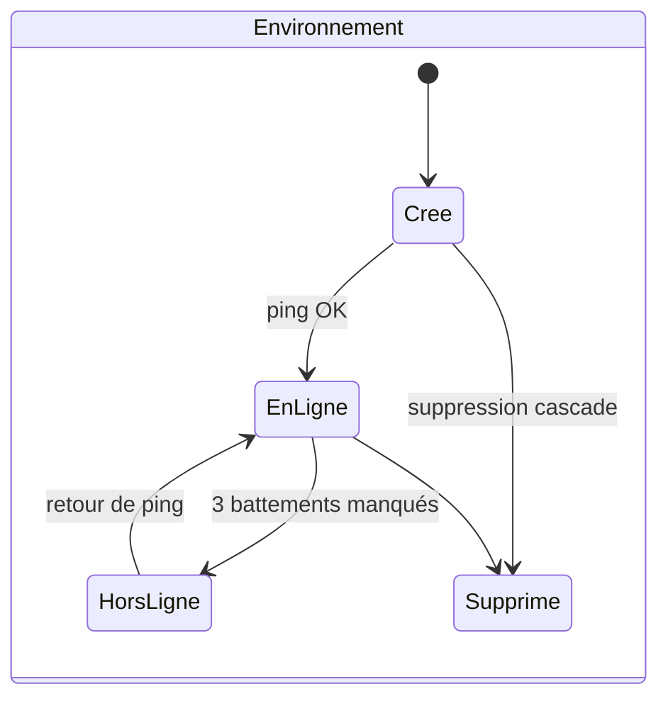
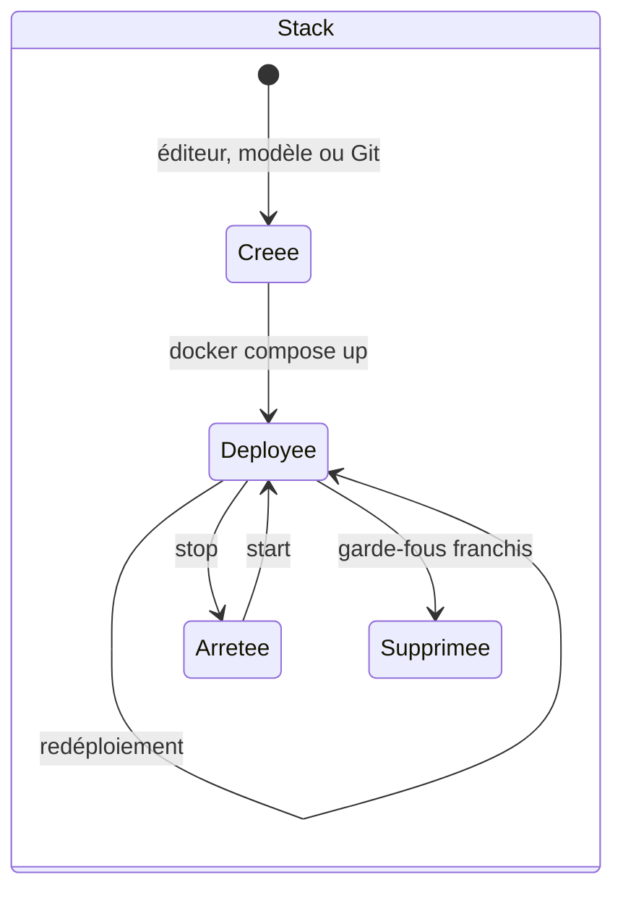
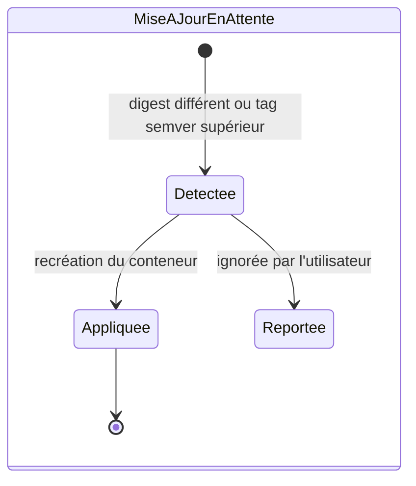
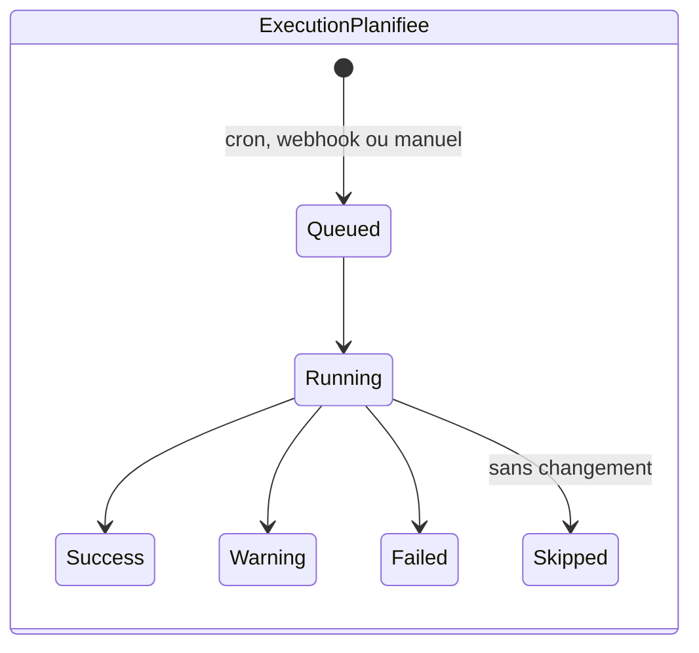
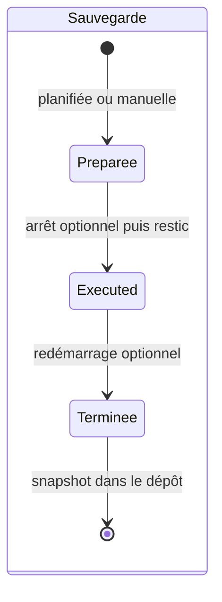

# Spécification fonctionnelle Dockhand — Chapitre 03 : Concepts et entités métier

| Rubrique | Valeur |
|---|---|
| **Chapitre** | 03 — Concepts et entités métier |
| **Statut** | Rédigé (phase 2, lot 1/5) |
| **Date de rédaction** | 21/08/2026 |
| **Version du logiciel analysée** | Dockhand **1.0.43** (numéro issu de [`package.json`](../../package.json:4)) |
| **Document de référence** | [`docs/spec/00-chapitrage.md`](00-chapitrage.md) |
| **Sources principales** | Schémas Drizzle : [`src/lib/server/db/schema/index.ts`](../../src/lib/server/db/schema/index.ts:1) (SQLite) et [`src/lib/server/db/schema/pg-schema.ts`](../../src/lib/server/db/schema/pg-schema.ts:1) (PostgreSQL) ; migrations [`drizzle/`](../../drizzle/0000_initial_schema.sql) et [`drizzle-pg/`](../../drizzle-pg/0000_initial_schema.sql) ; opérations [`src/lib/server/db.ts`](../../src/lib/server/db.ts:1) |

## Table des matières

1. [Objet, périmètre et prérequis de lecture](#1-objet-périmètre-et-prérequis-de-lecture)
2. [Conventions de modélisation](#2-conventions-de-modélisation)
3. [Diagramme de relations](#3-diagramme-de-relations)
4. [Domaine Environnement (entité pivot)](#4-domaine-environnement-entité-pivot)
5. [Objets Docker maniés par Dockhand](#5-objets-docker-maniés-par-dockhand)
6. [Domaine Stacks Compose](#6-domaine-stacks-compose)
7. [Domaine Intégration Git](#7-domaine-intégration-git)
8. [Domaine Images, registres et mises à jour](#8-domaine-images-registres-et-mises-à-jour)
9. [Domaine Planifications et exécutions](#9-domaine-planifications-et-exécutions)
10. [Domaine Sauvegardes — bêta](#10-domaine-sauvegardes--bêta)
11. [Domaine Sécurité applicative](#11-domaine-sécurité-applicative)
12. [Domaine Identité et accès](#12-domaine-identité-et-accès)
13. [Domaine Observabilité](#13-domaine-observabilité)
14. [Domaine Configuration transverse](#14-domaine-configuration-transverse)
15. [Cycles de vie des entités principales](#15-cycles-de-vie-des-entités-principales)
16. [Vocabulaire métier récapitulatif](#16-vocabulaire-métier-récapitulatif)
17. [Renvois vers les autres chapitres](#17-renvois-vers-les-autres-chapitres)

---

## 1. Objet, périmètre et prérequis de lecture

Ce chapitre définit le **vocabulaire fonctionnel** et le **modèle de données conceptuel** de Dockhand : chaque concept métier est décrit avec sa définition, son rôle, ses attributs clés et ses relations. Il sert de référence unique pour les chapitres 04 à 15.

**Prérequis de lecture** : chapitre 01 (positionnement, éditions/licence) et chapitre 02 (composants, flux, stockage).

**Périmètre** : toutes les entités persistées (tables Drizzle) ainsi que les objets Docker manipulés mais non persistés. Les attributs listés sont les **attributs clés** fonctionnellement signifiants (le détail exhaustif des colonnes relève de l'implémentation).

## 2. Conventions de modélisation

- **Entités persistées** : gérées par Drizzle en SQLite et PostgreSQL avec des définitions parallèles. La suppression d'un environnement **cascade** sur la plupart des entités liées (jetons Hawser, événements, métriques, variables de stacks, etc.) ; les références « documentaires » (audit, exécutions) sont conservées avec remise à `null` du lien.
- **Objets Docker** (conteneurs, images, réseaux, volumes) : **non répliqués en base** — leur état de référence est le Docker Engine de l'environnement concerné. Dockhand n'en persiste que des **observations** (événements, scans, mises à jour en attente).
- **Champs JSON sérialisés** : plusieurs attributs composites (listes d'identifiants d'environnements, mappings de rôles, rétentions, manifestes) sont stockés en texte JSON ; le chapitre décrit leur **contenu fonctionnel**.
- **Sensibilité** : les credentials et secrets (mots de passe, clés SSH, secrets de stacks, mots de passe restic, tokens) sont **chiffrés au repos** et **masqués** dans l'interface.
- **Identification des stacks** : une stack est identifiée par le couple **(nom de stack, environnement)** — il n'existe pas d'identifiant numérique global de stack ; les entités liées (source, variables, événements) rejoignent ce couple.

## 3. Diagramme de relations

Diagramme conceptuel des entités persistées (les cardinalités correspondent aux clés étrangères des schémas Drizzle) :

```mermaid
erDiagram
    ENVIRONNEMENTS ||--o{ HAWSER_TOKENS : "jetons d'agent"
    ENVIRONNEMENTS ||--o{ STACK_EVENTS : "journalise"
    ENVIRONNEMENTS ||--o{ HOST_METRICS : "mesure"
    ENVIRONNEMENTS ||--o{ CONTAINER_EVENTS : "observe"
    ENVIRONNEMENTS ||--o{ STACK_SOURCES : "porte"
    ENVIRONNEMENTS ||--o{ STACK_ENV_VARS : "paramètre"
    ENVIRONNEMENTS ||--o{ GIT_STACKS : "déploie"
    ENVIRONNEMENTS ||--o{ AUTO_UPDATE_SETTINGS : "règle"
    ENVIRONNEMENTS ||--o{ PENDING_UPDATES : "signale"
    ENVIRONNEMENTS ||--o{ VULN_SCANS : "scanne"
    ENVIRONNEMENTS ||--o{ SCHEDULE_EXECUTIONS : "exécute"
    ENVIRONNEMENTS ||--o{ BACKUP_CONFIGS : "sauvegarde"
    ENVIRONNEMENTS ||--o{ ENV_NOTIFICATIONS : "route"
    ENVIRONNEMENTS ||--o{ USER_ROLES : "porte"
    ENVIRONNEMENTS ||--o{ USER_PREFERENCES : "contexte"

    GIT_CREDENTIALS |o--o{ GIT_REPOSITORIES : "authentifie"
    GIT_REPOSITORIES ||--o{ GIT_STACKS : "contient"
    GIT_REPOSITORIES |o--o{ STACK_SOURCES : "référence"
    GIT_STACKS |o--o{ STACK_SOURCES : "référence"

    SECRET_PROVIDERS |o--o{ STACK_SOURCES : "injecte"

    NOTIFICATION_SETTINGS ||--o{ ENV_NOTIFICATIONS : "cible"

    BACKUP_DESTINATIONS ||--o{ BACKUP_CONFIGS : "reçoit"

    USERS ||--o{ SESSIONS : "ouvre"
    USERS ||--o{ USER_ROLES : "reçoit"
    ROLES ||--o{ USER_ROLES : "attribue"
    USERS ||--o{ API_TOKENS : "possède"
    USERS ||--o{ USER_PREFERENCES : "personnalise"
    USERS |o--o{ AUDIT_LOGS : "trace"
```

## 4. Domaine Environnement (entité pivot)

### 4.1 Environnement (`environments` — [schéma](../../src/lib/server/db/schema/index.ts:23))

- **Définition** : un hôte Docker administré par l'instance Dockhand. C'est l'entité pivot : presque toutes les autres entités métier s'y rattachent.
- **Rôle** : qualifier chaque action et observation (conteneurs, stacks, événements, métriques, sauvegardes…) par l'hôte concerné ; porter la configuration de connexion et les options de collecte.
- **Attributs clés** :
  - `name` (unique) — nom d'affichage ;
  - `connectionType` — mode de connexion : `socket` | `direct` | `hawser-standard` | `hawser-edge` ;
  - paramètres de connexion : `host`, `port` (défaut 2375), `protocol` (`http`/`https`), matériel TLS (`tlsCa`, `tlsCert`, `tlsKey`, `tlsSkipVerify`), `socketPath` (défaut `/var/run/docker.sock`) ;
  - attributs d'agent : `hawserToken` (jeton d'agent pour le mode standard), `hawserAgentId`/`hawserAgentName`/`hawserVersion`, `hawserCapabilities` (JSON : p.ex. `compose`, `exec`, `metrics`), `hawserLastSeen` ;
  - présentation : `icon` (défaut `globe`), `labels` (JSON de libellés de catégorisation) ;
  - options de collecte : `collectActivity`, `collectMetrics`, `highlightChanges`.
- **Relations** : un environnement possède des jetons Hawser, des événements (conteneurs/stacks), des métriques, des stacks (via le couple nom/environnement), des règles d'auto-update, des mises à jour en attente, des scans, des exécutions, des configurations de sauvegarde, des routages de notification et des attributions de rôles *(Enterprise)*.
- **Cycle de vie** : créé (choix du mode de connexion) → vérifié (ping) → en ligne/hors ligne (supervision continue) → modifiable (paramètres, icône, libellés) → supprimé (cascade sur les entités liées, conservation documentaire des audits). Voir chapitre 04.

### 4.2 Jeton d'agent Hawser (`hawser_tokens` — [schéma](../../src/lib/server/db/schema/index.ts:51))

- **Définition** : secret d'authentification d'un agent Hawser **edge** auprès de l'instance Dockhand.
- **Attributs clés** : `token` (valeur **hachée**, unique), `tokenPrefix` (8 premiers caractères, pour identification dans les listes), `name`, `environmentId` (portée de l'agent), `isActive`, `lastUsed`, `expiresAt`.
- **Rôle / règles** : un jeton lie un agent à **un environnement** ; il peut être désactivé ou expirer ; la date de dernière utilisation permet d'auditer l'activité. À distinguer du jeton **en clair** porté par l'environnement pour le mode **standard** (`hawserToken`).
- **Relations** : appartient à un environnement (supprimable en cascade).

## 5. Objets Docker maniés par Dockhand

Ces objets **ne sont pas des entités persistées** ; ils sont lus et manipulés en temps réel via l'API Docker de l'environnement.

| Concept | Définition fonctionnelle | Manipulations clés |
|---|---|---|
| **Conteneur** | Instance d'image en cours d'exécution (ou arrêtée) sur un environnement ; statut, santé, ports publiés, ressources, labels Docker. | start, stop, restart, pause/unpause, remove, **recreate** (recréation en conservant/mergeant configuration), exec, logs, fichiers. |
| **Image** | Artefact d'exécution identifié par un ou plusieurs tags et un **digest** ; couches, taille, conteneurs associés. | pull, remove, prune, inspection des couches, comparaison de digest, tags semver. |
| **Réseau Docker** | Segments réseau reliant conteneurs ; visualisés en graphe (par stack, par environnement). | inventaire, création, suppression, prune, connexions de conteneurs. |
| **Volume Docker** | Zone de données persistées ; parcourable via un **helper de volume** (conteneur utilitaire éphémère). | inventaire, création, suppression, prune protégé, navigateur de fichiers. |

**Correspondance observée en base** : les événements de conteneurs (`container_events`), les scans d'images (`vulnerability_scans`), les mises à jour en attente (`pending_container_updates`) et les métriques d'hôte (`host_metrics`) sont les observations persistées de ces objets.

## 6. Domaine Stacks Compose

### 6.1 Stack (concept)

- **Définition** : application multi-conteneurs décrite par un fichier Docker Compose, déployée sur un environnement et gérée comme un tout **nommé**.
- **Identité** : couple (`stackName`, `environmentId`) — repris par les entités liées.
- **Cycle de vie** : création (éditeur YAML/graphique, modèle, ou Git) → déploiement → redéploiement (options build/pull/force) → arrêt → suppression protégée par garde-fous (voir chapitre 06).

### 6.2 Source de stack (`stack_sources` — [schéma](../../src/lib/server/db/schema/index.ts:347))

- **Définition** : fiche d'origine d'une stack — d'où vient son fichier Compose et quels secrets y sont injectés.
- **Attributs clés** :
  - `sourceType` — `internal` (fichier édité dans Dockhand) ou `git` ;
  - `gitRepositoryId` / `gitStackId` — rattachement Git le cas échéant ;
  - `composePath` / `envPath` — chemins personnalisés des fichiers (pour stacks à emplacement non standard) ;
  - `secretProviderId` — fournisseur de secrets lié à la stack ;
  - `injectedSecretKeys` — **noms** (jamais les valeurs) des clés de secrets injectées au dernier déploiement, afin de masquer ces valeurs dans l'inspection de conteneurs sans rappeler le fournisseur.
- **Relations** : une par stack (unicité nom + environnement) ; référence un dépôt/une stack Git ou un fournisseur de secrets.

### 6.3 Variable d'environnement de stack (`stack_environment_variables` — [schéma](../../src/lib/server/db/schema/index.ts:366))

- **Définition** : variable injectée dans le contexte de déploiement d'une stack.
- **Attributs clés** : `key`, `value`, `isSecret` (marque *secret* : valeur masquée à l'affichage, **jamais écrite dans les fichiers .env**, injectée par environnement de processus), unicité par (stack, environnement, clé).
- **Règles fonctionnelles** : les variables secrètes sont chiffrées au repos et fusionnées avec les variables non secrètes et les résolutions de fournisseurs de secrets lors du déploiement (chapitres 06 et 10).

### 6.4 Événement de stack (`stack_events` — [schéma](../../src/lib/server/db/schema/index.ts:84))

- **Définition** : trace d'un événement de cycle de vie d'une stack (déploiement, démarrage, arrêt, échec…).
- **Attributs clés** : `stackName`, `eventType`, `metadata` (JSON), `timestamp`.
- **Rôle** : historique des opérations de stacks consultable dans l'interface (chapitre 13).

## 7. Domaine Intégration Git

### 7.1 Credential Git (`git_credentials` — [schéma](../../src/lib/server/db/schema/index.ts:273))

- **Définition** : secret d'authentification réutilisable pour accéder à des dépôts Git.
- **Attributs clés** : `name` (unique), `authType` (`none` | HTTPS | SSH), `username`/`password` (HTTPS), `sshPrivateKey`/`sshPassphrase` (SSH) — tous chiffrés au repos.
- **Relations** : référencé par zéro à N dépôts (déréférencé à la suppression).

### 7.2 Dépôt Git (`git_repositories` — [schéma](../../src/lib/server/db/schema/index.ts:298))

- **Définition** : dépôt source de stacks, avec ses paramètres de synchronisation.
- **Attributs clés** : `url`, `branch` (défaut `main`), `credentialId`, `composePath` par défaut, `environmentId` cible ; auto-synchronisation (`autoUpdate`, `autoUpdateSchedule`, `autoUpdateCron` par défaut `0 3 * * *`) ; webhook (`webhookEnabled`, `webhookSecret`) ; état de synchronisation (`lastSync`, `lastCommit`, `syncStatus` — p.ex. `pending` —, `syncError`).
- **Relations** : un dépôt contient N stacks Git.

### 7.3 Stack Git (`git_stacks` — [schéma](../../src/lib/server/db/schema/index.ts:319))

- **Définition** : stack déployée depuis un chemin d'un dépôt Git, avec ses options propres.
- **Attributs clés** :
  - chemins : `composePath` (défaut `docker-compose.yml`), `envFilePath` (fichier `.env` du dépôt, p.ex. `config/.env.prod`), `contextDir` (répertoire de travail relatif à la racine du dépôt ; `null` = répertoire du fichier Compose) ;
  - déploiement : `buildOnDeploy`, `noBuildCache`, `repullImages`, `forceRedeploy` ;
  - synchronisation : auto-update (type de planification + cron), webhook (activé + secret), état (`lastSync`, `lastCommit`, `syncStatus`, `syncError`) ;
  - `syncedFiles` — **manifeste JSON** des fichiers écrits lors de la dernière synchronisation (chemin relatif → empreinte SHA-256), servant de référence pour détecter les changements et pour le nettoyage des fichiers obsolètes.
- **Relations** : appartient à un dépôt (cascade) ; liée à un environnement ; unicité (nom de stack, environnement).
- **Vocabulaire associé** : *fichiers synchronisés* = ensemble des fichiers du dépôt recopiés sur l'hôte cible lors d'une synchro ; *commit* = identifiant Git déployé en dernier.

## 8. Domaine Images, registres et mises à jour

### 8.1 Registre (`registries` — [schéma](../../src/lib/server/db/schema/index.ts:63))

- **Définition** : registre d'images avec credentials, pour le pull, le catalogue distant et la détection de mises à jour.
- **Attributs clés** : `name` (unique), `url`, `username`/`password` (chiffré), `isDefault` (registre utilisé par défaut pour les opérations génériques).
- **Rôle** : authentifier les pulls et requêtes de catalogue ; comparer les digests locaux/distants (chapitre 08).

### 8.2 Mise à jour en attente (`pending_container_updates` — [schéma](../../src/lib/server/db/schema/index.ts:478))

- **Définition** : signal qu'un conteneur a une image plus récente disponible.
- **Attributs clés** :
  - `containerId`/`containerName`/`currentImage` — conteneur concerné (unicité par environnement + conteneur) ;
  - `hasImageUpdate` — **vrai** lorsqu'une mise à jour de type *digest* est disponible (indicateur « ambre » classique) ;
  - `newerVersion` — JSON `{tag, bump, skipped}` : suggestion de **tag semver supérieur** pour une image épinglée ; **indicative, jamais appliquée automatiquement** ;
  - `checkedAt` — fraîcheur du contrôle.
- **Cycle de vie** : détectée (vérification planifiée ou manuelle) → consultée → appliquée (recréation du conteneur avec la nouvelle image) **ou** ignorée/reportée (`skipped`) → effacée lorsque résolue.

### 8.3 Paramètre d'auto-update (`auto_update_settings` — [schéma](../../src/lib/server/db/schema/index.ts:123))

- **Définition** : règle de mise à jour automatique d'un conteneur nommé.
- **Attributs clés** : `containerName` (unicité par environnement), `enabled`, `scheduleType` + `cronExpression`, `vulnerabilityCriteria` — `never` | `any` | `critical_high` | `critical` | `more_than_current` (bloque ou autorise la mise à jour selon les vulnérabilités de l'image cible), `lastChecked`/`lastUpdated`.
- **Rôle** : alimente le planificateur (chapitres 08 et 14) ; les critères de vulnérabilités s'appuient sur les scans (chapitre 10).

## 9. Domaine Planifications et exécutions

### 9.1 Exécution planifiée (`schedule_executions` — [schéma](../../src/lib/server/db/schema/index.ts:449))

- **Définition** : trace d'une exécution d'une tâche planifiée (ou déclenchée).
- **Attributs clés** :
  - rattachement : `scheduleType` — `container_update` | `git_stack_sync` | `system_cleanup` (et types dédiés pour vérifications de mises à jour, prune d'images, sauvegardes, maintenance de dépôts) — et `scheduleId` (identifiant dans la table source, `0` pour les jobs système) ;
  - cible : `environmentId`, `entityName` (conteneur ou stack) ;
  - déclenchement : `triggeredBy` — `cron` | `webhook` | `manual` ; `triggeredAt`, `startedAt`, `completedAt`, `duration` ;
  - résultat : `status` — `queued` | `running` | `success` | `warning` | `failed` | `skipped` ; `errorMessage`, `details` (JSON), `logs`.
- **Rôle** : historique d'exécution consultable, base du suivi et du dépannage ; purgé selon la rétention configurée (chapitre 14).
- **Cycle de vie** : `queued` → `running` → statut final (`success`/`warning`/`failed`/`skipped`).

### 9.2 Notion de planification (concept)

La **planification** est un concept transverse : chaque objet porteur d'une expression cron (paramètre d'auto-update, stack Git, configuration de sauvegarde, politique de maintenance de destination, réglages système de nettoyage) est enregistré auprès du **planificateur unifié** (croner) qui matérialise ses exécutions dans `schedule_executions`. Voir chapitre 14.

## 10. Domaine Sauvegardes — bêta

> Fonction **gated par feature flag** : `FEAT_BACKUPS_ENABLED=true` (statut bêta). Voir chapitre 11.

### 10.1 Destination de sauvegarde (`backup_destinations` — [schéma](../../src/lib/server/db/schema/index.ts:500))

- **Définition** : dépôt **restic** cible des sauvegardes.
- **Attributs clés** : `name` (unique), `repository` (URL/chemin du dépôt), `password` (**chiffré AES-256-GCM**), `envVars` (JSON de variables d'environnement restic, valeurs chiffrées), `flags` (options CLI restic supplémentaires), `hostPath` (source de bind-mount pour les dépôts locaux), `policies` — JSON `{pruneSchedule, checkSchedule, autoUnlock, maxUnused}` (maintenance planifiée du dépôt), état du dernier test (`lastTestAt/Status/Error`).
- **Rôle** : concentrer les secrets d'accès au dépôt et sa politique de maintenance (prune/check/verify/auto-unlock).

### 10.2 Configuration de sauvegarde (`backup_configs` — [schéma](../../src/lib/server/db/schema/index.ts:520))

- **Définition** : règle de sauvegarde d'une cible (conteneur ou stack) vers une destination.
- **Attributs clés** : `type` (`container` | `stack`), `targetName`, `environmentId`, `destinationId`, `enabled`, périmètre de volumes (`allVolumes` ou `selectedVolumes` en JSON), `stopBeforeBackup`, `schedule` (cron), `retention` — JSON `{keepLast?, keepDaily?, keepWeekly?, keepMonthly?, keepYearly?}` —, `options` — JSON `{compression?, limitUpload?, limitDownload?, excludePatterns?, webhookSuccess?, webhookFailure?}` —, `tags`, état de la dernière sauvegarde (`lastBackupAt/Status`).
- **Relations** : N configurations vers une destination (cascade à la suppression de la destination).

### 10.3 Snapshot (concept)

- **Définition** : état daté d'un dépôt restic produit par une sauvegarde. **Non persisté dans la base Dockhand** : listé, parcouru et comparé (diff) directement depuis le dépôt restic via son CLI.
- **Vocabulaire associé** : *restauration sélective* (sous-ensemble de fichiers d'un snapshot), *maintenance de dépôt* (prune : application de la rétention ; check : intégrité des index ; verify : vérification des données).

## 11. Domaine Sécurité applicative

### 11.1 Scan de vulnérabilités (`vulnerability_scans` — [schéma](../../src/lib/server/db/schema/index.ts:383))

- **Définition** : résultat d'un scan d'une image par un scanner (Grype ou Trivy).
- **Attributs clés** : `imageId`/`imageName`, `scanner`, `scannedAt`, `scanDuration`, compteurs par sévérité (`critical/high/medium/low/negligible/unknown`), `vulnerabilities` (détail JSON), `error`.
- **Rôle** : alimenter le tableau de bord des vulnérabilités, l'export, et les **critères de vulnérabilités** de l'auto-update (§8.3) ; indexé par (environnement, image) pour la fraîcheur des résultats (chapitre 10).

### 11.2 Fournisseur de secrets (`secret_providers` — [schéma](../../src/lib/server/db/schema/index.ts:289))

- **Définition** : connexion à un gestionnaire de secrets externe, utilisable par les déploiements de stacks.
- **Attributs clés** : `type` — backend parmi `op-service-account` (1Password Service Account), `op-connect` (1Password Connect), `infisical`, `vault` (HashiCorp), `doppler`, `bitwarden`, `proton` (union extensible) —, `name` (unique), `config` (blob JSON **chiffré**, forme propre au backend : jetons, hôtes).
- **Rôle / modes de résolution** :
  1. **interpolation de références** — la valeur d'une variable contient une référence dans la syntaxe du backend (p.ex. `op://vault/item/field`) que le provider remplace ;
  2. **extraction en masse** — récupération de tous les secrets sous un sélecteur (environnement 1Password, projet/chemin Infisical, chemin KV Vault…) sous forme de paires clé/valeur.
- **Sécurité** : hôtes validés (anti-SSRF : loopback et métadonnées cloud bloqués, LAN autorisé) ; sondes de test de connexion avec cache ; clés injectées tracées dans `stack_sources.injectedSecretKeys` pour masquage sans appel live.

## 12. Domaine Identité et accès

### 12.1 Utilisateur (`users` — [schéma](../../src/lib/server/db/schema/index.ts:175))

- **Définition** : compte nominatif d'accès à l'interface et à l'API.
- **Attributs clés** : `username` (unique), `email`, `passwordHash` (**Argon2id** pour les comptes locaux), `displayName`, `avatar`, `authProvider` (`local`, ou `oidc:<Nom>`, `ldap:<Nom>` selon le fournisseur d'origine), `mfaEnabled` + `mfaSecret` (JSON : secret TOTP + codes de secours **hachés**), `isActive`, `lastLogin`.
- **Cycle de vie** : créé (localement ou provisionné à la première connexion SSO/LDAP) → utilisé (sessions, jetons) → désactivable → supprimable (cascade sessions/jetons/rôles/préférences ; conservation documentaire de l'audit avec `userId` mis à `null`).

### 12.2 Session (`sessions` — [schéma](../../src/lib/server/db/schema/index.ts:191))

- **Définition** : session authentifiée d'un utilisateur (cookie HttpOnly côté navigateur).
- **Attributs clés** : `id` (identifiant de session), `userId`, `provider` (origine : locale/OIDC/LDAP), `expiresAt`.
- **Règles** : expiration selon le délai configuré (défaut 86 400 s) ; purge/révocation possibles (script d'urgence `clear-sessions`). Voir chapitre 12.

### 12.3 Réglages d'authentification (`auth_settings` — [schéma](../../src/lib/server/db/schema/index.ts:166))

- **Attributs clés** : `authEnabled` (l'instance peut fonctionner **sans authentification** — p.ex. homelab isolé), `defaultProvider`, `sessionTimeout`.
- **Complément au démarrage** : lorsque l'authentification est activée mais qu'**aucun admin n'existe encore**, l'instance entre en **mode d'installation initiale** (création du premier administrateur) — cf. [`src/routes/+layout.server.ts`](../../src/routes/+layout.server.ts:36).

### 12.4 Configuration OIDC (`oidc_config` — [schéma](../../src/lib/server/db/schema/index.ts:224))

- **Définition** : fournisseur SSO OpenID Connect (plusieurs fournisseurs possibles).
- **Attributs clés** : `issuerUrl`, `clientId`/`clientSecret` (chiffré), `redirectUri`, `scopes`, claims personnalisés (username, e-mail, nom d'affichage), élévation admin (`adminClaim`/`adminValue`), **mappings de rôles** (`roleMappingsClaim`, p.ex. `groups`, et `roleMappings` JSON).

### 12.5 Configuration LDAP (`ldap_config` — [schéma](../../src/lib/server/db/schema/index.ts:202))

- **Définition** : annuaire LDAP/Active Directory.
- **Attributs clés** : `serverUrl`, `bindDn`/`bindPassword` (chiffré), `baseDn`, filtres et attributs (utilisateur, e-mail, nom, groupes), `adminGroup`, `roleMappings` (JSON groupe→rôle), TLS (`tlsEnabled`, `tlsCa`).

### 12.6 Rôle (`roles`) et attribution (`user_roles` — [schémas](../../src/lib/server/db/schema/index.ts:248))

- **Rôle** : ensemble nommé de **permissions par domaine fonctionnel** + **portée par environnements** (`environmentIds` : JSON d'identifiants ; `null` = tous les environnements) ; `isSystem` distingue les rôles fournis par défaut.
- **Attribution** : lien (utilisateur, rôle, environnement facultatif) matérialisant la portée effective — unicité sur le triplet.
- **Gating** : fonction **Enterprise** (SMB ne la débloque pas) ; en Free, l'instance fonctionne en administration de confiance sans cloisonnement RBAC (chapitre 12).

### 12.7 Jeton d'API (`api_tokens` — [schéma](../../src/lib/server/db/schema/index.ts:544))

- **Définition** : jeton personnel (Bearer) permettant d'appeler l'API REST sans session navigateur.
- **Attributs clés** : `name`, `tokenHash` (valeur **hachée**, unique — le jeton complet n'est montré qu'une fois à la création), `tokenPrefix` (identification dans les listes), `lastUsed`, `expiresAt` (expiration optionnelle).
- **Rôle** : automatisation et intégrations ; le fournisseur d'origine (local/ldap/oidc) est retrouvé pour la validation (chapitre 14).

## 13. Domaine Observabilité

### 13.1 Événement de conteneur (`container_events` — [schéma](../../src/lib/server/db/schema/index.ts:431))

- **Définition** : événement Docker de cycle de vie d'un conteneur, collecté et historisé.
- **Attributs clés** : `containerId`/`containerName`/`image`, `action` (create, start, stop, die, kill, restart, pause, unpause, destroy, rename, update, oom, health_status), `actorAttributes` (JSON), `timestamp`.
- **Rôle** : alimenter le flux d'activité temps réel (SSE) et l'historique filtrable ; base des notifications de cycle de vie ; rétention configurable (chapitre 13).

### 13.2 Métrique d'hôte (`host_metrics` — [schéma](../../src/lib/server/db/schema/index.ts:93))

- **Définition** : point de mesure CPU/mémoire d'un environnement.
- **Attributs clés** : `cpuPercent`, `memoryPercent`, `memoryUsed`, `memoryTotal`, `timestamp` (indexé avec l'environnement).
- **Rôle** : historique des graphiques de tableau de bord ; complété par les usages disque transmis par le collecteur.

### 13.3 Entrée d'audit (`audit_logs` — [schéma](../../src/lib/server/db/schema/index.ts:408))

- **Définition** : trace d'une action utilisateur (fonction **Enterprise**).
- **Attributs clés** : `userId`/`username`, `action`, `entityType`/`entityId`/`entityName`, `environmentId`, `description`, `details` (JSON), contexte réseau (`ipAddress`, `userAgent`), `createdAt`.
- **Rôle** : journal d'audit consultable et **diffusé en SSE** ; conservation documentaire des liens (utilisateur supprimé → `userId` à `null`, environnement supprimé → lien à `null`).

### 13.4 Paramètre de notification (`notification_settings`) et routage par environnement (`environment_notifications` — [schémas](../../src/lib/server/db/schema/index.ts:139))

- **Canal** : `type` (SMTP, Discord, Slack, Telegram, Gotify, ntfy, Bark, Signal, Apprise, Pushover, webhook générique, workflows GitHub, Zabbix, Mattermost) + `name` + `config` (chiffré selon le type) + `eventTypes` (JSON — à défaut, **tous** les types d'événements).
- **Types d'événements notifiables** (extrait de [`src/lib/server/db.ts`](../../src/lib/server/db.ts:959)) : cycle de vie des conteneurs (démarré, arrêté, redémarré, quitté, sain/malsain, OOM, mis à jour, image tirée), auto-update (succès/échec/blocage, mises à jour détectées, nouveau tag semver, mise à jour groupée), Git (succès/échec/saut de synchro), stacks (démarrée/arrêtée/déployée/échec de déploiement), sécurité (vulnérabilités critique/haute/toute), sauvegardes (succès/échec de sauvegarde et de restauration), système (environnements en ligne/hors-ligne, alerte disque, prune d'images, maintenance de dépôts, licence expirant).
- **Routage** : `environment_notifications` active un canal **pour un environnement donné** avec ses propres types d'événements ; les événements **système globaux** (maintenance de dépôts, licence) se règlent au niveau du canal uniquement.
- **Masquage** : un label Docker sur un conteneur peut désactiver les notifications le concernant.

## 14. Domaine Configuration transverse

### 14.1 Réglage global (`settings` — [schéma](../../src/lib/server/db/schema/index.ts:74))

- **Définition** : magasin clé/valeur des réglages d'instance (généraux, collecte, rétentions, cron système de nettoyage, fuseau horaire, licence activée, etc.).
- **Rôle** : paramétrage global lu par les services (y compris la licence stockée sous `enterprise_license`, cf. chapitre 01 §7.2).

### 14.2 Préférence utilisateur (`user_preferences` — [schéma](../../src/lib/server/db/schema/index.ts:563))

- **Définition** : préférence d'interface individualisée (disposition du tableau de bord, favoris de journaux, etc.).
- **Attributs clés** : `userId` (**`null` = préférence partagée** en édition Free ; renseigné = préférence nominative en Enterprise), `environmentId` (`null` = global), `key`, `value` (JSON) — unicité (utilisateur, environnement, clé).
- **Gating** : la personnalisation nominative exige une licence Enterprise (chapitre 15).

### 14.3 Jeu de configuration (`config_sets` — [schéma](../../src/lib/server/db/schema/index.ts:109))

- **Définition** : modèle réutilisable d'attributs de conteneur (variables d'environnement, labels, ports, volumes, mode réseau, politique de redémarrage).
- **Rôle** : appliquer un socle de configuration commun lors de la création/recréation de conteneurs (chapitre 05).

### 14.4 Source de modèles (`template_sources` — [schéma](../../src/lib/server/db/schema/index.ts:576))

- **Définition** : catalogue de modèles de stacks au **format compatible Portainer**.
- **Attributs clés** : `sourceId` (identifiant stable, p.ex. `portainer-lissy93`), `name`, `url` (JSON de modèles hébergé), `enabled`, `builtin`, `sortOrder`.
- **Rôle** : alimenter la bibliothèque de modèles (sources intégrées désactivables + sources personnalisées) ; déploiement d'un modèle = création d'une stack interne préremplie (chapitre 14).

## 15. Cycles de vie des entités principales

## 16. Vocabulaire métier récapitulatif

| Terme | Nature | Définition courte |
|---|---|---|
| Environnement | Entité persistée | Hôte Docker administré (socket, direct, Hawser standard/edge). |
| Agent Hawser | Composant distant | Compagnon exposant un Docker Engine distant ; standard (Dockhand se connecte) ou edge (WebSocket sortante). |
| Jeton Hawser | Entité persistée | Secret d'authentification d'un agent edge (haché) — ou jeton d'environnement en clair pour le mode standard. |
| Conteneur / Image / Réseau / Volume | Objets Docker | Ressources manipulées en temps réel, non répliquées en base. |
| Stack | Concept (identité nom + environnement) | Application Compose déployée comme un tout nommé. |
| Source de stack | Entité persistée | Origine d'une stack (interne ou Git) + fournisseur de secrets lié + clés injectées. |
| Variable de stack | Entité persistée | Variable d'environnement de déploiement ; marquée *secret* si masquée/injectée par processus. |
| Credential Git | Entité persistée | Secret HTTPS/SSH réutilisable pour les dépôts. |
| Dépôt Git / Stack Git | Entités persistées | Source de synchronisation / stack issue d'un chemin du dépôt, avec options et manifeste `syncedFiles`. |
| Fichiers synchronisés | Attribut (manifeste) | Fichiers recopiés sur l'hôte lors de la dernière synchro, avec empreintes SHA-256. |
| Registre | Entité persistée | Registre d'images + credentials + marque *par défaut*. |
| Digest / Semver | Mécanismes de détection | Empreinte d'image (mise à jour « réelle ») / versionnement des tags (suggestion indicative). |
| Mise à jour en attente | Entité persistée | Signal de mise à jour disponible pour un conteneur (digest) ou suggestion de tag (semver). |
| Critères de vulnérabilités | Attribut de règle | Condition bloquante/autorisante de l'auto-update fondée sur les scans. |
| Exécution planifiée | Entité persistée | Trace d'une tâche (cron/webhook/manuelle) avec statut et journaux. |
| Destination / Configuration de sauvegarde | Entités persistées | Dépôt restic (secrets, politiques) / règle de sauvegarde d'une cible (cibles de volumes, rétention, options). |
| Snapshot | Concept restic | État daté d'un dépôt, parcouru/diffusé/restauré via le CLI restic. |
| Scan de vulnérabilités | Entité persistée | Résultat Grype/Trivy par image, compteurs par sévérité. |
| Fournisseur de secrets | Entité persistée | Connexion chiffrée à un gestionnaire de secrets externe (1Password, Vault, Infisical, Doppler, Bitwarden, Proton). |
| Utilisateur / Session | Entités persistées | Compte nominatif (local/OIDC/LDAP, MFA) / session authentifiée expirable. |
| Rôle / Attribution | Entités persistées | Permissions par domaine + portée environnements / lien utilisateur-rôle-environnement *(Enterprise)*. |
| Jeton d'API | Entité persistée | Secret Bearer personnel pour l'API REST (haché, préfixe, expiration). |
| Événement de conteneur / de stack | Entités persistées | Observations historisées du cycle de vie. |
| Métrique d'hôte | Entité persistée | Point CPU/mémoire horodaté d'un environnement. |
| Entrée d'audit | Entité persistée | Trace d'action utilisateur avec contexte *(Enterprise)*. |
| Canal / Routage de notification | Entités persistées | Configuration d'un canal sortant / activation par environnement et types d'événements. |
| Jeu de configuration | Entité persistée | Modèle réutilisable d'attributs de conteneur. |
| Source de modèles | Entité persistée | Catalogue de stacks au format Portainer (intégré ou personnalisé). |
| Réglage / Préférence | Entités persistées | Paramètre d'instance clé/valeur / personnalisation d'interface (partagée ou nominative). |

## 17. Renvois vers les autres chapitres

| Chapitre | Lien | Pourquoi y aller |
|---|---|---|
| 00 — Chapitrage | [`00-chapitrage.md`](00-chapitrage.md) | Sommaire de référence. |
| 01 — Présentation générale | [`01-presentation-generale.md`](01-presentation-generale.md) | Positionnement, éditions/licence, glossaire de premier niveau. |
| 02 — Architecture fonctionnelle | [`02-architecture-fonctionnelle.md`](02-architecture-fonctionnelle.md) | Composants, flux, stockage et migrations portant ces entités. |
| 04 — Environnements | `04-environnements.md` *(à rédiger, lot 2)* | Détail des attributs de connexion, du protocole Hawser et des jetons. |
| 05 / 06 — Conteneurs / Stacks | *(à rédiger, lot 2)* | Usage des jeux de configuration, variables de stack, sources de stack. |
| 07 — Intégration Git | `07-integration-git.md` *(à rédiger, lot 2)* | Credentials, webhooks, manifeste des fichiers synchronisés. |
| 08 — Images et registres | `08-images-registres.md` *(à rédiger, lot 3)* | Détection digest/semver, auto-update, mises à jour en attente. |
| 10 — Sécurité applicative | `10-securite-applicative.md` *(à rédiger, lot 3)* | Scans, critères de vulnérabilités, fournisseurs de secrets. |
| 11 — Sauvegardes (bêta) | `11-sauvegardes.md` *(à rédiger, lot 3)* | Destinations, configurations, snapshots, maintenance de dépôts. |
| 12 — Authentification et RBAC | `12-authentification-rbac.md` *(à rédiger, lot 4)* | Utilisateurs, SSO/LDAP, MFA, rôles, jetons d'API. |
| 13 — Observabilité | `13-observabilite.md` *(à rédiger, lot 4)* | Événements, métriques, audit, notifications et routage. |
| 14 — Automatisation | `14-automatisation-api.md` *(à rédiger, lot 5)* | Planificateur, exécutions, modèles, API/jetons. |
| 15 — Administration | `15-administration-exploitation.md` *(à rédiger, lot 5)* | Réglages, préférences (gating), licence, exploitation. |
