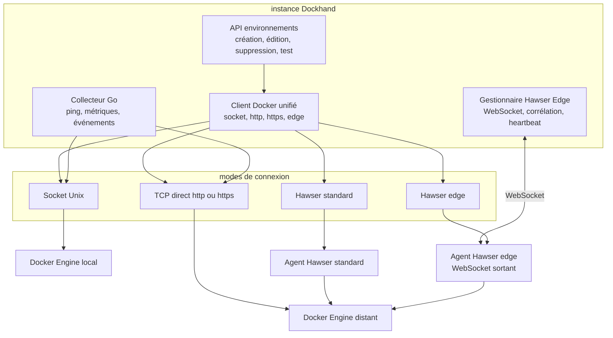
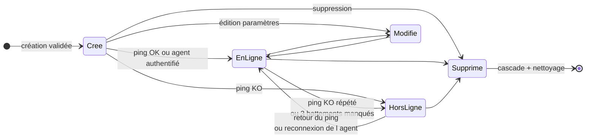
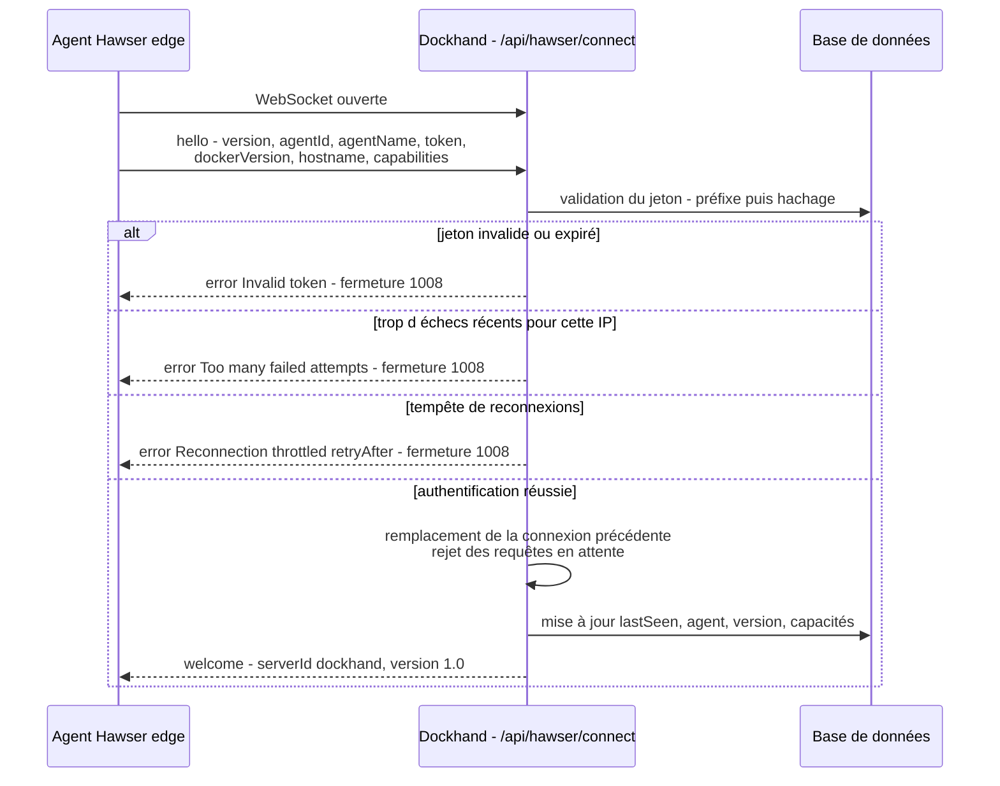

# Spécification fonctionnelle Dockhand — Chapitre 04 : Environnements et connexions aux hôtes Docker

| Rubrique | Valeur |
|---|---|
| **Chapitre** | 04 — Environnements et connexions aux hôtes Docker |
| **Statut** | Rédigé (phase 2, lot 2/5) |
| **Date de rédaction** | 21/08/2026 |
| **Version du logiciel analysée** | Dockhand **1.0.43** (numéro issu de [`package.json`](../../package.json:4)) |
| **Document de référence** | [`docs/spec/00-chapitrage.md`](00-chapitrage.md) |
| **Sources principales** | [`src/routes/api/environments/`](../../src/routes/api/environments/+server.ts:1), [`src/lib/server/hawser.ts`](../../src/lib/server/hawser.ts:1), [`src/lib/server/docker.ts`](../../src/lib/server/docker.ts:521), [`src/routes/api/hawser/tokens/+server.ts`](../../src/routes/api/hawser/tokens/+server.ts:1), [`src/lib/server/subprocess-manager.ts`](../../src/lib/server/subprocess-manager.ts:1), [`src/lib/server/db/schema/index.ts`](../../src/lib/server/db/schema/index.ts:23), [`src/lib/stores/environment.ts`](../../src/lib/stores/environment.ts:1) |

## Table des matières

1. [Objet, périmètre et prérequis de lecture](#1-objet-périmètre-et-prérequis-de-lecture)
2. [Vue d'ensemble de la gestion des environnements](#2-vue-densemble-de-la-gestion-des-environnements)
3. [Création et paramétrage d'un environnement](#3-création-et-paramétrage-dun-environnement)
4. [Les quatre modes de connexion](#4-les-quatre-modes-de-connexion)
5. [Test de connexion et détection de socket](#5-test-de-connexion-et-détection-de-socket)
6. [Cycle de vie, états et supervision de santé](#6-cycle-de-vie-états-et-supervision-de-santé)
7. [Agent Hawser : protocole et capacités](#7-agent-hawser--protocole-et-capacités)
8. [Jetons d'agent Hawser et périmètre d'accès](#8-jetons-dagent-hawser-et-périmètre-daccès)
9. [Options de collecte et comportements transverses](#9-options-de-collecte-et-comportements-transverses)
10. [Libellés, icônes et attributs d'affichage](#10-libellés-icônes-et-attributs-daffichage)
11. [Sélection et activation d'un environnement côté interface](#11-sélection-et-activation-dun-environnement-côté-interface)
12. [Synthèse des règles de sécurité](#12-synthèse-des-règles-de-sécurité)
13. [Renvois vers les autres chapitres](#13-renvois-vers-les-autres-chapitres)

---

## 1. Objet, périmètre et prérequis de lecture

Ce chapitre décrit la fonction **« environnements »**, entité pivot de Dockhand : la déclaration, la configuration et la supervision des hôtes Docker administrés par l'instance. Il couvre la création et le paramétrage (type de connexion, TLS, options de collecte), les quatre modes de connexion (socket Unix, TCP direct avec TLS optionnel, agent Hawser standard, agent Hawser edge), le cycle de vie et les états de santé, le protocole de l'agent Hawser (messages, battements de cœur, capacités), la gestion et la sécurité des jetons d'agent, les comportements transverses induits par le mode de connexion (collecte d'activité et de métriques, exécution distante de commandes, staging de fichiers, scanners), ainsi que la sélection d'environnement dans l'interface.

**Prérequis de lecture** : chapitre 02 (architecture, composants, canaux) et chapitre 03 (entité `environments`, `hawser_tokens`, concepts de collecte).

**Conventions** : les fonctions conditionnées à une licence Enterprise/SMB sont signalées *(Enterprise)* / *(SMB)* ; les fonctions activables par feature flag sont signalées *(flag)*.

## 2. Vue d'ensemble de la gestion des environnements

L'environnement est le **qualificateur universel** : toute ressource manipulée (conteneurs, stacks, images, volumes, réseaux, événements, métriques, sauvegardes…) est rattachée à un environnement. Le service applicatif unifie les quatre modes de connexion derrière une même configuration client ([`src/lib/server/docker.ts`](../../src/lib/server/docker.ts:521)) : les appels à l'API Docker, les flux (journaux, exec) et les commandes `docker compose` sont routés selon le mode déclaré.

Points fonctionnels clés :

- **Un environnement = un hôte Docker** identifié par un nom unique, un mode de connexion et des paramètres de connexion.
- **Une seule connexion edge active par environnement** : un nouvel agent qui s'authentifie remplace le précédent (les requêtes en attente de l'ancien sont rejetées).
- Les **états en ligne / hors-ligne** sont supervisés en continu (ping périodique via le collecteur Go, battements de cœur pour le mode edge) et notifiés (événements `environment_online` / `environment_offline`).
- Les environnements distants bénéficient des **mêmes fonctions** (déploiement de stacks, journaux, terminal, scans…), sous réserve des **capacités déclarées** par l'agent Hawser le cas échéant.

## 3. Création et paramétrage d'un environnement

### 3.1 Formulaire de création

La création passe par `POST /api/environments` ([`src/routes/api/environments/+server.ts`](../../src/routes/api/environments/+server.ts:87)). Champs fonctionnels :

| Champ | Rôle | Règles et valeurs par défaut |
|---|---|---|
| `name` | Nom d'affichage unique | Validé par règles dédiées (cf. §3.2) ; unicité contrôlée (conflit → erreur 409) |
| `connectionType` | Mode de connexion | `socket` \| `direct` \| `hawser-standard` \| `hawser-edge` ; toute autre valeur rejetée (400) ; défaut `socket` |
| `host` / `port` / `protocol` | Cible TCP | Requis pour `direct` et `hawser-standard` (sinon 400) ; port défaut **2375** ; protocole `http` ou `https` |
| `tlsCa` / `tlsCert` / `tlsKey` / `tlsSkipVerify` | Matériel TLS | PEM nettoyés (lignes vides retirées) pour le mode `direct` en https ; option *skip verify* pour accepter un certificat non vérifié |
| `socketPath` | Chemin du socket Unix | Défaut `/var/run/docker.sock` (mode `socket`) |
| `hawserToken` | Jeton d'agent | Utilisé par le mode `hawser-standard` (cf. §8) |
| `icon` | Icône d'affichage | Défaut `globe` ; icône personnalisée téléversable ensuite |
| `labels` | Libellés de catégorisation | Liste plafonnée (max `MAX_LABELS`), stockée en JSON |
| `publicIp` | IP publique affichée | Facultatif, purement informationnel |
| `collectActivity` / `collectMetrics` / `highlightChanges` | Options de collecte | **Activées par défaut** ; cf. §9 |

### 3.2 Validation du nom

Le nom est validé par un utilitaire dédié ([`src/lib/utils/env-name.ts`](../../src/lib/utils/env-name.ts:1)) ; les noms existants non conformes ne sont **pas corrigés automatiquement** — seules les écritures passent par le contrôle. Le nom sert aussi de **nom de répertoire sur disque** (`DATA_DIR/stacks/<nom>/` et `DATA_DIR/git-repos/<nom>/`), ce qui explique la sévérité du contrôle au renommage (cf. §6.4).

### 3.3 Effets de bord immédiats de la création

- **Prise en compte par la collecte** : les collecteurs d'arrière-plan sont notifiés (`refreshSubprocessEnvironments`) pour commencer à interroger le nouvel environnement sans redémarrage.
- **Redétection de l'hôte** : la détection du répertoire de données hôte est relancée — un déploiement sans environnement au démarrage (par exemple derrière un proxy de socket) peut ainsi atteindre Docker dès que le premier environnement est déclaré, sans redémarrage de l'instance.
- **Audit** : l'action `create` est journalisée *(Enterprise)*.
- **Auto-attribution de rôle** *(Enterprise)* : le créateur non-admin reçoit automatiquement le rôle **Admin** restreint à ce nouvel environnement (pour ne pas en être exclu par le RBAC), avec invalidation du cache de ses jetons d'API.

### 3.4 Consultation de la liste

`GET /api/environments` renvoie la liste enrichie : libellés parsés, `publicIp`, `timezone`, indicateurs de vérification de mises à jour (`updateCheckEnabled`, `updateCheckAutoUpdate`) et de prune d'images (`imagePruneEnabled`). En mode Enterprise, la liste est **filtrée selon les environnements accessibles** à l'utilisateur (RBAC) ; en édition Free, tous les environnements sont visibles.

## 4. Les quatre modes de connexion

### 4.1 Tableau comparatif

| Aspect | Socket Unix | TCP direct | Hawser standard | Hawser edge |
|---|---|---|---|---|
| `connectionType` | `socket` | `direct` | `hawser-standard` | `hawser-edge` |
| Qui initie | Dockhand (socket local) | Dockhand (HTTP/HTTPS) | Dockhand → agent (HTTP) | **Agent → Dockhand** (WebSocket sortante) |
| Cible | `socketPath` | `host:port` (protocole http/https, TLS facultatif) | Agent Hawser (host:port, en-tête `X-Hawser-Token`) | Endpoint interne `/api/hawser/connect` (jeton) |
| Cas d'usage | Hôte local, socket monté dans le conteneur | Hôte distant joignable, API Docker exposée (2375/2376) | Hôte distant avec agent, sans exposer l'API Docker | Hôte derrière NAT/pare-feu, connexion sortante uniquement |
| Paramètres spécifiques | Chemin de socket | CA/certificat/clé TLS, *skip verify* | Jeton d'agent (en clair côté environnement) | Jeton haché (table `hawser_tokens`), capacités d'agent |
| Supervision | Ping collecteur | Ping collecteur | Ping collecteur via agent | Battements WebSocket + métriques poussées par l'agent |

### 4.2 Socket Unix (mode `socket`)

L'API Docker est atteinte via le socket monté dans le conteneur Dockhand. La détection automatique ([`src/lib/server/docker.ts`](../../src/lib/server/docker.ts:165)) considère, dans l'ordre : la variable `DOCKER_SOCKET`, la variable `DOCKER_HOST` (schéma `unix://`), puis une liste de chemins candidats — `/var/run/docker.sock` (Linux/Docker Desktop), `~/.docker/run/docker.sock` (Docker Desktop Mac), `~/.orbstack/run/docker.sock` (OrbStack), `/run/docker.sock` — avec repli sur le chemin standard. Un endpoint de **détection de socket** (`/api/environments/detect-socket`) permet à l'interface de proposer les sockets trouvés lors de la création.

### 4.3 TCP direct (mode `direct`)

L'API Docker est atteinte en HTTP ou HTTPS sur `host:port`. En https, le triplet CA/certificat/clé est utilisé (les certificats sont conservés **chiffrés au repos**) ; l'option *skip verify* désactive la vérification du certificat serveur. Les connexions TLS bénéficient d'un **pool d'agents persistants** avec réutilisation des connexions et rotation des agents lorsque le matériel TLS change. Pour les déploiements de stacks, un **répertoire de staging distant** peut être configuré par environnement (cf. §9.3).

### 4.4 Hawser standard (mode `hawser-standard`)

Dockhand appelle l'agent Hawser distant en HTTP(S) ; l'agent rejoue les appels vers son Docker Engine local. L'authentification se fait par l'en-tête `X-Hawser-Token` portant le **jeton d'agent stocké côté environnement** (cf. §8.1). La supervision, la collecte et le test de connexion passent par la même voie.

### 4.5 Hawser edge (mode `hawser-edge`)

L'agent initie une **connexion WebSocket sortante** vers Dockhand (endpoint `/api/hawser/connect`), adaptée aux hôtes derrière NAT/pare-feu. Dockhand relaye ensuite requêtes/réponses et flux (journaux, exec, archives de fichiers) sur cette connexion persistante. Caractéristiques fonctionnelles :

- **Délais assouplis** : le ping de supervision passe à 20 s (au lieu de 5 s) pour tolérer les liaisons lentes.
- **Une seule connexion active** par environnement ; une reconnexion remplace la précédente.
- Les **fichiers de stack** sont préparés côté serveur puis transmis à l'agent (cf. §9.3).
- Le mode edge **ne peut pas être testé a priori** : la connexion est validée au moment où l'agent se connecte (cf. §5).

## 5. Test de connexion et détection de socket

Le test de connexion (`POST /api/environments/test`, [`src/routes/api/environments/test/+server.ts`](../../src/routes/api/environments/test/+server.ts:54)) vérifie une configuration **sans l'enregistrer** :

| Mode | Comportement du test |
|---|---|
| `socket` | Appel `/info` sur le socket indiqué ; retourne version serveur Docker, nombre de conteneurs et d'images, nom de l'hôte. |
| `direct` / `hawser-standard` | Appel `/info` sur `host:port` (HTTP) ou via le matériel TLS (HTTPS) ; jeton `X-Hawser-Token` pour Hawser standard, avec récupération d'informations complémentaires de l'agent. |
| `hawser-edge` | Retourne immédiatement un succès conditionnel : *« les environnements edge sont testés quand l'agent se connecte »* — la validation réelle a lieu à l'authentification WebSocket. |

Gardes fonctionnelles :

- **Protection SSRF** : l'hôte fourni dans le corps de la requête est validé — les plages privées/LAN sont **autorisées** (un Docker distant y vit légitimement), mais le loopback et l'adresse de métadonnées cloud sont **bloqués** ; un hôte refusé renvoie un échec explicite plutôt qu'une erreur de transport.
- Un échec de connexion est renvoyé comme **succès HTTP avec `success:false`** et un message lisible (l'incapacité à joindre Docker n'est pas une erreur de l'API de test).

Un endpoint distinct (`/api/environments/[id]/test`) permet de re-tester une configuration **enregistrée**.

## 6. Cycle de vie, états et supervision de santé

### 6.1 Diagramme d'états

### 6.2 Supervision en ligne / hors-ligne

- **Modes socket, direct, Hawser standard** : le collecteur Go interroge périodiquement chaque environnement (ping, statistiques, `/info`, événements selon les options) et remonte le statut au serveur, qui le stocke et le notifie (événements `environment_online` / `environment_offline` routables par canal de notification).
- **Mode Hawser edge** : la présence est matérialisée par la **connexion WebSocket active**. Un battement manqué met à jour l'horodatage dès qu'un message arrive ; l'absence de tout message pendant **90 secondes (3 battements de 30 s)** fait considérer la connexion perdue : les requêtes et flux en attente sont rejetés/terminés avec l'erreur « Connection timeout », la socket est fermée, et l'environnement repasse hors-ligne.
- L'attribut `hawserLastSeen` (dernier contact) alimente l'affichage de fraîcheur pour les environnements d'agent.

### 6.3 Édition

`PUT /api/environments/[id]` met à jour les paramètres de connexion, les options de collecte, l'icône, les libellés et l'IP publique. Comportements notables :

- le **cache du client Docker** de cet environnement est invalidé avant l'écriture (les nouveaux paramètres s'appliquent immédiatement) ;
- si les options de collecte changent, les collecteurs d'arrière-plan sont **reconfigurés à chaud** ;
- la **redétection de l'hôte** est relancée (même motif qu'à la création) ;
- l'**audit** enregistre le diff des modifications, en excluant les champs sensibles (matériel TLS, jeton Hawser) *(Enterprise)*.

### 6.4 Renommage d'un environnement

Renommer un environnement renomme **physiquement, avant l'écriture en base**, ses répertoires sur disque : `DATA_DIR/stacks/<ancien-nom>/` et `DATA_DIR/git-repos/<ancien-nom>/`. Règles fonctionnelles :

- si un répertoire cible existe déjà, le renommage est **refusé** (409) avec un message explicite — aucune donnée n'est écrasée ;
- en cas d'échec du second renommage après le premier, un **rollback best-effort** restaure l'état initial ;
- un échec de type système de fichiers différent (EXDEV) est signalé avec sa cause ;
- le renommage concerne **tous les modes** : pour les environnements socket/direct, le répertoire de staging **est** le répertoire déployé (les conteneurs référencent ces chemins) — l'interface avertit qu'un **redéploiement** est nécessaire ; pour les environnements Hawser, l'agent possède son répertoire distant (non impacté) mais la copie locale de staging et les clones Git suivent le nouveau nom ;
- après renommage, l'interface rafraîchit le nom de l'environnement sélectionné (cf. §11).

### 6.5 Suppression

`DELETE /api/environments/[id]` déclenche un nettoyage complet et ordonné :

1. **refus de sécurité** si le nom est vide/blanc (pour éviter tout nettoyage de répertoire non déterminé) ;
2. **fermeture de la connexion edge** le cas échéant (rejet des requêtes en attente, fermeture WebSocket avec le motif « Environment deleted ») ;
3. invalidation du cache client Docker ;
4. suppression des **stacks Git** de l'environnement : désinscription de leurs planifications de synchronisation, suppression des fichiers et des enregistrements ;
5. suppression de l'environnement en base (**cascade** sur jetons Hawser, événements, métriques, variables de stacks, etc. — cf. ch. 03) ;
6. nettoyage des éléments associés : icône personnalisée, IP publique, réglages de vérification de mises à jour et de prune d'images (avec désinscription des tâches planifiées correspondantes), désinscription des planifications de sauvegarde *(flag)* ;
7. suppression des répertoires `stacks/<nom>/` et `git-repos/<nom>/` **uniquement** s'ils sont bien des sous-répertoires nommés du répertoire racine (jamais la racine elle-même) ;
8. notification aux collecteurs (arrêt de la collecte), audit `delete`.

Les références « documentaires » (audit, exécutions) sont conservées avec remise à `null` du lien environnement.

## 7. Agent Hawser : protocole et capacités

### 7.1 Établissement de la connexion edge

### 7.2 Messages du protocole (version `1.0`)

Définis dans [`src/lib/server/hawser.ts`](../../src/lib/server/hawser.ts:19) :

| Message | Direction | Contenu fonctionnel |
|---|---|---|
| `hello` | Agent → Dockhand | Identification : version de protocole, identifiant et nom d'agent, **jeton**, version Docker, nom d'hôte, **capacités**. |
| `welcome` | Dockhand → Agent | Accusé d'authentification : identifiant de serveur, version de protocole. |
| `request` | Dockhand → Agent | Appel d'API Docker : méthode, chemin, en-têtes, corps (binaire en base64 pour les archives tar), marque `streaming` ; identifiant de corrélation (UUID). |
| `response` | Agent → Dockhand | Réponse corrélée : code HTTP, en-têtes, corps (binaire en base64 le cas échéant). |
| `stream` / `stream_end` | Agent → Dockhand (et `stream_end` dans l'autre sens pour annuler) | Morceaux de flux (journaux, exec, archives) avec canal `stdout`/`stderr` ; fin avec motif (fin naturelle, annulation, déconnexion). |
| `metrics` | Agent → Dockhand | Pompe de mesures hôte : CPU (usage + nombre de cœurs), mémoire totale/utilisée, disque, réseau, uptime. |
| `container_event` | Agent → Dockhand | Événement Docker de conteneur (action, conteneur, image, attributs, horodatage). |
| `ping` / `pong` | Bidirectionnel | Battements de cœur. |
| `error` | Agent → Dockhand | Erreur agent, éventuellement corrélée à une requête. |
| `exec_start` / `exec_ready` / `exec_input` / `exec_output` / `exec_resize` / `exec_end` | Bidirectionnel | Session de terminal distante (cf. ch. 05). |

### 7.3 Corrélation, délais et fiabilité

- Chaque requête reçoit un **UUID** ; la promesse côté serveur est résolue à la réception de la `response` correspondante, ou **rejetée au délai** (30 s par défaut, assoupli pour les opérations longues) ou sur `AbortSignal` de l'appelant.
- Les requêtes de flux (`streaming`) s'enregistrent séparément : les données arrivent par messages `stream` jusqu'au `stream_end` ; un `stream_end` émis par Dockhand **annule** le flux côté agent.
- **Ping serveur toutes les 5 s** pour maintenir la WebSocket ouverte à travers les proxys inverses aux délais d'inactivité agressifs ; tout message reçu met à jour l'horodatage de battement.
- **Perte de connexion** : après 90 s sans battement (contrôle toutes les 30 s), les requêtes en attente sont rejetées, les flux terminés, la socket fermée, l'environnement passe hors-ligne.

### 7.4 Anti-tempête de reconnexion

Un agent qui s'authentifie correctement mais dont le socket Docker local est défaillant peut boucler (connexion → délai → reconnexion). Le serveur limite ce phénomène : **au plus 10 reconnexions par fenêtre glissante de 2 minutes** par environnement ; au-delà, un **refroidissement progressif** s'applique (30 s, puis 60 s, 120 s, 300 s) communiqué à l'agent (`retryAfter`). Une connexion **stable pendant 5 minutes** réinitialise le compteur.

### 7.5 Capacités d'agent négociées

L'agent déclare ses **capacités** dans le `hello` (exemples observés : `compose`, `exec`, `metrics`). Elles sont stockées sur l'environnement (`hawserCapabilities`) et **conditionnent les fonctions proposées** : par exemple, le terminal interactif exige `exec`, le déploiement de stacks Compose exige `compose`. L'interface adapte les actions disponibles en conséquence ; une fonction demandée sur un agent non capable échoue avec une erreur explicite plutôt que d'aboutir à un comportement indéfini.

### 7.6 Données poussées par l'agent

- **Métriques** : le CPU brut envoyé par l'agent (pourcentage tous cœurs confondus) est **normalisé par le nombre de cœurs** avant stockage ; la mémoire est convertie en pourcentage ; les points alimentent le tampon mémoire et l'historique des graphiques (ch. 13). Les dernières mesures restent attachées à la connexion (affichage de l'uptime par exemple).
- **Événements de conteneurs** : mêmes traitements que la collecte locale — historisation (avec filtrage des répétitions de sondes de santé : seules les **transitions** healthy↔unhealthy sont conservées), diffusion SSE, notifications selon le type d'action et le label de masquage (ch. 13).

## 8. Jetons d'agent Hawser et périmètre d'accès

### 8.1 Deux natures de jetons

| Nature | Mode concerné | Stockage | Exposition |
|---|---|---|---|
| **Jeton d'environnement** (mode standard) | `hawser-standard` | Colonne `hawserToken` de l'environnement, en clair (chiffré au repos avec les autres secrets), envoyé dans l'en-tête `X-Hawser-Token` à chaque appel | Modifiable dans le formulaire d'environnement ; masqué dans l'interface |
| **Jeton d'agent edge** | `hawser-edge` | Table `hawser_tokens` : valeur **hachée** (Argon2id), préfixe de 8 caractères pour identification, nom, portée environnement, `isActive`, `lastUsed`, `expiresAt` | Généré via l'API d'administration ; **montré une seule fois** à la création |

### 8.2 Cycle de vie d'un jeton edge

- **Génération** (`POST /api/hawser/tokens`, réservé aux administrateurs) : 32 octets aléatoires encodés base64url ; la valeur en clair n'est retournée **qu'une fois** avec l'avertissement « sauvegardez ce jeton — il ne sera plus montré ». Une **valeur fournie par l'appelant** est acceptée (permet de générer côté client). Une **expiration facultative** peut être fixée.
- **Effets de bord de la génération** : toute connexion edge existante de l'environnement est **fermée** (l'agent doit se reconnecter avec le nouveau jeton) et **tous les jetons actifs de cet environnement sont révoqués** — un vieil agent ne peut pas se battre avec le nouveau pour le slot de connexion.
- **Validation** à chaque `hello` : recherche par **préfixe** (8 premiers caractères, indexée) puis vérification du hachage ; si aucun candidat n'existe, une vérification factice contre un hachage gabier est quand même effectuée (temps de réponse homogène, anti-énumération) ; l'expiration est contrôlée **après** la vérification du hachage ; `lastUsed` est mis à jour à chaque succès.
- **Révocation** (`DELETE /api/hawser/tokens?id=…`) : désactivation du jeton ; l'agent concerné ne pourra plus se reconnecter.
- **Liste** (`GET /api/hawser/tokens`) : préfixe, nom, environnement, état actif, dernière utilisation, création, expiration — **jamais la valeur complète**.

### 8.3 Périmètre d'accès

- Un jeton edge est **lié à un seul environnement** : l'agent authentifié ne parle que pour cet hôte.
- Les échecs d'authentification sont **comptés par IP source** avec un refroidissement de **5 minutes** (fermeture 1008 « Too many failed attempts ») — les agents réels utilisant un backoff de 30–60 s ne sont pas pénalisés ; un succès **efface** l'historique d'échecs de l'IP (rotation de jeton sans verrouillage).
- Les jetons sont supprimés **en cascade** avec l'environnement.

## 9. Options de collecte et comportements transverses

### 9.1 Options par environnement

| Option | Effet fonctionnel |
|---|---|
| `collectActivity` | Collecte des **événements de conteneurs** de l'hôte (flux d'activité, historique, notifications de cycle de vie). |
| `collectMetrics` | Collecte des **métriques** CPU/mémoire de l'hôte (graphiques de tableau de bord, historique). |
| `highlightChanges` | **Mise en évidence des changements** dans les inventaires (surlignage des conteneurs dont l'état change entre deux rafraîchissements). |

Ces options sont modifiables à chaud (reconfiguration immédiate des collecteurs, sans redémarrage). Le chapitre 13 détaille la consommation des données collectées ; le chapitre 15 les réglages globaux associés (rétentions, intervalles).

### 9.2 Modes de collecte : stream ou poll

La collecte d'événements fonctionne selon deux modes, configurés globalement et transmis au collecteur Go avec chaque environnement :

- **stream** : le collecteur maintient une connexion ouverte sur le flux d'événements Docker et pousse chaque événement au serveur dès sa survenue (réactivité maximale) ;
- **poll** : le collecteur interroge périodiquement les événements depuis un horodatage de reprise (robustesse sur les hôtes où le streaming est instable, par exemple certains NAS).

Dans les deux cas, le serveur reste responsable de l'écriture en base, de la diffusion SSE et des notifications ; le mode edge reçoit directement les événements poussés par l'agent (messages `container_event`).

### 9.3 Exécution distante de commandes et staging de fichiers

Les fonctions qui ne passent pas par l'API Docker HTTP utilisent des canaux adaptés au mode de connexion :

- **Déploiement de stacks Compose** : la CLI `docker compose` est exécutée côté serveur avec un `DOCKER_HOST` (et le matériel TLS) reconstitué pour l'environnement cible — y compris **à travers Hawser** (l'agent expose un point d'entrée compatible Docker). Cf. ch. 06.
- **Environnements edge** : les fichiers de stack sont préparés/stagés côté serveur (arborescence complète : compose, `.env`, fichiers du dépôt), encodés (binaire en base64, plafonds par fichier et total), puis transmis à l'agent qui les matérialise dans son répertoire de stacks avant d'exécuter Compose localement. Les opérations de cycle de vie (start/stop/restart/down) réutilisent le même transfert pour garantir la présence des fichiers référencés (`include:`, fichiers voisins).
- **Environnements directs (`direct`)** : un **répertoire de stacks distant** peut être configuré par environnement (`remote_stacks_dir`) ; lors d'un déploiement, l'arborescence est **copiée sur l'hôte distant** (conteneur utilitaire + archive tar) et les binds relatifs `./x` du fichier Compose sont **réécrits** vers le chemin absolu correspondant sur l'hôte ; cette copie sert de référence commune (sauvegardes, cohérence des chemins) — elle n'est **jamais supprimée** automatiquement (résidu sûr, cf. ch. 06 §10).

### 9.4 Scanners de vulnérabilités

Les conteneurs de scan (Grype/Trivy) s'exécutent **sur l'environnement cible** : le scanner **réplique la connexion Docker de Dockhand** (socket local, TCP/TLS, ou via Hawser avec le jeton adapté) pour joindre l'API et montter les données d'image. Le détail des scans fait l'objet du chapitre 10.

## 10. Libellés, icônes et attributs d'affichage

- **Libellés** (`labels`) : liste de chaînes de catégorisation, plafonnée en nombre, stockée en JSON sur l'environnement. Utilisations : filtrage du tableau de bord par libellé, regroupements visuels, couleurs automatiques ([`src/lib/utils/label-colors.ts`](../../src/lib/utils/label-colors.ts:1)).
- **Icônes** : icône prédéfinie (défaut `globe`) ou **icône personnalisée téléversée** (endpoint `/api/environments/[id]/icon`, fichier dédié supprimé avec l'environnement).
- **IP publique** (`publicIp`) : information déclarative affichée sur les tuiles (aide au raccourci d'accès aux services).
- **Fuseau horaire** (`timezone`) : fuseau de l'hôte, utilisé pour l'affichage et les planifications liées à l'environnement (endpoint `/api/environments/[id]/timezone`, cf. ch. 14).
- **Attributs d'agent** : `hawserAgentId/Name/Version`, capacités, `hawserLastSeen` — affichés pour qualifier la connexion des environnements Hawser.
- **Indicateurs de réglages** : la liste expose l'état de la vérification de mises à jour et du prune d'images par environnement (renvois ch. 08 et ch. 14).

## 11. Sélection et activation d'un environnement côté interface

Le frontend maintient l'environnement actif dans un store Svelte ([`src/lib/stores/environment.ts`](../../src/lib/stores/environment.ts:41)) :

- **Persistance locale** : le choix est mémorisé dans `localStorage` (clé `dockhand:environment`) et restauré au chargement — l'utilisateur retrouve son dernier environnement.
- **Sélecteur global** : toutes les pages principales qualifient leurs appels API avec l'environnement sélectionné (paramètre `env`), au travers de helpers de construction d'URL.
- **Auto-sélection** : au rafraîchissement de la liste, si aucun environnement n'est sélectionné (première visite) ou si l'environnement sélectionné **n'existe plus**, le **premier** de la liste est automatiquement sélectionné ; si la liste est vide, la sélection est effacée.
- **Gestion des périmés** : lorsqu'une API répond 404 pour l'environnement courant (supprimé entre-temps), le store **purge** la sélection périmée (le même mécanisme sert à nettoyer `localStorage` après suppression).
- **Renommage répercuté** : le libellé de l'environnement sélectionné est rafraîchi depuis la liste (l'identifiant reste stable).
- **Permissions** : en Enterprise, la liste renvoyée déjà filtrée par la portée de l'utilisateur masque de fait les environnements interdits *(Enterprise)* ; les appels directs à un environnement non autorisé sont rejetés côté serveur (403).

## 12. Synthèse des règles de sécurité

| Risque | Mesure fonctionnelle |
|---|---|
| Vol/fuite de jeton edge | Valeur **hachée** (Argon2id) en base, montrée **une fois**, préfixe seul dans les listes ; expiration possible ; révocation immédiate. |
| Énumération/brute-force de jetons | Recherche par préfixe + vérification à temps constant (hachage gabier) ; refroidissement de 5 min par IP après échec. |
| Usurpation de slot de connexion | Un seul agent actif par environnement ; génération de jeton = révocation des anciens + fermeture de la connexion courante. |
| Tempête de reconnexions | Fenêtre glissante 2 min / 10 essais, refroidissements progressifs 30→300 s, reset après stabilité. |
| Connexion morte indéfiniment | Battements 5 s, expiration à 90 s (3 battements manqués), rejet des requêtes pendantes. |
| SSRF via le testeur de connexion | Loopback et métadonnées cloud bloqués, LAN autorisé ; échec renvoyé comme résultat, pas comme erreur de transport. |
| Suppression dangereuse de répertoires | Refus si nom vide ; suppression limitée aux sous-répertoires `stacks/<nom>/` et `git-repos/<nom>/` strictement nommés. |
| Écrasement au renommage | Refus si le répertoire cible existe ; rollback best-effort ; erreurs de système de fichiers explicites. |
| Fuite de secrets dans l'audit | Diff d'audit amputé des champs TLS et jetons. |
| Secrets au repos | Matériel TLS et jetons d'environnement chiffrés (AES), rotation de clé au démarrage (ch. 02). |

## 13. Renvois vers les autres chapitres

| Chapitre | Lien | Pourquoi y aller |
|---|---|---|
| 00 — Chapitrage | [`00-chapitrage.md`](00-chapitrage.md) | Sommaire de référence. |
| 01 — Présentation générale | [`01-presentation-generale.md`](01-presentation-generale.md) | Positionnement multi-hôtes, personas (MSP, homelab). |
| 02 — Architecture fonctionnelle | [`02-architecture-fonctionnelle.md`](02-architecture-fonctionnelle.md) | Rôle du collecteur Go, des WebSockets, des topologies de déploiement. |
| 03 — Concepts et entités | [`03-concepts-entites.md`](03-concepts-entites.md) | Attributs complets de `environments` et `hawser_tokens`, cascades de suppression. |
| 05 — Gestion des conteneurs | [`05-conteneurs.md`](05-conteneurs.md) | Déclinaison des quatre modes de connexion sur chaque fonction conteneur (logs, exec, fichiers). |
| 06 — Stacks Compose | [`06-stacks.md`](06-stacks.md) | `DOCKER_HOST` adapté, staging distant, exécution Compose à travers Hawser. |
| 07 — Intégration Git | `07-integration-git.md` *(à rédiger, lot 2)* | Clones par environnement (`git-repos/<nom>/`), impact du renommage. |
| 08 — Images et registres | `08-images-registres.md` *(à rédiger, lot 3)* | Vérification de mises à jour et prune d'images par environnement. |
| 10 — Sécurité applicative | `10-securite-applicative.md` *(à rédiger, lot 3)* | Scanners répliquant la connexion de l'environnement. |
| 11 — Sauvegardes (bêta) | `11-sauvegardes.md` *(à rédiger, lot 3)* | Désinscription des planifications à la suppression *(flag)*. |
| 12 — Authentification et RBAC | `12-authentification-rbac.md` *(à rédiger, lot 4)* | Portée par environnement, auto-attribution Admin au créateur. |
| 13 — Observabilité | `13-observabilite.md` *(à rédiger, lot 4)* | Consommation des événements/métriques collectés, notifications en ligne/hors-ligne. |
| 14 — Automatisation | `14-automatisation-api.md` *(à rédiger, lot 5)* | Fuseaux horaires, tâches planifiées par environnement, API environnements. |
| 15 — Administration | `15-administration-exploitation.md` *(à rédiger, lot 5)* | Réglages par environnement (onglets, types d'événements), icônes. |
