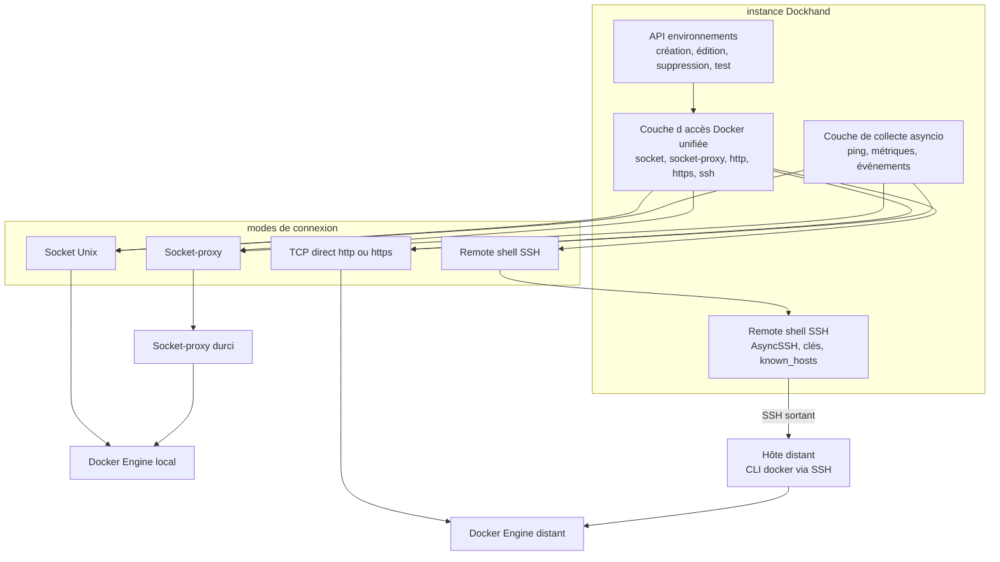
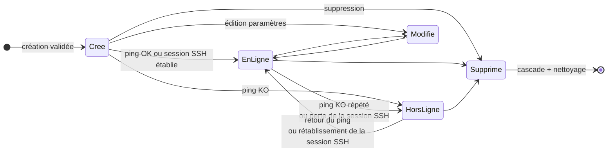
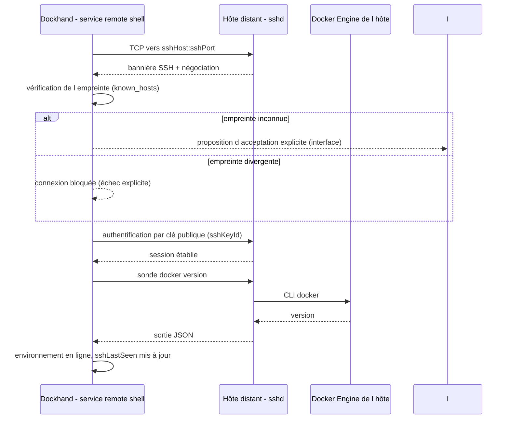

# Spécification fonctionnelle Dockhand — Chapitre 04 : Environnements et connexions aux hôtes Docker

| Rubrique | Valeur |
|---|---|
| **Chapitre** | 04 — Environnements et connexions aux hôtes Docker |
| **Document de référence** | [`00-chapitrage.md`](00-chapitrage.md) |

## Table des matières

1. [Objet, périmètre et prérequis de lecture](#1-objet-périmètre-et-prérequis-de-lecture)
2. [Vue d'ensemble de la gestion des environnements](#2-vue-densemble-de-la-gestion-des-environnements)
3. [Création et paramétrage d'un environnement](#3-création-et-paramétrage-dun-environnement)
4. [Les quatre modes de connexion](#4-les-quatre-modes-de-connexion)
5. [Test de connexion et détection de socket](#5-test-de-connexion-et-détection-de-socket)
6. [Cycle de vie, états et supervision de santé](#6-cycle-de-vie-états-et-supervision-de-santé)
7. [Remote shell SSH : établissement et commandes distantes](#7-remote-shell-ssh--établissement-et-commandes-distantes)
8. [Clés SSH et périmètre d'accès](#8-clés-ssh-et-périmètre-daccès)
9. [Options de collecte et comportements transverses](#9-options-de-collecte-et-comportements-transverses)
10. [Libellés, icônes et attributs d'affichage](#10-libellés-icônes-et-attributs-daffichage)
11. [Sélection et activation d'un environnement côté interface](#11-sélection-et-activation-dun-environnement-côté-interface)
12. [Synthèse des règles de sécurité](#12-synthèse-des-règles-de-sécurité)
13. [Renvois vers les autres chapitres](#13-renvois-vers-les-autres-chapitres)

---

## 1. Objet, périmètre et prérequis de lecture

Ce chapitre décrit la fonction **« environnements »**, entité pivot de Dockhand : la déclaration, la configuration et la supervision des hôtes Docker administrés par l'instance. Il couvre la création et le paramétrage (type de connexion, TLS, options de collecte), les quatre modes de connexion (socket Unix, socket-proxy, TCP direct avec TLS optionnel, remote shell SSH), le cycle de vie et les états de santé, le **remote shell SSH** (établissement de la connexion AsyncSSH, clés SSH, known_hosts, commandes docker exécutées à distance), les comportements transverses induits par le mode de connexion (collecte d'activité et de métriques, exécution distante de commandes, staging de fichiers, scanners), ainsi que la sélection d'environnement dans l'interface.

**Prérequis de lecture** : chapitre 02 (architecture, composants, canaux) et chapitre 03 (entité `environments`, `ssh_keys`, concepts de collecte).

**Conventions** : les fonctions conditionnées à une licence Enterprise/SMB sont signalées *(Enterprise)* / *(SMB)* ; les fonctions activables par feature flag sont signalées *(flag)*.

## 2. Vue d'ensemble de la gestion des environnements

L'environnement est le **qualificateur universel** : toute ressource manipulée (conteneurs, stacks, images, volumes, réseaux, événements, métriques, sauvegardes…) est rattachée à un environnement. Le service applicatif unifie les quatre modes de connexion derrière une même couche d'accès Docker : les appels à l'API Docker (aiodocker), les flux (journaux, exec) et les commandes `docker compose` (sous-processus ou exécution distante) sont routés selon le mode déclaré.

Points fonctionnels clés :

- **Un environnement = un hôte Docker** identifié par un nom unique, un mode de connexion et des paramètres de connexion.
- **Une seule connexion SSH active par environnement** : une nouvelle session distante remplace la précédente (les commandes en attente de l'ancienne sont rejetées).
- Les **états en ligne / hors-ligne** sont supervisés en continu (ping périodique par la couche de collecte, présence de la connexion SSH pour le mode remote shell) et notifiés (événements `environment_online` / `environment_offline`).
- Les environnements distants bénéficient des **mêmes fonctions** (déploiement de stacks, journaux, terminal, scans…), le remote shell SSH couvrant à lui seul les usages autrefois distingués en « standard » et « edge » : **tout passe par une connexion SSH sortante du serveur** Dockhand vers l'hôte distant.

## 3. Création et paramétrage d'un environnement

### 3.1 Formulaire de création

La création passe par `POST /api/environments`. Champs fonctionnels :

| Champ | Rôle | Règles et valeurs par défaut |
|---|---|---|
| `name` | Nom d'affichage unique | Validé par règles dédiées (cf. §3.2) ; unicité contrôlée (conflit → erreur 409) |
| `connectionType` | Mode de connexion | `socket` \| `socket-proxy` \| `direct` \| `remote-shell` ; toute autre valeur rejetée (400) ; défaut `socket` |
| `host` / `port` / `protocol` | Cible TCP | Requis pour `direct` (sinon 400) ; port défaut **2375** ; protocole `http` ou `https` |
| `tlsCa` / `tlsCert` / `tlsKey` / `tlsSkipVerify` | Matériel TLS | PEM nettoyés (lignes vides retirées) pour le mode `direct` en https ; option *skip verify* pour accepter un certificat non vérifié |
| `socketPath` | Chemin du socket Unix | Défaut `/var/run/docker.sock` (modes `socket` et `socket-proxy`) |
| `sshHost` / `sshPort` / `sshUser` | Cible SSH | Requis pour `remote-shell` ; port défaut **22** ; utilisateur dédié recommandé sur l'hôte distant |
| `sshKeyId` | Clé SSH d'authentification | Référence à une clé enregistrée (cf. §8) ; ed25519 recommandé |
| `icon` | Icône d'affichage | Défaut `globe` ; icône personnalisée téléversable ensuite |
| `labels` | Libellés de catégorisation | Liste plafonnée (max `MAX_LABELS`), stockée en JSON |
| `publicIp` | IP publique affichée | Facultatif, purement informationnel |
| `collectActivity` / `collectMetrics` / `highlightChanges` | Options de collecte | **Activées par défaut** ; cf. §9 |

### 3.2 Validation du nom

Le nom est validé par des règles dédiées ; les noms existants non conformes ne sont **pas corrigés automatiquement** — seules les écritures passent par le contrôle. Le nom sert aussi de **nom de répertoire sur disque** (`DATA_DIR/stacks/<nom>/` et `DATA_DIR/git-repos/<nom>/`), ce qui explique la sévérité du contrôle au renommage (cf. §6.4).

### 3.3 Effets de bord immédiats de la création

- **Prise en compte par la collecte** : les tâches de collecte d'arrière-plan sont notifiées pour commencer à interroger le nouvel environnement sans redémarrage.
- **Redétection de l'hôte** : la détection du répertoire de données hôte est relancée — un déploiement sans environnement au démarrage (par exemple derrière un socket-proxy) peut ainsi atteindre Docker dès que le premier environnement est déclaré, sans redémarrage de l'instance.
- **Audit** : l'action `create` est journalisée *(Enterprise)*.
- **Auto-attribution de rôle** *(Enterprise)* : le créateur non-admin reçoit automatiquement le rôle **Admin** restreint à ce nouvel environnement (pour ne pas en être exclu par le RBAC), avec invalidation du cache de ses jetons d'API.

### 3.4 Consultation de la liste

`GET /api/environments` renvoie la liste enrichie : libellés parsés, `publicIp`, `timezone`, indicateurs de vérification de mises à jour (`updateCheckEnabled`, `updateCheckAutoUpdate`) et de prune d'images (`imagePruneEnabled`). En mode Enterprise, la liste est **filtrée selon les environnements accessibles** à l'utilisateur (RBAC) ; en édition Free, tous les environnements sont visibles.

## 4. Les quatre modes de connexion

### 4.1 Tableau comparatif

| Aspect | Socket Unix | Socket-proxy | TCP direct | Remote shell SSH |
|---|---|---|---|---|
| `connectionType` | `socket` | `socket-proxy` | `direct` | `remote-shell` |
| Qui initie | Dockhand (socket local) | Dockhand (vers le proxy) | Dockhand (HTTP/HTTPS) | **Dockhand** (SSH sortant vers l'hôte) |
| Cible | `socketPath` | Socket/hôte du proxy filtré | `host:port` (protocole http/https, TLS facultatif) | `sshHost:sshPort`, utilisateur `sshUser`, clé `sshKeyId` |
| Cas d'usage | Hôte local, socket monté dans le conteneur | Hôte local durci : l'API Docker est filtrée par un socket-proxy | Hôte distant joignable, API Docker exposée (2375/2376) | Hôte distant **sans exposer l'API Docker** ; fonctionne derrière NAT/pare-feu dès lors que l'hôte est joignable en SSH |
| Paramètres spécifiques | Chemin de socket | Chemin de socket / hôte:port du proxy | CA/certificat/clé TLS, *skip verify* | Clé SSH, known_hosts (empreinte de l'hôte) |
| Supervision | Ping couche de collecte | Ping couche de collecte | Ping couche de collecte | Ping couche de collecte via la connexion SSH (commande `docker version` distante) |

### 4.2 Socket Unix (mode `socket`)

L'API Docker est atteinte via le socket monté dans le conteneur Dockhand. La détection automatique considère, dans l'ordre : la variable `DOCKER_SOCKET`, la variable `DOCKER_HOST` (schéma `unix://`), puis une liste de chemins candidats — `/var/run/docker.sock` (Linux/Docker Desktop), `~/.docker/run/docker.sock` (Docker Desktop Mac), `~/.orbstack/run/docker.sock` (OrbStack), `/run/docker.sock` — avec repli sur le chemin standard. Un endpoint de **détection de socket** (`/api/environments/detect-socket`) permet à l'interface de proposer les sockets trouvés lors de la création.

### 4.3 Socket-proxy (mode `socket-proxy`)

Même mécanique que le socket local, mais l'API Docker est atteinte à travers un **socket-proxy durci** : un conteneur intermédiaire (type docker-socket-proxy) qui n'expose qu'un sous-ensemble filtré des endpoints de l'API Docker. Les chemins/hôtes du proxy sont paramétrables ; c'est le mode recommandé pour durcir un hôte local sans donner à Dockhand un accès complet au socket brut. Les fonctions exigeant un endpoint filtré par le proxy échouent avec un message fonctionnel explicite.

### 4.4 TCP direct (mode `direct`)

L'API Docker est atteinte en HTTP ou HTTPS sur `host:port`. En https, le triplet CA/certificat/clé est utilisé (les certificats sont conservés **chiffrés au repos**) ; l'option *skip verify* désactive la vérification du certificat serveur. Les connexions TLS bénéficient d'un **pool de connexions persistantes** avec réutilisation et rotation lorsque le matériel TLS change. Pour les déploiements de stacks, un **répertoire de staging distant** peut être configuré par environnement (cf. §9.3).

### 4.5 Remote shell SSH (mode `remote-shell`)

Dockhand ouvre une **connexion SSH sortante** (AsyncSSH) vers l'hôte distant et y **exécute le CLI docker** (`docker`, `docker compose`) avec les paramètres de l'environnement :

- **Authentification par clés SSH** — ed25519 recommandé (RSA accepté) ; **pas de jeton maison** : la clé est référencée par `sshKeyId` et sa partie privée reste chiffrée au repos.
- **Hôte, port, utilisateur** configurables (`sshHost`, `sshPort` défaut 22, `sshUser`) ; l'utilisateur distant doit avoir accès au CLI docker (groupe `docker` ou équivalent).
- **known_hosts** : l'empreinte de l'hôte est vérifiée à chaque connexion ; la première connexion exige une acceptation explicite de l'empreinte dans l'interface, toute divergence ultérieure bloque la connexion (protection contre l'usurpation d'hôte / MITM).
- Les fonctions couvertes sont **identiques aux autres modes** : inventaire, cycle de vie des conteneurs, journaux, exec, fichiers, déploiement de stacks (les fichiers de stack sont préparés côté serveur puis transmis via la connexion SSH, et `docker compose` est exécuté sur l'hôte), scans.
- Ce mode **remplace l'agent distant historique** dans ses deux déclinaisons : tout passe par SSH sortant **du serveur** Dockhand vers l'hôte — il n'y a plus de distinction « standard » / « edge », plus d'agent à déployer, plus de protocole maison, plus de jetons d'agent.

## 5. Test de connexion et détection de socket

Le test de connexion (`POST /api/environments/test`) vérifie une configuration **sans l'enregistrer** :

| Mode | Comportement du test |
|---|---|
| `socket` / `socket-proxy` | Appel `/info` sur le socket indiqué ; retourne version serveur Docker, nombre de conteneurs et d'images, nom de l'hôte. |
| `direct` | Appel `/info` sur `host:port` (HTTP) ou via le matériel TLS (HTTPS). |
| `remote-shell` | Ouverture d'une connexion SSH (clé sélectionnée), vérification de l'empreinte d'hôte, exécution d'une commande de sonde (`docker version`) sur l'hôte distant ; retourne la version Docker distante, le nom d'hôte et des informations de la session. Si l'empreinte de l'hôte est inconnue, le test retourne l'empreinte à faire valider (acceptation explicite), sans silencieusement l'ajouter à known_hosts. |

Gardes fonctionnelles :

- **Protection SSRF** : l'hôte fourni dans le corps de la requête est validé — les plages privées/LAN sont **autorisées** (un Docker distant y vit légitimement), mais le loopback et l'adresse de métadonnées cloud sont **bloqués** ; un hôte refusé renvoie un échec explicite plutôt qu'une erreur de transport.
- Un échec de connexion est renvoyé comme **succès HTTP avec `success:false`** et un message lisible (l'incapacité à joindre Docker n'est pas une erreur de l'API de test).

Un endpoint distinct (`/api/environments/[id]/test`) permet de re-tester une configuration **enregistrée**.

## 6. Cycle de vie, états et supervision de santé

### 6.1 Diagramme d'états

### 6.2 Supervision en ligne / hors-ligne

- **Modes socket, socket-proxy, direct** : la couche de collecte interroge périodiquement chaque environnement (ping, statistiques, `/info`, événements selon les options) et met à jour le statut, qui est stocké et notifié (événements `environment_online` / `environment_offline` routables par canal de notification).
- **Mode remote-shell** : la présence est matérialisée par la **session SSH active**. Le ping périodique exécute la commande de sonde sur l'hôte distant à travers la connexion ; l'absence de réponse au-delà du seuil de perte (plusieurs pings consécutifs) fait considérer la connexion perdue : les commandes en attente sont rejetées avec l'erreur « Connection timeout », la session est fermée, et l'environnement repasse hors-ligne. Une nouvelle session est rétablie à la demande suivante.
- L'attribut `sshLastSeen` (dernier contact réussi) alimente l'affichage de fraîcheur pour les environnements remote shell.

### 6.3 Édition

`PUT /api/environments/[id]` met à jour les paramètres de connexion, les options de collecte, l'icône, les libellés et l'IP publique. Comportements notables :

- le **cache du client Docker** de cet environnement est invalidé avant l'écriture (les nouveaux paramètres s'appliquent immédiatement) ;
- si les paramètres SSH changent (hôte, port, utilisateur, clé), la **session SSH courante est fermée** pour être rétablie avec les nouveaux paramètres ;
- si les options de collecte changent, les tâches de collecte d'arrière-plan sont **reconfigurées à chaud** ;
- la **redétection de l'hôte** est relancée (même motif qu'à la création) ;
- l'**audit** enregistre le diff des modifications, en excluant les champs sensibles (matériel TLS, référence et empreinte de clé SSH : jamais la clé privée) *(Enterprise)*.

### 6.4 Renommage d'un environnement

Renommer un environnement renomme **physiquement, avant l'écriture en base**, ses répertoires sur disque : `DATA_DIR/stacks/<ancien-nom>/` et `DATA_DIR/git-repos/<ancien-nom>/`. Règles fonctionnelles :

- si un répertoire cible existe déjà, le renommage est **refusé** (409) avec un message explicite — aucune donnée n'est écrasée ;
- en cas d'échec du second renommage après le premier, un **rollback best-effort** restaure l'état initial ;
- un échec de type système de fichiers différent (EXDEV) est signalé avec sa cause ;
- le renommage concerne **tous les modes** : pour les environnements socket/socket-proxy/direct, le répertoire de staging **est** le répertoire déployé (les conteneurs référencent ces chemins) — l'interface avertit qu'un **redéploiement** est nécessaire ; pour les environnements remote shell, l'hôte distant possède son répertoire de stacks propre (non impacté côté hôte) mais la copie locale de staging et les clones Git suivent le nouveau nom ;
- après renommage, l'interface rafraîchit le nom de l'environnement sélectionné (cf. §11).

### 6.5 Suppression

`DELETE /api/environments/[id]` déclenche un nettoyage complet et ordonné :

1. **refus de sécurité** si le nom est vide/blanc (pour éviter tout nettoyage de répertoire non déterminé) ;
2. **fermeture de la session SSH** le cas échéant (rejet des commandes en attente, fermeture propre avec le motif « Environment deleted ») ;
3. invalidation du cache client Docker ;
4. suppression des **stacks Git** de l'environnement : désinscription de leurs planifications de synchronisation, suppression des fichiers et des enregistrements ;
5. suppression de l'environnement en base (**cascade** sur événements, métriques, variables de stacks, etc. — cf. ch. 03) ;
6. nettoyage des éléments associés : icône personnalisée, IP publique, réglages de vérification de mises à jour et de prune d'images (avec désinscription des tâches planifiées correspondantes), désinscription des planifications de sauvegarde *(flag)* ;
7. suppression des répertoires `stacks/<nom>/` et `git-repos/<nom>/` **uniquement** s'ils sont bien des sous-répertoires nommés du répertoire racine (jamais la racine elle-même) ;
8. notification aux tâches de collecte (arrêt de la collecte), audit `delete`.

La **clé SSH** référencée n'est pas supprimée (elle peut servir à d'autres environnements) ; le lien est simplement rompu. Les références « documentaires » (audit, exécutions) sont conservées avec remise à `null` du lien environnement.

## 7. Remote shell SSH : établissement et commandes distantes

### 7.1 Établissement de la connexion

Caractéristiques fonctionnelles :

- **Une seule session active par environnement** : une nouvelle session (après perte ou action manuelle) remplace la précédente ; les commandes en attente de l'ancienne session sont rejetées avec une erreur explicite.
- **Rétablissement automatique** : après une perte, la session est rétablie à la prochaine commande ; la supervision (§6.2) continue d'interroger l'hôte selon le rythme de ping.
- **Délais assouplis** : les commandes distantes bénéficient de délais adaptés aux liaisons lentes (sonde de supervision espacée par rapport au ping local).

### 7.2 Commandes docker exécutées à distance

Les fonctions qui ne passent pas par l'API Docker HTTP sont exécutées via le **CLI docker sur l'hôte distant**, à travers la session SSH :

| Fonction | Commande distante type | Notes |
|---|---|---|
| Sonde de santé | `docker version` (sortie JSON) | Ping de supervision ; renseigne la version Docker distante. |
| Déploiement de stack | `docker compose ... up -d` (options build/pull/force) | Exécutée dans le répertoire de stacks de l'hôte ; fichiers préalablement transférés (cf. §9.3). |
| Cycle de vie de stack | `docker compose ... start/stop/restart/down` | Même répertoire ; présence des fichiers garantie avant exécution. |
| Informations système | `docker system df`, `docker info` | Usage disque et informations d'hôte pour la maintenance (ch. 09). |
| Nettoyages planifiés | `docker image prune …`, prunes système | Options identiques aux autres modes (ch. 09 et 14). |

Les opérations de **l'API Docker** (inventaire des conteneurs, inspect, stats, journaux en flux, exec, archives de fichiers) passent par la même session SSH : requêtes API transportées à travers la connexion et flux relayés (journaux, exec) vers les canaux navigateur (SSE/WebSocket).

### 7.3 Fiabilité et délais

- Chaque commande distante reçoit un **délai d'exécution** ; les opérations longues (déploiement Compose avec build) bénéficient de délais étendus et d'une annulation propre à la demande.
- **Perte de connexion** : après plusieurs pings sans réponse, les commandes en attente sont rejetées, les flux terminés, la session fermée, l'environnement passe hors-ligne ; rétablissement automatique à la prochaine sollicitation.
- **Anti-tempête de reconnexion** : les tentatives de réétablissement de session sont limitées par une fenêtre glissante avec refroidissement progressif (30 s, puis 60 s, 120 s, 300 s) par environnement ; une session **stable pendant 5 minutes** réinitialise le compteur.

### 7.4 Données collectées via le remote shell

- **Métriques** : le CPU brut relevé sur l'hôte (pourcentage tous cœurs confondus) est **normalisé par le nombre de cœurs** avant stockage ; la mémoire est convertie en pourcentage ; les points alimentent le tampon mémoire et l'historique des graphiques (ch. 13).
- **Événements de conteneurs** : mêmes traitements que la collecte locale — historisation (avec filtrage des répétitions de sondes de santé : seules les **transitions** healthy↔unhealthy sont conservées), diffusion SSE, notifications selon le type d'action et le label de masquage (ch. 13).

## 8. Clés SSH et périmètre d'accès

### 8.1 Gestion des clés

**Les jetons d'agent n'existent plus** : l'authentification distante repose exclusivement sur des **clés SSH** enregistrées (`ssh_keys`, cf. ch. 03 §4.2) :

| Aspect | Règle fonctionnelle |
|---|---|
| **Génération** | Depuis l'interface (réservée aux administrateurs) : paire de clés générée côté serveur, algorithme **ed25519 recommandé** ; la **clé privée n'est affichée/importable qu'à la création** puis stockée **chiffrée au repos** (AES-256-GCM). L'**import d'une clé existante** est également possible (avec ou sans passphrase). |
| **Clé publique** | Toujours consultable (à déployer dans l'`authorized_keys` de l'hôte distant, idéalement avec restriction de commande) ; l'empreinte sert d'identification stable dans les listes. |
| **Test de connexion des clés** | Une sonde vérifie qu'une clé est utilisable pour joindre un hôte donné (authentification + sonde `docker version`), sans enregistrer d'environnement. |
| **Utilisation** | Référencée par un ou plusieurs environnements `remote-shell` ; `lastUsedAt` est mis à jour à chaque session réussie. |
| **Suppression** | Refusée si des environnements l'utilisent encore (ou avec déréférencement explicite) ; jamais de suppression silencieuse. |

### 8.2 Known_hosts et empreintes d'hôtes

- Chaque environnement remote shell porte son entrée **known_hosts** : l'empreinte attendue de l'hôte distant.
- **Première connexion** : l'empreinte est présentée à l'administrateur pour **acceptation explicite** ; elle est ensuite vérifiée à chaque connexion.
- **Divergence d'empreinte** : la connexion est **bloquée** avec un message explicite (hôte reconfigifié ou tentative d'usurpation) ; l'administrateur doit réaccepter délibérément la nouvelle empreinte.
- Le test de connexion n'ajoute **jamais** silencieusement une empreinte à known_hosts.

### 8.3 Périmètre d'accès

- Une clé peut être partagée par plusieurs environnements, mais **chaque environnement remote shell ne parle que pour son hôte** (`sshHost`/`sshUser` propres) : aucun mécanisme ne permet à une session d'atteindre un autre hôte.
- Les échecs d'authentification SSH sont **comptés par hôte cible** avec refroidissement (protection contre les tentatives répétées) ; un succès efface l'historique d'échecs.
- Les clés privées ne sortent **jamais** du serveur : elles sont déchiffrées en mémoire pour l'établissement des sessions uniquement ; l'API et l'audit n'exposent que l'empreinte et la partie publique.

## 9. Options de collecte et comportements transverses

### 9.1 Options par environnement

| Option | Effet fonctionnel |
|---|---|
| `collectActivity` | Collecte des **événements de conteneurs** de l'hôte (flux d'activité, historique, notifications de cycle de vie). |
| `collectMetrics` | Collecte des **métriques** CPU/mémoire de l'hôte (graphiques de tableau de bord, historique). |
| `highlightChanges` | **Mise en évidence des changements** dans les inventaires (surlignage des conteneurs dont l'état change entre deux rafraîchissements). |

Ces options sont modifiables à chaud (reconfiguration immédiate des tâches de collecte, sans redémarrage). Le chapitre 13 détaille la consommation des données collectées ; le chapitre 15 les réglages globaux associés (rétentions, intervalles).

### 9.2 Modes de collecte : stream ou poll

La collecte d'événements fonctionne selon deux modes, configurés globalement et appliqués à chaque environnement :

- **stream** : la couche de collecte maintient une connexion ouverte sur le flux d'événements Docker et pousse chaque événement dès sa survenue (réactivité maximale) ;
- **poll** : la couche interroge périodiquement les événements depuis un horodatage de reprise (robustesse sur les hôtes où le streaming est instable, par exemple certains NAS).

Dans les deux cas, le serveur reste responsable de l'écriture en base, de la diffusion SSE et des notifications ; le mode remote shell reçoit les événements via la session SSH de l'environnement.

### 9.3 Exécution distante de commandes et staging de fichiers

Les fonctions qui ne passent pas par l'API Docker HTTP utilisent des canaux adaptés au mode de connexion :

- **Déploiement de stacks Compose** : la CLI `docker compose` est **invoquée en sous-processus** côté serveur (`asyncio.create_subprocess_exec`) avec un `DOCKER_HOST` (et le matériel TLS) reconstitué pour l'environnement cible. Cf. ch. 06.
- **Environnements remote shell** : les fichiers de stack sont préparés/stagés côté serveur (arborescence complète : compose, `.env`, fichiers du dépôt), puis **transférés sur l'hôte distant via la session SSH** (transfert de fichiers, plafonds par fichier et total) dans le répertoire de stacks de l'hôte, avant d'y **exécuter Compose localement**. Les opérations de cycle de vie (start/stop/restart/down) réutilisent le même transfert pour garantir la présence des fichiers référencés (`include:`, fichiers voisins).
- **Environnements directs (`direct`)** : un **répertoire de stacks distant** peut être configuré par environnement (`remote_stacks_dir`) ; lors d'un déploiement, l'arborescence est **copiée sur l'hôte distant** (conteneur utilitaire + archive tar) et les binds relatifs `./x` du fichier Compose sont **réécrits** vers le chemin absolu correspondant sur l'hôte ; cette copie sert de référence commune (sauvegardes, cohérence des chemins) — elle n'est **jamais supprimée** automatiquement (résidu sûr, cf. ch. 06 §10).

### 9.4 Scanners de vulnérabilités

Les conteneurs de scan (Grype/Trivy) s'exécutent **sur l'environnement cible** : le scanner **réplique la connexion Docker de Dockhand** (socket local, socket-proxy, TCP/TLS, ou à travers le remote shell SSH) pour joindre l'API et monter les données d'image. Le détail des scans fait l'objet du chapitre 10.

## 10. Libellés, icônes et attributs d'affichage

- **Libellés** (`labels`) : liste de chaînes de catégorisation, plafonnée en nombre, stockée en JSON sur l'environnement. Utilisations : filtrage du tableau de bord par libellé, regroupements visuels, couleurs automatiques.
- **Icônes** : icône prédéfinie (défaut `globe`) ou **icône personnalisée téléversée** (endpoint `/api/environments/[id]/icon`, fichier dédié supprimé avec l'environnement).
- **IP publique** (`publicIp`) : information déclarative affichée sur les tuiles (aide au raccourci d'accès aux services).
- **Fuseau horaire** (`timezone`) : fuseau de l'hôte (fuseaux **IANA** via `zoneinfo`), utilisé pour l'affichage et les planifications liées à l'environnement (endpoint `/api/environments/[id]/timezone`, cf. ch. 14).
- **Attributs du remote shell** : utilisateur/hôte SSH, empreinte de clé utilisée, `sshLastSeen` — affichés pour qualifier la connexion des environnements remote shell.
- **Indicateurs de réglages** : la liste expose l'état de la vérification de mises à jour et du prune d'images par environnement (renvois ch. 08 et ch. 14).

## 11. Sélection et activation d'un environnement côté interface

Le frontend maintient l'environnement actif dans un **store Pinia** :

- **Persistance locale** : le choix est mémorisé dans `localStorage` (clé `dockhand:environment`) et restauré au chargement — l'utilisateur retrouve son dernier environnement.
- **Sélecteur global** : toutes les pages principales qualifient leurs appels API avec l'environnement sélectionné (paramètre `env`), au travers de composites/helpers de construction d'URL.
- **Auto-sélection** : au rafraîchissement de la liste, si aucun environnement n'est sélectionné (première visite) ou si l'environnement sélectionné **n'existe plus**, le **premier** de la liste est automatiquement sélectionné ; si la liste est vide, la sélection est effacée.
- **Gestion des périmés** : lorsqu'une API répond 404 pour l'environnement courant (supprimé entre-temps), le store **purge** la sélection périmée (le même mécanisme sert à nettoyer `localStorage` après suppression).
- **Renommage répercuté** : le libellé de l'environnement sélectionné est rafraîchi depuis la liste (l'identifiant reste stable).
- **Permissions** : en Enterprise, la liste renvoyée déjà filtrée par la portée de l'utilisateur masque de fait les environnements interdits *(Enterprise)* ; les appels directs à un environnement non autorisé sont rejetés côté serveur (403).

## 12. Synthèse des règles de sécurité

| Risque | Mesure fonctionnelle |
|---|---|
| Vol/fuite de clé privée SSH | Clé privée **chiffrée au repos** (AES-256-GCM), affichée **une seule fois** à la génération/import ; seule l'empreinte et la partie publique sont ensuite exposées ; jamais exportée par l'API. |
| Usurpation d'hôte / MITM | Empreinte d'hôte vérifiée via **known_hosts** à chaque connexion ; première connexion = acceptation explicite ; divergence = blocage. |
| Énumération/brute-force SSH | Échecs comptés par hôte cible avec refroidissement ; un succès efface l'historique. |
| Usurpation de session | Une seule session SSH active par environnement ; une nouvelle session rejette les commandes pendantes de l'ancienne. |
| Tempête de reconnexions | Fenêtre glissante / essais limités, refroidissements progressifs 30→300 s, reset après stabilité (5 min). |
| Connexion morte indéfiniment | Pings périodiques à travers la session, expiration après pings consécutifs sans réponse, rejet des commandes pendantes. |
| Portée excessive d'une clé | Une clé partageable, mais chaque environnement ne joint que son propre hôte/utilisateur ; clé publique déployable avec restriction de commande côté hôte. |
| SSRF via le testeur de connexion | Loopback et métadonnées cloud bloqués, LAN autorisé ; échec renvoyé comme résultat, pas comme erreur de transport. |
| Suppression dangereuse de répertoires | Refus si nom vide ; suppression limitée aux sous-répertoires `stacks/<nom>/` et `git-repos/<nom>/` strictement nommés. |
| Écrasement au renommage | Refus si le répertoire cible existe ; rollback best-effort ; erreurs de système de fichiers explicites. |
| Fuite de secrets dans l'audit | Diff d'audit amputé des champs TLS et des empreintes/matériel de clés. |
| Secrets au repos | Matériel TLS et clés privées SSH chiffrés (AES-256-GCM), rotation de clé au démarrage (ch. 02). |

## 13. Renvois vers les autres chapitres

| Chapitre | Lien | Pourquoi y aller |
|---|---|---|
| 00 — Chapitrage | [`00-chapitrage.md`](00-chapitrage.md) | Sommaire de référence. |
| 01 — Présentation générale | [`01-presentation-generale.md`](01-presentation-generale.md) | Positionnement multi-hôtes, personas (MSP, homelab). |
| 02 — Architecture fonctionnelle | [`02-architecture-fonctionnelle.md`](02-architecture-fonctionnelle.md) | Rôle de la couche de collecte, des WebSockets/SSE, des topologies de déploiement. |
| 03 — Concepts et entités | [`03-concepts-entites.md`](03-concepts-entites.md) | Attributs complets de `environments` et `ssh_keys`, cascades de suppression. |
| 05 — Gestion des conteneurs | [`05-conteneurs.md`](05-conteneurs.md) | Déclinaison des quatre modes de connexion sur chaque fonction conteneur (logs, exec, fichiers). |
| 06 — Stacks Compose | [`06-stacks.md`](06-stacks.md) | `DOCKER_HOST` adapté, staging distant, exécution Compose à travers le remote shell SSH. |
| 07 — Intégration Git | [`07-git.md`](07-git.md) | Clones par environnement (`git-repos/<nom>/`), impact du renommage. |
| 08 — Images et registres | [`08-images.md`](08-images.md) | Vérification de mises à jour et prune d'images par environnement. |
| 10 — Sécurité applicative | [`10-securite-applicative.md`](10-securite-applicative.md) | Scanners répliquant la connexion de l'environnement. |
| 11 — Sauvegardes (bêta) | [`11-sauvegardes.md`](11-sauvegardes.md) | Désinscription des planifications à la suppression *(flag)*. |
| 12 — Authentification et RBAC | [`12-authentification-rbac.md`](12-authentification-rbac.md) | Portée par environnement, auto-attribution Admin au créateur. |
| 13 — Observabilité | [`13-observabilite.md`](13-observabilite.md) | Consommation des événements/métriques collectés, notifications en ligne/hors-ligne. |
| 14 — Automatisation | [`14-automatisation-api.md`](14-automatisation-api.md) | Fuseaux horaires IANA, tâches planifiées par environnement, API environnements. |
| 15 — Administration | [`15-administration-exploitation.md`](15-administration-exploitation.md) | Réglages par environnement (onglets, types d'événements), icônes. |
