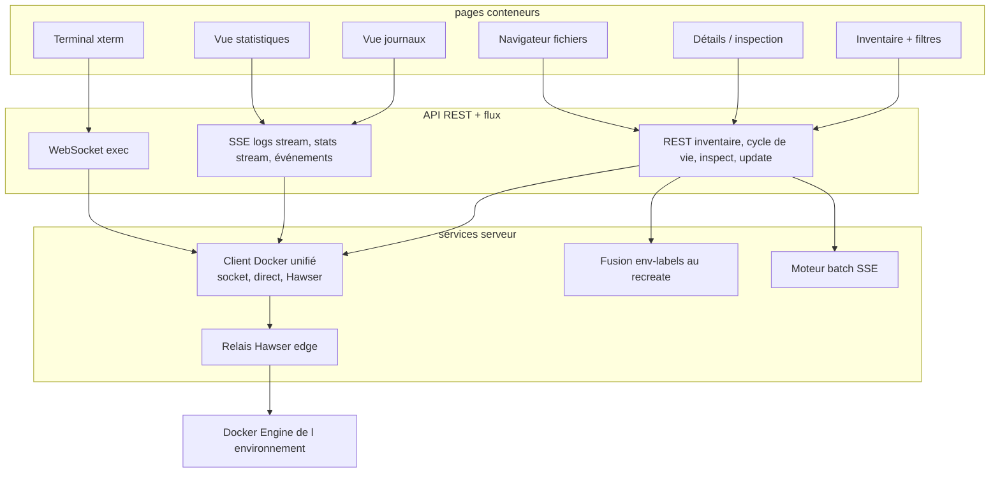
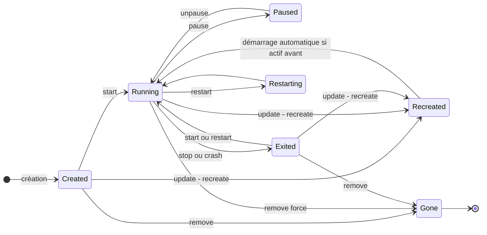
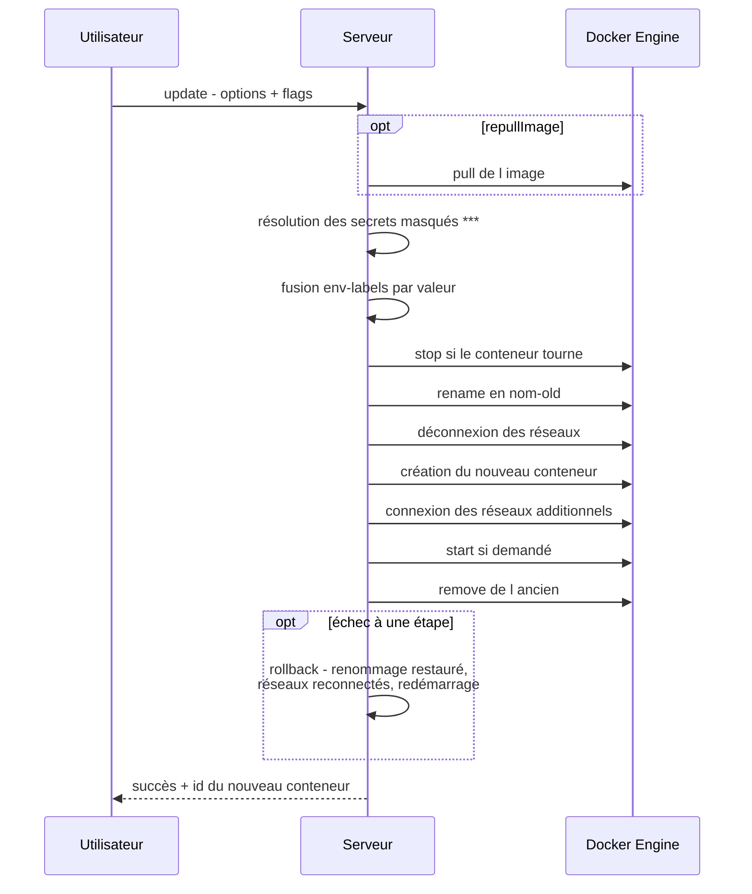

# Spécification fonctionnelle Dockhand — Chapitre 05 : Gestion des conteneurs

| Rubrique | Valeur |
|---|---|
| **Chapitre** | 05 — Gestion des conteneurs |
| **Statut** | Rédigé (phase 2, lot 2/5) |
| **Date de rédaction** | 21/08/2026 |
| **Version du logiciel analysée** | Dockhand **1.0.43** (numéro issu de [`package.json`](../../package.json:4)) |
| **Document de référence** | [`docs/spec/00-chapitrage.md`](00-chapitrage.md) |
| **Sources principales** | [`src/routes/api/containers/`](../../src/routes/api/containers/+server.ts:1), [`src/lib/server/docker.ts`](../../src/lib/server/docker.ts:1), [`src/routes/api/batch/+server.ts`](../../src/routes/api/batch/+server.ts:1), [`src/lib/server/container-env-merge.ts`](../../src/lib/server/container-env-merge.ts:1), [`src/lib/server/container-labels.ts`](../../src/lib/server/container-labels.ts:1), [`src/routes/+layout.ts`](../../src/routes/+layout.ts:1), [`src/lib/stores/containers.ts`](../../src/lib/stores/containers.ts:1), [`server.js`](../../server.js:1) |

## Table des matières

1. [Objet, périmètre et prérequis de lecture](#1-objet-périmètre-et-prérequis-de-lecture)
2. [Vue d'ensemble de la fonction conteneurs](#2-vue-densemble-de-la-fonction-conteneurs)
3. [Inventaire et supervision temps réel](#3-inventaire-et-supervision-temps-réel)
4. [Cycle de vie d'un conteneur](#4-cycle-de-vie-dun-conteneur)
5. [Opérations groupées (batch)](#5-opérations-groupées-batch)
6. [Inspection et détails d'un conteneur](#6-inspection-et-détails-dun-conteneur)
7. [Recreate avec fusion env/labels](#7-recreate-avec-fusion-envlabels)
8. [Journaux : streaming et consultation](#8-journaux--streaming-et-consultation)
9. [Terminal interactif (exec)](#9-terminal-interactif-exec)
10. [Navigateur de fichiers du conteneur](#10-navigateur-de-fichiers-du-conteneur)
11. [Statistiques et métriques temps réel](#11-statistiques-et-métriques-temps-réel)
12. [Événements de conteneurs](#12-événements-de-conteneurs)
13. [Suivi des mises à jour d'image en attente](#13-suivi-des-mises-à-jour-dimage-en-attente)
14. [Renvois vers les autres chapitres](#14-renvois-vers-les-autres-chapitres)

---

## 1. Objet, périmètre et prérequis de lecture

Ce chapitre décrit la **fonction centrale** de Dockhand : l'inventaire temps réel des conteneurs d'un environnement, leur pilotage (démarrage, arrêt, redémarrage, pause, suppression, recréation), l'inspection détaillée, le streaming des journaux, le terminal interactif, le navigateur de fichiers du conteneur, les statistiques temps réel, les opérations groupées et le suivi des mises à jour d'image en attente (indicateur et actions).

**Prérequis de lecture** : chapitre 04 (modes de connexion, sélection d'environnement) ; chapitre 03 (concepts de conteneur, mise à jour en attente).

**Conventions** : mentions *(Enterprise)* / *(SMB)* pour le gating d'édition, *(flag)* pour les fonctions sous feature flag.

## 2. Vue d'ensemble de la fonction conteneurs

Toutes les opérations conteneurs sont qualifiées par l'environnement sélectionné (paramètre `env` des API). Les permissions RBAC s'appliquent par domaine `containers` et, en Enterprise, par portée d'environnement *(Enterprise)* : `view`, `create`, `start`, `stop`, `restart`, `remove`, `logs`, `exec`, etc.

**Principes transverses** :

- les conteneurs sont **lus en temps réel** auprès du Docker Engine (aucune réplication en base ; cf. ch. 02 §7.3) ;
- les erreurs de connexion Docker sont **traduites en messages fonctionnels** (socket inaccessible, connexion perdue, délai dépassé, hôte introuvable) plutôt qu'exposées brutes ;
- un conteneur peut être **masqué** de l'inventaire par label Docker (`dockhand.hidden=true`), et ses notifications désactivées par label (`dockhand.notify`) — cf. §3.2 ;
- les actions de cycle de vie déclenchent **audit** *(Enterprise)* et **notifications** (selon routage, ch. 13).

## 3. Inventaire et supervision temps réel

### 3.1 Liste des conteneurs

`GET /api/containers?env=<id>` ([`src/routes/api/containers/+server.ts`](../../src/routes/api/containers/+server.ts:19)) :

- paramètre `all` : par défaut **vrai** (conteneurs arrêtés inclus ; passer `false` pour ne voir que les actifs) ;
- retourne id, nom, image, état (`state`), statut lisible (`status`, ex. « Up 2 hours (healthy) »), ports, labels ;
- comportements aux limites : **installation fraîche sans environnement** → tableau vide ; **environnement inexistant** → 404 (le frontend en profite pour purger la sélection périmée, cf. ch. 04 §11) ; **environnement hors ligne** → tableau vide (l'interface se charge, sans erreur bloquante) ;
- filtrage serveur du label de masquage (§3.2).

L'inventaire est complété par des tailles disque optionnelles (`GET /api/containers/sizes`) : taille du système de fichiers inscriptible et totale par conteneur (opération plus lente, à la demande).

### 3.2 Labels Dockhand sur conteneurs

| Label | Effet |
|---|---|
| `dockhand.hidden=true` | Conteneur **exclu de l'inventaire** et des vues (utilisé notamment par les conteneurs utilitaires internes : scans, helpers de volume). |
| `dockhand.notify` | Désactive les **notifications** de cycle de vie pour ce conteneur (le label est lu dans les attributs d'acteur des événements). |
| `dockhand.order` | Fournit une **clé de tri** personnalisée dans les vues en grille/tableau. |

### 3.3 Rafraîchissement et surlignage

- L'inventaire est rechargé périodiquement et à chaque événement pertinent ; les vues de grille/tableau conservent les préférences de colonnes (ch. 15).
- L'option d'environnement `highlightChanges` (ch. 04 §9.1) active la **mise en évidence des changements** : un conteneur dont l'état change entre deux observations est surligné dans la vue.
- Le badge de **mise à jour d'image en attente** (cf. §13) complète la supervision.

## 4. Cycle de vie d'un conteneur

### 4.1 Actions élémentaires

Chaque action est un endpoint REST dédié (`POST /api/containers/[id]/…`) adossé à une opération Docker ([`src/lib/server/docker.ts`](../../src/lib/server/docker.ts:1217)) :

| Action | Endpoint | Effet | Notes fonctionnelles |
|---|---|---|---|
| Démarrer | `…/start` | Passe le conteneur à l'état `running` | |
| Arrêter | `…/stop` | Arrêt propre (SIGTERM puis SIGKILL après grâce) | |
| Redémarrer | `…/restart` | Arrêt puis démarrage | |
| Mettre en pause | `…/pause` | Gèle les processus (état `paused`) | |
| Reprendre | `…/unpause` | Sort de l'état `paused` | |
| Renommer | `…/rename` | Change le nom du conteneur | |
| Supprimer | `DELETE /api/containers/[id]` | Suppression du conteneur | Option **force** (suppression d'un conteneur actif) ; la suppression nettoie l'éventuelle **mise à jour en attente** associée |
| Recréer | `POST …/update` | Recréation avec nouvelle configuration/image | Cf. §7 |

Les identifiants fournis dans les chemins sont **validés** (format d'identifiant/nom Docker) avant toute opération, pour éviter les injections de chemin d'API.

### 4.2 Création d'un conteneur

`POST /api/containers?env=<id>` crée un conteneur à partir d'options complètes : nom, image, ports, volumes (binds et volumes nommés), variables d'environnement, labels, commande/point d'entrée, répertoire de travail, politique de redémarrage, mode réseau (avec alias, adresses IPv4/IPv6, réseaux additionnels). Règles :

- **pull automatique** : si l'image est absente localement (erreur Docker « No such image »), Dockhand **tire l'image** puis retente la création (le résultat signale `imagePulled: true`) ;
- option `startAfterCreate` pour démarrer immédiatement ;
- les **réseaux additionnels** sont connectés après création (Docker n'accepte qu'un réseau à la création) ;
- les **jeux de configuration** (modèles réutilisables d'attributs — env, labels, ports, volumes, réseau, politique de redémarrage ; cf. ch. 03 §14.3) peuvent préremplir le formulaire.

### 4.3 Diagramme d'états fonctionnel

## 5. Opérations groupées (batch)

`POST /api/batch` ([`src/routes/api/batch/+server.ts`](../../src/routes/api/batch/+server.ts:1)) applique une même opération à un ensemble d'éléments, avec **suivi en flux (SSE)** :

- **types d'entités et opérations** : conteneurs (start/stop/restart/pause/unpause/remove), images (remove), volumes (remove), réseaux (remove), **stacks** (start/stop/restart/down/remove) — la batch est donc transverse aux chapitres 05/06/09 ;
- **options** : force, suppression des volumes (pour remove) ;
- **permissions** : chaque opération est mappée à la permission RBAC correspondante du domaine concerné (pause→stop, unpause→start, down→stop, etc.) ;
- **déroulement** : événement `start` (total) → `progress` par élément (statut `pending`/`processing`/`success`/`error`, message d'erreur le cas échéant, compteur courant) → `complete` avec résumé (total, succès, échecs) ;
- **sérialisation** : les éléments sont traités séquentiellement (pas de tempête d'appels Docker) ; un échec n'interrompt pas la suite ;
- **effets de bord** : pour la suppression de conteneurs, désinscription et suppression des **planifications d'auto-update** concernées et purge des **mises à jour en attente** ;
- pour les suppressions de stacks en batch, les mêmes nettoyages que la suppression unitaire (ch. 06 §8) s'appliquent.

La mise à jour groupée de conteneurs dispose en outre d'un canal dédié (`batch-update` + `batch-update-stream`) détaillé au chapitre 08 (application des mises à jour en attente).

## 6. Inspection et détails d'un conteneur

`GET /api/containers/[id]/inspect` renvoie la vision Docker enrichie, structurée en onglets dans l'interface :

| Volet | Contenu fonctionnel |
|---|---|
| **État** | Statut, santé (statut + dernières sondes : code de sortie, sortie), redémarrages, PID, code de sortie, dates de démarrage/fin, OOM. |
| **Configuration** | Image, commande et point d'entrée, utilisateur, répertoire de travail, TTY, **variables d'environnement** (valeurs secrètes **masquées**, cf. §7.3), **labels** Docker. |
| **Réseau** | Réseaux connectés (IP, passerelle, MAC), ports publiés et liaisons, mode réseau. |
| **Montages** | Bind mounts et volumes nommés (source, destination, lecture/écriture). |
| **Ressources** | Limites mémoire/swap, CPU (nanoCPUs, shares), mode privilégié. |
| **Processus** | `top` : liste des processus du conteneur (endpoint `…/top`). |

- La vue de détails propose l'accès direct aux journaux, au terminal, au navigateur de fichiers et à l'action de recréation.
- Un endpoint `version-notes` expose les notes de version associées à l'image du conteneur lorsque disponibles (renvoi ch. 08).
- L'inspection sert aussi de **source de vérité pour la recréation** (cf. §7).

## 7. Recreate avec fusion env/labels

### 7.1 Principe

La recréation (`POST /api/containers/[id]/update`) remplace un conteneur par un nouveau en **préservant sa configuration** (issue de l'inspection et/ou du formulaire d'édition) : image (éventuellement nouvelle), env, labels, ports, volumes, réseaux, politiques. C'est le mécanisme utilisé pour :

- l'**édition** d'un conteneur (modifier env/labels/ports…) ;
- la **mise à jour d'image** manuelle (avec `repullImage`) ou automatique (auto-update, ch. 08).

L'opération requiert la permission `containers:create` (recréer = créer).

### 7.2 Déroulement sécurisé

Étapes clés ([`src/lib/server/docker.ts`](../../src/lib/server/docker.ts:1917)) :

1. **arrêt** (si actif), **renommage** en `<nom>-old` pour libérer le nom ;
2. **déconnexion des réseaux** de l'ancien (libère les IP statiques) — **sauf** modes réseau partagés (`container:`, `service:`, `host`, `none`) où toute manipulation réseau est ignorée ;
3. **création** du nouveau conteneur avec la configuration passée (Config/HostConfig transmis à l'identique, image remplacée), réseau initial puis **réseaux additionnels** reconnectés ;
4. **démarrage** (si le conteneur tournait ou si demandé) puis **suppression de l'ancien** ;
5. **rollback** en cas d'échec : renommage restauré, réseaux reconnectés avec leurs réglages d'origine, redémarrage si nécessaire.

### 7.3 Fusion (rebase) env/labels/commande

Problème fonctionnel : la configuration d'un conteneur **aplatit** à la création les valeurs par défaut de l'image (env, labels, CMD) avec les choix de l'utilisateur — au moment de recréer avec une **nouvelle image**, il faut distinguer ce qui doit **suivre la nouvelle image** de ce qui doit être **préservé**. La fusion s'opère **par valeur** ([`src/lib/server/container-env-merge.ts`](../../src/lib/server/container-env-merge.ts:1)) :

- pour chaque clé d'env / label : si la valeur actuelle du conteneur est **identique** à celle de l'ancienne image → l'utilisateur ne l'a pas touchée → elle prend la valeur de la **nouvelle** image ; si elle **diffère** → choix explicite de l'utilisateur → conservée ; les entrées absentes de l'ancienne image sont conservées ;
- même logique pour **Cmd/Entrypoint** : la commande « cuite » par l'ancienne image suit la nouvelle image, un `command:` utilisateur survit ;
- la configuration de l'**ancienne image est capturée avant le pull** (après un pull, l'ancien tag peut être détaggé/collecté et ne plus être inspectable) ;
- en complément : **déduplication des volumes** au recreate (binds équivalents fusionnés) et **résolution de conflits** HostConfig (nanoCPUs, userns Podman).

### 7.4 Secrets masqués et édition

L'inspection **masque** les valeurs secrètes (noms ressemblant à des secrets : `*_PASSWORD`, `*_TOKEN`, `*_KEY`… — même heuristique que la règle `SECRET_IN_ENVIRONMENT` du validateur Compose, cf. ch. 06 §7). À l'édition, le formulaire renvoie `***` pour les valeurs inchangées : le serveur **résout** ces placeholders en relisant les valeurs réelles du conteneur courant avant la recréation — l'utilisateur édite les autres champs sans jamais réimporter les secrets.

### 7.4bis Effet sur les mises à jour en attente

Une recréation réussie **efface** la mise à jour en attente du conteneur (l'indicateur ambre disparaît).

## 8. Journaux : streaming et consultation

### 8.1 Flux SSE de journaux

`GET /api/containers/[id]/logs/stream?env=<id>&tail=<n>&since=<t>&until=<t>` ([`src/routes/api/containers/[id]/logs/stream/+server.ts`](../../src/routes/api/containers/[id]/logs/stream/+server.ts:271)) ouvre un flux **Server-Sent Events** :

- **paramètres** : `tail` (nombre de lignes historiques amorcées, défaut 100), `since`/`until` (horodatage Unix ou durée Docker, ex. `10m`) ;
- **événements** : `connected` (id, nom, TTY du conteneur) → `log` (texte + nom du conteneur + canal `stdout`/`stderr`) → `end` (motif) ; `error` en cas d'échec ;
- **battements** : commentaire keepalive toutes les 5 s (compatibilité reverse-proxy, ex. Traefik) ;
- **démultiplexage** : les trames Docker (en-tête 8 octets) sont décodées côté serveur ; les conteneurs **TTY** diffusent le texte brut ; les fragments de trames incomplets sont conservés en tampon jusqu'à complétude ;
- **Hawser edge** : le flux passe par la WebSocket de l'agent (messages `stream`/`stream_end`, base64) ; si l'agent n'est pas connecté, le flux renvoie un événement d'erreur explicite (503 fonctionnel).

### 8.2 Consultation ponctuelle et consolidation

- `GET …/logs` (non stream) retourne un extrait de journaux pour consommation ponctuelle (mêmes paramètres).
- Les **journaux fusionnés** (`/api/logs/merged`) permettent de suivre simultanément plusieurs conteneurs (vue multi-conteneurs, agrégation par ligne horodatée) — utilisés par les vues « journaux » de l'application.
- **Favoris de journaux** : l'utilisateur peut enregistrer des configurations réutilisables (conteneur + filtres) ; les préférences sont stockées par utilisateur *(Enterprise)* ou partagées (Free) — cf. ch. 03 §14.2 et ch. 15.
- Fonctions d'interface : recherche dans le flux, filtrage texte, affichage des horodatages (activés par le streaming), copie/téléchargement.

## 9. Terminal interactif (exec)

### 9.1 Établissement

1. `POST /api/containers/[id]/exec?envId=<id>` crée une **instance exec** dans le conteneur (shell proposé par défaut `/bin/sh`, utilisateur `root`) et retourne l'identifiant d'exec ainsi que les **informations de connexion Docker** pour la WebSocket ;
2. le navigateur ouvre une **WebSocket** (serveur `ws` de [`server.js`](../../server.js:1)) authentifiée par le mécanisme partagé `ws-auth` (session) ;
3. l'interface rend un terminal **xterm** ; l'utilisateur peut changer de shell (les shells disponibles sont listés par `GET …/shells` : `/bin/bash`, `/bin/sh`…) et d'utilisateur.

### 9.2 Comportement

- **bidirectionnel** : entrées clavier → stdin du processus ; stdout/stderr → affichage temps réel ; **redimensionnement** du terminal pris en compte (colonnes/lignes transmises à Docker) ;
- **modes de connexion** : socket local (relais direct), TCP/TLS direct, Hawser standard (relais HTTP) et **Hawser edge** (messages dédiés `exec_start`/`exec_ready`/`exec_input`/`exec_output`/`exec_resize`/`exec_end` sur la WebSocket de l'agent — cf. ch. 04 §7.2) ;
- **fin de session** : sortie du processus, fermeture du navigateur, ou arrêt du conteneur — la fermeture est propre des deux côtés ;
- **permission dédiée** `containers:exec` exigée (contrôlée à la création de l'exec).

## 10. Navigateur de fichiers du conteneur

Sous-arborescence `GET/POST /api/containers/[id]/files/…` :

| Fonction | Endpoint | Comportement |
|---|---|---|
| Parcours | `GET …/files?path=
` | Liste fichiers/répertoires (nom, type, taille, date, permissions) du chemin indiqué. |
| Lecture | `GET …/files/content?path=
` | Contenu texte d'un fichier (aperçu). |
| Édition | `POST …/files/content` | Écriture du contenu modifié dans le conteneur. |
| Création | `POST …/files/create` | Création de fichier ou répertoire. |
| Renommage | `POST …/files/rename` | Renommage/déplacement dans le conteneur. |
| Suppression | `POST …/files/delete` | Suppression de fichier/répertoire. |
| Permissions | `POST …/files/chmod` | Changement des permissions. |
| Téléversement | `POST …/files/upload` | Envoi d'un fichier dans le conteneur (archive tar transmise à l'API Docker). |
| Téléchargement | `GET …/files/download?path=
` | Extraction d'un fichier (ou dossier) du conteneur vers le navigateur. |

Points fonctionnels :

- l'accès aux fichiers d'un conteneur **s'exécute au sein du conteneur** (API Docker arch tar) — les volumes montés sont donc parcourables par leur point de montage (la navigation dans les **volumes** eux-mêmes passe par le helper de volume dédié, ch. 09) ;
- le **staging Hawser** transmet les archives en base64 (binaire) sur la WebSocket edge — y compris les téléversements volumineux (canal `isBinary`) ;
- l'interface offre un explorateur à deux volets avec fil d'Ariane, actions contextuelles et éditeur de texte intégré (fichiers texte ; les binaires sont proposés au téléchargement).

## 11. Statistiques et métriques temps réel

### 11.1 Flux SSE de statistiques

`GET /api/containers/stats/stream?env=<id>` ([`src/routes/api/containers/stats/stream/+server.ts`](../../src/routes/api/containers/stats/stream/+server.ts:75)) effectue **une ronde de mesures** sur tous les conteneurs actifs puis se termine :

- un événement `stat` par conteneur : `cpuPercent`, `memoryUsage` (hors cache), `memoryRaw`, `memoryCache`, `memoryLimit`, `memoryPercent`, `networkRx/Tx`, `blockRead/Write` ;
- calculs normalisés : CPU en pourcentage du système pondéré par le nombre de cœurs ; mémoire **hors cache de pages** (usage réel) ; réseau sommé par interface ; E/S bloc sommées par opération ;
- événements `error` (environnement introuvable) puis `done` final — le client relance la ronde à son rythme d'actualisation ;
- un instantané unitaire est disponible par `GET …/stats` (conteneur unique).

### 11.2 Colonnes et grilles

Les vues de grille/tableau affichent les colonnes de ressources rafraîchies par ce flux ; les préférences de colonnes (visibilité, ordre) sont persistées (ch. 15). La supervision d'hôte (CPU/mémoire/disque de l'environnement) relève du tableau de bord et des métriques d'hôte (ch. 13).

## 12. Événements de conteneurs

Les événements Docker de cycle de vie (create, start, stop, die, kill, restart, pause, unpause, destroy, rename, update, oom, health_status) sont collectés en arrière-plan (collecteur Go en stream/poll, ou agent Hawser edge) puis :

- **historisés** (`container_events` : conteneur, image, action, attributs d'acteur, horodatage) avec filtrage des **répétitions de sondes de santé** (seules les transitions healthy↔unhealthy sont conservées pour éviter la noyade de la base) ;
- **diffusés en SSE** (`/api/events`) pour le flux d'activité temps réel (ch. 13) ;
- **notifiés** selon le routage par environnement/type d'événement et le label `dockhand.notify` — la sévérité visuelle dépend de l'action (`die`/`kill`/`oom` → erreur ; `stop` → avertissement ; `start` → succès ; autre → information) ;
- consultables avec filtres via `/api/activity/containers` (ch. 13).

## 13. Suivi des mises à jour d'image en attente

L'indicateur de **mise à jour en attente** (entité `pending_container_updates`, cf. ch. 03 §8.2) apparaît dans l'inventaire et les détails :

| Aspect | Comportement |
|---|---|
| Détection | Planifiée par environnement (vérification digest — et tags semver pour images épinglées) ou déclenchée manuellement (`POST /api/containers/check-updates`) ; détail au ch. 08. |
| Consultation | `GET /api/containers/pending-updates?env=<id>` : liste des conteneurs concernés avec image courante, digest disponible, suggestion semver éventuelle, fraîcheur. |
| Application | Recréation du conteneur avec la nouvelle image (§7) — unitaire ou **groupée** (`batch-update` avec flux SSE de progression). |
| Report/ignoré | Suggestion semver marquée `skipped` (jamais appliquée automatiquement). |
| Effacement | Résolue automatiquement à la recréation réussie ou à la suppression du conteneur ; reconciliée après un déploiement de stack avec pull (ch. 06). |

Les **règles d'auto-update** par conteneur nommé (planification cron + critères de vulnérabilités) pilotent l'application automatique — détail aux chapitres 08 et 14.

## 14. Renvois vers les autres chapitres

| Chapitre | Lien | Pourquoi y aller |
|---|---|---|
| 00 — Chapitrage | [`00-chapitrage.md`](00-chapitrage.md) | Sommaire de référence. |
| 02 — Architecture fonctionnelle | [`02-architecture-fonctionnelle.md`](02-architecture-fonctionnelle.md) | Flux bout en bout (terminal exec, supervision), canaux SSE/WebSocket. |
| 03 — Concepts et entités | [`03-concepts-entites.md`](03-concepts-entites.md) | Conteneur comme objet Docker, mises à jour en attente, jeux de configuration. |
| 04 — Environnements | [`04-environnements.md`](04-environnements.md) | Modes de connexion derrière chaque opération conteneur, sélection d'environnement. |
| 06 — Stacks Compose | [`06-stacks.md`](06-stacks.md) | Conteneurs vus comme services d'une stack ; batch transverse. |
| 08 — Images et registres | `08-images-registres.md` *(à rédiger, lot 3)* | Détection digest/semver, auto-update, application groupée des mises à jour. |
| 09 — Volumes, réseaux et maintenance | `09-volumes-reseaux-maintenance.md` *(à rédiger, lot 3)* | Navigateur de fichiers de volume (helper), connexions réseau des conteneurs. |
| 10 — Sécurité applicative | `10-securite-applicative.md` *(à rédiger, lot 3)* | Critères de vulnérabilités conditionnant l'auto-update. |
| 12 — Authentification et RBAC | `12-authentification-rbac.md` *(à rédiger, lot 4)* | Permissions du domaine `containers` et portée par environnement. |
| 13 — Observabilité | `13-observabilite.md` *(à rédiger, lot 4)* | Flux d'activité, événements, notifications de cycle de vie, dashboard. |
| 15 — Administration | `15-administration-exploitation.md` *(à rédiger, lot 5)* | Préférences de grilles/colonnes, favoris de journaux. |
