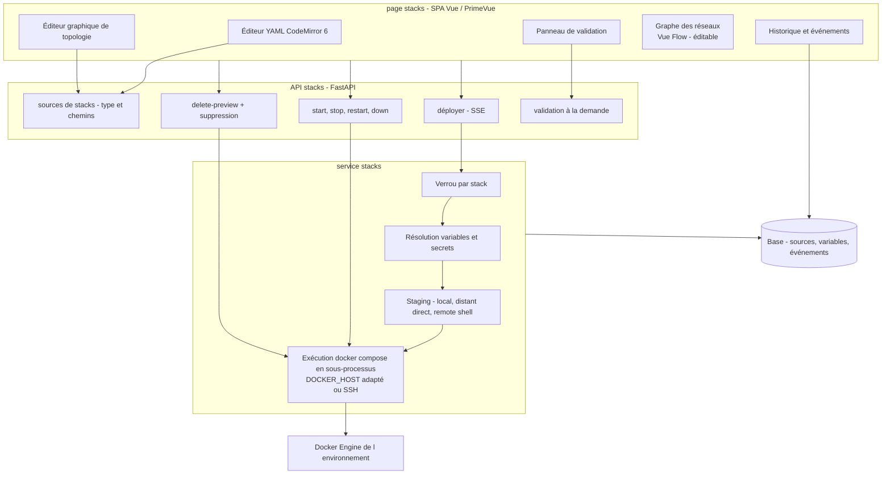
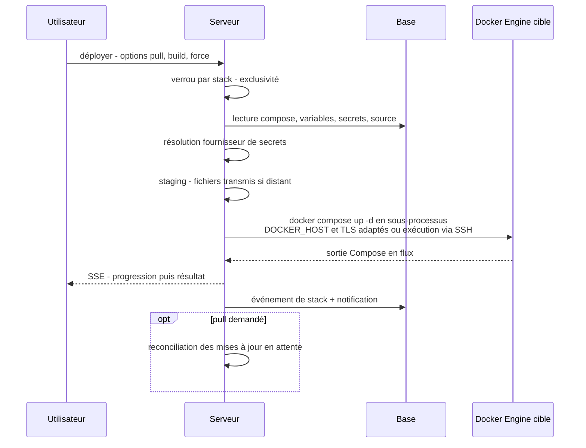
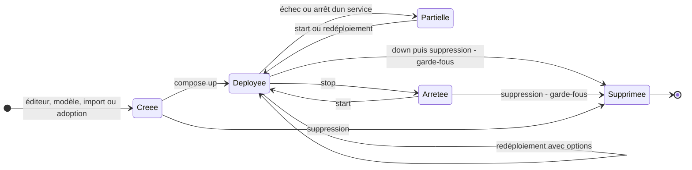

# Spécification fonctionnelle Dockhand — Chapitre 06 : Stacks Compose

| Rubrique | Valeur |
|---|---|
| **Chapitre** | 06 — Stacks Compose |
| **Document de référence** | [`00-chapitrage.md`](00-chapitrage.md) |

## Table des matières

1. [Objet, périmètre et prérequis de lecture](#1-objet-périmètre-et-prérequis-de-lecture)
2. [Vue d'ensemble de la gestion des stacks](#2-vue-densemble-de-la-gestion-des-stacks)
3. [Définition et identité d'une stack](#3-définition-et-identité-dune-stack)
4. [Création d'une stack via l'éditeur YAML](#4-création-dune-stack-via-léditeur-yaml)
5. [Éditeur graphique de topologie](#5-éditeur-graphique-de-topologie)
6. [Validation Compose dédiée](#6-validation-compose-dédiée)
7. [Variables d'environnement de stack et secrets](#7-variables-denvironnement-de-stack-et-secrets)
8. [Déploiement, redéploiement et cycle de vie](#8-déploiement-redéploiement-et-cycle-de-vie)
9. [Suppression protégée](#9-suppression-protégée)
10. [Chemins de fichiers de stack et stacks adoptées](#10-chemins-de-fichiers-de-stack-et-stacks-adoptées)
11. [Stacks issues de modèles (templates)](#11-stacks-issues-de-modèles-templates)
12. [Historique et événements de stack](#12-historique-et-événements-de-stack)
13. [Intégration avec les mises à jour d'images et Git](#13-intégration-avec-les-mises-à-jour-dimages-et-git)
14. [Renvois vers les autres chapitres](#14-renvois-vers-les-autres-chapitres)

---

## 1. Objet, périmètre et prérequis de lecture

Ce chapitre décrit la gestion des **stacks Docker Compose** : définition et identité d'une stack, création via l'éditeur YAML (ou assistant), éditeur graphique de topologie, validation Compose, variables d'environnement avec secrets masqués, déploiement/redéploiement avec options, cycle de vie (démarrage, arrêt, redémarrage, arrêt complet, suppression protégée par garde-fous), adoption de stacks existantes, chemins de fichiers associés, historique d'événements et articulation avec les mises à jour d'images (ch. 08) et l'intégration Git (ch. 07).

**Prérequis de lecture** : chapitre 04 (environnements, exécution distante de `docker compose`, staging) et chapitre 03 (source de stack, variables de stack, événements de stack).

**Conventions** : mentions *(Enterprise)* / *(SMB)* et *(flag)* comme dans les chapitres précédents.

## 2. Vue d'ensemble de la gestion des stacks

Le pilotage des stacks est **compose-first** : toutes les opérations de cycle de vie s'appuient sur la CLI `docker compose` **invoquée en sous-processus côté serveur** (`asyncio.create_subprocess_exec`), avec un contexte de connexion (socket, `DOCKER_HOST` + TLS, ou exécution à distance via le remote shell SSH) reconstitué pour l'environnement cible. Les résultats (sortie Compose, succès/échec) sont retournés en **flux SSE** (via sse-starlette) pour un retour visuel progressif.

## 3. Définition et identité d'une stack

- **Identité** : le couple **(nom de stack, environnement)** — il n'existe pas d'identifiant numérique global (cf. ch. 03 §6.1) ; toutes les entités liées (source, variables, événements, stack Git) rejoignent ce couple.
- **Nom** : contrainte forte au déploiement — minuscules alphanumériques, tirets et underscores ; doit **commencer par une lettre ou un chiffre** (contrôle explicite avec message d'erreur dédié, sinon refus du déploiement).
- **Types de sources** (entité `stack_sources`, cf. ch. 03 §6.2) :
  - `internal` — stack créée/éditée dans Dockhand (fichier Compose stocké dans le répertoire de stacks de l'instance) ;
  - `git` — stack déployée depuis un chemin d'un dépôt Git (ch. 07) ;
  - `external` — stack **découverte** sur l'environnement (conteneurs Docker Compose préexistants) ou **adoptée** (fichier Compose à un emplacement personnalisé sur l'hôte).
- **Inventaire** (`GET /api/stacks?env=<id>`) : les stacks sont découvertes **depuis Docker** (regroupement par projet Compose des conteneurs) et **complétées par la base** — une source sans conteneur (stack créée non démarrée, ou arrêtée) apparaît au statut `created` ; chaque stack expose : conteneurs et leurs détails (service, état, santé, image, ports, réseaux, volumes, redémarrages, code de sortie), statut agrégé (`running` / `stopped` / `partial` / `created`), type de source, présence d'un fichier Compose.

### 3.1 Statuts agrégés d'une stack

| Statut | Signification |
|---|---|
| `running` | Tous les services attendus sont actifs. |
| `partial` | Certains services actifs, d'autres arrêtés — signalé visuellement comme dégradation. |
| `stopped` | Aucun service actif (mais les conteneurs/la définition existent). |
| `created` | Définition présente (source en base) sans conteneur — typiquement « créée sans démarrage » ou entièrement arrêtée. |

## 4. Création d'une stack via l'éditeur YAML

### 4.1 Parcours de création

`POST /api/stacks?env=<id>` :

1. **nom** (requis, cf. §3) et **contenu Compose** (requis) saisis dans l'éditeur **CodeMirror 6** (coloration YAML, replis) ;
2. **variables d'environnement** : saisie structurée (clé/valeur, marqueur *secret*) **et/ou** contenu brut `.env` (éditeur texte) — les deux coexistent, cf. §7 ;
3. liaison facultative d'un **fournisseur de secrets** (nécessite en outre la permission `secrets:view`) ;
4. chemins personnalisés facultatifs (`composePath`, `envPath` — cf. §10) ;
5. bouton **Créer** (persister uniquement) ou **Créer et déployer** (persister puis déployer) ;
6. à la création : le fichier Compose et le `.env` sont écrits dans le répertoire de la stack, les **secrets sont stockés chiffrés en base** (jamais écrits dans le `.env`), la **source** est enregistrée (`internal`), et le déploiement éventuel suit le flux du §8.

### 4.2 Édition ultérieure

- L'édition du YAML réécrit le fichier Compose de la stack ; **enregistrer ne redéploie pas** — le redéploiement est une action explicite (avec options, cf. §8.2) ;
- l'éditeur propose la **validation à la demande** (§6) et l'aperçu du **contexte effectif** (variables résolues) ;
- les métadonnées de source (chemins, fournisseur de secrets) restent modifiables.

### 4.3 Stacks découvertes et adoption

- Les stacks Compose **déjà présentes** sur l'hôte (déployées hors Dockhand) apparaissent dans l'inventaire comme `external` : pilotables (start/stop/restart/down) mais sans fichier Compose géré.
- L'**adoption** (`POST /api/stacks/adopt`) rattache un fichier Compose existant à un emplacement personnalisé sur l'hôte : Dockhand enregistre la source avec `composePath` (et `envPath` le cas échéant) et opère **en place**, sans copie — les chemins relatifs du fichier continuent de se résoudre à leur emplacement d'origine (cf. §10).
- L'**import** d'un fichier Compose local crée une stack `internal` à partir du fichier téléversé (fenêtre d'import dédiée).

## 5. Éditeur graphique de topologie

L'éditeur graphique complète l'éditeur YAML par une manipulation **visuelle** de la topologie :

- **objets manipulables** : services (avec image, ports, variables), réseaux, volumes et secrets du fichier Compose ;
- **liaisons visuelles** : rattachement d'un service à un réseau ou à un volume, exposition de ports — les modifications sont **sérialisées en YAML** (l'éditeur graphique et l'éditeur texte restent deux vues du même document) ;
- la **vue de graphe des réseaux**, rendue avec **Vue Flow** (@vue-flow/core), montre ensuite le réseau effectif : nœuds services, liens par réseau, volumes et ports publiés — visualisation **par stack** et au niveau environnement (graphe des réseaux, ch. 09). Le graphe est **éditable** : drag & drop des nœuds, **création et suppression de nœuds et de liens** (rattachements conteneur↔réseau), et **positions persistées** pour retrouver la disposition d'une session à l'autre ;
- fonctions d'aide : détection des références pendantes (réseau/volume non déclaré), repli vers l'éditeur YAML pour tout ce qui n'a pas de représentation graphique.

Cet éditeur produit du Compose standard : aucune fonctionnalité propriétaire n'est requise au déploiement.

## 6. Validation Compose dédiée

### 6.1 Moteur de règles

Dockhand embarque un **service de validation Compose** intégré au backend, distinct de la validation Docker : analyse du YAML parsé + confrontation à l'**état réel de l'environnement** (ports utilisés, noms de conteneurs, ressources externes existantes). Chaque règle est auto-déclarée (`id`, description, groupe, sévérité par défaut) ; le moteur applique les **sévérités personnalisées** de l'utilisateur, isole une règle qui plante (sans faire échouer les autres) et complète les trouvailles avec la sévérité effective.

### 6.2 Catalogue des règles

| Identifiant | Vérification fonctionnelle |
|---|---|
| `NO_SERVICES` | Le fichier ne définit aucun service. |
| `DUPLICATE_HOST_PORT` | Deux services de la stack publient le même port hôte. |
| `CROSS_STACK_PORT_COLLISION` | Un port hôte déjà utilisé par un autre conteneur de l'environnement. |
| `DB_PORT_ON_ALL_INTERFACES` | Un service de base de données/cache publie sur toutes les interfaces. |
| `DEPENDS_ON_UNDEFINED` | `depends_on` référence un service non défini. |
| `UNDEFINED_NETWORK_REF` | Un service utilise un réseau non déclaré au niveau supérieur. |
| `UNDEFINED_VOLUME_REF` | Montage d'un volume nommé non déclaré au niveau supérieur. |
| `CONTAINER_NAME_COLLISION` | `container_name` déjà utilisé par un conteneur de l'environnement. |
| `MISSING_EXTERNAL_RESOURCE` | Un réseau/volume externe n'existe pas sur l'environnement. |
| `LATEST_TAG` | Image avec `:latest` ou sans tag (reproductibilité). |
| `PRIVILEGED_CONTAINER` | Service en mode privilégié (accès hôte complet). |
| `DOCKER_SOCKET_MOUNT` | Montage du socket Docker. |
| `OBSOLETE_VERSION_KEY` | Clé `version:` obsolète en tête de fichier. |
| `UNKNOWN_SERVICE_KEY` | Clé de service ressemblant à une faute de frappe d'une vraie clé Compose. |
| `UNKNOWN_TOP_LEVEL_KEY` | Clé de premier niveau ressemblant à une faute de frappe. |
| `SECRET_IN_ENVIRONMENT` | Valeur d'aspect secret codée en dur dans `environment:` au lieu de `secret`/variable. |
| `HOST_NETWORK_MODE` | `network_mode: host` (pas d'isolation réseau). |
| `WRITABLE_ROOT_MOUNT` | Chemin hôte sensible monté en écriture (compromission potentielle de l'hôte). |
| `CAP_ADD_DANGEROUS` | Capacité Linux quasi-privilégiée ajoutée (`SYS_ADMIN`, `NET_ADMIN`…). |
| `MISSING_RESTART_POLICY` | Absence de politique de redémarrage (ne reviendra pas après un redémarrage hôte). |

### 6.3 Usage fonctionnel

- Le **panneau de validation** (composant de la page stacks) affiche les trouvailles avec sévérité, position et explication ; les réglages permettent de **désactiver une règle** ou d'en changer la sévérité (persistés — ch. 15) ;
- la validation est proposée **avant déploiement** (bouton dédié) et à la demande (`POST /api/stacks/[name]/validate` avec le contenu à valider) ;
- elle est **informative** : elle ne bloque pas le déploiement (les blockers effectifs sont les erreurs Docker/Compose elles-mêmes), sauf usage par l'auto-update où des critères de vulnérabilités peuvent bloquer (ch. 08/10).

## 7. Variables d'environnement de stack et secrets

### 7.1 Modèle

- Les variables de stack (entité `stack_environment_variables`, cf. ch. 03 §6.3) sont uniques par **(stack, environnement, clé)** ; chaque entrée porte un marqueur `isSecret`.
- Deux modes de saisie coexistent : **grille structurée** (clé, valeur, secret) et **contenu brut `.env`** (le texte intégral du fichier — conservé tel quel, réécrit à l'édition).

### 7.2 Règles de secret

| Règle | Comportement |
|---|---|
| Masquage | Les valeurs marquées *secret* sont **masquées à l'affichage** dans toute l'interface (et l'inspection de conteneurs, via `injectedSecretKeys`, ch. 10). |
| Stockage | Chiffrées au repos (AES-256-GCM) ; **jamais écrites dans le fichier `.env`** de la stack. |
| Injection | Passées à Compose **par environnement de processus** du déploiement (pas par fichier), uniquement au moment de l'exécution. |
| Fournisseurs externes | Une stack peut être liée à un **fournisseur de secrets** (1Password, Vault, Infisical, Doppler, Bitwarden, Proton) : interpolation de références (`op://…`) et extraction en masse ; les **clés injectées** sont tracées dans la source pour masquage sans rappel du fournisseur (détail ch. 10). |
| Priorité de fusion | Au déploiement : `.env` du répertoire **+ variables non secrètes de la base + résolutions du fournisseur + secrets** ; pour les stacks Git, les valeurs du dépôt viennent du `.env` synchronisé du dépôt et les redéfinitions de l'éditeur passent par un **fichier d'override dédié** (`.env.dockhand`) — seules les valeurs de la base vont dans l'override (cf. §8.3). |

### 7.3 Réécriture des chemins de volumes

Pour les environnements où les chemins vus par le Docker Engine diffèrent des chemins vus par Dockhand (conteneurisé), les **binds relatifs** du Compose peuvent être réécrits vers le chemin hôte effectif (mécanisme de réécriture des chemins de volumes, cf. ch. 04 §9.3).

## 8. Déploiement, redéploiement et cycle de vie

### 8.1 Flux de déploiement

Étapes clés :

- **verrou par stack** : les opérations concurrentes sur une même stack sont sérialisées (aucun déploiement parallèle) ;
- **emplacement de travail** : répertoire interne de la stack (`DATA_DIR/stacks/<environnement>/<stack>/`) ; pour une stack adoptée, **emplacement d'origine du Compose** (usage en place) ; pour une stack Git, copie **en surimpression** du répertoire source vers le répertoire de la stack — **sans effacer au préalable** (les données des volumes relatifs comme `./data` vivent dans ce répertoire et seraient détruites sinon), puis application des **suppressions Git** (fichiers retirés du dépôt, avec vérifications de contenu — ch. 07) ;
- **variables** : cf. §7.2 ;
- **staging distant** : pour un environnement **remote shell SSH**, l'arborescence complète (compose, `.env`, fichiers annexes, fichiers du dépôt — binaires encodés, plafonds 10 Mo/fichier et 256 Mo total) est **transférée sur l'hôte distant via la session SSH**, qui matérialise `STACKS_DIR/<stack>/` ; pour `direct`, copie facultative vers le `remote_stacks_dir` de l'environnement avec réécriture des binds relatifs (ch. 04 §9.3) ;
- **exécution** : `docker compose up -d` invoqué en sous-processus avec options (voir §8.2) ; délai global configurable (`COMPOSE_TIMEOUT`, défaut 15 min) avec grâce de 5 s avant SIGKILL ;
- **traçabilité** : événement de stack (§12), notification `stack_deployed` / `stack_deploy_failed` (supprimée pour un déploiement issu d'une synchro Git — remplacée par les notifications `git_sync_*`, ch. 07), audit *(Enterprise)* ;
- après un déploiement **avec pull**, les **mises à jour en attente** des conteneurs de la stack sont reconciliées (effacement des badges périmés — avec garde-fou de délai pour ne jamais pénaliser le déploiement réussi).

### 8.2 Options de déploiement/redéploiement

| Option | Effet Compose | Usage type |
|---|---|---|
| `pull` | Politique de pull **always** (re-tirer les images avant up) | Mise à jour des images flottantes |
| `build` | `--build` (construire les images avant démarrage) | Stacks avec `build:` |
| `noBuildCache` | `--no-cache` (sans cache de build ; requiert `build`) | Reconstruction propre |
| `forceRecreate` | `--force-recreate` (recréer les conteneurs même sans changement) | Forcer l'application d'un changement non détecté |

Le **redéploiement** relit le Compose courant et les variables, puis rejoue le même flux — un composant dédié de redéploiement permet de choisir les options à la volée. Les **stacks Git** ajoutent leurs options propres (reportées depuis leur configuration : `buildOnDeploy`, `noBuildCache`, `repullImages`, `forceRedeploy` — ch. 07).

### 8.3 Cycle de vie : démarrage, arrêt, arrêt complet

Actions unitaires (`POST /api/stacks/[name]/…`, toutes en flux SSE de progression) :

| Action | Commande Compose sous-jacente | Effet fonctionnel |
|---|---|---|
| Démarrer (`start`) | `docker compose start` | Démarre les conteneurs existants d'une stack arrêtée. |
| Arrêter (`stop`) | `docker compose stop` | Arrête les conteneurs (conservés). |
| Redémarrer (`restart`) | `docker compose restart` | Arrêt + démarrage des services. |
| Arrêt complet (`down`) | `docker compose down` | Arrête **et supprime** les conteneurs et réseaux de la stack ; option **`removeVolumes`** pour supprimer aussi les volumes nommés. |

- Les opérations de cycle de vie passent le même contexte de connexion que le déploiement (y compris le **transfert des fichiers pour le remote shell SSH** — les opérations start/stop/redémarrage/down réutilisent le transfert de l'arborescence pour garantir la présence des fichiers référencés, cf. ch. 04 §9.3) ;
- pour une stack Git, un **fichier d'override** (`.env.dockhand`) est utilisé pour superposer les variables de l'éditeur au `.env` du dépôt — évitant d'écraser les valeurs du dépôt ;
- le **pull d'images** d'une stack peut être lancé isolément, ainsi que le pull/mise à jour **d'un service** précis — base du lien avec le ch. 08.

### 8.4 Diagramme d'états

## 9. Suppression protégée

La suppression (options : `force`, `removeVolumes`, `deleteFiles`) est encadrée par plusieurs **garde-fous** :

1. **verrou par stack** (pas de suppression concurrente au déploiement) ;
2. si un Compose existe : `docker compose down` d'abord (avec `removeVolumes` si demandé) — un échec du down **bloque** la suppression sauf si `force` ;
3. **nettoyage des conteneurs orphelins** dynamiquement engendrés par la stack (hors gestion Compose) ;
4. nettoyage des dépendances : désinscription/suppression des **planifications d'auto-update** des conteneurs de la stack, purge des **mises à jour en attente** ;
5. suppression des enregistrements en base : **source de stack** (avec chemins), **variables** (y compris secrets), **stack Git** le cas échéant (avec désinscription de sa synchro et suppression de ses fichiers) ;
6. suppression des **fichiers** — uniquement si `deleteFiles` — et sous conditions strictes (cf. §9.1).

Une **prévisualisation de suppression** (`POST /api/stacks/[name]/delete-preview`) informe en amont : conteneurs, réseaux, volumes qui seront impactés, fichiers qui seront supprimés — l'interface demande une **confirmation explicite** (fenêtre de confirmation dédiée).

### 9.1 Garde-fous de suppression de fichiers

- **Répertoire strictement imbriqué** : seuls des sous-répertoires **stricts** du répertoire des stacks (`DATA_DIR/stacks/.../`) peuvent être supprimés — jamais la racine elle-même : le contrôleur vérifie que le répertoire est un sous-répertoire strict **et** que son nom de base **correspond au nom de la stack** ;
- **stacks adoptées** : les fichiers hors du répertoire de données de Dockhand (chemin personnalisé sur l'hôte) sont **préservés** (Dockhand ne supprime pas les données des utilisateurs) ;
- **staging distant `direct`** : la copie éventuellement présente sur l'hôte distant (`remote_stacks_dir/<stack>/`) n'est **jamais supprimée** — un résidu de Compose est jugé plus sûr qu'une suppression récursive d'un répertoire pouvant contenir des données utilisateur ;
- **staging remote shell SSH** : la suppression distante ne retire **que** les fichiers listés par Dockhand (contenu du répertoire de staging local : compose, `.env`, fichiers Git), chacun **vérifié par empreinte SHA-256** avant suppression sur l'hôte distant ; le répertoire de stack distant n'est retiré que s'il ne reste rien d'autre dedans ;
- le mode **« retirer la stack sans supprimer les fichiers »** (`deleteFiles=false`) laisse Compose, `.env` et données sur disque.

## 10. Chemins de fichiers de stack et stacks adoptées

- **Répertoire par défaut** : `DATA_DIR/stacks/<environnement>/<stack>/` — contient le Compose (nom standard détecté parmi `docker-compose.yaml`/`.yml`, `compose.yaml`/`.yml`), le `.env` éventuel et les fichiers annexes ; le **fichier d'override** `.env.dockhand` s'ajoute pour les stacks Git.
- **Chemins personnalisés** : `composePath` et `envPath` mémorisés dans la source (stacks adoptées/importées à emplacement non standard) ; Dockhand opère **en place** (pas de copie) pour que les chemins relatifs du fichier continuent de se résoudre.
- **Aides au cheminement** (endpoints dédiés) :
  - `path-hints` : suggestions de localisation du Compose d'une stack découverte (répertoires candidats, chemins issus des labels des conteneurs) ;
  - `validate-path` : validation d'un chemin proposé (existence, droits, cohérence) ;
  - `check-path-change` : contrôle **avant** un changement de chemin (impact sur les binds relatifs, avertissements) ;
  - `relocate` : **déplacement** contrôlé du répertoire d'une stack vers un nouvel emplacement (avec mise à jour de la source) ;
  - `base-path` / `default-path` / `scan` : gestion du chemin de base des stacks et **scan** de l'hôte pour proposer des stacks à adopter (conteneurs Compose existants).
- **Renommage d'environnement** : les répertoires suivent le nom de l'environnement (cf. ch. 04 §6.4) ; pour les environnements socket/direct, un **redéploiement** est ensuite nécessaire (les conteneurs référencent les anciens chemins).

## 11. Stacks issues de modèles (templates)

La **bibliothèque de modèles** (ch. 14) fournit des stacks prêtes à l'emploi au **format compatible Portainer** (sources intégrées désactivables + sources personnalisées) :

- le choix d'un modèle **préremplit** l'éditeur de création : nom proposé, YAML du modèle, variables d'environnement suggérées (avec valeurs par défaut du modèle) ;
- le déploiement suit ensuite le flux standard d'une stack **interne** (aucune différence de traitement) ;
- l'appartenance au modèle n'est pas mémorisée comme un type de source distinct — la stack devient `internal` à part entière (comparaison et mises à jour ultérieures possibles depuis le modèle).

## 12. Historique et événements de stack

- Chaque opération significative journalise un **événement de stack** (`stack_events` : nom, environnement, type, métadonnées, horodatage) : déploiement, démarrage, arrêt, redémarrage, arrêt complet, échec de déploiement, suppression — base de l'**historique** consultable dans l'interface (fenêtre dédiée sur la page stacks) ;
- les types d'événements notifiables (`stack_started`, `stack_stopped`, `stack_deployed`, `stack_deploy_failed`…) sont routables par canal et par environnement (ch. 13) ;
- les **exécutions planifiées** liées aux stacks Git (synchros) sont suivies dans l'historique des planifications (ch. 14).

## 13. Intégration avec les mises à jour d'images et Git

### 13.1 Mises à jour d'images (renvoi ch. 08)

- Les **mises à jour en attente** détectées pour les conteneurs d'une stack sont visibles au niveau de la stack et de ses services ; l'application passe par le **pull + redéploiement** (avec `pull: always`) ou par la mise à jour ciblée d'un service ;
- après un déploiement avec pull, Dockhand **reconcilie** les indicateurs de mise à jour des conteneurs de la stack (les badges obsolètes disparaissent) ;
- l'**auto-update** des conteneurs d'une stack suit les règles génériques par conteneur nommé (planification + critères de vulnérabilités) — le détail (détection digest/semver, critères, application groupée) fait l'objet du chapitre 08.

### 13.2 Intégration Git (renvoi ch. 07)

- Une **stack Git** référence un chemin de dépôt (fichier Compose, `.env` du dépôt, répertoire de contexte) ; la synchronisation (manuelle, planifiée ou webhook signé) met à jour les fichiers **puis redéploie si le contenu a changé** ;
- les fichiers synchronisés sont tracés dans un **manifeste** (chemin → empreinte SHA-256, calculée via `hashlib`) qui sert de référence aux suppressions sûres lors des synchros suivantes et au nettoyage ;
- le lien stack ↔ Git est porté par la source de stack (`sourceType: git`, rattachement dépôt/stack Git) ; la suppression d'une stack Git supprime ses fichiers synchronisés et désinscrit sa planification — le détail (credentials, webhooks, état de synchronisation) fait l'objet du chapitre 07.

## 14. Renvois vers les autres chapitres

| Chapitre | Lien | Pourquoi y aller |
|---|---|---|
| 00 — Chapitrage | [`00-chapitrage.md`](00-chapitrage.md) | Sommaire de référence. |
| 02 — Architecture fonctionnelle | [`02-architecture-fonctionnelle.md`](02-architecture-fonctionnelle.md) | Flux de déploiement de bout en bout, sous-processus `docker compose`. |
| 03 — Concepts et entités | [`03-concepts-entites.md`](03-concepts-entites.md) | Source de stack, variables, événements, identité (nom + environnement). |
| 04 — Environnements | [`04-environnements.md`](04-environnements.md) | `DOCKER_HOST` adapté, staging distant et remote shell, `remote_stacks_dir`, impact du renommage. |
| 05 — Gestion des conteneurs | [`05-conteneurs.md`](05-conteneurs.md) | Services vus comme conteneurs ; batch transverse ; recreate. |
| 07 — Intégration Git | [`07-git.md`](07-git.md) | Stacks Git, synchro, webhooks, manifeste des fichiers. |
| 08 — Images et registres | [`08-images.md`](08-images.md) | Détection de mises à jour, pull de stack, auto-update. |
| 09 — Volumes, réseaux et maintenance | [`09-volumes-reseaux.md`](09-volumes-reseaux.md) | Graphe des réseaux d'environnement (Vue Flow), volumes des stacks. |
| 10 — Sécurité applicative | [`10-securite-applicative.md`](10-securite-applicative.md) | Fournisseurs de secrets, injection au déploiement, clés injectées. |
| 11 — Sauvegardes (bêta) | [`11-sauvegardes.md`](11-sauvegardes.md) | Sauvegarde d'une stack, redéploiement post-restauration *(flag)*. |
| 13 — Observabilité | [`13-observabilite.md`](13-observabilite.md) | Événements de stack, notifications, historique consultable. |
| 14 — Automatisation | [`14-automatisation-api.md`](14-automatisation-api.md) | Bibliothèque de modèles, planifications, API stacks. |
| 15 — Administration | [`15-administration-exploitation.md`](15-administration-exploitation.md) | Réglages du validateur (sévérités), timeouts Compose. |
