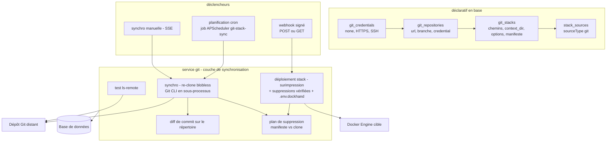
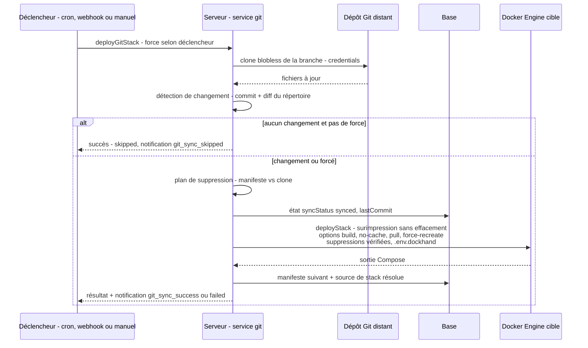

# Spécification fonctionnelle Dockhand — Chapitre 07 : Intégration Git

| Rubrique | Valeur |
|---|---|
| **Chapitre** | 07 — Intégration Git |
| **Document de référence** | [`00-chapitrage.md`](00-chapitrage.md) |

## Table des matières

1. [Objet, périmètre et prérequis de lecture](#1-objet-périmètre-et-prérequis-de-lecture)
2. [Vue d'ensemble de l'intégration Git](#2-vue-densemble-de-lintégration-git)
3. [Credentials Git](#3-credentials-git)
4. [Dépôts Git](#4-dépôts-git)
5. [Stacks Git : rattachement, chemins et options de déploiement](#5-stacks-git--rattachement-chemins-et-options-de-déploiement)
6. [Synchronisation des stacks Git](#6-synchronisation-des-stacks-git)
7. [Surimpression sans effacement et protection des données](#7-surimpression-sans-effacement-et-protection-des-données)
8. [Manifeste des fichiers synchronisés et suppression vérifiée](#8-manifeste-des-fichiers-synchronisés-et-suppression-vérifiée)
9. [Webhooks de déploiement signés](#9-webhooks-de-déploiement-signés)
10. [Flux de déploiement Git et événements git_sync](#10-flux-de-déploiement-git-et-événements-git_sync)
11. [Sécurité de l'intégration Git](#11-sécurité-de-lintégration-git)
12. [Renvois vers les autres chapitres](#12-renvois-vers-les-autres-chapitres)

---

## 1. Objet, périmètre et prérequis de lecture

Ce chapitre décrit l'**intégration Git** de Dockhand : le déploiement et la tenue à jour de stacks Compose depuis des dépôts Git. Il couvre les credentials Git (authentification none/HTTPS/SSH, chiffrement au repos), les dépôts (entité `git_repositories`), les stacks Git (rattachement dépôt + chemins + répertoire de contexte + options de déploiement), la synchronisation (manuelle, planifiée via le planificateur unifié APScheduler, ou déclenchée par webhook signé), le mécanisme de copie **en surimpression sans effacement** (protection des volumes relatifs `./data`), le **manifeste des fichiers synchronisés** (`syncedFiles`) et la suppression vérifiée par empreinte SHA-256 des fichiers retirés du dépôt, ainsi que les webhooks signés (secret par dépôt et par stack, vérification de signature, réponses) et les événements de notification `git_sync_*`.

**Prérequis de lecture** : chapitre 04 (environnements, exécution distante de `docker compose`, staging remote shell SSH) et chapitre 06 (déploiement des stacks, source de stack, variables d'environnement). Le chapitre 03 §7 donne le modèle d'entités (`git_credentials`, `git_repositories`, `git_stacks`).

**Conventions** : mentions *(Enterprise)* / *(SMB)* pour le gating d'édition, *(flag)* pour les fonctions sous feature flag.

## 2. Vue d'ensemble de l'intégration Git

L'intégration Git est un producteur de stacks : une stack Git est une stack Compose (ch. 06) dont la source des fichiers est un **sous-chemin d'un dépôt Git**. La synchronisation clone (ou re-clone) le dépôt localement via la **CLI Git invoquée en sous-processus**, détecte les changements, met à jour le répertoire de déploiement de la stack, puis déclenche le déploiement Compose standard si du contenu a changé.

**Principes transverses** :

- chaque stack Git possède son **propre clone** du dépôt (répertoire `DATA_DIR/git-repos/<environnement>/<stack>/`, avec repli sur l'ancien chemin `stack-<id>` pour compatibilité) — deux stacks d'un même dépôt ne partagent pas leur historique local ;
- la synchronisation d'une stack **re-clône systématiquement** (clone *blobless* : tous les commits, les blobs à la demande) pour garantir un état propre face aux changements de branche/URL/credential, force-pushs, etc. ;
- le déploiement consomme le **répertoire de contexte** (voir §5.2) recopié **en surimpression** dans le répertoire de la stack — jamais en effaçant au préalable ;
- l'état de synchronisation (`lastSync`, `lastCommit`, `syncStatus`, `syncError`) est visible dans l'interface et les exécutions planifiées sont tracées (ch. 14).

## 3. Credentials Git

### 3.1 Modèle et types

L'entité `git_credentials` (cf. ch. 03 §7.1) est un secret **réutilisable** référencé par zéro à N dépôts (déréférencé à sa suppression) :

| Champ | Rôle |
|---|---|
| `name` | Nom unique d'affichage |
| `authType` | `none` \| `password` (HTTPS) \| `ssh` |
| `username` / `password` | Couple HTTPS (utilisateur + mot de passe ou jeton PAT GitHub/GitLab/Gitea) |
| `sshPrivateKey` / `sshPassphrase` | Clé privée SSH OpenSSH + passphrase optionnelle |

Tous les champs sensibles sont **chiffrés au repos** (AES-256-GCM, rotation de clé au démarrage — ch. 02 §7.2) et **jamais retournés par l'API** : la liste n'expose que des indicateurs `hasPassword` / `hasSshKey`.

**Règles de création** (`POST /api/git/credentials`) :

- `authType` restreint à `none` | `password` | `ssh` (sinon 400) ;
- `password` exigé pour `password`, `sshPrivateKey` exigé pour `ssh` (400 sinon) ;
- unicité du nom (conflit → 400 explicite) ;
- audit `create` *(Enterprise)*.

### 3.2 Mise en œuvre de l'authentification

La **couche de synchronisation Git** construit l'environnement d'exécution des sous-processus `git` en appliquant des règles de sécurité strictes :

| Type | Mécanisme | Mesures de sécurité |
|---|---|---|
| `none` | Accès anonyme | `GIT_TERMINAL_PROMPT=0` (jamais d'invite interactive) ; SSH configuré pour **refuser toute clé** (`IdentitiesOnly=yes`, `PubkeyAuthentication=no`) — aucune clé de l'hôte n'est utilisée |
| `password` (HTTPS) | En-tête `Authorization: Basic` injecté par variables d'environnement Git (`http.extraHeader`) | **Jamais d'identifiants dans l'URL** (fuite via la ligne de commande du sous-processus) ; identifiants éventuels de l'URL **retirés** avant clonage ; compatible jetons PAT et utilisateur vide |
| `ssh` | Clé privée écrite dans un fichier temporaire (sous `/tmp`, permissions `0600`) référencée par `GIT_SSH_COMMAND` (`IdentitiesOnly=yes`, aucun agent) | Une **passphrase** éventuelle est levée in place (ssh-keygen) pour un usage non interactif ; fichier **unique par opération** et supprimé après usage (pas de partage entre syncs concurrentes) ; `StrictHostKeyChecking=no` avec `UserKnownHostsFile=/dev/null` |

Comportements annexes notables :

- **Certificats personnalisés** : si une autorité interne est configurée (variable d'environnement dédiée, p.ex. `SSL_CERT_FILE`), un **bundle CA fusionné** (CA système + CA personnalisée) est constitué pour `GIT_SSL_CAINFO` — sinon le remplacement du magasin par défaut casserait les dépôts publics (GitHub/GitLab) ;
- **UID non déclaré** : lorsque le conteneur Dockhand tourne sous un UID absent de `/etc/passwd` (fréquent avec `--user`), une entrée temporaire est injectée via `libnss_wrapper` pour que les appels SSH (`getpwuid()`) réussissent. Ce mécanisme est **conservé** : il est lié à OpenSSH (invoqué par `GIT_SSH_COMMAND`), pas au runtime applicatif.

### 3.3 Test de credential / dépôt

Le test (`git ls-remote --heads --refs`) vérifie **sans clonage** l'URL, la branche et les credentials :

- connexion impossible → message fonctionnel nettoyé (les avertissements SSH/bruit sont filtrés, les messages `fatal:`/`permission denied` traduits) ;
- branche inexistante mais dépôt joignable → liste des branches disponibles (5 premières) ;
- dépôt vide → succès avec la mention « empty repository ».

Le test s'applique à une configuration enregistrée (bouton de grille) ou à une configuration candidate avant enregistrement (bouton de fenêtre modale, credentials résolus par `credentialId`).

## 4. Dépôts Git

### 4.1 Modèle

L'entité `git_repositories` (cf. ch. 03 §7.2) décrit **la source distante** ; la configuration de déploiement a migré vers les stacks Git (édition du dépôt limitée aux champs `name`/`url`/`branch`/`credentialId`) :

| Champ | Rôle | Défaut |
|---|---|---|
| `name` | Nom unique | — |
| `url` | URL distante (https, http, ssh, git, scp-like `git@host:path`) | — |
| `branch` | Branche suivie | `main` |
| `credentialId` | Credential appliqué (facultatif, `set null` à la suppression du credential) | — |
| `composePath` | Chemin Compose par défaut (usage historique ; les stacks Git portent leur propre chemin) | `docker-compose.yml` |
| `environmentId` | Environnement cible (usage historique du déploiement par dépôt) | — |
| `lastSync` / `lastCommit` / `syncStatus` / `syncError` | État de la dernière synchronisation | `pending` |

### 4.2 Cycle de vie

- **Création** : directe (`POST /api/git/repositories`) ou **implicite** lors de la création d'une stack Git (fourniture de `url`/`branch`/`credentialId` en lieu et place d'un `repositoryId`) — dans ce cas le nom du dépôt prend celui de la stack sauf `repoName` fourni ;
- **Édition** : champs de base uniquement ; l'`url` reste soumise à la validation de sûreté (§11) ;
- **Suppression** (`DELETE /api/git/repositories/[id]`) : les **clones des stacks Git** qu'il porte sont supprimés d'abord (répertoires), puis le clone propre du dépôt (`repo-<id>`), puis la ligne en base — la **cascade** emporte les stacks Git.

### 4.3 Vérification de mises à jour disponibles

La vérification compare le commit local au commit distant par un `fetch` sans fusion : un clone absent (jamais synchronisé) est signalé « à jour à prendre » ; un échec de commande est remonté en erreur.

## 5. Stacks Git : rattachement, chemins et options de déploiement

### 5.1 Création et identité

La création (`POST /api/git/stacks`) rassemble :

| Paramètre | Rôle | Règles |
|---|---|---|
| `stackName` | Nom de la stack | Minuscules, initiale alphanumérique, tirets/underscores autorisés (regex Compose) ; conflit avec toute stack existante de l'environnement (interne/externe/Git) → 409 |
| `environmentId` | Environnement cible | Le couple (nom, environnement) est unique |
| `repositoryId` **ou** (`url`, `branch`, `credentialId`) | Rattachement au dépôt | Création implicite du dépôt si nécessaire |
| `composePath` | Chemin du fichier Compose dans le dépôt | Défaut `compose.yaml` à la création (valeur colonne : `docker-compose.yml`) |
| `envFilePath` | Chemin du fichier `.env` **du dépôt** (p.ex. `config/.env.prod`) | Facultatif ; la **prévisualisation** propose les fichiers `.env*` du clone (profondeur 3, hors `node_modules`/`.git`) |
| `contextDir` | Répertoire de travail relatif à la racine du dépôt | `null` = répertoire du fichier Compose |
| `autoUpdate`, `autoUpdateSchedule`, `autoUpdateCron` | Planification de synchro | Cron par défaut `0 3 * * *` |
| `webhookEnabled`, `webhookSecret` | Webhook de la stack | **Secret obligatoire** si activé (400 sinon) |
| `buildOnDeploy`, `noBuildCache`, `repullImages`, `forceRedeploy` | Options de déploiement | Voir §5.3 |
| `secretProviderId` | Fournisseur de secrets lié | Exige en outre la permission `secrets:view` (anti-exfiltration) |
| `envVars` | Variables d'override | Sauvegardées avant déploiement ; secrets masqués `***` filtrés |
| `deployNow` | Déployer immédiatement | Réponse en **flux SSE** (job) avec le résultat |

À la création : la **source de stack** est enregistrée immédiatement (`sourceType: git`, rattachements dépôt + stack Git, fournisseur de secrets), la **planification** est inscrite au planificateur (APScheduler) si `autoUpdate` est actif, l'audit `create` est journalisé *(Enterprise)*.

### 5.2 Répertoire de contexte (`contextDir`)

Le `contextDir` répond au cas des dépôts *monorepo* où le Compose et ses fichiers annexes vivent dans un sous-répertoire, avec un `.env` ailleurs :

- le **répertoire source** recopié vers la stack est le `contextDir` (résolu contre la racine du clone) ; sinon, par défaut, le répertoire **du fichier Compose** ;
- le nom de fichier Compose devient alors le **chemin relatif** du Compose dans ce répertoire (p.ex. `apps/myapp/compose.yaml`) ;
- gardes : le `contextDir` doit rester **dans le dépôt** et le fichier Compose **dans le `contextDir`** (erreurs explicites sinon) ;
- la détection de changements (diff entre commits) porte sur `contextDir` s'il est défini, sinon sur le répertoire du Compose.

### 5.3 Options de déploiement

Reportées à chaque déploiement Git vers le déploiement Compose unifié (ch. 06 §8) :

| Option | Effet au déploiement Git |
|---|---|
| `buildOnDeploy` | `--build` (construire avant up) |
| `noBuildCache` | `--no-cache` (reconstruction propre) |
| `repullImages` | Politique de pull `always` (re-tirer les images avant up) |
| `forceRedeploy` | Redéployer **même sans changement détecté** lors des syncs planifiées/webhook (la synchro manuelle force déjà par défaut) |

De plus, tout changement détecté implique `forceRecreate` (recréation des conteneurs concernés, pour appliquer p.ex. des variables d'environnement modifiées sans changement de Compose).

## 6. Synchronisation des stacks Git

### 6.1 Déroulement d'une synchronisation

1. **verrou d'état** : si `syncStatus = syncing`, la demande est refusée (« Sync already in progress ») ;
2. **état** : passage à `syncing` (effacé en `synced` ou `error` avec message) ;
3. **re-clone blobless** de la branche via la CLI Git en sous-processus (l'ancien clone est supprimé) ; le **commit précédent** est capturé avant destruction (repli sur `lastCommit` en base si le clone avait déjà disparu) ;
4. **détection de changement** : comparaison des commits (7 caractères) ; si différent, `git diff --name-only <précédent> <nouveau> -- <contextDir ou répertoire Compose>/` — un échec de diff (force-push, commit disparu) **suppose un changement** (prudence) ; pas de commit précédent (première synchro) = changement ;
5. **lecture** du Compose (obligatoire : erreur si absent) et du `.env` du dépôt (facultatif : absence ou échec d'analyse non bloquant ; les variables sont analysées, clés invalides ignorées) ;
6. **plan de suppression** : confrontation manifeste ↔ clone (§8) ;
7. **résultat** : succès avec commit, contenu Compose, répertoire source, fichier env relatif, indicateur `updated`, fichiers changés et données de suppression.

Le **déploiement avec progression** (interface) reprend les mêmes étapes en cinq pas remontés en SSE (`connecting`, `cloning`, `fetching`, `reading`, `deploying` → `complete`/`error`) ; la **table des changements de fichiers** est affichée **avant** le déploiement (l'utilisateur voit ce qui va changer pendant que Compose tourne), les divergences d'application éventuelles étant rapportées après.

### 6.2 Déclencheurs

| Déclencheur | Mécanique | Force |
|---|---|---|
| **Manuel** | `POST /api/git/stacks/[id]/sync` ou `/deploy` (ou `deployNow` à la création/édition), flux SSE de progression | **oui** (déploie même sans changement) |
| **Planifié** | job `git-stack-sync` du planificateur unifié (**APScheduler**, AsyncIOScheduler, trigger cron) sur le cron de la stack ; exécution tracée dans `schedule_executions` (`triggeredBy: cron`), journalisée ligne à ligne | **non** (saute si aucun changement → statut `skipped`) |
| **Webhook** | `POST /api/git/stacks/[id]/webhook` (signature) ou `GET …?secret=…` | **non** (saute si aucun changement, sauf `forceRedeploy`) |

Règles communes :

- la modification (PUT) de la stack réinscrit/désinscrit la planification selon `autoUpdate` ;
- au **démarrage du planificateur**, les stacks bloquées en `syncing` (crash d'un processus précédent) sont réinitialisées à `pending` avec mention « recovered from interrupted sync » ;
- à la **suppression** de la stack ou de l'environnement, la planification est désinscrite et les fichiers supprimés.

### 6.3 État de synchronisation et historique

| Attribut | Signification |
|---|---|
| `syncStatus` | `pending` (créée, jamais synchronisée) \| `syncing` (en cours) \| `synced` (dernière synchro OK) \| `error` (échec) |
| `lastSync` | Horodatage ISO de la dernière synchro aboutie |
| `lastCommit` | Commit court (7 caractères) déployé en dernier |
| `syncError` | Message d'erreur de la dernière synchro échouée |

Les **exécutions planifiées** (type `git_stack_sync`, `scheduleId` = id de stack Git, `entityName` = nom de stack) fournissent l'historique détaillé : journaux horodatés, statut (`success`/`skipped`/`failed`), durée (ch. 14). Le **tableau de changements** de chaque synchro (ajouts/modifications/suppressions par fichier) est journalisé serveur et visible dans les journaux d'exécution.

## 7. Surimpression sans effacement et protection des données

### 7.1 Principe

Le répertoire de déploiement d'une stack Git (`DATA_DIR/stacks/<env>/<stack>/`) peut contenir des **données persistantes** : un Compose du dépôt qui monte `./data` crée un répertoire de données **vivant dans le répertoire de la stack** (bind relatif). Effacer le répertoire avant copie détruirait ces données.

La synchro recopie donc le répertoire source du clone **par-dessus** le répertoire de la stack, **sans effacement préalable** (copie récursive filtrant `.git`). Les fichiers disparus du dépôt ne sont supprimés qu'au titre du mécanisme vérifié du §8.

### 7.2 Fichier d'override `.env.dockhand`

Les variables d'environnement saisies dans l'éditeur Dockhand (variables de stack, ch. 06 §7) ne doivent **pas écraser** le `.env` du dépôt :

- le `.env` du dépôt est copié tel quel dans le répertoire de la stack (nom relatif préservé, passé à Compose via `--env-file`) ;
- les valeurs de la base (variables non secrètes + secrets, résolutions du fournisseur de secrets) sont écrites dans un **fichier d'override dédié `.env.dockhand`**, superposé au déploiement — les secrets restent **chiffrés en base** et injectés par environnement de processus (jamais écrits dans un fichier, ch. 06 §7.2) ;
- la priorité de fusion reste celle du chapitre 06 : `.env` du dépôt < override Dockhand < secrets injectés.

### 7.3 Staging distant

Pour les environnements distants, l'arborescence complète (Compose, `.env`, fichiers du dépôt, override) transite par le **staging** décrit au ch. 04 §9.3 : **transfert sur l'hôte distant via la session SSH** du remote shell (fichiers binaires encodés, plafonds 10 Mo/fichier et 256 Mo total), ou copie vers `remote_stacks_dir` avec réécriture des binds relatifs (mode `direct`). Les suppressions distantes suivent les règles du §8.4.

## 8. Manifeste des fichiers synchronisés et suppression vérifiée

### 8.1 Manifeste `syncedFiles`

L'attribut `git_stacks.syncedFiles` porte un **manifeste JSON** `{ commit, files }` :

- `files` : mapping **chemin relatif → empreinte SHA-256** (calculée via `hashlib`) des fichiers (réguliers uniquement, hors `.git`) écrits lors de la **dernière synchro réussie** ;
- `commit` : commit complet (40 caractères) d'où proviennent les fichiers (`null` pour un manifeste hérité/vide).

C'est la **référence de propriété** : seuls les fichiers listés dans le manifeste ont été écrits par Dockhand et sont donc éligibles à la suppression automatique.

### 8.2 Calcul du plan de suppression

À chaque synchro :

1. **hachage du clone** : chaque fichier du répertoire source est haché (SHA-256) ;
2. **manifeste vide** (première synchro, base fraîche, manifeste corrompu) → **rien à supprimer** (échec fermé : un manifeste illisible vaut manifeste vide) ;
3. **garde de sanité** : si le parcours du clone paraît cassé (aucun fichier, ou le Compose lui-même absent du parcours), **toutes** les suppressions de cette synchro sont annulées — un défaut de Dockhand ne doit pas ressembler à un dépôt vidé ;
4. **diff** : chaque entrée du manifeste absente du nouveau clone devient candidate (chemin + empreinte) ; les chemins non sûrs (absolus, échappants) et les **fichiers porteurs** (noms `docker-compose.yml`/`.yaml`, `compose.yml`/`.yaml`, `.env`) sont exclus d'office ;
5. le plan `{ toDelete, skipped }` est transmis au déploiement, qui l'applique **après** le succès de la copie en surimpression.

### 8.3 Application vérifiée par empreinte

L'application est structurellement incapable de toucher quoi que ce soit hors du répertoire de la stack :

| Contrôle | Effet |
|---|---|
| Containment du chemin | Tout chemin qui échapperait au répertoire de stack est refusé (`invalid-path`) |
| Fichiers porteurs | Jamais supprimés automatiquement, même listés (`load-bearing`) |
| Type d'entrée | Seuls les **fichiers réguliers** sont traités ; un lien/répertoire à la place d'un fichier = « modifié localement » → conservé |
| **Empreinte disque** | Le fichier n'est supprimé que si ses octets **correspondent encore** à l'empreinte du manifeste ; toute divergence = modification locale → conservé (`locally-modified`) |
| Répertoires | Nettoyage des répertoires devenus vides par `rmdir` **non récursif** (un répertoire contenant autre chose survit) |

Les **sauts sont définitifs par conception** : une suppression est tentée une seule fois, à la synchro où le fichier disparaît du clone ; tout échec (empreinte divergente, erreur de suppression) laisse le fichier en **résidu non géré** — le pire cas est toujours « un fichier périmé survit », jamais une perte de données. Les fichiers sautés sortent du manifeste suivant (ils cessent d'être gérés).

### 8.4 Environnement remote shell SSH

Pour un déploiement d'un environnement remote shell, la **liste à supprimer** est transmise sur l'hôte distant avec l'arborescence (via la session SSH) ; le serveur applique **les mêmes vérifications** (containment, fichiers porteurs, empreinte) en exécutant les commandes de suppression **sur l'hôte distant à travers SSH**. Les raisons de saut sont normalisées (toute raison inconnue devient `apply-failed`) ; un échec de canal SSH suspend les suppressions distantes (aucune suppression aveugle).

### 8.5 Résumé de changements

Chaque synchro réussie produit un **tableau par fichier** (`added`/`updated`/`removed`/`skipped` avec raison + compteur d'inchangés) : affiché en progression avant déploiement, journalisé avec les résultats réels d'application après. Le **manifeste suivant** est exactement l'ensemble des fichiers écrits à cette synchro, au commit de cette synchro.

## 9. Webhooks de déploiement signés

### 9.1 Deux webhooks indépendants

| Webhook | Endpoint | Cible |
|---|---|---|
| **Par dépôt** | `POST|GET /api/git/webhook/[id]` | Déploiement de la stack portant le nom du dépôt (usage historique, déploiement par dépôt) |
| **Par stack Git** | `POST|GET /api/git/stacks/[id]/webhook` | Synchro + déploiement de la stack désignée (`deployGitStack`, force = faux) |

Chacun porte son **propre secret** (`webhookSecret` de l'entité concernée) et son **propre interrupteur** (`webhookEnabled`). Le webhook par stack est le mécanisme recommandé : il bénéficie de la détection de changement (saut propre sans re-déploiement) et de toutes les options de la stack.

### 9.2 Authentification du webhook

Le secret est **obligatoire** : un webhook activé sans secret configuré est rejeté (401) et journalisé en audit — jamais de webhook « ouvert ».

**POST (fournisseurs)** — deux familles de format, détectées par en-tête, signature vérifiée via le module `hmac` de la bibliothèque standard :

| Source | En-tête | Vérification |
|---|---|---|
| GitHub / Gitea / Forgejo | `X-Hub-Signature-256: sha256=<hmac>` | HMAC-SHA256 du **corps brut** de la requête, clé = secret ; comparaison à temps constant (`hmac.compare_digest`) |
| GitLab | `X-Gitlab-Token: <secret>` | Égalité exacte du jeton, comparaison à temps constant |

**GET (déclenchement manuel/sonde)** — le secret passe en paramètre d'URL `?secret=…` et est comparé à la valeur configurée (401 explicite en cas d'écart).

### 9.3 Réponses et rejeu

| Cas | Réponse |
|---|---|
| Signature/jeton valides, déploiement lancé | 200 `{ success, output?, skipped?, error? }` |
| Signature invalide / secret manquant | 401 + audit `webhook` avec motif (`invalid_signature`, `no_secret_configured`, `invalid_secret`) |
| Webhook désactivé sur l'entité | 403 |
| Entité inexistante / id invalide | 404 / 400 |
| Échec du déploiement déclenché | 200 avec `success:false` et l'erreur (le transport du webhook réussit ; l'échec fonctionnel est dans le corps) ou 500 sur exception |

Le **rejeu** est sans effet de bord destructeur : une nouvelle requête valide re-déclenche la synchro, qui re-clône et saute le re-déploiement si rien n'a changé (sécurisé par la comparaison de commit + diff de répertoire). Le déploiement déclenché par webhook est **audité** *(Enterprise)* avec le résultat (`deployed`/`failed`/`skipped`).

## 10. Flux de déploiement Git et événements git_sync

### 10.1 Flux de bout en bout

Le déploiement lui-même (`deployStack`, option `isGitDeploy`) suit le flux du **ch. 06 §8.1** : verrou par stack, résolution de variables et secrets, staging distant le cas échéant, exécution `docker compose up -d` en sous-processus avec les options de la stack, réconciliation des mises à jour en attente si le pull était demandé.

### 10.2 Événements de notification `git_sync_*`

Le déploiement Git **supprime** la notification générique `stack_deployed` (option `isGitDeploy`) au profit d'événements dédiés — **quel que soit l'appelant** (webhook, manuel, création/édition, planificateur) :

| Événement | Quand | Type |
|---|---|---|
| `git_sync_success` | Synchro + déploiement réussis | succès |
| `git_sync_skipped` | Aucun changement détecté (déploiement sauté) | info |
| `git_sync_failed` | Échec de synchro ou de déploiement, avec le message | erreur |

Ces événements sont **routables** par canal de notification et par environnement (ch. 13) ; l'émission est *best-effort* (un échec de notification ne change jamais l'issue du déploiement).

### 10.3 Effets en base après succès

- `git_stacks` : `syncStatus = synced`, `lastSync`, `lastCommit`, **manifeste suivant** persisté ;
- `stack_sources` : upsert avec le **chemin Compose résolu** dans le répertoire de la stack (cohérence avec l'inventaire et les chemins du ch. 06 §10) ;
- exécution planifiée clôturée (`success`/`skipped`) avec journaux et table de changements.

## 11. Sécurité de l'intégration Git

| Risque | Mesure fonctionnelle |
|---|---|
| Injection d'options Git via l'URL/branche | URL : refus des valeurs commençant par `-`, des transports `ext::`/`fd::`/`file://`, des chemins locaux ; branche : refus des refs option-like |
| Évasion du clone par les chemins Compose/.env | Résolution + contrôle de containment : tout chemin qui s'échapperait du clone est refusé ; un `/` initial est traité comme relatif à la racine du clone |
| Fuite de credentials en ligne de commande | HTTPS par variables d'environnement (jamais dans l'URL, identifiants retirés de l'URL) ; SSH par fichier temporaire `0600` unique par opération, nettoyé après |
| Utilisation de clés SSH de l'hôte | `IdentitiesOnly=yes`, agent désactivé, et sans credential SSH : authentification par clé explicitement désactivée |
| Suppression de fichiers utilisateur | Suppression conditionnée au **manifeste** (fichiers écrits par Dockhand uniquement), vérification **d'empreinte SHA-256** avant suppression, fichiers porteurs intouchables, `rmdir` non récursif, garde de sanité sur clone vide |
| Webhook non authentifié | Secret obligatoire, HMAC-SHA256 à temps constant (`hmac.compare_digest`) pour GitHub/Gitea/Forgejo ou jeton (GitLab), audit des échecs |
| Clé SSH exposée sur volume réseau | Écrite sous `/tmp` (filesystem local fiable), pas dans le répertoire de données |
| État `syncing` orphelin après crash | Réinitialisation à `pending` au démarrage du planificateur avec trace explicite |
| Données de stack détruites au re-déploiement | Copie **en surimpression sans effacement** ; overrides dans `.env.dockhand` séparé du `.env` du dépôt |
| Secrets dans les journaux | Variables d'environnement parsées journalisées **masquées** (valeurs `***`, clés seules) |

## 12. Renvois vers les autres chapitres

| Chapitre | Lien | Pourquoi y aller |
|---|---|---|
| 00 — Chapitrage | [`00-chapitrage.md`](00-chapitrage.md) | Sommaire de référence. |
| 02 — Architecture fonctionnelle | [`02-architecture-fonctionnelle.md`](02-architecture-fonctionnelle.md) | Sous-processus Git, flux de synchro de bout en bout. |
| 03 — Concepts et entités | [`03-concepts-entites.md`](03-concepts-entites.md) | Attributs complets de `git_credentials`/`git_repositories`/`git_stacks`, cascades. |
| 04 — Environnements | [`04-environnements.md`](04-environnements.md) | Répertoires `git-repos/<nom>/`, impact du renommage et de la suppression d'environnement, staging remote shell SSH. |
| 05 — Gestion des conteneurs | [`05-conteneurs.md`](05-conteneurs.md) | Conteneurs recréés par les re-déploiements Git (`force-recreate`). |
| 06 — Stacks Compose | [`06-stacks.md`](06-stacks.md) | Flux de déploiement (§8.1) consommé par le déploiement Git, variables/`.env.dockhand` (§7.2), suppression de stack (§9). |
| 08 — Images et registres | [`08-images.md`](08-images.md) | Option `repullImages` → pull `always` et réconciliation des mises à jour en attente. |
| 10 — Sécurité applicative | [`10-securite-applicative.md`](10-securite-applicative.md) | Fournisseurs de secrets liés aux stacks Git. |
| 13 — Observabilité | [`13-observabilite.md`](13-observabilite.md) | Routage des événements `git_sync_*`, historique. |
| 14 — Automatisation | [`14-automatisation-api.md`](14-automatisation-api.md) | Job `git-stack-sync` (APScheduler), exécutions, fuseaux horaires, endpoints webhook dans l'OpenAPI. |
| 15 — Administration | [`15-administration-exploitation.md`](15-administration-exploitation.md) | Autorités de certification internes, `GIT_REPOS_DIR`. |
