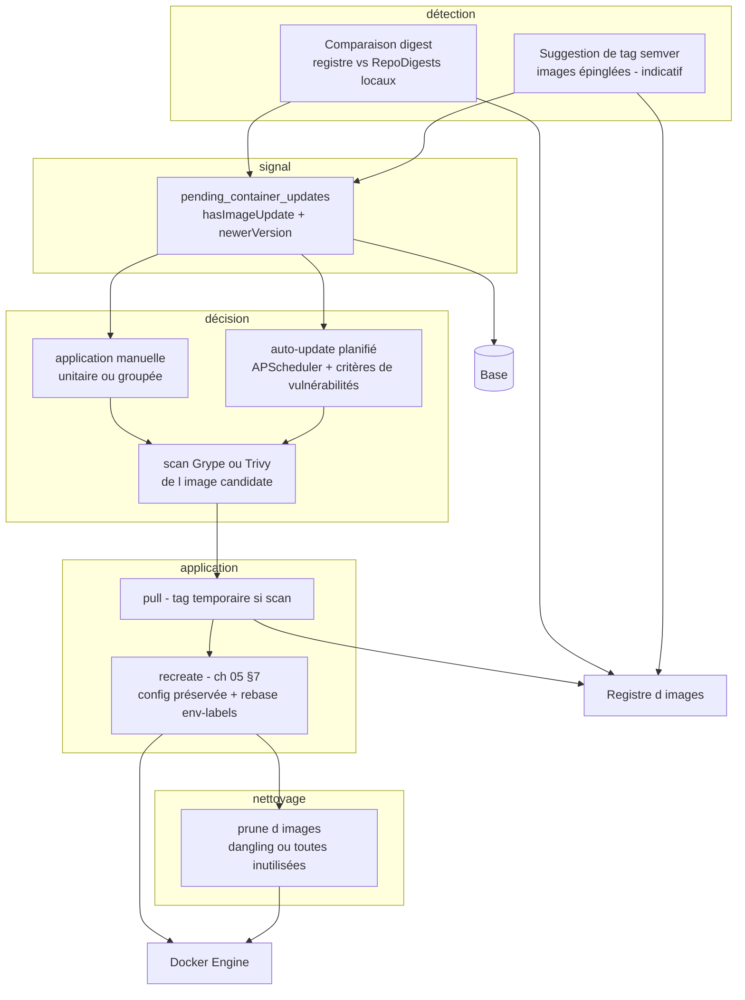

# Spécification fonctionnelle Dockhand — Chapitre 08 : Images, registres et gestion des mises à jour

| Rubrique | Valeur |
|---|---|
| **Chapitre** | 08 — Images, registres et gestion des mises à jour |
| **Document de référence** | [`00-chapitrage.md`](00-chapitrage.md) |

## Table des matières

1. [Objet, périmètre et prérequis de lecture](#1-objet-périmètre-et-prérequis-de-lecture)
2. [Vue d'ensemble de la gestion des images et mises à jour](#2-vue-densemble-de-la-gestion-des-images-et-mises-à-jour)
3. [Inventaire et inspection des images](#3-inventaire-et-inspection-des-images)
4. [Opérations sur les images : pull, load, suppression](#4-opérations-sur-les-images--pull-load-suppression)
5. [Registres](#5-registres)
6. [Détection des mises à jour : double mécanisme digest / semver](#6-détection-des-mises-à-jour--double-mécanisme-digest--semver)
7. [Mises à jour en attente et rapprochement par stack](#7-mises-à-jour-en-attente-et-rapprochement-par-stack)
8. [Application des mises à jour : recreate unitaire et batch](#8-application-des-mises-à-jour--recreate-unitaire-et-batch)
9. [Auto-update de conteneurs](#9-auto-update-de-conteneurs)
10. [Nettoyage d'images (prune)](#10-nettoyage-dimages-prune)
11. [Synthèse des règles de sécurité](#11-synthèse-des-règles-de-sécurité)
12. [Renvois vers les autres chapitres](#12-renvois-vers-les-autres-chapitres)

---

## 1. Objet, périmètre et prérequis de lecture

Ce chapitre décrit la gestion des **images** et des **registres**, ainsi que le **suivi et l'application des mises à jour d'images** : inventaire et inspection (couches, taille, conteneurs associés), pull avec progression, chargement d'images depuis une archive (hôtes sans registre), suppression avec traduction des erreurs Docker, gestion des registres (credentials, registre par défaut, catalogue distant), le **double mécanisme de détection** (digest appliquable vs suggestion semver indicative), les mises à jour en attente (`pending_container_updates`) et leur rapprochement après redéploiement de stack, l'application des mises à jour (recréation unitaire du ch. 05 §7, application groupée en flux `batch-update-stream`, critères de vulnérabilités bloquants), l'auto-update planifié (`auto_update_settings`, critères `never|any|critical_high|critical|more_than_current`) et le nettoyage d'images (prune manuel et planifié, images dites *dangling*).

**Prérequis de lecture** : chapitre 05 (recreate et fusion env/labels, §7 ; suivi des mises à jour, §13) et chapitre 06 (déploiement avec pull, réconciliation). Le chapitre 03 §8 donne les entités `registries`, `pending_container_updates` et `auto_update_settings`.

**Conventions** : mentions *(Enterprise)* / *(SMB)* pour le gating d'édition, *(flag)* pour les fonctions sous feature flag.

## 2. Vue d'ensemble de la gestion des images et mises à jour

Les images sont des **objets Docker non répliqués en base** (ch. 02 §7.3) : l'inventaire se lit en temps réel sur l'environnement via **aiodocker** (ou à travers la session SSH du remote shell pour les environnements concernés). La valeur ajoutée de Dockhand tient dans le **cycle de mise à jour** : détection (digest et/ou semver), signal (mise à jour en attente), décision (manuelle ou auto-update planifié, avec critères de vulnérabilités), application (recréation à configuration préservée), puis nettoyage (prune des images inutilisées).

## 3. Inventaire et inspection des images

### 3.1 Inventaire

`GET /api/images?env=<id>` (service d'inventaire d'images adossé à **aiodocker**) :

- retourne par image : identifiant, `RepoTags`, `RepoDigests`, tailles (réelle et virtuelle), date de création, labels et **nombre de conteneurs associés** (calculé côté Dockhand en croisant l'inventaire des conteneurs — y compris arrêtés — car certains hôtes renvoient `-1`) ;
- comportements aux limites : sans environnement → tableau vide ; environnement inexistant → 404 ; Docker injoignable → **tableau vide** (l'interface se charge sans erreur bloquante) ;
- filtrage interface par tag/dépôt, tri par taille ou date ; les images **sans tag** (*dangling*) sont identifiables et candidates au prune.

### 3.2 Inspection, couches et historique

- `GET /api/images/[id]/inspect` : détails Docker de l'image (config, arch, OS, digests) ;
- `GET /api/images/[id]/history` : **couches** successives (commande de création, taille, identifiant) — restituées dans la fenêtre de détails ;
- `GET /api/images/[id]/tag` : gestion des tags (ajout/suppression d'un tag sur une image existante) ;
- `GET /api/containers/[id]/version-notes` : notes de version associées à l'image d'un conteneur (renvoi depuis le ch. 05 §6) ;
- les **scans** et **exports** de résultats sont traités au ch. 10.

## 4. Opérations sur les images : pull, load, suppression

### 4.1 Pull avec progression

`POST /api/images/pull` :

- le **tag est explicitement isolé** de la référence (repo:tag, repo@digest, port de registre vs tag) afin de ne **jamais tirer tous les tags** d'un dépôt ;
- **authentification** : les credentials du registre correspondant (§5) sont encodés dans l'en-tête Docker `X-Registry-Auth` (base64url **avec padding**, exigence du daemon — un encodage sans padding serait silencieusement traité comme anonyme et provoquerait des limites de débit) ;
- la progression est **streamée en SSE** (via sse-starlette ; événements de pull ligne à ligne) ; une erreur survenant dans le flux (réponse 200 avec ligne `error`) est capturée et remontée en échec à la fin du flux ;
- **scan après pull** optionnel (`scanAfterPull`) : si un scanner est configuré, le scan démarre à l'issue du pull avec sa progression dans le même flux (détail ch. 10) ;
- les **environnements remote shell SSH** reçoivent le pull exécuté sur l'hôte distant via la session SSH ; session SSH non établissable → erreur fonctionnelle immédiate.

### 4.2 Chargement d'archive (docker load)

`POST /api/images/load` charge une image depuis un **tar téléversé** — destiné aux hôtes sans accès registre (*air-gapped*) :

- l'archive est **transmise en flux** au daemon (pas de mise en tampon mémoire : une image de plusieurs Go ne met pas Dockhand à genoux) ;
- **non supporté sur les environnements remote shell SSH** : refus explicite et actionnable dès le départ (le transport SSH n'est pas adapté au streaming d'un téléversement volumineux depuis le navigateur) ;
- la progression NDJSON du daemon (lignes `stream`/`error`) est analysée et relayée ; une ligne d'erreur fait échouer l'opération après la fin du flux.

### 4.3 Suppression

`DELETE /api/images/[id]?force=<bool>` :

- le **nom** de l'image est résolu avant suppression (audit lisible) ;
- les **erreurs Docker 409 sont traduites** en messages fonctionnels : image utilisée par un conteneur actif (« stopper le conteneur d'abord ») ou images enfants dépendantes (« supprimer celles-ci d'abord ou forcer ») ;
- l'opération est **auditée** *(Enterprise)* avec l'option force ; la suppression en **batch** transverse est décrite au ch. 05 §5.

## 5. Registres

### 5.1 Modèle

L'entité `registries` (cf. ch. 03 §8.1) :

| Champ | Rôle |
|---|---|
| `name` | Nom unique |
| `url` | URL du registre (normalisée en hôte pour la mise en correspondance avec les références d'images) |
| `username` / `password` | Credentials (**chiffrés au repos**), rognés des espaces parasites à la saisie (des blancs de copier-coller corrompraient les en-têtes d'authentification) |
| `isDefault` | Registre employé par défaut pour les opérations génériques |

L'API n'expose **jamais le mot de passe** : la liste et les réponses ne portent qu'un indicateur `hasCredentials`. Un endpoint dédié (`POST /api/registries/[id]/default`) désigne le registre par défaut (unicité garantie).

### 5.2 Authentification des opérations

Lors d'un pull ou d'une requête de détection, Dockhand **résout le registre depuis la référence d'image** (hôte explicite, sinon Docker Hub et ses variantes canonisées `docker.io`/`index.docker.io`) et cherche les credentials correspondants :

- Docker Hub exige le `serveraddress` canonique `https://index.docker.io/v1/` — un simple nom d'hôte serait traité comme anonyme ;
- en **détection distante** (tokens de registre), les requêtes de jeton suivent les **redirections manuellement** en réattachant l'en-tête `Authorization` **uniquement si l'hôte ne change pas** (un Harbor derrière proxy TLS qui redirige `http→https` sur le même hôte doit rester authentifié ; un changement d'hôte ne fuit jamais les credentials) ;
- chaque saut de redirection (et l'URL initiale) est soumis au **garde anti-SSRF** (voir §11).

### 5.3 Catalogue et recherche distants

L'interface de déploiement s'appuie sur des endpoints délégués au daemon ou au registre (`/api/registry/` : `catalog`, `search`, `tags`, `tag-info`, `image`) :

- le **catalogue** (`/v2/_catalog`) peut être refusé par certains registres (GitLab, Harbor le réservent aux administrateurs) : la réponse est **classée** fonctionnellement entre « non supporté — utiliser la recherche par chemin complet » (jeton valide sans permission, `insufficient_scope`) et « échec d'authentification » (jeton invalide/rejeté) — évite de faire croire à un mauvais mot de passe ;
- la **recherche** et la **liste de tags** complètent le parcours de pull (choix du tag, détails d'un tag).

## 6. Détection des mises à jour : double mécanisme digest / semver

### 6.1 Vérification par digest (appliquable)

La vérification compare, **sans tirer l'image**, le manifeste distant aux empreintes locales :

1. **images épinglées par digest** (`repo@sha256:…`) : jamais signalées — l'épinglage est un verrou volontaire ;
2. **registres locaux** (`localhost:port/…`) : exclus du contrôle (non résolvables depuis Dockhand, bruit d'erreurs inutile) ;
3. lecture des `RepoDigests` de l'image locale (une image peut en porter plusieurs) ;
4. interrogation du registre pour le **digest du manifeste** du tag (requête HEAD) ;
5. correspondance avec **n'importe quel** digest local → à jour ; sinon :
6. **élimination du faux positif multi-arch** : le digest de tête est celui de l'index ; une image locale identifiée par le digest **enfant par architecture** ne correspond jamais à l'index alors qu'elle est à jour — Dockhand vérifie l'appartenance du digest local aux enfants de l'index avant de déclarer une mise à jour ;
7. cas particulier **sans aucun RepoDigest** : ambigu (image construite localement **ou** image de registre détaguée par un pull plus récent — précisément l'état « à mettre à jour ») ; Dockhand interroge le registre : s'il répond, une mise à jour est déclarée ; sinon l'image est traitée de locale.

### 6.2 Suggestion semver (indicative)

Pour les images **épinglées par version** (`app:1.24.0`), le digest ne bouge pas : la détection porte sur les **tags du registre**. Cette suggestion est un paramètre **global** (réglages : activée, palier maximal de saut `maxBump`, saveur de correspondance, préversions incluses ou non) avec une **surcharge par conteneur** (label Docker `dockhand.version.pattern` pour les tags non standards — CalVer+hash, etc.) :

- résultat : `newerVersion` JSON `{tag, bump}` — le tag le plus récent compatible et le type de saut ;
- **purement indicative** : jamais appliquée automatiquement, jamais comptée comme mise à jour « réelle » ; un champ `skipped` marque les suggestions ignorées par l'utilisateur ;
- les **tags flottants** (`latest`) court-circuitent la vérification (aucun appel registre) ;
- une notification dédiée `newer_version_available` signale les **nouvelles** suggestions (comparaison au tag déjà signalé — pas de re-notification à chaque cycle).

### 6.3 Tableau comparatif

| Aspect | Digest (`hasImageUpdate`) | Semver (`newerVersion`) |
|---|---|---|
| Cible | Images à tag flottant ou toute image de registre | Images épinglées par version |
| Méthode | Digest du manifeste distant vs digests locaux | Liste des tags du registre, comparaison sémantique |
| Signification | **Mise à jour réelle appliquable** (même référence, nouveau contenu) | **Suggestion** de nouvelle version publiée |
| Application | Manuelle (unitaire/batch) ou auto-update | **Jamais automatique** — action humaine uniquement |
| Signal visuel | Indicateur « ambre » classique | Suggestion avec type de saut, marquable « ignorée » (`skipped`) |

### 6.4 Déclencheurs de la vérification

| Déclencheur | Mécanique |
|---|---|
| **Manuel** | `POST /api/containers/check-updates` (flux SSE de progression par conteneur ; `GET` du même endpoint lit le **cache** sans effet de bord) |
| **Planifié par environnement** | job `env-update-check` du planificateur (**APScheduler**, trigger cron des réglages de l'environnement) : passe en revue tous les conteneurs éligibles, reconstruit les lignes en attente, notifie et optionnellement auto-update (§9.3) |
| **Après déploiement de stack avec pull** | réconciliation (§7.2) |

Les contrôles excluent systématiquement : conteneurs **système** (Dockhand lui-même et son sidecar « image updater » — non auto-mise-à-jour depuis l'intérieur), conteneurs **masqués** (`dockhand.hidden=true`), conteneurs d'infrastructure Podman (`<pod>-infra`), conteneurs désactivés par label (`dockhand.update=false`) et images à **digest épinglé**.

## 7. Mises à jour en attente et rapprochement par stack

### 7.1 Modèle

L'entité `pending_container_updates` (cf. ch. 03 §8.2 ; unicité environnement + conteneur) cumule les deux signaux sur une même ligne :

| Champ | Signification |
|---|---|
| `containerId` / `containerName` / `currentImage` | Conteneur concerné et référence d'image |
| `hasImageUpdate` | **Vrai** si une mise à jour digest est disponible (indicateur ambre) |
| `newerVersion` | JSON `{tag, bump, skipped}` : suggestion semver, `skipped` si ignorée |
| `checkedAt` | Fraîcheur du contrôle |

**Cycle de vie** : la vérification (manuelle ou planifiée) **réinitialise** les lignes de l'environnement puis les reconstruit en fusionnant les deux signaux (un conteneur « semver pur » obtient une ligne avec `hasImageUpdate = false`) ; la ligne est **effacée** à la recréation réussie du conteneur ou à sa suppression ; les lignes orphelines (conteneur recréé/supprimé hors Dockhand) restent mais ne s'affichent que si le conteneur existe — la **tuile du tableau de bord ne compte que les lignes dont le conteneur est vivant**.

Consultation : `GET /api/containers/pending-updates?env=` ; suppression ciblée ou globale (`DELETE`, permission `containers:manage`).

### 7.2 Réconciliation après redéploiement de stack

Un redéploiement avec pull recrée les conteneurs avec de **nouveaux identifiants**, orphelins pour les lignes en attente (clé = ancien identifiant). La règle de réconciliation efface une ligne **uniquement si le conteneur prouve** qu'il tourne la plus récente image locale de son tag :

- conteneur vivant introuvable par nom → ligne orpheline, effacée ;
- conteneur vivant mais hors de la stack concernée → **conservé** (pas à nous) ;
- identifiant d'image du conteneur = plus récent identifiant local du tag → à jour, effacée ;
- sinon (pull échoué, image `build:`, tag irrésolvable) → **conservé** — toute ambiguïté préserve le signal plutôt que de masquer une mise à jour réelle.

Un garde-fou de délai évite que la réconciliation ne retarde ou ne fasse échouer le déploiement lui-même (ch. 06 §8.1).

## 8. Application des mises à jour : recreate unitaire et batch

### 8.1 Recréation unitaire (cœur du mécanisme)

Toute application de mise à jour repose sur la **recréation à configuration préservée** du chapitre 05 §7 :

- **passthrough complet** de la configuration (Config/HostConfig transmis à l'identique depuis l'inspection ; seule l'image change) — aucun mapping de champs manuel, aucune perte de réglage ;
- **rebase env/labels/commande** : la configuration de l'**ancienne image est inspectée AVANT le pull** (après un pull, l'ancien tag peut être détagué/collecté et ne plus être inspectable) ; chaque valeur identique à celle de l'ancienne image suit la nouvelle image, chaque valeur modifiée par l'utilisateur est conservée (détail ch. 05 §7.3) ;
- **conteneurs dépendants** : un conteneur enfant partageant le réseau du parent (`network_mode: service:`/`container:`) référence l'**ancien identifiant** du parent ; après recréation réussie du parent, Dockhand **recrée les enfants** avec la référence réécrite par **nom** (survit aux recréations futures), en chaîne, au mieux — sans jamais compromettre la mise à jour du parent ;
- succès ⇒ **effacement de la ligne en attente** du conteneur et notification `container_updated`.

### 8.2 Application groupée (batch-update-stream)

`POST /api/containers/batch-update-stream` applique les mises à jour d'un ensemble de conteneurs **séquentiellement** avec suivi en flux (job SSE relançable par `jobId`) :

- **corps** : liste d'identifiants de conteneurs + critère de vulnérabilités optionnel (défaut `never`) ; permission exigée : `containers:create` (recréer = créer) ;
- **par conteneur** : sauts de sécurité (système, `dockhand.update=false`, digest épinglé), puis **pull avec progression** (événements `pull_log`), puis flux de **scan protégé** (§8.3), puis **recréation** ;
- **événements du flux** : `start` (total) → `progress` (étape par conteneur : `pulling`, `scanning`, `stopping`, `removing`, `creating`, `starting`, `done`, `failed`, `blocked`, `skipped`) → `scan_start`/`scan_log`/`scan_complete`/`blocked` → `complete` avec résumé (total, succès, échecs, bloqués, sautés) ; `error` en échec global ;
- un échec **n'interrompt pas** la file ; chaque conteneur réussi voit sa ligne en attente effacée.

### 8.3 Flux de pull protégé (temp tag)

Lorsqu'un scanner est actif et l'image non épinglée, la mise à jour suit un protocole prudent :

1. **pull** de la nouvelle image (le tag est repointé dessus) ;
2. **restauration du tag original sur l'ancienne image** (l'ancienne reste désignable — un blocage ne laisse jamais le tag orphelin d'une image inconnue) ;
3. **tag temporaire** `<tag>-dockhand-pending` sur la nouvelle image ;
4. **scan** de l'image candidate (par identifiant, pour un cache correct ; les résultats sont enregistrés en base, ch. 10) ;
5. décision : **blocage** → l'image candidate est supprimée, le conteneur reste sur l'ancienne, notification `auto_update_blocked` ; **approbation** → re-tag vers l'original, nettoyage du tag temporaire, recréation.

Sans scanner (ou image à digest), le pull est direct. Un **échec du scan** lui-même est traité en échec de la mise à jour (prudence : on ne déploie pas une image qu'on n'a pas pu évaluer) dans les chemins automatiques.

## 9. Auto-update de conteneurs

### 9.1 Règles d'auto-update

L'entité `auto_update_settings` (cf. ch. 03 §8.3 ; unicité environnement + nom de conteneur) définit une règle par **conteneur nommé** :

| Champ | Rôle |
|---|---|
| `containerName` + `environmentId` | Cible (le nom survit aux recréations) |
| `enabled` | Interrupteur |
| `scheduleType` + `cronExpression` | Planification (trigger cron **APScheduler**) |
| `vulnerabilityCriteria` | `never` \| `any` \| `critical_high` \| `critical` \| `more_than_current` |
| `lastChecked` / `lastUpdated` | Suivi |

Le job `container-update` du planificateur unifié exécute une règle : contrôles de sécurité (conteneur présent, non système, labels, digest), vérification digest (§6.1), puis flux protégé (§8.3) et recréation ; l'exécution est tracée dans `schedule_executions` avec un détail riche (mode, digest, critères, résumé par conteneur, résultats de scanners). Notifications : `auto_update_success`, `auto_update_failed`, `auto_update_blocked`.

### 9.2 Critères de vulnérabilités

La décision de blocage s'appuie sur le **résumé combiné des scanners** (le pire de chaque sévérité entre scanners, ch. 10) :

| Critère | Blocage quand |
|---|---|
| `never` | Jamais (aucun contrôle) — défaut |
| `any` | Toute vulnérabilité (critique+haute+moyenne+basse > 0) |
| `critical_high` | Au moins une critique **ou** haute |
| `critical` | Au moins une critique |
| `more_than_current` | Total de vulnérabilités de la nouvelle image **supérieur** à celui de l'image courante |

Le critère `more_than_current` bénéficie d'un traitement robuste : les bases de vulnérabilités grossissent, un scan en cache **sous-estime** l'image courante et ferait faussement paraître la nouvelle pire ; lorsque la comparaison (en cache) bloquerait — ou qu'aucun scan n'existe — l'image **courante est re-scannée à frais nouveaux** et la décision refondée ; un compte courant indisponible ne **bloque pas** (on ne refuse pas une mise à jour faute de données).

**Interaction avec les scans** : le critère contrôle le **blocage**, pas le scan — le scan s'exécute dès qu'un scanner est configuré (`scanner != none`), indépendamment du critère. Le détail des scanners (Grype/Trivy, files, cache) relève du ch. 10.

### 9.3 Vérification par environnement avec auto-update

Le job `env-update-check` complète les règles unitaires au niveau de l'environnement :

- **exclusivité** : une seule exécution simultanée par environnement (verrou en mémoire) ;
- passe en revue les conteneurs éligibles, **réinitialise puis reconstruit** les lignes en attente (fusion digest + semver), collecte la config de l'ancienne image **avant tout pull** (rebase) ;
- **mode notification seule** : notification `updates_detected` avec la liste (références et digests) ;
- **mode auto-update** (activé au niveau des réglages de l'environnement, avec son propre critère de vulnérabilités) : flux protégé par conteneur, résumé d'exécution (mis à jour/bloqués/échoués avec raisons et résultats scanners), notification `batch_update_success` (type visuel selon le bilan) ;
- les conteneurs **bloqués ou échoués restent en attente** (seuls les réussis sont effacés).

## 10. Nettoyage d'images (prune)

### 10.1 Prune manuel

`POST /api/prune/images?dangling=<bool>&env=<id>` (flux SSE de job) :

| Mode | Périmètre |
|---|---|
| `dangling` (défaut) | Images **sans tag** uniquement |
| `dangling=false` | **Toutes** les images inutilisées |

- le réglage général `protectScannerImages` **exclut les images des scanners** (Grype `anchore/grype:v0.115.0`, Trivy `aquasec/trivy:0.71.2`) du prune « toutes inutilisées » — sinon chaque cycle re-téléchargerait des gigaoctets de bases de vulnérabilités ;
- résultat (images supprimées, espace libéré) et **audit** `prune` ; le prune **global toutes ressources** (`/api/prune/all`) et par ressource (conteneurs/volumes/réseaux) est décrit au ch. 09.

### 10.2 Prune planifié

Réglages par environnement (`/api/environments/[id]/image-prune`) : `enabled`, `cronExpression` (défaut `0 3 * * 0` — 3 h le dimanche), `pruneMode` (`dangling` | `all`). Le job `image-prune` du planificateur unifié :

- journalise l'exécution, met à jour `lastPruned` et le dernier résultat (images retirées, espace libéré) ;
- notifie `image_prune_success` **uniquement si quelque chose a été nettoyé** (pas de notification quotidienne à vide), `image_prune_failed` en échec ;
- déclenchement manuel hors cron possible (ch. 14) ; désinscription automatique à la suppression de l'environnement.

## 11. Synthèse des règles de sécurité

| Risque | Mesure fonctionnelle |
|---|---|
| SSRF via une référence d'image forgée pointant vers loopback/métadonnées | Hôtes de registre contrôlés à chaque requête de token et **chaque redirection** (LAN autorisé — un registre interne y vit légitimement — loopback/métadonnées cloud/réservés bloqués) |
| Fuite de credentials de registre | Mot de passe jamais exposé par l'API (`hasCredentials` seulement), chiffré au repos ; en-tête `Authorization` réattaché en redirection **même hôte uniquement** |
| Authentification Docker silencieusement anonyme | Encodage `X-Registry-Auth` en base64url **avec padding** ; canonisation Docker Hub (`index.docker.io/v1/`) |
| Mise à jour vers une image plus vulnérable | Flux protégé par tag temporaire + scan préalable + critères bloquants (dont comparaison à l'image courante re-scannée pour `more_than_current`) |
| Perte de configuration à la recréation | Passthrough complet de l'inspection ; rebase env/labels/commande avec capture de l'ancienne image **avant** le pull |
| Conteneur système auto-détruit | Dockhand et son sidecar « image updater » exclus de toute mise à jour depuis l'intérieur |
| Mise à jour non voulue d'un conteneur | Labels `dockhand.update=false` (prioritaire sur la base) et `dockhand.hidden=true` ; images à digest épinglé exclues |
| Faux positifs de détection | Multi-digests locaux, vérification d'enfants d'index multi-arch, distinction image locale/détaguée par question au registre |
| Espace disque et dette de scan | Prune protégé (images scanners exclues), suggestions semver jamais auto-appliquées |

## 12. Renvois vers les autres chapitres

| Chapitre | Lien | Pourquoi y aller |
|---|---|---|
| 00 — Chapitrage | [`00-chapitrage.md`](00-chapitrage.md) | Sommaire de référence. |
| 02 — Architecture fonctionnelle | [`02-architecture-fonctionnelle.md`](02-architecture-fonctionnelle.md) | Flux de mise à jour automatique de bout en bout. |
| 03 — Concepts et entités | [`03-concepts-entites.md`](03-concepts-entites.md) | Entités `registries`, `pending_container_updates`, `auto_update_settings`. |
| 04 — Environnements | [`04-environnements.md`](04-environnements.md) | Réglages de vérification de mises à jour et de prune par environnement, pull via le remote shell SSH. |
| 05 — Gestion des conteneurs | [`05-conteneurs.md`](05-conteneurs.md) | Recreate et fusion env/labels (§7) — cœur de l'application ; suivi des mises à jour (§13). |
| 06 — Stacks Compose | [`06-stacks.md`](06-stacks.md) | Déploiement avec `pull: always`, pull d'une stack, mise à jour d'un service, réconciliation post-déploiement. |
| 07 — Intégration Git | [`07-git.md`](07-git.md) | Option `repullImages` des stacks Git (pull `always` à chaque synchro). |
| 09 — Volumes, réseaux et maintenance | [`09-volumes-reseaux.md`](09-volumes-reseaux.md) | Prune global, usage disque, nettoyages système. |
| 10 — Sécurité applicative | [`10-securite-applicative.md`](10-securite-applicative.md) | Scanners Grype/Trivy, cache des scans, tableau de bord des vulnérabilités, images de scan personnalisées. |
| 13 — Observabilité | [`13-observabilite.md`](13-observabilite.md) | Notifications d'auto-update et de prune, tuile mises à jour du tableau de bord. |
| 14 — Automatisation | [`14-automatisation-api.md`](14-automatisation-api.md) | Jobs `container-update`, `env-update-check`, `image-prune` du planificateur APScheduler, exécutions, fuseaux horaires. |
| 15 — Administration | [`15-administration-exploitation.md`](15-administration-exploitation.md) | Réglages globaux (semver, protection des images scanners), rétentions. |
