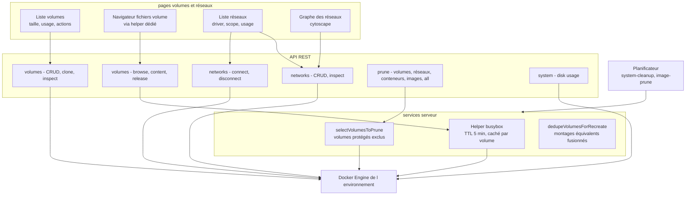

# Spécification fonctionnelle Dockhand — Chapitre 09 : Volumes, réseaux et maintenance système

| Rubrique | Valeur |
|---|---|
| **Chapitre** | 09 — Volumes, réseaux et maintenance système |
| **Statut** | Rédigé (phase 2, lot 3/5) |
| **Date de rédaction** | 21/08/2026 |
| **Version du logiciel analysée** | Dockhand **1.0.43** (numéro issu de [`package.json`](../../package.json:4)) |
| **Document de référence** | [`docs/spec/00-chapitrage.md`](00-chapitrage.md) |
| **Sources principales** | [`src/routes/api/volumes/`](../../src/routes/api/volumes/+server.ts:1), [`src/routes/api/networks/`](../../src/routes/api/networks/+server.ts:1), [`src/routes/api/prune/`](../../src/routes/api/prune/volumes/+server.ts:1), [`src/routes/api/system/`](../../src/routes/api/system/disk/+server.ts:1), [`src/lib/server/docker.ts`](../../src/lib/server/docker.ts:4280), [`src/lib/server/volume-prune-core.ts`](../../src/lib/server/volume-prune-core.ts:1), [`src/lib/server/mount-dedupe.ts`](../../src/lib/server/mount-dedupe.ts:1), [`src/lib/server/scheduler/tasks/system-cleanup.ts`](../../src/lib/server/scheduler/tasks/system-cleanup.ts:1), [`src/routes/networks/NetworkGraphViewer.svelte`](../../src/routes/networks/NetworkGraphViewer.svelte:1) |

## Table des matières

1. [Objet, périmètre et prérequis de lecture](#1-objet-périmètre-et-prérequis-de-lecture)
2. [Vue d'ensemble](#2-vue-densemble)
3. [Volumes : inventaire, création, suppression, clone](#3-volumes--inventaire-création-suppression-clone)
4. [Prune des volumes (protégé)](#4-prune-des-volumes-protégé)
5. [Navigateur de fichiers de volume](#5-navigateur-de-fichiers-de-volume)
6. [Déduplication des montages (recreate)](#6-déduplication-des-montages-recreate)
7. [Réseaux : inventaire, création, suppression](#7-réseaux--inventaire-création-suppression)
8. [Connectivité conteneur ↔ réseau](#8-connectivité-conteneur--réseau)
9. [Graphe des réseaux de l'environnement](#9-graphe-des-réseaux-de-lenvironnement)
10. [Maintenance système et prunes globaux](#10-maintenance-système-et-prunes-globaux)
11. [Nettoyages système planifiés (tâche system-cleanup)](#11-nettoyages-système-planifiés-tâche-system-cleanup)
12. [Synthèse des règles de sécurité](#12-synthèse-des-règles-de-sécurité)
13. [Renvois vers les autres chapitres](#13-renvois-vers-les-autres-chapitres)

---

## 1. Objet, périmètre et prérequis de lecture

Ce chapitre décrit la gestion des **volumes** et des **réseaux** Docker, ainsi que la **maintenance système** de l'hôte : inventaires temps réel, création, suppression (avec audit), clone de volume, prune protégé des volumes (exclusion des volumes internes de Dockhand), navigateur de fichiers de volume (helper conteneur dédié, distinct du navigateur de conteneur du ch. 05), déduplication des montages à la recréation (`mount-dedupe`), inventaire/création/suppression des réseaux, connectivité conteneur↔réseau (connexion/déconnexion), graphe des réseaux de l'environnement, usage disque (`docker system df`), prunes par ressource et global, et nettoyages système planifiés (exécutions, événements, helpers de volume, cache des scanners).

**Prérequis de lecture** : chapitre 04 (environnements, modes de connexion) et chapitre 05 (navigateur de fichiers du **conteneur** — à distinguer du présent, labels `dockhand.*`). Le chapitre 03 §5 rappelle que volumes et réseaux sont des objets Docker **non répliqués en base**.

**Conventions** : mentions *(Enterprise)* / *(SMB)* pour le gating d'édition, *(flag)* pour les fonctions sous feature flag. Les vérifications d'accès par environnement (RBAC *(Enterprise)*) s'appliquent à toutes les routes (`volumes:*`, `networks:*`, etc.).

## 2. Vue d'ensemble

Volumes et réseaux suivent le même modèle que les autres ressources Docker : lecture temps réel, actions qualifiées par environnement, permissions par domaine. La spécificité fonctionnelle tient aux **garde-fous orientés données** (le volume porte des données utilisateur) et aux **helpers** (conteneurs utilitaires internes mis à contribution pour parcourir/clôner).

## 3. Volumes : inventaire, création, suppression, clone

### 3.1 Inventaire

`GET /api/volumes?env=<id>` ([`src/routes/api/volumes/+server.ts`](../../src/routes/api/volumes/+server.ts:18), service `listVolumes`) :

- par volume : nom, driver, point de montage, portée, date de création, labels et **utilisateurs** (`usedBy` : conteneurs qui le montent, **y compris arrêtés** — un volume tenu par un conteneur arrêté est considéré **utilisé**, sémantique alignée sur le prune Docker) ;
- comportements aux limites : sans environnement → tableau vide ; environnement inexistant → 404 ;
- l'interface expose taille, conteneurs utilisateurs et actions (inspecter, parcourir, clôner, supprimer).

### 3.2 Création

`POST /api/volumes?env=<id>` :

| Champ | Rôle | Défaut |
|---|---|---|
| `name` | Nom du volume (requis) | — |
| `driver` | Driver Docker | `local` |
| `driverOpts` | Options du driver | `{}` |
| `labels` | Labels | `{}` |

Audit `create` *(Enterprise)*. Les volumes créés manuellement sont immédiatement utilisables dans des montages de conteneurs/stacks.

### 3.3 Inspection et suppression

- `GET /api/volumes/[name]/inspect` : inspection Docker complète (driver, options, labels, point de montage, horodatage) ;
- `DELETE /api/volumes/[name]?force=<bool>` : suppression (option force) ; les erreurs Docker remontent avec leur code (404 si déjà absent) ; audit `delete` avec l'option force. La suppression en **batch** transverse est décrite au ch. 05 §5.

### 3.4 Clone de volume

`POST /api/volumes/[name]/clone` ([route](../../src/routes/api/volumes/[name]/clone/+server.ts:21)) copie un volume vers un **nouveau volume nommé** :

1. inspection de la source : le clone **préserve driver, options et labels** (label additionnel `dockhand.cloned.from` traçant l'origine) ;
2. création du volume cible ;
3. copie des données par un **conteneur utilitaire temporaire** (busybox, `cp -a /src/. /dst/`, source montée en lecture seule, destination en lecture-écriture, label `dockhand.volume.helper`) ;
4. attente de la fin du conteneur (code de sortie non nul = échec explicite) puis **nettoyage systématique** du conteneur de copie (y compris en erreur) ;
5. audit `clone` avec le couple source → cible.

Permission requise : `volumes:create`. Usage type : sauvegarde ponctuelle avant intervention, migration de données.

### 3.5 Export

`GET /api/volumes/[name]/export` produit une **archive tar** du contenu du volume (téléchargement), via le même mécanisme de helper que la navigation (§5).

## 4. Prune des volumes (protégé)

### 4.1 Principe

Le prune natif de Docker (`/volumes/prune`) ne supprime par défaut que les volumes **anonymes** depuis l'API v1.42 — les volumes **nommés** inutilisés survivraient. Dockhand implémente donc son propre prune ([`pruneVolumes`](../../src/lib/server/docker.ts:4695)) :

1. liste des volumes avec leurs utilisateurs (conteneurs actifs **et** arrêtés) ;
2. sélection des volumes **inutilisés et non protégés** ([`selectVolumesToPrune`](../../src/lib/server/volume-prune-core.ts:24)) ;
3. suppression **unitaire** de chacun, **sans force** : un volume devenu utilisé entre la liste et la suppression échoue et est **passé** (sémantique non-forçante du prune Docker) — un volume récalcitrant n'interrompt jamais la file ;
4. l'espace libéré n'est **pas fabriqué** : l'API de liste de volumes ne donne pas de taille par volume, la valeur reste 0 (aucun octet inventé).

### 4.2 Volumes protégés

Deux volumes internes de Dockhand sont **exclus par nom** ([`PROTECTED_VOLUME_NAMES`](../../src/lib/server/volume-prune-core.ts:15)) : `dockhand-grype-db` et `dockhand-trivy-db` — les caches des bases de vulnérabilités des scanners (ch. 10). Ce sont des volumes nommés inutilisés entre deux scans : un prune non filtré les détruirait et forcerait un re-téléchargement coûteux à chaque scan.

### 4.3 Points d'entrée

`POST /api/prune/volumes?env=<id>` (permission `volumes:remove`, audit `prune`) ; le prune volumes participe aussi au **prune global** (§10.2).

## 5. Navigateur de fichiers de volume

### 5.1 Principe et distinction avec le navigateur conteneur

Contrairement au navigateur de fichiers **du conteneur** (ch. 05 §10, qui s'exécute au sein du conteneur via l'API Docker), un volume Docker **n'appartient à aucun conteneur en particulier** : Dockhand mobilise un **helper dédié** — un conteneur utilitaire (image `busybox:latest`, tirée automatiquement si absente, avec authentification de registre le cas échéant) qui monte le volume à parcourir.

### 5.2 Cycle de vie du helper

| Étape | Comportement |
|---|---|
| Obtention | Cache par (volume, environnement) : un helper existant est **réutilisé** et son échéance rafraîchie ; sinon création (`sleep infinity`, label `dockhand.volume.helper=true`) |
| Durée de vie | TTL de **5 minutes**, renouvelé à chaque accès ; pas de démon permanent |
| Libération anticipée | `POST /api/volumes/[name]/browse/release` à la fermeture de la fenêtre : le helper est retiré du cache puis arrêté/supprimé |
| Recyclage planifié | la tâche système **Volume helper cleanup** (§11.3) supprime les helpers expirés et les helpers orphelins ; au démarrage, un nettoyage des helpers obsolètes de tous les environnements évite les résidus de crash |

Les helpers portent le label `dockhand.volume.helper=true`, ce qui les rend **masqués de l'inventaire** (label `dockhand.hidden` de fait, ch. 05 §3.2) et exclus des recensements.

### 5.3 Parcours et lecture

`GET /api/volumes/[name]/browse?path=
&env=<id>` ([route](../../src/routes/api/volumes/[name]/browse/+server.ts:19)) :

- **usage préalable** : les conteneurs qui montent le volume sont listés (avec état) ; la réponse expose `isInUse` ;
- **montage conditionnel** : le volume est monté **en lecture seule dans le helper si des conteneurs l'utilisent** (prudence vis-à-vis des données vives), en lecture-écriture sinon ;
- retour : entrées du répertoire (nom, type, taille, permissions, propriétaire/groupe, date), usage du volume, `helperId` — l'identifiant du helper, que le frontend réutilise pour les **endpoints de fichiers du conteneur** (édition, création, suppression, téléversement, téléchargement du ch. 05 §10) ;
- `GET /api/volumes/[name]/browse/content?path=` : lecture d'un fichier (plafonné à **1 Mo** pour l'aperçu ; 413 au-delà, 400 pour un répertoire) ;
- erreurs traduites : répertoire introuvable (404), permission refusée (403).

La navigation **en écriture** (créer/modifier/supprimer des fichiers du volume) s'opère via les endpoints conteneur appliqués au helper — donc uniquement quand le volume n'est pas en usage (helper monté lecture seule sinon).

## 6. Déduplication des montages (recreate)

À la recréation d'un conteneur (ch. 05 §7), Docker peut se voir reproposer un point de montage déjà occupé — collision entre le `Config.Volumes` hérité de l'image (directive `VOLUME`), un tmpfs, un bind existant, un bind sur le point d'être ajouté, ou un volume nommé qui n'apparaît que dans l'inspection (forme renvoyée par les daemons distants/Hawser). [`dedupeVolumesForRecreate`](../../src/lib/server/mount-dedupe.ts:27) :

- collecte les destinations **déjà montées** depuis les cinq sources (tmpfs, binds, binds additionnels, `Mounts` de HostConfig, `Mounts` de l'inspection) ;
- retire du `Config.Volumes` toute entrée dont le chemin est déjà monté (les entrées VOLUME d'image n'ont pas vocation à créer un montage concurrent) ;
- [`getAdditionalVolumeBinds`](../../src/lib/server/mount-dedupe.ts:49) reconstruit a contrario les **binds manquants** pour les volumes nommés présents dans l'inspection mais absents de HostConfig.

Fonctionnellement : la recréation (édition, auto-update, mise à jour groupée) **conserve exactement les montages d'origine**, sans doublon ni perte — un point clé pour les mises à jour automatiques de conteneurs à montages complexes.

## 7. Réseaux : inventaire, création, suppression

### 7.1 Inventaire et inspection

`GET /api/networks?env=<id>` ([`src/routes/api/networks/+server.ts`](../../src/routes/api/networks/+server.ts:17), service [`listNetworks`](../../src/lib/server/docker.ts:4280)) : par réseau — identifiant, nom, driver, portée, indicateurs internal/attachable/ingress, et **conteneurs connectés** (croisés avec l'inventaire des conteneurs). L'inspection (`GET /api/networks/[id]/inspect`) détaille la configuration IPAM (sous-réseaux, passerelles), les options et les points de montage.

### 7.2 Création

`POST /api/networks?env=<id>` :

| Champ | Rôle | Défaut |
|---|---|---|
| `name` | Nom du réseau (requis) | — |
| `driver` | Driver (`bridge`, `overlay`, `macvlan`…) | `bridge` |
| `internal` | Réseau interne sans sortie externe | faux |
| `attachable` | Attachable par des conteneurs non orchestrés | faux |
| `ingress` | Réseau d'entrée Swarm | faux |
| `enableIPv6` | IPv6 activé | faux |
| `options` / `labels` | Options driver / labels | `{}` |
| `ipam` | Configuration IPAM (driver, sous-réseaux `config`, options) | — |

Audit `create` *(Enterprise)*. Les réseaux créés sont utilisables dans les Compose (réseau `external`) et par la connexion à chaud (§8).

### 7.3 Suppression

`DELETE /api/networks/[id]?force=<bool>` : suppression (option force) ; un réseau portant des conteneurs connectés échoue côté Docker avec l'erreur traduite ; audit `delete`. Le **prune réseaux** (§10) nettoie les réseaux inutilisés.

## 8. Connectivité conteneur ↔ réseau

- **Connexion** : `POST /api/networks/[id]/connect` (corps : `containerId`, `containerName` facultatif pour l'audit) — permission `networks:connect` ; le nom du réseau est résolu pour l'audit ; la même opération sert aux **réseaux additionnels** à la création d'un conteneur (ch. 05 §4.2) et au raccrochage des réseaux à la recréation (ch. 05 §7.2) ;
- **Déconnexion** : `POST /api/networks/[id]/disconnect` — retire un conteneur du réseau ;
- l'interface propose la connexion depuis la fiche réseau (fenêtre dédiée avec choix du conteneur) et la déconnexion depuis les conteneurs connectés ;
- ces opérations sont **à chaud** (pas de recréation du conteneur) ; l'inspection du conteneur reflète immédiatement les réseaux additionnels (ch. 05 §6).

## 9. Graphe des réseaux de l'environnement

La page réseaux propose une vue **graphe** de la connectivité de l'environnement ([`NetworkGraphViewer.svelte`](../../src/routes/networks/NetworkGraphViewer.svelte:1), rendu **cytoscape**) :

- **nœuds** : réseaux et conteneurs connectés (forme distincte par type) ; **arêtes** : appartenance conteneur → réseau ; les métadonnées (IP du conteneur dans le réseau, driver) sont consultables par sélection ;
- disposition calculée automatiquement, thème clair/sombre commutable, sélection et inspection des nœuds ;
- cette vue **complète** la visionneuse par stack du ch. 06 §5 (graphe d'une stack précise) : ici le périmètre est **l'environnement entier**, tous projets confondus — utile pour repérer les ponts entre stacks et les réseaux orphelins.

## 10. Maintenance système et prunes globaux

### 10.1 Usage disque de l'hôte Docker

`GET /api/system/disk?env=<id>` ([route](../../src/routes/api/system/disk/+server.ts:23), `docker system df`) :

- retourne l'usage détaillé : taille des couches d'images, et par catégorie (images, conteneurs, volumes) les éléments avec taille et compteur d'inutilisés ;
- **contournement possible** : `SKIP_DF_COLLECTION=true` (variable d'environnement, contournement de performances pour certains NAS Synology) → réponse `null` ; l'interface affiche alors un état « indisponible » ;
- délai de garde de **15 s** : au-delà, `null` plutôt qu'une erreur (même comportement d'interface) ;
- les **informations système** générales de l'hôte (version Docker, OS, ressources) proviennent de la collecte du chapitre 04 (collecteur Go `/info`, métriques — ch. 13).

### 10.2 Prunes par ressource et global

| Endpoint | Ressource | Note |
|---|---|---|
| `POST /api/prune/containers` | Conteneurs **arrêtés** | Permission `containers:remove` |
| `POST /api/prune/images` | Images (dangling ou toutes inutilisées) | Détail au ch. 08 §10 |
| `POST /api/prune/volumes` | Volumes inutilisés **non protégés** | §4 du présent chapitre |
| `POST /api/prune/networks` | Réseaux inutilisés | Permission `networks:remove` |
| `POST /api/prune/all` | **Les quatre à la suite** | Exige la permission `remove` sur les **quatre** domaines ; une seule entrée d'audit `prune` |

Tous sont qualifiés par environnement (`?env=`), audités, et retournent le rapport Docker correspondant (éléments supprimés, espace libéré le cas échéant).

## 11. Nettoyages système planifiés (tâche system-cleanup)

La tâche `system_cleanup` du planificateur ([`src/lib/server/scheduler/tasks/system-cleanup.ts`](../../src/lib/server/scheduler/tasks/system-cleanup.ts:1)) regroupe quatre jobs système identifiés (`scheduleId` 1 à 4) — chacun activable/désactivable et doté de sa rétention/cron dans les réglages (ch. 15) :

| Job (id) | Nettoyage | Règles |
|---|---|---|
| **Exécutions** (1) | Anciennes lignes de `schedule_executions` | Rétention en jours configurable ; désactivable |
| **Événements** (2) | Anciens `container_events` | Rétention en jours configurable ; désactivable |
| **Helpers de volume** (3) | Helpers `dockhand-browse-*` **expirés** (TTL dépassé) et **orphelins** (tous environnements) | Toujours actif logiquement (pas d'interrupteur : pure hygiène) ; cf. §5.2 |
| **Cache scanners** (4) | Volumes et répertoires de bind des bases Grype/Trivy, **local + tous les environnements distants** | Désactivable ; un environnement injoignable est passé avec un message, sans échec global |

Le **déclenchement manuel** hors cron est possible (ch. 14) ; les exécutions sont tracées dans `schedule_executions` avec journaux horodatés. À ces jobs s'ajoutent les nettoyages liés aux autres chapitres : prune d'images planifié (ch. 08 §10.2), maintenance de dépôts restic *(flag, ch. 11)*.

## 12. Synthèse des règles de sécurité

| Risque | Mesure fonctionnelle |
|---|---|
| Perte de données de volumes | Prune **sélectif** : seuls les volumes sans utilisateur (y compris conteneurs arrêtés) et hors liste protégée ; suppression unitaire **sans force** ; volumes des scanners exclus par nom |
|Écrasement de données vives via le navigateur | Volume monté **lecture seule** dans le helper dès qu'un conteneur l'utilise ; écritures possibles seulement hors usage |
| Conteneurs utilitaires visibles/éternels | Helpers labellisés `dockhand.volume.helper` (masqués de l'inventaire), TTL 5 min, libération à la fermeture, recyclage planifié et purge au démarrage |
| Injection via identifiants | Tous les noms/identifiants de volume/réseau validés (format d'identifiant Docker) avant opération |
| Suppression hors périmètre | Prunes et suppressions qualifiés par environnement ; permissions `volumes:*` / `networks:*` par domaine et portée *(Enterprise)* |
| Rapports de prune trompeurs | Espace « libéré » des volumes non fabriqué (l'API Docker ne fournit pas la taille par volume) |
| Doublons de montages à la recréation | Déduplication multi-sources (tmpfs, binds, HostConfig.Mounts, inspection) avant create |

## 13. Renvois vers les autres chapitres

| Chapitre | Lien | Pourquoi y aller |
|---|---|---|
| 00 — Chapitrage | [`00-chapitrage.md`](00-chapitrage.md) | Sommaire de référence. |
| 02 — Architecture fonctionnelle | [`02-architecture-fonctionnelle.md`](02-architecture-fonctionnelle.md) | Collecte disque par le collecteur Go, prunes dans la carte des modules. |
| 03 — Concepts et entités | [`03-concepts-entites.md`](03-concepts-entites.md) | Volumes/réseaux comme objets Docker non répliqués ; `schedule_executions`. |
| 04 — Environnements | [`04-environnements.md`](04-environnements.md) | `/info` et métriques hôtes, suppression des réglages de prune à la suppression d'environnement. |
| 05 — Gestion des conteneurs | [`05-conteneurs.md`](05-conteneurs.md) | Navigateur de fichiers conteneur (distinct, §10), recreate et réseaux additionnels (§7), batch transverse (§5). |
| 06 — Stacks Compose | [`06-stacks.md`](06-stacks.md) | Volumes/réseaux des stacks, `down` avec `removeVolumes`, graphe par stack (§5). |
| 07 — Intégration Git | [`07-git.md`](07-git.md) | Binds relatifs `./data` protégés par la surimpression sans effacement. |
| 08 — Images et registres | [`08-images.md`](08-images.md) | Prune d'images (manuel/planifié), lien avec le prune global. |
| 10 — Sécurité applicative | `10-securite-applicative.md` *(à rédiger, lot 4)* | Volumes protégés des scanners, nettoyage du cache scanners. |
| 11 — Sauvegardes (bêta) | `11-sauvegardes.md` *(à rédiger, lot 4)* | Sauvegarde de volumes, helpers restic *(flag)*. |
| 13 — Observabilité | `13-observabilite.md` *(à rédiger, lot 4)* | Rétention des événements, notifications d'alerte disque. |
| 14 — Automatisation | `14-automatisation-api.md` *(à rédiger, lot 5)* | Tâches `system_cleanup`/`image_prune`, déclenchement manuel, rétentions. |
| 15 — Administration | `15-administration-exploitation.md` *(à rédiger, lot 5)* | Réglages des nettoyages (crons, rétentions), `SKIP_DF_COLLECTION`. |
