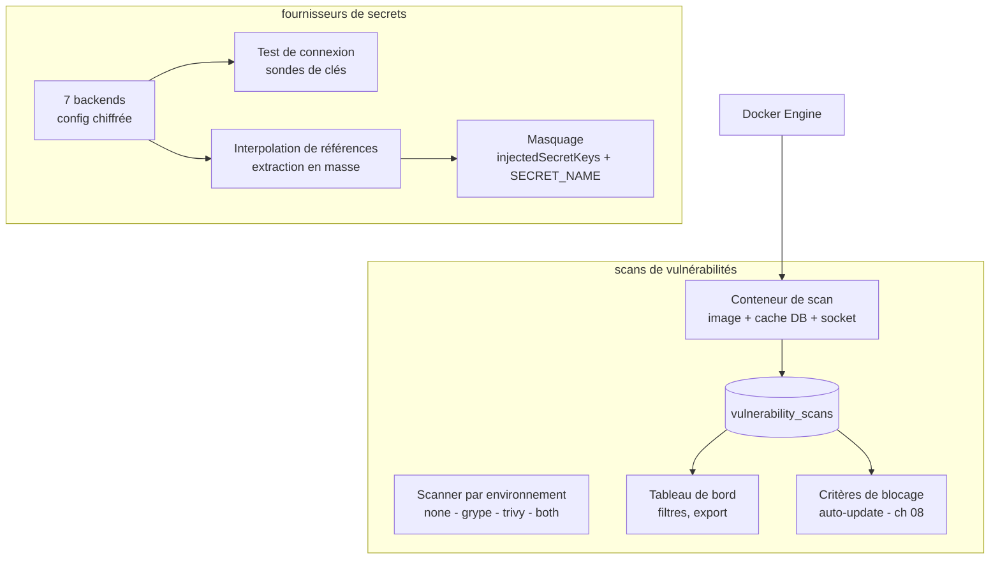

# Spécification fonctionnelle Dockhand — Chapitre 10 : Sécurité applicative — scans de vulnérabilités et secrets

| Rubrique | Valeur |
|---|---|
| **Chapitre** | 10 — Sécurité applicative : scans de vulnérabilités et secrets |
| **Statut** | Rédigé (phase 2, lot 4/5) |
| **Date de rédaction** | 21/08/2026 |
| **Version du logiciel analysée** | Dockhand **1.0.43** (numéro issu de [`package.json`](../../package.json:4)) |
| **Document de référence** | [`docs/spec/00-chapitrage.md`](00-chapitrage.md) |
| **Sources principales** | [`src/lib/server/scanner.ts`](../../src/lib/server/scanner.ts:1), [`src/lib/server/scanner-socket-detect.ts`](../../src/lib/server/scanner-socket-detect.ts:1), [`src/lib/server/vulnerabilities.ts`](../../src/lib/server/vulnerabilities.ts:1), [`src/lib/server/vulnerabilities-cache.ts`](../../src/lib/server/vulnerabilities-cache.ts:1), [`src/lib/server/vuln-access.ts`](../../src/lib/server/vuln-access.ts:1), [`src/lib/server/secretproviders/`](../../src/lib/server/secretproviders/shared.ts:1), [`src/lib/server/secretproviders/probe-cache.ts`](../../src/lib/server/secretproviders/probe-cache.ts:1), [`src/lib/server/stack-secret-keys.ts`](../../src/lib/server/stack-secret-keys.ts:1), [`src/lib/server/db.ts`](../../src/lib/server/db.ts:5337), [`src/lib/server/db/schema/index.ts`](../../src/lib/server/db/schema/index.ts:289), [`src/routes/api/images/scan/`](../../src/routes/api/images/scan/+server.ts:1), [`src/routes/api/vulnerabilities/`](../../src/routes/api/vulnerabilities/+server.ts:1), [`src/routes/api/secret-providers/`](../../src/routes/api/secret-providers/+server.ts:1) |

## Table des matières

1. [Objet, périmètre et prérequis de lecture](#1-objet-périmètre-et-prérequis-de-lecture)
2. [Vue d'ensemble de la sécurité applicative](#2-vue-densemble-de-la-sécurité-applicative)
3. [Scanners de vulnérabilités : modèle et configuration](#3-scanners-de-vulnérabilités--modèle-et-configuration)
4. [Exécution d'un scan : conteneur de scan, files et cache de bases](#4-exécution-dun-scan--conteneur-de-scan-files-et-cache-de-bases)
5. [Déclencheurs de scan](#5-déclencheurs-de-scan)
6. [Résultats : modèle, historisation et notifications](#6-résultats--modèle-historisation-et-notifications)
7. [Tableau de bord des vulnérabilités](#7-tableau-de-bord-des-vulnérabilités)
8. [Critères de vulnérabilités et lien avec l'auto-update](#8-critères-de-vulnérabilités-et-lien-avec-lauto-update)
9. [Fournisseurs de secrets : types et configuration](#9-fournisseurs-de-secrets--types-et-configuration)
10. [Test de connexion, sondes et cache de noms de clés](#10-test-de-connexion-sondes-et-cache-de-noms-de-clés)
11. [Injection des secrets au déploiement](#11-injection-des-secrets-au-déploiement)
12. [Masquage des valeurs : SECRET_NAME et injectedSecretKeys](#12-masquage-des-valeurs--secret_name-et-injectedsecretkeys)
13. [Synthèse des règles de sécurité](#13-synthèse-des-règles-de-sécurité)
14. [Renvois vers les autres chapitres](#14-renvois-vers-les-autres-chapitres)

---

## 1. Objet, périmètre et prérequis de lecture

Ce chapitre décrit les fonctions de **sécurité applicative** de Dockhand : les scans d'images de conteneurs via les scanners **Grype** et **Trivy** (configuration par environnement, conteneurs de scan réutilisables, volumes de bases de vulnérabilités protégés, file et déduplication des scans, déclencheurs manuels/automatiques y compris scan après pull), l'**historisation** des résultats (`vulnerability_scans`), le **tableau de bord** des vulnérabilités (vues filtrées, tri, pagination, export JSON/CSV, export par image avec SARIF), les **critères de vulnérabilités** alimentant la décision de blocage de l'auto-update (ch. 08), ainsi que la gestion des **fournisseurs de secrets** externes (1Password Service Account/Connect, Infisical, HashiCorp Vault, Doppler, Bitwarden, Proton Pass) : configuration, test de connexion, sondes de noms de clés, deux modes de résolution (interpolation de références et extraction en masse), garde anti-SSRF, et **masquage** des valeurs sensibles dans l'interface (clés `injectedSecretKeys`, heuristique `SECRET_NAME`).

**Prérequis de lecture** : chapitre 08 (détection de mises à jour, flux protégé par tag temporaire, critères de blocage — §8.3 et §9.2) et chapitre 06 (déploiement de stacks, variables et secrets — §7). Le chapitre 03 §11 rappelle les entités `vulnerability_scans` et `secret_providers`.

**Conventions** : mentions *(Enterprise)* / *(SMB)* pour le gating d'édition, *(flag)* pour les fonctions sous feature flag. Les vérifications d'accès RBAC (`images:view`, `secrets:*`, portée environnement *(Enterprise)*) s'appliquent aux routes concernées.

## 2. Vue d'ensemble de la sécurité applicative

Deux briques indépendantes et complémentaires :

- **Connaître les faiblesses** : scanner les images pour recenser les vulnérabilités (CVE), les consolider en tableau de bord et **bloquer les mises à jour** qui dégraderaient la situation ;
- **Protéger les secrets** : externaliser les valeurs sensibles vers des gestionnaires dédiés, les injecter **au moment du déploiement uniquement**, et les **masquer** partout ailleurs (édition, inspection de conteneurs).

## 3. Scanners de vulnérabilités : modèle et configuration

### 3.1 Scanner par environnement

Le **type de scanner est un réglage par environnement** (`vulnerability_scanner` via `getEnvSetting`, lu dans les réglages de l'environnement — ch. 04) :

| Valeur | Signification |
|---|---|
| `none` (défaut) | Scans désactivés sur cet environnement |
| `grype` | Grype uniquement |
| `trivy` | Trivy uniquement |
| `both` | Les deux scanners (double scan) |

Les **arguments CLI** et les **images des scanners** sont **globaux** (réglages généraux — ch. 15) : `default_grype_args` / `default_trivy_args` (avec le substituable `{image}`), `default_grype_image` / `default_trivy_image`, `default_scanner_network_mode` et `default_scanner_dns` (surcharges réseau/DNS). Les valeurs par défaut sont **épinglées par version** ([`DEFAULT_GRYPE_IMAGE`](../../src/lib/server/scanner.ts:131) = `anchore/grype:v0.115.0`, [`DEFAULT_TRIVY_IMAGE`](../../src/lib/server/scanner.ts:132) = `aquasec/trivy:0.71.2`) — choix délibéré après l'attaque de chaîne d'approvisionnement Trivy de mars 2026 : un `:latest` aurait fait du scanner lui-même un vecteur.

L'écran de configuration (`/api/settings/scanner`) complète l'état : **disponibilité** des images de scan (présentes localement), **versions** (conteneur temporaire `version`/`--version`) et **mises à jour disponibles** des images de scan (comparaison de digest — mécanisme du ch. 08 §6.1) ; la route `DELETE /api/settings/scanner?removeImages=true&env=` retire les images de scan et purge le cache des bases pour l'environnement.

### 3.2 Répartition global / par environnement

| Paramètre | Portée | Clé de réglage |
|---|---|---|
| Type de scanner (`none`/`grype`/`trivy`/`both`) | Environnement | `vulnerability_scanner` |
| Arguments CLI Grype/Trivy | Global | `default_grype_args` / `default_trivy_args` |
| Images des scanners | Global | `default_grype_image` / `default_trivy_image` |
| Mode réseau / DNS du conteneur de scan | Global | `default_scanner_network_mode` / `default_scanner_dns` |

## 4. Exécution d'un scan : conteneur de scan, files et cache de bases

### 4.1 Conteneur de scan

Un scan exécute l'image du scanner dans un **conteneur éphémère** dédié (nom `dockhand-<scanner>-<horodatage>`, supprimé à la fin) qui monte :

- le **socket Docker** (lecture seule) ou l'équivalent détecté — voir §4.2 ;
- le **cache de la base de vulnérabilités** du scanner, pour ne pas retélécharger ~200 Mo à chaque scan.

Le scanner analyse l'image **via l'API Docker** (il inspecte les couches de l'image locale) ; le conteneur de scan n'a pas besoin de monter l'image scannée. La sortie JSON du scanner est **nettoyée** (extraction de l'objet JSON, assainissement des caractères de contrôle non échappés) puis **analysée** : chaque vulnérabilité produit une entrée `{id, severity, package, version, fixedVersion, description, link, scanner}`, et un **compteur par sévérité** (`critical`, `high`, `medium`, `low`, `negligible`, `unknown`). Un **délai maximal de 10 minutes** protège contre les scans qui se bloquent indéfiniment.

### 4.2 Accès Docker du conteneur de scan

Le conteneur de scan doit pouvoir parler au Docker Engine qui héberge l'image scannée ; Dockhand **reflète sa propre manière de se connecter** :

| Contexte de l'environnement scanné | Connexion du conteneur de scan |
|---|---|
| Dockhand lui-même en TCP (p.ex. socket-proxy) | Même `DOCKER_HOST` TCP + même réseau (avertissement si plusieurs réseaux — colocaliser le proxy) |
| Environnement Hawser (standard/edge) | **Détection du socket distant** (y compris socket rootless Podman `/run/user/<uid>/podman/podman.sock`) ; repli sur le chemin standard |
| Socket local | Bind du socket hôte (lecture seule) ; **UID rootless détecté** (socket `/run/user/<uid>/...`) → cache par bind monté avec `chown` adapté |

Les variables de **proxy** (`HTTP_PROXY`…) et la **version d'API Docker négociée** (le client Docker embarqué de Grype peut être plus récent que le daemon hôte) sont propagées au conteneur de scan. Les surcharges utilisateur `default_scanner_network_mode`/`dns` s'appliquent par-dessus l'auto-détection (utile quand le réseau par défaut ne résout pas le DNS).

### 4.3 Cache des bases et volumes protégés

Deux stratégies de stockage du cache selon le Docker :

- **Docker standard** : volume nommé `dockhand-grype-db` / `dockhand-trivy-db` monté en `/cache/<scanner>` (variables `GRYPE_DB_CACHE_DIR`/`TRIVY_CACHE_DIR`) ;
- **Docker rootless** : les volumes nommés appartiennent à root (incompatibles avec un scanner non-root) → **bind monté** depuis le répertoire de données de Dockhand (`DATA_DIR/scanner-cache/<scanner>/`) avec `chown` vers l'UID cible.

Ces deux volumes sont **protégés du prune** (liste [`PROTECTED_VOLUME_NAMES`](../../src/lib/server/volume-prune-core.ts:15) — ch. 09 §4.2) : inutilisés entre deux scans, un prune non filtré les détruirait et forcerait un re-téléchargement coûteux. Le **nettoyage du cache** (job système « cache scanners » du ch. 09 §11 et route `/api/settings/scanner/cache`) supprime volumes **et** répertoires de bind, local + environnements distants ; le scan suivant retélécharge une base fraîche.

### 4.4 File d'attente, sérialisation et déduplication

Trois mécanismes complémentaires dans [`scanner.ts`](../../src/lib/server/scanner.ts:90) :

1. **Verrou série par type de scanner** : les scans Grype sont sérialisés entre eux (idem Trivy) — évite les conflits de verrou base et surtout garantit que le deuxième scan profite d'une base **chaude** au lieu de re-télécharger ;
2. **Déduplication par image** : un scan déjà en cours pour la même `(image, scanner, environnement)` est **réutilisé** — plusieurs conteneurs partageant une image ne déclenchent qu'un scan (le résultat est partagé par identifiant d'image, §6.1) ;
3. **Statistiques** : la profondeur de file est exposée à l'endpoint de métriques (`getScannerStats` : scans en cours, verrous tenus — ch. 13).

## 5. Déclencheurs de scan

| Déclencheur | Mécanique |
|---|---|
| **Manuel (image)** | `POST /api/images/scan` (flux SSE de progression : `checking` → `pulling-scanner` → `scanning` avec sortie live → `parsing` → `complete`/`error`) ; scanner forçable dans le corps de requête |
| **Scan complet d'environnement** | `POST /api/vulnerabilities/scan-all` (SSE) : chaque image **taguée** est scannée séquentiellement (progression N/total) ; les images non taguées mais **épinglées par digest** sont scannées par leur digest de dépôt (pas de saut silencieux) ; les images réellement *dangling* (ni tag ni digest) sont exclues ; **un échec n'interrompt pas la file** ; les résultats **remplacent** les scans précédents de la même (image, scanner) |
| **Scan après pull** (`scanAfterPull`) | À l'issue d'un pull (ch. 08 §4.1), si un scanner est configuré, le scan s'exécute dans le même flux SSE (statuts `scanning`, `scan-progress`, `scan-complete`, `scan-error`) |
| **Automatique (flux protégé)** | Toute application de mise à jour avec scanner actif scanne **l'image candidate** avant recréation (ch. 08 §8.3) — le critère de vulnérabilités contrôle le blocage, pas le scan |
| **Après pull d'une stack** | Le pull de stack (`pullStackImages`) et la mise à jour d'un service déclenchent le même scan-conditionné-à-la-mise-à-jour (ch. 06 §13.1) |

Le tableau de bord des environnements expose l'indicateur `scannerEnabled` par environnement (type ≠ `none`) — ch. 13.

## 6. Résultats : modèle, historisation et notifications

### 6.1 Modèle de persistance

Chaque scan réussi est enregistré dans [`vulnerability_scans`](../../src/lib/server/db/schema/index.ts:383) (index (environnement, image)) :

| Champ | Rôle |
|---|---|
| `environmentId` / `imageId` / `imageName` | Cible du scan — `imageId` est le **SHA-256 complet** de l'image (résolu par inspection), garantissant un cache correct au fil des re-tags |
| `scanner` | `grype` ou `trivy` (une ligne par scanner) |
| `scannedAt` / `scanDuration` | Fraîcheur et coût du scan |
| `criticalCount` … `unknownCount` | Compteurs par sévérité |
| `vulnerabilities` | Détail JSON (liste des vulnérabilités) |
| `error` | Erreur éventuelle |

Mode `both` : **deux lignes** (une par scanner) pour la même image ; la consultation fusionne (§7) et la décision de blocage prend **le pire de chaque sévérité** entre scanners (ch. 08 §9.2).

### 6.2 Consultation du cache de scan

`GET /api/images/scan?image=<nom>&env=<id>&scanner=<s>` résout le tag en identifiant SHA-256 puis retourne le **dernier scan persisté** (`found: false` sinon) — c'est la lecture « cache » utilisée par l'interface de détails d'image (ch. 08 §3.2), sans relancer de scan.

### 6.3 Notifications

À l'issue d'un scan (combinaison des scanners : maximum par sévérité), des notifications sont émises **selon la sévérité trouvée** ([`sendVulnerabilityNotifications`](../../src/lib/server/scanner.ts:40)) : `vulnerability_critical` (si ≥ 1 critique), `vulnerability_high` (si ≥ 1 haute), et `vulnerability_any` **uniquement** en l'absence de critique/haute (évite le double spam). Aucune notification si zéro vulnérabilité. Routage par canal/environnement : ch. 13.

## 7. Tableau de bord des vulnérabilités

### 7.1 Agrégation

Le service [`aggregateVulnerabilities`](../../src/lib/server/vulnerabilities.ts:22) construit la vue par environnement :

1. lecture des **derniers scans par image** (fusion Grype + Trivy) ;
2. **filtrage des images disparues** : seuls les scans d'images encore présentes sur l'hôte comptent (Docker injoignable → repli sur le comptage brut, jamais d'erreur bloquante) ;
3. **aplatissage en trouvailles par CVE** : chaque scan devient une liste de vulnérabilités individuelles, **enrichies** des conteneurs qui utilisent l'image et des stacks (label `com.docker.compose.project`) ;
4. synthèse : total, compteurs par sévérité, ratio `imagesScanned / totalImages`.

### 7.2 Cache court et pagination

L'agrégat complet est **mémoïsé 30 s par environnement** ([`vulnerabilities-cache.ts`](../../src/lib/server/vulnerabilities-cache.ts:12)) : la pagination/le défilement ne re-parsent pas les blobs JSON à chaque requête ; les **vues filtrées+triées** sont mémoïsées (LRU borné), les environnements en cache plafonnés, et toute **écriture d'un scan invalide automatiquement** le cache (aucun appelant ne peut oublier de le faire). Les cold-starts concurrents sont fusionnés en une seule agrégation.

### 7.3 Vues, filtres et export

- **Grille paginée** (`GET /api/vulnerabilities?env=`) : filtres texte, **sévérités multiples**, image, conteneur, stack ; tri et direction ; les compteurs d'en-tête suivent le **jeu filtré** (les pastilles de sévérité reflètent les filtres actifs) ;
- **métadonnées** (`/api/vulnerabilities/count`) : synthèse + valeurs distinctes des listes déroulantes (images, conteneurs, stacks) ;
- **export d'environnement** (`/api/vulnerabilities/export?format=json|csv`) : rendu côté serveur **réutilisant exactement la vue filtrée/triée** de la grille (aucune dérive entre l'affiché et l'exporté) ;
- **export par image** (`/api/images/scan/export?format=json|csv|sarif`) : trouvailles en cache pour **une image**, formats à intégration CI (SARIF pour DefectDojo/Dependency-Track) ; authentification par cookie **ou jeton Bearer** (ch. 14) ; l'environnement est **exigé** en mode authentifié (sinon un utilisateur restreint à l'environnement A lirait les scans de B en omettant `env`).

### 7.4 Contrôle d'accès

Toutes les routes de vulnérabilités passent par [`authorizeVulnAccess`](../../src/lib/server/vuln-access.ts:21) : permission `images:view` + **portée environnement** *(Enterprise)* (`canAccessEnvironment`) ; un `env` non numérique est une erreur 400, pas un « tous environnements » implicite.

## 8. Critères de vulnérabilités et lien avec l'auto-update

Rappel fonctionnel (détail au ch. 08 §9.2) — les scans alimentent la décision de **blocage** des mises à jour :

| Critère (`vulnerabilityCriteria`) | Blocage quand |
|---|---|
| `never` (défaut) | Jamais |
| `any` | Toute vulnérabilité |
| `critical_high` | ≥ 1 critique **ou** haute |
| `critical` | ≥ 1 critique |
| `more_than_current` | Total de la nouvelle **supérieur** au total de l'image courante (re-scan à frais nouveaux de l'image courante pour éviter les faux blocages — ch. 08 §9.2) |

Le **résumé combiné** des scanners (maximum par sévérité) sert de base à la décision ; le scan lui-même s'exécute dès que le scanner est configuré, indépendamment du critère. Les flux protégés (tag temporaire, suppression de l'image candidate en cas de blocage) sont décrits au ch. 08 §8.3.

## 9. Fournisseurs de secrets : types et configuration

### 9.1 Modèle

L'entité `secret_providers` ([schéma](../../src/lib/server/db/schema/index.ts:289)) : `name` (unique), `type` (union **extensible** — l'ajout d'un backend est une inscription dans le registre [`secretproviders/index.ts`](../../src/lib/server/secretproviders/index.ts:27)), et `config` — blob JSON **chiffré au repos** dont la forme est propre au backend. L'API ne retourne **jamais la config déchiffrée** : la lecture d'un fournisseur renvoie les **coordonnées non secrètes** (hôte, projet, chemin…), le jeton étant retiré ([`redactProviderConfig`](../../src/lib/server/secretproviders/shared.ts:244) — les clés secrètes sont `token`/`clientSecret`) ; un champ vide à l'édition signifie « conserver le secret stocké ».

### 9.2 Backends supportés

| Type | Backend | Coordonnées de config (non secrètes en gras) | Références | Extraction en masse |
|---|---|---|---|---|
| `op-service-account` | 1Password Service Account | **—** (jeton unique) | `op://vault/item/field` | par environnement 1Password |
| `op-connect` | 1Password Connect (auto-hébergé) | **host** | `op://vault/item/field` | par environnement 1Password |
| `infisical` | Infisical (cloud ou auto-hébergé) | **host**, **projectId**, **environment**, **path** ; jeton statique **ou** Universal Auth (clientId + clientSecret) | `infisical://path/key` | projet + environnement + chemin |
| `vault` | HashiCorp Vault (KV v2) | **address**, **namespace**, **mount** (défaut `secret`) | `vault://path/key` | chemin KV |
| `doppler` | Doppler | **host** (tests), **project**+**config** (requis pour un jeton personnel `dp.pt.` ; un jeton service `dp.st.` porte sa propre portée) | — | config du projet |
| `bitwarden` | Bitwarden Secrets Manager | **serverUrl** (UE/auto-hébergé) | — | machine account du jeton |
| `proton` | Proton Pass | **—** | `pass://SHARE_ID/ITEM_ID[/FIELD]` | un coffre (par nom) |

Chaque backend déclare ses **capacités** (`supportsReferences`, `supportsBulk`) ; une opération non supportée lève une erreur explicite « non supporté sur ce fournisseur » (p.ex. interpolation de références sur un backend bulk-only comme Doppler). Les échecs de résolution **individuels** (référence introuvable) sont journalisés et **passés** — la valeur reste littérale ; les échecs de transport/authentification font échouer l'opération.

### 9.3 Gestion par l'API

`/api/secret-providers` (permissions `secrets:view|create|edit|delete`) : création (type **enregistré** exigé, unicité du nom), lecture (config rédigée), mise à jour (rotation de config : fusion entrant ⊕ stocké pour les secrets laissés vides — un **Test en édition valide exactement ce qu'un Save persisterait**), suppression (déréférencement des stacks liées : leur `secretProviderId` devient orphelin sans suppression en cascade).

## 10. Test de connexion, sondes et cache de noms de clés

- **Test avant enregistrement** (`POST /api/secret-providers/test`, permission `secrets:create`) : valide une config saisie contre le backend ; le test exige une **réponse JSON** du backend (un portail captif ou un domaine parqué répond 200 en HTML — ce n'est pas une preuve de connexion) ; les messages d'erreur ne sont extraits du corps de réponse **que s'ils correspondent à la forme d'erreur documentée du backend** (aucun octet arbitraire d'un hôte tiers réfléchi) ;
- **Test d'un fournisseur stocké** (`POST /api/secret-providers/[id]/test`, `secrets:view`) : teste la config persistée, éventuellement fusionnée avec des coordonnées saisies (le secret reste côté serveur) ;
- **Sonde de noms de clés** (`POST /api/secret-providers/[id]/probe`) : pour l'éditeur de stack, retourne quels **noms de clés** existent sous un sélecteur (marqueur « présent dans le coffre » en direct) — **jamais les valeurs** ; le résultat est mémoïsé ~30 s par (fournisseur, sélecteur) ([`probe-cache.ts`](../../src/lib/server/secretproviders/probe-cache.ts:12)) pour ne pas marteler l'API du backend à chaque frappe.

## 11. Injection des secrets au déploiement

Une stack (interne ou Git) peut être **liée** à un fournisseur (`secretProviderId` sur `stack_sources` — la liaison exige en outre la permission `secrets:view` : un utilisateur « stacks seul » ne peut pas lier un coffre pour en exfiltrer les secrets via l'inspection de conteneurs). Au déploiement (ch. 06 §8.1), deux modes de résolution :

1. **Interpolation de références** : une variable de stack dont la valeur est une référence dans la syntaxe du backend (`op://…`, `vault://…`, `infisical://…`, `pass://…`) est remplacée par le secret réel — la détection de ce qui compte comme référence est propre au backend (`isReference`) ;
2. **Extraction en masse** : tous les secrets sous un sélecteur (environnement 1Password, projet/chemin Infisical, chemin KV Vault, config Doppler, coffre Proton) sont récupérés en paires clé/valeur et injectés comme variables.

Les valeurs résolues sont **promues secrets** : transmises à Compose par **environnement de processus** (jamais écrites dans le `.env` — ch. 06 §7.2), et leurs **noms** sont tracés dans `stack_sources.injectedSecretKeys` pour le masquage ultérieur (§12). Les secrets marqués dans la base (`stack_environment_variables.isSecret`) suivent la même voie d'injection par processus.

## 12. Masquage des valeurs : SECRET_NAME et injectedSecretKeys

### 12.1 Clés à masquer

La fonction [`getSecretKeysToMask`](../../src/lib/server/db.ts:5337) construit l'ensemble des clés dont la valeur doit apparaître comme `***` dans l'inspection de conteneur :

1. clés des variables de stack marquées **secret** en base ;
2. **clés injectées par le fournisseur** au dernier déploiement (`stack_sources.injectedSecretKeys` — noms seuls, jamais de valeurs ; parsing tolérant, une ligne corrompue dégrade en « rien d'extra masqué ») ;
3. **clés de conteneur liées par interpolation** : si le Compose contient `MYSQL_PASSWORD=${db_secret}` et que `db_secret` est un secret, la clé conteneur `MYSQL_PASSWORD` est masquée aussi (analyse des références `${…}` du fichier Compose).

### 12.2 Heuristique SECRET_NAME

L'heuristique [`SECRET_NAME`](../../src/lib/server/compose-validate/rules.ts:86) (mêmes motifs que la règle `SECRET_IN_ENVIRONMENT` du validateur Compose — ch. 06 §6.2) reconnaît les noms *d'aspect secret* : `password`, `passwd`, `secret`, `api_key`/`apikey`, `access_key`, `private_key`, `token`, `credentials` (bornés par des séparateurs, pluriels admis, insensible à la casse). Elle alimente le **conseil de sécurité** du validateur (valeur codée en dur dans `environment:`) — les clés `*_FILE`/`*_PATH` (lecture depuis fichier) sont considérées sûres.

### 12.3 Points de masquage

| Endroit | Comportement |
|---|---|
| Inspection de conteneur (`/api/containers/[id]`, `/inspect`) | `Config.Env` filtré : `CLÉ=***` pour chaque clé à masquer (§12.1) |
| Éditeur de stack (variables) | Valeurs secrètes affichées `***` ; l'écriture d'un `***` est interprétée comme « conserver la valeur en base » (et l'écriture brute d'un placeholder masqué dans le `.env` est rejetée) |
| Fournisseurs de secrets | Config rédigée (jetons jamais renvoyés) ; sondes = noms seuls |
| Liée au binding d'un fournisseur | Exige `secrets:view` (sinon exfiltration possible via l'env du conteneur) |

## 13. Synthèse des règles de sécurité

| Risque | Mesure fonctionnelle |
|---|---|
| Scanner devenu vecteur (supply chain) | Images de scan **épinglées par version** (pas de `:latest`), mettant à jour de façon contrôlée |
| Re-téléchargement massif des bases | Volumes `dockhand-grype-db`/`-trivy-db` protégés du prune ; verrou série par scanner (base chaude) ; mode rootless par bind `chown` |
| Scan bloqué à l'infini | Timeout de scan 10 min ; déduplication et file par type de scanner |
| Décision d'auto-update sur données périmées | Cache indexé par SHA-256 d'image ; `more_than_current` re-scanne l'image courante avant de bloquer (ch. 08) |
| SSRF via fournisseur de secrets | Hôtes contrôlés : loopback et IP de métadonnées cloud bloqués, LAN autorisé (coffre auto-hébergé légitime) ; sélecteurs de chemin assainis (pas de traversée `..`, encodage par segment) |
| Fuite du secret du fournisseur | Config chiffrée au repos ; jamais renvoyée déchiffrée ; fusions « champ vide = garder le stocké » ; test en édit valident exactement le Save |
| Fuite via messages d'erreur | Corps de réponse réflétés uniquement s'ils correspondent à la forme d'erreur documentée du backend |
| Exfiltration par binding de fournisseur | Liaison d'un fournisseur à une stack : exige `secrets:view` en plus de `stacks:edit/create` |
| Secret visible dans l'inspection de conteneurs | Masquage `CLÉ=***` (secrets de base + clés injectées + clés liées par interpolation) ; valeurs injectées par environnement de processus, jamais dans les fichiers |
| Divulgation croisée d'environnements *(Enterprise)* | `authorizeVulnAccess` : `env` exigé et validé pour l'export par image ; portée environnement sur toutes les vues |
| Spam de notifications | `vulnerability_any` émis seulement sans critique/haute ; rien à zéro vulnérabilité |

## 14. Renvois vers les autres chapitres

| Chapitre | Lien | Pourquoi y aller |
|---|---|---|
| 00 — Chapitrage | [`00-chapitrage.md`](00-chapitrage.md) | Sommaire de référence. |
| 02 — Architecture fonctionnelle | [`02-architecture-fonctionnelle.md`](02-architecture-fonctionnelle.md) | Flux de scan et place des services serveur. |
| 03 — Concepts et entités | [`03-concepts-entites.md`](03-concepts-entites.md) | Entités `vulnerability_scans`, `secret_providers`, `stack_sources.injectedSecretKeys`. |
| 04 — Environnements | [`04-environnements.md`](04-environnements.md) | Réglage scanner par environnement, sockets détectés, environnements Hawser. |
| 05 — Gestion des conteneurs | [`05-conteneurs.md`](05-conteneurs.md) | Inspection de conteneurs et masquage de `Config.Env`. |
| 06 — Stacks Compose | [`06-stacks.md`](06-stacks.md) | Variables et secrets de stack (§7), déploiement et injection par processus (§8), règle `SECRET_IN_ENVIRONMENT` (§6.2). |
| 07 — Intégration Git | [`07-git.md`](07-git.md) | Fournisseur de secrets lié aux stacks Git, `.env.dockhand`. |
| 08 — Images et registres | [`08-images.md`](08-images.md) | Flux protégé par tag temporaire, critères de blocage, scan après pull, exports de scan. |
| 09 — Volumes, réseaux et maintenance | [`09-volumes-reseaux.md`](09-volumes-reseaux.md) | Volumes protégés des scanners, job de nettoyage du cache scanners. |
| 11 — Sauvegardes (bêta) | [`11-sauvegardes.md`](11-sauvegardes.md) | Secret de destination restic chiffré, webhooks de sauvegarde *(flag)*. |
| 12 — Authentification et RBAC | [`12-authentification-rbac.md`](12-authentification-rbac.md) | Permissions `secrets:*` et `images:view`, portée environnement. |
| 13 — Observabilité | `13-observabilite.md` *(à rédiger, lot 5)* | Notifications `vulnerability_*`, métriques de file de scan, tableau de bord. |
| 14 — Automatisation | `14-automatisation-api.md` *(à rédiger, lot 5)* | Planificateur (scan-conditionné des mises à jour), API et jetons Bearer pour l'export SARIF. |
| 15 — Administration | `15-administration-exploitation.md` *(à rédiger, lot 5)* | Réglages globaux des scanners (images, args, réseau/DNS), protection des images scanners au prune. |
