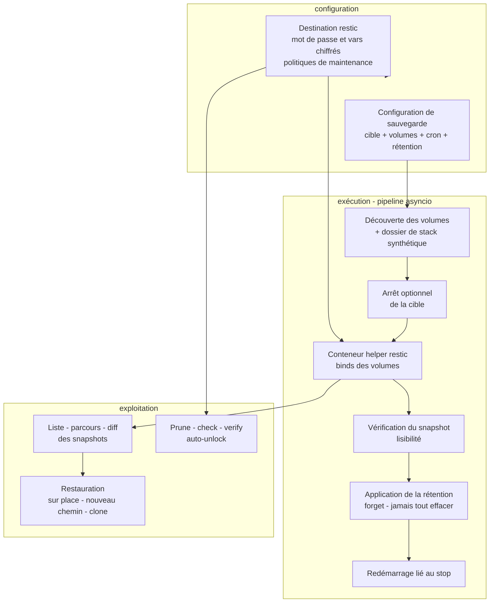
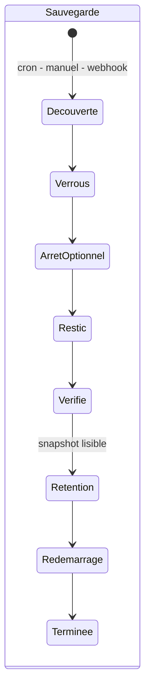

# Spécification fonctionnelle Dockhand — Chapitre 11 : Sauvegardes et restauration (bêta)

| Rubrique | Valeur |
|---|---|
| **Chapitre** | 11 — Sauvegardes et restauration (bêta) |
| **Document de référence** | [`00-chapitrage.md`](00-chapitrage.md) |

## Table des matières

1. [Objet, périmètre et prérequis de lecture](#1-objet-périmètre-et-prérequis-de-lecture)
2. [Vue d'ensemble et statut bêta](#2-vue-densemble-et-statut-bêta)
3. [Destinations restic](#3-destinations-restic)
4. [Configurations de sauvegarde](#4-configurations-de-sauvegarde)
5. [Exécution d'une sauvegarde](#5-exécution-dune-sauvegarde)
6. [Rétention des snapshots](#6-rétention-des-snapshots)
7. [Snapshots : liste, parcours, diff, métadonnées](#7-snapshots--liste-parcours-diff-métadonnées)
8. [Restauration](#8-restauration)
9. [Maintenance des dépôts : prune, check, verify, unlock](#9-maintenance-des-dépôts--prune-check-verify-unlock)
10. [Suivi des exécutions, annulation et taxonomie d'erreurs](#10-suivi-des-exécutions-annulation-et-taxonomie-derreurs)
11. [Sécurité et cloisonnement](#11-sécurité-et-cloisonnement)
12. [Notifications et webhooks](#12-notifications-et-webhooks)
13. [Renvois vers les autres chapitres](#13-renvois-vers-les-autres-chapitres)

---

## 1. Objet, périmètre et prérequis de lecture

Ce chapitre décrit le sous-système de **sauvegarde et de restauration** de conteneurs et de stacks, reposant sur **restic** : destinations (dépôt restic, mot de passe et variables chiffrés, politiques de maintenance), configurations de sauvegarde (cible conteneur ou stack, volumes ciblés, arrêt avant sauvegarde, planification, rétention, options), exécution (pipeline sauvegarde, helpers conteneurisés, verrous), snapshots (liste, parcours de fichiers, diff, métadonnées), restauration (sur place destructrice, nouveau chemin, clonage avec recréation/redéploiement), maintenance des dépôts (prune/check/verify/auto-unlock), suivi des exécutions avec annulation et **taxonomie d'erreurs fermée**, sécurité (balisage par instance, portée environnement *(Enterprise)*) et notifications associées. L'orchestration est assurée par le **backend Python/asyncio** : le pipeline de sauvegarde est une séquence de coroutines, les commandes restic s'exécutent dans un **helper conteneurisé** piloté via l'API Docker (aiodocker).

> **Fonction gated par feature flag** *(flag)* : l'ensemble du sous-système n'est actif que si la variable d'environnement `FEAT_BACKUPS_ENABLED=true` est positionnée au démarrage (lue une fois au boot). Sans elle : aucune route de sauvegarde, aucune inscription au planificateur, aucune récupération au démarrage. Le statut est **bêta**.

**Prérequis de lecture** : chapitre 03 §10 (entités `backup_destinations` et `backup_configs`, concept de snapshot), chapitre 05 (conteneurs, volumes) et chapitre 06 (stacks, redéploiement). Les permissions `backups:view|manage` et la portée environnement relèvent du ch. 12.

## 2. Vue d'ensemble et statut bêta

Dockhand n'implémente pas un format de sauvegarde propre : il **orchestre restic** — dépôts chiffrés, snapshots dédupliqués, rétention — et lui ajoute la connaissance Docker (quels volumes monter, quand arrêter la cible, comment recréer/redéployer après restauration). L'orchestration est écrite en **Python/asyncio** au sein du backend : le service de sauvegarde enchaîne des étapes asynchrones (verrous asyncio, arrêt/démarrage des cibles via l'API Docker, pilotage du helper restic, analyse des sorties JSON) et journalise chaque phase.

Statut **bêta** : le gate `FEAT_BACKUPS_ENABLED` est global à l'instance ; les planifications de sauvegarde et de maintenance ne sont inscrites au planificateur (**APScheduler**) que lorsque le flag est actif, et la **récupération au démarrage** (scrubbage des lignes d'opération restées `running` après un crash — marquage `stale`) est également conditionnée au flag.

## 3. Destinations restic

### 3.1 Modèle

L'entité `backup_destinations` (cf. ch. 03 §10.1) :

| Champ | Rôle |
|---|---|
| `name` | Nom unique |
| `repository` | URL/chemin du dépôt restic (`/chemin/absolu` pour un dépôt local, `s3:`, `rest:`, `b2:`… pour un distant) |
| `password` | Mot de passe du dépôt — **chiffré AES-256-GCM au repos** (`enc:v1:…`, via la bibliothèque `cryptography`), déchiffrement **strict** (échec = erreur, jamais le blob brut comme mot de passe vivant) |
| `envVars` | JSON de variables d'environnement restic (credentials cloud S3/B2…) — **valeurs chiffrées** |
| `flags` | Options CLI restic supplémentaires — validées par **allowlist** (voir §11) |
| `hostPath` | Source de bind-mount côté hôte pour les dépôts locaux |
| `policies` | JSON `{pruneSchedule, checkSchedule, verifySchedule, autoUnlock, maxUnused}` — maintenance planifiée (§9) |
| `lastTestAt/Status/Error` | Résultat du dernier test de connexion |

### 3.2 Test de connexion

Le test exécute `restic` contre le dépôt avec les identifiants déchiffrés et classe le résultat : succès, `REPO_NOT_INITIALIZED` (dépôt à initialiser), `WRONG_PASSWORD`, `NETWORK`… (taxonomie §10.3). L'état du dernier test est persisté sur la destination. Les secrets ne sont **jamais renvoyés** par l'API de liste ; seuls les utilisateurs pouvant **éditer** la destination (`backups:manage`) reçoivent les credentials cloud déchiffrés en édition.

### 3.3 Répertoires locaux

Un dépôt **local** est un chemin **absolu** (définition unique du service) : c'est la seule forme acceptée par la porte d'enregistrement, et toutes les opérations de bind/garde s'y réfèrent — une divergence `./` vs `/` provoquerait des errements de montage.

## 4. Configurations de sauvegarde

L'entité `backup_configs` (cf. ch. 03 §10.2) — une **règle de sauvegarde d'une cible vers une destination** :

| Champ | Rôle |
|---|---|
| `type` + `targetName` | Cible : `container` (nom de conteneur) ou `stack` (nom de stack) |
| `environmentId` | Environnement de la cible (portée — §11.3) ; `null` = environnement local implicite |
| `destinationId` | Dépôt cible (cascade à la suppression de la destination) |
| `enabled` | Interrupteur |
| `allVolumes` / `selectedVolumes` | Périmètre de volumes : **tous** les volumes/binds de la cible, ou une **sélection nommée** (JSON) — une sélection vide est refusée à la validation |
| `stopBeforeBackup` | Arrêter la cible pendant la sauvegarde (cohérence), redémarrage garanti ensuite |
| `schedule` | Expression cron (validée) — planification via le planificateur (§5.1) |
| `retention` | JSON `{keepLast?, keepDaily?, keepWeekly?, keepMonthly?, keepYearly?}` (§6) |
| `options` | JSON `{compression?, limitUpload?, limitDownload?, excludePatterns?, excludeCaches?, webhookSuccess?, webhookFailure?, excludedStackFiles?}` |
| `tags` | Étiquettes additionnelles portées par les snapshots |
| `lastBackupAt/Status` | État de la dernière sauvegarde |

**Validation sans I/O** : type parmi `container`/`stack`, cible non vide, destination valide, cron bien formé, rétention JSON valide, sélection de volumes non vide si `allVolumes=false` — **tous les problèmes sont rapportés d'un coup** (l'utilisateur corrige en une passe), avant tout effet de bord.

**Périmètre d'une stack** : en plus de ses volumes, la stack capture son **dossier de fichiers** (Compose, `.env`, configuration) via un **volume synthétique** `__dockhand_stackdir__` bind-monté depuis le dossier hôte de la stack (localisé depuis le label `com.docker.compose.project.working_dir`). Si le dossier hôte est introuvable (stack non gérée par Compose, ou environnement distant sans « répertoire de stacks distant » configuré), la sauvegarde **échoue explicitement** plutôt que d'écrire un snapshot sans les fichiers. Les fichiers Compose sont exclusables (`excludedStackFiles`).

**Cible sans volume** : légitime — le `metadata.json` (config du conteneur/de la stack, cf. §7.4) est toujours capturé : la sauvegarde est « configuration seule », restaurable par recréation/redéploiement.

## 5. Exécution d'une sauvegarde

### 5.1 Déclencheurs

| Déclencheur | Mécanique |
|---|---|
| **Cron** | job `backup` du planificateur (**APScheduler** ; inscription de chaque configuration dotée d'un `schedule`, uniquement si le flag est actif) |
| **Manuel** | Lancement depuis l'interface (`triggeredBy=manual`) |
| **Webhook** | Déclenchement entrant signé (ch. 14) |

### 5.2 Pipeline

Le service de sauvegarde exécute une séquence **fail-fast** de coroutines où chaque phase conditionne la suivante :

1. **Découverte** : résolution des conteneurs de la cible (tous états — une cible arrêtée mais existante se sauvegarde ; une cible **supprimée** mène à un refus explicite « ne pas sauvegarder rien ») puis de leurs volumes (échec d'inspection d'**un seul** conteneur = échec de la sauvegarde : aucun snapshot partiel ne doit atteindre la rétention) ; pour une stack, planification du volume synthétique du dossier (§4) ;
2. **Verrous** : mutex de **cible vivante** (deux opérations sur les mêmes données rejetées — sauvegarde `:ro` et restauration `:rw` partagent la clé) puis **sérialisation par destination** (un dépôt = une opération à la fois) ;
3. **Arrêt optionnel** (`stopBeforeBackup`) pour un instantané cohérent — le redémarrage est **lié au même périmètre** que l'arrêt (aucun chemin ne peut le sauter) ;
4. **Exécution restic dans un conteneur helper** : les volumes sont bind-montés dans le helper (`/volumes/<clé>`), les métadonnées sont injectées par archive (`/metadata` — jamais dans la ligne de commande, plafond ARG_MAX) ; les **options effectives** (compression, limites, exclusions, liste précise des volumes) sont journalisées dans l'exécution ;
5. **Déverrouillage préventif** : un `restic unlock` **simple** (jamais `--remove-all`) est tenté avant la sauvegarde pour récolter les verrous orphelins d'un crash précédent — sans jamais détruire le verrou vivant d'une **autre instance** partageant le dépôt ;
6. **Validation du résultat** : succès seulement si le helper a terminé avec le code 0 (un code indéterminé = échec) **et** qu'un identifiant de snapshot a été analysé en sortie ; un résumé absent = `INTEGRITY` (jamais de snapshot fantôme) ; le **code 3** de restic (fichiers source illisibles) est un **avertissement** — le snapshot est commis et incomplet ;
7. **Vérification de lisibilité** du snapshot **avant** de déclarer le succès et **avant** la rétention ;
8. **Rétention** (§6) puis **redémarrage** de la cible — un échec de redémarrage est **surfacé** (avertissement + notification + code `STOPPED_RESTART_FAILED`), jamais silencieux, et **jamais compensé** par un rollback : les données sont déjà sauvées.

Aucun délai maximal par défaut : une grande sauvegarde légitime peut durer (un cap fixe tuait des travaux sains) ; une opération bloquée se gère par **annulation manuelle** (§10.2) et le **recyclage du helper** (suppression des helpers orphelins/expirés) ; l'unique garde est la variable `RESTIC_TIMEOUT` (0 = illimité).

## 6. Rétention des snapshots

Deux propriétés de sûreté :

1. **Désactivée par défaut** : une nouvelle configuration garde **tous** les snapshots jusqu'à configuration explicite — une erreur de configuration ne peut pas silencieusement supprimer des sauvegardes ; un blob de rétention absent, vide ou illisible se dégrade en « aucune rétention » ;
2. **Jamais tout effacer** : avant un `forget` réel, un passage `--dry-run` est analysé ; si la politique supprimerait **tous** les snapshots du groupe (keep = 0), le prune est **refusé** — une politique qui ne garde rien est toujours une erreur.

| Mode (JSON stocké) | Signification |
|---|---|
| absent / zéros / illisible | `none` — tout garder |
| `keepLast: N` | Garder les N plus récents (prioritaire s'il coexiste) |
| `keepDaily/Weekly/Monthly/Yearly` | Garder le plus récent par panier temporel |

Le `forget` est **ciblé par étiquettes de configuration** (instance + configId — §11.1) : la rétention d'une configuration ne touche jamais les snapshots d'une autre. Le `forget` **n'emporte pas** `--prune` (le repaquage complet du dépôt, long, appartient à la maintenance planifiée de la destination) ; un `forget` qui échoue ou dépasse son attente de verrou (défaut 1 min, `RESTIC_FORGET_RETRY_LOCK`) est un **avertissement** — la sauvegarde déjà réussie n'échoue pas pour ça, la rétention se rejouera au prochain cycle.

## 7. Snapshots : liste, parcours, diff, métadonnées

### 7.1 Identité et balisage

Chaque snapshot porte des **étiquettes stables** : `dockhand:instance=<uuid>` (identité d'installation), `dockhand:configid=<id>`, `dockhand:envid=<id|local>`, plus les décorations lisibles `dockhand:type=` et `dockhand:name=`. **Toutes les décisions de portée** (rétention, appartenance, accès par environnement) n'utilisent **que** les identifiants stables — jamais les noms normalisés (deux environnements aux noms normalisant identiquement croiseraient leurs rétentions).

### 7.2 Liste et parcours

- **Liste** (`restic snapshots --json`) : snapshots **appartenant à l'instance** (filtre par étiquette d'instance), plus récents d'abord, par configuration ou par destination ; le **dump** d'un snapshot passe par un **job interrogé** (un proxy qui coupe à ~15 s ne peut pas avorter l'opération) ;
- **Parcours de fichiers** (`restic ls`) : arborescence `/volumes/<clé>` et `/metadata` du snapshot, consultable répertoire par répertoire ;
- **Téléchargement de fichier** possible depuis le parcours ; `metadata.json` n'est **jamais** téléchargeable brut (il porte des secrets chiffrés et des env de conteneurs en clair) — uniquement via l'endpoint de métadonnées **rédigées** (§7.4).

### 7.3 Diff

`restic diff --json` entre deux snapshots d'une même destination : fichiers ajoutés/supprimés/modifiés, présenté pour comparer deux sauvegardes successives (voie d'analyse : que s'est-il passé entre hier et aujourd'hui ?).

### 7.4 Métadonnées

Chaque sauvegarde capture `metadata.json` : configuration du conteneur (inspection) ou de la stack (Compose, secrets chiffrés de stack, variables), liste des volumes. **Rédaction systématique** avant exposition : les secrets de stack et les `Config.Env`/labels de conteneurs sont retirés — c'est l'unique chemin de sortie des métadonnées.

## 8. Restauration

### 8.1 Modes

La demande de restauration (validation pure, puis service de restauration) propose :

| Mode | Comportement | Garde |
|---|---|---|
| **Sur place** (`in-place`) | Écrase les **volumes vivants** de la cible avec le contenu du snapshot (staging puis bascule atomique du contenu) | **Confirmation explicite obligatoire** (`confirmOverwrite`) — une restauration ne peut jamais écraser silencieusement des données vivantes |
| **Nouveau chemin** (`new-location`) | Extraction vers un répertoire hôte choisi | Chemin absolu, hors **racines système interdites** (`/`, `/etc`, `/root`, `/boot`, `/dev`, `/proc`, `/sys`, `/run`, `/var/run`, `/bin`, `/sbin`, `/lib`, `/lib64`, `/var/lib/docker`) — le helper monte la cible en écriture **en root** |
| **Clone** (nouveau chemin + destinations) | Chaque volume restauré est dirigé vers une destination (volume nommé valide ou chemin absolu protégé), puis **recréation/redéploiement** de la cible sous un nouveau nom | Nom de cible requis pour l'action post-restauration ; volumes non mappés retombent sur le chemin cible |

La **restauration sélective** agit sur un sous-ensemble des volumes du snapshot (`volumes: []` = tous). Les chemins d'inclusion sont **allowlistés** (`/volumes/<nom-sûr>` ou `/metadata` littéral) : toute valeur avec métacaractère est rejetée avant d'atteindre la commande du helper.

### 8.2 Actions post-restauration

Après une restauration sur place réussie : démarrage du conteneur, **recréation** (depuis les métadonnées) ou **redéploiement** de la stack (avec reprise des secrets portés par le snapshot — désactivable). Ces actions sont **au mieux** : les données sont déjà restaurées ; un échec **dégrade** le résultat en `warning` (code `STOPPED_RESTART_FAILED` le cas échéant) sans jamais rollback la restauration — l'opérateur doit agir.

### 8.3 Résultat

Comme la sauvegarde : résultat **explicite** (`success` avec volumes restaurés et issue post-restauration, `warning`, `skipped`, `error` + code) — jamais un booléen nu.

## 9. Maintenance des dépôts : prune, check, verify, unlock

Trois tâches planifiées par destination (politiques `policies`), inscrites au planificateur (**APScheduler**) sous les types `repo_prune` / `repo_check` / `repo_verify` (gate flag), plus des déclenchements manuels (ch. 14) :

| Tâche | Rôle | Notes |
|---|---|---|
| **Prune** | `restic prune` avec `maxUnused` (quantité de données inutilisées tolérée avant repaquage) | Repaquage du dépôt — opération longue, hors chemin des sauvegardes |
| **Check** | `restic check` — intégrité des index et structures | Peut lire un sous-ensemble de données selon options |
| **Verify** | `restic verify` — vérification du **contenu** des données (sous-ensemble configurable : pourcentage, taille) | Le plus coûteux ; progression journalisée |
| **Unlock** | Nettoyage des verrous | **Auto-unlock** optionnel avant chaque tâche de maintenance : `unlock` **simple** (verrous prouvés stalés) — jamais `--remove-all` automatique ; l'action manuelle « Unlock » explicite seule peut tout retirer (jugement opérateur : « aucune autre opération ne tourne ») |

Chaque tâche trace une exécution (`schedule_executions`, libellé `Prune/Check/Verify: <destination>`) avec journaux horodatés et notifications `repo_*_success/failed` (§12).

## 10. Suivi des exécutions, annulation et taxonomie d'erreurs

### 10.1 Journal des opérations

Chaque sauvegarde/restauration ouvre une **opération** (ligne d'exécution) : progression par étapes (`stopping`, `metadata`, `backing-up` avec la liste des volumes, `progress` des lignes restic — en direct si le transport le permet, sinon relecture post-exit), journaux horodatés, résultat final riche. Au démarrage de l'instance, les lignes restées `running` après un crash sont marquées **`stale`** (scrubbage — conditionné au flag).

### 10.2 Annulation

Une sauvegarde en cours peut être **annulée** : le conteneur helper (nommé) est tué ; l'issue est rapportée comme `cancelled` (et non comme une erreur restic) — les snapshots déjà commis restent valides ; rien n'est effacé à contretemps puisque les suppressions de rétention ne s'exécutent qu'après validation du snapshot courant.

### 10.3 Taxonomie d'erreurs fermée

Les erreurs portent un **code machine** fermé — l'interface affiche un message humain, l'automatisation branche sur le code :

| Code | Signification fonctionnelle |
|---|---|
| `VALIDATION` | Erreur de configuration/saisie — corriger l'entrée |
| `REPO_LOCKED` | Dépôt verrouillé (transitoire — réessayer) |
| `REPO_NOT_INITIALIZED` | Dépôt non initialisé |
| `WRONG_PASSWORD` | Mot de passe du dépôt incorrect |
| `DOCKER` | Docker injoignable/erreur d'API |
| `NETWORK` | Réseau/transport (transitoire) |
| `RESTIC` | restic lui-même a échoué |
| `INTEGRITY` | Artefact incomplet/inutilisable — **le grave** |
| `CANCELLED` | Annulation utilisateur |
| `STOPPED_RESTART_FAILED` | Données saines mais un service arrêté n'a pas redémarré — l'opérateur doit agir |
| `CONCURRENCY` | Conflit de verrous internes (cible ou destination occupée) |
| `UNKNOWN` | Non classé |

Statuts d'opération : `running` → terminaux `success` | `warning` (terminé avec réserve : exit 3, redémarrage partiel) | `error` | `cancelled` (+ `stale` au scrubbage).

## 11. Sécurité et cloisonnement

### 11.1 Propriété par instance

Les snapshots sont **balisés** par l'identifiant d'instance (`dockhand:instance=<uuid>`) : la liste et la rétention ne considèrent que **ses propres** snapshots ; deux instances Dockhand partageant un dépôt ne se marchent pas dessus (chaque verrou vivant de l'autre est respecté — cf. §5.2 et §9).

### 11.2 Surface d'exécution réduite

- l'environnement du sous-processus/helper restic est construit depuis une **allowlist** — jamais l'environnement complet du processus Dockhand (la clé maître de chiffrement ou `DATABASE_URL` de Dockhand ne peuvent pas fuiter vers restic, et une variable malveillante ne peut pas injecter `PATH`/`LD_PRELOAD`) ;
- les variables cloud d'une destination sont **filtrées** par allowlist avant d'atteindre le helper ;
- les **flags restic supplémentaires** sont validés contre une allowlist : tout ce qui peut lire/écrire des fichiers arbitraires ou exécuter du code (`--option`, `--password-command`, `--cacert`…) est rejeté ;
- les identifiants de snapshot sont validés syntaxiquement (hex, 8 ou 64) **avant** toute interpolation en arguments de commande ;
- comparaison du mot de passe fourni vs stocké en **temps constant** (`hmac.compare_digest` — pas de fuite de timing) ;
- gardes de chemin : allowlist d'inclusion, confinement des cibles sous leur racine (avec frontière de séparateur), segments de nom sans traversée, racines système interdites (§8.1) ;
- webhooks de succès/échec : schèmes http(s) uniquement, hôtes loopback/privés/link-local/métadonnées bloqués, **redirections bloquées** (SSRF).

### 11.3 Portée environnement *(Enterprise)*

La permission `backups:view|manage` seule est **globale** ; en édition Enterprise, les routes de contenu de snapshot **résolvent l'environnement propriétaire depuis les étiquettes du snapshot lui-même** (jamais du paramètre `env` fourni par l'appelant) et appliquent le contrôle d'accès par environnement — **échec fermé** si l'environnement est indésolvable. La liste à l'échelle d'une destination **filtre** les snapshots dont l'environnement est inaccessible ; les routes par configuration passent toutes par un **garde unifié** (chargement + porte d'environnement en un appel — l'omission est non représentable). Sans licence Enterprise : pas de cloisonnement par environnement au-delà des permissions globales.

## 12. Notifications et webhooks

| Événement | Émis quand |
|---|---|
| `backup_success` / `backup_failed` | Issue d'une sauvegarde (le `warning` est un succès notifié avec réserve) |
| `restore_success` / `restore_failed` | Issue d'une restauration |
| `repo_prune_success/failed`, `repo_check_success/failed`, `repo_verify_success/failed` | Issue des tâches de maintenance |

En complément, chaque configuration peut porter des **webhooks de succès/échec** (`options.webhookSuccess/webhookFailure`) appelés en aller-simple après l'opération (non fatals — n'influencent jamais l'issue). Le routage par canal/environnement des événements ci-dessus relève du ch. 13 (acheminement multicanal assuré par la bibliothèque **apprise**) ; les types système globaux (maintenance de dépôts) se règlent au niveau du canal uniquement.

## 13. Renvois vers les autres chapitres

| Chapitre | Lien | Pourquoi y aller |
|---|---|---|
| 00 — Chapitrage | [`00-chapitrage.md`](00-chapitrage.md) | Sommaire de référence. |
| 02 — Architecture fonctionnelle | [`02-architecture-fonctionnelle.md`](02-architecture-fonctionnelle.md) | Place du sous-système sauvegardes dans la carte des modules, flux de sauvegarde de bout en bout. |
| 03 — Concepts et entités | [`03-concepts-entites.md`](03-concepts-entites.md) | Entités `backup_destinations`, `backup_configs`, concept de snapshot, `schedule_executions`. |
| 04 — Environnements | [`04-environnements.md`](04-environnements.md) | Portée environnement des configurations, répertoire de stacks distant (condition du dossier de stack), environnements remote shell SSH. |
| 05 — Gestion des conteneurs | [`05-conteneurs.md`](05-conteneurs.md) | Cibles conteneur, volumes et binds, inspection (source des métadonnées). |
| 06 — Stacks Compose | [`06-stacks.md`](06-stacks.md) | Cibles stack, dossier de stack, redéploiement post-restauration, secrets de stack reportés. |
| 08 — Images et registres | [`08-images.md`](08-images.md) | `default_backup_image` (image du helper restic) parmi les réglages généraux, protection des images utilitaires au prune. |
| 09 — Volumes, réseaux et maintenance | [`09-volumes-reseaux.md`](09-volumes-reseaux.md) | Volumes source des sauvegardes, helpers conteneurisés (modèle voisin), maintenance système. |
| 10 — Sécurité applicative | [`10-securite-applicative.md`](10-securite-applicative.md) | Chiffrement au repos des secrets, gardes SSRF des webhooks, masquage. |
| 12 — Authentification et RBAC | [`12-authentification-rbac.md`](12-authentification-rbac.md) | Permissions `backups:view/manage`, portée environnement *(Enterprise)*. |
| 13 — Observabilité | [`13-observabilite.md`](13-observabilite.md) | Notifications `backup_*`/`restore_*`/`repo_*`, routage par environnement. |
| 14 — Automatisation | [`14-automatisation-api.md`](14-automatisation-api.md) | Types de planification `backup`/`repo_prune`/`repo_check`/`repo_verify`, déclenchement manuel et webhook, historique des exécutions. |
| 15 — Administration | [`15-administration-exploitation.md`](15-administration-exploitation.md) | Feature flags (dont `FEAT_BACKUPS_ENABLED`), réglage `default_backup_image`, `RESTIC_TIMEOUT`. |
