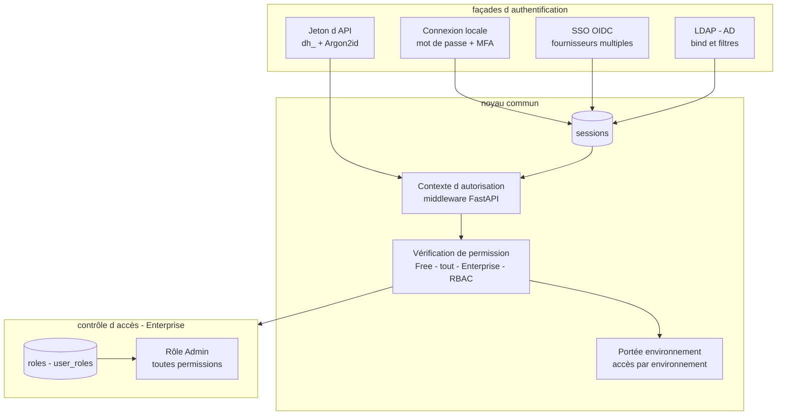
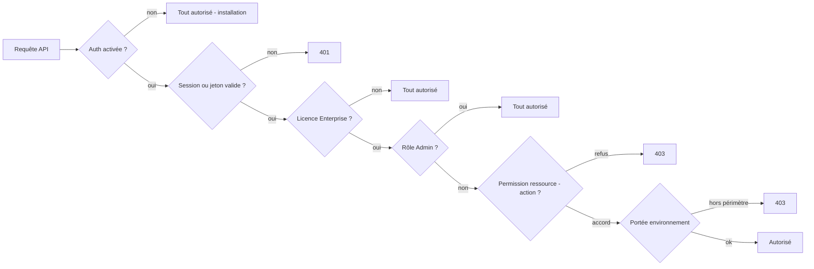

# Spécification fonctionnelle Dockhand — Chapitre 12 : Authentification, utilisateurs et contrôle d'accès (RBAC)

| Rubrique | Valeur |
|---|---|
| **Chapitre** | 12 — Authentification, utilisateurs et contrôle d'accès (RBAC) |
| **Document de référence** | [`00-chapitrage.md`](00-chapitrage.md) |

## Table des matières

1. [Objet, périmètre et prérequis de lecture](#1-objet-périmètre-et-prérequis-de-lecture)
2. [Vue d'ensemble du modèle d'accès](#2-vue-densemble-du-modèle-daccès)
3. [Authentification locale : comptes, connexion, MFA](#3-authentification-locale--comptes-connexion-mfa)
4. [Sessions](#4-sessions)
5. [SSO OpenID Connect](#5-sso-openid-connect)
6. [LDAP / Active Directory](#6-ldap--active-directory)
7. [Gestion des utilisateurs](#7-gestion-des-utilisateurs)
8. [Rôles et permissions](#8-rôles-et-permissions)
9. [Portée par environnement et gating d'édition](#9-portée-par-environnement-et-gating-dédition)
10. [Jetons d'API](#10-jetons-dapi)
11. [Procédures d'urgence d'administration des comptes](#11-procédures-durgence-dadministration-des-comptes)
12. [Synthèse des règles de sécurité](#12-synthèse-des-règles-de-sécurité)
13. [Renvois vers les autres chapitres](#13-renvois-vers-les-autres-chapitres)

---

## 1. Objet, périmètre et prérequis de lecture

Ce chapitre décrit l'**authentification** (comptes locaux Argon2id via argon2-cffi, connexion avec MFA TOTP et codes de secours, sessions par cookie HttpOnly, SSO OIDC multi-fournisseurs via authlib, LDAP/AD via ldap3, mode authentification désactivée et installation initiale) et le **contrôle d'accès** (rôles et permissions par domaine fonctionnel, portée par environnement, mappings de rôles OIDC/LDAP, rôles système Admin/Operator/Viewer, différences Free/Enterprise, auto-attribution du rôle Admin au créateur d'environnement, jetons d'API personnels `dh_`, commandes d'urgence d'administration des comptes).

**Prérequis de lecture** : chapitre 01 (modèle d'éditions et licence — §7), chapitre 03 §12 (entités `users`, `sessions`, `roles`, `user_roles`, `oidc_config`, `ldap_config`, `api_tokens`, `auth_settings`). Les préférences par utilisateur *(Enterprise)* sont traitées au ch. 15.

**Conventions** : mentions *(Enterprise)* / *(SMB)* ; **SMB ne débloque pas** le RBAC (voir §9.2).

## 2. Vue d'ensemble du modèle d'accès

Le modèle d'accès se résume en trois questions posées à chaque requête (contexte d'autorisation construit par le middleware d'authentification du backend FastAPI) :

1. **Authentification** : l'appelant est-il identifié (session cookie ou jeton Bearer) — et l'authentification est-elle seulement activée ?
2. **Permission** : a-t-il le droit `ressource:action` demandé — en Free tous les authentifiés ont tout, en Enterprise le RBAC décide ;
3. **Portée** : l'action vise un environnement auquel il a accès ?

## 3. Authentification locale : comptes, connexion, MFA

### 3.1 Comptes locaux

Les comptes locaux stockent un **hachage Argon2id** (`passwordHash`, calculé par la bibliothèque **argon2-cffi**) — jamais de mot de passe en clair. Un compte porte : `username` (unique), `email`, `displayName`, `avatar`, `authProvider` (`local`, `oidc:<Nom>`, `ldap:<Nom>` selon l'origine), `mfaEnabled`/`mfaSecret` (JSON : secret TOTP + codes de secours **hachés**), `isActive`, `lastLogin`.

### 3.2 Connexion

`POST /api/auth/login` (corps : `username`, `password`, `mfaToken` facultatif, `provider`) : vérifie le hachage, exige un **code TOTP valide si la MFA est activée** (les codes de secours hachés servent de repli), puis ouvre une session (§4). L'échec est indifférencié (aucune indication sur l'existence du compte). La page de connexion propose les **fournisseurs** déclarés (`/api/auth/providers` : local, LDAP, OIDC actifs) et le fournisseur **par défaut** des réglages.

### 3.3 MFA TOTP *(Enterprise)*

L'activation se fait par l'utilisateur lui-même : `action=setup` régénère un secret TOTP (via la bibliothèque **pyotp**) et retourne un **QR code** ; `action=verify` confirme un code et active. Des **codes de secours** hachés sont générés à l'activation (repli en cas de perte du générateur). La désactivation requiert un code valide.

### 3.4 Mode sans authentification et installation initiale

Les réglages globaux (`auth_settings`) portent `authEnabled` : une instance peut fonctionner **sans authentification** (cas homelab isolé) — toutes les vérifications deviennent alors des no-op (le contexte d'autorisation répond « tout permis »). À l'**activation** de l'authentification, au moins un compte admin doit exister (garde à l'enregistrement des réglages). Réciproquement, si l'authentification est activée alors qu'**aucun admin n'existe**, l'instance entre en **mode d'installation initiale** : l'interface propose la création du premier administrateur (ch. 15).

## 4. Sessions

- **Cookie HttpOnly** `dockhand_session` — le navigateur ne peut pas le lire (anti-exfiltration XSS) ; la **déconnexion** détruit la session côté serveur et efface le cookie ;
- chaque session (`sessions`) porte `userId`, le `provider` d'origine (locale/OIDC/LDAP) et `expiresAt` — expiration selon le délai configuré (`sessionTimeout`, défaut 86 400 s) ;
- la session courante s'interroge via `/api/auth/session` (amorçage du frontend : état authentifié, `authEnabled`, profil) ;
- **révocation globale** : la commande d'urgence `clear-sessions` purge toutes les sessions (§11) — il n'existe pas de liste de sessions actives gérable depuis l'interface.

## 5. SSO OpenID Connect

### 5.1 Configuration

Plusieurs **fournisseurs OIDC** peuvent coexister (`oidc_config`, gestion `/api/auth/oidc` — CRUD, secret client masqué, test de découverte) ; le protocole est implémenté via la bibliothèque **authlib** :

| Champ | Rôle |
|---|---|
| `name`, `enabled` | Identification et activation |
| `issuerUrl` + `clientId`/`clientSecret` (chiffré) | Paramètres du protocole ; le **test** vérifie la découverte (`/.well-known/openid-configuration`) |
| `redirectUri` | Rappel de l'IdP vers Dockhand |
| `scopes` + claims (`usernameClaim`, `emailClaim`, `displayNameClaim`) | Mapping des attributs utilisateur |
| `adminClaim`/`adminValue` | **Élévation admin** : si le claim vaut la valeur attendue, l'utilisateur reçoit le rôle Admin à la connexion |
| `roleMappingsClaim` + `roleMappings` (JSON) | Mapping **groupe/claim → rôle Dockhand** |

### 5.2 Connexion OIDC

Le flux est un **Authorization Code** standard : `initiate` construit l'URL d'autorisation (302 vers l'IdP, ou URL retournée en JSON pour l'API) ; le `callback` échange le code, valide les claims et **provisionne l'utilisateur à la première connexion** (`authProvider = oidc:<Nom>`), applique l'élévation/mapping admin, puis ouvre une session et redirige vers la destination d'origine (ou vers `/login` avec l'erreur en paramètre en cas d'échec — toujours une réponse 302).

## 6. LDAP / Active Directory *(Enterprise)*

La connexion LDAP complète le SSO pour les annuaires d'entreprise (implémentation via la bibliothèque **ldap3** ; gestion `/api/auth/ldap` — CRUD **réservé Enterprise**, mot de passe de bind masqué, test de connectivité) :

- **Connexion à l'annuaire** : `serverUrl`, `bindDn`/`bindPassword` (chiffré), `baseDn`, TLS (`tlsEnabled`, `tlsCa`) — le **test** vérifie la liaison ;
- **recherche d'utilisateurs** : `userFilter` (avec substituable de nom d'utilisateur), attributs `usernameAttribute`, `emailAttribute`, `displayNameAttribute` ;
- **groupes** : `groupBaseDn`, `groupFilter`, et deux mécanismes d'élévation : `adminGroup` (membre ⇒ Admin) et `roleMappings` (groupe → rôle Dockhand) ;
- la **connexion** (`POST /api/auth/login` avec fournisseur LDAP) lie avec le compte saisi puis lit ses attributs/groupes ; l'utilisateur est provisionné à la première connexion (`authProvider = ldap:<Nom>`) avec application des mappings.

## 7. Gestion des utilisateurs

- **Inventaire et CRUD** (`/api/users`, permissions `users:*` en Enterprise) : création (mot de passe obligatoire, haché), édition (identité, avatar, réinitialisation du mot de passe, activation/désactivation), suppression — **cascade** sur sessions, jetons d'API, rôles et préférences ; le journal d'audit conserve les traces avec `userId` remis à `null` (conservation documentaire) ;
- **désactivation** (`isActive=false`) : le compte ne peut plus se connecter, ni session ni jeton ne fonctionnent plus (les jetons vérifient `isActive` à chaque validation) ;
- les utilisateurs **SSO/LDAP** sont provisionnés à la première connexion ; leur mot de passe local est absent (pas de connexion locale possible) ;
- l'**avatar** peut être une image téléversée ; le profil est éditable par l'utilisateur lui-même (nom affiché, e-mail, mot de passe avec vérification de l'ancien).

## 8. Rôles et permissions

### 8.1 Modèle

- **Rôle** (`roles`) : `name`, `description`, `permissions` (JSON : domaine → liste d'actions), `environmentIds` (JSON d'identifiants ; `null` = **tous** les environnements), `isSystem` (rôles fournis, mis à jour à chaque démarrage) ;
- **Attribution** (`user_roles`) : triplet unique (utilisateur, rôle, environnement facultatif) matérialisant la **portée effective** — une attribution peut cibler un environnement précis ;
- les permissions d'un utilisateur = **fusion** des permissions de tous ses rôles (union des actions par domaine) ; l'utilisateur portant le rôle **Admin** court-circuite (toutes permissions).

### 8.2 Domaines de permissions

L'ensemble des domaines (19) : `containers`, `images`, `volumes`, `networks`, `stacks`, `environments`, `registries`, `notifications`, `configsets`, `settings`, `users`, `git`, `license`, `audit_logs`, `activity`, `schedules`, `templates`, `secrets`, `backups`. Les actions typiques : `view`, `create`, `edit`, `delete`, plus des actions dédiées (`start`/`stop`/`restart`/`exec`/`logs`/`inspect` pour les conteneurs ; `pull`/`load`/`push`/`build` pour les images ; `connect`/`disconnect` pour les réseaux ; `test` pour les notifications ; `run` pour les planifications ; `deploy`/`manage` pour les modèles ; `manage` pour la licence).

### 8.3 Rôles système

Trois rôles `isSystem` sont créés (et **recalés** à chaque démarrage par le service d'initialisation des données de référence) :

| Domaine | Admin | Operator | Viewer |
|---|---|---|---|
| containers | view, create, start, stop, restart, remove, exec, logs, inspect | view, start, stop, restart, logs, exec | view, logs, inspect |
| images | view, pull, load, push, remove, build, inspect | view, pull | view, inspect |
| volumes | view, create, remove, inspect | view, inspect | view, inspect |
| networks | view, create, remove, inspect, connect, disconnect | view, inspect | view, inspect |
| stacks | view, create, start, stop, remove, edit | view, start, stop | view |
| environments | view, create, edit, delete | view | view |
| registries | view, create, edit, delete | view | view |
| notifications | view, create, edit, delete, test | view | view |
| configsets | view, create, edit, delete | view | view |
| settings | view, edit | view | — |
| users | view, create, edit, delete | — | — |
| git | view, create, edit, delete | view, create, edit | view |
| license | manage | — | — |
| audit_logs | view | — | — |
| activity | view | view | view |
| schedules | view, edit, run | view, edit, run | view |
| templates | view, deploy, manage | view, deploy | view |
| secrets | view, create, edit, delete | view | — |
| backups | view, manage — par court-circuit du rôle Admin | — | — |

Lecture fonctionnelle : **Admin** fait tout ; **Operator** opère (démarre/arrête, tire des images, synchro Git, planifications) sans rien créer/supprimer de structurel ni toucher aux utilisateurs/réseaux/volumes ; **Viewer** lit (journaux et inspection compris) sans agir. Le domaine `backups` n'est pas présent dans les permissions des rôles système Viewer/Operator — il s'ajoute aux rôles personnalisés.

### 8.4 Mappings de rôles externes

OIDC (`roleMappings` sur claim de groupes) et LDAP (`roleMappings` groupe → rôle) traduisent l'appartenance de groupe IdP/annuaire en **rôles Dockhand** à chaque connexion — le provisionnement applique (ou retire) les attributions correspondantes ; l'élévation `adminClaim`/`adminGroup` attribue le rôle Admin par la même voie.

## 9. Portée par environnement et gating d'édition

### 9.1 Portée environnement

- **accès à un environnement** : vrai pour les admins, en Free pour tout authentifié ; en Enterprise, vrai si l'utilisateur tient **au moins un rôle s'appliquant** à cet environnement (rôle global `environmentIds=null` ou couvrant l'environnement, ou attribution ciblée) ;
- **liste des environnements accessibles** : `null` = tous les environnements (admin, Free, auth désactivée) ; sinon la liste des identifiants accessibles (utilisée p.ex. pour **filtrer l'inventaire des environnements** — ch. 04) ;
- la vérification de permission **avec contexte d'environnement** (`can(ressource, action, envId)`) ne considère que les rôles **applicables à cet environnement** — un Operator global et Viewer sur l'env 3 est Viewer sur l'env 3 ;
- **auto-attribution du rôle Admin au créateur d'environnement** *(Enterprise)* : un utilisateur non-admin qui crée un environnement reçoit le rôle **Admin borné à cet environnement** (échec de l'attribution non bloquant — l'environnement est créé) : le créateur peut administrer sa création sans devenir admin global.

### 9.2 Gating d'édition

Le RBAC n'est actif que si la **licence validée est de type `enterprise` exactement** (vérification par signature RSA-SHA256 — le service de licence exige `type === 'enterprise'` dans la charge validée) : une licence **SMB** valide n'active **pas** le RBAC (pas de LDAP/MFA non plus — §§3.3 et 6). Récapitulatif :

| Capacité | Free | SMB | Enterprise |
|---|---|---|---|
| Comptes locaux, sessions | ✔ | ✔ | ✔ |
| SSO OIDC | ✔ | ✔ | ✔ |
| LDAP/AD | — | — | ✔ |
| MFA TOTP | — | — | ✔ |
| RBAC (rôles, portées, filtrage des environnements) | — | — | ✔ |
| Journal d'audit | — | — | ✔ |
| Préférences nominatives | — (partagées) | — (partagées) | ✔ |

En Free (et SMB sans Enterprise), **tout utilisateur authentifié est de facto administrateur** : la vérification de permission répond vrai, l'inventaire n'est pas filtré — modèle d'« administration de confiance » assumé pour un homelab mono-utilisateur.

## 10. Jetons d'API

Les jetons personnels (`api_tokens`, gestion `/api/auth/tokens` — propres à l'utilisateur authentifié, jamais via un autre jeton) permettent d'appeler l'API REST sans session navigateur :

- **Format** : préfixe `dh_` + 43 caractères base64url (32 octets aléatoires) — la valeur **complète n'est montrée qu'une fois** à la création ; la base ne stocke que le **hachage Argon2id** (`tokenHash`, unique — argon2-cffi) et un `tokenPrefix` (8 caractères après `dh_`) pour l'identification dans les listes ;
- **Usage** : en-tête `Authorization: Bearer dh_…` ; la validation recharge l'utilisateur propriétaire (avec son `authProvider` d'origine), vérifie `isActive`, l'**expiration optionnelle** (`expiresAt`, testée **après** vérification du hachage — pas d'oracle de timing) et reconstruit ses permissions (Free : Admin ; Enterprise : fusion des rôles) ;
- **Performance** : cache mémoire (clé SHA-256, TTL 60 s borné par l'expiration) — Argon2id ne tourne qu'au premier appel ; un jeton sans candidat déclenche quand même une vérification contre un haché factice (temps constant) ;
- **Traçabilité** : `lastUsed` mis à jour au vol (non bloquant) ; **révocation** = suppression (le cache est invalidé pour l'utilisateur) ;
- la création d'un jeton exige une **session** (pas un Bearer) et la confirmation du mot de passe.

Le périmètre effectif d'un jeton est celui de son propriétaire (mêmes permissions RBAC, même portée d'environnement) — l'usage pour l'API documentée et l'export SARIF est traité au ch. 14. Ces jetons sont les **seuls** jetons du produit : l'administration distante d'hôtes s'effectue par le remote shell SSH authentifié par **clés SSH** (ch. 04), pas par des jetons dédiés.

## 11. Procédures d'urgence d'administration des comptes

Des **commandes d'urgence** sont exécutées sur l'hôte, typiquement dans le conteneur Dockhand (elles agissent directement sur la base via la couche de données — SQLAlchemy selon `DATABASE_URL` : aiosqlite/SQLite par défaut, psycopg 3/PostgreSQL le cas échéant) :

| Commande | Action fonctionnelle |
|---|---|
| `create-admin` | Crée (ou réactive) un compte **administrateur** avec un mot de passe fourni — reprise en main d'une instance verrouillée |
| `reset-password` | Réinitialise le mot de passe d'un utilisateur (hachage Argon2id) — et **désactive sa MFA** au passage |
| `disable-auth` | Désactive l'authentification de l'instance (`authEnabled=false`) — accès direct à l'interface pour dépannage |
| `clear-sessions` | Purge **toutes** les sessions (déconnexion forcée de tout le monde) |
| `list-users` | Liste les comptes (nom, fournisseur, état MFA/actif) — diagnostic sans interface |

Ces commandes complètent les outils d'urgence base de données (`backup-db`, `restore-db`, `reset-db` — ch. 15). Elles agissent **directement sur la base** (contournement de l'application) : elles supposent un accès hôte légitime.

## 12. Synthèse des règles de sécurité

| Risque | Mesure fonctionnelle |
|---|---|
| Vol de session par XSS | Cookie **HttpOnly** ; expiration configurée ; purge globale en urgence |
| Force brute / oracle de comptes | Hachage **Argon2id** (argon2-cffi, coût élevé par essai) ; échec de connexion indifférencié |
| Perte du générateur TOTP | Codes de secours **hachés** générés à l'activation MFA |
| Élévation non maîtrisée via SSO | Élévation Admin par claim/groupe **explicite** (`adminClaim`/`adminGroup`), mappings déclarés par fournisseur |
| Compte inactif persistant | `isActive=false` bloque connexions, sessions et jetons (vérifié à chaque usage de jeton) |
| Suppression d'utilisateur effaçant l'historique | Audit conservé avec `userId` à `null` (lien documentaire) |
| Jeton d'API volé en base | Valeur complète jamais stockée (hachage Argon2id) ni réaffichée ; préfixe d'identification seul |
| Oracle d'expiration de jeton | Expiration testée **après** vérification du hachage ; haché factice sur candidat absent |
| Divergence de droits entre session et jeton | Même reconstruction de permissions (fusion des rôles, portées d'environnement) |
| Verrouillage accidentel de l'instance | Garde « au moins un admin » à l'activation de l'auth ; commandes d'urgence (create-admin, disable-auth) |
| Créateur d'environnement sans droits dessus *(Enterprise)* | Auto-attribution du rôle **Admin borné à cet environnement** |
| Escalade via SMB | Le contrôle de licence exige `type=enterprise` exactement — SMB ne débloque ni RBAC, ni LDAP, ni MFA |

## 13. Renvois vers les autres chapitres

| Chapitre | Lien | Pourquoi y aller |
|---|---|---|
| 00 — Chapitrage | [`00-chapitrage.md`](00-chapitrage.md) | Sommaire de référence. |
| 01 — Présentation générale | [`01-presentation-generale.md`](01-presentation-generale.md) | Modèle de licence BSL, éditions Free/SMB/Enterprise, activation par clé signée. |
| 02 — Architecture fonctionnelle | [`02-architecture-fonctionnelle.md`](02-architecture-fonctionnelle.md) | Cookies de session, en-têtes de sécurité, contexte de requête (middleware session/Bearer). |
| 03 — Concepts et entités | [`03-concepts-entites.md`](03-concepts-entites.md) | Entités du domaine identité et accès (§12). |
| 04 — Environnements | [`04-environnements.md`](04-environnements.md) | Filtrage de l'inventaire par environnements accessibles, auto-attribution Admin au créateur, clés SSH du remote shell. |
| 05 — Gestion des conteneurs | [`05-conteneurs.md`](05-conteneurs.md) | Application des permissions `containers:*` sur les opérations. |
| 06 — Stacks Compose | [`06-stacks.md`](06-stacks.md) | Permissions `stacks:*`, exigence `secrets:view` pour lier un fournisseur. |
| 07 — Intégration Git | [`07-git.md`](07-git.md) | Permissions `git:*`, webhooks signés (authentification entrante). |
| 08 — Images et registres | [`08-images.md`](08-images.md) | Permissions `images:*`, `registries:*`. |
| 09 — Volumes, réseaux et maintenance | [`09-volumes-reseaux.md`](09-volumes-reseaux.md) | Permissions `volumes:*`, `networks:*`, prune global multi-permissions. |
| 10 — Sécurité applicative | [`10-securite-applicative.md`](10-securite-applicative.md) | Permissions `secrets:*`, `images:view` sur les vulnérabilités, portée d'environnement des vues. |
| 11 — Sauvegardes (bêta) | [`11-sauvegardes.md`](11-sauvegardes.md) | Permissions `backups:view/manage` et résolution d'environnement depuis les étiquettes de snapshot *(flag)*. |
| 13 — Observabilité | [`13-observabilite.md`](13-observabilite.md) | Journal d'audit *(Enterprise)*, diffusion SSE, contexte IP/user-agent des traces. |
| 14 — Automatisation | [`14-automatisation-api.md`](14-automatisation-api.md) | API REST et authentification Bearer, viewer Scalar, préférences d'interface des jetons. |
| 15 — Administration | [`15-administration-exploitation.md`](15-administration-exploitation.md) | Gestion de licence (activation/expiration), préférences par utilisateur *(Enterprise)*, réglages d'authentification, mode installation initiale. |
