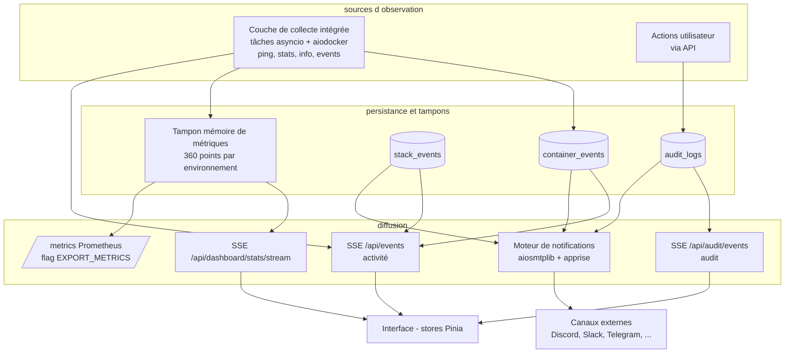
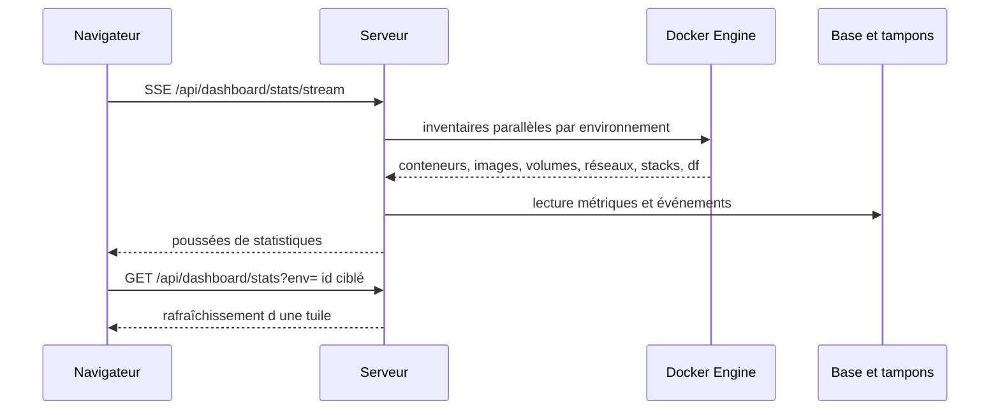
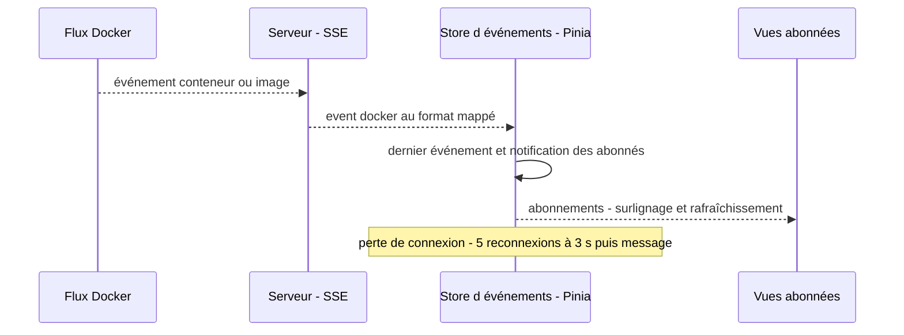
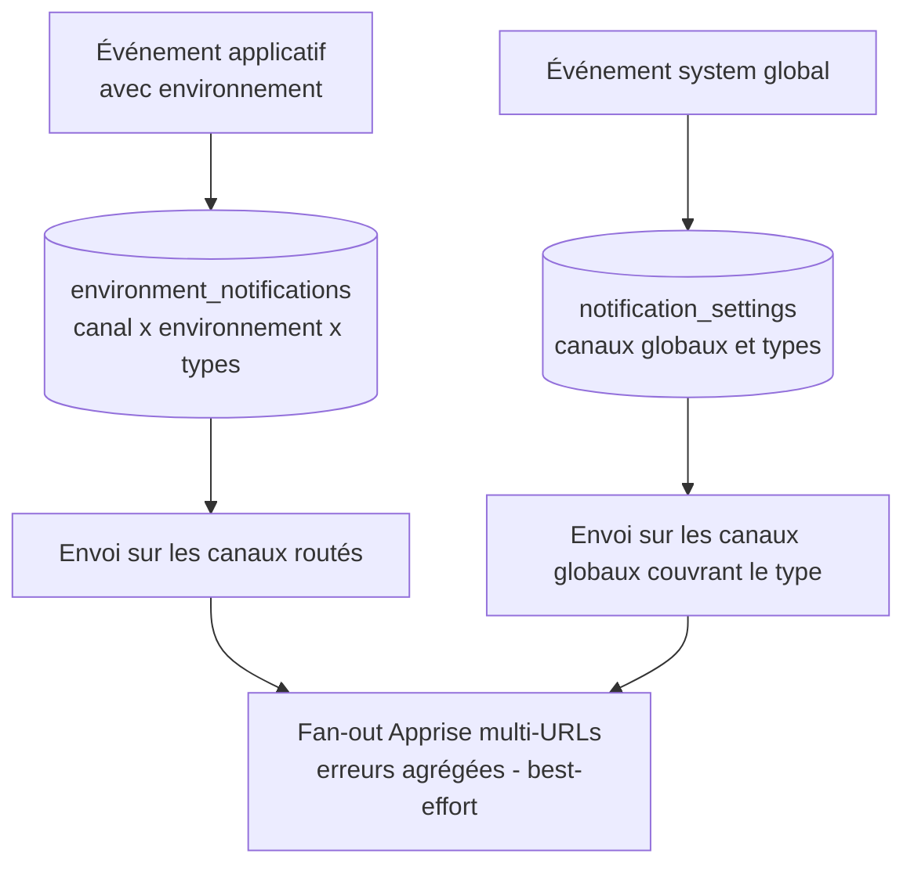

# Spécification fonctionnelle Dockhand — Chapitre 13 : Observabilité — tableaux de bord, activité, audit, événements et notifications

| Rubrique | Valeur |
|---|---|
| **Chapitre** | 13 — Observabilité : tableaux de bord, activité, audit, événements et notifications |
| **Document de référence** | [`00-chapitrage.md`](00-chapitrage.md) |

## Table des matières

1. [Objet, périmètre et prérequis de lecture](#1-objet-périmètre-et-prérequis-de-lecture)
2. [Vue d'ensemble du dispositif d'observabilité](#2-vue-densemble-du-dispositif-dobservabilité)
3. [Tableau de bord personnalisable](#3-tableau-de-bord-personnalisable)
4. [Métriques d'hôtes : collecte, stockage et historique](#4-métriques-dhôtes--collecte-stockage-et-historique)
5. [Export Prometheus](#5-export-prometheus)
6. [Événements de conteneurs et flux d'activité](#6-événements-de-conteneurs-et-flux-dactivité)
7. [Événements de stacks et historique](#7-événements-de-stacks-et-historique)
8. [Journal d'audit *(Enterprise)*](#8-journal-daudit-enterprise)
9. [Système d'événements temps réel côté interface (stores Pinia)](#9-système-dévénements-temps-réel-côté-interface-stores-pinia)
10. [Notifications : architecture des canaux](#10-notifications--architecture-des-canaux)
11. [Matrice des types d'événements notifiables](#11-matrice-des-types-dévénements-notifiables)
12. [Routage par environnement et règles anti-spam](#12-routage-par-environnement-et-règles-anti-spam)
13. [Synthèse des règles de sécurité et de bon fonctionnement](#13-synthèse-des-règles-de-sécurité-et-de-bon-fonctionnement)
14. [Renvois vers les autres chapitres](#14-renvois-vers-les-autres-chapitres)

---

## 1. Objet, périmètre et prérequis de lecture

Ce chapitre décrit l'**observabilité fonctionnelle** de Dockhand : le tableau de bord personnalisable (tuiles d'environnement, statistiques agrégées, rafraîchissement continu), la collecte et l'historisation des **métriques d'hôtes** (CPU/mémoire par la couche de collecte intégrée), l'**export Prometheus**, le flux d'**activité des conteneurs** (collecte, historique, filtres), les **événements de stacks**, le **journal d'audit** *(Enterprise)* (contenu, consultation, diffusion temps réel), le système d'**événements temps réel** côté interface (stores Pinia consommant les flux SSE) et le dispositif de **notifications multi-canaux** (canaux supportés, configuration, test, routage par type d'événement et par environnement, règles anti-spam).

**Prérequis de lecture** : chapitre 02 (composants — couche de collecte intégrée, canaux SSE/WebSocket) et chapitre 03 §13 (entités `container_events`, `host_metrics`, `audit_logs`, `notification_settings`, `environment_notifications`).

**Conventions** : mentions *(Enterprise)* / *(SMB)* pour le gating d'édition, *(flag)* pour les fonctions sous feature flag. Les permissions RBAC (`activity:view`, `notifications:*`, `audit_logs:view`, `environments:view`) et la portée par environnement s'appliquent aux routes concernées.

## 2. Vue d'ensemble du dispositif d'observabilité

Trois plans d'observation complémentaires :

1. **Voir** — le tableau de bord et ses tuiles d'environnement, alimentés par une API de statistiques agrégées et un flux SSE de rafraîchissement ;
2. **Tracer** — les événements Docker historisés (conteneurs, stacks), les métriques d'hôtes, et le journal d'audit *(Enterprise)* ;
3. **Être alerté** — les notifications multi-canaux routées par type d'événement et par environnement, plus l'export Prometheus pour une supervision externe.

Principes transverses :

- la **collecte d'arrière-plan est assurée par la couche de collecte intégrée** (tâches asyncio + aiodocker — ch. 02 §3.3) pour **tous les modes de connexion** (socket, socket-proxy, direct, remote shell SSH — dans ce dernier cas, les requêtes transitent par la connexion SSH de l'environnement) ;
- le serveur reste **responsable des écritures en base, de la diffusion SSE (flux servis par sse-starlette) et des notifications** — la couche de collecte ne fait qu'observer ;
- l'émission des notifications est **best-effort** : un échec d'envoi n'altère jamais l'issue de l'opération métier à l'origine de l'événement.

## 3. Tableau de bord personnalisable

### 3.1 Statistiques agrégées par environnement

`GET /api/dashboard/stats?env=<id>` construit, pour chaque environnement, une **tuile de statistiques** complète :

| Bloc | Contenu fonctionnel |
|---|---|
| Identité | nom, hôte/port, icône, libellés parsés, mode de connexion, état `online` (indéfini = connexion en cours, faux = hors-ligne/vrai = en ligne) |
| Indicateurs de fonctions | `scannerEnabled` (type de scanner ≠ `none`, ch. 10), `updateCheckEnabled` / `updateCheckAutoUpdate` (vérification de mises à jour de l'environnement, ch. 08) |
| Conteneurs | total, running, stopped, paused, restarting, unhealthy, **mises à jour en attente** (lignes à conteneur vivant uniquement — ch. 08 §7) |
| Images | total et taille cumulée (issues de `docker system df` quand disponible) |
| Volumes | total et taille cumulée ; tailles du système de fichiers inscriptible des conteneurs et du cache de build |
| Réseaux / Stacks | nombre de réseaux ; stacks total/running/partial/stopped |
| Métriques | dernier point CPU/mémoire (tampon du §4) |
| Événements | total historisé et total du jour |
| Top conteneurs | conteneurs les plus consommateurs (CPU, mémoire) |
| Historique | séries de points CPU/mémoire pour les graphiques, derniers événements |

Comportements notables :

- **installation fraîche sans environnement** → tableau vide ; **environnement hors-ligne** → tuile dégradée avec message d'erreur explicite, sans erreur bloquante ;
- chaque opération Docker est protégée par un **délai** (5 s pour la connexion, 10 s par collecte) ; l'usage disque peut être contourné par `SKIP_DF_COLLECTION` (ch. 09 §10.1) ;
- en mode Enterprise, la liste est **filtrée aux environnements accessibles** à l'utilisateur (portée RBAC — ch. 12 §9) ;
- le **rafraîchissement continu** passe par le flux SSE `GET /api/dashboard/stats/stream` ; le paramètre `env` restreint la mise à jour à une tuile précise.

### 3.2 Préférences de disposition

`GET/POST /api/dashboard/preferences` persistent la personnalisation du tableau de bord sous une clé unique `dashboard_prefs` :

| Préférence | Rôle |
|---|---|
| `gridLayout` | Disposition des tuiles (positions et tailles dans la grille) |
| `locked` | Verrouillage de la disposition (évite les déplacements accidentels) |
| `viewMode` | Vue `grid` (tuiles) ou `list` (liste) |

- la préférence est enregistrée **par utilisateur** lorsque la licence Enterprise est active (préférences nominatives), sinon de façon **partagée** (`userId = null` — ch. 03 §14.2) ;
- une **migration automatique** relit l'ancienne clé `dashboard_layout` des installations antérieures ;
- le **filtrage par libellé** d'environnement (mode « au moins un » / « tous les libellés », réglage global — ch. 15) restreint les tuiles affichées.

### 3.3 Flux de rafraîchissement

## 4. Métriques d'hôtes : collecte, stockage et historique

### 4.1 Collecte

- **Tous les modes de connexion** (socket, socket-proxy, direct, remote shell SSH) : la couche de collecte intégrée interroge périodiquement chaque environnement (statistiques CPU/mémoire du daemon selon l'intervalle global `metricsCollectionInterval`, 10 s à 5 min — ch. 15) — pour un environnement `remote-shell`, les requêtes Docker sont relayées à travers la connexion SSH (ch. 04).
- L'option d'environnement `collectMetrics` (ch. 04 §9.1) active ou coupe la collecte ; à la réception, le serveur **stocke le point** et met à jour l'état en ligne.

### 4.2 Stockage : tampon circulaire en mémoire

Les points de métriques vivent dans un **tampon circulaire en mémoire** : **360 points par environnement** (une heure à 10 s d'intervalle, trois heures à 30 s), soit un encombrement borné (~576 Ko pour 16 environnements). Conséquences fonctionnelles :

- les **graphiques** du tableau de bord et la vue métriques lisent ce tampon (dernier point, historique court) — les dernières valeurs sont toujours disponibles sans requête Docker ;
- l'**historique long** n'est pas persisté : au redémarrage de l'instance, les courbes repartent de zéro (volatilité assumée) ;
- le modèle relationnel conserve l'entité `host_metrics` (ch. 03 §13.2) ; la suppression d'un environnement **purge** son tampon mémoire et ses lignes.

### 4.3 Fraîcheur et affichage

- La tuile du tableau de bord affiche le **dernier point** (CPU %, mémoire utilisée/totale) ; l'indicateur d'état en ligne est corroboré par le ping périodique (ch. 04 §6.2) ;
- les **statistiques par conteneur** (flux `stats/stream` du ch. 05 §11) sont un dispositif distinct, collecté à la demande, qui ne transite pas par ce tampon.

## 5. Export Prometheus

### 5.1 Activation et accès

L'endpoint **`/metrics`** (convention Prometheus) est livré éteint et activé par la variable d'environnement **`EXPORT_METRICS=true`** (lecture unique au démarrage) ; l'exposition est réalisée par la bibliothèque **prometheus-client** :

| Contexte | Comportement |
|---|---|
| Flag éteint | **404** — l'endpoint semble ne pas exister |
| Authentification applicative **désactivée** | **Public** (scrape direct sur réseau de confiance, calqué sur `/api/health`) |
| Authentification **activée** | Session valide **ou jeton d'API Bearer** requis — sinon **401 direct** (jamais de redirection vers la page de connexion : Prometheus scrape avec `authorization: { credentials: … }`) |

### 5.2 Familles de séries (préfixe `dockhand_`)

Toutes les séries portent le préfixe `dockhand_` et sont rendues au **format d'exposition texte** de Prometheus (jauges déclarées via prometheus-client) :

| Famille | Exemples de jauges | Étiquettes |
|---|---|---|
| **État Docker par environnement** | `env_up`, `containers`, `containers_health`, `container_restarts_total`, `updates_available`, `images_count`, `images_dangling`, `image_bytes`, `volumes_count`, `networks_count`, `stacks_count`, `vulnerabilities`, `images_scanned`, `container_events_total`, `container_events_today`, `container_events_by_action`, `scan_oldest_age_seconds`, `scan_avg_duration_seconds` | `env`, `env_id` (+ état/santé/action/sévérité selon la série ; `connection_type` pour `env_up`) |
| **Ressources par environnement** | `env_cpu_percent`, `env_memory_used_bytes`, `env_memory_total_bytes` — **lues dans le tampon du §4**, aucune collecte Docker supplémentaire | `env`, `env_id` |
| **Internes Dockhand** | `build_info`, `uptime_seconds`, `environments`, `users`, `registries`, `git_repositories`, `config_sets`, `api_tokens`, `schedule_executions`, `schedule_last_run_seconds`, `schedule_last_success_seconds`, `backup_last_success_seconds`, `backup_last_status`, `jobs`, `scan_queue`, `vuln_cache_entries`, `scheduler_running`, `scheduler_active_jobs`, `database_size_bytes`, `database_info`, `database_rows`, `database_stat` + métriques de processus du runtime Python (collecteur standard de prometheus-client) | diverses (`type`, `status`, `config_id`, `state`…) |

Gardes de collecte : **cache de 15 s** par scrape (un intervalle de scrape serré ne martèle pas Docker), **délai global de 10 s** (un environnement lent ne bloque jamais le rendu), **concurrence limitée à 4 environnements** ; un environnement mort est **sauté, pas fatal** — la série `env_up` est émise à 0 d'office pour chaque environnement configuré afin que les alertes `dockhand_env_up == 0` puissent se déclencher.

### 5.3 Valeur fonctionnelle

L'export couvre trois usages : **supervision externe** de la flotte (états, ressources, événements), **alerting** sur la fraîcheur (âge du dernier succès de planification par type, âge de la dernière sauvegarde **par configuration** — une cible silencieusement en échec est visible individuellement) et **capacity planning** (tailles d'images, bases de scans, taille de la base de données).

## 6. Événements de conteneurs et flux d'activité

### 6.1 Collecte et historisation

Les événements Docker de cycle de vie (create, start, stop, die, kill, restart, pause, unpause, destroy, rename, update, oom, health_status) sont collectés en arrière-plan par la couche de collecte intégrée (mode **stream** ou **poll** global — ch. 04 §9.2, y compris à travers le remote shell SSH), puis **historisés** dans `container_events` (conteneur, image, action, attributs d'acteur, horodatage — ch. 03 §13.1) :

- **filtrage des répétitions de sondes de santé** : seules les **transitions** healthy↔unhealthy sont conservées — un conteneur sain re-sondé toutes les 30 s ne remplit pas la base ;
- la **rétention** est paramétrable (réglage global + tâche système « Container event cleanup », ch. 09 §11 et ch. 15) ;
- l'option d'environnement `collectActivity` coupe la collecte pour un hôte donné.

### 6.2 Flux temps réel (SSE `/api/events`)

`GET /api/events?env=<id>` diffuse **en direct** les événements Docker bruts de l'environnement :

- événements du flux : `connected` → `docker` (type, action, acteur, horodatages) → `heartbeat` toutes les 5 s (compatibilité reverse-proxy) → `error` à la perte de connexion ;
- **couvre tous les types d'objets** (conteneur, image, volume, réseau) — c'est la source du surlignage des changements et des rafraîchissements d'inventaire ;
- pour un environnement **remote shell**, les événements Docker sont relayés par la couche de collecte à travers la connexion SSH — l'endpoint SSE reste identique pour l'interface ;
- sans paramètre `env`, un message `info` est émis et le flux se termine.

### 6.3 Consultation historique (page Activité)

La page **Activité** s'appuie sur :

| Endpoint | Rôle |
|---|---|
| `GET /api/activity/events` | Historique paginé et filtrable des événements (environnement, conteneur, actions, période) |
| `GET /api/activity/containers` | Liste distincte des conteneurs apparaissant dans le journal (alimentation des filtres) — filtrée aux environnements accessibles *(Enterprise)* |
| `GET /api/activity/stats` | Statistiques d'événements (totaux, par action) |

La permission requise est `activity:view` (portée environnement en Enterprise). Le **surlignage des changements** (`highlightChanges`, ch. 04 §9.1) met en évidence les conteneurs dont l'état change entre deux rafraîchissements ; les **conteneurs masqués** (`dockhand.hidden=true` — helpers, scanners) n'apparaissent ni dans les inventaires ni dans les vues alimentées par l'activité.

## 7. Événements de stacks et historique

Chaque opération significative sur une stack journalise un **événement de stack** (`stack_events` — ch. 03 §6.4) : déploiement, démarrage, arrêt, redéploiement, arrêt complet, échec de déploiement, suppression. Ces événements alimentent :

- l'**historique consultable** de la page stacks (fenêtre dédiée, ch. 06 §12) ;
- les **notifications** `stack_started` / `stack_stopped` / `stack_deployed` / `stack_deploy_failed` routables par canal et par environnement (§11) — la notification `stack_deployed` est supprimée pour un déploiement issu d'une synchro Git au profit des `git_sync_*` (ch. 07 §10.2) ;
- les compteurs du tableau de bord (statuts agrégés des stacks — les statuts eux-mêmes sont calculés depuis Docker, ch. 06 §3.1).

## 8. Journal d'audit *(Enterprise)*

### 8.1 Contenu et écriture

Fonction **Enterprise exclusive** (SMB ne la débloque pas — ch. 12 §9.2) : chaque action utilisateur significative des chapitres métier (création/modification/suppression d'environnements, de stacks, de credentials, d'images, de volumes, de réseaux, de registres, de notifications, déclenchements de webhooks, prunes, déploiements…) journalise une entrée `audit_logs` via le service d'audit :

| Champ | Contenu fonctionnel |
|---|---|
| `userId` / `username` | Auteur (le lien utilisateur est **conservé en documentaire** à la suppression du compte : `userId` remis à `null` — ch. 03 §13.3) |
| `action` / `entityType` / `entityId` / `entityName` | Nature de l'action et cible |
| `environmentId` | Environnement concerné le cas échéant (lien conservé, remis à `null` si l'environnement disparaît) |
| `description` / `details` | Résumé lisible et détails JSON (le **diff d'audit exclut les champs sensibles** — matériel TLS, jetons, secrets — ch. 04 §6.3) |
| `ipAddress` / `userAgent` | Contexte réseau de la requête |
| `createdAt` | Horodatage |

### 8.2 Consultation

`GET /api/audit` — double garde : **licence Enterprise exigée** (403 sinon) et **permission `audit_logs:view`** (rôle système Admin uniquement — ch. 12 §8.3). Filtres supportés :

- **multi-sélection** : `usernames`, `entityTypes`, `actions` (listes séparées par virgules), avec support des formes unitaires historiques ;
- `environmentId`, **libellés** d'environnement (`labels`), plage de dates (`fromDate`/`toDate`) ;
- pagination (`limit`/`offset`) avec total — la réponse inclut la liste des utilisateurs présents dans le journal (alimentation des filtres).

### 8.3 Diffusion temps réel

Le flux **`GET /api/audit/events`** pousse chaque nouvelle entrée (`event: audit`) avec battements de cœur, réservé aux mêmes gardes *(Enterprise)*. La page Audit l'exploite pour un **journal vivant** (§9). Il n'existe pas de rétention dédiée à l'audit : la conservation suit le cycle de vie de la base (outils d'urgence du ch. 15 pour les purges globales).

## 9. Système d'événements temps réel côté interface (stores Pinia)

Le frontend (Vue 3.5 / Pinia) centralise la consommation des flux dans des **stores Pinia dédiés, alimentés par les flux SSE/WebSocket** :

| Store Pinia | Flux consommé | Rôle |
|---|---|---|
| Store d'événements | `/api/events?env=` | Diffuse les événements Docker à tous les abonnés : surlignage des changements, rafraîchissement des inventaires, activité temps réel |
| Store d'audit | `/api/audit/events` *(Enterprise)* | Journal d'audit vivant |
| Store du tableau de bord | `/api/dashboard/stats/stream` | Statistiques continues du tableau de bord |
| Store d'environnement | — (REST) | Environnement sélectionné, auto-sélection, purge des périmés (ch. 04 §11) |

Comportements transverses des stores :

- **reconnexion automatique** : jusqu'à **5 tentatives espacées de 3 s**, puis message d'erreur invitant à recharger ; tout succès réinitialise le compteur ;
- les battements (`heartbeat`) maintiennent les connexions à travers les reverse-proxys (émission toutes les 5 s côté serveur).

## 10. Notifications : architecture des canaux

### 10.1 Modèle à deux types de canaux

Les canaux de notification sont configurables dans les réglages (permissions `notifications:*`). Le modèle de persistance distingue **deux types de canaux** (`notification_settings.type`) :

| Type stocké | Nature | Détail |
|---|---|---|
| `smtp` | Serveur de messagerie | Hôte, port, sécurité, identifiants (mot de passe **chiffré au repos**), expéditeur, destinataires, option de saut de vérification TLS — envoi assuré par **aiosmtplib** |
| `apprise` | **Multicanal Apprise** | Liste d'**URLs Apprise** ; chaque URL est routée vers son service par la **bibliothèque Python apprise** selon son schéma |

Le type `apprise` concentre ainsi **treize familles de services effectives**, routées par schéma d'URL :

| Service | Schémas d'URL | Service | Schémas d'URL |
|---|---|---|---|
| Discord | `discord://`, `discords://` | Gotify | `gotify://`, `gotifys://` |
| Slack | `slack://`, `slacks://` | ntfy | `ntfy://`, `ntfys://` |
| Mattermost | `mmost://`, `mmosts://` | Bark | `bark://`, `barks://` |
| Telegram | `tgram://` | Signal | `signal://`, `signals://` |
| Apprise (relais) | `apprise://`, `apprises://` | Pushover | `pushover://` |
| Webhook générique (JSON) | `json://`, `jsons://` | Workflows GitHub | `workflows://` |
| Zabbix | `zabbix://`, `zabbixs://` | | |

Au total, **quatorze canaux effectifs** (SMTP + les treize familles ci-dessus) : l'acheminement multicanal est assuré par la **bibliothèque apprise**, qui route chaque URL selon son schéma, et par **aiosmtplib** pour SMTP. L'ajout d'un service = une URL supplémentaire dans la configuration du canal ; le routeur ne connaît jamais le contenu d'une URL.

### 10.2 Cycle de vie d'un canal

- **Création/édition** (`/api/notifications`) : nom, type, configuration, **types d'événements** visés (à défaut : **tous**) ; le mot de passe SMTP est chiffré et jamais retourné en clair ;
- **Test** (permission `notifications:test`) : envoie une charge fixe (« Dockhand Test Notification ») sur le canal sauvegardé pour vérifier la livraison ;
- **Suppression** : les routages d'environnement liés disparaissent avec le canal.

### 10.3 Charge de notification et formats

Chaque envoi véhicule une **charge de notification commune** : **titre**, **message**, **type visuel** (`info` / `success` / `warning` / `error`), **type d'événement**, et enrichissement **environnement** (identifiant et nom) lorsque l'événement y est rattaché. Chaque destination formate cette charge selon les usages du service concerné (sujet + corps du courriel SMTP, cartes Discord/Slack/Mattermost, sons/priorités Pushover, trapper Zabbix avec sévérité mappée, payload JSON du webhook générique…) — la sémantique (titre/message/type) reste identique partout. Les échecs d'URLs multiples d'un même canal Apprise sont **agrégés** (une URL défaillante ne masque pas les saines), et l'ensemble est **best-effort** : un échec d'envoi n'influence jamais l'opération métier émettrice.

## 11. Matrice des types d'événements notifiables

Le catalogue exhaustif définit **41 types d'événements** répartis en 7 groupes, chacun qualifié par sa **portée** : `environment` (routable par environnement — configuré dans les routages `environment_notifications` **et** au niveau du canal) ou `system` (global — réglé **uniquement au niveau du canal**).

### 11.1 Cycle de vie des conteneurs (portée environment)

| Type | Signification |
|---|---|
| `container_started` | Conteneur démarré |
| `container_stopped` | Conteneur arrêté |
| `container_restarted` | Conteneur redémarré (manuel ou automatique) |
| `container_exited` | Conteneur quitté (arrêt anormal/kill — inclut les `die`/`kill` Docker) |
| `container_unhealthy` | Sonde de santé en échec (transition) |
| `container_healthy` | Sonde de santé rétablie (transition) |
| `container_oom` | Conteneur tué par manque de mémoire |
| `container_updated` | Image du conteneur mise à jour (signal émis par le flux de recréation, pas par l'événement Docker brut) |
| `image_pulled` | Nouvelle image tirée |

> Le mappage **action Docker → type notifiable** est une fonction pure : `start`→started, `stop`→stopped, `restart`→restarted, `die`/`kill`→exited, `oom`→oom, `health_status: unhealthy|healthy`→transitions, `pull`→image_pulled. Les actions non listées ne notifient pas.

### 11.2 Auto-update (portée environment)

| Type | Signification |
|---|---|
| `auto_update_success` | Mise à jour automatique réussie du conteneur |
| `auto_update_failed` | Échec (pull, démarrage…) |
| `auto_update_blocked` | Mise à jour **bloquée** par les critères de vulnérabilités (ch. 08 §9.2) |
| `updates_detected` | Mises à jour disponibles détectées (vérification planifiée) |
| `newer_version_available` | Nouveau **tag semver supérieur** publié pour une image épinglée (suggestion indicative — ch. 08 §6.2) |
| `batch_update_success` | Bilan d'une mise à jour groupée planifiée |

### 11.3 Git, stacks, sécurité, sauvegardes (portée environment)

| Groupe | Types |
|---|---|
| **Git** (ch. 07 §10.2) | `git_sync_success`, `git_sync_failed`, `git_sync_skipped` (aucun changement) |
| **Stacks** (ch. 06 §12) | `stack_started`, `stack_stopped`, `stack_deployed`, `stack_deploy_failed` |
| **Sécurité** (ch. 10 §6.3) | `vulnerability_critical`, `vulnerability_high`, `vulnerability_any` (moyennes/basses — émis seulement en l'absence de critique/haute) |
| **Sauvegardes** *(flag, ch. 11 §12)* | `backup_success`, `backup_failed`, `restore_success`, `restore_failed` |

### 11.4 Système

| Type | Portée | Signification |
|---|---|---|
| `environment_offline` / `environment_online` | environment | Environnement devenu injoignable / revenu (ch. 04 §6.2) |
| `disk_space_warning` | environment | Usage disque Docker au-delà du seuil (ch. 09) |
| `image_prune_success` / `image_prune_failed` | environment | Prune d'images planifié (succès notifié **seulement si quelque chose a été nettoyé** — ch. 08 §10.2) |
| `repo_prune_success` / `repo_prune_failed` | **system** | Maintenance de dépôt restic — prune *(flag)* |
| `repo_check_success` / `repo_check_failed` | **system** | Maintenance — check d'intégrité *(flag)* |
| `repo_verify_success` / `repo_verify_failed` | **system** | Maintenance — vérification des données *(flag)* |
| `license_expiring` | **system** | Licence Enterprise arrivant à expiration (alerte à J-30, ch. 01 §7.2) |

Lecture de la matrice : **34 types à portée environment**, **7 à portée system** (les 6 `repo_*` et `license_expiring`). Les types du groupe « system » à portée environment (`environment_offline/online`, `disk_space_warning`, `image_prune_*`) se règlent **par environnement** comme les autres, seuls les `repo_*`/licence sont strictement globaux (les tentatives de routage par environnement des types system sont filtrées à l'enregistrement).

## 12. Routage par environnement et règles anti-spam

### 12.1 Deux fonctions d'émission

Le routeur de notifications expose deux entrées fonctionnelles :

1. **notification d'événement Docker d'un environnement** : l'action est traduite en type notifiable (§11.1) ; les **routages actifs** de cet environnement pour ce type (`environment_notifications`, ch. 03 §13.4) reçoivent la charge enrichie du nom d'environnement ;
2. **notification d'événement applicatif** (auto-update, Git, stacks, sécurité, sauvegardes, système) : **avec** environnement → routages de cet environnement pour le type ; **sans** environnement (types system purs) → **tous les canaux globaux** dont la liste `eventTypes` couvre le type.

### 12.2 Routage par environnement

L'entité `environment_notifications` **active un canal pour un environnement donné** avec sa propre sélection de types : un même canal SMTP peut ainsi recevoir les échecs de sauvegarde de l'environnement « prod » uniquement, pendant qu'un canal Discord reçoit tout le cycle de vie de « staging ». Les types **system purs** ne peuvent pas y figurer (filtrés) ; ils se règlent dans la configuration du canal global.

### 12.3 Règles anti-spam et désactivation

| Règle | Effet |
|---|---|
| **Label de conteneur** `dockhand.notify` | Coupe **toutes** les notifications du conteneur porteur (label lu dans les attributs d'acteur de l'événement — ch. 05 §3.2) |
| **Conteneurs de scanners exclus** | Les images Grype/Trivy (conteneurs de scan éphémères) ne notifient jamais (motifs d'images de scanners exclus par le routeur) — éviterait un déluge à chaque scan |
| **Transitions de santé uniquement** | Seules les bascules healthy↔unhealthy sont historisées et notifiées (§6.1) |
| **Semver sans re-notification** | `newer_version_available` n'est émis que pour une **nouvelle** suggestion (comparaison au tag déjà signalé — ch. 08 §6.2) |
| **Vulnérabilités hiérarchisées** | `vulnerability_any` seulement sans critique/haute ; rien à zéro vulnérabilité (ch. 10 §6.3) |
| **Prune silencieux à vide** | `image_prune_success` seulement si des images ont effectivement été supprimées (ch. 08 §10.2) |
| **Licence avec anti-spam 24 h** | Alerte d'expiration quotidienne à partir de J-30 sans répétition dans la même journée (ch. 01 §7.2) |
| **Sélection par types** | Un canal ne reçoit que les types cochés (défaut : tous) — premier niveau de filtrage |

## 13. Synthèse des règles de sécurité et de bon fonctionnement

| Risque | Mesure fonctionnelle |
|---|---|
| Noyade de la base par les sondes de santé | Historisation **sur transition uniquement** (healthy↔unhealthy) |
| Déluge de notifications | Labels `dockhand.notify`, exclusion des conteneurs scanners, hiérarchie des vulnérabilités, prune silencieux à vide, sélections par types, anti-spam licence 24 h |
| Fuite d'identifiants SMTP | Mot de passe **chiffré au repos**, jamais retourné par l'API |
| Scan Prometheus martelant Docker | Cache 15 s, délai 10 s, concurrence 4 environnements, ressources lues dans le tampon mémoire |
| `/metrics` exposé | Gated `EXPORT_METRICS=true` (404 sinon) ; session ou **Bearer** exigés quand l'auth est active (401 direct, jamais de redirection) |
| Divulgation d'audit cross-environnement *(Enterprise)* | `audit_logs:view` (Admin seul en rôles système), filtres par environnement, portée RBAC sur l'activité |
| Perte de flux temps réel derrière proxy | Battements SSE 5 s, reconnexion auto (5 × 3 s) côté stores Pinia |
| Environnement mort faussant l'observabilité | Tuiles dégradées explicites, `env_up=0` toujours émis, environnements morts sautés (jamais fatals) |
| Échec de notification perturbant une opération | Émission **best-effort** — agrégation des erreurs multi-URLs, aucune influence sur l'issue métier |

## 14. Renvois vers les autres chapitres

| Chapitre | Lien | Pourquoi y aller |
|---|---|---|
| 00 — Chapitrage | [`00-chapitrage.md`](00-chapitrage.md) | Sommaire de référence. |
| 01 — Présentation générale | [`01-presentation-generale.md`](01-presentation-generale.md) | Positionnement, éditions/licence, feature flags. |
| 02 — Architecture fonctionnelle | [`02-architecture-fonctionnelle.md`](02-architecture-fonctionnelle.md) | Couche de collecte intégrée, canaux SSE/WebSocket, flux de supervision de bout en bout (§8.1). |
| 03 — Concepts et entités | [`03-concepts-entites.md`](03-concepts-entites.md) | Entités `container_events`, `host_metrics`, `audit_logs`, `notification_settings`, `environment_notifications`, `user_preferences`. |
| 04 — Environnements | [`04-environnements.md`](04-environnements.md) | Options de collecte (`collectActivity`, `collectMetrics`, `highlightChanges`), modes stream/poll, relais par remote shell SSH, notifications en ligne/hors-ligne. |
| 05 — Gestion des conteneurs | [`05-conteneurs.md`](05-conteneurs.md) | Labels `dockhand.hidden`/`dockhand.notify`, surlignage des changements, statistiques par conteneur (flux distinct). |
| 06 — Stacks Compose | [`06-stacks.md`](06-stacks.md) | Événements de stack et statuts agrégés affichés dans le tableau de bord. |
| 07 — Intégration Git | [`07-git.md`](07-git.md) | Événements `git_sync_*` notifiables, remplacement de `stack_deployed`. |
| 08 — Images et registres | [`08-images.md`](08-images.md) | Notifications d'auto-update et de prune, tuile « mises à jour en attente » (lignes vivantes). |
| 09 — Volumes, réseaux et maintenance | [`09-volumes-reseaux.md`](09-volumes-reseaux.md) | Usage disque (alerte `disk_space_warning`), rétentions des événements (tâche système), prunes globaux. |
| 10 — Sécurité applicative | [`10-securite-applicative.md`](10-securite-applicative.md) | Indicateur `scannerEnabled`, notifications `vulnerability_*`, fraîcheur des scans dans les métriques. |
| 11 — Sauvegardes (bêta) | [`11-sauvegardes.md`](11-sauvegardes.md) | Notifications `backup_*`/`restore_*`/`repo_*`, jauges Prometheus par configuration *(flag)*. |
| 12 — Authentification et RBAC | [`12-authentification-rbac.md`](12-authentification-rbac.md) | Permissions `activity:view`, `audit_logs:view`, `notifications:*`, portée environnement des vues, jetons Bearer pour `/metrics`. |
| 14 — Automatisation | [`14-automatisation-api.md`](14-automatisation-api.md) | Jauges scheduler dans Prometheus, tâches à l'origine des événements notifiés, `/metrics` et l'OpenAPI. |
| 15 — Administration | [`15-administration-exploitation.md`](15-administration-exploitation.md) | Réglages globaux (intervalles de collecte, rétentions, `EXPORT_METRICS`, thème du tableau de bord), préférences nominatives *(Enterprise)*. |
