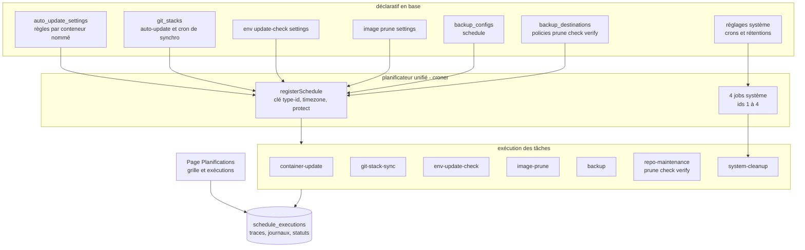

# Spécification fonctionnelle Dockhand — Chapitre 14 : Automatisation — planificateur, modèles et API

| Rubrique | Valeur |
|---|---|
| **Chapitre** | 14 — Automatisation : planificateur, modèles et API |
| **Statut** | Rédigé (phase 2, lot 5/5) |
| **Date de rédaction** | 21/08/2026 |
| **Version du logiciel analysée** | Dockhand **1.0.43** (numéro issu de [`package.json`](../../package.json:4)) |
| **Document de référence** | [`docs/spec/00-chapitrage.md`](00-chapitrage.md) |
| **Sources principales** | [`src/lib/server/scheduler/index.ts`](../../src/lib/server/scheduler/index.ts:1), [`src/lib/server/scheduler/cron-utils.ts`](../../src/lib/server/scheduler/cron-utils.ts:1), [`src/lib/server/scheduler/tasks/`](../../src/lib/server/scheduler/tasks/container-update.ts:1), [`src/routes/api/schedules/`](../../src/routes/api/schedules/+server.ts:1), [`src/routes/api/schedules/[type]/[id]/run/+server.ts`](../../src/routes/api/schedules/[type]/[id]/run/+server.ts:1), [`src/lib/server/templates.ts`](../../src/lib/server/templates.ts:1), [`src/routes/api/templates/+server.ts`](../../src/routes/api/templates/+server.ts:1), [`scripts/generate-openapi.ts`](../../scripts/generate-openapi.ts:1), [`src/routes/api/docs/+server.ts`](../../src/routes/api/docs/+server.ts:1), [`src/routes/api/docs/ui/+page.svelte`](../../src/routes/api/docs/ui/+page.svelte:1), [`src/hooks.server.ts`](../../src/hooks.server.ts:1) |

## Table des matières

1. [Objet, périmètre et prérequis de lecture](#1-objet-périmètre-et-prérequis-de-lecture)
2. [Vue d'ensemble de l'automatisation](#2-vue-densemble-de-lautomatisation)
3. [Le planificateur unifié (croner)](#3-le-planificateur-unifié-croner)
4. [Tâches système et nettoyages](#4-tâches-système-et-nettoyages)
5. [Détail des tâches utilisateurs](#5-détail-des-tâches-utilisateurs)
6. [Exécutions : cycle de vie, journaux, historique et rétention](#6-exécutions--cycle-de-vie-journaux-historique-et-rétention)
7. [Fuseaux horaires](#7-fuseaux-horaires)
8. [Bibliothèque de modèles de stacks](#8-bibliothèque-de-modèles-de-stacks)
9. [API REST : authentification et conventions](#9-api-rest--authentification-et-conventions)
10. [Documentation OpenAPI et viewer Scalar *(flag FEAT_API_DOCS)*](#10-documentation-openapi-et-viewer-scalar-flag-feat_api_docs)
11. [Webhooks entrants](#11-webhooks-entrants)
12. [Synthèse des règles de sécurité](#12-synthèse-des-règles-de-sécurité)
13. [Renvois vers les autres chapitres](#13-renvois-vers-les-autres-chapitres)

---

## 1. Objet, périmètre et prérequis de lecture

Ce chapitre décrit les fonctions d'**automatisation** de Dockhand : le **planificateur unifié** (mécanisme croner, inscription dynamique des planifications issues de la base, verrous et protection contre le chevauchement, jobs système, traçabilité des exécutions et récupération des états orphelins après crash), le **détail de chaque tâche** (avec renvois aux chapitres métier), les **fuseaux horaires** (global et par environnement), la **bibliothèque de modèles de stacks** (sources compatibles Portainer, sources personnalisées, déploiement depuis un modèle), l'**API REST** (authentification par jetons `dh_`, périmètre des endpoints, génération OpenAPI et viewer Scalar *(flag)*), et les **webhooks entrants** signés.

**Prérequis de lecture** : chapitre 02 (démarrage des services, hooks serveur), chapitre 03 §9 (entité `schedule_executions`, concept de planification) et chapitre 12 §10 (jetons d'API). Les chapitres métier 07, 08, 09, 11 détaillent le comportement fonctionnel de chaque tâche.

**Conventions** : mentions *(Enterprise)* / *(SMB)* pour le gating d'édition, *(flag)* pour les fonctions sous feature flag (`FEAT_BACKUPS_ENABLED`, `FEAT_API_DOCS`).

## 2. Vue d'ensemble de l'automatisation

Le planificateur est **unique et central** : toutes les fonctions périodiques du produit (auto-update de conteneurs, synchronisation Git, vérification de mises à jour par environnement, prune d'images, sauvegardes et maintenance de dépôts restic, nettoyages système) s'y inscrivent. Il démarre avec l'instance (après les migrations et la rotation des clés de chiffrement — ch. 02 §7.2) et inscrit dynamiquement un **job croner par planification active** lue en base.

Points fonctionnels clés :

- **une seule instance du planificateur** par processus ; les jobs sont identifiés par la clé `type-id` (le type et l'identifiant de l'entité porteuse) ;
- chaque job vérifie **au moment du tick** que sa planification existe toujours et est active (relecture en base) — une suppression/désactivation entre deux ticks est honorée immédiatement ;
- les exécutions sont **matérialisées** dans `schedule_executions` avec statut, durées, journaux horodatés ligne à ligne et détails JSON : c'est l'historique consultable de la page Planifications.

## 3. Le planificateur unifié (croner)

### 3.1 Démarrage et inscription

Au démarrage ([`startScheduler`](../../src/lib/server/scheduler/index.ts:130)), le planificateur :

1. **récupère les états orphelins** (§3.4) ;
2. crée les **jobs système** avec le fuseau horaire par défaut (§4) ;
3. inscrit toutes les **planifications dynamiques** de la base ([`refreshAllSchedules`](../../src/lib/server/scheduler/index.ts:264)) : règles d'auto-update actives, stacks Git en auto-synchro, réglages de vérification de mises à jour par environnement, réglages de prune d'images, et — si `FEAT_BACKUPS_ENABLED` est actif — configurations de sauvegarde et politiques de maintenance des destinations.

### 3.2 Mécanisme d'inscription (registerSchedule)

[`registerSchedule`](../../src/lib/server/scheduler/index.ts:404) matérialise une planification :

| Étape | Comportement |
|---|---|
| Clé | `type-id` — l'inscription est **idempotente** (réinscrire remplace proprement le job existant) |
| Lecture | relit l'entité porteuse en base : expression **cron**, **nom d'entité** affiché, interrupteur `enabled` — une entité disparue ou sans cron n'est pas inscrite |
| Fuseau horaire | jobs liés à un environnement → **fuseau de l'environnement** ; jobs sans environnement (maintenance de dépôts) → **fuseau par défaut** de l'instance (jamais un UTC implicite) |
| Protection | option croner **`protect`** : un tick est **sauté si l'exécution précédente tourne encore** — une synchro Git ou une mise à jour lente ne se chevauche pas elle-même (pas de double recréation de conteneur, pas de pull Git concurrent sur le même répertoire) |
| Tick | relecture défensive de l'entité (existence + activation), puis lancement de la tâche avec `triggeredBy: cron` |

Les **expressions cron** sont validées par un utilitaire pur ([`isValidCron`](../../src/lib/server/scheduler/cron-utils.ts:24), mode `legacyMode: false` — logique ET entre jour-du-mois et jour-de-semaine) ; le **prochain passage** est calculable pour l'affichage ([`getNextRun`](../../src/lib/server/scheduler/cron-utils.ts:9)).

### 3.3 Désinscription et rafraîchissement

- [`unregisterSchedule`](../../src/lib/server/scheduler/index.ts:544) arrête et retire un job (idempotent) — appelé à la suppression/désactivation des entités porteuses (les chapitres métier décrivent chaque hook : suppression de conteneur ch. 05 §5, de stack ch. 06 §9, d'environnement ch. 04 §6.5…) ;
- [`refreshSchedulesForEnvironment`](../../src/lib/server/scheduler/index.ts:562) réinscrit toutes les planifications d'un environnement — déclenché au **changement de fuseau horaire** (§7) ;
- [`refreshSystemJobs`](../../src/lib/server/scheduler/index.ts:663) recrée les jobs système — déclenché au changement du fuseau par défaut ou des crons système ;
- l'**arrêt propre** de l'instance stoppe tous les jobs (ch. 15 §8).

### 3.4 Récupération des états orphelins au démarrage

Un crash en cours d'exécution laisserait des états mensongers (« en cours » perpétuel). Le démarrage applique trois récupérations :

| Récupération | Mécanisme | Effet |
|---|---|---|
| **Syncs Git interrompues** | [`cleanupStaleSyncStates`](../../src/lib/server/scheduler/index.ts:106) | Les stacks Git bloquées en `syncing` repassent à `pending` avec la mention « Recovered from interrupted sync on startup » (ch. 07 §6.2) |
| **Exécutions non terminées** | [`failStaleRunningExecutions`](../../src/lib/server/db.ts:4297) | Les lignes `queued`/`running` sont marquées **`failed`** avec « Interrupted — Dockhand restarted while this run was in progress » |
| **Helpers de sauvegarde orphelins** *(flag)* | reaper exécuté **avant** toute sauvegarde possible | Les conteneurs helpers restés d'un processus crashé sont retirés — sinon le `unlock` de la prochaine sauvegarde détruirait un verrou qu'un restic orphelin détient encore (ch. 11 §5.2) |

## 4. Tâches système et nettoyages

Quatre **jobs système** tournent sous le type `system_cleanup`, identifiés `scheduleId` **1 à 4** (constantes [`SYSTEM_*_CLEANUP_ID`](../../src/lib/server/scheduler/tasks/system-cleanup.ts:21)) — il n'existe **aucun autre identifiant synthétique** côté planificateur :

| Job (id) | Nom | Nettoyage | Cron / interrupteur |
|---|---|---|---|
| 1 | Schedule execution cleanup | Anciennes lignes de `schedule_executions` | Réglables (cron + rétention en jours + activation) |
| 2 | Container event cleanup | Anciens `container_events` | Réglables (idem) |
| 3 | Volume helper cleanup | Helpers `dockhand-browse-*` **expirés** et **orphelins**, tous environnements | Fixe **toutes les 30 minutes**, toujours actif (pure hygiène — ch. 09 §5.2) |
| 4 | Scanner cache cleanup | Volumes et répertoires de bind des bases Grype/Trivy, local + environnements distants | Réglables ; un environnement injoignable est passé avec message, sans échec global |

Chaque job journalise une exécution (`schedule_executions`) ; le **déclenchement manuel** hors cron est possible depuis la page Planifications (§6.3) — un déclenchement manuel **outrepasse l'interrupteur d'activation** du job (contrôle explicite de l'opérateur). Le détail fonctionnel des nettoyages relève du ch. 09 §11.

## 5. Détail des tâches utilisateurs

### 5.1 Panorama et types de planification

Huit **types de planification** dynamiques (union `registerSchedule`) :

| Type | Porté par | Chapitre métier |
|---|---|---|
| `container_update` | `auto_update_settings` (règle par conteneur nommé) | ch. 08 §9 |
| `git_stack_sync` | `git_stacks.autoUpdate` + cron | ch. 07 §6 |
| `env_update_check` | réglages de vérification de l'environnement | ch. 08 §9.3 |
| `image_prune` | réglages de prune d'images de l'environnement | ch. 08 §10.2 |
| `backup` *(flag)* | `backup_configs.schedule` | ch. 11 §5 |
| `repo_prune` / `repo_check` / `repo_verify` *(flag)* | `backup_destinations.policies` | ch. 11 §9 |

### 5.2 container-update — auto-update d'un conteneur

Exécute une règle d'auto-update : contrôles de sécurité (conteneur présent, non système, labels, digest), vérification digest, puis **flux protégé** (pull, scan conditionné, recréation à configuration préservée) — détail au ch. 08 §9.1. Notifications `auto_update_success/failed/blocked`. L'exécution embarque un **détail riche** (mode, digests, critères, résumé par conteneur, résultats de scanners).

### 5.3 git-stack-sync — synchronisation d'une stack Git

Re-clone blobless, détection de changement (commit + diff du répertoire), **saut propre sans changement** (statut `skipped`), sinon plan de suppression vérifié et déploiement Compose — détail au ch. 07 §6. Notifications `git_sync_*`. Le verrou d'état `syncing` de la stack interdit les exécutions concurrentes.

### 5.4 env-update-check — vérification par environnement

Passe en revue tous les conteneurs éligibles de l'environnement, **réinitialise puis reconstruit** les lignes de mises à jour en attente (digest + semver), avec **exclusivité** par environnement (verrou mémoire) ; deux modes : notification seule (`updates_detected`) ou **auto-update** avec critères de vulnérabilités et bilan `batch_update_success` — détail au ch. 08 §9.3.

### 5.5 image-prune — nettoyage planifié d'images

Prune selon le mode de l'environnement (`dangling` ou toutes inutilisées, images des scanners protégées), mise à jour de l'état `lastPruned`, notification de succès **seulement si nettoyage effectif** — détail au ch. 08 §10.2.

### 5.6 backup et repo-maintenance *(flag `FEAT_BACKUPS_ENABLED`)*

`backup` exécute la sauvegarde d'une configuration (pipeline complet du ch. 11 §5) ; `repo_prune` / `repo_check` / `repo_verify` exécutent les tâches de maintenance des destinations selon leurs politiques (avec `verifyDataSubset` pour la vérification partielle) — détail au ch. 11 §9. **Gate** : si le flag est éteint, ces planifications ne sont pas inscrites au démarrage, et les endpoints de déclenchement les renvoient en **404**.

## 6. Exécutions : cycle de vie, journaux, historique et rétention

### 6.1 Modèle

Chaque exécution d'une tâche (cron, manuelle ou webhook) ouvre une ligne `schedule_executions` (ch. 03 §9.1) : `scheduleType`, `scheduleId` (identifiant de l'entité porteuse — **1 à 4 pour les jobs système**, cf. §4), environnement, `entityName`, `triggeredBy` (`cron` | `manual` | `webhook`), horodatages début/fin/durée, `status` (`queued` → `running` → `success`/`warning`/`failed`/`skipped`), `errorMessage`, `details` (JSON), `logs`.

Les **journaux** sont concaténés **atomiquement côté SQL** ([`appendScheduleExecutionLog`](../../src/lib/server/db.ts:4310)) : chaque ligne est horodatée ISO et les appels concurrents ne s'écrasent pas ; un échec d'écriture de ligne de journal n'affecte jamais le statut de l'exécution (seule la ligne de texte libre est perdue, avec une trace stderr).

### 6.2 Consultation

- **`GET /api/schedules`** ([route](../../src/routes/api/schedules/+server.ts:56)) : la grille consolidée — toutes les planifications (conteneurs, Git, vérifications d'environnement, prunes, sauvegardes, maintenance de dépôts, jobs système) avec cron, **prochain passage** calculé dans le fuseau applicable, dernière exécution et **5 exécutions récentes** par planification ; enrichies d'indicateurs (scanner actif, critères de vulnérabilités, mode de prune) ;
- **`GET /api/schedules/stream`** : la même grille en flux SSE (rafraîchissement continu) ;
- permission `schedules:view` ; l'affichage est **identique entre le GET et le flux** (exigence de cohérence).

### 6.3 Déclenchement manuel

**`POST /api/schedules/[type]/[id]/run`** ([route](../../src/routes/api/schedules/[type]/[id]/run/+server.ts:31), permission `schedules:run` + **portée environnement** résolue depuis l'entité) : exécute immédiatement une planification hors cron (`triggeredBy: manual`). Comportements :

- les types sauvegardes sont **injoignables sans flag** (404) ;
- **identifiants synthétiques de présentation** : la liste et le flux exposent les trois tâches de maintenance de chaque destination sous des ids **`dest.id + 100000` (repo_prune), `+200000` (repo_check), `+300000` (repo_verify)** afin qu'elles soient uniques dans la grille ; le déclenchement (et les actions run/toggle/delete) **décode** l'offset pour retrouver l'identifiant réel de la destination ([`REPO_ID_OFFSET`](../../src/routes/api/schedules/[type]/[id]/run/+server.ts:54)). Ces offsets sont un **artifice d'affichage des routes API** — le planificateur, lui, inscrit ces tâches directement par identifiant de destination ;
- la vérification d'existence de l'entité (règle, stack, réglage, configuration, destination) précède tout déclenchement (404 sinon).

### 6.4 Activation/désactivation et suppression

Les routes `toggle` et `DELETE` sous `/api/schedules/[type]/[id]/` répercutent l'interrupteur ou la suppression sur l'entité porteuse (avec le même décodage d'offset pour la maintenance de dépôts) ; la désinscription du planificateur est immédiate.

### 6.5 Rétention

La tâche système 1 (§4) purge les exécutions au-delà de la **rétention configurable en jours** (réglages — ch. 15) ; les jauges Prometheus (`schedule_executions`, `schedule_last_run_seconds`, `schedule_last_success_seconds` par type — ch. 13 §5.2) permettent d'alerter sur des tâches qui ne réussissent plus.

## 7. Fuseaux horaires

Deux niveaux :

| Niveau | Réglage | Effet |
|---|---|---|
| **Global (défaut)** | Réglage général `defaultTimezone` (défaut UTC — ch. 15) | Sert aux jobs système et aux planifications **sans environnement** (maintenance de dépôts) |
| **Par environnement** | `timezone` de l'environnement (`GET/POST /api/environments/[id]/timezone`, permission `environments:edit`) | Sert à **toutes** les planifications rattachées à cet environnement (auto-update, synchro Git, vérification, prune, sauvegardes) |

- la valeur doit être un **nom IANA reconnu** (validation `Intl.supportedValuesOf('timeZone')`) ; un jeu d'**alias** réconcilie les noms modernes avec leurs équivalents ICU ([`TIMEZONE_ALIASES`](../../src/routes/api/environments/[id]/timezone/+server.ts:12), p.ex. `Europe/Kyiv`→`Europe/Kiev`) ;
- **changer le fuseau réinscrit à chaud** les planifications concernées : [`refreshSchedulesForEnvironment`](../../src/lib/server/scheduler/index.ts:562) pour l'environnement, [`refreshSystemJobs`](../../src/lib/server/scheduler/index.ts:663) pour les jobs système au changement du fuseau par défaut — sans redémarrage ;
- le fuseau sert aussi à l'**affichage** (prochain passage dans la grille).

## 8. Bibliothèque de modèles de stacks

### 8.1 Sources intégrées (format compatible Portainer)

La bibliothèque s'appuie sur des **catalogues JSON hébergés** au format Portainer (types 1 = conteneur, 3 = stack ; les modèles Swarm type 2 sont ignorés). Neuf sources **intégrées** sont semées à la première initialisation ([`DEFAULT_TEMPLATE_SOURCES`](../../src/lib/server/templates.ts:22)) :

| sourceId | Nom | Activée par défaut |
|---|---|---|
| `portainer-lissy93` | Portainer templates (Lissy93) | **oui** |
| `lsio-technorabilia` | LinuxServer.io (Technorabilia) | **oui** |
| `ntv-one` | NTV-One (consolidated) | non |
| `mlva` | MLVA (TheLustriVA) | non |
| `selfhostedpro` | SelfHostedPro | non |
| `portainer-qballjos` | Qballjos (homelab) | non |
| `mikestraney` | MikeStraney | non |
| `pi-hosted-amd64` | Pi-Hosted (amd64) | non |
| `pi-hosted-arm64` | Pi-Hosted (arm64) | non |

Les sources intégrées sont **activables/désactivables** (et renommables/re-pointables) mais pas supprimables (`builtin`) ; l'ordre d'affichage est fixé par `sortOrder`.

### 8.2 Sources personnalisées

`POST /api/templates/sources` (permission `templates:manage`) ajoute une source : nom + **URL de catalogue JSON** (validée par la garde anti-SSRF), activée d'emblée, `sourceId` généré (`custom-<horodatage>`). Une source personnalisée est modifiable et **supprimable**.

### 8.3 Consommation des modèles

`GET /api/templates` ([route](../../src/routes/api/templates/+server.ts:1), permission `templates:view`) agrège les catalogues des sources **activées** :

- chaque entrée est **normalisée** en modèle unifié : titre, description, logo, catégories, type (conteneur/stack), source, ports, volumes, variables avec valeurs par défaut, politique de redémarrage, dépôt (URL + stackfile), note du catalogue et **URL de projet** résolue (lien dans la description, la note, le mainteneur ou le dépôt) ;
- un **cache serveur d'une heure** par URL évite de re-télécharger les catalogues à chaque consultation ; l'URL est contrôlée par la garde anti-SSRF ;
- l'interface permet de **filtrer/rechercher** (titre, catégories, source) et de **déployer depuis un modèle** : le formulaire de création de stack est **prérempli** (nom proposé, YAML du modèle, variables suggérées) et le déploiement suit le flux standard d'une stack **interne** (ch. 06 §11) — l'appartenance au modèle n'est pas mémorisée comme un type de source distinct.

## 9. API REST : authentification et conventions

### 9.1 Surface

Toute la surface fonctionnelle est exposée en REST/JSON sous [`src/routes/api/`](../../src/routes/api) : environnements, conteneurs (cycle de vie, logs, exec, fichiers, statistiques), stacks, images et registres, volumes, réseaux, prunes, Git (credentials, dépôts, stacks, webhooks), vulnérabilités et scans, secret-providers, sauvegardes *(flag)*, notifications, planifications, modèles, utilisateurs/rôles, licence, santé, self-update, journaux, activité, audit *(Enterprise)*, métriques, pages légales, changelog. Les **points d'entrée publics** sont volontairement minces (connexion, santé, et — si activés — les docs API) : tout le reste exige l'authentification.

### 9.2 Authentification

- **Navigateur** : session cookie HttpOnly (ch. 12 §4) ;
- **Clients machine** : **jeton d'API personnel** `dh_…` en `Authorization: Bearer` (ch. 12 §10) — validation avec cache 60 s, vérification `isActive` et expiration ; le périmètre effectif du jeton est celui de son **propriétaire** (mêmes permissions RBAC, même portée d'environnement) ;
- **limitation de débit sur échecs** : fenêtre glissante puis refroidissement (ch. 02 §6) ; `/metrics` accepte le Bearer et répond **401 direct** (ch. 13 §5.1).

### 9.3 Conventions de réponse

- erreurs JSON `{ error }` avec codes significatifs (400 saisie, 401 non authentifié, 403 permission/portée, 404 inexistant — y compris les fonctions **gated par flag éteintes**, 409 conflit, 500 inattendu) ;
- les **opérations longues** (déploiement, synchro, pull, scans, batch) répondent en **flux SSE** de progression plutôt qu'en attente bloquante (ch. 02 §6) ;
- les **identifiants de chemin sont validés** (formats d'identifiants Docker) avant toute opération (anti-injection).

## 10. Documentation OpenAPI et viewer Scalar *(flag FEAT_API_DOCS)*

### 10.1 Activation

La documentation de l'API est livrée **éteinte** : `FEAT_API_DOCS=true` l'expose (lecture unique au démarrage — ch. 01 §7.3). Sans le flag : `/api/docs` et `/api/docs/ui` renvoient **404** — la surface documentée n'existe pas pour un visiteur.

### 10.2 Génération

La spécification **OpenAPI 3.0** est **générée à la construction** par [`scripts/generate-openapi.ts`](../../scripts/generate-openapi.ts:1) (exécuté au `prebuild`, moteur dans [`scripts/openapi/`](../../scripts/openapi/build-spec.ts:1)) :

- **chemins, méthodes, étiquettes et exigence d'authentification déduits automatiquement** de l'arbre de routes SvelteKit (`src/routes/**/+server.ts`, toute profondeur — y compris `/metrics`) et des chemins publics déclarés dans `hooks.server.ts` : ajouter un endpoint ne coûte **aucune édition manuelle** de ces champs ;
- les **schémas et exemples** proviennent de blocs JSDoc `@openapi` additifs posés sur les gestionnaires (résumé, description, paramètres, corps, réponses) ;
- trois modes : **génération** (écrit la spec), **--check** (porte CI : échoue en cas de dérive entre code et spec), **--strict-coverage** (échoue si un handler manque d'annotation), **--scaffold** (produit un brouillon d'annotation ancré dans le code pour les handlers non annotés) ;
- la spec générée est **importée comme module** côté serveur (embarquée dans le build de production — pas de lecture disque à l'exécution) et aussi copiée en statique pour accès direct.

### 10.3 Exposition et viewer

| Endpoint | Contenu |
|---|---|
| `GET /api/docs` | Le document OpenAPI complet (JSON, non authentifié, **ETag** + cache court — la spec est immuable à l'exécution) |
| `GET /api/docs/ui` | **Viewer Scalar** interactif (parcours par étiquettes, essai des requêtes depuis le navigateur) |

L'authentification des appels d'essai reste celle du §9.2 (le viewer ne constitue pas une dérogation). La spec couvre l'intégralité de la surface REST, ce qui en fait la **référence d'intégration** pour les automatisations tierces (avec les jetons d'API).

## 11. Webhooks entrants

Trois familles de webhooks entrants, tous **authentifiés par secret** :

| Webhook | Endpoint | Action | Détail |
|---|---|---|---|
| **Déploiement Git (dépôt)** | `POST\|GET /api/git/webhook/[id]` | Synchro + déploiement de la stack portant le nom du dépôt | Signature HMAC-SHA256 (GitHub/Gitea/Forgejo) ou jeton (GitLab) ; `?secret=` pour GET — ch. 07 §9 |
| **Déploiement Git (stack)** | `POST\|GET /api/git/stacks/[id]/webhook` | Synchro + déploiement de la stack désignée (recommandé : détection de changement, saut propre) | Idem — secret propre à la stack |
| **Déclenchement de sauvegarde** *(flag)* | Endpoint de déclenchement entrant signé | Lance une sauvegarde configurée | Ch. 11 §5.1 |

Règles communes : secret **obligatoire** à l'activation (401 sur signature invalide, échecs audités), **rejeu sans effet destructeur** (la détection de changement saute un re-déploiement inutile), traçabilité par `triggeredBy: webhook` dans les exécutions. Les **webhooks sortants** (succès/échec de sauvegarde par configuration — ch. 11 §12) sont un mécanisme distinct couvert au ch. 11.

## 12. Synthèse des règles de sécurité

| Risque | Mesure fonctionnelle |
|---|---|
| Chevauchement d'exécutions | `protect` croner (skip si le précédent tourne) ; verrous d'état (`syncing` Git) ; exclusivité par environnement (env-update-check) |
| Exécution fantôme après crash | Récupérations au démarrage : syncs `syncing`→`pending`, exécutions `queued/running`→`failed`, helpers orphelins récoltés *(flag)* |
| Planification périmée déclenchée | Relecture défensive de l'entité à chaque tick (existence + activation) |
| IDs de maintenance ambiguïté | Offsets de présentation décodés systématiquement par les actions run/toggle/delete ; jamais d'offset côté planificateur |
| Webhook non authentifié | Secret obligatoire, HMAC/jeton à temps constant, audit des échecs, rejeu sans effet destructeur |
| Docs API exposées par défaut | Gate `FEAT_API_DOCS` (404 sinon) ; spec ETag-ée non authentifiée mais surface d'API elle-même protégée |
| Modèle malveillant / SSRF | URL de catalogue contrôlée (garde anti-SSRF), modèles Swarm ignorés, déploiement = stack interne standard (validations du ch. 06) |
| Abus de jeton d'API | Hachage Argon2id, cache borné, expiration testée après hachage, refroidissement sur échecs (ch. 12) |
| Dérive code/spécification | Mode `--check` (porte CI) et couverture stricte optionnelle de la génération OpenAPI |

## 13. Renvois vers les autres chapitres

| Chapitre | Lien | Pourquoi y aller |
|---|---|---|
| 00 — Chapitrage | [`00-chapitrage.md`](00-chapitrage.md) | Sommaire de référence. |
| 02 — Architecture fonctionnelle | [`02-architecture-fonctionnelle.md`](02-architecture-fonctionnelle.md) | Démarrage des sous-processus et du planificateur, flux de synchro et d'auto-update de bout en bout. |
| 03 — Concepts et entités | [`03-concepts-entites.md`](03-concepts-entites.md) | Entité `schedule_executions`, concepts de planification et de source de modèles. |
| 04 — Environnements | [`04-environnements.md`](04-environnements.md) | Fuseau horaire par environnement, désinscription des planifications à la suppression. |
| 05 — Gestion des conteneurs | [`05-conteneurs.md`](05-conteneurs.md) | Nettoyage des planifications d'auto-update à la suppression de conteneur (batch). |
| 06 — Stacks Compose | [`06-stacks.md`](06-stacks.md) | Déploiement depuis un modèle (§11), suppression protégée désinscrivant les synchros. |
| 07 — Intégration Git | [`07-git.md`](07-git.md) | Tâche `git-stack-sync`, webhooks de déploiement signés, récupération des états `syncing`. |
| 08 — Images et registres | [`08-images.md`](08-images.md) | Tâches `container-update`, `env-update-check`, `image-prune` ; critères de vulnérabilités. |
| 09 — Volumes, réseaux et maintenance | [`09-volumes-reseaux.md`](09-volumes-reseaux.md) | Jobs système de nettoyage (exécutions, événements, helpers, cache scanners). |
| 10 — Sécurité applicative | [`10-securite-applicative.md`](10-securite-applicative.md) | Scans conditionnés aux mises à jour planifiées, fraîcheur des résultats. |
| 11 — Sauvegardes (bêta) | [`11-sauvegardes.md`](11-sauvegardes.md) | Tâches `backup` et `repo_*` *(flag)*, déclenchement webhook, webhooks sortants. |
| 12 — Authentification et RBAC | [`12-authentification-rbac.md`](12-authentification-rbac.md) | Jetons d'API `dh_` (authentification de l'API), permissions `schedules:*`, `templates:*`. |
| 13 — Observabilité | [`13-observabilite.md`](13-observabilite.md) | Jauges Prometheus du scheduler et des exécutions, notifications émises par les tâches. |
| 15 — Administration | [`15-administration-exploitation.md`](15-administration-exploitation.md) | Réglages des crons/rétentions système, fuseau par défaut, feature flags, démarrage/arrêt du planificateur. |
