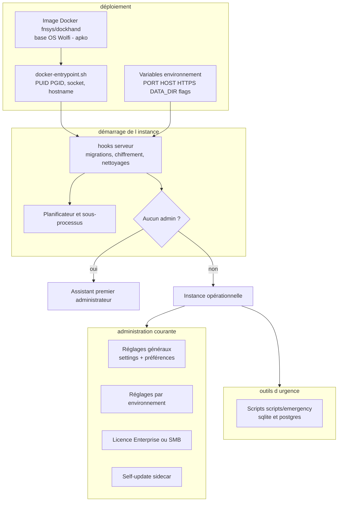
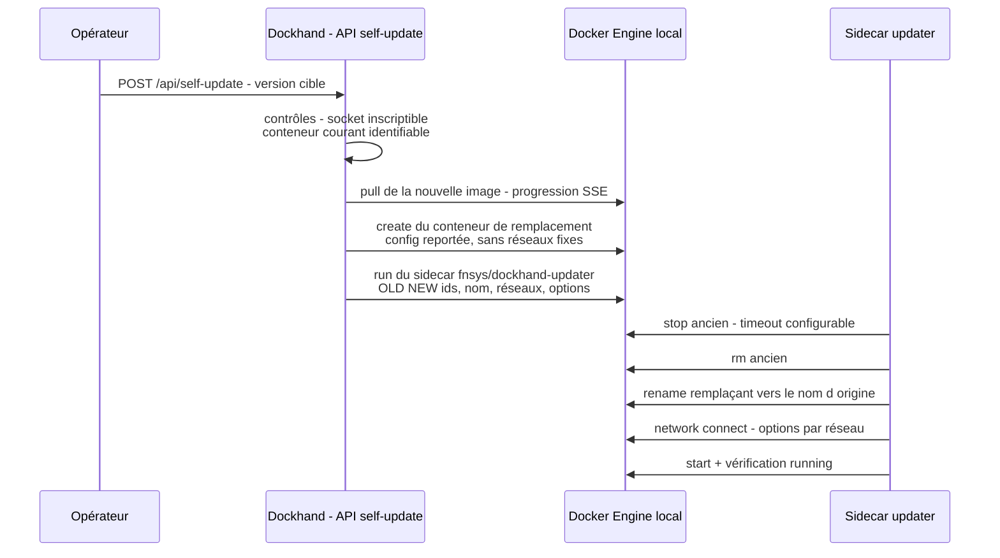

# Spécification fonctionnelle Dockhand — Chapitre 15 : Administration, exploitation et cycle de vie de l'application

| Rubrique | Valeur |
|---|---|
| **Chapitre** | 15 — Administration, exploitation et cycle de vie de l'application |
| **Statut** | Rédigé (phase 2, lot 5/5) |
| **Date de rédaction** | 21/08/2026 |
| **Version du logiciel analysée** | Dockhand **1.0.43** (numéro issu de [`package.json`](../../package.json:4)) |
| **Document de référence** | [`docs/spec/00-chapitrage.md`](00-chapitrage.md) |
| **Sources principales** | [`docker-entrypoint.sh`](../../docker-entrypoint.sh:1), [`docker-compose.yaml`](../../docker-compose.yaml), [`docker-compose-postgresql.yaml`](../../docker-compose-postgresql.yaml:1), [`server.js`](../../server.js:1), [`src/hooks.server.ts`](../../src/hooks.server.ts:1), [`src/routes/api/self-update/+server.ts`](../../src/routes/api/self-update/+server.ts:1), [`updater/update.sh`](../../updater/update.sh:1), [`src/routes/api/settings/general/+server.ts`](../../src/routes/api/settings/general/+server.ts:1), [`scripts/emergency/`](../../scripts/emergency/backup-db.sh:1), [`scripts/generate-legal-pages.ts`](../../scripts/generate-legal-pages.ts:1), [`src/routes/api/health/+server.ts`](../../src/routes/api/health/+server.ts:1), [`src/routes/api/dependencies/+server.ts`](../../src/routes/api/dependencies/+server.ts:1) |

## Table des matières

1. [Objet, périmètre et prérequis de lecture](#1-objet-périmètre-et-prérequis-de-lecture)
2. [Vue d'ensemble de l'administration](#2-vue-densemble-de-ladministration)
3. [Installation et déploiement](#3-installation-et-déploiement)
4. [Configuration au premier démarrage](#4-configuration-au-premier-démarrage)
5. [Réglages généraux et préférences](#5-réglages-généraux-et-préférences)
6. [Réglages applicatifs globaux (scanners, sauvegardes, sémver, fuseaux)](#6-réglages-applicatifs-globaux-scanners-sauvegardes-sémver-fuseaux)
7. [Gestion de la base de données](#7-gestion-de-la-base-de-données)
8. [Cycle de vie de l'application et auto-mise à jour](#8-cycle-de-vie-de-lapplication-et-auto-mise-à-jour)
9. [Licence et éditions](#9-licence-et-éditions)
10. [Santé, diagnostic et dépendances](#10-santé-diagnostic-et-dépendances)
11. [Pages légales, changelog et confidentialité](#11-pages-légales-changelog-et-confidentialité)
12. [Support et contribution](#12-support-et-contribution)
13. [Synthèse des règles d'exploitation](#13-synthèse-des-règles-dexploitation)
14. [Renvois vers les autres chapitres](#14-renvois-vers-les-autres-chapitres)

---

## 1. Objet, périmètre et prérequis de lecture

Ce chapitre regroupe les fonctions **transverses d'administration et d'exploitation** de l'instance Dockhand : installation et déploiement (image Docker, compose, variante PostgreSQL, socket Docker, PUID/PGID), configuration au premier démarrage (installation initiale, mode authentification désactivée, HTTPS/HSTS et variables d'environnement), réglages généraux et préférences (thème, police, disposition, rétentions, collecte), réglages applicatifs globaux (scanners, image de sauvegarde, variables `RESTIC_*`, sémver, fuseaux, labels `dockhand.*`), gestion de la base de données (SQLite vs PostgreSQL, migrations Drizzle, **outils d'urgence** backup/restore/reset/export), cycle de vie de l'application (démarrage, arrêt propre, **auto-mise à jour par sidecar**), licence et éditions, santé/diagnostic et dépendances, pages légales et journal des modifications, support et contribution.

**Prérequis de lecture** : chapitre 01 (modèle de distribution et d'édition) et chapitre 02 (architecture, stockage, démarrage des services). Les scripts d'urgence d'administration des **comptes** sont traités au ch. 12 §11 ; le présent chapitre couvre les outils de **base de données**.

**Conventions** : mentions *(Enterprise)* / *(SMB)* pour le gating d'édition, *(flag)* pour les fonctions sous feature flag.

## 2. Vue d'ensemble de l'administration

L'instance Dockhand s'administre à trois niveaux :

1. **Le conteneur et son environnement** — point d'entrée, variables d'environnement, volumes, socket Docker, PUID/PGID (déploiement) ;
2. **Les réglages en base** — magasin clé/valeur `settings` (préférences d'interface, rétentions, crons système, images par défaut, sémver, fuseau par défaut…) complété par les préférences utilisateur et les réglages par environnement ;
3. **Les opérations hors interface** — outils d'urgence sur la base (sauvegarde, restauration, réinitialisation, export) et scripts d'administration des comptes (ch. 12).



## 3. Installation et déploiement

### 3.1 Image et prérequis

- **Vecteur de distribution** : image Docker `fnsys/dockhand` — système de base **construit from scratch** à partir de paquets Wolfi via apko, chaque paquet explicitement déclaré (surface minimale, ch. 01 §7.4) ; variantes de build présentes pour riscv64 ;
- **point d'entrée applicatif** : `node ./server.js` (serveur HTTP natif, HTTPS optionnel) lancé par [`docker-entrypoint.sh`](../../docker-entrypoint.sh:1) ; l'image embarque le build SvelteKit, le collecteur Go et les scripts d'exploitation ;
- **port** : 3000 par défaut (`PORT`) ; **hôte** d'écoute `HOST` (défaut `0.0.0.0`) ;
- **volume de données** : `DATA_DIR` (défaut `/app/data`) — base, stacks, clones Git, icônes, cache scanners, snapshots.

### 3.2 Déploiement type (SQLite embarqué)

```yaml
# docker-compose.yaml (extrait fonctionnel)
services:
  dockhand:
    image: fnsys/dockhand:latest
    ports:
      - "3000:3000"
    volumes:
      - /var/run/docker.sock:/var/run/docker.sock   # socket Docker local
      - ./data:/app/data                             # DATA_DIR persistant
```

Le **socket Docker monté** donne à l'instance sa connexion à l'hôte local (environnement `socket` — ch. 04 §4.2) ; il est **facultatif** (déploiement avec socket-proxy ou hôtes distants uniquement — l'entrée point le signale et invite à configurer les environnements dans l'interface).

### 3.3 Déploiement PostgreSQL

Le compose dédié [`docker-compose-postgresql.yaml`](../../docker-compose-postgresql.yaml:1) ajoute un service `postgres:16-alpine` et passe à Dockhand la variable **`DATABASE_URL: postgres://…`** — sa seule présence **bascule l'instance en mode PostgreSQL** (ch. 02 §7). Volume applicatif et volume de base sont distincts.

### 3.4 Entrée point : utilisateur, socket et hostname

[`docker-entrypoint.sh`](../../docker-entrypoint.sh:1) prépare l'environnement avant lancement :

| Sujet | Comportement |
|---|---|
| **PUID/PGID** (défaut 1001/1001) | En mode root : création/ajustement de l'utilisateur `dockhand` aux UID/GID demandés (réutilisation du groupe existant, détection de conflits d'UID avec repli) puis **chown ciblé** des sous-répertoires de données (jamais du volume entier — les stacks montent des sous-chemins qui doivent garder leur propriétaire) ; `PUID=0` ou directive `user:` non-root → exécution directe |
| **Socket Docker** | Détection de la lisibilité du socket ; si GID incompatible, ajout de l'utilisateur au groupe du socket (suggestion `--group-add` en cas d'échec) |
| **Hostname de licence** | Si `DOCKHAND_HOSTNAME` n'est pas défini et que le socket est accessible, interrogation de `/info` pour **détecter le nom d'hôte Docker réel** (validité de licence Enterprise — ch. 01 §7.2) ; sinon message d'avertissement |
| **Répertoires** | Création de `DATA_DIR/db` et `stacks` (mode non-root) avec message d'aide explicite en cas d'échec de permissions |

### 3.5 HTTPS natif et HSTS

[`server.js`](../../server.js:40) propose un écouteur HTTPS natif (sinon terminaison TLS par reverse-proxy amont) :

| Variable | Rôle |
|---|---|
| `HTTPS_MODE=on` | Active HTTPS — **exige** `HTTPS_CERT_PATH` et `HTTPS_KEY_PATH` (PEM lisibles ; `HTTPS_CA_PATH` facultatif) |
| `HSTS_MAX_AGE` (défaut 31536000) | En-tête HSTS (1 an) ; `0` le désactive — appliqué **uniquement** en HTTPS |

Au démarrage HTTPS, le certificat est **analysé et journalisé** (sujet, émetteur, SAN, validité) avec avertissement à moins de 30 jours de l'expiration — l'opérateur confirme qu'il a monté le bon fichier.

## 4. Configuration au premier démarrage

### 4.1 Séquence d'initialisation

Au premier lancement, les hooks serveur ([`src/hooks.server.ts`](../../src/hooks.server.ts:1)) enchaînent : **migration** du schéma (Drizzle, dialecte selon `DATABASE_URL`), **chiffrement/rotation** des credentials au repos (le démarrage des sous-processus et du planificateur **attend** la fin de cette migration — ch. 02 §7.2), semis des données de référence (rôles système, sources de modèles, réglages par défaut), nettoyages de démarrage (conteneurs de scan orphelins, helpers de volume obsolètes), puis démarrage du **collecteur Go**, du **planificateur** (avec ses récupérations d'états — ch. 14 §3.4) et des tâches périodiques de fond (vérification de licence…).

### 4.2 Installation initiale (premier administrateur)

Si l'authentification est activée alors qu'**aucun compte admin n'existe**, l'instance entre en **mode installation** : l'interface propose la **création du premier administrateur** (garde d'accès du layout — ch. 02 §3.1, modèle `auth_settings` — ch. 03 §12.3). Ce mode disparaît dès qu'un admin existe.

### 4.3 Mode authentification désactivée

`authEnabled=false` permet une instance **sans authentification** (homelab isolé) : toutes les vérifications deviennent des no-op (ch. 12 §3.4). Deux implications d'exploitation : les **préférences sont partagées** (pas de nominatives), et `/metrics` est **public** si l'export est activé (ch. 13 §5.1). La réactivation exige qu'au moins un admin existe (garde à l'enregistrement).

### 4.4 Variables d'environnement de configuration

| Variable | Rôle | Détail |
|---|---|---|
| `PORT` / `HOST` | Écoute HTTP | défauts 3000 / 0.0.0.0 |
| `HTTPS_MODE`, `HTTPS_CERT_PATH`, `HTTPS_KEY_PATH`, `HTTPS_CA_PATH`, `HSTS_MAX_AGE` | HTTPS natif + HSTS | §3.5 |
| `DATA_DIR` | Répertoire de données | défaut `/app/data` |
| `DATABASE_URL` | Bascule PostgreSQL | présence d'une URL `postgres://` |
| `DOCKER_HOST` / `DOCKER_SOCKET` | Connexion Docker locale | détection et surcharges (ch. 04 §4.2) |
| `DOCKHAND_HOSTNAME` | Hostname pour la licence | sinon détection par socket |
| `PUID` / `PGID` | Utilisateur applicatif | §3.4 |
| `FEAT_BACKUPS_ENABLED` | Sauvegardes *(bêta)* *(flag)* | ch. 11 |
| `FEAT_API_DOCS` | Docs API + Scalar *(flag)* | ch. 14 §10 |
| `EXPORT_METRICS` | Endpoint `/metrics` Prometheus | ch. 13 §5 |
| `SKIP_DF_COLLECTION` | Contournement `docker system df` (NAS) | ch. 09 §10.1 |
| `NODE_EXTRA_CA_CERTS` | Autorité interne (Git, fournisseurs) | ch. 07 §3.2 |
| `COMPOSE_TIMEOUT` | Délai global des déploiements | ch. 06 §8.1 |
| `RESTIC_TIMEOUT`, `RESTIC_FORGET_RETRY_LOCK` | Sauvegardes *(flag)* | §6.3 |

Ces variables sont lues **au démarrage** (lecture unique pour les flags) : leur modification exige un redémarrage du conteneur.

## 5. Réglages généraux et préférences

### 5.1 Réglages généraux

`GET/POST /api/settings/general` ([route](../../src/routes/api/settings/general/+server.ts:1), permission `settings:view|edit`) expose le **grand sac de réglages d'instance** ([`GeneralSettings`](../../src/routes/api/settings/general/+server.ts:53)). Principales familles :

| Famille | Exemples de réglages |
|---|---|
| **Comportement d'interface** | confirmation des actions destructrices, affichage des conteneurs arrêtés, surlignage des mises à jour, boutons d'action colorés, taille des icônes d'action, ports compacts, ports exposés, hash de commit Git affiché, formatage des horodatages de journaux, mode de filtrage par libellé (`any`/`all`), liens de changelog d'images, animation des icônes, guides d'indentation de l'éditeur |
| **Formats** | heure (12 h/24 h), date, format de téléchargement |
| **Apparence (référence quand l'auth est désactivée)** | thème clair/sombre (catalogues validés), police et tailles, police des grilles, du terminal, de l'éditeur |
| **Journaux** | plafond de lignes du tampon |
| **Divers** | labels d'URLs de reverse-proxy honorés (Traefik, Pangolin), modèle Compose par défaut de l'éditeur, chemins de stacks externes et emplacement principal |

Les réglages de **rétention et de crons système** (exécutions, événements, cache scanners), le **fuseau horaire par défaut**, les **intervalles de collecte** (mode stream/poll, intervalle de poll d'événements 30 s–5 min, intervalle de métriques 10 s–5 min — avec validation et reconfiguration à chaud des sous-processus) et les **images de scanners** complètent le sac (§6).

### 5.2 Préférences utilisateur

Les préférences individualisées (disposition du tableau de bord — ch. 13 §3.2, favoris de journaux — ch. 05 §8.2, colonnes de grilles, sidebar) sont stockées dans `user_preferences` : **nominatives** avec une licence Enterprise, **partagées** (`userId=null`) sinon (ch. 03 §14.2). Les stores frontend correspondants ([`src/lib/stores/`](../../src/lib/stores/theme.ts:1) : thème, grilles, sidebar) persistent les choix côté interface.

### 5.3 Réglages par environnement

Chaque environnement porte ses réglages propres (onglets d'activité/mises à jour/sauvegardes, types d'événements collectés, scanner, fuseau horaire, vérification de mises à jour, prune d'images, répertoire de stacks distant) — détail aux ch. 04 §9, 08 et 11 ; ces réglages disparaissent avec l'environnement.

## 6. Réglages applicatifs globaux (scanners, sauvegardes, sémver, fuseaux)

### 6.1 Scanners de vulnérabilités

Réglages **globaux** complémentaires du choix par environnement (ch. 10 §3) :

| Réglage | Défaut | Rôle |
|---|---|---|
| `default_grype_image` | `anchore/grype:v0.115.0` | Image de scan Grype — **épinglée par version** (jamais `:latest`) |
| `default_trivy_image` | `aquasec/trivy:0.71.2` | Image de scan Trivy — idem |
| `default_grype_args` / `default_trivy_args` | `-o json -v {image}` / `image --format json {image}` | Arguments CLI (substituable `{image}`) |
| `default_scanner_network_mode` / `default_scanner_dns` | vide (auto-détection) | Surcharges réseau/DNS du conteneur de scan |
| `protect_scanner_images` | vrai | Exclut les images de scan du prune « toutes inutilisées » (ch. 08 §10.1) |

L'écran de configuration des scanners expose en outre l'**état des images** (présence locale, versions, mises à jour disponibles par digest) et la **purge du cache** des bases (route `/api/settings/scanner`, ch. 10 §3.1).

### 6.2 Image de sauvegarde *(flag)*

`default_backup_image` (réglages généraux) désigne l'image du **helper restic** utilisé par le sous-système de sauvegarde (ch. 11) ; la valeur proposée par défaut suit l'image **réellement utilisée par le moteur** (épinglée et consciente du baseline), pas un tag flottant.

### 6.3 Variables RESTIC_* *(flag)*

| Variable | Défaut | Rôle |
|---|---|---|
| `RESTIC_TIMEOUT` (millisecondes) | 0 = illimité | Délai unique englobant **toute** opération restic (processus hôte et conteneur helper) — un travail sain de longue durée n'est jamais tué (ch. 11 §5.2) |
| `RESTIC_FORGET_RETRY_LOCK` | 1 min | Attente de verrou avant échec du `forget` de rétention (échec = avertissement, rétention rejouée au cycle suivant — ch. 11 §6) |

### 6.4 Sémver global

`GET/POST /api/settings/semver` règle la **suggestion de nouveaux tags** pour les images épinglées (ch. 08 §6.2) :

| Paramètre | Défaut | Rôle |
|---|---|---|
| `enabled` | faux | Active la détection semver |
| `maxBump` | `major` | Palier maximal proposé (`patch`/`minor`/`major`) |
| `matchFlavor` | vrai | Exige la même saveur de suffixe (`-alpine`…) — le premier filtre anti-bruit |
| `includePrerelease` | faux | Considère les tags préversions (`-rc`, `-beta`) |

Une **surcharge par conteneur** existe par label Docker `dockhand.version.pattern` (tags non standards — ch. 08 §6.2).

### 6.5 Fuseaux horaires et rétentions

- **fuseau par défaut** (`defaultTimezone`, défaut UTC) — jobs système et planifications sans environnement ; **fuseau par environnement** pour les planifications rattachées (changement = réinscription à chaud, ch. 14 §7) ;
- **rétentions** : exécutions planifiées et événements de conteneurs (jours, avec crons et interrupteurs propres — jobs système 1 et 2, ch. 14 §4).

### 6.6 Labels Docker `dockhand.*` (récapitulatif)

| Label | Portée | Effet |
|---|---|---|
| `dockhand.hidden=true` | Conteneur | Masqué des inventaires et vues (helpers, scanners) |
| `dockhand.notify` | Conteneur | Notifications coupées pour ce conteneur |
| `dockhand.order` | Conteneur | Clé de tri personnalisée dans les vues |
| `dockhand.update=false` | Conteneur | Exclu des mises à jour (manuelles groupées et auto-update) |
| `dockhand.version.pattern` | Conteneur | Surcharge du schéma de tags pour la suggestion semver |

## 7. Gestion de la base de données

### 7.1 SQLite vs PostgreSQL

Le choix est fait **au démarrage** selon la présence de `DATABASE_URL` (ch. 02 §7) : SQLite en fichier dans `DATA_DIR/db` (défaut, zéro dépendance) ou PostgreSQL (donnée externalisée, compose dédié). Le reste du système est agnostique (même jeu d'opérations).

### 7.2 Migrations Drizzle

Deux arborescences parallèles ([`drizzle/`](../../drizzle/0000_initial_schema.sql) SQLite, [`drizzle-pg/`](../../drizzle-pg/0000_initial_schema.sql) PostgreSQL) sont appliquées au démarrage ; le périmètre fonctionnel des migrations 0→11 est décrit au ch. 02 §7.2. Les **credentials sensibles** sont chiffrés au repos et re-chiffrés au démarrage si la clé change.

### 7.3 Outils d'urgence

Scripts shell dans [`scripts/emergency/`](../../scripts/emergency/backup-db.sh:1), exécutés **sur l'hôte** (typiquement `docker exec -it dockhand …`) : les scripts racines **détectent le type de base** (`DATABASE_URL` présent → variantes `postgres/`, sinon `sqlite/`). Ils agissent directement sur la base, hors application — ils supposent un accès légitime au conteneur.

| Script | Action fonctionnelle |
|---|---|
| `backup-db.sh [répertoire]` | Sauvegarde de la base (dump) vers un répertoire |
| `restore-db.sh` | Restauration d'une sauvegarde |
| `reset-db.sh` | **Réinitialisation complète** de la base (perte de configuration) |
| `export-stacks.sh` | Export des définitions de stacks (fichiers Compose et configuration) |
| `create-admin.sh`, `reset-password.sh`, `disable-auth.sh`, `clear-sessions.sh`, `list-users.sh` | Administration des comptes — ch. 12 §11 |

Usage type : sauvegarde préalable à une manipulation risquée, restauration après incident, réinitialisation d'une instance de test, export avant migration.

### 7.4 Hygiène

La taille et la santé de la base sont observables via Prometheus (`database_size_bytes`, `database_info`, `database_rows`, `database_stat` — ch. 13 §5.2) ; les rétentions (exécutions, événements) bornent la croissance des tables à fort churn.

## 8. Cycle de vie de l'application et auto-mise à jour

### 8.1 Démarrage

Séquence complète : entrypoint (§3.4) → `server.js` (HTTP/HTTPS, WebSockets) → hooks (migrations, chiffrement, nettoyages, semis) → collecteur Go + planificateur + tâches de fond. Le **journal serveur** est horodaté ISO avec niveaux INFO/WARN/ERROR (ch. 02 §3.2).

### 8.2 Arrêt propre

À la réception de **SIGTERM/SIGINT**, l'instance arrête le **collecteur Go** et les **sous-processus** avant de sortir ; le planificateur stoppe ses jobs. C'est ce chemin qu'emprunte l'auto-mise à jour (arrêt propre de l'ancien conteneur avec délai de grâce).

### 8.3 Auto-mise à jour (self-update par sidecar)

La fonction *self-update* permet à Dockhand de **se remplacer lui-même** :



Étapes fonctionnelles ([`src/routes/api/self-update/+server.ts`](../../src/routes/api/self-update/+server.ts:1), contrat du sidecar [`updater/update.sh`](../../updater/update.sh:1)) :

1. **pré-vérifications** : accès Docker **inscriptible** (socket monté en lecture/écriture — un socket en lecture seule ou un TCP sans droits interdit la mise à jour avec un message explicite), identification du **conteneur courant** (label/name) ;
2. **pull de la nouvelle image** avec progression en flux (authentification de registre réutilisée — ch. 08 §5.2) ;
3. **pré-création du remplaçant** : configuration reportée depuis l'inspection (le même mécanisme de fusion de montages que la recréation de conteneur — ch. 05 §7), **sans** NetworkingConfig initial (évite les conflits d'IP statiques avec l'ancien encore vivant) ;
4. **lancement du sidecar** `fnsys/dockhand-updater` (image dédiée, label `dockhand.updater`) avec les identifiants ancien/nouveau, le nom à restaurer, la liste des réseaux et des **options de connexion par réseau** ; les updaters résiduels d'une tentative précédente sont nettoyés d'abord ;
5. le sidecar enchaîne **stop (avec délai de grâce, défaut 30 s) → rm → rename → reconnexion des réseaux → start**, puis **vérifie** l'état `running` (échec explicite sinon).

La fenêtre d'indisponibilité est l'arrêt/redémarrage du conteneur ; la mise à jour ne **modifie pas** les volumes de données (DATA_DIR) ni les réseaux au-delà de la reconnexion. L'interface affiche la version courante et les mises à jour disponibles, avec lien vers le **changelog** (§11) et fenêtre « What's New » après une mise à jour.

## 9. Licence et éditions

Rappel du modèle (détail au ch. 01 §7) :

| Fonction d'administration | Comportement |
|---|---|
| **Activation** | Clé signée RSA (`payloadBase64.signature`) collée dans les réglages (permission `license:manage`) ; contrôles de signature, d'expiration, de concordance du nom et du **hostname** (détection Docker-aware via `DOCKHAND_HOSTNAME`, sinon `os.hostname()`) |
| **Effets** | Enterprise : RBAC, audit, préférences nominatives, LDAP/MFA (ch. 12) ; SMB : fonctions intermédiaires **sans** les fonctions Enterprise |
| **Expiration** | Vérification quotidienne ; notification `license_expiring` à **J-30** avec anti-spam 24 h (ch. 13 §11.4) ; expiration = retour aux capacités Free |
| **Désactivation** | Retrait de la clé dans les réglages — retour immédiat au comportement Free |

## 10. Santé, diagnostic et dépendances

| Endpoint | Rôle |
|---|---|
| `GET /api/health` | **Sonde de vivacité** — 200 systématique tant que le processus SvelteKit répond (public) |
| `GET /api/debug/memory` | Diagnostic mémoire du processus |
| `GET /api/dependencies` | **Inventaire des dépendances** : npm + outils externes (Grype/Trivy avec leurs versions épinglées et licences), trié, hors Dockhand lui-même |
| `/metrics` *(flag `EXPORT_METRICS`)* | Santé détaillée par jauges (ch. 13 §5) |

Le **journal serveur horodaté** (niveaux INFO/WARN/ERROR) constitue la première ligne de diagnostic ; les exécutions planifiées journalisées (ch. 14 §6) documentent les tâches de fond.

## 11. Pages légales, changelog et confidentialité

### 11.1 Textes embarqués et exposition

- [`LICENSE.txt`](../../LICENSE.txt) (BSL 1.1 — ch. 01 §7.1) et [`PRIVACY.txt`](../../PRIVACY.txt) sont **embarqués** dans l'image et servis par l'API : `GET /api/legal/license` et `GET /api/legal/privacy` (JSON `{content}` par défaut, `?format=text` pour le texte brut) ;
- [`SECURITY.md`](../../SECURITY.md) documente le **signalement des vulnérabilités** (canal et périmètre attendus) ;
- [`scripts/generate-legal-pages.ts`](../../scripts/generate-legal-pages.ts:1) génère les **pages HTML statiques** du site (licence et confidentialité) depuis ces .txt — **source unique de vérité** : les textes ne sont pas dupliqués.

### 11.2 Changelog

- les données de version ([`src/lib/data/changelog.json`](../../src/lib/data/changelog.json)) sont rendues **dans l'interface** (page changelog, modale « What's New » après une mise à jour) ;
- la page HTML publique est générée par [`scripts/generate-changelog-page.ts`](../../scripts/generate-changelog-page.ts:1) (même principe de source unique).

### 11.3 Confidentialité

Fonctionnellement, l'instance n'émet **aucun appel sortant obligatoire** (auto-hébergement intégral — ch. 01 §3) : télémétrie absente, mises à jour vérifiées uniquement sur action, notifications uniquement vers les canaux configurés. Les données restent dans `DATA_DIR` et la base ; les secrets sont chiffrés au repos (ch. 02 §9.5).

## 12. Support et contribution

- **Site et documentation** : https://dockhand.pro et https://dockhand.pro/manual (références du ch. 01 §10) ;
- [`CONTRIBUTING.md`](../../CONTRIBUTING.md) encadre la **contribution** (développement local, tests, soumissions) ; [`tests/`](../../tests) et la porte CI `generate:openapi --check` (ch. 14 §10.2) gardent la qualité ;
- **signalement de sécurité** : canal décrit dans `SECURITY.md` (pas d'issue publique pour les vulnérabilités).

## 13. Synthèse des règles d'exploitation

| Sujet | Règle fonctionnelle |
|---|---|
| Persistance | Tout ce qui compte vit dans `DATA_DIR` (et la base externe le cas échéant) — le conteneur est remplaçable (self-update, upgrade manuel) |
| Flags au démarrage | `FEAT_BACKUPS_ENABLED`, `FEAT_API_DOCS`, `EXPORT_METRICS` lus une fois : modification = redémarrage |
| Droits Docker | Le self-update exige un socket **inscriptible** ; un socket en lecture seule dégrade explicitement la fonction |
| Upgrades | Sauvegarde de base recommandée avant montée de version (`backup-db.sh`) ; migrations automatiques au démarrage |
| Réinitialisation | `reset-db.sh` repart de zéro ; `export-stacks.sh` sauvegarde les définitions de stacks au préalable |
| Licence | Hostname déterminé par `DOCKHAND_HOSTNAME` ou détection socket — le changer peut invalider une clé Enterprise |
| Indisponibilité | Fenêtre limitée à l'arrêt/redémarrage lors du self-update (arrêt propre SIGTERM, délai de grâce) |
| Diagnostics | `/api/health` (liveness), journal horodaté, `/api/debug/memory`, jauges `/metrics`, exécutions journalisées |

## 14. Renvois vers les autres chapitres

| Chapitre | Lien | Pourquoi y aller |
|---|---|---|
| 00 — Chapitrage | [`00-chapitrage.md`](00-chapitrage.md) | Sommaire de référence. |
| 01 — Présentation générale | [`01-presentation-generale.md`](01-presentation-generale.md) | Modèle de distribution, licence BSL et éditions, feature flags. |
| 02 — Architecture fonctionnelle | [`02-architecture-fonctionnelle.md`](02-architecture-fonctionnelle.md) | Séquence de démarrage, stockage et migrations, arrêt propre, topologies de déploiement. |
| 03 — Concepts et entités | [`03-concepts-entites.md`](03-concepts-entites.md) | Entités `settings`, `user_preferences`, `auth_settings` (gating des préférences). |
| 04 — Environnements | [`04-environnements.md`](04-environnements.md) | Socket monté, `DOCKER_HOST`/`DOCKER_SOCKET`, réglages par environnement. |
| 05 — Gestion des conteneurs | [`05-conteneurs.md`](05-conteneurs.md) | Labels `dockhand.*`, favoris de journaux, préférences de grilles. |
| 06 — Stacks Compose | [`06-stacks.md`](06-stacks.md) | `externalStackPaths`, `COMPOSE_TIMEOUT`, emplacement principal des stacks. |
| 07 — Intégration Git | [`07-git.md`](07-git.md) | `NODE_EXTRA_CA_CERTS` (autorités internes), clones dans `DATA_DIR/git-repos/`. |
| 08 — Images et registres | [`08-images.md`](08-images.md) | Réglages sémver, protection des images scanners, prune par environnement. |
| 09 — Volumes, réseaux et maintenance | [`09-volumes-reseaux.md`](09-volumes-reseaux.md) | `SKIP_DF_COLLECTION`, crons/rétentions des jobs système, nettoyages. |
| 10 — Sécurité applicative | [`10-securite-applicative.md`](10-securite-applicative.md) | Réglages globaux des scanners, purge du cache des bases. |
| 11 — Sauvegardes (bêta) | [`11-sauvegardes.md`](11-sauvegardes.md) | `FEAT_BACKUPS_ENABLED`, `default_backup_image`, variables `RESTIC_*` *(flag)*. |
| 12 — Authentification et RBAC | [`12-authentification-rbac.md`](12-authentification-rbac.md) | Mode auth désactivée, installation initiale, scripts d'urgence des comptes. |
| 13 — Observabilité | [`13-observabilite.md`](13-observabilite.md) | `/metrics` et jauges de santé, rétentions des événements, tableau de bord. |
| 14 — Automatisation | [`14-automatisation-api.md`](14-automatisation-api.md) | Fuseaux horaires, jobs système, OpenAPI et `FEAT_API_DOCS`. |
